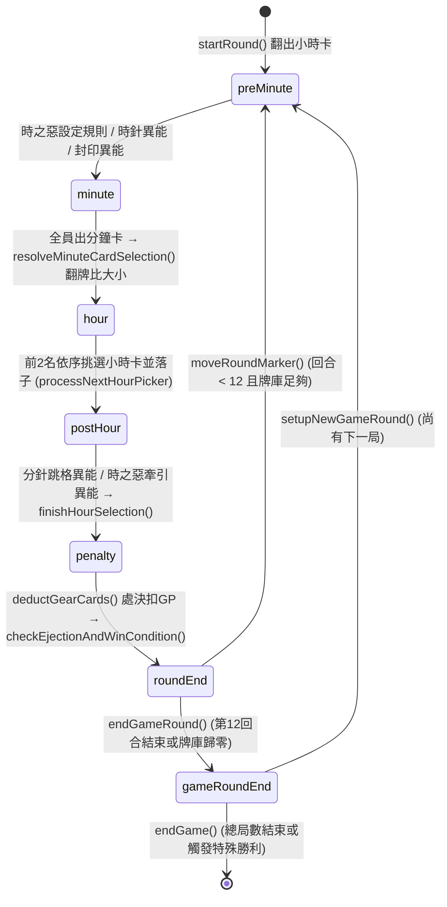

# 《蝕入記憶》(Eaten into Memory) — 系統架構與核心遊戲機制技術規格書 (AI Ingest Spec)

> **文件用途**：本規格書以高資訊密度、結構化 Schema 與精準函式索引撰寫，專供後續 AI 代理與開發者快速攝取、理解全專案架構、狀態機流轉、資料模型、UI 契約與驗證流程，無需進行全專案盲目掃描。

---

## 1. 系統總覽與雙軌架構 (System Overview)

《蝕入記憶》(Eaten into Memory) 為純前端（Vanilla JS + HTML5 + CSS3）實作的暗拍策略桌遊網頁應用，無需後端伺服器與打包工具即可直接於瀏覽器執行。專案採用**雙軌入口渲染架構**：

- **現代動態星芒版（預設入口）**：[`index.html`](file:///home/antigravity/boychan1231/Eaten-into-Memory/index.html) + [`modern.css`](file:///home/antigravity/boychan1231/Eaten-into-Memory/modern.css) + [`modern_board.js`](file:///home/antigravity/boychan1231/Eaten-into-Memory/modern_board.js)（PixiJS 畫布 + GSAP 動畫）+ [`modern_intro.js`](file:///home/antigravity/boychan1231/Eaten-into-Memory/modern_intro.js)。
- **經典 DOM 備援版**：[`classic.html`](file:///home/antigravity/boychan1231/Eaten-into-Memory/classic.html) + [`style.css`](file:///home/antigravity/boychan1231/Eaten-into-Memory/style.css)（純 DOM 圓形鐘面）。

### 1.1 Script 載入順序與模組依賴 (Load Order & Dependencies)

所有核心腳本以全域物件（`window.*`）共享狀態，載入順序不可任意調換（依 [`index.html`](file:///home/antigravity/boychan1231/Eaten-into-Memory/index.html)）：

| 載入序 | 檔案路徑 | 核心職責與關鍵全域導出 |
| :---: | :--- | :--- |
| 1 | `pixi.min.js`, `gsap.min.js` | 第三方渲染與補間動畫引擎（**代理禁止讀取原始碼**）。 |
| 2 | [`locales/zh-TW.js`](file:///home/antigravity/boychan1231/Eaten-into-Memory/locales/zh-TW.js), [`locales/en-US.js`](file:///home/antigravity/boychan1231/Eaten-into-Memory/locales/en-US.js) | 繁體中文 / 英文 UI 與規則字典（`window.I18N_LOCALES`）。 |
| 3 | [`i18n.js`](file:///home/antigravity/boychan1231/Eaten-into-Memory/i18n.js) | 多語系核心（`window.i18n`, `window.t()`），支援即時語言切換與 DOM 刷新。 |
| 4 | [`locales/stories_data.js`](file:///home/antigravity/boychan1231/Eaten-into-Memory/locales/stories_data.js) | 小時卡時代回憶故事文本資料。 |
| 5 | `role_assets_data.js` | 角色立繪與圖資 Base64 映射（**代理禁止讀取**）。 |
| 6 | [`config.js`](file:///home/antigravity/boychan1231/Eaten-into-Memory/config.js) | 語言無關識別碼 `GAME_IDS`、遊戲設定 `GAME_CONFIG`、UI 參數 `UI_CONFIG`、角色/技能/珍貴卡常數 `GAME_DATA`。 |
| 7 | [`logger.js`](file:///home/antigravity/boychan1231/Eaten-into-Memory/logger.js) | 戰鬥日誌控制器 `appLogger`（上限 `UI_CONFIG.LOG_RETENTION_LIMIT = 200`）。 |
| 8 | [`audio.js`](file:///home/antigravity/boychan1231/Eaten-into-Memory/audio.js) | 音效與 BGM 控制器 `gameAudio`、`gameVoice`（含防競態 Token 與平滑淡入淡出）。 |
| 9 | [`abilities.js`](file:///home/antigravity/boychan1231/Eaten-into-Memory/abilities.js) | 角色專屬異能函式與幼體時魔 4 大進化判定引擎。 |
| 10 | [`game_setup.js`](file:///home/antigravity/boychan1231/Eaten-into-Memory/game_setup.js) | 卡牌生成器、3P/5P 初始狀態構建器 `initializeGame()`、`setupNewGameRound()`、人類玩家 ID 管理。 |
| 11 | [`ai_engine.js`](file:///home/antigravity/boychan1231/Eaten-into-Memory/ai_engine.js) | 3P/5P AI 決策引擎（出牌前異能、分鐘卡暗拍選牌、小時卡挑選、放牌後跳格判定）。 |
| 12 | [`game.js`](file:///home/antigravity/boychan1231/Eaten-into-Memory/game.js) | 核心回合狀態機、比牌暗拍、處決吞噬、飢餓、受詛者結算、勝負判定。 |
| 13 | [`ui_modals.js`](file:///home/antigravity/boychan1231/Eaten-into-Memory/ui_modals.js) | 彈窗生命週期與離開畫面檢測（`openModal`, `closeModal`, `isPlayerAwayFromGame`）。 |
| 14 | [`ui_components.js`](file:///home/antigravity/boychan1231/Eaten-into-Memory/ui_components.js) | 手牌拖放（Drag & Drop）、比牌動畫 `AnimationController`、浮動跳字、畫面震動、HUD 渲染。 |
| 15 | [`tutorial_mode.js`](file:///home/antigravity/boychan1231/Eaten-into-Memory/tutorial_mode.js) | 動作導向新手教學系統（聚光燈高亮、氣泡引導、跳動箭頭 `#tutorial-bounce-arrow`）。 |
| 16 | [`ui.js`](file:///home/antigravity/boychan1231/Eaten-into-Memory/ui.js) | 主畫面事件綁定、`updateUI()`、`AutoNextRoundTimer`（7 秒倒數）、局結算與排行榜渲染。 |
| 17 | [`modern_board.js`](file:///home/antigravity/boychan1231/Eaten-into-Memory/modern_board.js), [`modern_intro.js`](file:///home/antigravity/boychan1231/Eaten-into-Memory/modern_intro.js) | PixiJS 鐘面、高危光圈、棋子 Token 渲染、平移縮放（Pan/Zoom）與動態開場。 |

---

## 2. 核心資料模型 (Core Data Schemas)

### 2.1 標準識別碼與設定 (`config.js`)

- **`window.GAME_IDS`**：語言無關的標準化常數，避免邏輯層依賴中英文字串比對。
  - `ROLES`: `{ HOUR: 'hour', MINUTE: 'min', SECOND: 'sec' }`
  - `TYPES`: `{ DEMON: 'demon', SIN: 'sin', CURSED: 'scz', YOUNG_DEMON: 'young_demon' }`
  - `AGE_GROUPS`: `{ CHILD: 'child', YOUTH: 'youth', ADULT: 'adult', MIDDLE: 'middle', DEATH: 'death' }`
  - 轉換工具：`getNormalizedRole(role)`、`getNormalizedType(type)`。
- **`window.GAME_CONFIG`**：
  ```js
  {
    enableAbilities: boolean,      // 是否啟用角色專屬異能
    testMode: boolean,             // 測試模式（顯示所有 AI 手牌等）
    tutorialMode: boolean,         // 新手教學模式
    defaultHumanId: 'SM_1',        // 預設人類玩家 ID
    gameMode: '5P' | '3P',         // 5人陣營模式 / 3人指針競速模式
    threePStartingRole: '時針' | '分針' | '秒針',
    aiDifficulty: 'normal' | 'easy'
  }
  ```

### 2.2 全域遊戲狀態 (`globalGameState` / `gameState`)

由 [`game_setup.js`](file:///home/antigravity/boychan1231/Eaten-into-Memory/game_setup.js) 初始化並由 [`game.js`](file:///home/antigravity/boychan1231/Eaten-into-Memory/game.js) 驅動：

```ts
interface GameState {
  gameMode: '5P' | '3P';
  totalGameRounds: 5 | 3;          // 5P=5局, 3P=3局
  gameRound: number;               // 當前局數 (1 ~ totalGameRounds)
  roundMarker: number;             // 當前局內回合數 (1 ~ 12)
  phase: 'preMinute' | 'minute' | 'hour' | 'postHour' | 'penalty' | 'roundEnd' | 'gameOver';
  isGameOver: boolean;

  players: Player[];               // 5P: 5人, 3P: 3人
  minuteDeck: MinuteCard[];        // 1~60 分鐘卡牌庫
  hourDeck: HourCard[];            // 5P: 36張小時卡, 3P: 24張小時卡
  preciousConfig: PreciousConfig;  // 當局隨機抽出的 12 張珍貴卡配置

  clockFace: Array<{               // 長度 12，對應鐘面刻度 1~12
    position: number;              // 1 ~ 12
    cards: HourCard[];             // 該刻度疊放的小時卡（頂部為陣列尾端或首端依操作函式定義）
  }>;

  // 回合動態暫存與狀態旗標
  currentDrawnHourCards: HourCard[];           // 本回合翻出的小時卡（通常 2 張，牌庫剩 1 張時為 1 張）
  playedMinuteCards: Array<{ playerId: string; card: MinuteCard; backupCard?: MinuteCard }>;
  hourPickerQueue: string[];                   // 依分鐘卡點數由大到小排序的前 2 名玩家 ID
  currentPenaltyRule: 'max' | 'nearSin';       // 預設 'max' (接近12受罰)；時之惡可切換為 'nearSin'
  abilityMarker: boolean;                      // true 代表本回合異能已被時之惡封印
  waitingForHumanMinuteCard: boolean;          // 等待人類出分鐘卡
  waitingForHumanHourCard: boolean;            // 等待人類挑選小時卡
  waitingForSecondHandChoice: boolean;         // 等待秒針二選一
  waitingForPostHourAbility: boolean;          // 等待小時卡放置後的主動異能（如分針跳格）
  waitingForNextRound: boolean;                // 等待進入下一回合（觸發 AutoNextRoundTimer）

  // 歷史與結算快照
  roundHistory: RoundHistoryEntry[];           // 供「出牌記錄」彈窗顯示
  lastRoundSummary: RoundSummarySnapshot | null; // 局末重置前凍結的得分快照，避免被新局重洗覆蓋
}
```

### 2.3 玩家資料模型 (`Player`)

```ts
interface Player {
  id: string;                      // 5P: 'SM_1', 'SM_2', 'SM_Y', 'SIN', 'SCZ'; 3P: 'P1', 'P2', 'P3'
  name: string;                    // 顯示名稱
  type: '時魔' | '時魔幼體' | '時之惡' | '受詛者';
  role: '時針' | '分針' | '秒針' | null; // 全域唯一指針身份
  isHuman: boolean;

  // 核心資源
  gearCards: number;               // GP（生命齒輪）：同時為 HP、MP 上限、局末得分來源
  totalScore: number;              // 跨局累計總分
  mana: number;                    // MP（當前法力值，上限 = gearCards）
  shield: number;                  // 護盾（受罰時優先消耗 1 層抵擋 1 點 GP 扣除）

  // 狀態與位置
  currentClockPosition: number | null; // 1~12 表示已進入鐘面；null 表示未進入鐘面（免疫處決）
  isEjected: boolean;              // true 表示本局「被吞噬」（出局），下局滿血復活
  specialAbilityUsed: boolean;     // 本回合是否已使用主動異能
  hungerCounter: number;           // 連續未獲得小時卡的回合數（飢餓機制）

  // 手牌與收集
  minuteHand: MinuteCard[];        // 當前剩餘分鐘卡手牌
  hourCards: HourCard[];           // 本局收集的小時卡
  lockedPreciousCards: HourCard[]; // 受詛者專用：永久鎖定的珍貴小時卡（跨局保留）
}
```

### 2.4 卡牌模型 (`MinuteCard` & `HourCard`)

- **分鐘卡 (`MinuteCard`)**：點數 `1 ~ 60` 共 60 張不重複。每張附帶 GP（齒輪）價值（由 [`getGearCount()`](file:///home/antigravity/boychan1231/Eaten-into-Memory/game_setup.js#L63-L70) 計算）：
  - `1 ~ 11` 與 `50 ~ 60`：`0 GP`
  - `12 ~ 25` 與 `36 ~ 49`：`0.5 GP`
  - `26 ~ 35`：`1 GP`
- **小時卡 (`HourCard`)**：5P 模式共 **36 張**（12 刻度 × 3 張），依 [`HOUR_PER_NUMBER_SLOTS`](file:///home/antigravity/boychan1231/Eaten-into-Memory/game_setup.js#L102-L115) 分配 5 種時代：
  - `幼年` (5 張：刻度 1~5)、`少年` (10 張)、`青年` (10 張)、`中年` (10 張)、`死亡` (1 張：固定於刻度 12)。
  - 每局隨機挑選一組 `GAME_DATA.HOUR_PRECIOUS_CONFIGS`，標記 **12 張** `isPrecious: true`（每個刻度恰 1 張；幼年 1 / 少年 4 / 青年 4 / 中年 3 / 死亡 0）。
  - 3P 模式簡化為 **24 張**（刻度 1~12 各 2 張，無時代與珍貴屬性）。

---

## 3. 回合狀態機與函式呼叫鏈 (Turn Lifecycle State Machine)



### 關鍵狀態流轉函式索引 ([`game.js`](file:///home/antigravity/boychan1231/Eaten-into-Memory/game.js))

1. **開局與回合啟動**：`startRound(gameState)` — 重置回合旗標、抽出 2 張小時卡（若牌庫剩 1 張則抽 1 張；剩 0 張則提早進入 `endGameRound()`）、處理時之惡處決規則選擇（`activateSinTargetingAbility`）與時針出牌前異能（`hourHandPreMinuteAI`）。
2. **暗拍出牌**：`processMinuteCardSelection()` -> 人類觸發 `handleHumanChoice(cardValue)` 或秒針 `handleHumanSecondHandCommit(card1, card2)` -> 全員到齊後呼叫 `resolveMinuteCardSelection()`。
3. **比牌與選小時卡**：依分鐘卡點數降冪排序，前 2 名進入 `hourPickerQueue`（第 3 名及以後留在鐘面外，**絕對免疫處決**）-> `processNextHourPicker()` -> `placeHourCardForPlayer()` / `handleHumanHourCardChoice()`。
4. **放牌後異能**：`minuteHandPostHourAI()` / 人類分針跳格或時之惡牽引 -> `finishHourSelection()`。
5. **處決與吞噬結算**：`deductGearCards()`（依 `currentPenaltyRule` 計算高危受罰者、護盾抵擋、受詛者珍貴卡保護、GP 扣除與畫面震動、時之惡庇護回能）-> `checkEjectionAndWinCondition()`（GP ≤ 0 再次受創或 < 0 時設 `isEjected = true` 標記為**被吞噬**）。
6. **回合末與局末推進**：`inRoundEndActions()`（幼體進化檢查、飢餓判定）-> `moveRoundMarker()` -> 達第 12 回合或牌庫耗盡時呼叫 `endGameRound()`（建立 `lastRoundSummary` 快照、結算 GP 積分與受詛者獎勵）-> 若達最後一局則 `endGame()`。

---

## 4. 核心遊戲規則與數值系統 (Core Mechanics)

1. **GP（生命齒輪）三位一體**：
   - **HP**：遭受處決扣除 1 GP；若已有護盾則優先消耗 1 層護盾。
   - **Max MP**：`player.mana` 上限永遠等於當前 `player.gearCards`（`maxMP = Math.max(0, Math.floor(player.gearCards))`）。
   - **對局積分**：每局結束時，未「被吞噬」者的剩餘 GP 計入 `totalScore`；「被吞噬」者當局計 0 分。
2. **離鐘面絕對保護 (Off-Clock-Face Protection)**：
   - 僅當回合分鐘卡前 2 名會取得小時卡並進入鐘面（`currentClockPosition !== null`）。
   - 未進入鐘面者（`currentClockPosition === null`）100% 免疫當回合處決。
3. **處決規則 (`currentPenaltyRule`)**：
   - **`max`（預設）**：在鐘面上刻度數值最大（最接近 12）的玩家受罰。
   - **`nearSin`（時之惡指定）**：在鐘面上與時之惡所在刻度距離最近者受罰。
4. **受詛者 (Cursed One / `SCZ`) 專屬機制**：
   - 收集珍貴小時卡並跨局鎖定於 `lockedPreciousCards`。
   - 集滿指定階段張數獲得額外積分獎勵；若至終局未達門檻則觸發 `-999` 懲罰。
   - 受罰時若持有護盾可將珍貴小時卡移至鐘面底部保護。
5. **幼體時魔 (Young Demon / `SM_Y`) 4 大進化配方 ([`checkEvolutionCondition()`](file:///home/antigravity/boychan1231/Eaten-into-Memory/abilities.js#L10-L39))**：
   - 滿足以下任一條件即可透過 [`attemptRoleUpgrade()`](file:///home/antigravity/boychan1231/Eaten-into-Memory/abilities.js#L117) 進化為場上尚未被佔用的指針身份（`時針` / `分針` / `秒針`），並**嚴格維護指針全域唯一性**：
     1. **久遠一生**：3 種不同時代 + 至少 1 張珍貴卡。
     2. **命途節錄**：4 個不同數字 + 至少 1 張珍貴卡。
     3. **漫長生涯**：任意 5 張小時卡 + 至少 2 張珍貴卡。
     4. **銘記珍重**：3 張任意珍貴卡。

---

## 5. 角色專屬異能系統 ([`abilities.js`](file:///home/antigravity/boychan1231/Eaten-into-Memory/abilities.js))

所有主動異能皆受 `GAME_CONFIG.enableAbilities === true`、未「被吞噬」（`!player.isEjected`）、未被封印（`!gameState.abilityMarker`）與 MP 足夠等條件約束：

| 角色 / 身份 | 異能名稱 | 消耗 MP (`ABILITY_COSTS`) | 觸發階段 | 核心函式與效果 |
| :--- | :--- | :---: | :--- | :--- |
| **時針 (`hour`)** | 頂牌移底 | `1` (`TIME_HAND_MOVE`) | `preMinute` | 將鐘面某格頂部小時卡移至該格底部，改變公開資訊與可選順序。 |
| **分針 (`min`)** | 鐘面跳格 | `2` (`MINUTE_HAND_MOVE`) | `postHour` | [`activateMinuteHandAbility()`](file:///home/antigravity/boychan1231/Eaten-into-Memory/abilities.js#L44-L108)：順時針（`cw`）或逆時針（`ccw`）移動至下一個有小時卡的刻度。 |
| **秒針 (`sec`)** | 雙牌伏擊 | `3` (`SECOND_HAND_SELECT`) | `minute` | 暗拍時可蓋出 2 張分鐘卡，翻牌後二選一結算。 |
| **時之惡 (`sin`)** | 牽引移動 | `2` (`SIN_PULL`) | `postHour` | 將鐘面上指定目標棋子牽引移動，操縱處決對象。 |
| **時之惡 (`sin`)** | 異能封印 | `3` (`SIN_SEAL`) | `preMinute` | `activateSinSealAbility()`：設 `gameState.abilityMarker = true`，封鎖本回合所有角色異能。 |
| **幼體 (`young_demon`)** | 幼體護盾 | `3` (`YOUNG_SHIELD`) | 主動 | 為自身附加 1 層護盾抵擋處決。 |

---

## 6. UI、渲染、動畫與教學契約 (UI & Visual Contracts)

- **字型與符號規範**：
  - 鐘面刻度與分鐘卡牌數字統一使用 `Cinzel-VariableFont`（定義於 [`style.css`](file:///home/antigravity/boychan1231/Eaten-into-Memory/style.css) 與 [`modern.css`](file:///home/antigravity/boychan1231/Eaten-into-Memory/modern.css)）。
  - 全介面、日誌、規則說明全面使用標準 Unicode 特殊符號（`✦`, `◈`, `◆`, `▲`, `▶`, `⧖`, `⛨`, `☠`, `§`, `※`, `↻`, `✕`, `★`），**不使用 Emoji**。
- **現代版 HUD 佈局 ([`index.html`](file:///home/antigravity/boychan1231/Eaten-into-Memory/index.html) / [`modern.css`](file:///home/antigravity/boychan1231/Eaten-into-Memory/modern.css))**：
  - 左側懸浮抽屜群（`.hud-drawer-left`）：第 1 項為回合流程提示 `#round-phase-tracker`（左上角），其下為規則/設定等抽屜。
  - 右側懸浮抽屜群（`.hud-drawer-right`）：戰鬥日誌、出牌記錄、故事回憶等抽屜。
- **動畫與回饋 ([`ui_components.js`](file:///home/antigravity/boychan1231/Eaten-into-Memory/ui_components.js))**：
  - `UI_CONFIG.SEQUENTIAL_EFFECTS` 控制浮動跳字依序播放（間隔 `260ms`）。
  - 扣除 GP 時觸發畫面震動（由 `UI_CONFIG.SCREEN_SHAKE` 與 `#screen-shake-toggle` 控制）。
  - `AnimationController` 內建 Watchdog 超時保險絲，避免動畫卡死導致狀態機停擺。
- **新手教學系統 ([`tutorial_mode.js`](file:///home/antigravity/boychan1231/Eaten-into-Memory/tutorial_mode.js))**：
  - 動作導向推進，不自動倒數關閉。
  - 歡迎步驟於「下一回合」高亮光環正上方顯示跳動箭頭 `#tutorial-bounce-arrow`。

---

## 7. 多國語系與持久化鍵值 (i18n & `localStorage`)

- **雙語同步**：[`locales/zh-TW.js`](file:///home/antigravity/boychan1231/Eaten-into-Memory/locales/zh-TW.js) 與 [`locales/en-US.js`](file:///home/antigravity/boychan1231/Eaten-into-Memory/locales/en-US.js) 維持 100% 鍵值對齊；UI 透過 `data-i18n` 屬性與 `window.t(key, params)` 渲染。
- **常用 `localStorage` 持久化鍵值**：
  - 語系偏好（`zh-TW` / `en-US`）
  - 畫面震動開關（`#screen-shake-toggle`）
  - 手牌排序偏好（`UI_CONFIG.HAND_SORT_ORDER`: `'asc'` / `'desc'`）
  - 音效 / BGM 音量與靜音狀態

---

## 8. AI 代理開發守則與驗證流程 (Agent Protocol & Verification)

1. **專案守則 ([`AGENTS.md`](file:///home/antigravity/boychan1231/Eaten-into-Memory/AGENTS.md))**：
   - 嚴禁掃描 `SFX/`、`assets/`、`pixi.min.js`、`gsap.min.js`、`role_assets_data.js`、`ai_studio/AI_STUDIO_CONTEXT_BUNDLE.md`。
   - 術語統一：**吞噬 / 被吞噬**、**MP**、**GP**。
   - 任何修改驗證完成後須主動 `git commit` 並 `git push origin main`。
2. **標準驗證指令**：
   - **一鍵完整驗證（推薦）**：`npm run verify`（或 `node scripts/verify.js`），涵蓋語法檢查、雙語對齊與格式檢查、教學行為測試、40 場無頭對戰壓力測試及雙入口 `<script>` 載入順序檢查。
   - **語法檢查**：`for f in *.js locales/*.js; do node -c "$f"; done`
   - **雙語鍵值對齊檢查**：以 Node.js 載入 `locales/zh-TW.js` 與 `locales/en-US.js` 比對所有遞迴鍵值是否完全一致。
   - **無頭對戰壓力測試**：於 Node.js `vm` 環境載入 `config.js`, `logger.js`, `abilities.js`, `game_setup.js`, `game.js`，自動模擬數十場 5P / 3P 完整對局，驗證 0 未捕獲例外與 0 狀態機死鎖。
