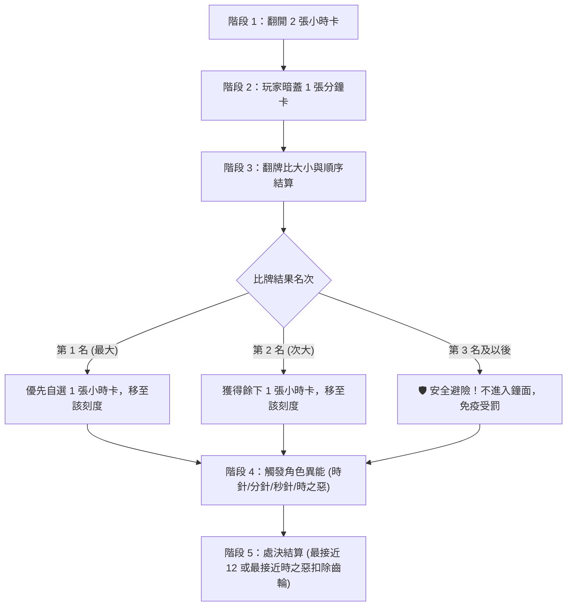

# 《Eaten into Memory》遊戲玩法與規則全手冊

歡迎查閱《Eaten into Memory》（時間之鐘的遺忘編年史）完整玩法與規則手冊。本文件系統化彙整遊戲的世界觀、核心機制、回合流程、角色能力、進化路徑、雙大對局模式及實戰操作策略。

---

## 目錄
1. [遊戲背景與核心概念](#一遊戲背景與核心概念)
2. [重要元件與關鍵名詞](#二重要元件與關鍵名詞)
3. [單回合標準流程（5 階段詳解）](#三單回合標準流程5-階段詳解)
4. [遊戲模式比較（3P 競速 vs 5P 扮演）](#四遊戲模式比較3p-競速-vs-5p-扮演)
5. [角色圖鑑與專屬能力](#五角色圖鑑與專屬能力)
6. [時魔進化體系（5P 模式專屬）](#六時魔進化體系5p-模式專屬)
7. [操作指南（桌面電腦與手機觸控）](#七操作指南桌面電腦與手機觸控)
8. [實戰戰術與避險博弈心法](#八實戰戰術與避險博弈心法)

---

## 一、遊戲背景與核心概念

在永恆運轉的遺忘鐘塔之中，時間的刻度被古老的力量所侵蝕。玩家扮演穿梭於鐘面上的「時魔」或代表混沌的「時之惡」與「受詛者」。

* **核心勝負機制**：玩家透過打出手中的「分鐘卡」進行暗拍競標，爭奪鐘面上的「小時卡」與站位。
* **避險與生還**：鐘面最危險的位置為刻度 **12**（或被時之惡牽引之處）。每回合結束時，站位最劣勢的角色將遭受「受罰」，扣除齒輪（生命值）。
* **生存即是分數**：每局遊戲結束時，玩家保留下來的齒輪將直接換算為對局積分，累計總分最高者榮登記憶的守護者。

---

## 二、重要元件與關鍵名詞

### 1. 鐘面刻度（Clock Face）
* 鐘面共有 **1 至 12** 的圓形軌道刻度。
* **受罰基準**：預設規則下，刻度數值最大（最接近 12 點鐘位置）的角色在回合結算時會受到處決懲罰。

### 2. 小時卡（Hour Cards）
* 數值為 **1 至 12**，分為三個時代：
  * **少年時代**：刻度 1 ～ 4
  * **青年時代**：刻度 5 ～ 8
  * **中年時代**：刻度 9 ～ 12
* **珍貴小時卡（★）**：每局特定時代中會包含帶有星號的「珍貴卡」，是時魔進化與受詛者達成特殊勝利的關鍵記憶碎片。

### 3. 分鐘卡（Minute Cards - 玩家手牌）
* 牌庫共有數值 **1 至 60** 且完全不重複的分鐘卡。
* 分鐘卡用於每回合的盲出暗拍，數值較大者擁有優先選卡權。

### 4. 齒輪（Gears / 生命值 / Mana / 分數）
* **三重功能一體化**：
  1. **生命值（HP）**：受到懲罰時扣除 1 點齒輪；當齒輪歸零且再次受傷，角色將被「逐出」（Exile），當局無法再行動，直到下一局遊戲重新發牌時才復活返回。
  2. **乙太法力（Mana）**：角色的 Mana 上限等同當前擁有的齒輪數，用於施放角色強大主動能力。
  3. **終局計分（Score）**：每局結束時，剩餘的齒輪數會全數計入該玩家的累積排行榜總分中。

### 5. 護盾（Shield）
* 特殊防禦狀態。受到懲罰時會優先破裂抵擋傷害，保護齒輪不受扣減。

---

## 三、單回合標準流程（5 階段詳解）

每一局遊戲固定進行 **12 回合**（對應 12 小時），每回合依序執行以下 5 個步驟：

### 階段 1：揭示小時卡（Reveal Hour Cards）
* 系統由小時卡牌庫頂翻開 **2 張小時卡**，放置於鐘面上對應的刻度位置，作為本回合競標目標。

### 階段 2：暗拍競標（Secret Bidding）
* 全體玩家依據當前鐘面牌面、對手手牌推測與自身生命狀態，從手牌中**暗蓋 1 張分鐘卡**（秒針時魔可發動異能暗蓋 2 張）。

### 階段 3：揭牌判定與選卡移動（Minute Clash & Movement）
* 全體玩家同時開牌比大小：
  * **第一名（打出最大分鐘卡者）**：擁有絕對優先選擇權，挑選 2 張小時卡中的任一張，並將自己的角色棋子移動至該鐘面刻度。
  * **第二名（打下次大分鐘卡者）**：自動獲得剩下的一張小時卡，並將角色棋子移動至對應的刻度。
  * **未進前兩名者（第三名、第四名、第五名）**：
    * 🛡️ **戰略優勢（絕對避險保命）**：本回合**完全不踏入鐘面**，不受任何刻度處決懲罰，齒輪毫髮無損！
    * ⚠️ **戰略劣勢（無回憶收穫）**：無法獲得小時卡，延緩幼體時魔收集卡牌進化的進度。

### 階段 4：角色能力發動（Abilities Resolution）
* 符合條件的角色可在此時消耗 Mana 發動專屬異能（例如分針順/逆時針跳格、時之惡切換受罰規則等）。

### 階段 5：處決結算與推進（Penalty Resolution）
* 評判鐘面上所有在場角色的位置：
  * **預設規則**：位置最接近 **12**（刻度數值最大）的角色判定受罰，扣除 1 點護盾或齒輪。
  * **時之惡發動「惡之牽引」規則**：距離時之惡自身步數最近的角色受罰。
* 若玩家齒輪扣至 0 再次受創，將被逐出場外。
* 清理鐘面上的小時卡，準備進入下一回合。

---

## 四、遊戲模式比較（3P 競速 vs 5P 扮演）

本遊戲提供兩種截然不同的對戰體驗，可於初始選單自由切換：

| 比較項目 | ⚔️ 3P 競速對抗模式 | 🎭 5P 完整扮演模式 |
| :--- | :--- | :--- |
| **玩家組成** | **3 人**（時針、分針、秒針 三針純對決） | **5 人**（3 幼體時魔 vs 1 時之惡 vs 1 受詛者） |
| **對局規模** | **3 局**（每局 12 回合） | **5 局**（每局 12 回合） |
| **每局手牌** | **13 張手牌**（12 回合出牌，保留 1 張策略餘量） | **12 張手牌**（12 回合全數打出） |
| **角色起始狀態** | 開局直接為**完全體進化形態**，享有滿級專屬異能 | 時魔從**幼體**開始，需邊打邊收集回憶碎片達成進化 |
| **陣營角力** | 純技術指針博弈，無中立第三方或特殊陣營 | 非對稱對抗，含獵殺者（時之惡）與收集者（受詛者） |
| **勝利條件** | 3 局累計剩餘**齒輪總積分最高者獲勝** | 累計齒輪分數最高勝出，或達成**三大特殊勝利條件** |
| **AI 決策風格** | 專屬 3P AI：主動設陷阱逼對手吃毒牌、緊急逃生算牌 | 5P AI：以收集進化配方、陣營互制為核心策略 |

### 5P 模式三大特殊勝利條件：
1. **時魔陣營特殊勝利**：若合力或藉由鐘面處決將「時之惡」成功驅逐，時魔全體立即獲勝並獲得額外積分獎勵。
2. **時之惡特殊勝利**：在 5 局遊戲結束前，成功將全場 3 位時魔「各驅逐一次」。
3. **受詛者特殊勝利**：遊戲結束前，在鐘面上成功踩踏並「鎖定 12 張珍貴小時卡」。

---

## 五、角色圖鑑與專屬能力

### 👁️ 時針（Time Hand）—— 命運的預見者
* **【被動】預知未來**：每回合自動預知小時卡牌庫的下一張頂牌數值。
* **【主動】時間操弄（消耗 1 Mana）**：可將當前小時牌庫頂牌移至底部，重塑抽牌格局；同回合可再消耗 2 Mana 執行第二次。

### 👟 分針（Minute Hand）—— 空間的躍遷者
* **【主動】跳躍移動（消耗 2 Mana）**：挑選小時卡並落子後，可選擇**順時針**或**逆時針**跳躍至下一個有牌的鐘面刻度，靈活擺脫 12 點受罰危險格。

### 🃏 秒針（Second Hand）—— 狡黠的千面者
* **【主動】雙牌伏擊（消耗 3 Mana）**：出牌階段可同時暗蓋 **2 張分鐘卡**。待全場其餘玩家翻開卡牌後，秒針可觀察全場開牌結果，再決定最終打出哪一張，具備極強的戰術後手優勢。

### 🐣 時魔幼體（Young Time Demon）—— 僅 5P 模式
* **【被動】絕境護符**：整場遊戲限用一次。當自身 Mana $\ge$ 3 且即將遭受處決受罰時，可消耗全部 Mana 完全抵免該次傷害。

### 😈 時之惡（Time Evil）—— 僅 5P 模式（起始刻度：12）
* **【主動】惡之牽引（消耗 2 Mana）**：扭曲處決規則！本回合不再以「最接近 12」作為處決目標，改為處決「**距離時之惡自身最近**」的角色。
* **【主動】虛無封鎖（消耗 3 Mana）**：封印全場！本回合封鎖全場所有時魔的特殊能力與進化效果。

### 👻 受詛者（Cursed One）—— 僅 5P 模式（起始刻度：1）
* **【被動】接觸鎖定**：當受詛者移動至帶有「珍貴小時卡」的刻度時，會永久將該珍貴卡鎖定在鐘面上。
* **【勝利任務】**：在遊戲結束前於鐘面累積鎖定 12 張珍貴卡即可單獨取得超額大勝。

---

## 六、時魔進化體系（5P 模式專屬）

在 5P 模式中，3 位時魔開局均為「幼體」，必須於回合中取得小時卡放入回憶行囊。當收集的小時卡組合滿足以下任一配方時，即可在回合結束時進化為強大的**時針、分針或秒針**（全場高階身份具備唯一性，先進化者先得）：

| 進化配方名稱 | 達成條件要求 | 特色與難度 |
| :--- | :--- | :--- |
| **久遠一生** | 收集 **3 張不同時代**的小時卡（少年、青年、中年各一），且其中至少包含 **1 張珍貴卡(★)** | 均衡型，需跨足三個時代刻度 |
| **命途節錄** | 收集 **4 張不同數字**的小時卡，且其中至少包含 **1 張珍貴卡(★)** | 靈活型，容易在前期自然湊成 |
| **漫長生涯** | 收集 **5 張任意**小時卡，且其中至少包含 **2 張珍貴卡(★)** | 厚積薄發型，適合經常爭取小時卡的玩家 |
| **銘記珍重** | 收集 **3 張珍貴小時卡(★)** | 精英型，極度依賴爭奪星號珍貴卡 |

---

## 七、操作指南（桌面電腦與手機觸控）

本作針對現代瀏覽器與行動裝置進行了專屬響應式改良：

### 1. 手牌出牌操作
* **拖曳出牌（Drag & Drop）**：按住手牌向上拖曳過半場並放開，即可將分鐘卡打入鐘面。
* **點擊選牌出牌（手機推薦）**：直接輕觸手牌（卡牌會向上浮起並亮金邊），接著點擊右下角綠色的「**確認出牌**」按鈕送出。
* **取消收回判定**：若將卡牌拖出後想更換，只要將游標或手指拉回底部手牌區並放開，卡牌即安全歸位。

### 2. 鐘面檢視與縮放控制
* **手勢縮放（手機端）**：支援原生**雙指捏合縮放（Pinch-to-Zoom）**，最高可放大至 **2.6 倍**，並可自由單指平移鐘面視野。
* **浮動縮放控制列**：畫面右下角提供浮動按鈕：
  * `+`：局部放大鐘面。
  * `-`：縮小視野。
  * `⟲`：一鍵復位至置中全景。

### 3. 五大資訊輔助抽屜（HUD Drawers）
點擊畫面上的標籤按鈕即可展開專屬資訊面板（手機版以優雅的 Bottom Sheet 底部抽屜呈現，再次點擊按鈕即可收合）：
* 👥 **玩家狀態**：檢視全體玩家的角色身份、剩餘齒輪、Mana 與護盾。
* 🏆 **得分榜**：查看每位玩家當前累計總積分與歷史局次得分。
* 🗂️ **棄牌記錄**：實時查看已被打出的分鐘卡（標示綠底）與尚未出現的卡牌。
* ⚡ **能力與進化**：檢視自身角色技能、法力值與幼體進化的即時進度條。
* 📜 **遊戲日誌**：回溯每回合的詳細暗拍數值、出牌記錄與處決事件。

### 4. 新手教學指針系統
* 遊戲內建智慧動態氣泡引導，於首回合重點提示操作要訣。
* 點擊氣泡右上角的 `✕` 可關閉當前步驟提示（後續新步驟仍會適時提示）。
* 點擊標題列的「**不再提示**」，可隨時完全關閉新手教學模式。

---

## 八、實戰戰術與避險博弈心法

1. **「不進鐘面才是最高境界」**：
   * 當鐘面翻出的兩張小時卡為高危數字（如 10、11 或 12）時，打出 1～20 的小分鐘卡爭取落入**第 3 名或更後**，完全不上鐘面，能讓爭搶大牌的對手自相殘殺！
2. **算牌與棄牌堆追蹤**：
   * 分鐘卡共有 1-60 不重複。隨時開啟「棄牌記錄」抽屜，若發現 50 以上大牌已被消耗殆盡，手中的 40 多號卡牌便能充當全場無敵的決定性王牌。
3. **時魔的 Mana 資源管理**：
   * 齒輪既是生命也是 Mana，更是終局分數。切記不要為了瑣碎的跳格而濫用 Mana，將 Mana 保留在關鍵回合施展「分針逃生」或「秒針二選一」，能發揮逆轉乾坤的效果。
4. **時之惡的心理威懾**：
   * 5P 模式中，時之惡擁有改變處決規則的「惡之牽引」。當玩家站在刻度 1、2 等看似絕對安全的位置時，需提防時之惡突然發動牽引處決身邊角色。

---

*本文件隨遊戲版本同步維護更新，祝各位時魔在記憶之鐘的對局中旗開得勝！*
