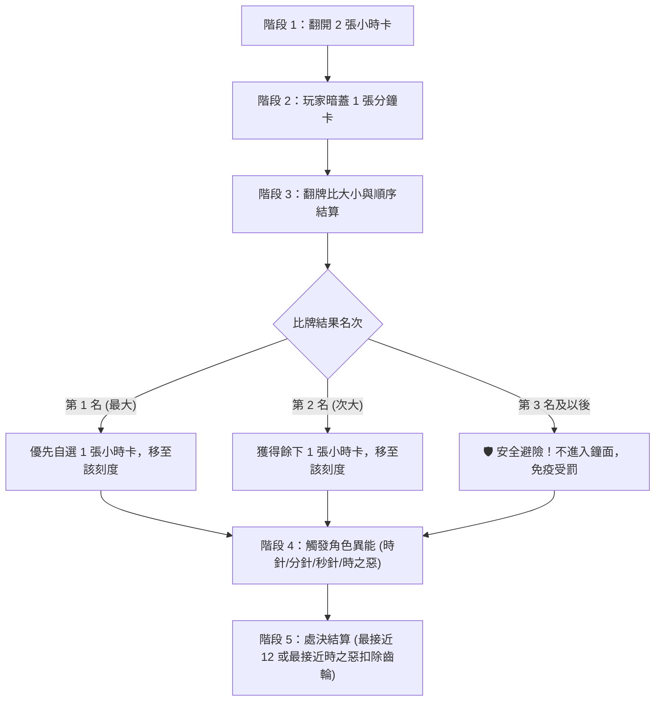

# 《蝕入記憶》(Eaten into Memory) — Google AI Studio 完整專案上下文整合包

> 本檔案由 `node ai_studio/build_context_bundle.js` 自動產生，包含全專案 25 個核心設計文件與原始碼檔案。

> 已排除第三方函式庫 (`pixi.min.js`, `gsap.min.js`) 與純 Base64 角色圖資 (`role_assets_data.js`) 以節省 Token。

## 包含檔案目錄 (Table of Contents)

1. `README.md` (2.2 KB)
2. `GAMEPLAY.md` (16.5 KB)
3. `PROJECT_HANDOVER_NOTES.md` (11.9 KB)
4. `package.json` (0.8 KB)
5. `vite.config.ts` (2.1 KB)
6. `config.js` (4.8 KB)
7. `logger.js` (1.5 KB)
8. `audio.js` (10.8 KB)
9. `i18n.js` (5.7 KB)
10. `locales/zh-TW.js` (25.9 KB)
11. `locales/en-US.js` (24.1 KB)
12. `abilities.js` (12.1 KB)
13. `game_setup.js` (16.7 KB)
14. `game.js` (98.0 KB)
15. `ui_modals.js` (1.7 KB)
16. `ui_components.js` (155.4 KB)
17. `tutorial_mode.js` (41.1 KB)
18. `ui.js` (74.3 KB)
19. `modern_board.js` (68.4 KB)
20. `modern_intro.js` (40.2 KB)
21. `index.html` (48.2 KB)
22. `classic.html` (36.6 KB)
23. `modern.css` (120.7 KB)
24. `style.css` (96.0 KB)
25. `stories_data.js` (12.2 KB)

---


================================================================================
=== FILE: README.md ===
================================================================================

`````markdown
# 《Eaten into Memory》時間之鐘的遺忘編年史

<p align="center">
  <b>一場穿梭於齒輪與時光維度之間的策略暗拍博弈桌上遊戲</b>
</p>

---

## 🎮 線上即玩（Live Demo）

* 🔮 **現代 PixiJS 版（預設推薦）**：[https://boychan1231.github.io/Eaten-into-Memory/](https://boychan1231.github.io/Eaten-into-Memory/)
* 🔄 **經典 DOM 版（相容備援）**：[https://boychan1231.github.io/Eaten-into-Memory/classic.html](https://boychan1231.github.io/Eaten-into-Memory/classic.html)

---

## 📖 完整玩法手冊

詳細的規則說明、回合步驟解析、角色能力、進化配方與實戰博弈策略，請直接查閱專屬玩法文件：
👉 **[完整遊戲玩法手冊 (GAMEPLAY.md)](./GAMEPLAY.md)**

---

## 🌟 遊戲核心特色

1. **雙對戰規模模式**：
   * **⚔️ 3P 競速對抗模式**：3 位時魔（時針、分針、秒針）直接以完全體型態交鋒，13 張手牌、3 局對決，搭載專屬高階 AI（毒牌避讓、逃生搶位）。
   * **🎭 5P 完整扮演模式**：3 幼體時魔 vs 1 時之惡 vs 1 受詛者，5 局對決，包含卡牌收集進化、時之惡牽引處決與受詛者鎖定回憶之三大特殊勝利。
2. **雙軌視覺渲染引擎**：
   * **現代 PixiJS 渲染引擎**：星空動態鐘面、齒輪旋轉、動態光影粒子與全方位平移縮放。
   * **經典 DOM 結構**：輕量化備援渲染，保證在各種極端環境與舊型裝置上流暢運行。
3. **全面響應式行動裝置支援**：
   * 手機端原生多點觸控捏合縮放（Pinch-to-Zoom，最高達 2.6 倍）。
   * 手機底部抽屜式資訊面板（Bottom Sheet）與點選出牌操作支援。
4. **新手教學與動態引導指標**：
   * 內建智慧引導系統，動態偵測當前對局階段並標示建議操作與戰術思維。

---

## 🛠️ 技術架構

* **核心語言**：Vanilla JavaScript (ES6+), HTML5, CSS3
* **渲染技術**：Pixi.js (現代版畫布) + GSAP 動畫引擎
* **多語系支援**：繁體中文 (`zh-TW`)、英文 (`en-US`)
* **架構風格**：輕量無框架架構，零建置步驟，開箱即玩

---

*Copyright © 2026 Eaten into Memory. All rights reserved.*

`````


================================================================================
=== FILE: GAMEPLAY.md ===
================================================================================

`````markdown
# 《Eaten into Memory》遊戲玩法與規則全手冊

歡迎查閱《Eaten into Memory》（時間之鐘的遺忘編年史）完整玩法與規則手冊。本文件系統化彙整遊戲的世界觀、核心機制、回合流程、角色能力、進化路徑、雙大對局模式及實戰操作策略。

---

## 目錄
1. [遊戲背景與核心概念](#一遊戲背景與核心概念)
2. [重要元件與關鍵名詞](#二重要元件與關鍵名詞)
3. [單回合標準流程（5 階段詳解）](#三單回合標準流程5-階段詳解)
4. [遊戲模式比較（3P 競速 vs 5P 扮演）](#四遊戲模式比較3p-競速-vs-5p-扮演)
5. [角色圖鑑與專屬能力](#五角色圖鑑與專屬能力)
6. [時魔進化體系（5P 模式專屬）](#六時魔進化體系5p-模式專屬)
7. [操作指南（桌面電腦與手機觸控）](#七操作指南桌面電腦與手機觸控)
8. [實戰戰術與避險博弈心法](#八實戰戰術與避險博弈心法)

---

## 一、遊戲背景與核心概念

在永恆運轉的遺忘鐘塔之中，時間的刻度被古老的力量所侵蝕。玩家扮演穿梭於鐘面上的「時魔」或代表混沌的「時之惡」與「受詛者」。

* **核心勝負機制**：玩家透過打出手中的「分鐘卡」進行暗拍競標，爭奪鐘面上的「小時卡」與站位。
* **避險與生還**：鐘面最危險的位置為刻度 **12**（或被時之惡牽引之處）。每回合結束時，站位最劣勢的角色將遭受「受罰」，扣除齒輪（生命值）。
* **生存即是分數**：每局遊戲結束時，玩家保留下來的齒輪將直接換算為對局積分，累計總分最高者榮登記憶的守護者。

---

## 二、重要元件與關鍵名詞

### 1. 鐘面刻度（Clock Face）
* 鐘面共有 **1 至 12** 的圓形軌道刻度。
* **受罰基準**：預設規則下，刻度數值最大（最接近 12 點鐘位置）的角色在回合結算時會受到處決懲罰。

### 2. 小時卡（Hour Cards）
* 數值為 **1 至 12**，分為三個時代：
  * **少年時代**：刻度 1 ～ 4
  * **青年時代**：刻度 5 ～ 8
  * **中年時代**：刻度 9 ～ 12
* **珍貴小時卡（★）**：每局特定時代中會包含帶有星號的「珍貴卡」，是時魔進化與受詛者達成特殊勝利的關鍵記憶碎片。

### 3. 分鐘卡（Minute Cards - 玩家手牌）
* 牌庫共有數值 **1 至 60** 且完全不重複的分鐘卡。
* 分鐘卡用於每回合的盲出暗拍，數值較大者擁有優先選卡權。

### 4. 齒輪（Gears / 生命值 / Mana / 分數）
* **三重功能一體化**：
  1. **生命值（HP）**：受到懲罰時扣除 1 點齒輪；當齒輪歸零且再次受傷，角色將被「逐出」（Exile），當局無法再行動，直到下一局遊戲重新發牌時才復活返回。
  2. **乙太法力（Mana）**：角色的 Mana 上限等同當前擁有的齒輪數，用於施放角色強大主動能力。
  3. **終局計分（Score）**：每局結束時，剩餘的齒輪數會全數計入該玩家的累積排行榜總分中。

### 5. 護盾（Shield）
* 特殊防禦狀態。受到懲罰時會優先破裂抵擋傷害，保護齒輪不受扣減。

---

## 三、單回合標準流程（5 階段詳解）

每一局遊戲固定進行 **12 回合**（對應 12 小時），每回合依序執行以下 5 個步驟：



### 階段 1：揭示小時卡（Reveal Hour Cards）
* 系統由小時卡牌庫頂翻開 **2 張小時卡**，放置於鐘面上對應的刻度位置，作為本回合競標目標。

### 階段 2：暗拍競標（Secret Bidding）
* 全體玩家依據當前鐘面牌面、對手手牌推測與自身生命狀態，從手牌中**暗蓋 1 張分鐘卡**（秒針時魔可發動異能暗蓋 2 張）。

### 階段 3：揭牌判定與選卡移動（Minute Clash & Movement）
* 全體玩家同時開牌比大小，依數值排序：
  * **第一名（打出最大分鐘卡者）**：擁有絕對優先選擇權，挑選 2 張小時卡中的任一張，並將自己的角色棋子移動至該鐘面刻度。
  * **第二名（打下次大分鐘卡者）**：自動獲得剩下的一張小時卡，並將角色棋子移動至對應的刻度。
  * **未進前兩名者（第三名、第四名、第五名）**：本回合**完全不踏入鐘面**，不獲得小時卡，留在外圍休息區。

#### 💡 核心機制詳解：獲得小時卡的分別（「已進入鐘面」vs「未進入鐘面」）

在競標結算後，玩家會被明確劃分為**「已進入鐘面」**與**「未進入鐘面」**兩種狀態，兩者在小時卡的獲取資格、卡片去向與受罰風險上存在本質的分別：

| 比較維度 | 🎯 已進入鐘面（前 2 名：打出最大與次大分鐘卡） | 🛡️ 未進入鐘面（第 3 名及以後：打出較小分鐘卡） |
| :--- | :--- | :--- |
| **小時卡獲取資格** | **成功取得小時卡**：<br>• **第 1 名**：自由挑選 2 張揭示小時卡中的任意 1 張。<br>• **第 2 名**：自動收下剩下未被選走的那 1 張小時卡。 | **完全無法獲得小時卡**：<br>本回合不分發任何小時卡，無法充實記憶庫或達成進化條件。 |
| **小時卡去向與效果** | **依角色形態產生不同效果**：<br>1. **幼體時魔（5P 模式）**：小時卡**收入專屬記憶行囊（手牌區）**，自鐘面移除，用於湊齊 4 大進化配方。<br>2. **完全體時魔（時針/分針/秒針）與時之惡**：角色移至該刻度，小時卡**留在鐘面該格子**。<br>3. **受詛者（5P 模式）**：若踩中的是「★ 珍貴小時卡」，觸發**接觸鎖定**永久固定在鐘面上。 | **完全無交互**：<br>角色留在鐘面外部休息區，不取得、不接觸、亦不鎖定任何小時卡。 |
| **刻度落點與角色移動** | **靈魂強制移至所選小時卡的刻度位置**（刻度 1 ～ 12），成為鐘面上的受罰候選棋子。 | **不移動棋子**，角色棋子保持在鐘面外圍，不佔用任何刻度位置。 |
| **受罰處決威脅（生命代價）** | **⚠️ 暴露於處決風險之中**：<br>必須參與「階段 5：處決結算」。若落子位置為全場最接近 12（或最接近時之惡），將被判定受罰，扣除 1 點護盾或齒輪（生命）。 | **🛡️ 享有絕對免疫護體**：<br>**完全不參與階段 5 處決結算！** 無論鐘面上的 11、12 號刻度如何凶險，齒輪 100% 毫髮無損。 |
| **核心戰略價值** | **進攻與成長**：<br>積極爭取珍貴小時卡（★）與安全低刻度（1～5 點），推進時魔進化或鎖定任務。 | **避險與保命（毒牌避讓）**：<br>當場上翻出 10、11、12 等高危險毒牌時，**刻意打出小牌成為未進入鐘面者**，既能保全自身齒輪，又能坐收對手互踩處決的漁翁之利。 |

### 階段 4：角色能力發動（Abilities Resolution）
* 符合條件的角色可在此時消耗 Mana 發動專屬異能（例如分針順/逆時針跳格、時之惡切換受罰規則等）。

### 階段 5：處決結算與推進（Penalty Resolution）
* 評判鐘面上所有在場角色的位置：
  * **預設規則**：位置最接近 **12**（刻度數值最大）的角色判定受罰，扣除 1 點護盾或齒輪。
  * **時之惡發動「惡之牽引」規則**：距離時之惡自身步數最近的角色受罰。
* 若玩家齒輪扣至 0 再次受創，將被逐出場外。
* 清理鐘面上的小時卡，準備進入下一回合。

---

## 四、遊戲模式比較（3P 競速 vs 5P 扮演）

本遊戲提供兩種截然不同的對戰體驗，可於初始選單自由切換：

| 比較項目 | ⚔️ 3P 競速對抗模式 | 🎭 5P 完整扮演模式 |
| :--- | :--- | :--- |
| **玩家組成** | **3 人**（時針、分針、秒針 三針純對決） | **5 人**（3 幼體時魔 vs 1 時之惡 vs 1 受詛者） |
| **對局規模** | **3 局**（每局 12 回合） | **5 局**（每局 12 回合） |
| **每局手牌** | **13 張手牌**（12 回合出牌，保留 1 張策略餘量） | **12 張手牌**（12 回合全數打出） |
| **角色起始狀態** | 開局直接為**完全體進化形態**，享有滿級專屬異能 | 時魔從**幼體**開始，需邊打邊收集回憶碎片達成進化 |
| **陣營角力** | 純技術指針博弈，無中立第三方或特殊陣營 | 非對稱對抗，含獵殺者（時之惡）與收集者（受詛者） |
| **勝利條件** | 3 局累計剩餘**齒輪總積分最高者獲勝** | 累計齒輪分數最高勝出，或達成**三大特殊勝利條件** |
| **AI 決策風格** | 專屬 3P AI：主動設陷阱逼對手吃毒牌、緊急逃生算牌 | 5P AI：以收集進化配方、陣營互制為核心策略 |

### 5P 模式三大特殊勝利條件：
1. **時魔陣營特殊勝利**：若合力或藉由鐘面處決將「時之惡」成功驅逐，時魔全體立即獲勝並獲得額外積分獎勵。
2. **時之惡特殊勝利**：在 5 局遊戲結束前，成功將全場 3 位時魔「各驅逐一次」。
3. **受詛者特殊勝利**：遊戲結束前，在鐘面上成功踩踏並「鎖定 12 張珍貴小時卡」。

---

## 五、角色圖鑑與專屬能力

### 👁️ 時針（Time Hand）—— 命運的預見者
* **【被動】預知未來**：每回合自動預知小時卡牌庫的下一張頂牌數值。
* **【主動】時間操弄（消耗 1 Mana）**：可將當前小時牌庫頂牌移至底部，重塑抽牌格局；同回合可再消耗 2 Mana 執行第二次。

### 👟 分針（Minute Hand）—— 空間的躍遷者
* **【主動】跳躍移動（消耗 2 Mana）**：挑選小時卡並落子後，可選擇**順時針**或**逆時針**跳躍至下一個有牌的鐘面刻度，靈活擺脫 12 點受罰危險格。

### 🃏 秒針（Second Hand）—— 狡黠的千面者
* **【主動】雙牌伏擊（消耗 3 Mana）**：出牌階段可同時暗蓋 **2 張分鐘卡**。待全場其餘玩家翻開卡牌後，秒針可觀察全場開牌結果，再決定最終打出哪一張，具備極強的戰術後手優勢。

### 🐣 時魔幼體（Young Time Demon）—— 僅 5P 模式
* **【被動】絕境護符**：整場遊戲限用一次。當自身 Mana $\ge$ 3 且即將遭受處決受罰時，可消耗全部 Mana 完全抵免該次傷害。

### 😈 時之惡（Time Evil）—— 僅 5P 模式（起始刻度：12）
* **【主動】惡之牽引（消耗 2 Mana）**：扭曲處決規則！本回合不再以「最接近 12」作為處決目標，改為處決「**距離時之惡自身最近**」的角色。
* **【主動】虛無封鎖（消耗 3 Mana）**：封印全場！本回合封鎖全場所有時魔的特殊能力與進化效果。

### 👻 受詛者（Cursed One）—— 僅 5P 模式（起始刻度：1）
* **【被動】接觸鎖定**：當受詛者移動至帶有「珍貴小時卡」的刻度時，會永久將該珍貴卡鎖定在鐘面上。
* **【勝利任務】**：在遊戲結束前於鐘面累積鎖定 12 張珍貴卡即可單獨取得超額大勝。

---

## 六、時魔進化體系（5P 模式專屬）

在 5P 模式中，3 位時魔開局均為「幼體」，必須於回合中取得小時卡放入回憶行囊。當收集的小時卡組合滿足以下任一配方時，即可在回合結束時進化為強大的**時針、分針或秒針**（全場高階身份具備唯一性，先進化者先得）：

| 進化配方名稱 | 達成條件要求 | 特色與難度 |
| :--- | :--- | :--- |
| **久遠一生** | 收集 **3 張不同時代**的小時卡（少年、青年、中年各一），且其中至少包含 **1 張珍貴卡(★)** | 均衡型，需跨足三個時代刻度 |
| **命途節錄** | 收集 **4 張不同數字**的小時卡，且其中至少包含 **1 張珍貴卡(★)** | 靈活型，容易在前期自然湊成 |
| **漫長生涯** | 收集 **5 張任意**小時卡，且其中至少包含 **2 張珍貴卡(★)** | 厚積薄發型，適合經常爭取小時卡的玩家 |
| **銘記珍重** | 收集 **3 張珍貴小時卡(★)** | 精英型，極度依賴爭奪星號珍貴卡 |

---

## 七、操作指南（桌面電腦與手機觸控）

本作針對現代瀏覽器與行動裝置進行了專屬響應式改良：

### 1. 手牌出牌操作
* **拖曳出牌（Drag & Drop）**：按住手牌向上拖曳過半場並放開，即可將分鐘卡打入鐘面。
* **點擊選牌出牌（手機推薦）**：直接輕觸手牌（卡牌會向上浮起並亮金邊），接著點擊右下角綠色的「**確認出牌**」按鈕送出。
* **取消收回判定**：若將卡牌拖出後想更換，只要將游標或手指拉回底部手牌區並放開，卡牌即安全歸位。

### 2. 鐘面檢視與縮放控制
* **手勢縮放（手機端）**：支援原生**雙指捏合縮放（Pinch-to-Zoom）**，最高可放大至 **2.6 倍**，並可自由單指平移鐘面視野。
* **浮動縮放控制列**：畫面右下角提供浮動按鈕：
  * `+`：局部放大鐘面。
  * `-`：縮小視野。
  * `⟲`：一鍵復位至置中全景。

### 3. 五大資訊輔助抽屜（HUD Drawers）
點擊畫面上的標籤按鈕即可展開專屬資訊面板（手機版以優雅的 Bottom Sheet 底部抽屜呈現，再次點擊按鈕即可收合）：
* 👥 **玩家狀態**：檢視全體玩家的角色身份、剩餘齒輪、Mana 與護盾。
* 🏆 **得分榜**：查看每位玩家當前累計總積分與歷史局次得分。
* 🗂️ **棄牌記錄**：實時查看已被打出的分鐘卡（標示綠底）與尚未出現的卡牌。
* ⚡ **能力與進化**：檢視自身角色技能、法力值與幼體進化的即時進度條。
* 📜 **遊戲日誌**：回溯每回合的詳細暗拍數值、出牌記錄與處決事件。

### 4. 新手教學指針系統（含角色專屬得分教學）
* **開局角色專屬得分導引**：首回合出牌前，教學指針自動指向玩家角色稱號，依據當前扮演角色（時魔幼體、時針、分針、秒針、時之惡、受詛者）呈現專屬的得分機制、生存要求與特殊勝負目標。
* **動態變身進化教學**：5P 模式中，當幼體時魔湊齊配方進化為時針、分針或秒針時，系統會在新回合開始時自動跳出全新形態的異能操作與得分攻略提示。
* **局中即時戰術提示**：
  * **受詛者**：挑選小時卡時提示優先鎖定【★ 珍貴卡】，並於回合末回報當前累積鎖定進度（X/12），提醒倒數局數與任務獎勵分。
  * **時之惡**：挑選小時卡時提示發動【惡之牽引】獵殺時魔，回合末顯示「各驅逐一次」的特殊大勝進度（X/3）與飢餓警報。
  * **時魔幼體**：回合末回報背包小時卡收集數量與進化進度。
* **輕量直覺互動**：點擊氣泡右上角 `✕` 僅關閉當前提示（不影響後續教學步驟）；點擊標題列「**不再提示**」可隨時完全關閉教學模式。所有提示框支援滑鼠懸停與手指觸控自動暫停計時，確保充分閱讀。

---

## 八、實戰戰術與避險博弈心法

1. **「不進鐘面才是最高境界」**：
   * 當鐘面翻出的兩張小時卡為高危數字（如 10、11 或 12）時，打出 1～20 的小分鐘卡爭取落入**第 3 名或更後**，完全不上鐘面，能讓爭搶大牌的對手自相殘殺！
2. **算牌與棄牌堆追蹤**：
   * 分鐘卡共有 1-60 不重複。隨時開啟「棄牌記錄」抽屜，若發現 50 以上大牌已被消耗殆盡，手中的 40 多號卡牌便能充當全場無敵的決定性王牌。
3. **時魔的 Mana 資源管理**：
   * 齒輪既是生命也是 Mana，更是終局分數。切記不要為了瑣碎的跳格而濫用 Mana，將 Mana 保留在關鍵回合施展「分針逃生」或「秒針二選一」，能發揮逆轉乾坤的效果。
4. **時之惡的心理威懾**：
   * 5P 模式中，時之惡擁有改變處決規則的「惡之牽引」。當玩家站在刻度 1、2 等看似絕對安全的位置時，需提防時之惡突然發動牽引處決身邊角色。

---

*本文件隨遊戲版本同步維護更新，祝各位時魔在記憶之鐘的對局中旗開得勝！*

`````


================================================================================
=== FILE: PROJECT_HANDOVER_NOTES.md ===
================================================================================

`````markdown
# 《Eaten into Memory》重要事項開發移交記錄檔

本文件彙整了《Eaten into Memory》核心系統架構、近期重大改良、關鍵 Bug 修復邏輯、專案約定與維護禁忌，供跨專案移交與後續程式修改查閱。

---

## 目錄
1. [專案模組架構與檔案職責](#一專案模組架構與檔案職責)
2. [近期關鍵機制與重大改良記錄](#二近期關鍵機制與重大改良記錄)
3. [核心 Bug 修復與防禦邏輯（重要防踩坑）](#三核心-bug-修復與防禦邏輯重要防踩坑)
4. [教學系統設計與自動關閉條件](#四教學系統設計與自動關閉條件)
5. [國際化（i18n）與多語系對齊規格](#五國際化i18n與多語系對齊規格)
6. [協同開發規範與環境注意事項](#六協同開發規範與環境注意事項)

---

## 一、專案模組架構與檔案職責

專案採用**雙軌視覺渲染（PixiJS 現代鐘面 + 傳統 DOM 備援）**，核心架構如下：

| 檔案名稱 | 核心職責 | 關鍵依賴 / 備註 |
| :--- | :--- | :--- |
| `index.html` | **預設入口：PixiJS 現代動態星芒鐘面版**<br>整合開場動態、PixiJS 全視野鐘面、動態浮動 HUD 抽屜。 | 預設開啟版本，支援版本切換至 `classic.html`。 |
| `classic.html` | **傳統 DOM 經典備援版**<br>原始靜態 HTML/CSS DOM 鐘面結構與標準版面。 | 供相容性備援測試。 |
| `modern.html` | **現代版向前相容跳轉頁**<br>自動無縫導向至預設 `index.html`。 | 保證舊書籤與歷史連結有效性。 |
| `game.js` | **遊戲核心狀態機與規則引擎**<br>處理抽卡、出牌、比大小、小時卡分配、齒輪扣除、逐出判定、局/局數推進與算分結算。 | 全域管理 `gameState`，維護 `lastRoundSummary` 快照。 |
| `game_setup.js` | **對局初始化與手牌分配**<br>建構初始玩家資料、洗牌、角色初始手牌與齒輪配置、3P/5P 模式角色初始化。 | 依賴 `config.js`。 |
| `abilities.js` | **角色技能與時魔進化系統**<br>時針（牌頂移底）、分針（跳躍移動）、秒針（二選一）、時之惡（牽引/封鎖）、幼體時魔進化判定。 | 管理 `AVAILABLE_ROLES`，執行身份全域唯一性檢查。 |
| `modern_board.js` | **PixiJS 現代鐘面渲染器**<br>繪製動態齒輪背景、鐘面刻度、角色立繪 Token、發光小時格交互、拖曳與縮放（Pan/Zoom）。 | 暴露 `ModernBoard` 模組，支援響應式視窗縮放。 |
| `ui_components.js` | **操作介面交互與組件邏輯**<br>手牌拖曳（Drag & Drop）狀態機、擬物化齒輪生命值、Mana 乙太管、日誌與懸浮資訊抽屜、Minute Clash 動畫控制器。 | 管理 `bindMinuteCardDragToPlay` 與拖放判定。 |
| `tutorial_mode.js` | **新手教學指針引導系統**<br>根據當前對局階段自動計算聚光燈（Spotlight）目標與氣泡說明、追蹤步驟、自動關閉條件判定。 | 管理 `TutorialModeManager`。 |
| `ui.js` | **介面事件綁定與彈窗管理器**<br>局結算彈窗 (`showRoundReadyModal`)、設定頁面、音效開關、手動關閉教學切換。 | 局結算讀取 `lastRoundSummary` 快照。 |
| `locales/` | **雙語系字典檔** (`zh-TW.js`, `en-US.js`)<br>UI 介面字串、教學提示、日誌字串、規則說明手冊。 | 結構需保持 100% 鍵值同步。 |

---

## 二、近期關鍵機制與重大改良記錄

### 1. 手牌拖曳（Drag & Drop）狀態機與「收回」判定
* **拖曳出牌機制**：
  * 卡牌向上拖入鐘面判定區（以視窗比例動態計算 `dropBoundaryY`）時，鐘面邊框產生金色高亮提示。
  * 放開滑鼠/手指即視為打出分鐘卡，同時支援在手牌區雙擊快速出牌。
* **「↩ 收回」判定準則（最新校準）**：
  * **規則**：只有當卡牌「曾被拖出過手牌區（`hasDraggedOut`）」、且「非出牌就緒狀態（`!isDropReady`）」、且「游標被拖回手牌區域內（`inCancelZone`）」時才顯示「收回」標籤。
  * 徹底解決了剛點擊手牌或在空中拖曳時誤亮「收回」的干擾問題。

### 2. 小時牌挑選互動（取消特效、即時響應）
* 小時卡被挑選時**取消了延遲性消散動畫**，點選小時格或中央小時牌後**立即**觸發 `handleHumanHourCardChoice` 推進落子，零等待、零卡頓。
* 保留了 `window.playHourCardDisintegrateAnimation` 空回呼相容介面，防止跨版本相容報錯。

### 3. 分鐘卡比大小（Minute Clash）播放節奏改良
* 預設播放時間緊湊控制，集結後的靜止時間縮減，避免拖慢出牌博弈節奏。
* 支援點擊快速跳過（Skip）或倒數退場並行。

### 4. 3P 模式專屬 AI 決策系統（三角博弈與指針異能專精）
* **背景與痛點**：舊版 AI 以 5P 模式（3 幼體 vs 1 時之惡 vs 1 受詛者）為基準，在 3P 模式下仍會無效計算「幼體進化條件」與「珍貴卡渴求」（3P 牌庫無珍貴卡且開局全員已為完全體），且缺乏 3 人競速下的三角互推避罰思維。
* **改良機制**：
  * **分鐘卡出牌決策 (`makeAIChoice3P`)**：加入「毒牌陷阱（Poison Hour）」判定（若場上小時卡皆大於對手位置，故意爭取第 3 名避坑不吃牌）與「緊急逃生（Emergency Escape）」判定（自身面臨最高值危險時全力搶牌改善落點），並在前期適度保留王牌（58-60）。
  * **小時卡挑選 (`chooseHourCardForAI3P`)**：建立精準避罰演算法，評估每張小時卡是否會讓自身成為場上最大值（風險 2、1、0 分級），優先挑選能讓對手頂替最高位的安全低數值牌。
  * **指針異能專精**：
    * **時針**：在 `hourHandPreMinuteAI` 中針對 3P 安全性調度頂牌，主動將致命大牌（11、12）移至底部。
    * **秒針**：在 `makeAIChoice3P` 與翻牌二選一決策中，依據場上小時卡是否為毒牌或逃生機會智能決定打出大牌或小牌。
    * **分針**：挑選小時卡時預先考量 Mana 跳躍逃生空間。

### 5. 操作回饋與視覺細節深化
* **手牌牌力區間視覺輔助（Tier Badges）**：
  * 自動劃分 1～20 避險牌（冷色調與青色微標記）、21～45 中位牌（穩健金色）、46～60 強奪王牌（暖金光芒與星星微標記），支援更清晰的懸停預覽與選取脈衝。
* **鐘面小時格即時戰術風險預警（`assessHourCardTactics`）**：
  * 挑選小時卡時，即時在鐘面可選刻度與中央卡牌標註「⚠️ 高危 (受罰預警)」、「🛡️ 安全 (避險)」、「⭐ 契合配方」、「💎 珍貴回憶」，省去繁複心算。
* **戰鬥處決浮動文字與棋子受擊震動（Combat Float & Token Shake）**：
  * 扣除齒輪時直接以棋子在螢幕上的即時像素座標彈出文字（如 `-1 ⚙ (最高刻度處決)`、`🛡️ 護盾抵免!`、`⚠️ 逐出出局!`），棋子同步觸發受擊抖動。
* **對局結算戰術榮譽標籤（Match Highlights）**：
  * 局末排行榜為各玩家計算個性化標籤（`👑 榮耀之冠`、`💎 記憶收藏家`、`🛡️ 堅毅生還`、`✨ 命運探索者` 等）。

---

## 三、核心 Bug 修復與防禦邏輯（重要防踩坑）

> [!CAUTION]
> 在修改角色邏輯或局結算邏輯時，**務必嚴格遵守以下防禦規範**，切勿破壞現有保護機制！

### 1. 杜絕「場上出現兩位分針時魔」保護
* **歷史 Bug 成因**：
  先前的代碼在幼體時魔進化判定 `attemptRoleUpgrade` 中，計算已被佔用的身份時使用了 `.filter(p => p !== player && !p.isEjected && p.type === '時魔')`。當身為「分針時魔」的玩家齒輪扣光出局時（`isEjected: true`），其「分針」身份被錯誤排除，導致其他 AI 幼體搶佔「分針」進化，進入新局復活後場上出現兩位分針。
* **鐵律防禦代碼**（`abilities.js`）：
  ```javascript
  // 絕對不可加入 !p.isEjected！
  // 時針、分針、秒針為全域唯一高階身份，即使暫時被逐出，身份依舊屬於被佔用狀態！
  const takenRoles = gameState.players
      .filter(p => p !== player && p.type === '時魔')
      .map(p => p.roleCard);
  ```

### 2. 杜絕「齒輪扣除出局後仍取得分數」保護
* **歷史 Bug 成因**：
  在 `endGameRound` 中，系統在彈出結算視窗前就先行執行了「傳遞狀態 (手牌/齒局)」，把所有玩家（包括出局者）的 `gearCards` 覆蓋為新一局的起始手牌齒輪（例如 3 齒），並將 `isEjected` 重置為 `false`，導致結算表格讀取到了下一局的新數據。
* **鐵律防禦機制**（`game.js` & `ui.js`）：
  1. 在 `endGameRound` 一開始、尚未重新發牌前，立即生成上一局快照 `gameState.lastRoundSummary`。
  2. 出局者當局得分強制計算為 0：
     `const roundEarned = wasEjected ? 0 : Math.max(0, player.gearCards);`
  3. 結算彈窗 `showRoundReadyModal` 必須**優先讀取 `gameState.lastRoundSummary` 快照**渲染排名與得分，若出局則明確顯示 `+0 齒` 與 `<s>角色</s> (逐出)`。
  4. 遊戲結束 `endGame` 的時魔陣營額外加分（+3分）**必須包含 `!p.isEjected`**，已出局陣亡者不得享有加分。

### 3. 受詛者任務總分同步機制
* 在 `endGameRound` 進行受詛者任務結算（加 9/5/2 分或扣 999 分）後，必須同步更新快照：
  ```javascript
  if (Array.isArray(gameState.lastRoundSummary)) {
      gameState.lastRoundSummary.forEach(item => {
          const p = gameState.players.find(x => x.id === item.id);
          if (p) item.totalScore = p.score;
      });
  }
  ```

---

## 四、教學系統設計與自動關閉條件

### 1. 步驟流程規格
1. **開局歡迎（Step 0）**：首次進入遊戲第 1 局第 1 回合，指向「下一回合」按鈕提示翻開小時卡。
2. **出牌提示（Step 1）**：指向手牌區，提示向上拖曳出牌，並提醒**戰術思維（大牌搶位搶回憶卡，小牌避險免受罰）**。
3. **選小時卡（Step 3）**：指向發光小時格，提示遠離接近 12 或時之惡的危險格。
4. **無須選卡提醒（Step 2-B / Step 4 落選）**：若玩家未進前 2 名，彈出結構化提示：
   * 🛡️ **優勢（避險）**：不入鐘面，免受扣齒輪懲罰。
   * ⚠️ **劣勢（無收穫）**：無法取得變身回憶卡。
5. **回合結束（Step 4 / 5）**：指向「下一回合」推進對局。

### 2. 自動關閉條件（最新校準）
* **條件 A**：推進至第 3 回合以上（`roundMarker >= 3` 或 `gameRound > 1`）且已出過牌，自動關閉防干擾。
* **條件 B**：玩家完整走過一輪核心流程：
  `hasPlayedCard (step1)` && `hasExperiencedPickHour (step3)` && `hasFinishedRound (step4_next_round)`。

---

## 五、國際化（i18n）與多語系對齊規格

* 專案支援 **繁體中文 (`zh-TW`)** 與 **英文 (`en-US`)**。
* 所有新增的教學字串、介面文字、角色名稱、能力說明均定義於 `locales/zh-TW.js` 與 `locales/en-US.js`。
* **檢查規範**：每次增刪字典欄位時，必須使用 Node.js 執行對齊校驗，確保兩份檔案的鍵值樹完全一致。

---

## 六、協同開發規範與環境注意事項

> [!IMPORTANT]
> **語言與詞彙強制規範**：
> 在向使用者回報或說明程式更新時，**嚴格禁用「優化」**，一律改用**「改良」**！

### 1. 測試標準
* **非核心微調（文案、單一參數校準）**：執行輕量語法檢查（`node -c`）與邏輯審查即可。
* **核心機制/狀態機改動（算分、進化、逐出、發牌、動畫控制器）**：必須執行針對性模擬腳本（單元測試）或深度驗證。

### 2. Windows / PowerShell 環境指令注意
* 系統預設 PATH 中未包含 `git.exe` 時，可調用 GitHub Desktop 內建引擎：
  `& "C:\Users\USER\AppData\Local\GitHubDesktop\app-3.6.10\resources\app\git\cmd\git.exe"`
* 執行 Node.js 腳本修改多行字串時，建議寫入 scratch 暫存腳本執行，避免 PowerShell 引號轉義與換行符（CRLF）造成的破壞。

`````


================================================================================
=== FILE: package.json ===
================================================================================

`````json
{
  "name": "eaten-into-memory",
  "private": true,
  "version": "0.0.0",
  "type": "module",
  "scripts": {
    "dev": "vite --port=3000 --host=0.0.0.0",
    "build": "vite build",
    "preview": "vite preview",
    "clean": "rm -rf dist",
    "lint": "tsc --noEmit"
  },
  "dependencies": {
    "@google/genai": "^1.29.0",
    "@tailwindcss/vite": "^4.1.14",
    "@vitejs/plugin-react": "^5.0.4",
    "dotenv": "^17.2.3",
    "express": "^4.21.2",
    "lucide-react": "^0.546.0",
    "motion": "^12.23.24",
    "react": "^19.0.0",
    "react-dom": "^19.0.0",
    "vite": "^6.2.0"
  },
  "devDependencies": {
    "@types/express": "^4.17.21",
    "@types/node": "^22.14.0",
    "autoprefixer": "^10.4.21",
    "tailwindcss": "^4.1.14",
    "tsx": "^4.21.0",
    "typescript": "~5.8.2",
    "vite": "^6.2.0"
  }
}

`````


================================================================================
=== FILE: vite.config.ts ===
================================================================================

`````typescript
import fs from 'fs';
import path from 'path';
import { defineConfig, loadEnv } from 'vite';

// 複製靜態腳本與資源至 dist/，確保純原生 <script src="..."> 架構在 Vite Build 下完整運作
function copyStaticGameFilesPlugin() {
  return {
    name: 'copy-static-game-files',
    closeBundle() {
      const rootDir = process.cwd();
      const outDir = path.resolve(rootDir, 'dist');
      if (!fs.existsSync(outDir)) {
        fs.mkdirSync(outDir, { recursive: true });
      }

      const filesToCopy = [
        'pixi.min.js',
        'gsap.min.js',
        'i18n.js',
        'stories_data.js',
        'role_assets_data.js',
        'config.js',
        'logger.js',
        'audio.js',
        'abilities.js',
        'game_setup.js',
        'game.js',
        'ui_modals.js',
        'ui_components.js',
        'tutorial_mode.js',
        'ui.js',
        'modern_board.js',
        'modern_intro.js',
        'style.css',
        'modern.css',
        'classic.html',
        'modern.html',
        'clock-bg.png'
      ];

      for (const file of filesToCopy) {
        const src = path.join(rootDir, file);
        const dest = path.join(outDir, file);
        if (fs.existsSync(src)) {
          fs.copyFileSync(src, dest);
        }
      }

      const dirsToCopy = ['locales', 'assets', 'SFX'];
      for (const dir of dirsToCopy) {
        const srcDir = path.join(rootDir, dir);
        const destDir = path.join(outDir, dir);
        if (fs.existsSync(srcDir)) {
          fs.cpSync(srcDir, destDir, { recursive: true });
        }
      }
    }
  };
}

export default defineConfig(({ mode }) => {
  const env = loadEnv(mode, '.', '');
  return {
    plugins: [copyStaticGameFilesPlugin()],
    define: {
      'process.env.GEMINI_API_KEY': JSON.stringify(env.GEMINI_API_KEY),
    },
    resolve: {
      alias: {
        '@': path.resolve(__dirname, '.'),
      },
    },
    server: {
      port: 3000,
      host: '0.0.0.0',
      // HMR is disabled in AI Studio via DISABLE_HMR env var.
      // Do not modify - file watching is disabled to prevent flickering during agent edits.
      hmr: process.env.DISABLE_HMR !== 'true',
    },
  };
});

`````


================================================================================
=== FILE: config.js ===
================================================================================

`````javascript
// config.js - 遊戲全域設定檔

window.globalGameState = null; 

// 1. 系統開關 (System Toggles)
// 0. 核心資料識別碼（獨立於自然語言，供邏輯判定與多語系/語音索引使用）
window.GAME_IDS = {
    ROLES: {
        HOUR: 'hour',
        MINUTE: 'min',
        SECOND: 'sec'
    },
    TYPES: {
        TIME_DEMON: 'demon',
        TIME_SIN: 'sin',
        CURSED_ONE: 'scz',
        YOUNG_DEMON: 'young_demon'
    },
    AGE_GROUPS: {
        YOUTH: 'youth',
        ADULT: 'adult',
        MIDDLE: 'middle'
    }
};

// 雙向相容層 (Legacy Adapter)
window.getNormalizedRole = function (role) {
    if (!role) return '';
    if (role === '時針' || role === 'hour' || role === 'Hour Hand') return 'hour';
    if (role === '分針' || role === 'min' || role === 'Minute Hand') return 'min';
    if (role === '秒針' || role === 'sec' || role === 'Second Hand') return 'sec';
    return role;
};

window.getNormalizedType = function (type) {
    if (!type) return '';
    if (type === '時魔' || type === 'demon' || type === 'Time Demon') return 'demon';
    if (type === '時之惡' || type === 'sin' || type === 'Time Sin') return 'sin';
    if (type === '受詛者' || type === 'scz' || type === 'Cursed One') return 'scz';
    if (type === '幼體時魔' || type === '時魔幼體' || type === 'young_demon' || type === 'Young Demon') return 'young_demon';
    return type;
};

window.GAME_CONFIG = {
    enableAbilities: false, // 預設是否啟用特殊能力 (可被 UI 開關覆蓋)
    testMode: false,        // 預設是否開啟測試模式 (可被 UI 開關覆蓋)
    tutorialMode: true,     // 預設是否開啟新手教學引導模式
    defaultHumanId: 'SM_1',  // 預設人類玩家 ID
    gameMode: '5P',          // 遊戲模式: '5P' (預設) 或 '3P'
    threePStartingRole: '時針', // 3P 模式下人類玩家初始身份
    aiDifficulty: 'normal'   // AI 對戰難度: 'normal' (一般，新改良演算法) 或 'easy' (簡單，原始基礎行為)
};

// 2. 介面外觀 (UI Appearance)
window.UI_CONFIG = {
    SEQUENTIAL_EFFECTS: true,  // 預設是否啟用「特效依序播放 (逐一發生)」
    EFFECT_INTERVAL_MS: 260,   // 特效逐一播放間隔時間 (毫秒，推薦 200~300ms 輕快節奏)
    LOG_SPEED: 360,          // 日誌顯示速度 (毫秒，越小越快)
    LOG_RETENTION_LIMIT: 200, // 日誌保留上限 (DOM)
    HISTORY_LIMIT: 12,       // 右側歷史記錄顯示的回合數
    LOG_TO_UI: true,         // 是否輸出日誌到 UI
    LOG_TO_CONSOLE: true,    // 是否輸出日誌到瀏覽器 Console
	
	// 手牌排序預設值 ('asc' = 由小到大, 'desc' = 由大到小)
    HAND_SORT_ORDER: 'asc',
    
    // 角色顏色定義
    ROLE_COLORS: {
        '時魔': '#ff6b6b',
        '時之惡': '#feca57',
        '受詛者': '#54a0ff',
        '時針': '#ff9ff3',
        '分針': '#f368e0',
        '秒針': '#00d2d3',
        'demon': '#ff6b6b',
        'sin': '#feca57',
        'scz': '#54a0ff',
        'hour': '#ff9ff3',
        'min': '#f368e0',
        'sec': '#00d2d3'
    }
};

// 3. 遊戲核心數據 (Game Data)
window.GAME_DATA = {
    // 角色列表定義 (保持不變)
    PLAYER_ROLES: [
        { id: 'SM_1', name: '時魔幼體 1', type: '時魔' },
        { id: 'SM_2', name: '時魔幼體 2', type: '時魔' },
        { id: 'SM_3', name: '時魔幼體 3', type: '時魔' },
        { id: 'sin', name: '時之惡', type: '時之惡' },
        { id: 'SCZ', name: '受詛者', type: '受詛者' }
    ],
    
    // 能力消耗與參數設定 (集中管理平衡數值)
    ABILITY_COSTS: {
        TIME_HAND_MOVE: 1,      // 時針：移牌到底部
        MINUTE_HAND_MOVE: 2,    // 分針：移動一格
        SECOND_HAND_SELECT: 3,  // 秒針：二選一
        SIN_PULL: 2,            // 時之惡：惡之牽引
        SIN_SEAL: 3,            // 時之惡：全場封印
        YOUNG_SHIELD: 3         // 幼體：護盾
    },

    // ✅ 新增：小時卡珍貴配置 (原本在 game.js)
    HOUR_PRECIOUS_CONFIGS: [
        {   id: 'CFG_1', label: 'hour123',
            mapping: { '少年': [1, 5, 8, 10], '青年': [2, 6, 7, 11], '中年': [3, 4, 9, 12] }
        },
        {   id: 'CFG_2', label: 'hour231',
            mapping: { '少年': [2, 6, 7, 11], '青年': [3, 4, 9, 12], '中年': [1, 5, 8, 10] }
        },
        {   id: 'CFG_3', label: 'hour312',
            mapping: { '少年': [3, 4, 9, 12], '青年': [1, 5, 8, 10], '中年': [2, 6, 7, 11] }
        }
    ],

    // 卡牌基礎設定 (保持不變)
    HOUR_CARDS: { ageGroups: ['少年', '青年', '中年'], countsPerGroup: 12 },
    MINUTE_CARDS: { total: 60 }
};

    // 小時卡故事庫已獨立至 stories_data.js，由 window.getHourCardStory 統一存取
    window.GAME_DATA.HOUR_STORIES = window.GAME_DATA.HOUR_STORIES || {};

`````


================================================================================
=== FILE: logger.js ===
================================================================================

`````javascript
// logger.js - 可切換的全域 Logger
(function initLogger() {
    const config = window.UI_CONFIG || {};
    const logToConsoleEnabled = config.LOG_TO_CONSOLE ?? true;
    const logToUIEnabled = config.LOG_TO_UI ?? true;
    const pendingUiLogs = [];
    let uiSink = null;

    function safeStringify(value) {
        if (typeof value !== 'object' || value === null) return String(value);
        try {
            return JSON.stringify(value);
        } catch (error) {
            return `[Unserializable: ${error?.message || 'unknown error'}]`;
        }
    }

    function emitToConsole(args) {
        if (!logToConsoleEnabled) return;
        console.log(...args);
    }

    function emitToUI(args) {
        if (!logToUIEnabled) return;
        if (typeof uiSink === 'function') {
            uiSink(args);
            return;
        }
        pendingUiLogs.push(args);
    }

    function log(...args) {
        emitToConsole(args);
        emitToUI(args);
    }

    function logToConsole(...args) {
        emitToConsole(args);
    }

    function logToUI(...args) {
        emitToUI(args);
    }

    function setUiSink(sink) {
        uiSink = sink;
        if (typeof uiSink === 'function' && pendingUiLogs.length > 0) {
            const queued = pendingUiLogs.splice(0, pendingUiLogs.length);
            queued.forEach(args => uiSink(args));
        }
    }

    window.appLogger = {
        log,
        logToConsole,
        logToUI,
        setUiSink,
        safeStringify
    };
})();

`````


================================================================================
=== FILE: audio.js ===
================================================================================

`````javascript
// audio.js - 音效與背景音樂管理器

const AudioConfig = {
    BGM_PATH: 'SFX/BGM.mp3', 
    BGM_STORY_PATH: 'SFX/BGM_story.mp3',       
	BGM_STORY_YOUTH_DEFAULT: 'SFX/BGM_story.mp3',       
    BGM_STORY_YOUNG_DEFAULT: 'SFX/BGM_story.mp3',       
    BGM_STORY_MIDDLE_DEFAULT: 'SFX/BGM_story.mp3',     
    BGM_STORY_PRECIOUS: 'SFX/BGM_emotional.mp3',
	
    SFX_CLICK_PATH: 'SFX/sfx_click.wav', 		// 按鈕點擊聲
    SFX_CONFIRM_PATH: 'SFX/sfx_confirm.wav', 	// 確認/成功聲（e.g. 出牌確認）
	SFX_EVOLVE_PATH: 'SFX/sfx_chime.wav',  	 // 進化/升級音效（暫以鐘聲提供反饋）
    SFX_ABILITY_PATH: 'SFX/sfx_confirm.wav',  	 // 特殊能力發動音效（暫以確認音提供反饋）
    SFX_CHIME_PATH: 'SFX/sfx_chime.wav',    	 // 遊戲輪開始/鐘聲
    SFX_WIN_PATH: 'SFX/sfx_chime.wav',        	 // 勝利音效（暫以鐘聲提供反饋）
    SFX_LOSE_PATH: 'SFX/sfx_Lose.mp3'       	 // 失敗/被逐出音效
};

// --- 新增 (Add)：精確到每張卡的 BGM 設定表 ---
// 你可以在這裡自由新增或修改！如果某張卡沒寫在這裡，就會播放上方的 Default 音樂
const StoryBgmMap = {
    '少年': {
        4: 'SFX/BGM_emotional.mp3',  // 少年 4 號專屬音樂
    },
    '青年': {
        // 12: 'SFX/bgm_young_12.mp3'
    },
    '中年': {
        // 3: 'SFX/bgm_middle_3.mp3'
    }
};

class AudioManager {
    constructor() {
        this.bgm = new Audio(AudioConfig.BGM_PATH);
        this.bgm.loop = true; // 設定 BGM 循環播放
        this.currentBgmType = 'main'; // --- 新增：紀錄目前正在播放哪一首 BGM ---
        this.sfxClick = new Audio(AudioConfig.SFX_CLICK_PATH);
        this.sfxConfirm = new Audio(AudioConfig.SFX_CONFIRM_PATH);
		this.sfxEvolve = new Audio(AudioConfig.SFX_EVOLVE_PATH);
        this.sfxAbility = new Audio(AudioConfig.SFX_ABILITY_PATH);
        this.sfxChime = new Audio(AudioConfig.SFX_CHIME_PATH);
        this.sfxWin = new Audio(AudioConfig.SFX_WIN_PATH);
        this.sfxLose = new Audio(AudioConfig.SFX_LOSE_PATH);
		
		this.bgmVolume = 0.5; // BGM 獨立音量
        this.sfxVolume = 0.5; // SFX 獨立音量
		
		this.isBGMMuted = false; // 背景音樂靜音狀態
        this.isSFXMuted = false; // 音效靜音狀態
        this._bgmFadeTimer = null; // BGM 淡入計時器
        
        this.updateVolume();
    }

    // 清除進行中的 BGM 淡入計時器
    _clearFadeTimer() {
        if (this._bgmFadeTimer) {
            clearInterval(this._bgmFadeTimer);
            this._bgmFadeTimer = null;
        }
    }
	
    // 更新所有音軌的音量
    updateVolume() {
        this._clearFadeTimer();
		const bgmVol = this.isBGMMuted ? 0 : this.bgmVolume;
        const sfxVol = this.isSFXMuted ? 0 : this.sfxVolume;

        this.bgm.volume = bgmVol;
        
        this.sfxClick.volume = sfxVol;
        this.sfxConfirm.volume = sfxVol;
        this.sfxEvolve.volume = sfxVol;
        this.sfxAbility.volume = sfxVol;
        this.sfxChime.volume = sfxVol;
        this.sfxWin.volume = sfxVol;
        this.sfxLose.volume = sfxVol;
    }

	setBGMVolume(value) {
        this.bgmVolume = Math.max(0, Math.min(1, value));
        this.updateVolume();
    }
	
	setSFXVolume(value) {
        this.sfxVolume = Math.max(0, Math.min(1, value));
        this.updateVolume();
    }

    setBGMMuted(muted) {
        this.isBGMMuted = muted;
        this.updateVolume();
        // 如果取消靜音且音樂暫停中，嘗試播放並平滑淡入 (因為這是使用者點擊觸發的，瀏覽器允許)
        if (!muted && this.bgm.paused) {
            this.playBGM(2400);
        }
    }

    // 設定音效靜音
    setSFXMuted(muted) {
        this.isSFXMuted = muted;
        this.updateVolume();
    }

    // 播放背景音樂並支援平滑淡入效果 (預設淡入 2800ms)
    playBGM(fadeInMs = 2800) {
        // 防止重複播放
        if (!this.bgm.paused) return;

        const targetVol = this.isBGMMuted ? 0 : this.bgmVolume;
        this._clearFadeTimer();

        if (fadeInMs > 0 && targetVol > 0) {
            this.bgm.volume = 0;
        } else {
            this.bgm.volume = targetVol;
        }

        this.bgm.play().then(() => {
            if (fadeInMs > 0 && !this.isBGMMuted && this.bgmVolume > 0) {
                this.fadeInBGM(fadeInMs);
            }
        }).catch(e => {
            console.warn("瀏覽器阻擋自動播放，等待使用者互動:", e);
        });
    }

    // BGM 音量由 0 平滑淡入至設定音量
    fadeInBGM(durationMs = 2800) {
        this._clearFadeTimer();
        if (this.isBGMMuted || this.bgmVolume <= 0) {
            this.bgm.volume = 0;
            return;
        }

        const stepMs = 40;
        const totalSteps = Math.max(1, Math.round(durationMs / stepMs));
        let currentStep = 0;
        this.bgm.volume = 0;

        this._bgmFadeTimer = setInterval(() => {
            if (this.isBGMMuted || this.bgm.paused) {
                this._clearFadeTimer();
                if (this.isBGMMuted) this.bgm.volume = 0;
                return;
            }
            currentStep++;
            const progress = Math.min(1, currentStep / totalSteps);
            // 平滑漸強曲線 (easeInOutQuad)
            const eased = progress < 0.5
                ? 2 * progress * progress
                : 1 - Math.pow(-2 * progress + 2, 2) / 2;
            const targetVol = this.bgmVolume;
            this.bgm.volume = Math.max(0, Math.min(1, targetVol * eased));

            if (progress >= 1) {
                this.bgm.volume = targetVol;
                this._clearFadeTimer();
            }
        }, stepMs);
    }

    stopBGM() {
        this._clearFadeTimer();
        this.bgm.pause();
        this.bgm.currentTime = 0;
    }

    // 播放點擊音效
    playClick() {
        // 為了支援快速連點，重置播放時間
        if (this.sfxClick.paused || this.sfxClick.currentTime > 0) {
            this.sfxClick.currentTime = 0;
        }
        this.sfxClick.play().catch(() => {});
    }

    playConfirm() {
        this.sfxConfirm.currentTime = 0;
        this.sfxConfirm.play().catch(() => {});
    }
	
	// 播放通用音效的輔助函式
    _playSfx(audioObj) {
        if (!audioObj) return;
        // 如果音效還沒載入好，可能 readyState 不夠，加個 catch 防止報錯
        try {
            audioObj.currentTime = 0;
            audioObj.play().catch(e => console.warn("音效播放失敗(可能檔案損毀或格式不支援):", e));
        } catch (e) {
            console.warn("音效物件錯誤:", e);
        }
    }
	
	playEvolve() { this._playSfx(this.sfxEvolve); }
    playAbility() { this._playSfx(this.sfxAbility); }
    playChime() { this._playSfx(this.sfxChime); }
    playDamage() { this._playSfx(this.sfxClick); }
    
    playGameOver(isWin) {
        // 停止背景音樂，營造結算氛圍
        this.stopBGM();
        if (isWin) this._playSfx(this.sfxWin);
        else this._playSfx(this.sfxLose);
    }
	
	switchBGM(type, card = null) {
        let targetSrc = AudioConfig.BGM_PATH;
        let newType = 'main';

        if (type === 'story') {
            newType = 'story';
            targetSrc = AudioConfig.BGM_STORY_PATH;

            if (card) {
                const age = card.ageGroup;
                const num = card.number;
                if (card.isPrecious && AudioConfig.BGM_STORY_PRECIOUS) {
                    targetSrc = AudioConfig.BGM_STORY_PRECIOUS;
                } else if (age && num && StoryBgmMap[age] && StoryBgmMap[age][num]) {
                    targetSrc = StoryBgmMap[age][num];
                }
            }
        }

        // 如果類型相同且音檔相同，不需重新加載
        if (this.currentBgmType === newType && this.bgm.src && this.bgm.src.endsWith(targetSrc)) return;

        // 記錄切換前是否正在播放
        const wasPlaying = !this.bgm.paused;
        
        // 先暫停目前的音樂與淡入計時器
        this._clearFadeTimer();
        this.bgm.pause();

        this.bgm.src = targetSrc;
        this.currentBgmType = newType;
        this.bgm.load(); // 載入新音檔

        // 如果原本音樂有在播放，且 BGM 沒有被靜音，就自動播放新曲目並淡入
        if (wasPlaying && !this.isBGMMuted) {
            this.bgm.volume = 0;
            this.bgm.play().then(() => {
                this.fadeInBGM(2000);
            }).catch(e => console.warn("切換 BGM 播放失敗:", e));
        }
    }
	
}

// ==========================================
// 語音管理器 (Voice Manager - 多國語音版核心骨架)
// ==========================================
class VoiceManager {
    constructor() {
        this.currentAudio = null;
        this.voiceVolume = 0.8;
        this.isVoiceMuted = false;
        this.basePath = 'audio/voices';
    }

    // 取得當前語系代碼（對應 i18n）
    getLanguage() {
        if (window.i18n && typeof window.i18n.getLanguage === 'function') {
            return window.i18n.getLanguage();
        }
        return 'zh-TW';
    }

    setVoiceVolume(val) {
        this.voiceVolume = Math.max(0, Math.min(1, val));
        if (this.currentAudio) {
            this.currentAudio.volume = this.isVoiceMuted ? 0 : this.voiceVolume;
        }
    }

    setVoiceMuted(muted) {
        this.isVoiceMuted = muted;
        if (this.currentAudio) {
            this.currentAudio.volume = muted ? 0 : this.voiceVolume;
        }
    }

    stopVoice() {
        if (this.currentAudio) {
            this.currentAudio.pause();
            this.currentAudio.currentTime = 0;
            this.currentAudio = null;
        }
    }

    /**
     * 播放角色或系統語音
     * @param {string} category 類別（roles, system, story, clash）
     * @param {string} voiceKey 語音識別碼（例如 'hour_ability', 'clash_start'）
     * @param {object} options 可選參數 { onEnd: function }
     */
    playVoice(category, voiceKey, options = {}) {
        if (this.isVoiceMuted) return;

        this.stopVoice();

        const lang = this.getLanguage();
        // 檔案命名約定：audio/voices/{lang}/{category}/{voiceKey}.mp3
        const src = `${this.basePath}/${lang}/${category}/${voiceKey}.mp3`;

        const audio = new Audio(src);
        audio.volume = this.voiceVolume;

        audio.onended = () => {
            this.currentAudio = null;
            if (typeof options.onEnd === 'function') options.onEnd();
        };

        audio.onerror = () => {
            // 若當前語系沒有該音檔，安全靜默忽略，不中斷遊戲
            this.currentAudio = null;
        };

        this.currentAudio = audio;
        audio.play().catch(() => {
            this.currentAudio = null;
        });
    }
}

// 建立全域實例
const gameAudio = new AudioManager();
const gameVoice = new VoiceManager();

// 掛載到 window 以便除錯或從其他檔案呼叫
window.gameAudio = gameAudio;
window.gameVoice = gameVoice;

`````


================================================================================
=== FILE: i18n.js ===
================================================================================

`````javascript
// i18n.js - 輕量多國語言在地化引擎
(function () {
    const STORAGE_KEY = 'eaten_into_memory_lang';
    const DEFAULT_LANG = 'zh-TW';

    const i18n = {
        currentLang: DEFAULT_LANG,
        locales: {},

        init() {
            this.locales = window.I18N_LOCALES || {};
            // 讀取玩家儲存的偏好語系
            try {
                const saved = localStorage.getItem(STORAGE_KEY);
                if (saved && this.locales[saved]) {
                    this.currentLang = saved;
                }
            } catch (_) {}

            if (typeof document !== 'undefined' && typeof document.addEventListener === 'function') {
                if (document.readyState === 'loading') {
                    document.addEventListener('DOMContentLoaded', () => {
                        this.applyDOM();
                    });
                } else {
                    this.applyDOM();
                }
            }
        },

        setLanguage(lang) {
            if (!this.locales[lang]) {
                console.warn(`[i18n] 語系 ${lang} 尚未載入，維持當前語系 ${this.currentLang}`);
                return false;
            }
            this.currentLang = lang;
            try {
                localStorage.setItem(STORAGE_KEY, lang);
            } catch (_) {}

            this.applyDOM();
            if (typeof window.dispatchEvent === 'function' && typeof CustomEvent !== 'undefined') {
                window.dispatchEvent(new CustomEvent('languageChange', { detail: { lang } }));
            }
            if (window.globalGameState && typeof window.updateUI === 'function') {
                window.updateUI(window.globalGameState);
            }
            return true;
        },

        getLanguage() {
            return this.currentLang;
        },

        // 核心文字解析函式：支援點號路徑與 {param} 插值
        t(keyPath, params = {}) {
            if (!keyPath || typeof keyPath !== 'string') return '';
            const dict = this.locales[this.currentLang] || this.locales[DEFAULT_LANG] || {};
            const fallbackDict = this.locales[DEFAULT_LANG] || {};

            let val = this._resolveKey(dict, keyPath);
            if (val === undefined || val === null) {
                val = this._resolveKey(fallbackDict, keyPath);
            }
            if (val === undefined || val === null) {
                return keyPath; // 找不到時退回 keyPath
            }

            if (typeof val === 'string' && params && typeof params === 'object') {
                return val.replace(/\{(\w+)\}/g, (match, p1) => {
                    return params[p1] !== undefined ? params[p1] : match;
                });
            }
            return String(val);
        },

        _resolveKey(obj, path) {
            const parts = path.split('.');
            let curr = obj;
            for (let i = 0; i < parts.length; i++) {
                if (curr === null || typeof curr !== 'object') return undefined;
                curr = curr[parts[i]];
            }
            return curr;
        },

        // 自動掃描並翻譯 DOM 中的 [data-i18n] 標記
        applyDOM(root = document) {
            if (!root || typeof root.querySelectorAll !== 'function') return;
            const elements = root.querySelectorAll('[data-i18n]');
            elements.forEach(el => {
                const key = el.getAttribute('data-i18n');
                if (!key) return;
                const attr = el.getAttribute('data-i18n-attr');
                const translated = this.t(key);
                if (attr) {
                    el.setAttribute(attr, translated);
                } else {
                    el.textContent = translated;
                }
            });

            // 支援富文本 HTML 注入 [data-i18n-html]
            const htmlElements = root.querySelectorAll('[data-i18n-html]');
            htmlElements.forEach(el => {
                const key = el.getAttribute('data-i18n-html');
                if (!key) return;
                const translated = this.t(key);
                if (translated && translated !== key) {
                    el.innerHTML = translated;
                }
            });
        },

        // 角色與身分多語系轉換輔助
        getRoleName(roleOrType) {
            if (!roleOrType) return '';
            const normalized = String(roleOrType).trim().toLowerCase();
            const keyMap = {
                '時針': 'hour',
                '分針': 'min',
                '秒針': 'sec',
                '時魔': 'demon',
                '時之惡': 'sin',
                '受詛者': 'scz',
                '幼體時魔': 'young_demon',
                '時魔幼體': 'young_demon',
                'hour': 'hour',
                'min': 'min',
                'sec': 'sec',
                'demon': 'demon',
                'sin': 'sin',
                'scz': 'scz',
                'young_demon': 'young_demon'
            };
            const mappedKey = keyMap[roleOrType] || keyMap[normalized] || normalized;
            const fullKey = `roles.${mappedKey}`;
            const translated = this.t(fullKey);
            return (translated && translated !== fullKey) ? translated : roleOrType;
        },

        getAgeGroupName(ageGroup) {
            if (!ageGroup) return '';
            const keyMap = {
                '少年': 'youth',
                '青年': 'adult',
                '中年': 'middle',
                'youth': 'youth',
                'adult': 'adult',
                'middle': 'middle'
            };
            const mappedKey = keyMap[ageGroup] || ageGroup;
            return this.t(`age_groups.${mappedKey}`) || ageGroup;
        }
    };

    window.i18n = i18n;
    i18n.init();
})();

`````


================================================================================
=== FILE: locales/zh-TW.js ===
================================================================================

`````javascript
// locales/zh-TW.js - 繁體中文語言包
(function () {
    window.I18N_LOCALES = window.I18N_LOCALES || {};
    window.I18N_LOCALES['zh-TW'] = {
        lang_name: '繁體中文',
        roles: {
            demon: '時魔',
            sin: '時之惡',
            scz: '受詛者',
            hour: '時針',
            min: '分針',
            sec: '秒針',
            young_demon: '時魔幼體'
        },
        age_groups: {
            youth: '少年',
            adult: '青年',
            middle: '中年'
        },
        ui: {
            drawers: {
                evolution: '⚡ 能力與進化',
                log: '📝 遊戲日誌',
                players: '👥 角色',
                scores: '🏆 積分',
                players_scores: '👥 各角色與積分',
                played_cards: '⚔️ 本回合出牌',
                history: '📜 出牌記錄',
                played_scores: '📊 出牌與積分',
                size_reset: '重置預設尺寸',
                resize_grip: '拖曳調整大小 (雙擊重置)'
            },
            buttons: {
                confirm_move: '確認出牌',
                next_round: '下一回合',
                next_round_countdown: '下一回合 ({sec}s)',
                next_round_skip: '下一回合 (略過能力)',
                game_over: '遊戲結束',
                start_game: '開始新遊戲',
                view_collection: '查看已收集卡片',
                sort: '⇅ 排序',
                recenter: '置中鐘面',
                zoom_in: '放大鐘面',
                zoom_out: '縮小鐘面',
                restart: '🔄 再玩一局',
                view_board: '👀 查看盤面',
                tutorial_hint: '教學提示',
                tutorial_hint_tip: '重新顯示當前步驟的新手教學提示'
            },
            phase_tracker: {
                bid: '出牌競標',
                reveal: '比牌揭曉',
                pick: '挑選小時卡',
                resolve: '處決結算',
                status_bid: '請挑選 1 張分鐘卡出牌',
                status_reveal: '揭開分鐘卡 · 比較大小排序中',
                status_pick: '依名次順序挑選小時卡',
                status_your_pick: '👉 【{rank}】輪到您挑選小時卡',
                status_ai_pick: '⏳ 【{rank}】{name} 正在挑選小時卡',
                status_minute_jump: '👟 分針能力：決定是否躍遷刻度',
                status_second_choice: '🃏 秒針能力：二選一決定打出卡牌',
                status_resolve: '回合結算完畢 · 請點擊「下一回合」',
                status_round_end: '回合結算中'
            },
            discard_pile: {
                title: '出牌記錄',
                empty: '尚無出牌',
                empty_sub: '點擊查看出牌記錄',
                last_played: '上一張出牌',
                modal_title: '📜 出牌記錄',
                modal_subtitle: '第 {round} 局 · 共出 {count} 張分鐘卡',
                tab_history: '各角色歷程',
                tab_timeline: '依回合記錄',
                tab_matrix: '數字盤 (1~60)',
                trick_title: '第 {trick} 回合',
                cards_count: '{count} 張',
                unplayed_count: '剩餘未出 {count} 張',
                tooltip: '點擊查看出牌記錄 (共 {count} 張)',
                retrieve_badge: '↩ 收回'
            },
            labels: {
                you_are: '您是：',
                you_tag: '★我',
                mana: 'Mana',
                gear_hp: '生命',
                shield: '護盾',
                collected: '🃏 收集',
                hand_count: '手牌：',
                position: '位置：',
                not_on_board: '未上場',
                ejected: '驅逐',
                round: '回合 {round}',
                game_round: '第 {round} 局',
                deck_remain: '牌庫剩餘',
                precious: '★ 珍貴'
            },
            tabs: {
                game: '遊戲舞台',
                rules: '遊戲規則',
                settings: '設定',
                current_round: '本回合',
                history: '歷史',
                scores: '積分'
            },
            scores: {
                tab_standings: '🏆 即時總分',
                tab_history: '📜 得分歷程',
                round_summary: '第 {round} 局結算',
                empty_title: '第 1 局進行中',
                empty_desc: '每局結算後，此處將記錄各角色的當局得分、逐出狀態與累計分數變化。'
            },
            settings: {
                title: '⚙️ 遊戲設定',
                language: '🌐 語言 / Language',
                lang_zh: '繁體中文 (Traditional Chinese)',
                lang_en: 'English (英文)',
                ai_difficulty_title: '🤖 AI 對戰難度',
                ai_difficulty_normal: '一般 (新改良演算法)',
                ai_difficulty_easy: '簡單 (原始基礎行為)',
                ai_difficulty_desc: '「一般」具備進化目標渴求與長線資源規劃；「簡單」維持原版基礎避險出牌。',
                sequential_effects: '特效依序播放（逐一發生）',
                sequential_effects_desc: '數值變動浮字、受傷扣血與落位動態依序播放，避免多個特效同時堆疊。'
            },
            hints: {
                drag_to_play: '⚡ 放開以出牌',
                pick_hour: '請點選小時卡',
                waiting_input: '請出牌...',
                waiting_hour_choice: '請在鐘面挑選小時卡...',
                waiting_minute_choice: '等待分針特殊選擇...',
                waiting_ability_choice: '請決定是否使用特殊能力...',
                waiting_second_final: '請完成秒針二選一...',
                comparing_minute: '比較分鐘數值中...',
                comparing_minute_skip: '比較分鐘數值中…（點擊畫面可提前跳過）',
                sec_ability_select_two: '⚡ 秒針能力：請點選 2 張分鐘卡。',
                sec_ability_ready: '⚡ 已選 2 張卡牌，請點擊「確認出牌」。'
            },
            tactics: {
                danger: '⚠️ 高危',
                danger_max: '⚠️ 高危 (受罰預警)',
                danger_sin: '⚠️ 高危 (接近時之惡)',
                safe: '🛡️ 安全',
                recipe: '⭐ 契合配方',
                precious: '💎 珍貴回憶',
                tier_low: '避險小牌',
                tier_mid: '中位牌',
                tier_high: '先驅強奪'
            },
            combat_float: {
                penalty_max: '-1 ⚙ (最高刻度處決)',
                penalty_sin: '-1 ⚙ (時之惡侵蝕)',
                ejected: '⚠️ 逐出出局!',
                shield_block: '🛡️ 護盾抵免!',
                mana_spend: '-{n} Mana',
                mana_gain: '+{n} Mana'
            },
            match_highlights: {
                champion: '👑 榮耀之冠',
                collector: '💎 記憶收藏家',
                survivor: '🛡️ 堅毅生還',
                pioneer: '⚡ 競速先鋒',
                destiny: '✨ 命運探索者',
                awakened: '⌛ 覺醒者',
                hunter: '😈 終焉獵手'
            },
            clash: {
                gathering: '⏳ 各玩家已蓋牌集結，準備翻牌…',
                revealing: '🃏 揭曉各玩家打出的分鐘卡…',
                comparing: '⚡ 比較分鐘數值大小，排列行動次序…',
                resolved: '✨ 分鐘卡大小次序已確定！',
                continue_prompt: '👆 點擊畫面任意處繼續（{sec}s 後自動進入挑選小時卡）'
            },
            round_ready: {
                title: '第 {round} 局結算',
                subtitle: '已重新分配手牌，準備進入第 {nextRound} 局',
                ready_btn: '準備完成',
                col_rank: '排名',
                col_player: '角色',
                col_role: '身份',
                col_round_score: '本局得分',
                col_total_score: '累計總分',
                pts_gear: '+{gear} 齒',
                pts_total: '{pts} 分',
                ejected: '(逐出)'
            }
        },
        abilities: {
            target_role: '目標身份：',
            no_available_role: '無可用身份',
            condition_met: '✨ 條件達成！回合結束時進化',
            cond_ages: '1. 時代 {ages}/3, 珍貴 {precious}/1',
            cond_numbers: '2. 數字 {numbers}/4, 珍貴 {precious}/1',
            cond_total: '3. 總數 {total}/5, 珍貴 {precious}/2',
            cond_precious: '4. 珍貴 {precious}/3 (任意)',
            hour_desc: '👁️預知牌頂 + ⚡1 Mana：牌頂移底',
            hour_top_card: '👁️ 牌庫頂：<strong>{number}</strong> <span style="font-size:0.8rem; color:#ccc;">{age}</span> {star}',
            hour_deck_empty: '(牌庫已空)',
            hour_predict_disabled: '🚫 預知能力失效',
            hour_move_btn: '{cost} Mana<br><span style="font-size:0.8rem; font-weight:normal;">將頂牌移至底部</span>',
            hour_move_again_btn: '{cost} Mana<br><span style="font-size:0.8rem; font-weight:bold;">🔄 再移動一次 (剩1次)</span>',
            min_desc: '⚡2 Mana：移至下一個有小時卡的格子',
            min_prompt: '⚡請選擇移動方向 (將跳至下一個有卡片的格子)：',
            min_btn_ccw: '↺ 逆時針',
            min_btn_cw: '↻ 順時針',
            min_btn_skip: '略過',
            min_passive_text: '取得小時卡時，可消耗 {cost} Mana 跳躍至順/逆時針下一個有卡片的格子。',
            min_passive_disabled: '<span style="color:#888; text-decoration:line-through;">取得小時卡時，可消耗 {cost} Mana 移動。</span><br><span style="color:#ff6b6b; font-weight:bold;">(🚫 本回合失效)</span>',
            sec_desc: '⚡3 Mana：出牌二選一',
            sec_btn_play: '{cost} Mana<br><span style="font-size:0.8rem; font-weight:normal;">蓋 2 張，翻牌後二選一</span>',
            sec_btn_cancel: '取消選擇',
            sec_pick_one_prompt: '請選擇一張牌...',
            sec_pick_two_hint: '👆 請點擊上方 2 張手牌',
            sin_mode_near: '扣滅目標：距離最近 (已變更)',
            sin_mode_max: '扣滅目標：數值最大 (預設)',
            sin_btn_pull: '{cost} Mana<br><span style="font-size:0.8rem; font-weight:normal;">惡之牽引</span>',
            sin_pull_tip: '改為懲罰「距離最近」者',
            sin_btn_seal: '{cost} Mana<br><span style="font-size:0.8rem; font-weight:normal;">封鎖時魔</span>',
            sin_seal_tip: '本回合封印全體時魔能力',
            sin_acted: '已行動',
            sin_lack_mana: '缺 Mana ({cost})',
            locked_btn: '🚫 能力被封鎖'
        },
        tutorial: {
            turn_prefix: '<div style="font-size:0.8rem; color:#aaa; margin-bottom:4px;">💡 可於「設定」隨時關閉教學模式</div>',
            welcome_prefix: '<strong>✨ 歡迎來到《Eaten into Memory》！</strong><br>',
            step0_welcome: '<strong>✨ 歡迎來到《Eaten into Memory》！</strong><br>請點擊「<strong>下一回合</strong>」翻開鐘面上的小時卡，展開第一回合競標。',
            step1_drag_minute: '<strong>步驟 1：挑選一張分鐘卡出牌</strong><br>• <strong>操作方式：</strong>按住卡牌往鐘面方向拉動並放開，或<strong>點擊卡牌後點擊「確認出牌」</strong>。<br>💡 <strong>戰術思維：</strong>數字大者可搶佔鐘面安全位與回憶卡；數字較小未進前 2 名則無須進入鐘面，能安全避開受罰！',
            step1_select_minute_hint: '<strong>步驟 1：點擊「確認出牌」</strong><br>已選取 <strong>[{value}]</strong> 號分鐘卡，點擊「確認出牌」蓋牌送出，或直接將卡牌向上拖曳至鐘面！',
            step1_sec_ability_select: '<strong>秒針能力（{count}/2）：請點選 2 張分鐘卡</strong><br>選滿 2 張後再點擊右側「確認出牌」。',
            step1_sec_ability_confirm: '<strong>秒針能力：點擊「確認出牌」</strong><br>將挑選的 2 張分鐘卡蓋牌送出！',
            step3_select_hour: '<strong>步驟 3：點擊鐘面上發光的小時格</strong><br>將您的角色移動至該位置並獲得小時卡！',
            step3_no_hour_notice: '<strong>【戰術提醒：無須挑選小時卡】</strong><br>🛡️ <strong>優勢（避險保命）：</strong>本回合不進入鐘面，<strong>完全免疫</strong>「受罰」扣減齒輪（生命值）的風險！<br>⚠️ <strong>劣勢（無收穫）：</strong>無法獲得小時卡，將延緩達成角色進化（變身）的進度。',
            penalty_sin: '<br><span style="color:#feca57;">⚠️ 當前為「受罰：距離最近」，請遠離時之惡！</span>',
            penalty_max: '<br><span style="color:#ff6b6b;">⚠️ 當前為「受罰：最高小時值」，接近 12 者將扣生命/護盾！</span>',
            step_minute_ability: '<strong>分針能力：選擇移動方向</strong><br>可消耗 Mana 順時針或逆時針跳躍至下一個有小時卡的格子（若想保留 Mana 可點擊略過）。',
            step_second_ability: '<strong>秒針能力：</strong>請在兩張蓋放的分鐘卡中選擇最終打出的一張！',
            step4_round_done: '<strong>回合結算完畢！</strong>點擊「下一回合」展開新回合競標。',
            step4_no_hour_card: '<strong>【戰術提醒：無須挑選小時卡】</strong><br>🛡️ <strong>優勢（避險）：</strong>本回合不進入鐘面，齒輪毫髮無損！<br>⚠️ <strong>劣勢（無收穫）：</strong>無法獲得小時卡，延緩變身進度。<br>點擊「<strong>下一回合</strong>」展開新回合競標！',
            step_next_round: '<strong>點擊「下一回合」</strong><br>結算當前移動並進入下一回合！',
            role_scoring_young: '<strong>【🐣 時魔幼體 · 得分與勝負指南】</strong><br>• <strong>基礎得分：</strong>每局結束時存活保留的齒輪將 1:1 轉換為總分！<br>• <strong>成長目標：</strong>爭奪小時卡湊齊 4 大配方進化為時、分、秒針！第 5 局結束時，已進化的時魔享有 <strong>+3 分</strong> 陣營加成！<br>• <strong>驅逐大勝：</strong>若合力將「時之惡」齒輪扣盡驅逐，時魔全體直接獲勝！<br>• <strong>保命防禦：</strong>Mana ≥ 3 且即將受罰時，可消耗全部 Mana 抵免傷害一次。',
            role_scoring_hour: '<strong>【👁️ 時針時魔 · 得分與勝負指南】</strong><br>• <strong>齒輪即積分：</strong>局末存活保留的齒輪轉換為最高總分！<br>• <strong>預知未來：</strong>每回合自動預覽小時牌庫頂牌數值。<br>• <strong>移底操弄：</strong>主動消耗 Mana 將 11、12 點高危毒牌移至底部，確保翻出的都是安全的小數字小時卡，保全自身齒輪！',
            role_scoring_minute: '<strong>【👟 分針時魔 · 得分與勝負指南】</strong><br>• <strong>齒輪即積分：</strong>局末存活保留的齒輪轉換為最高總分！<br>• <strong>躍遷避險：</strong>取得小時卡落子後，可消耗 2 Mana 順時針或逆時針跳躍至下一個有牌的刻度，甩開 12 點處決厄運，把受罰丟給對手！',
            role_scoring_second: '<strong>【🃏 秒針時魔 · 得分與勝負指南】</strong><br>• <strong>齒輪即積分：</strong>局末存活保留的齒輪轉換為最高總分！<br>• <strong>後手雙牌伏擊：</strong>關鍵回合消耗 3 Mana 暗蓋 2 張分鐘卡，看清全場牌後再二選一打出！精準搶下低刻度安全格或故意落入第 3 名避險！',
            role_scoring_sin: '<strong>【😈 時之惡 · 獵殺與得分指南】</strong><br>• <strong>基礎得分：</strong>局末保留的齒輪轉為總分。<br>• <strong>🩸 特殊大勝：</strong>在 5 局內成功將全場 3 位時魔<strong>各驅逐一次</strong>，即可直接奪得特殊大勝！<br>• <strong>⚠️ 飢餓懲罰：</strong>若連續 2 局無人被驅逐時，將因飢餓扣除 1 齒輪！齒輪歸零時直接敗北！<br>• <strong>專屬異能：</strong>【惡之牽引 (2 Mana)】改變處決規則為「處決距離自己最近者」；【虛無封鎖 (3 Mana)】封印全場技能！',
            role_scoring_scz: '<strong>【👻 受詛者 · 鎖定與得分指南】</strong><br>• <strong>基礎得分：</strong>局末保留的齒輪轉為總分。<br>• <strong>🔒 核心任務：</strong>踩中帶有【★】的珍貴小時卡將其永久鎖定在鐘面！<br>• <strong>🏆 巨額階段分：</strong>第 2 / 3 / 4 局結束前累積鎖定 12 張，依序額外獲得 <strong>+9 / +5 / +2 巨額獎勵分</strong>！<br>• <strong>☠️ 終局生死線：</strong>第 5 局結束若<strong>未滿 12 張</strong>，總分將被重扣 <strong>-999 分</strong>！務必全力搶奪珍貴卡！',
            role_evolved_notice: '<strong>🎉【恭喜進化為 {roleName}！】</strong><br>您已成功變身！終局將享有 <strong>+3 分</strong> 陣營額外加分！請善用全新的專屬異能保護齒輪，爭取最高積分！',
            role_scz_hour_hint: '<br><span style="color:#00d2d3;">💡 <strong>受詛者專屬提示：</strong>請優先挑選【★ 珍貴卡】！踩上即可永久鎖定，衝刺 12 張任務目標以獲得巨額加分並免受 -999 分懲罰！</span>',
            role_sin_hour_hint: '<br><span style="color:#feca57;">💡 <strong>時之惡專屬提示：</strong>落子後可發動【惡之牽引 (2 Mana)】處決身邊獵物，加速達成「驅逐 3 位時魔各一次」的特殊大勝！</span>',
            role_progress_scz: '當前鐘面鎖定珍貴卡：{count}/12 張（第 {round} 局）',
            role_progress_sin: '特殊大勝進度：已逐出時魔 {count}/3 位',
            role_progress_young: '背包已收集小時卡：{count} 張，繼續收集以達成進化！'
        },
        logs: {
            round_start: '--- 開始第 {round} 局 第 {turn} 回合 ---',
            hour_drawn: '抽出的小時卡：[{c1}, {c2}]',
            waiting_minute: '等待玩家打出分鐘卡...',
            sin_pull_activated: '⚡【時之惡】發動能力！本回合距離「時之惡」最近者受罰。',
            sin_rule_default: '【時之惡】鐘面數值最大者受罰 (接近12)。',
            sin_seal_ai: '😈【時之惡】(AI) 耗用 {cost} Mana 發動「封鎖」！本回合所有時魔能力已被封印。',
            sec_ability_ai: '⏱️【秒針】{name} (AI) 耗用 {cost} Mana，蓋放 2 張分鐘卡（翻牌後二選一）。',
            evolution_success: '🎉【進化成功】{oldRole} 達成條件「{condition}」！變身為：{newRole}',
            hour_top_to_bottom: '🕒【時針能力】{name} 消耗 {cost} Mana，將頂牌 ({num}) 移至底部。',
            minute_hand_moved: '⏱️【分針能力】{name} 耗用 {cost} Mana，{dir}移至下一個有小時卡的位置 ({pos} 點)。',
            balance_g4: '⚖️【第4局平衡】牌庫>26，強制移除 {count} 張「非珍貴 1 號卡」。',
            balance_g5: '⚖️【第5局平衡】牌庫過厚 ({total}張)，系統已移除 {count} 張非珍貴卡，修正為 24 張。'
        },
        rules: {
            manual_html: `
					<h2 style="color: var(--accent-color); border-bottom: 2px solid #444; padding-bottom: 10px; margin-top: 0;">遊戲規則說明</h2>
					<div style="background: rgba(0,0,0,0.3); padding: 15px; border-radius: 8px; margin-bottom: 25px; border: 1px solid #444;">
						<h3 style="color: #feca57; margin-top: 0; display: flex; align-items: center; gap: 8px;">
							<span>⏳</span> 核心機制
						</h3>
						<p><strong>目標：</strong> 玩家利用「分鐘卡」競標鐘面「小時卡」的選擇順序，從而得到安全的小時位置，保護擁有的齒輪（分數）。</p>
						<ul style="padding-left: 20px; margin-bottom: 0;">
							<li><strong>鐘面小時：</strong>小時位置最接近<strong>12</strong>的角色，在每回合結束時扣取一點<strong>齒輪</strong>。</li>
							<li><strong>小時卡 (場上)：</strong>分為少年、青年、中年三種時代。每局依照特定組合在三個時代中分配<strong>珍貴(★)</strong>小時卡。</li>
							<li><strong>分鐘卡 (手牌)：</strong>數值 1 - 60 不重覆的卡牌，用於競標小時卡，分鐘卡數字最大者先選擇小時卡，次者取得餘下的小時卡。</li>
							<li><strong>齒輪（分數） (生命/分數/Mana)：</strong>角色的生命值和Mana量。回合結束時，位置最差（數值最大）的玩家會扣除齒輪（分數），齒輪（分數）歸零則<strong>被驅逐 (下個遊戲局返回)。每回合剩餘的齒輪（分數）成為玩家的分數。</strong>。</li>
							<li><strong>未進入鐘面：</strong>若本回合分鐘卡點數較小未能取得小時卡，角色本回合不進入鐘面。雖然不進入鐘面能保護齒輪免受懲罰，但本回合也無法取得變身用的珍貴回憶卡。</li>
						</ul>
					</div>

					<h3 style="color: #4cd137; margin-bottom: 15px;">🔄 遊戲流程</h3>
					<div style="background: rgba(76, 209, 55, 0.08); padding: 15px; border-left: 4px solid #4cd137; border-radius: 0 8px 8px 0; margin-bottom: 25px;">
						<ol style="padding-left: 20px; margin: 0; line-height: 1.8; color: #eee;">
							<li><strong>回合開始：</strong>系統抽出 2 張「小時卡」作為本回合競標目標。</li>
							<li><strong>暗拍競標：</strong>每位玩家從手牌中暗蓋 1 張「分鐘卡」。</li>
							<li><strong>翻牌移動：</strong>翻開分鐘卡，數字<strong>最大者</strong>優先挑選 1 張小時卡，並將靈魂移至該鐘面位置，第二大的角色取得餘下的小時卡並移動位置。</li>
							<li><strong>處決結算：</strong>位置數值<strong>最大 (最接近 12)</strong> 的玩家受罰，扣除護盾或齒輪（分數）。</li>
							<li><strong>收集進化：</strong>幼體時魔將卡片收入背包，滿足特定組合即可於回合末進化。</li>
							<li><strong>局次結算：</strong>12 回合結束後，將剩餘齒輪（分數）轉為分數。重新派發 12 張手牌進入下一局。</li>
						</ol>
						<div style="margin-top: 12px; background: rgba(0,0,0,0.25); border: 1px solid rgba(76, 209, 55, 0.35); border-radius: 6px; padding: 10px 12px; font-size: 0.88rem; line-height: 1.6;">
							<strong style="color: #4cd137;">💡 獲得小時卡的分別（已進入鐘面 vs 未進入鐘面）：</strong><br>
							• <strong>🎯 已進入鐘面（前 2 名）：</strong>成功取得小時卡（第 1 名自選，第 2 名取餘下）。幼體時魔將卡片收入背包累積進化；完全體時魔將卡片留於鐘面；受詛者踩中珍貴卡則永久鎖定。但必須承擔回合末落於 12 點（或靠近時之惡）扣除齒輪的處決風險。<br>
							• <strong>🛡️ 未進入鐘面（第 3 名及以後）：</strong>完全無法取得本回合的小時卡（無法充實進化背包），但享有<strong>絕對免傷特權</strong>，完全不參與回合末處決，齒輪毫髮無損！面對高危毒牌（11、12）時，故意打小牌不進鐘面是最有效的保命避險戰術。
						</div>
						<div style="margin-top: 10px; font-size: 0.9em; color: #aaa;">
							<em>*註：若齒輪（分數）歸零且再次受傷，靈魂將被「驅逐」。時魔全滅或時之惡陣亡將直接結束遊戲。</em>
						</div>
					</div>

					<h3 style="color: #00d2d3; margin-bottom: 15px;">🎮 遊戲模式</h3>
					<div style="overflow-x: auto;">
						<table style="width: 100%; border-collapse: collapse; margin-bottom: 25px; font-size: 0.9rem; background: rgba(255,255,255,0.05);">
							<thead>
								<tr style="background: rgba(255,255,255,0.1);">
									<th style="padding: 12px; border: 1px solid #555; text-align: left;">項目</th>
									<th style="padding: 12px; border: 1px solid #555; color: #ff9ff3;">⚔️ 3P 對抗模式</th>
									<th style="padding: 12px; border: 1px solid #555; color: #ff6b6b;">⚔️ 5P 扮演模式</th>
								</tr>
							</thead>
							<tbody>
								<tr>
									<td style="padding: 10px; border: 1px solid #555;"><strong>玩家人數及局數</strong></td>
									<td style="padding: 10px; border: 1px solid #555;">3 人 (時、分、秒針)，3 局遊戲</td>
									<td style="padding: 10px; border: 1px solid #555;">5 人 (3幼體時魔 vs 1時之惡 vs 1受詛者)，5 局遊戲</td>
								</tr>
								<tr>
									<td style="padding: 10px; border: 1px solid #555;"><strong>角色狀態</strong></td>
									<td style="padding: 10px; border: 1px solid #555;">直接扮演<strong>進化形態</strong> (擁有特殊能力)</td>
									<td style="padding: 10px; border: 1px solid #555;">時魔由<strong>幼體</strong>開始 (需收集卡片進化)</td>
								</tr>
								<tr>
									<td style="padding: 10px; border: 1px solid #555;"><strong>勝利條件</strong></td>
									<td style="padding: 10px; border: 1px solid #555;">遊戲結束時齒輪積分最高者勝</td>
									<td style="padding: 10px; border: 1px solid #555;">齒輪積分＋特殊勝利條件 (受詛者鎖定12張珍貴卡 / 驅逐時之惡)</td>
								</tr>
							</tbody>
						</table>
					</div>

					<h4>🧬 進化機制 (時魔專屬)</h4>
					<ul>
						<li><strong>久遠一生：</strong>3 張不同時代 + 當中至少 1 張珍貴。</li>
						<li><strong>命途節錄：</strong>4 張不同數字 + 當中至少 1 張珍貴。</li>
						<li><strong>漫長生涯：</strong>5 張任意卡 + 當中至少 2 張珍貴。</li>
						<li><strong>銘記珍重：</strong>3 張珍貴。</li>
					</ul>
            `
        }
    };
})();

`````


================================================================================
=== FILE: locales/en-US.js ===
================================================================================

`````javascript
// locales/en-US.js - English Language Pack
(function () {
    window.I18N_LOCALES = window.I18N_LOCALES || {};
    window.I18N_LOCALES['en-US'] = {
        lang_name: 'English',
        roles: {
            demon: 'Time Demon',
            sin: 'Time Sin',
            scz: 'Cursed One',
            hour: 'Hour Hand',
            min: 'Minute Hand',
            sec: 'Second Hand',
            young_demon: 'Young Demon'
        },
        age_groups: {
            youth: 'Youth',
            adult: 'Adult',
            middle: 'Middle-aged'
        },
        ui: {
            drawers: {
                evolution: '⚡ Abilities & Evolution',
                log: '📝 Game Log',
                players: '👥 Characters',
                scores: '🏆 Scores',
                players_scores: '👥 Players & Standings',
                played_cards: '⚔️ Current Round',
                history: '📜 Minute History',
                played_scores: '📊 Played & Scores',
                size_reset: 'Reset to default size',
                resize_grip: 'Drag to resize (Double click to reset)'
            },
            buttons: {
                confirm_move: 'Confirm Play',
                next_round: 'Next Round',
                next_round_countdown: 'Next Round ({sec}s)',
                next_round_skip: 'Next Round (Skip Ability)',
                game_over: 'Game Over',
                start_game: 'Start New Game',
                view_collection: 'View Collection',
                sort: '⇅ Sort',
                recenter: 'Recenter Clock',
                zoom_in: 'Zoom In',
                zoom_out: 'Zoom Out',
                restart: '🔄 Play Again',
                view_board: '👀 View Board',
                tutorial_hint: 'Hint',
                tutorial_hint_tip: 'Replay tutorial guidance for the current step'
            },
            phase_tracker: {
                bid: 'Minute Bidding',
                reveal: 'Card Reveal',
                pick: 'Hour Selection',
                resolve: 'Resolution',
                status_bid: 'Choose 1 Minute Card to play',
                status_reveal: 'Revealing cards & comparing ranks',
                status_pick: 'Claim Hour Cards in rank order',
                status_your_pick: '👉 [{rank}] Your turn to pick an Hour Card',
                status_ai_pick: '⏳ [{rank}] {name} is picking an Hour Card',
                status_minute_jump: '👟 Minute Hand: Decide jump direction',
                status_second_choice: '🃏 Second Hand: Pick final card from 2 cards',
                status_resolve: 'Round resolved · Click "Next Round"',
                status_round_end: 'Resolving round penalties'
            },
            discard_pile: {
                title: 'Played Cards Record',
                empty: 'No Cards Played',
                empty_sub: 'Click to view played cards record',
                last_played: 'Last Played Card',
                modal_title: '📜 Played Cards Record',
                modal_subtitle: 'Round {round} · {count} cards played',
                tab_history: 'Player History',
                tab_timeline: 'By Trick / Round',
                tab_matrix: 'Number Matrix (1~60)',
                trick_title: 'Round {trick}',
                cards_count: '{count} cards',
                unplayed_count: '{count} remaining unplayed',
                tooltip: 'Click to view played cards record ({count} cards)',
                retrieve_badge: '↩ Retrieve'
            },
            labels: {
                you_are: 'You are: ',
                you_tag: '★Me',
                mana: 'Mana',
                gear_hp: 'Life',
                shield: 'Shield',
                collected: '🃏 Cards',
                hand_count: 'Hand: ',
                position: 'Pos: ',
                not_on_board: 'Not Placed',
                ejected: 'Ejected',
                round: 'Round {round}',
                game_round: 'Game {round}',
                deck_remain: 'Deck Left',
                precious: '★ Precious'
            },
            tabs: {
                game: 'Game Stage',
                rules: 'Rules',
                settings: 'Settings',
                current_round: 'Current',
                history: 'History',
                scores: 'Scores'
            },
            scores: {
                tab_standings: '🏆 Standings',
                tab_history: '📜 Score History',
                round_summary: 'Round {round} Summary',
                empty_title: 'Round 1 in Progress',
                empty_desc: 'After each round ends, round scores, ejection status, and cumulative totals will appear here.'
            },
            settings: {
                title: '⚙️ Game Settings',
                language: '🌐 語言 / Language',
                lang_zh: '繁體中文 (Traditional Chinese)',
                lang_en: 'English (英文)',
                ai_difficulty_title: '🤖 AI Difficulty',
                ai_difficulty_normal: 'Normal (Enhanced Algorithm)',
                ai_difficulty_easy: 'Easy (Legacy Baseline)',
                ai_difficulty_desc: 'Normal features evolution-driven bidding and long-term card pacing; Easy retains the original baseline logic.',
                sequential_effects: 'Sequential Effects (One by One)',
                sequential_effects_desc: 'Play floating texts, damage effects, and board movements sequentially instead of simultaneously.'
            },
            hints: {
                drag_to_play: '⚡ Release to play',
                pick_hour: 'Select an Hour Card',
                waiting_input: 'Please play a card...',
                waiting_hour_choice: 'Pick an Hour Card on the board...',
                waiting_minute_choice: 'Waiting for Minute Hand choice...',
                waiting_ability_choice: 'Decide whether to use ability...',
                waiting_second_final: 'Complete Second Hand pick...',
                comparing_minute: 'Comparing minute cards...',
                comparing_minute_skip: 'Comparing minute values... (Click anywhere to skip)',
                sec_ability_select_two: '⚡ Second Hand: Select 2 minute cards.',
                sec_ability_ready: '⚡ 2 cards selected. Click "Confirm Play".'
            },
            tactics: {
                danger: '⚠️ Danger',
                danger_max: '⚠️ High Risk (Max Hour)',
                danger_sin: '⚠️ High Risk (Near Sin)',
                safe: '🛡️ Safe',
                recipe: '⭐ Evolution Fit',
                precious: '💎 Precious',
                tier_low: 'Safe Low',
                tier_mid: 'Mid Range',
                tier_high: 'High Bid'
            },
            combat_float: {
                penalty_max: '-1 ⚙ (Max Hour Penalty)',
                penalty_sin: '-1 ⚙ (Sin Encroachment)',
                ejected: '⚠️ Ejected!',
                shield_block: '🛡️ Shield Blocked!',
                mana_spend: '-{n} Mana',
                mana_gain: '+{n} Mana'
            },
            match_highlights: {
                champion: '👑 Champion',
                collector: '💎 Memory Collector',
                survivor: '🛡️ Resilient Survivor',
                pioneer: '⚡ Speed Pioneer',
                destiny: '✨ Destiny Seeker',
                awakened: '⌛ Awakened',
                hunter: '😈 Apex Hunter'
            },
            clash: {
                gathering: '⏳ Players committed cards, preparing to reveal…',
                revealing: '🃏 Revealing minute cards from all players…',
                comparing: '⚡ Comparing values to decide turn order…',
                resolved: '✨ Turn order determined!',
                continue_prompt: '👆 Click anywhere to continue ({sec}s auto proceed)'
            },
            round_ready: {
                title: 'Game {round} Summary',
                subtitle: 'Hands redealt, preparing for Game {nextRound}',
                ready_btn: 'Ready',
                col_rank: 'Rank',
                col_player: 'Player',
                col_role: 'Role',
                col_round_score: 'Round Pts',
                col_total_score: 'Total Pts',
                pts_gear: '+{gear} Gears',
                pts_total: '{pts} pts',
                ejected: '(Ejected)'
            }
        },
        abilities: {
            target_role: 'Target Role:',
            no_available_role: 'No Role Available',
            condition_met: '✨ Condition Met! Evolves at end of round',
            cond_ages: '1. Ages {ages}/3, Precious {precious}/1',
            cond_numbers: '2. Values {numbers}/4, Precious {precious}/1',
            cond_total: '3. Total {total}/5, Precious {precious}/2',
            cond_precious: '4. Precious {precious}/3 (Any)',
            hour_desc: '👁️Scry Deck Top + ⚡1 Mana: Move top card to bottom',
            hour_top_card: '👁️ Top Card: <strong>{number}</strong> <span style="font-size:0.8rem; color:#ccc;">{age}</span> {star}',
            hour_deck_empty: '(Deck Empty)',
            hour_predict_disabled: '🚫 Prediction Disabled',
            hour_move_btn: '{cost} Mana<br><span style="font-size:0.8rem; font-weight:normal;">Move top card to bottom</span>',
            hour_move_again_btn: '{cost} Mana<br><span style="font-size:0.8rem; font-weight:bold;">🔄 Move again (1 left)</span>',
            min_desc: '⚡2 Mana: Jump to next space with Hour Card',
            min_prompt: '⚡Select move direction (jump to next occupied space):',
            min_btn_ccw: '↺ Counter-Clockwise',
            min_btn_cw: '↻ Clockwise',
            min_btn_skip: 'Skip',
            min_passive_text: 'When obtaining Hour Card, spend {cost} Mana to jump to next space with cards.',
            min_passive_disabled: '<span style="color:#888; text-decoration:line-through;">Spend {cost} Mana to move upon getting Hour Card.</span><br><span style="color:#ff6b6b; font-weight:bold;">(🚫 Sealed this round)</span>',
            sec_desc: '⚡3 Mana: Play 2 cards, pick 1',
            sec_btn_play: '{cost} Mana<br><span style="font-size:0.8rem; font-weight:normal;">Play 2, pick 1 upon reveal</span>',
            sec_btn_cancel: 'Cancel',
            sec_pick_one_prompt: 'Select 1 card...',
            sec_pick_two_hint: '👆 Select 2 cards from your hand',
            sin_mode_near: 'Penalty Target: Nearest (Modified)',
            sin_mode_max: 'Penalty Target: Highest Value (Default)',
            sin_btn_pull: '{cost} Mana<br><span style="font-size:0.8rem; font-weight:normal;">Sin Pull</span>',
            sin_pull_tip: 'Penalize nearest player to Time Sin',
            sin_btn_seal: '{cost} Mana<br><span style="font-size:0.8rem; font-weight:normal;">Seal Demon</span>',
            sin_seal_tip: 'Seal all demon abilities this round',
            sin_acted: 'Acted',
            sin_lack_mana: 'Need Mana ({cost})',
            locked_btn: '🚫 Ability Sealed'
        },
        tutorial: {
            turn_prefix: '<div style="font-size:0.8rem; color:#aaa; margin-bottom:4px;">💡 Tutorial can be disabled in Settings</div>',
            welcome_prefix: '<strong>✨ Welcome to Eaten into Memory!</strong><br>',
            step0_welcome: '<strong>✨ Welcome to Eaten into Memory!</strong><br>Click "<strong>Next Round</strong>" to reveal Hour Cards and start bidding.',
            step1_drag_minute: '<strong>Step 1: Choose a Minute Card to play</strong><br>• <strong>Controls:</strong> Drag toward the clock face and release, or <strong>click a card and then click "Confirm Play"</strong>.<br>💡 <strong>Tactics:</strong> Higher cards claim safe spots & memories; smaller cards stay off the clock face to safely avoid penalties!',
            step1_select_minute_hint: '<strong>Step 1: Click "Confirm Play"</strong><br>Selected card <strong>[{value}]</strong>. Click "Confirm Play" to commit face-down, or drag it up to the clock face!',
            step1_sec_ability_select: '<strong>Second Hand ({count}/2): Select 2 Minute Cards</strong><br>Click "Confirm Play" after picking 2 cards.',
            step1_sec_ability_confirm: '<strong>Second Hand: Click "Confirm Play"</strong><br>Commit both selected cards face-down!',
            step3_select_hour: '<strong>Step 3: Click a glowing Hour Space</strong><br>Move your piece there and claim the Hour Card!',
            step3_no_hour_notice: '<strong>【Tactical Notice: Staying Off the Clock Face】</strong><br>🛡️ <strong>Advantage (Safety):</strong> You do not enter the clock face this round, <strong>completely avoiding</strong> gear/life penalties!<br>⚠️ <strong>Disadvantage:</strong> You gain no Hour Cards, delaying memory collection for character evolution.',
            penalty_sin: '<br><span style="color:#feca57;">⚠️ Current Rule: "Nearest to Sin penalized"!</span>',
            penalty_max: '<br><span style="color:#ff6b6b;">⚠️ Current Rule: "Highest Hour penalized"! Stay away from 12!</span>',
            step_minute_ability: '<strong>Minute Hand: Choose Move Direction</strong><br>Spend Mana to jump clockwise or counter-clockwise (or click Skip).',
            step_second_ability: '<strong>Second Hand:</strong> Choose 1 final card from the two committed Minute Cards!',
            step4_round_done: '<strong>Round Resolved!</strong> Click "Next Round" to begin the next round.',
            step4_no_hour_card: '<strong>【Tactical Notice: Staying Off the Clock Face】</strong><br>🛡️ <strong>Advantage (Safety):</strong> Off the clock face—gears are completely safe from penalties!<br>⚠️ <strong>Disadvantage:</strong> No Hour Card claimed, delaying evolution progress.<br>Click "<strong>Next Round</strong>" to continue!',
            step_next_round: '<strong>Click "Next Round"</strong><br>Resolve movements and start next round!',
            role_scoring_young: '<strong>【🐣 Young Time Demon: Scoring & Goal】</strong><br>• <strong>Base Score:</strong> Each surviving gear at the end of each game converts 1:1 to score points!<br>• <strong>Evolution Goal:</strong> Compete for Hour Cards to satisfy 4 recipe requirements and evolve into Hour, Minute, or Second Hand! Evolved demons gain a <strong>+3 pts</strong> faction bonus at the end of Game 5!<br>• <strong>Ejection Victory:</strong> Eject Time Evil by draining its gears to win immediately!<br>• <strong>Emergency Shield:</strong> If Mana ≥ 3, spend all Mana to completely negate 1 incoming penalty.',
            role_scoring_hour: '<strong>【👁️ Time Hand: Scoring & Tactics】</strong><br>• <strong>Gears = Score:</strong> Retain gears until game end to convert to maximum total points!<br>• <strong>Foresight:</strong> Automatically reveals the next Hour Card atop the deck each round.<br>• <strong>Deck Manipulation:</strong> Spend Mana to move lethal high cards (11, 12) to the bottom, ensuring safe low-number cards appear and preserving your gears!',
            role_scoring_minute: '<strong>【👟 Minute Hand: Scoring & Tactics】</strong><br>• <strong>Gears = Score:</strong> Retain gears until game end to convert to maximum total points!<br>• <strong>Leap Evasion:</strong> After claiming an Hour Card, spend 2 Mana to jump clockwise or counter-clockwise to the next card space, escaping lethal position 12 and forcing penalties onto rivals!',
            role_scoring_second: '<strong>【🃏 Second Hand: Scoring & Tactics】</strong><br>• <strong>Gears = Score:</strong> Retain gears until game end to convert to maximum total points!<br>• <strong>Dual-Card Ambush:</strong> Spend 3 Mana on crucial turns to commit 2 face-down Minute Cards. After all others reveal, choose the ideal card to seize safe spots or intentionally take 3rd place to avoid penalties!',
            role_scoring_sin: '<strong>【😈 Time Evil: Hunting & Scoring Guide】</strong><br>• <strong>Base Score:</strong> Remaining gears at game end convert to score.<br>• <strong>🩸 Special Win:</strong> Eject each of the 3 Time Demons <strong>at least once</strong> across 5 games to achieve an instant Special Victory!<br>• <strong>⚠️ Starvation:</strong> If 2 consecutive games pass with no demon ejected, lose 1 gear to hunger! If gears hit 0, you lose immediately!<br>• <strong>Abilities:</strong> 【Sin\'s Pull (2 Mana)】penalizes whoever is closest to you; 【Seal (3 Mana)】blocks all demon abilities!',
            role_scoring_scz: '<strong>【👻 Cursed One: Memory Lock & Scoring Guide】</strong><br>• <strong>Base Score:</strong> Remaining gears at game end convert to score.<br>• <strong>🔒 Core Mission:</strong> Land on 【★ Precious Hour Cards】to lock them permanently onto the clock face!<br>• <strong>🏆 Huge Bonus Points:</strong> Locking 12 cards by end of Game 2 / 3 / 4 grants <strong>+9 / +5 / +2 huge bonus points</strong>!<br>• <strong>☠️ Lethal Deadline:</strong> If fewer than 12 cards are locked by the end of Game 5, suffer a devastating <strong>-999 pts penalty</strong>! Prioritize Precious Cards!',
            role_evolved_notice: '<strong>🎉【Evolved into {roleName}!】</strong><br>You have evolved! You will earn a <strong>+3 pts</strong> faction bonus at game end! Use your new powers to safeguard gears and maximize your score!',
            role_scz_hour_hint: '<br><span style="color:#00d2d3;">💡 <strong>Cursed One Tip:</strong> Prioritize 【★ Precious Cards】! Stepping on one permanently locks it, rushing towards 12 cards for huge bonus points and escaping the -999 penalty!</span>',
            role_sin_hour_hint: '<br><span style="color:#feca57;">💡 <strong>Time Evil Tip:</strong> After moving, activate 【Sin\'s Pull (2 Mana)】to penalize adjacent demons and work towards your 3-ejection Special Victory!</span>',
            role_progress_scz: 'Clock Face Locked Precious Cards: {count}/12 (Game {round})',
            role_progress_sin: 'Special Victory Progress: {count}/3 Demons Ejected',
            role_progress_young: 'Backpack Hour Cards: {count} collected. Continue collecting to evolve!'
        },
        logs: {
            round_start: '--- Game {round} Round {turn} Started ---',
            hour_drawn: 'Hour Cards Drawn: [{c1}, {c2}]',
            waiting_minute: 'Waiting for players to play Minute Cards...',
            sin_pull_activated: '⚡【Time Sin】Ability activated! Nearest player will be penalized.',
            sin_rule_default: '【Time Sin】Highest clock position penalized (near 12).',
            sin_seal_ai: '😈【Time Sin】(AI) Spent {cost} Mana on "Seal"! All demon abilities blocked this round.',
            sec_ability_ai: '⏱️【Second Hand】{name} (AI) Spent {cost} Mana to commit 2 cards (pick 1).',
            evolution_success: '🎉【Evolved】{oldRole} met condition "{condition}"! Evolved into: {newRole}',
            hour_top_to_bottom: '🕒【Hour Hand】{name} spent {cost} Mana to move top card ({num}) to bottom.',
            minute_hand_moved: '⏱️【Minute Hand】{name} spent {cost} Mana, moved {dir} to space {pos}.',
            balance_g4: '⚖️【Balance G4】Deck > 26, removed {count} non-precious 1s.',
            balance_g5: '⚖️【Balance G5】Deck trimmed by {count} cards to 24.'
        },
        rules: {
            manual_html: `
					<h2 style="color: var(--accent-color); border-bottom: 2px solid #444; padding-bottom: 10px; margin-top: 0;">Game Rules & Guide</h2>
					<div style="background: rgba(0,0,0,0.3); padding: 15px; border-radius: 8px; margin-bottom: 25px; border: 1px solid #444;">
						<h3 style="color: #feca57; margin-top: 0; display: flex; align-items: center; gap: 8px;">
							<span>⏳</span> Core Mechanics
						</h3>
						<p><strong>Goal:</strong> Players use Minute Cards to bid for selection order of Hour Cards, securing safe positions on the clock face to protect their Gear Life.</p>
						<ul style="padding-left: 20px; margin-bottom: 0;">
							<li><strong>Clock Hours:</strong> The character whose position is closest to <strong>12</strong> loses 1 Gear at round end.</li>
							<li><strong>Hour Cards (Board):</strong> Divided into Youth, Adult, and Middle ages. Precious (★) cards are distributed each game.</li>
							<li><strong>Minute Cards (Hand):</strong> Values 1 - 60 used for blind bidding. Highest value picks first.</li>
							<li><strong>Gear Points (Life / Mana):</strong> Remaining gears become player score at game end. Zero life means ejection until next game.</li>
							<li><strong>Off-Clock Protection & Memory Cards:</strong> If you do not acquire an Hour Card in a round (due to lower Minute Card values), your character does not enter the clock face. While staying off the clock protects your gears from penalties, you cannot acquire the precious memory cards needed for evolution this round.</li>
						</ul>
					</div>

					<h3 style="color: #4cd137; margin-bottom: 15px;">🔄 Round Flow</h3>
					<div style="background: rgba(76, 209, 55, 0.08); padding: 15px; border-left: 4px solid #4cd137; border-radius: 0 8px 8px 0; margin-bottom: 25px;">
						<ol style="padding-left: 20px; margin: 0; line-height: 1.8; color: #eee;">
							<li><strong>Draw Hours:</strong> 2 Hour Cards revealed on board.</li>
							<li><strong>Blind Bid:</strong> Each player commits 1 Minute Card face down.</li>
							<li><strong>Reveal & Move:</strong> Reveal cards; highest value picks an Hour Card and moves piece there.</li>
							<li><strong>Execution:</strong> Highest position (closest to 12) penalized by losing gear/shield.</li>
							<li><strong>Evolution:</strong> Young demons collecting needed sets evolve at round end.</li>
							<li><strong>Game Resolution:</strong> After 12 rounds, leftover gears convert to score. Redeal 12 cards for next game.</li>
						</ol>
						<div style="margin-top: 12px; background: rgba(0,0,0,0.25); border: 1px solid rgba(76, 209, 55, 0.35); border-radius: 6px; padding: 10px 12px; font-size: 0.88rem; line-height: 1.6;">
							<strong style="color: #4cd137;">💡 Hour Cards: Entering vs Staying Off the Clock Face:</strong><br>
							• <strong>🎯 Entered Clock Face (Top 2):</strong> Claim revealed Hour Cards (1st chooses, 2nd takes remainder). Young Time Demons store them in inventory for evolution; Evolved demons leave cards on the board; Cursed One locks precious cards. However, players must face end-of-round penalty risks near 12 o'clock.<br>
							• <strong>🛡️ Off the Clock Face (3rd place and below):</strong> Gain NO Hour Cards this round (evolution progress pauses), but receive <strong>absolute immunity</strong> from penalties—gears are 100% safe! Playing low cards to intentionally stay off the board is a prime tactic when lethal cards (11, 12) appear.
						</div>
					</div>

					<h3 style="color: #00d2d3; margin-bottom: 15px;">🎮 Game Modes</h3>
					<div style="overflow-x: auto;">
						<table style="width: 100%; border-collapse: collapse; margin-bottom: 25px; font-size: 0.9rem; background: rgba(255,255,255,0.05);">
							<thead>
								<tr style="background: rgba(255,255,255,0.1);">
									<th style="padding: 12px; border: 1px solid #555; text-align: left;">Feature</th>
									<th style="padding: 12px; border: 1px solid #555; color: #ff9ff3;">⚔️ 3P Confrontation</th>
									<th style="padding: 12px; border: 1px solid #555; color: #ff6b6b;">⚔️ 5P Role Play</th>
								</tr>
							</thead>
							<tbody>
								<tr>
									<td style="padding: 10px; border: 1px solid #555;"><strong>Players & Games</strong></td>
									<td style="padding: 10px; border: 1px solid #555;">3 Players (Hour, Min, Sec), 3 Games</td>
									<td style="padding: 10px; border: 1px solid #555;">5 Players (3 Young Demons, 1 Time Sin, 1 Cursed One), 5 Games</td>
								</tr>
								<tr>
									<td style="padding: 10px; border: 1px solid #555;"><strong>Starting Form</strong></td>
									<td style="padding: 10px; border: 1px solid #555;">Evolved Forms (with active abilities)</td>
									<td style="padding: 10px; border: 1px solid #555;">Young Demons start unevolved (collect cards to evolve)</td>
								</tr>
								<tr>
									<td style="padding: 10px; border: 1px solid #555;"><strong>Victory</strong></td>
									<td style="padding: 10px; border: 1px solid #555;">Highest Gear Score wins</td>
									<td style="padding: 10px; border: 1px solid #555;">Gear Score + special victory conditions</td>
								</tr>
							</tbody>
						</table>
					</div>
            `
        }
    };
})();

`````


================================================================================
=== FILE: abilities.js ===
================================================================================

`````javascript
// abilities.js (特殊能力定義檔 - 新版進化規則)
var appLogger = window.appLogger || {
    log: (...args) => console.log(...args)
};

// 定義可進化的目標身份 (僅保留名稱，不再綁定特定數字)
const AVAILABLE_ROLES = ['時針', '分針', '秒針'];

// --- 輔助：檢查是否滿足進化條件 (3選1) ---
function checkEvolutionCondition(player) {
    if (!player || !Array.isArray(player.hourCards)) return { met: false, type: null };

    const cards = player.hourCards;
    const preciousCount = cards.filter(c => c.isPrecious).length;
    
    // 條件 1: 3張不同時代 (少年/青年/中年)，至少 1 張珍貴
    const ageGroups = new Set(cards.map(c => c.ageGroup).filter(g => g));
    if (ageGroups.size >= 3 && preciousCount >= 1) {
        return { met: true, type: '久遠一生 (3時代 + 1珍貴)' };
    }

    // 條件 2: 4張不同數字，至少 1 張珍貴
    const uniqueNumbers = new Set(cards.map(c => c.number));
    if (uniqueNumbers.size >= 4 && preciousCount >= 1) {
        return { met: true, type: '命途節錄(4不同數 + 1珍貴)' };
    }

    // 條件 3: 5張任意卡，至少 2 張珍貴
    if (cards.length >= 5 && preciousCount >= 2) {
        return { met: true, type: '漫長生涯 (5張卡 + 2珍貴)' };
    }
	
	// 條件 4: 3 張任意珍貴卡
    if (preciousCount >= 3) {
        return { met: true, type: '銘記珍重 (3張珍貴)' };
    }

    return { met: false, type: null };
}

// --- 特殊能力函式 ---

// 分針能力
function activateMinuteHandAbility(gameState, playerId, direction) {
    if (!GAME_CONFIG.enableAbilities) return false;
    
    // 取得玩家
    const player = gameState.players.find(p => p.id === playerId);
    if (!player || player.isEjected) return false;

    // 基本檢查
    if (gameState.abilityMarker) {
        appLogger.log("【分針】能力被封鎖，無法發動。");
        return false;
    }
    const COST = window.GAME_DATA?.ABILITY_COSTS?.MINUTE_HAND_MOVE || 2;
    if (player.mana < COST) {
        appLogger.log(`【分針】Mana 不足 (需要 ${COST})，無法發動。`);
        return false;
    }
    
    const oldPos = player.currentClockPosition;
    if (typeof oldPos !== 'number' || !Number.isFinite(oldPos)) {
        appLogger.log("【分針】尚未在鐘面上定位，無法發動移動能力。");
        return false;
    }
    let checkPos = oldPos;
    let newPos = null;
    let found = false;

    // 搜尋迴圈：最多找 11 次 (排除自己原本的位置)
    for (let i = 0; i < 11; i++) {
        if (direction === 'ccw') {
            // 逆時針 -1
            checkPos--;
            if (checkPos < 1) checkPos = 12;
        } else {
            // 順時針 +1
            checkPos++;
            if (checkPos > 12) checkPos = 1;
        }

        // 檢查該鐘面位置是否有卡片
        const spot = gameState.clockFace.find(s => s.position === checkPos);
        if (spot && spot.cards && spot.cards.length > 0) {
            newPos = checkPos;
            found = true;
            break; // 找到了，跳出迴圈
        }
    }

    if (!found) {
        appLogger.log(`【分針】發動失敗：${direction === 'ccw' ? '逆' : '順'}時針方向找不到其他有牌的格子。`);
        return false;
    }

    // 執行消耗與移動
    player.mana -= COST;
    player.specialAbilityUsed = true; // 標記本回合已用過
    player.currentClockPosition = newPos;
	
	if (window.gameAudio) window.gameAudio.playAbility();

    const dirText = direction === 'ccw' ? '逆時針' : '順時針';
    appLogger.log(`⏱️【分針能力】${player.name} 耗用 ${COST} Mana，${dirText}移至下一個有小時卡的位置 (${oldPos} ➝ ${newPos})。`);

    return true;
}

// 確保掛載到 window
if (typeof window !== 'undefined') {
    window.activateMinuteHandAbility = activateMinuteHandAbility;
}


// 進化檢查
function attemptRoleUpgrade(player, gameState) {
    if (!player || !gameState) return false;

    // 1. 基本資格檢查
    if (player.type !== '時魔' || player.isEjected) return false;
    const roleText = String(player.roleCard || '');
    if (!roleText.includes('幼體')) return false;
    if (!Array.isArray(player.hourCards) || player.hourCards.length === 0) return false;

    // 2. 檢查是否滿足 3 種條件之一
    const checkResult = checkEvolutionCondition(player);
    if (!checkResult.met) return false;

    // 3. 決定目標身份
    // 人類玩家：讀取 UI 設定的 targetRoleName，若無則預設 '時針'
    // AI 玩家：隨機挑選一個還沒被佔用的身份
    let targetRole = null;
    
    // 判斷是否為人類 (或是透過某些標記)
    const isHuman = (typeof getEffectiveHumanPlayerId === 'function' && player.id === getEffectiveHumanPlayerId());
    
    if (isHuman && player.targetRoleName && AVAILABLE_ROLES.includes(player.targetRoleName)) {
        targetRole = player.targetRoleName;
    }

    // 找出目前已被佔用的身份
    const takenRoles = gameState.players
        .filter(p => p !== player && p.type === '時魔')
        .map(p => p.roleCard);

    // 如果沒指定，或指定的已被搶走，則自動尋找剩下的
    if (!targetRole || takenRoles.includes(targetRole)) {
        const available = AVAILABLE_ROLES.filter(r => !takenRoles.includes(r));
        if (available.length === 0) return false; // 沒位置了，無法進化
        
        // 如果原本想進化的被搶了，人類玩家自動遞補，AI 隨機
        targetRole = available[0]; 
    }

    // 4. 執行進化
    const oldRole = player.roleCard;
    player.roleCard = targetRole;

    // 解析編號 (維持原邏輯)
    const name = String(player.name || '').trim();
    let m = name.match(/時魔\s*幼體\s*(\d+)/);
    if (!m) m = name.match(/時魔\s*(\d+)/);
    if (!m) m = String(player.id || '').match(/SM_(\d+)/);
    const idxText = m ? m[1] : (String(player.id || '').replace(/^SM_/, '') || '');

    player.name = `時魔 ${idxText} (${targetRole})`;

    if (window.gameAudio) window.gameAudio.playEvolve();

    appLogger.log(`🎉【進化成功】${oldRole} 達成條件「${checkResult.type}」！變身為：${targetRole}`);

    // 5. 歸還小時卡 (珍貴放上層，普通放下層)
    player.hourCards.forEach(card => {
        const clockSpot = gameState.clockFace.find(s => s.position === card.number);
        if (!clockSpot) return;
        if (card.isPrecious) clockSpot.cards.push(card);
        else clockSpot.cards.unshift(card);
    });

    player.hourCards = [];
	
	// ✅ 新增：進化歸還卡片後，檢查是否有卡片落到了受詛者腳下
    checkAndLockPreciousCards(gameState);
	
    return true;
}

// 為了讓 UI 使用條件檢查函式，掛載到 window (如果是瀏覽器環境)
if (typeof window !== 'undefined') {
    window.checkEvolutionCondition = checkEvolutionCondition;
    window.AVAILABLE_ROLES = AVAILABLE_ROLES;
}

// === 時針能力：頂牌放到底 (1 Mana 消耗) ===
function hourHandMoveTopToBottom(gameState, playerId) {
    const player = gameState.players.find(p => p.id === playerId);
    if (!player) return false;

    // 1. 計算當前是第幾次使用 (0=尚未, 1=已用一次)
    const moveCount = player.hourHandMoveCount || 0;

    // 2. 設定消耗：第1次 1 Mana，第2次 2 Mana
    const baseCost = window.GAME_DATA?.ABILITY_COSTS?.TIME_HAND_MOVE || 1;
    const currentCost = (moveCount === 0) ? baseCost : 2;

    // 3. 檢查限制
    if (moveCount >= 2) {
        console.warn("時針能力每回合限用 2 次。");
        return false;
    }
    if (player.mana < currentCost) {
        console.warn(`Mana 不足 (需 ${currentCost})`);
        return false;
    }
    if (!Array.isArray(gameState.hourDeck) || gameState.hourDeck.length < 1) {
        console.warn("牌庫中沒有卡可移動。");
        return false;
    }

    // 4. 執行移動
    const topCard = gameState.hourDeck.pop();
    gameState.hourDeck.unshift(topCard);
    
    // 5. 扣除消耗並更新計數
    player.mana -= currentCost;
    player.hourHandMoveCount = moveCount + 1;
	
	if (window.gameAudio) window.gameAudio.playAbility(); //音效

    // ✅ 關鍵：如果是第 2 次使用，才將 specialAbilityUsed 設為 true (鎖定)
    // 如果是第 1 次使用，保持 false，讓 UI 允許玩家按第二次
    if (player.hourHandMoveCount >= 2) {
        player.specialAbilityUsed = true;
    } else {
        player.specialAbilityUsed = false; 
    }

    const logSuffix = (player.hourHandMoveCount === 1) ? " (可再消耗 2 Mana 發動一次)" : " (次數已達上限)";
    appLogger.log(`🕒【時針能力】${player.name} 消耗 ${currentCost} Mana，將頂牌 (${topCard.number}${topCard.isPrecious ? '★' : ''}) 移至底部。${logSuffix}`);
    
    return true;
}

// 掛載至 window
if (typeof window !== 'undefined') {
    window.hourHandMoveTopToBottom = hourHandMoveTopToBottom;
}

//時之惡能力
function activateSinAbility(gameState, playerId) {
    if (!GAME_CONFIG.enableAbilities) return false;

    const player = gameState.players.find(p => p.id === playerId);
    if (!player || player.isEjected || player.type !== '時之惡') return false;
	
	// --- 限制只能在出牌前使用 ---
    if (gameState.phase !== 'preMinute') {
        appLogger.log("⚠️「惡之牽引」只能在選擇分鐘卡（出牌）前使用");
        return false;
    }

    // 檢查限制
    if (player.specialAbilityUsed) {
        appLogger.log("⚠️本回合已經發動過能力了");
        return false;
    }
	const COST = window.GAME_DATA?.ABILITY_COSTS?.SIN_PULL || 2;
    if (player.mana < COST) {
        appLogger.log("⚠️Mana 不足，無法發動。");
        return false;
    }

    // 執行能力
    player.mana -= COST;
	if (window.gameAudio) window.gameAudio.playAbility();
    player.specialAbilityUsed = true; // 標記已使用
    gameState.sinTargetingMode = 'sin'; // ✅ 改變全域變數：懲罰模式改為「距離最近」

    appLogger.log(`😈【時之惡】發動能力！消耗 ${COST} Mana。`);
    appLogger.log(`⚠️ 本回合懲罰規則變更為：距離「時之惡」最近者受罰。`);

    return true;
}

// 掛載到 window
if (typeof window !== 'undefined') {
    window.activateSinAbility = activateSinAbility;
}

// abilities.js (請加在檔案最下方)

// === 時之惡能力：封鎖 ===
function activateSinSealAbility(gameState, playerId) {
    if (!GAME_CONFIG.enableAbilities) return false;

    const player = gameState.players.find(p => p.id === playerId);
    if (!player || player.isEjected || player.type !== '時之惡') return false;

    // 1. 基本檢查
    if (player.specialAbilityUsed) {
        appLogger.log("⚠️本回合已經發動過能力了");
        return false;
    }
    
    // 2. 讀取消耗 (預設 3 Mana)
    const COST = window.GAME_DATA?.ABILITY_COSTS?.SIN_SEAL || 3;
    if (player.mana < COST) {
        appLogger.log(`⚠️Mana 不足 (需 ${COST})，無法發動封印。`);
        return false;
    }

    // 3. 條件檢查：場上必須有 2 名以上已進化的時魔 (保留原本 game.js 的設計精隨)
    //const evolvedCount = gameState.players.filter(p => 
    //    p.type === '時魔' && 
    //    !p.isEjected && 
    //    ['時針', '分針', '秒針'].includes(p.roleCard)
    //).length;
    //if (evolvedCount < 2) {
    //    appLogger.log(`條件未達成：場上已進化時魔僅 ${evolvedCount} 名 (需 >= 2)。`);
    //    return false;}

    // 4. 執行效果
    player.mana -= COST;
	if (window.gameAudio) window.gameAudio.playAbility();
    player.specialAbilityUsed = true;
    gameState.abilityMarker = true; // ✅ 開啟封印標記

    appLogger.log(`😈【時之惡】耗用 ${COST} Mana 發動「封鎖」！本回合所有時魔能力已被封印。`);
    return true;
}

// 掛載到 window
if (typeof window !== 'undefined') {
    window.activateSinSealAbility = activateSinSealAbility;
}

`````


================================================================================
=== FILE: game_setup.js ===
================================================================================

`````javascript
// game.js
var appLogger = (typeof window !== 'undefined' && window.appLogger) || {
    log: (...args) => console.log(...args)
};

// ✅ 人類玩家 ID：改為可動態設定（支援角色選擇/測試），預設讀取設定檔。
let HUMAN_PLAYER_ID = (typeof window !== 'undefined' && window.GAME_CONFIG?.defaultHumanId)
    ? window.GAME_CONFIG.defaultHumanId
    : 'SM_1';

// 讓 UI/測試模式可安全取得「當前實際的人類玩家 id」
function getHumanPlayerId() { return HUMAN_PLAYER_ID; }
function setHumanPlayerId(newId) {
    if (typeof newId !== 'string' || !newId.trim()) return false;
    HUMAN_PLAYER_ID = newId.trim();
    if (typeof window !== 'undefined') {
        window.__HUMAN_PLAYER_ID_OVERRIDE = HUMAN_PLAYER_ID;
    }
    return true;
}
function getEffectiveHumanPlayerId() {
    // 1) UI 可能會把「人類玩家 id」存到 window 上（例如角色選擇）
    if (typeof window !== 'undefined') {
        const w = window;
        const v = w.__HUMAN_PLAYER_ID_OVERRIDE || w.__humanPlayerIdOverride || w.__humanPlayerId;
        if (typeof v === 'string' && v.trim()) return v.trim();
    }
    // 2) 也允許從 GAME_CONFIG 讀取（若未來加入）
    if (typeof GAME_CONFIG !== 'undefined' && GAME_CONFIG) {
        const v = GAME_CONFIG.humanPlayerId || GAME_CONFIG.humanRoleId;
        if (typeof v === 'string' && v.trim()) return v.trim();
    }
    return HUMAN_PLAYER_ID;
}
if (typeof window !== 'undefined') {
    window.getHumanPlayerId = getHumanPlayerId;
    window.setHumanPlayerId = setHumanPlayerId;
    window.getEffectiveHumanPlayerId = getEffectiveHumanPlayerId;
}

let humanChoiceCardValue = null; 

// 遊戲設定（與 UI 共用同一份 window.GAME_CONFIG）
var GAME_CONFIG = (typeof window !== 'undefined' && window.GAME_CONFIG)
    ? window.GAME_CONFIG
    : { enableAbilities: false, testMode: false };

if (GAME_CONFIG.enableAbilities === undefined) GAME_CONFIG.enableAbilities = false;
if (GAME_CONFIG.testMode === undefined) GAME_CONFIG.testMode = false;
if (GAME_CONFIG.gameMode === undefined) GAME_CONFIG.gameMode = '5P';
if (GAME_CONFIG.threePStartingRole === undefined) GAME_CONFIG.threePStartingRole = '時針';
if (GAME_CONFIG.aiDifficulty === undefined) GAME_CONFIG.aiDifficulty = 'normal';

try { if (typeof window !== 'undefined') window.GAME_CONFIG = GAME_CONFIG; } catch (_) {}

// ✅ 對外提供同一份設定（給 ui.js / abilities.js 使用）
if (typeof window !== 'undefined') {
    window.GAME_CONFIG = GAME_CONFIG;
}

// --- 1. 卡牌定義 ---

function getGearCount(value) {
    if (value >= 1 && value <= 11) return 0;
    else if (value >= 12 && value <= 25) return 0.5;
    else if (value >= 26 && value <= 35) return 1;
    else if (value >= 36 && value <= 49) return 0.5;
    else if (value >= 50 && value <= 60) return 0;
    return 0;
}

function createMinuteCard(value) {
    const gear = getGearCount(value);
    return { type: 'minute', value, gear };
}


const DECK_MINUTE_CARDS = [];
for (let i = 1; i <= 60; i++) {
    DECK_MINUTE_CARDS.push(createMinuteCard(i));
}

// === 小時卡：少年 / 青年 / 中年 各 12 張（每種 1~12 各 1 張），總計 36 張 ===
// 每局開局：隨機從 3 組配置中選 1 組，決定哪一組年齡版本是「珍貴(★)」。
// 珍貴仍然是 12 張（每個數字 1~12 各 1 張是珍貴）。

const HOUR_AGE_GROUPS = ['少年', '青年', '中年'];
const THREE_PLAYER_HAND_ROLES = ['時針', '分針', '秒針'];

function createHourCard(number, ageGroup, isPrecious = false) {
    return { type: 'hour', number, ageGroup, isPrecious };
}

//讀取 window.GAME_DATA
function pickRandomPreciousConfig() {
    const configs = window.GAME_DATA?.HOUR_PRECIOUS_CONFIGS || [];
    if (configs.length === 0) return null; // 防呆
    const idx = getRandomInt(configs.length);
    return configs[idx];
}


function getPreciousAgeGroupForNumber(config, number) {
    if (!config || !config.mapping) return null;
    // 遍歷 mapping 中的所有年齡層 (少年、青年、中年)
    for (const ageGroup in config.mapping) {
        const numbers = config.mapping[ageGroup];
        // 檢查目標數字是否在該年齡層的陣列中
        if (numbers.includes(number)) {
            return ageGroup;
        }
    }
    return null; // 若數字不符合任何設定 (防呆用)
}

/**
 * buildHourDeckWithRandomPrecious()
 * - 生成 36 張小時卡：少年/青年/中年 各 12 張（1~12）
 * - 隨機挑一個珍貴配置，將對應年齡版本標成 isPrecious=true
 * - 回傳：{ deck, config }
 */
function buildHourDeckWithRandomPrecious() {
    const config = pickRandomPreciousConfig();
    if (!config || !config.mapping) {
        console.warn("⚠️ 未載入小時卡珍貴配置，將以非珍貴卡建立牌庫。");
    }
    const deck = [];

    for (const age of HOUR_AGE_GROUPS) {
        for (let n = 1; n <= 12; n++) {
            const preciousAge = getPreciousAgeGroupForNumber(config, n);
           
			const isPrecious = (age === preciousAge);
            deck.push(createHourCard(n, age, isPrecious));
        }
    }

    // （保險檢查，可留可刪）
    const preciousCount = deck.filter(c => c.isPrecious).length;
    if (preciousCount !== 12) {
        console.warn(`⚠️ 小時卡珍貴數量異常：${preciousCount}（預期 12）`);
    }

    return { deck, config };
}

function buildHourDeckForThreePlayer() {
    const deck = [];
    for (let i = 0; i < 2; i++) {
        for (let n = 1; n <= 12; n++) {
            deck.push(createHourCard(n, null, false));
        }
    }
    return { deck, config: null };
}

function getGameMode() {
    const mode = GAME_CONFIG?.gameMode || (typeof window !== 'undefined' ? window.GAME_CONFIG?.gameMode : null);
    return mode === '3P' ? '3P' : '5P';
}

function getRolesForMode(mode) {
    if (mode === '3P') {
        return PLAYER_ROLES.filter(role => role.type === '時魔');
    }
    return PLAYER_ROLES;
}

function formatTimeDemonName(player, roleName) {
    const name = String(player.name || '').trim();
    let m = name.match(/時魔\s*幼體\s*(\d+)/);
    if (!m) m = name.match(/時魔\s*(\d+)/);
    if (!m) m = String(player.id || '').match(/SM_(\d+)/);
    const idxText = m ? m[1] : (String(player.id || '').replace(/^SM_/, '') || '');
    return `時魔 ${idxText} (${roleName})`;
}

function assignThreePlayerRoles(gameState) {
    if (!gameState || !Array.isArray(gameState.players)) return;
    const humanId = (typeof getEffectiveHumanPlayerId === 'function') ? getEffectiveHumanPlayerId() : HUMAN_PLAYER_ID;
    const humanPlayer = gameState.players.find(p => p.id === humanId) || gameState.players[0];
    const preferredRole = (GAME_CONFIG?.threePStartingRole || window.GAME_CONFIG?.threePStartingRole);
    const rolePool = [...THREE_PLAYER_HAND_ROLES];
    const humanRole = rolePool.includes(preferredRole) ? preferredRole : rolePool[0];

    if (humanPlayer) {
        humanPlayer.roleCard = humanRole;
        humanPlayer.name = formatTimeDemonName(humanPlayer, humanRole);
    }

    const remainingRoles = rolePool.filter(role => role !== humanRole);
    shuffle(remainingRoles);

    gameState.players
        .filter(p => p !== humanPlayer)
        .forEach((player, idx) => {
            const roleName = remainingRoles[idx % remainingRoles.length];
            player.roleCard = roleName;
            player.name = formatTimeDemonName(player, roleName);
        });
}

// --- 2. 玩家/角色定義 ---
// ✅ 修改：從 config.js 讀取角色列表
const PLAYER_ROLES = window.GAME_DATA?.PLAYER_ROLES || [
    { id: 'SM_1', name: '時魔幼體 1', type: '時魔' },
    { id: 'SM_2', name: '時魔幼體 2', type: '時魔' },
    { id: 'SM_3', name: '時魔幼體 3', type: '時魔' },
    { id: 'sin', name: '時之惡', type: '時之惡' },
    { id: 'SCZ', name: '受詛者', type: '受詛者' }
];

// --- 3. 遊戲狀態類別 ---

class GameState {
    constructor(players) {
        this.players = players.map(role => ({
            ...role,
            hand: [],
            gearCards: 0,
            hourCards: [],
            roleCard: role.name,
			// 加入 ID 判斷，確保受詛者一定有護盾
            d6Die: (role.type === '時之惡' || role.type === '受詛者' || role.id === 'SCZ') ? 6 : null,
            isEjected: false,
            hasEverBeenEjected: false,// 永久記錄是否曾被驅逐 (用於時之惡勝利判定)
			shieldUsed: false,
            specialAbilityUsed: false,
            giftCards: [],
            score: 0,
            currentClockPosition: null 
        }));
        
        this.minuteDeck = [...DECK_MINUTE_CARDS];
        this.hourDeck = [];
		this.hourPreciousConfig = null; // 新增：紀錄本局抽到的珍貴配置（CFG_1/2/3）
        this.minuteDiscard = [];
        this.lastPlayedCard = null;
        this.clockFace = Array(12).fill(null).map((_, i) => ({
            position: i + 1,
            cards: []
        }));
        
        this.roundMarker = 1;
        this.gameRound = 1;
        this.scoreHistory = []; // 新增：記錄每局得分結算歷程
        this.activePlayerIndex = 0;
        this.abilityMarker = false;
        this.gameEnded = false;
		
		// 防止結算面板重複彈出
        this.hasShownGameOverPanel = false; 
        this.currentRoundAIChoices = null;
		
		this.phase = 'idle';

        this.originalHandSets = [];
        this.originalGearSets = []; 
        
        this.currentMinuteChoices = null; 
        this.hourPickOrder = null;        
        this.nextHourPickerIndex = 0;     
        this.waitingHourChoice = false;   
        this.waitingHourChoicePlayerId = null; 

        // 時之惡（sin）目標模式：default = 接近12；sin = 距離時之惡最近
        this.sinTargetingMode = 'default';
		// 記錄上一局是否「安全」(沒有時魔被逐出)
        // 初始設為 false，確保第一局就算安全也不會觸發「連續兩局」的條件
        this.previousRoundSafe = false;
		// 記錄本局是否有「時魔被逐出」事件（用於連續兩局懲罰判定）
        this.roundHadTimeDemonEjection = false;
    }
}


// --- 4. 輔助函式 ---

// ✅ 新增：統一亂數核心
// 目前是直接回傳 Math.random()，未來可在此替換為 Seeded Random (種子亂數)
function getRandom() {
    return Math.random();
}

// ✅ 新增：機率判定 (輸入 0.0 ~ 1.0)
// 用法：if (checkChance(0.5)) { ... } 代表 50% 機率成功
function checkChance(probability) {
    return getRandom() < probability;
}

// ✅ 新增：取得 0 到 max-1 的隨機整數 (用於陣列取值)
// 用法：getRandomInt(10) 會回傳 0~9
function getRandomInt(max) {
    return Math.floor(getRandom() * max);
}

// 掛載到 window，讓 abilities.js 也能呼叫
if (typeof window !== 'undefined') {
    window.getRandom = getRandom;
    window.checkChance = checkChance;
    window.getRandomInt = getRandomInt;
}

function shuffle(array) {
    for (let i = array.length - 1; i > 0; i--) {
		const j = getRandomInt(i + 1);
        [array[i], array[j]] = [array[j], array[i]];
    }
}

function getCircularDistance(pos1, pos2) {
    const diff = Math.abs(pos1 - pos2);
    return Math.min(diff, 12 - diff); 
}

// --- 5. 遊戲初始化邏輯 ---

function initializeGame(roles = null) {
    let resolvedGameMode;
    let resolvedRoles;

    if (Array.isArray(roles)) {
        resolvedGameMode = roles.length === 3 ? '3P' : '5P';
        resolvedRoles = roles;
    } else if (typeof roles === 'string' && (roles === '3P' || roles === '5P')) {
        resolvedGameMode = roles;
        resolvedRoles = getRolesForMode(resolvedGameMode);
    } else if (typeof roles === 'boolean') {
        resolvedGameMode = roles ? '3P' : '5P';
        resolvedRoles = getRolesForMode(resolvedGameMode);
    } else {
        resolvedGameMode = getGameMode();
        resolvedRoles = getRolesForMode(resolvedGameMode);
    }

    const minuteDeckCopy = [...DECK_MINUTE_CARDS];
	shuffle(minuteDeckCopy);

	// 生成「本局」小時牌庫（含隨機珍貴配置）
	const { deck: hourDeckCopy, config: hourConfig } = (resolvedGameMode === '3P')
        ? buildHourDeckForThreePlayer()
        : buildHourDeckWithRandomPrecious();
	shuffle(hourDeckCopy);

	const gameState = new GameState(resolvedRoles);
    gameState.gameMode = resolvedGameMode;
	gameState.minuteDeck = minuteDeckCopy;
	gameState.hourDeck = hourDeckCopy;

	// 存起本局配置（方便日後 UI 顯示或除錯）
	gameState.hourPreciousConfig = hourConfig;
	if (hourConfig && hourConfig.id) {
	    appLogger.log(`【小時卡設定】本局珍貴配置：${hourConfig.id}｜${hourConfig.label}`);
	} else {
	    appLogger.log("【小時卡設定】3P 模式：不使用珍貴小時卡。");
	}


    const numCards = (resolvedGameMode === '3P') ? 13 : 12;
    const numPlayers = gameState.players.length;
	
	// --- 測試模式：固定人類玩家第 1 局起始手牌 ---
    const __humanIdForTest = getEffectiveHumanPlayerId();
    const __shouldApplyTestHand = !!(GAME_CONFIG.testMode && __humanIdForTest && gameState.gameRound === 1);
    let __testHandCards = null;
    let __testHumanIndex = -1;

    if (__shouldApplyTestHand) {
        __testHumanIndex = gameState.players.findIndex(p => p.id === __humanIdForTest);
        if (__testHumanIndex >= 0) {
            const __desiredValues = [1, 2, 3, 4, 5, 12, 36, 56, 57, 58, 59, 60];
            __testHandCards = [];

            // 從分鐘牌庫中抽出指定牌（移除，避免重複分配）
            __desiredValues.forEach(v => {
                const idx = gameState.minuteDeck.findIndex(c => c && c.value === v);
                if (idx >= 0) __testHandCards.push(gameState.minuteDeck.splice(idx, 1)[0]);
            });

            // 若因任何原因缺牌，使用剩餘牌庫補齊 12 張（仍避免中斷遊戲）
            while (__testHandCards.length < 12 && gameState.minuteDeck.length > 0) {
                __testHandCards.push(gameState.minuteDeck.pop());
            }
            __testHandCards = __testHandCards.slice(0, numCards);

            appLogger.log(`🧪【測試模式】人類玩家 ${__humanIdForTest} 第 1 局起始手牌固定為：${__testHandCards.map(c => c.value).join(',')}`);
        } else {
            console.warn(`🧪【測試模式】找不到人類玩家 id=${__humanIdForTest}，未套用固定手牌。`);
        }
    }

    
    for (let i = 0; i < numPlayers; i++) {
        const handSet = [];

        // 測試模式：指定人類玩家固定手牌（僅第 1 局）
        if (__testHandCards && i === __testHumanIndex) {
            handSet.push(...__testHandCards);
        } else {
            for (let j = 0; j < numCards; j++) {
                if (gameState.minuteDeck.length > 0) {
                    handSet.push(gameState.minuteDeck.pop());
                }
            }
        }

        gameState.originalHandSets.push(handSet);
        
        const setTotalGear = handSet.reduce((sum, card) => sum + card.gear, 0);
        const setGearCount = Math.floor(setTotalGear);
        gameState.originalGearSets.push(setGearCount);
    }
    
    gameState.players.forEach((player, index) => {
        player.hand = gameState.originalHandSets[index].map(card => ({...card}));
        const initialGear = gameState.originalGearSets[index];
        player.gearCards = initialGear; 
        player.mana = player.gearCards;
        
        if (player.type === '時之惡') {
            player.d6Die = Math.max(1, Math.min(player.gearCards + 1, 5)); 
        } else if (player.type === '受詛者') {
            player.d6Die = Math.max(1, Math.min(player.gearCards, 3)); 
        }
    });

    // 初始位置
    const sinPlayerStart = gameState.players.find(p => p.type === '時之惡');
    if (sinPlayerStart) {
        sinPlayerStart.currentClockPosition = 12;
        appLogger.log("【初始設定】時之惡 位於位置 12");
    }

    const sczPlayerStart = gameState.players.find(p => p.type === '受詛者');
    if (sczPlayerStart) {
        sczPlayerStart.currentClockPosition = 1;
        appLogger.log("【初始設定】受詛者 位於位置 1");
    }

    if (resolvedGameMode === '3P') {
        assignThreePlayerRoles(gameState);
    }
    
    // 若開啟新手教學模式，在新遊戲初始化時重置步驟記錄
    if (typeof window !== 'undefined' && window.TutorialModeManager && typeof window.TutorialModeManager.resetTutorialProgress === 'function') {
        window.TutorialModeManager.resetTutorialProgress();
    }

    appLogger.log("遊戲初始化完成！");
    return gameState;
}
if (typeof window !== 'undefined') {
    window.initializeGame = initializeGame;
    if (typeof resetGameForNextRound !== 'undefined') window.resetGameForNextRound = resetGameForNextRound;
    if (typeof createMinuteDeck !== 'undefined') window.createMinuteDeck = createMinuteDeck;
    if (typeof createHourDeck !== 'undefined') window.createHourDeck = createHourDeck;
}

`````


================================================================================
=== FILE: game.js ===
================================================================================

`````javascript


var GAME_CONFIG = (typeof window !== 'undefined' && window.GAME_CONFIG) ? window.GAME_CONFIG : (typeof GAME_CONFIG !== 'undefined' ? GAME_CONFIG : { enableAbilities: false });

// --- 6. 遊戲流程控制 ---

function activateSinTargetingAbility(gameState) {
    if (!GAME_CONFIG.enableAbilities) return;

    const sinPlayer = gameState.players.find(p => p.type === '時之惡' && !p.isEjected);
    if (!sinPlayer) return;
	
	// 如果是人類扮演時之惡，直接退出，不執行 AI 自動判定(人類玩家需透過 UI 按鈕手動發動)
    const humanId = (typeof getEffectiveHumanPlayerId === 'function') ? getEffectiveHumanPlayerId() : 'SM_1';
    if (sinPlayer.id === humanId) {
        // ✅ 保險：人類未手動觸發能力時，回合預設規則應回到接近 12
        gameState.sinTargetingMode = 'default';
        return;
    }

    // 場上必須有存活的時魔
    const timeDemons = gameState.players.filter(p => p.type === '時魔' && !p.isEjected);
    if (timeDemons.length === 0) return;

	const COST = window.GAME_DATA?.ABILITY_COSTS?.SIN_PULL || 2;
    const isEasy = (window.GAME_CONFIG?.aiDifficulty === 'easy');

    if (isEasy) {
        // 原始基礎行為（簡單）：60% 機率直接發動
        if (sinPlayer.mana >= COST && checkChance(0.6)) {
            sinPlayer.mana -= COST;
            gameState.sinTargetingMode = 'sin';
            appLogger.log(`⚡【時之惡】(AI-簡單) 發動能力！本回合距離「時之惡」最近者受罰。`);
        } else {
            gameState.sinTargetingMode = 'default';
            appLogger.log(`【時之惡】(AI-簡單) 鐘面數值最大者受罰 (接近12)。`);
        }
        return;
    }

    // 新改良演算法（一般）：依環形鐘面幾何距離智能決策
    if (sinPlayer.mana >= COST) {
        const clockDist = (a, b) => {
            if (typeof a !== 'number' || typeof b !== 'number') return 999;
            const diff = Math.abs(a - b);
            return Math.min(diff, 12 - diff);
        };

        const sinPos = sinPlayer.currentClockPosition;
        const demonsWithPos = timeDemons.filter(d => typeof d.currentClockPosition === 'number');

        let shouldPull = false;
        if (typeof sinPos === 'number' && demonsWithPos.length > 0) {
            const minDemonDist = Math.min(...demonsWithPos.map(d => clockDist(d.currentClockPosition, sinPos)));
            const allPositions = [sinPos, ...demonsWithPos.map(d => d.currentClockPosition)];
            const maxPos = Math.max(...allPositions);

            // 若預設模式（最大數值受罰）會處罰到時之惡自身（時之惡為最大值或 >= 10），發動牽引避險
            const sinInDangerByDefault = (sinPos === maxPos || sinPos >= 10);
            
            // 若有時魔緊貼時之惡（距離 <= 2），牽引能精準懲罰時魔
            const demonIsClose = (minDemonDist <= 2);

            // 若時魔本身已在 maxPos 且時之惡安全，不需浪費 Mana，讓預設機制懲罰時魔
            const demonAlreadyAtMax = demonsWithPos.some(d => d.currentClockPosition === maxPos);

            if (sinInDangerByDefault) {
                shouldPull = true;
            } else if (demonIsClose && (!demonAlreadyAtMax || checkChance(0.5))) {
                shouldPull = true;
            }
        } else {
            shouldPull = checkChance(0.4);
        }

        if (shouldPull) {
            sinPlayer.mana -= COST;
            gameState.sinTargetingMode = 'sin';
            appLogger.log(`⚡【時之惡】(AI) 發動惡之牽引！本回合距離「時之惡」最近者受罰。`);
            return;
        }
    }

    gameState.sinTargetingMode = 'default';
    appLogger.log(`【時之惡】(AI) 鐘面數值最大者受罰 (接近12)。`);
}


//新增 AI 封印判定函式
function activateSinSealAI(gameState) {
    if (!GAME_CONFIG.enableAbilities) return;

    const sinPlayer = gameState.players.find(p => p.type === '時之惡' && !p.isEjected);
    if (!sinPlayer) return;

    // 1. 檢查是否為 AI (人類玩家手動發動，不在此處理)
    const humanId = (typeof getEffectiveHumanPlayerId === 'function') ? getEffectiveHumanPlayerId() : 'SM_1';
    if (sinPlayer.id === humanId) return;

    // 2. 檢查本回合是否已發動過能力 (避免與惡之牽引衝突，或設定優先順序)
    if (sinPlayer.specialAbilityUsed) return;

    // 3. 條件檢查
    const COST = window.GAME_DATA?.ABILITY_COSTS?.SIN_SEAL || 3;
    
    // 計算場上「已進化」的時魔數量
    const evolvedCount = gameState.players.filter(p => 
        p.type === '時魔' && !p.isEjected && 
        ['時針', '分針', '秒針'].includes(p.roleCard)
    ).length;

    // 觸發條件：Mana >= 3, 進化時魔 >= 2, 機率 50%
    if (sinPlayer.mana >= COST && evolvedCount >= 2 && checkChance(0.5)) {
        sinPlayer.mana -= COST;
        sinPlayer.specialAbilityUsed = true; // 標記已使用能力
        gameState.abilityMarker = true;      // ✅ 設定封印標記 (重點)
        
        appLogger.log(`😈【時之惡】(AI) 耗用 ${COST} Mana 發動「封鎖」！本回合所有時魔能力已被封印。`);
    }
}

// ✅ AI 時針預知與移牌決策函式
function hourHandPreMinuteAI(gameState) {
    if (!GAME_CONFIG.enableAbilities || gameState.abilityMarker) return;
    const humanId = (typeof getEffectiveHumanPlayerId === 'function') ? getEffectiveHumanPlayerId() : HUMAN_PLAYER_ID;

    // 找出所有非人類、存活且身分為時針的玩家
    const hourHandAIs = gameState.players.filter(p =>
        p.id !== humanId &&
        !p.isEjected &&
        p.roleCard === '時針'
    );

    if (hourHandAIs.length === 0) return;

    hourHandAIs.forEach(aiPlayer => {
        // 時針每回合最多可發動 2 次
        for (let i = 0; i < 2; i++) {
            if (!Array.isArray(gameState.hourDeck) || gameState.hourDeck.length === 0) break;
            const moveCount = aiPlayer.hourHandMoveCount || 0;
            if (moveCount >= 2) break;

            const baseCost = window.GAME_DATA?.ABILITY_COSTS?.TIME_HAND_MOVE || 1;
            const currentCost = (moveCount === 0) ? baseCost : 2;
            if (aiPlayer.mana < currentCost) break;

            // 查看牌庫頂牌（陣列末端）
            const topCard = gameState.hourDeck[gameState.hourDeck.length - 1];
            if (!topCard) break;

            let shouldMove = false;

            if (gameState.gameMode === '3P') {
                // === 3P 時針專屬移牌判定 ===
                // 3P 模式沒有珍貴卡，純粹依據鐘面安全性調度：
                // 12 與 11 是致命大牌，強烈建議移到底部避險
                if (topCard.number >= 11) {
                    shouldMove = true;
                } else if (topCard.number >= 9 && checkChance(0.7)) {
                    shouldMove = true;
                } else if (aiPlayer.currentClockPosition !== null && topCard.number >= aiPlayer.currentClockPosition && topCard.number >= 8 && checkChance(0.6)) {
                    // 比自己當前位置大且偏高，移開以策安全
                    shouldMove = true;
                } else {
                    // 1~7 號相對安全或具有優良落點價值，保留在牌頂
                    shouldMove = false;
                }
            } else {
                // 決策：
                // 1. 若頂牌是珍貴卡，時魔視為關鍵獲勝目標，保留在牌頂以供下回合奪取
                if (topCard.isPrecious) {
                    shouldMove = false;
                } else if (topCard.number === 12) {
                    // 2. 12 號是最高危險區，極高風險，強烈建議移到底部
                    shouldMove = true;
                } else if (topCard.number >= 10 && checkChance(0.6)) {
                    // 3. 高數值卡偏危險，有較大機率移開
                    shouldMove = true;
                } else if (aiPlayer.currentClockPosition !== null && topCard.number === aiPlayer.currentClockPosition && checkChance(0.5)) {
                    // 4. 與自身位置相同，若抽出無法推進，考慮移開
                    shouldMove = true;
                }
            }

            if (shouldMove && typeof hourHandMoveTopToBottom === 'function') {
                const success = hourHandMoveTopToBottom(gameState, aiPlayer.id);
                if (!success) break;
            } else {
                break; // 頂牌符合預期，不再繼續移
            }
        }
    });
}

if (typeof window !== 'undefined') {
    window.hourHandPreMinuteAI = hourHandPreMinuteAI;
}

function startRound(gameState) {
	if (window.AutoNextRoundTimer && typeof window.AutoNextRoundTimer.stop === 'function') {
		window.AutoNextRoundTimer.stop();
	}
	const humanId = (typeof getEffectiveHumanPlayerId === 'function') ? getEffectiveHumanPlayerId() : HUMAN_PLAYER_ID;
	// 當仍在等待人類輸入時，不允許進入下一回合（避免「未選牌也能按下一回合」）
    const waitingMinute = gameState && gameState.currentRoundAIChoices !== null;
    const waitingHour = gameState && !!gameState.waitingHourChoice && gameState.waitingHourChoicePlayerId === humanId;
    const waitingAbility = gameState && !!gameState.waitingAbilityChoice && gameState.waitingAbilityChoicePlayerId === humanId;
    const waitingSecondFinal = gameState && !!gameState.waitingSecondHandFinalChoice && gameState.waitingSecondHandFinalChoicePlayerId === humanId;

    //防呆：若仍在等待人類輸入（出牌/選卡/能力），禁止直接進入下一回合
    if (waitingMinute || waitingHour || waitingAbility || waitingSecondFinal) {
        appLogger.log("[Game] 仍在等待人類操作（分鐘/小時/能力/秒針最終選擇），不能開始下一回合。");
        return;
    }
	
	// ✅ 新增：第 4 局開局平衡機制 (僅在第4局且第1回合時觸發)
    // 若牌庫 > 26 張，優先移除「非珍貴的 1」
    if (gameState.gameMode !== '3P' && gameState.gameRound === 4 && gameState.roundMarker === 1) {
        if (gameState.hourDeck.length > 26) {
            
            // 1. 找出所有「非珍貴」且數字為「1」的卡
            const candidates = gameState.hourDeck.filter(c => !c.isPrecious && c.number === 1);
            
            // 2. 固定移除 2 張
            const countToRemove = Math.min(2, candidates.length);
            const cardsToRemove = candidates.slice(0, countToRemove);
            
            // 3. 執行移除
            cardsToRemove.forEach(card => {
                const idx = gameState.hourDeck.indexOf(card);
                if (idx !== -1) {
                    gameState.hourDeck.splice(idx, 1);
                }
            });
            
            // 4. 重新洗牌
            if (cardsToRemove.length > 0) {
                shuffle(gameState.hourDeck);
                appLogger.log(`⚖️【第4局平衡】牌庫>26，強制移除 ${cardsToRemove.length} 張「非珍貴 1 號卡」。`);
            }
        }
    }
	
		// 第 5 局開局平衡機制 (僅在第5局且第1回合時觸發)
    // 如果牌庫大於 24 張，優先移除數字小的非珍貴卡，直到剩下 24 張
    if (gameState.gameMode !== '3P' && gameState.gameRound === 5 && gameState.roundMarker === 1) {
        if (gameState.hourDeck.length > 24) {
            const targetCount = 24;
            const removeCount = gameState.hourDeck.length - targetCount;
            
            // 1. 找出所有非珍貴卡 (候選名單)
            const nonPreciousCandidates = gameState.hourDeck.filter(c => !c.isPrecious);
            
            // 2. 依照數字由小到大排序 (1, 1, 2, 2, 3...)
            nonPreciousCandidates.sort((a, b) => a.number - b.number);
            
            // 3. 鎖定要移除的卡片 (取前 N 張)
            const cardsToRemove = nonPreciousCandidates.slice(0, removeCount);
            
            // 4. 執行移除
            cardsToRemove.forEach(card => {
                const idx = gameState.hourDeck.indexOf(card);
                if (idx !== -1) {
                    gameState.hourDeck.splice(idx, 1);
                }
            });
            
            // 5. 重新洗牌 (確保剩餘卡片的隨機性)
            shuffle(gameState.hourDeck);
            
            const maxRemovedNum = cardsToRemove.length > 0 ? cardsToRemove[cardsToRemove.length - 1].number : '?';
            appLogger.log(`⚖️【第5局平衡】牌庫過厚 (${gameState.hourDeck.length + cardsToRemove.length}張)，系統已移除 ${cardsToRemove.length} 張非珍貴卡 (數字 1~${maxRemovedNum})，修正為 24 張。`);
        }
    }
	
    gameState.currentMinuteChoices = null;
	
	// 每回合開始：重置「每回合一次」能力使用狀態（含時針頂牌放底）
	gameState.players.forEach(p => { p.specialAbilityUsed = false; });

    appLogger.log(`--- 開始第 ${gameState.gameRound} 局 第 ${gameState.roundMarker} 回合 ---`);

	// === 每回合重置：特殊能力使用狀態 & 本回合拿到的小時卡記錄 ===
	gameState.abilityMarker = false; 
	gameState.sinTargetingMode = 'default';
	gameState.players.forEach(p => {
		p.specialAbilityUsed = false;        
		p.pickedHourThisTurn = false;         
		p.pickedHourCardThisTurnNumber = null;
        p.pickedMinHourThisTurn = false;
        p.hourHandMoveCount = 0;
	});

// ✅ 2. 先嘗試判定「封印全場」(消耗較高，優先判定)
    if (typeof activateSinSealAI === 'function') {
        activateSinSealAI(gameState);
    }
	
// ✅ 3. 若沒封印(沒耗魔)，再嘗試判定「惡之牽引」
    const sinPlayer = gameState.players.find(p => p.type === '時之惡');
    if (sinPlayer && !sinPlayer.specialAbilityUsed) { // 確保沒有一回合放兩招
        if (typeof activateSinTargetingAbility === 'function') {
            activateSinTargetingAbility(gameState); 
        }
    }	
	
    const drawnCards = [];
    if (gameState.hourDeck.length >= 2) {
        drawnCards.push(gameState.hourDeck.pop()); 
        drawnCards.push(gameState.hourDeck.pop()); 
    } else {
        console.warn("小時卡牌庫不足。");
    }
    gameState.currentDrawnHourCards = drawnCards; 
	
	const nums = drawnCards.map(c => c?.number).filter(n => typeof n === 'number');
	gameState.roundMinHourNumber = nums.length ? Math.min(...nums) : null;

	
// 進入「出分鐘卡前」階段（時針能力可用）
	gameState.phase = 'preMinute';

	// AI 時針：回合前自動偷看/決策（人類時針由 UI 按鈕觸發）
	if (typeof hourHandPreMinuteAI === 'function') {
		hourHandPreMinuteAI(gameState);
    }

	// ✅ 修改：每個「新遊戲局」(也就是第 1 回合) 開始時才播放鐘聲
    if (gameState.roundMarker === 1) {
        if (window.gameAudio) window.gameAudio.playChime();
    }
        
    appLogger.log(`抽出的小時卡：[${drawnCards[0]?.number || 'X'}, ${drawnCards[1]?.number || 'X'}]`);
    appLogger.log("等待玩家打出分鐘卡...");
    processMinuteCardSelection(gameState); 
}


// =========================================================
// ⏱️ 3P 競速對抗模式專屬 AI 決策系統 (Dedicated 3P Mode AI)
// =========================================================

function makeAIChoice3P(player, gameState) {
    if (!player.hand || player.hand.length === 0) return null;
    const sortedHand = [...player.hand].sort((a, b) => a.value - b.value);
    const handSize = sortedHand.length;
    const drawnHours = gameState.currentDrawnHourCards || [];
    const myPos = player.currentClockPosition;
    const isEasy = (window.GAME_CONFIG?.aiDifficulty === 'easy');

    function pickIndex(rankA, rankB, isFromSmallest) {
        const chosenRank = checkChance(0.5) ? rankA : rankB;
        if (isFromSmallest) {
            return Math.min(chosenRank - 1, handSize - 1);
        } else {
            return Math.max(handSize - chosenRank, 0);
        }
    }

    let selectedIndex = 0;

    if (isEasy) {
        // === 3P 簡單模式 (基礎啟發式) ===
        // 若自身面臨較高數值 (>= 8)，嘗試出大牌搶翻出的小時卡避險
        if (myPos !== null && myPos >= 8 && drawnHours.some(c => c.number < myPos)) {
            selectedIndex = pickIndex(1, 2, false); // 搶前排
        } else if (drawnHours.every(c => c.number >= 10)) {
            // 場上都是危險大牌，故意出小牌避坑
            selectedIndex = pickIndex(1, 2, true);
        } else {
            // 隨機平均出牌
            selectedIndex = Math.floor(handSize / 2);
        }
    } else {
        // === 3P 一般模式 (新改良三角博弈演算法) ===
        const otherAlive = (gameState.players || []).filter(p => p.id !== player.id && !p.isEjected);
        const otherPositions = otherAlive
            .map(p => p.currentClockPosition)
            .filter(pos => typeof pos === 'number');
        const maxOtherPos = otherPositions.length > 0 ? Math.max(...otherPositions) : null;

        const round = gameState.roundMarker || 1;
        const isEarly = (round <= 4 && handSize >= 5);

        // 輔助函式：出大牌時在前期適度保留王牌 (58-60)
        const pickAggressive = (rankA, rankB, urgent = false) => {
            const rawIdx = pickIndex(rankA, rankB, false);
            if (!urgent && isEarly && rawIdx === handSize - 1) {
                return Math.max(0, handSize - 2);
            }
            return rawIdx;
        };

        const minDrawn = drawnHours.length > 0 ? Math.min(...drawnHours.map(c => c.number)) : 6;

        // 1. 致命毒牌判定 (Poison Hour Check)：
        // 若場上翻出的 2 張小時卡都比其他對手當前位置還要大 (例如對手在 4、6，場上是 10、11)
        // 且自己目前位置安全 (myPos < minDrawn 或尚未落位)
        // 此時若拿小時卡必成最大值受罰，反之拿第 3 名 (不拿牌) 100% 安全！
        const isPoisonTrap = (maxOtherPos !== null && drawnHours.length > 0 &&
            drawnHours.every(c => c.number > maxOtherPos) &&
            (myPos === null || myPos < minDrawn));

        // 2. 救命逃生判定 (Emergency Escape Check)：
        // 若自身當前已經是場上最高位置 (或 >= 9 極高危險)，且場上有更小的小時卡可以逃離
        const isCurrentlyHighest = (maxOtherPos !== null && myPos !== null && myPos >= maxOtherPos);
        const hasEscapeCard = (myPos !== null && minDrawn < myPos);
        const isUrgentEscape = (isCurrentlyHighest || (myPos !== null && myPos >= 9)) && hasEscapeCard;

        // 3. 完美佔點 (Sweet Spot Capture)：
        // 場上有極度安全的低數值卡 (<= 3)，且搶先拿到可以長期處於安全區
        const hasSuperSafeCard = (minDrawn <= 3);

        // 4. 優勢巡航 (Safe Stalling)：
        // 自身當前已在極安全位置 (<= 4)，且其他對手有更高數值擋在前方
        const isComfortablySafe = (myPos !== null && myPos <= 4 && maxOtherPos !== null && maxOtherPos > myPos);

        if (isPoisonTrap) {
            // 🚨 陷阱回合：全力出小牌以求落入第 3 名，讓對手被迫吃毒牌受罰
            selectedIndex = pickIndex(1, 2, true);
        }
        else if (isUrgentEscape) {
            // 💥 逃生回合：必須擠進前 2 名挑牌以洗掉身上的危險位置
            selectedIndex = pickAggressive(1, 2, true);
        }
        else if (hasSuperSafeCard && (myPos === null || minDrawn < myPos)) {
            // ⭐ 搶佔安全刻度：穩健爭取前 2 名
            selectedIndex = pickAggressive(2, 3, false);
        }
        else if (isComfortablySafe) {
            // 🛡️ 優勢巡航：自己位置已經很好，出中低牌省大牌，第 2 或第 3 名皆可接受
            selectedIndex = pickIndex(2, 3, true);
        }
        else if (myPos === null) {
            // 開局首輪尚未落點：以中上位牌爭取適中落點
            selectedIndex = pickAggressive(2, 3, false);
        }
        else {
            // 穩健過渡
            selectedIndex = Math.floor(handSize / 2);
        }
    }

    const targetCardValue = sortedHand[selectedIndex].value;
    const originalIndex = player.hand.findIndex(c => c.value === targetCardValue);
    const chosenCard = player.hand.splice(originalIndex, 1)[0];

    // --- 3P 秒針專屬能力判定 ---
    const SEC_COST = window.GAME_DATA?.ABILITY_COSTS?.SECOND_HAND_SELECT || 3;
    if (
        GAME_CONFIG.enableAbilities &&
        player.roleCard === '秒針' &&
        !gameState.abilityMarker &&
        !player.specialAbilityUsed &&
        player.mana >= SEC_COST &&
        player.hand.length >= 1
    ) {
        let shouldActivateSec = false;
        if (isEasy) {
            shouldActivateSec = checkChance(0.6);
        } else {
            const hasDangerHour = drawnHours.some(c => c.number >= 9);
            const hasSafeHour = drawnHours.some(c => c.number <= 4);
            const isHighStakes = (hasDangerHour && hasSafeHour) || (myPos !== null && myPos >= 8);
            shouldActivateSec = isHighStakes ? checkChance(0.85) : checkChance(0.5);
        }

        if (shouldActivateSec) {
            const remainingSorted = [...player.hand].sort((a, b) => a.value - b.value);
            const altLow = remainingSorted[0];
            const altHigh = remainingSorted[remainingSorted.length - 1];

            const altCard =
                (Math.abs((altHigh?.value ?? 0) - chosenCard.value) >= Math.abs(chosenCard.value - (altLow?.value ?? 0)))
                    ? altHigh
                    : altLow;

            const altIdx = player.hand.indexOf(altCard);
            if (altIdx !== -1) {
                player.hand.splice(altIdx, 1);
                player.mana -= SEC_COST;
                player.specialAbilityUsed = true;
                if (window.gameAudio) window.gameAudio.playAbility();
                appLogger.log(`⏱️【秒針】${player.name} (3P AI) 耗用 ${SEC_COST} Mana，蓋放 2 張分鐘卡（翻牌後二選一）。`);
                return {
                    type: 'seconds_pending',
                    options: [chosenCard, altCard]
                };
            }
        }
    }

    return chosenCard;
}

function makeAIChoice(player, gameState) {
    if (player.hand.length === 0) return null;

    // ✅ 3P 模式分流至專屬 AI 決策
    if (gameState.gameMode === '3P') {
        return makeAIChoice3P(player, gameState);
    }
    const sortedHand = [...player.hand].sort((a, b) => a.value - b.value);
    const handSize = sortedHand.length;
    const drawnHours = gameState.currentDrawnHourCards || [];
    const myPos = player.currentClockPosition; 
    const hasPosition = myPos !== null;

    function pickIndex(rankA, rankB, isFromSmallest) {
        const chosenRank = checkChance(0.5) ? rankA : rankB;
        if (isFromSmallest) {
            return Math.min(chosenRank - 1, handSize - 1);
        } else {
            return Math.max(handSize - chosenRank, 0);
        }
    }

    const isEasy = (window.GAME_CONFIG?.aiDifficulty === 'easy');
    let selectedIndex = 0; 

    if (isEasy) {
        // === 原始基礎行為 (簡單) ===
        if (player.type === '時魔') {
            if (!hasPosition && drawnHours.some(c => c.number > 6)) {
                if (handSize > 8) selectedIndex = pickIndex(3, 4, true);
                else if (handSize >= 5) selectedIndex = pickIndex(2, 3, true);
                else selectedIndex = pickIndex(1, 2, true);
            }
            else if (hasPosition && drawnHours.some(c => c.number > myPos)) {
                if (handSize > 8) selectedIndex = pickIndex(2, 3, true);
                else if (handSize >= 5) selectedIndex = pickIndex(1, 2, true);
                else selectedIndex = pickIndex(1, 1, true);
            }
            else if (hasPosition && drawnHours.length > 0 && drawnHours.every(c => c.number < myPos)) {
                if (handSize > 8) selectedIndex = pickIndex(2, 3, false);
                else if (handSize >= 5) selectedIndex = pickIndex(1, 2, false);
                else selectedIndex = pickIndex(1, 1, false);
            }
            else if (!hasPosition && drawnHours.length > 0 && drawnHours.every(c => c.number < 5)) {
                if (handSize > 8) selectedIndex = pickIndex(3, 4, false);
                else if (handSize >= 5) selectedIndex = pickIndex(2, 3, false);
                else selectedIndex = pickIndex(1, 2, false);
            }
            else {
                selectedIndex = Math.floor(handSize / 2);
            }
        } 
        else if (player.type === '時之惡') {
            const timeDemons = gameState.players.filter(p => p.type === '時魔' && !p.isEjected);
            const demonsNoPosCount = timeDemons.filter(p => p.currentClockPosition === null).length;
            const demonsLowPosCount = timeDemons.filter(p => p.currentClockPosition !== null && p.currentClockPosition < 4).length;
            
            const hasHourOver6 = drawnHours.some(c => c.number > 6);
            const allHoursUnder6 = drawnHours.length > 0 && drawnHours.every(c => c.number < 6);
            const allHoursOver8 = drawnHours.length > 0 && drawnHours.every(c => c.number > 8);

            if ( (demonsNoPosCount >= 2 && hasHourOver6) || (demonsLowPosCount >= 2) ) {
                if (handSize > 8) selectedIndex = pickIndex(3, 4, true);
                else if (handSize >= 5) selectedIndex = pickIndex(2, 3, true);
                else selectedIndex = pickIndex(1, 2, true);
            }
            else if (allHoursUnder6) {
                if (handSize > 8) selectedIndex = pickIndex(3, 4, false);
                else if (handSize >= 5) selectedIndex = pickIndex(2, 3, false);
                else selectedIndex = pickIndex(1, 2, false);
            }
            else if (allHoursOver8) {
                if (handSize > 8) selectedIndex = pickIndex(2, 3, true);
                else if (handSize >= 5) selectedIndex = pickIndex(1, 2, true);
                else selectedIndex = pickIndex(1, 1, true);
            }
            else {
                selectedIndex = handSize - 1; 
            }
        }
        else if (player.type === '受詛者') {
            const preciousCount = drawnHours.filter(c => c.isPrecious).length;
            if (preciousCount === 2) {
                if (handSize > 8) selectedIndex = pickIndex(2, 3, false); 
                else if (handSize >= 5) selectedIndex = pickIndex(1, 2, false); 
                else selectedIndex = pickIndex(1, 1, false); 
            }
            else if (preciousCount === 0) {
                if (handSize > 8) selectedIndex = pickIndex(3, 4, true); 
                else if (handSize >= 5) selectedIndex = pickIndex(2, 3, true); 
                else selectedIndex = pickIndex(1, 2, true); 
            }
            else {
                if (handSize > 8) selectedIndex = pickIndex(3, 4, false); 
                else if (handSize >= 5) selectedIndex = pickIndex(2, 3, false); 
                else selectedIndex = pickIndex(1, 2, false); 
            }
        }
        else {
            selectedIndex = handSize - 1; 
        }
    } else {
        // === 新改良演算法 (一般) ===
        // 手牌長線節奏控制輔助：前 4 回合若非關鍵救命或立即進化，保留最強殺手牌 (58-60)
        const round = gameState.roundMarker || 1;
        const isEarlyGame = (round <= 4 && handSize >= 5);

        const pickHighPaced = (rankA, rankB, urgent = false) => {
            const rawIdx = pickIndex(rankA, rankB, false);
            if (!urgent && isEarlyGame && rawIdx === handSize - 1) {
                // 節奏保留：將王牌留待中後期關鍵局
                return Math.max(0, handSize - 2);
            }
            return rawIdx;
        };

        if (player.type === '時魔') {
            const heldCards = player.hourCards || [];
            const heldPrecious = heldCards.filter(c => c.isPrecious).length;
            const hasPreciousOnBoard = drawnHours.some(c => c.isPrecious);

            // 1. 進化目標渴求判定：翻出的小時卡是否能讓幼體時魔立即達成進化條件？
            let canEvolveNow = false;
            if (typeof checkEvolutionCondition === 'function') {
                canEvolveNow = drawnHours.some(card => {
                    return checkEvolutionCondition({ hourCards: [...heldCards, card] })?.met;
                });
            }

            // 2. 鐘面危害判定
            const activeDemons = gameState.players.filter(p => p.type === '時魔' && !p.isEjected);
            const demonsWithPos = activeDemons.filter(d => typeof d.currentClockPosition === 'number');
            const maxDemonPos = demonsWithPos.length > 0 ? Math.max(...demonsWithPos.map(d => d.currentClockPosition)) : null;
            const isDemonAtMax = (maxDemonPos !== null && myPos === maxDemonPos);
            const minDrawnHour = drawnHours.length > 0 ? Math.min(...drawnHours.map(c => c.number)) : 6;
            const maxDrawnHour = drawnHours.length > 0 ? Math.max(...drawnHours.map(c => c.number)) : 6;

            if (canEvolveNow) {
                // 💥 頂級優先：可立即進化！全力爭奪優先挑牌權
                selectedIndex = pickHighPaced(1, 2, true);
            }
            else if (isDemonAtMax && minDrawnHour < myPos) {
                // 🚨 救命判定：當前處於全場最危險鐘面位置，場上有安全小數值牌可轉移
                selectedIndex = pickHighPaced(1, 2, true);
            }
            else if (hasPreciousOnBoard && heldPrecious < 2) {
                // ⭐ 珍貴卡渴求：進化必備珍貴卡，高順位搶奪
                if (handSize > 8) selectedIndex = pickHighPaced(2, 3, false);
                else if (handSize >= 5) selectedIndex = pickHighPaced(1, 2, false);
                else selectedIndex = pickHighPaced(1, 2, true);
            }
            else if (hasPosition && myPos <= 4 && maxDrawnHour > 6) {
                // 🛡️ 守勢避險：自身已在極安全位置 (<= 4)，場上小時卡數值偏高，故意出小/中牌避免被迫拿大數值
                if (handSize > 8) selectedIndex = pickIndex(3, 4, true);
                else if (handSize >= 5) selectedIndex = pickIndex(2, 3, true);
                else selectedIndex = pickIndex(1, 2, true);
            }
            else if (hasPosition && drawnHours.length > 0 && drawnHours.every(c => c.number < myPos)) {
                // 場上牌全部比自己目前位置好，搶先出牌以改善位置
                selectedIndex = pickHighPaced(2, 3, false);
            }
            else if (!hasPosition && drawnHours.length > 0 && drawnHours.every(c => c.number <= 5)) {
                // 首次落位且場上都是優質低數值，積極爭取優良落點
                selectedIndex = pickHighPaced(2, 3, false);
            }
            else {
                // 穩健過渡牌
                selectedIndex = Math.floor(handSize / 2);
            }
        }
        else if (player.type === '時之惡') {
            const timeDemons = gameState.players.filter(p => p.type === '時魔' && !p.isEjected);
            const demonsWithPos = timeDemons.filter(p => typeof p.currentClockPosition === 'number');
            const maxDemonPos = demonsWithPos.length > 0 ? Math.max(...demonsWithPos.map(d => d.currentClockPosition)) : null;
            const minDrawn = drawnHours.length > 0 ? Math.min(...drawnHours.map(c => c.number)) : 6;
            const maxDrawn = drawnHours.length > 0 ? Math.max(...drawnHours.map(c => c.number)) : 6;

            const isSinPenaltyMode = (gameState.sinTargetingMode === 'sin');

            if (isSinPenaltyMode) {
                // 惡之牽引模式：距離時之惡最近者受罰
                selectedIndex = pickHighPaced(2, 3, false);
            }
            else {
                // 預設模式：最大數值 (接近 12) 受罰
                const sinPos = player.currentClockPosition;
                const sinInDanger = (typeof sinPos === 'number' && (sinPos >= 10 || (maxDemonPos !== null && sinPos >= maxDemonPos)));

                if (sinInDanger && minDrawn < (sinPos ?? 12)) {
                    // 時之惡自身受罰危險，搶小牌避險
                    selectedIndex = pickHighPaced(1, 2, true);
                }
                else if (demonsWithPos.length > 0 && maxDrawn >= 8) {
                    // 場上有危險大牌，故意出小牌讓時魔被迫拿走大牌受罰
                    if (handSize > 8) selectedIndex = pickIndex(3, 4, true);
                    else if (handSize >= 5) selectedIndex = pickIndex(2, 3, true);
                    else selectedIndex = pickIndex(1, 2, true);
                }
                else if (minDrawn <= 4) {
                    // 場上有安全牌，時之惡嘗試掠奪，封死時魔逃生路徑
                    selectedIndex = pickHighPaced(2, 3, false);
                }
                else {
                    selectedIndex = pickHighPaced(2, 3, false);
                }
            }
        }
        else if (player.type === '受詛者') {
            const preciousCount = drawnHours.filter(c => c.isPrecious).length;
            if (preciousCount > 0) {
                // 受詛者接觸珍貴卡即鎖定，全力爭奪！
                selectedIndex = pickHighPaced(1, 2, true);
            } else {
                // 無珍貴卡時積蓄手牌資源
                if (handSize > 8) selectedIndex = pickIndex(3, 4, true);
                else if (handSize >= 5) selectedIndex = pickIndex(2, 3, true);
                else selectedIndex = pickIndex(1, 2, true);
            }
        }
        else {
            selectedIndex = pickHighPaced(1, 2, false);
        }
    }

    const targetCardValue = sortedHand[selectedIndex].value;
    const originalIndex = player.hand.findIndex(c => c.value === targetCardValue);
    const chosenCard = player.hand.splice(originalIndex, 1)[0];
    
	// ✅ 秒針能力：消耗 3 Mana 蓋放 2 張，翻牌後二選一（AI 也可用）
	const COST = window.GAME_DATA?.ABILITY_COSTS?.SECOND_HAND_SELECT || 3;	
	if (
		GAME_CONFIG.enableAbilities &&
		player.roleCard === '秒針' &&
		!gameState.abilityMarker &&
		!player.specialAbilityUsed &&
		player.mana >= COST &&
		player.hand.length >= 1 // chosenCard 已拿走後，還要至少 1 張當第二張
	) {
		const useChance = isEasy ? 0.7 : 0.8;
		const usinbility = checkChance(useChance);

		if (usinbility) {
			const remainingSorted = [...player.hand].sort((a, b) => a.value - b.value);
			const altLow = remainingSorted[0];
			const altHigh = remainingSorted[remainingSorted.length - 1];

			// 選跟 chosenCard 差距較大的那張，讓 AI 有彈性
			const altCard =
				(Math.abs((altHigh?.value ?? 0) - chosenCard.value) >= Math.abs(chosenCard.value - (altLow?.value ?? 0)))
					? altHigh
					: altLow;

			const altIdx = player.hand.indexOf(altCard);
			if (altIdx !== -1) {
				player.hand.splice(altIdx, 1);
				player.mana -= COST;
				player.specialAbilityUsed = true;
				if (window.gameAudio) window.gameAudio.playAbility();
				appLogger.log(`⏱️【秒針】${player.name} (AI) 耗用 ${COST} Mana，蓋放 2 張分鐘卡（翻牌後二選一）。`);
				return {
					type: 'seconds_pending',
					options: [chosenCard, altCard]
				};
			} else {
				appLogger.log("AI 秒針能力發動失敗：找不到第二張牌");
			}
		}
	}
    return chosenCard;
}

function processMinuteCardSelection(gameState) {
    const choices = [];
    const humanId = (typeof getEffectiveHumanPlayerId === 'function') ? getEffectiveHumanPlayerId() : HUMAN_PLAYER_ID;
    const humanPlayer = gameState.players.find(p => p.id === humanId);

    // 1. 讓所有 AI 決定出牌
    gameState.players.filter(p => p.id !== humanId && !p.isEjected).forEach(player => {
        const card = makeAIChoice(player, gameState);
        if (card) {
            choices.push({ playerId: player.id, playerName: player.name, card, roleType: player.type });
            // 👇 刪除了原本這裡的 appLogger.log(`${player.name} (AI) 已蓋牌。`);
        }
    });

    // 👇 新增：如果 AI 有出牌，統一在這裡顯示一行精簡的訊息
    if (choices.length > 0) {
        appLogger.log("其他玩家 (AI) 已蓋牌。");
    }

    // 2. 判斷人類玩家狀態
    if (humanPlayer && !humanPlayer.isEjected && humanPlayer.hand.length > 0) {
        appLogger.log(`\n🚨${humanPlayer.name} 回合！請選擇您的卡牌。 🚨`);
        gameState.currentRoundAIChoices = choices; 
        const nextStepBtn = document.getElementById('next-step-btn');
        if (nextStepBtn) nextStepBtn.disabled = true;
        return; 
    } else if (humanPlayer && humanPlayer.hand.length === 0) {
        appLogger.log(`\n⚠️${humanPlayer.name} 已無手牌，本回合自動略過。`);
    }
    
    resolveMinuteCardSelection(gameState, choices);
}

function handleHumanSecondHandCommit(gameState, chosenCardValues) {
    const humanId = (typeof getEffectiveHumanPlayerId === 'function') ? getEffectiveHumanPlayerId() : HUMAN_PLAYER_ID;
    const humanPlayer = gameState.players.find(p => p.id === humanId);
    if (!humanPlayer || humanPlayer.isEjected) return false;

    if (!GAME_CONFIG.enableAbilities || humanPlayer.roleCard !== '秒針') {
        console.warn("目前不能使用秒針能力。");
        return false;
    }
    if (gameState.abilityMarker) {
        console.warn("本回合能力被封鎖，不能使用秒針能力。");
        return false;
    }
    if (humanPlayer.specialAbilityUsed) {
        console.warn("本回合已使用過特殊能力。");
        return false;
    }
	//讀取秒針能力消耗
	const COST = window.GAME_DATA?.ABILITY_COSTS?.SECOND_HAND_SELECT || 3;
    if (humanPlayer.mana < COST) {
        console.warn("Mana 不足，不能使用秒針能力。");
        return false;
    }
    if (!Array.isArray(chosenCardValues) || chosenCardValues.length !== 2) {
        console.warn("秒針能力必須選 2 張分鐘卡。");
        return false;
    }

    const [v1, v2] = chosenCardValues;

    const idx1 = humanPlayer.hand.findIndex(c => c.value === v1);
    if (idx1 === -1) return false;
    const card1 = humanPlayer.hand.splice(idx1, 1)[0];

    const idx2 = humanPlayer.hand.findIndex(c => c.value === v2);
    if (idx2 === -1) {
        humanPlayer.hand.push(card1);
        return false;
    }
    const card2 = humanPlayer.hand.splice(idx2, 1)[0];

    // ✅ 只在成功蓋牌後扣 Mana
    humanPlayer.mana -= COST;
	
	if (window.gameAudio) window.gameAudio.playAbility();
	
    humanPlayer.specialAbilityUsed = true;

    gameState.phase = 'postMinute';

    // 保存兩張備選卡
    gameState.secondHandPendingCards = [card1, card2];
    gameState.waitingSecondHandFinalChoice = true;
    gameState.waitingSecondHandFinalChoicePlayerId = humanId;

    // 翻開其他玩家（AI）的牌
    const aiChoices = gameState.currentRoundAIChoices || [];
    gameState.secondHandRevealedChoices = [...aiChoices];

    // ✅ 修正：UI 的「本回合出牌」加入秒針的待選狀態，這樣介面上會顯示 "??"
    gameState.currentMinuteChoices = [...aiChoices, {
        playerId: humanPlayer.id,
        playerName: humanPlayer.name,
        card: { type: 'seconds_pending' },
        roleType: humanPlayer.type
    }];

    // 清掉等待出牌（人類已完成「蓋牌」）
    gameState.currentRoundAIChoices = null;

    appLogger.log(`⏱️【秒針】您耗用 ${COST} Mana，蓋放 2 張分鐘卡（翻牌後二選一）。`);
    appLogger.log("--- ✋ 翻牌時刻！ 🤚 ---");
    aiChoices.forEach(c => {
        if (c.card && c.card.type === 'seconds_pending') {
            appLogger.log(`🔸 ${c.playerName} (秒針) 蓋放了 2 張卡牌。`);
        } else {
            appLogger.log(`🔸 ${c.playerName} 翻開了：[ ${c.card.value} ]`);
        }
    });
    appLogger.log("⏳【秒針】請從 2 張蓋牌中選 1 張打出。");

    if (typeof updateUI === 'function') updateUI(gameState);
    return true;
}

function handleHumanSecondHandFinalChoice(gameState, chosenValue) {
    const humanId = (typeof getEffectiveHumanPlayerId === 'function') ? getEffectiveHumanPlayerId() : HUMAN_PLAYER_ID;
    const humanPlayer = gameState.players.find(p => p.id === humanId);
    if (!humanPlayer || humanPlayer.isEjected) return false;

    if (!gameState.waitingSecondHandFinalChoice || gameState.waitingSecondHandFinalChoicePlayerId !== humanId) {
        return false;
    }

    const pending = gameState.secondHandPendingCards || [];
    if (pending.length !== 2) {
        console.warn("秒針備選卡不存在。");
        return false;
    }

    const [a, b] = pending;
    const chosen = (a.value === chosenValue) ? a : (b.value === chosenValue ? b : null);
    if (!chosen) {
        console.warn("無效的秒針選擇。");
        return false;
    }
    const other = (chosen === a) ? b : a;

    // 未選擇的卡回手牌
    humanPlayer.hand.push(other);

    // 即時更新人類最後打出的卡牌（供手牌旁棄牌區頂牌顯示）
    gameState.lastPlayedCard = {
        value: chosen.value,
        gear: chosen.gear,
        card: chosen,
        playerId: humanPlayer.id,
        playerName: humanPlayer.name,
        roleType: humanPlayer.type,
        gameRound: gameState.gameRound,
        roundMarker: gameState.roundMarker,
        isHuman: true
    };

    const baseChoices = gameState.secondHandRevealedChoices || [];
    const allChoices = [...baseChoices, {
        playerId: humanPlayer.id,
        playerName: humanPlayer.name,
        card: chosen,
        roleType: humanPlayer.type
    }];

    gameState.currentMinuteChoices = allChoices;

    // 清理狀態
    gameState.waitingSecondHandFinalChoice = false;
    gameState.waitingSecondHandFinalChoicePlayerId = null;
    gameState.secondHandPendingCards = null;
    gameState.secondHandRevealedChoices = null;

    appLogger.log(`🔸 ${humanPlayer.name} (秒針) 從 2 張中選擇翻開：[ ${chosen.value} ]`);

    // ✅ 進入既有流程，但跳過翻牌 log（避免重複顯示）
    resolveMinuteCardSelection(gameState, allChoices, { skipRevealLog: true });

    if (typeof updateUI === 'function') updateUI(gameState);
    return true;
}


function handleHumanChoice(gameState, chosenCardValue) {
    const humanId = (typeof getEffectiveHumanPlayerId === 'function') ? getEffectiveHumanPlayerId() : HUMAN_PLAYER_ID;
    const humanPlayer = (gameState && Array.isArray(gameState.players))
        ? (gameState.players.find(p => p.id === humanId) || gameState.players[0])
        : null;
    if (!humanPlayer || !Array.isArray(humanPlayer.hand)) {
        console.warn("無法取得人類玩家手牌。");
        return false;
    }
    const chosenCardIndex = humanPlayer.hand.findIndex(c => c.value === chosenCardValue);
    if (chosenCardIndex === -1) {
        console.warn("無效卡牌選擇，請重新選擇。");
        return false; 
    }
    const chosenCard = humanPlayer.hand.splice(chosenCardIndex, 1)[0];
    gameState.lastPlayedCard = {
        value: chosenCard.value,
        gear: chosenCard.gear,
        card: chosenCard,
        playerId: humanPlayer.id,
        playerName: humanPlayer.name,
        roleType: humanPlayer.type,
        gameRound: gameState.gameRound,
        roundMarker: gameState.roundMarker,
        isHuman: true
    };

    const allChoices = gameState.currentRoundAIChoices || [];
    allChoices.push({ 
        playerId: humanPlayer.id, 
        playerName: humanPlayer.name, 
        card: chosenCard, 
        roleType: humanPlayer.type 
    });
    appLogger.log(`你打出了 ${chosenCard.value} 號分鐘卡。`);

    resolveMinuteCardSelection(gameState, allChoices);
    gameState.currentRoundAIChoices = null;
    return true; 
}

function resolveMinuteCardSelection(gameState, choices, options = {}) {
    gameState.phase = 'postMinute';
    const skipRevealLog = !!options.skipRevealLog;

    if (!choices || choices.length === 0) {
        deductGearCards(gameState);
        return;
    }

    if (!skipRevealLog) {
        appLogger.log("--- ✋ 翻牌時刻！ 🤚 ---");
        choices.forEach(c => {
            if (c.card && c.card.type === 'seconds_pending') {
                appLogger.log(`🔸 ${c.playerName} (秒針) 蓋放了 2 張卡牌。`);
            } else {
                appLogger.log(`🔸 ${c.playerName} 翻開了：[ ${c.card.value} ]`);
            }
        });
    }

    // === 秒針能力（AI）：翻牌後二選一（在排序/選小時卡前完成）===
    const pendingChoices = choices.filter(c => c.card && c.card.type === 'seconds_pending');
    if (pendingChoices.length > 0) {
        pendingChoices.forEach(pc => {
            const player = gameState.players.find(p => p.id === pc.playerId);
            const opts = pc.card.options || [];
            if (opts.length !== 2) return;

            const [a, b] = opts;

            // AI 策略：依據當前翻出的小時卡及自身位置進行智能二選一
            const drawnHours = gameState.currentDrawnHourCards || [];
            const myPos = player ? player.currentClockPosition : null;
            let wantsHourCard = true;

            if (gameState.gameMode === '3P') {
                // === 3P 秒針專屬翻牌二選一意向判定 ===
                const otherAlive = (gameState.players || []).filter(p => p.id !== player.id && !p.isEjected);
                const otherPositions = otherAlive
                    .map(p => p.currentClockPosition)
                    .filter(pos => typeof pos === 'number');
                const maxOtherPos = otherPositions.length > 0 ? Math.max(...otherPositions) : null;
                const minDrawn = drawnHours.length > 0 ? Math.min(...drawnHours.map(c => c.number)) : 6;

                // 毒牌陷阱判定：場上所有小時卡皆大於其他對手當前位置，且自己目前比翻出的小時卡安全
                const isPoisonTrap = (maxOtherPos !== null && drawnHours.length > 0 &&
                    drawnHours.every(c => c.number > maxOtherPos) &&
                    (myPos === null || myPos < minDrawn));

                if (isPoisonTrap) {
                    wantsHourCard = false; // 故意不要小時卡，爭取第 3 名！
                } else if (myPos !== null && maxOtherPos !== null && myPos >= maxOtherPos && minDrawn < myPos) {
                    wantsHourCard = true; // 緊急逃生，務必拿下前 2 名
                } else if (myPos !== null && myPos <= 4 && maxOtherPos !== null && maxOtherPos > myPos && minDrawn >= 6) {
                    wantsHourCard = false; // 當前位置極優，場上牌沒自己好，不強求拿牌
                } else {
                    wantsHourCard = true;
                }
            } else {
                if (myPos !== null && drawnHours.length > 0 && drawnHours.every(c => c.number < myPos)) {
                    // 全部小時卡都小於目前位置，拿了無法推進且易受罰，傾向選小牌防守
                    wantsHourCard = false;
                }
                if (drawnHours.some(c => c.isPrecious)) {
                    // 有珍貴卡，強烈想要搶先選牌
                    wantsHourCard = true;
                }
            }

            const isEasy = (window.GAME_CONFIG?.aiDifficulty === 'easy');
            let chosen = null;

            if (isEasy) {
                chosen = wantsHourCard
                    ? ((a.value >= b.value) ? a : b)
                    : ((a.value < b.value) ? a : b);
            } else {
                // 新改良演算法：檢視其他玩家已揭曉分鐘牌，評估排位競爭力
                const higherCard = (a.value >= b.value) ? a : b;
                const lowerCard = (a.value < b.value) ? a : b;
                const otherValues = choices
                    .filter(c => c !== pc && c.card && typeof c.card.value === 'number')
                    .map(c => c.card.value)
                    .sort((x, y) => y - x);

                if (wantsHourCard) {
                    // 場上前 2 名有選牌權 (5P/3P 模式每回合 2 張小時卡)
                    const secondHighestOther = otherValues.length >= 2 ? otherValues[1] : (otherValues[0] ?? 0);
                    if (lowerCard.value > secondHighestOther) {
                        // 小牌就足以擠進前 2 名，保送出線並省下大牌！
                        chosen = lowerCard;
                    } else if (higherCard.value <= secondHighestOther && otherValues.length >= 2) {
                        // 即使出大牌也擠不進前 2 名，認賠保留大牌給下一輪
                        chosen = lowerCard;
                    } else {
                        chosen = higherCard;
                    }
                } else {
                    chosen = lowerCard;
                }
            }
            const other = (chosen === a) ? b : a;

            // 未選擇者回到手牌
            if (player && Array.isArray(player.hand)) player.hand.push(other);

            pc.card = chosen;

            if (!skipRevealLog) {
                appLogger.log(`🔸 ${pc.playerName} (秒針) 從 2 張中選擇翻開：[ ${chosen.value} ]`);
            }
        });
    }

    // 保留翻牌後的原始玩家出牌順序，供「分鐘卡比大小與次序排列動畫」對比換位使用
    const preSortChoices = choices.map(c => ({
        playerId: c.playerId,
        playerName: c.playerName,
        card: c.card,
        roleType: c.roleType
    }));

    choices.sort((a, b) => b.card.value - a.card.value);

    const drawnCards = gameState.currentDrawnHourCards || [];

    const _roundHourNums = (drawnCards || [])
        .map(c => c?.number)
        .filter(n => typeof n === 'number');
    gameState.roundMinHourNumber = _roundHourNums.length ? Math.min(..._roundHourNums) : null;

    gameState.currentMinuteChoices = choices;
	
	// ✅ 新增：把「這批分鐘卡」所屬回合鎖定下來
	// 之後 moveRoundMarker() 先 roundMarker++ 再 updateUI() 時，UI 也不會誤以為是下一回合的新資料
	gameState.uiMinuteChoicesTurnKey = `${gameState.gameRound}-${gameState.roundMarker}`;

    if (!drawnCards || drawnCards.length === 0) {
        gameState.currentDrawnHourCards = null;
        recordMinuteDiscard(gameState, choices);
        deductGearCards(gameState);
        return;
    }

    const pickers = choices.slice(0, drawnCards.length);

    gameState.hourPickOrder = pickers;
    gameState.nextHourPickerIndex = 0;
    gameState.waitingHourChoice = false;
    gameState.waitingHourChoicePlayerId = null;

    // 若處於瀏覽器互動模式且存在「分鐘卡比大小與次序排列動畫」播放器，先演繹三階段比大小動畫再進入選小時卡
    if (typeof window !== 'undefined' && typeof window.playMinuteClashAnimation === 'function') {
        const clashEl = document.getElementById('minute-clash-overlay');
        if (clashEl && clashEl.nodeType === 1) {
            gameState.isPlayingMinuteClash = true;
            if (typeof updateUI === 'function') updateUI(gameState);
            window.playMinuteClashAnimation(gameState, preSortChoices, choices, () => {
                gameState.isPlayingMinuteClash = false;
                processNextHourPicker(gameState);
            });
            return;
        }
    }

    processNextHourPicker(gameState);
}


function processNextHourPicker(gameState) {
    const drawnCards = gameState.currentDrawnHourCards || [];
    const pickers = gameState.hourPickOrder || [];

    if (!pickers || drawnCards.length === 0 || gameState.nextHourPickerIndex >= pickers.length) {
        finishHourSelection(gameState);
        return;
    }

    const pickerInfo = pickers[gameState.nextHourPickerIndex];
    const player = gameState.players.find(p => p.id === pickerInfo.playerId);

    if (!player || player.isEjected) {
        gameState.nextHourPickerIndex++;
        setTimeout(() => processNextHourPicker(gameState), 0);
        return;
    }

    const humanId = (typeof getEffectiveHumanPlayerId === 'function') ? getEffectiveHumanPlayerId() : HUMAN_PLAYER_ID;
    if (player.id === humanId) {
        gameState.waitingHourChoice = true;
        gameState.waitingHourChoicePlayerId = player.id;
        appLogger.log(`👉 ${player.name} 請在右側選擇一張小時卡。`);
        if (typeof updateUI === 'function') {
            updateUI(gameState);
        }
        return; 
    }

    const chosenCard = chooseHourCardForAI(gameState, player, drawnCards);
	
    if (!chosenCard) {
        finishHourSelection(gameState);
        return;
    }

    placeHourCardForPlayer(gameState, player, chosenCard, pickerInfo.playerName);

	if (typeof updateUI === 'function') {
        updateUI(gameState); 
    }

    gameState.nextHourPickerIndex++;
    const pickDelay = (typeof window !== 'undefined' && window.EffectQueue && window.EffectQueue.isEnabled())
        ? (window.EffectQueue.getIntervalMs() || 260)
        : 50;
    setTimeout(() => {
        processNextHourPicker(gameState);
    }, pickDelay); 
}

// =========================================================
// ⏱️ 3P 模式專屬小時卡挑選演算法 (3P Hour Card Selection)
// =========================================================
function chooseHourCardForAI3P(gameState, player, drawnCards) {
    if (!drawnCards || drawnCards.length === 0) return null;

    const isEasy = (window.GAME_CONFIG?.aiDifficulty === 'easy');
    const otherAlive = (gameState?.players || []).filter(p => p.id !== player.id && !p.isEjected);
    const otherPositions = otherAlive
        .map(p => p.currentClockPosition)
        .filter(pos => typeof pos === 'number');

    if (isEasy || otherPositions.length === 0) {
        // 簡單模式或對手尚未落位：純粹挑選數值最小的小時卡 (離 12 越遠越好)
        const sorted = drawnCards.slice().sort((a, b) => a.number - b.number);
        const target = sorted[0];
        const idx = drawnCards.findIndex(c => c === target);
        if (idx !== -1) return drawnCards.splice(idx, 1)[0];
        return null;
    }

    // === 3P 一般模式：精準避罰與位置控制演算法 ===
    const otherMax = Math.max(...otherPositions);

    // 評估每張候選牌的受罰風險：
    // 若 card.number < otherMax -> 風險 0 (其他對手比我高，本回合絕對安全)
    // 若 card.number === otherMax -> 風險 1 (並列最高，會受罰)
    // 若 card.number > otherMax -> 風險 2 (全場最高，必受罰)
    const scoredCards = drawnCards.slice().map(c => {
        let risk = 0;
        if (c.number > otherMax) risk = 2;
        else if (c.number === otherMax) risk = 1;
        else risk = 0;

        // 分針專屬加權：若身為分針且 Mana >= 2，評估跳躍逃生彈性
        if (player.roleCard === '分針' && player.mana >= 2 && risk > 0) {
            risk = 0.5; // 分針可透過技能跳走，風險折半
        }

        return { card: c, risk, number: c.number };
    });

    // 排序優先序：風險低者優先；同風險時數值小者優先 (離 12 越遠越好)
    scoredCards.sort((a, b) => {
        if (a.risk !== b.risk) return a.risk - b.risk;
        return a.number - b.number;
    });

    const chosen = scoredCards[0].card;
    const idx = drawnCards.findIndex(c => c === chosen);
    if (idx !== -1) {
        return drawnCards.splice(idx, 1)[0];
    }
    return null;
}

function chooseHourCardForAI(gameState, player, drawnCards) {
    if (!drawnCards || drawnCards.length === 0) return null;

    // ✅ 3P 模式分流至專屬挑牌演算法
    if (gameState.gameMode === '3P') {
        return chooseHourCardForAI3P(gameState, player, drawnCards);
    }

    const isEasy = (window.GAME_CONFIG?.aiDifficulty === 'easy');
    if (isEasy) {
        // === 原始基礎行為 (簡單) ===
        const activeTimeDemons = (gameState?.players || [])
            .filter(p => !p.isEjected && typeof p.currentClockPosition === 'number');

        const maxPos = activeTimeDemons.length
            ? Math.max(...activeTimeDemons.map(p => p.currentClockPosition))
            : null;

        const isAtMaxHourValue =
            (maxPos !== null &&
             typeof player?.currentClockPosition === 'number' &&
             player.currentClockPosition === maxPos);

        const heldCards = (player && Array.isArray(player.hourCards)) ? player.hourCards : [];
        const heldNumbers = new Set(heldCards.map(c => c.number));
        const heldPreciousCount = heldCards.filter(c => c.isPrecious).length;

        if (isAtMaxHourValue) {
            const sorted = drawnCards.slice().sort((a, b) => {
                if (a.number !== b.number) return a.number - b.number;
                if (heldPreciousCount < 2) {
                    return (b.isPrecious === true) - (a.isPrecious === true);
                }
                return 0;
            });
            const target = sorted[0];
            const idx = drawnCards.findIndex(c => c === target);
            if (idx === -1) return null;
            return drawnCards.splice(idx, 1)[0];
        }

        let candidate = drawnCards.slice();
        const nonDuplicate = candidate.filter(c => !heldNumbers.has(c.number));
        if (nonDuplicate.length > 0) {
            candidate = nonDuplicate;
        }

        let pool = candidate;
        if (heldPreciousCount < 2) {
            const precious = candidate.filter(c => c.isPrecious);
            if (precious.length > 0) {
                pool = precious;
            }
        }

        const targetCard = pool.slice().sort((a, b) => a.number - b.number)[0];
        const idx = drawnCards.findIndex(c => c === targetCard);
        if (idx === -1) return null;
        return drawnCards.splice(idx, 1)[0];
    }

    // === 新改良演算法 (一般) ===
    const heldCards = (player && Array.isArray(player.hourCards)) ? player.hourCards : [];
    const heldNumbers = new Set(heldCards.map(c => c.number));
    const heldPreciousCount = heldCards.filter(c => c.isPrecious).length;

    // 1. 進化條件立即達成檢查：若有某張卡能立即讓幼體時魔達成進化，最高優先挑選！
    if (typeof checkEvolutionCondition === 'function') {
        const evoCandidate = drawnCards.find(card => {
            return checkEvolutionCondition({ hourCards: [...heldCards, card] })?.met;
        });
        if (evoCandidate) {
            const idx = drawnCards.findIndex(c => c === evoCandidate);
            if (idx !== -1) return drawnCards.splice(idx, 1)[0];
        }
    }

    // 2. 鐘面受罰危險判定
    const targetingMode = gameState.sinTargetingMode || 'default';
    const sinPlayer = gameState.players.find(p => p.type === '時之惡' && !p.isEjected);
    const sinPos = sinPlayer?.currentClockPosition ?? null;

    const clockDist = (a, b) => {
        if (typeof a !== 'number' || typeof b !== 'number') return 999;
        const diff = Math.abs(a - b);
        return Math.min(diff, 12 - diff);
    };

    const activeDemons = (gameState?.players || [])
        .filter(p => !p.isEjected && typeof p.currentClockPosition === 'number');
    const maxDemonPos = activeDemons.length ? Math.max(...activeDemons.map(p => p.currentClockPosition)) : null;
    const isAtMaxHourValue = (maxDemonPos !== null && player?.currentClockPosition === maxDemonPos);

    if (targetingMode === 'sin' && sinPos !== null) {
        // 惡之牽引模式：避開離時之惡最近的位置，挑選離時之惡最遠的卡牌
        const sorted = drawnCards.slice().sort((a, b) => {
            const distA = clockDist(a.number, sinPos);
            const distB = clockDist(b.number, sinPos);
            if (distA !== distB) return distB - distA; // 距離遠者優先
            if (heldPreciousCount < 2) return (b.isPrecious === true) - (a.isPrecious === true);
            return a.number - b.number;
        });
        const target = sorted[0];
        const idx = drawnCards.findIndex(c => c === target);
        if (idx !== -1) return drawnCards.splice(idx, 1)[0];
    } else if (isAtMaxHourValue) {
        // 預設模式且自身在最高位：優先挑選數值最小的卡牌避險
        const sorted = drawnCards.slice().sort((a, b) => {
            if (a.number !== b.number) return a.number - b.number;
            if (heldPreciousCount < 2) return (b.isPrecious === true) - (a.isPrecious === true);
            return 0;
        });
        const target = sorted[0];
        const idx = drawnCards.findIndex(c => c === target);
        if (idx !== -1) return drawnCards.splice(idx, 1)[0];
    }

    // 3. 常規挑選：珍貴卡優先 (未滿 2 張時)，並儘量挑選不重複數字與補齊時代
    let candidate = drawnCards.slice();
    const nonDuplicate = candidate.filter(c => !heldNumbers.has(c.number));
    if (nonDuplicate.length > 0) {
        candidate = nonDuplicate;
    }

    if (heldPreciousCount < 2) {
        const precious = candidate.filter(c => c.isPrecious);
        if (precious.length > 0) {
            candidate = precious;
        }
    }

    // 時代補齊加權（進化條件 1：3 種不同時代）
    const heldAges = new Set(heldCards.map(c => c.ageGroup).filter(Boolean));
    const sortedByAgeNeed = candidate.slice().sort((a, b) => {
        const aNewAge = !heldAges.has(a.ageGroup) ? 1 : 0;
        const bNewAge = !heldAges.has(b.ageGroup) ? 1 : 0;
        if (aNewAge !== bNewAge) return bNewAge - aNewAge;
        return a.number - b.number;
    });

    const finalTarget = sortedByAgeNeed[0];
    const finalIdx = drawnCards.findIndex(c => c === finalTarget);
    if (finalIdx === -1) return null;
    return drawnCards.splice(finalIdx, 1)[0];
}

// --- 新增輔助函式：受詛者鎖定機制 ---
// game.js - 輔助函式區

// --- 新增輔助函式：受詛者鎖定機制 (接觸即鎖定) ---
function checkAndLockPreciousCards(gameState) {
    const sczPlayer = gameState.players.find(p => p.type === '受詛者' && !p.isEjected);
    if (!sczPlayer || !sczPlayer.currentClockPosition) return;

    // 找出受詛者所在的格子
    const currentSpot = gameState.clockFace.find(s => s.position === sczPlayer.currentClockPosition);
    if (!currentSpot || currentSpot.cards.length === 0) return;

    let newLockedCount = 0;
    
    // 遍歷該格子的所有卡片
    currentSpot.cards.forEach(card => {
        // 只要是珍貴卡，且尚未被鎖定，就執行鎖定
        if (card.isPrecious && !card.isLocked) {
            card.isLocked = true; // 🔒 加上鎖定標記 (永久保留在鐘面)
            newLockedCount++;
            appLogger.log(`🔒【受詛者】接觸並固定了珍貴小時卡 [${card.number}★]！`);
        }
    });
}

// game.js - placeHourCardForPlayer 修正版

function placeHourCardForPlayer(gameState, player, cardToPlace, playerNameForLog) {
    if (!gameState || !player || !cardToPlace) return;

    // 1) 更新玩家位置
    player.currentClockPosition = cardToPlace.number;

    // 記錄本回合資訊
    player.pickedHourThisTurn = true;
    player.pickedHourCardThisTurnNumber = cardToPlace.number;
    player.pickedMinHourThisTurn =
        (player.roleCard === '分針' &&
         gameState.roundMinHourNumber !== null &&
         cardToPlace.number === gameState.roundMinHourNumber);

    const label = playerNameForLog || player.name;
    appLogger.log(`${label} 挑選小時卡 [${cardToPlace.number}${cardToPlace.isPrecious ? '★' : ''}]，移動到 ${cardToPlace.number} 格。`);

    // 2) 幼體時魔：持有卡片
    const isTimeDemon = player.type === '時魔' && !player.isEjected;
    const roleText = String(player.roleCard || '');
    const isYoungTimeDemon = isTimeDemon && roleText.includes('幼');

    if (!Array.isArray(player.hourCards)) player.hourCards = [];

    if (isYoungTimeDemon) {
        player.hourCards.push(cardToPlace);
        appLogger.log(`${label} 取得小時卡 ${cardToPlace.number}${cardToPlace.isPrecious ? '★' : ''}`);
        return;
    }

    // 3) 其他角色 (含受詛者)：留在鐘面
    const clockSpot = gameState.clockFace.find(s => s.position === cardToPlace.number);
    if (clockSpot) {
        clockSpot.cards.push(cardToPlace);
        
        // 這樣受詛者一拿到卡片 (一踩上去)，卡片就會立刻被鎖定
        if (typeof checkAndLockPreciousCards === 'function') {
            checkAndLockPreciousCards(gameState);
        }

        return; 
    }

    // 4) 防呆
    gameState.hourDeck.push(cardToPlace);
    console.warn(`⚠️ 找不到鐘面位置 ${cardToPlace.number}，已將小時卡退回牌庫避免遺失。`);
}

function handleHumanHourCardChoice(gameState, chosenIndex) {
    const humanId = (typeof getEffectiveHumanPlayerId === 'function') ? getEffectiveHumanPlayerId() : HUMAN_PLAYER_ID;
    if (!gameState || !gameState.waitingHourChoice || gameState.waitingHourChoicePlayerId !== humanId) {
        return;
    }

    const humanPlayer = gameState.players.find(p => p.id === humanId);
    if (!humanPlayer) return;

    const drawnCards = gameState.currentDrawnHourCards || [];
    if (chosenIndex < 0 || chosenIndex >= drawnCards.length) {
        console.warn("所選小時卡不存在或已被拿走。");
        return;
    }

    const cardToPlace = drawnCards.splice(chosenIndex, 1)[0];
    placeHourCardForPlayer(gameState, humanPlayer, cardToPlace, humanPlayer.name);

    gameState.waitingHourChoice = false;
    gameState.waitingHourChoicePlayerId = null;
    gameState.nextHourPickerIndex++;

    processNextHourPicker(gameState);

    if (typeof updateUI === 'function') {
        updateUI(gameState);
    }
}

// ✅ AI 分針移動能力判定函式
function minuteHandPostHourAI(gameState) {
    if (!GAME_CONFIG.enableAbilities || gameState.abilityMarker) return;
    const humanId = (typeof getEffectiveHumanPlayerId === 'function') ? getEffectiveHumanPlayerId() : HUMAN_PLAYER_ID;
    const COST = window.GAME_DATA?.ABILITY_COSTS?.MINUTE_HAND_MOVE || 2;

    const minuteHandAIs = gameState.players.filter(p =>
        p.id !== humanId &&
        !p.isEjected &&
        p.roleCard === '分針' &&
        p.mana >= COST &&
        !p.specialAbilityUsed &&
        p.pickedHourThisTurn === true &&
        typeof p.currentClockPosition === 'number'
    );

    minuteHandAIs.forEach(aiPlayer => {
        const oldPos = aiPlayer.currentClockPosition;

        // 搜尋指定方向下一個有牌的格子
        const findNextPos = (dir) => {
            let pos = oldPos;
            for (let i = 0; i < 11; i++) {
                if (dir === 'ccw') {
                    pos--;
                    if (pos < 1) pos = 12;
                } else {
                    pos++;
                    if (pos > 12) pos = 1;
                }
                const spot = gameState.clockFace.find(s => s.position === pos);
                if (spot && spot.cards && spot.cards.length > 0) return pos;
            }
            return null;
        };

        const posCW = findNextPos('cw');
        const posCCW = findNextPos('ccw');

        if (posCW === null && posCCW === null) return;

        // 計算受罰風險 (若會被判定為懲罰對象回傳 2，否則回傳 0)
        const evaluatePenaltyRisk = (testPos) => {
            const targetingMode = gameState.sinTargetingMode || 'default';
            const currentMode = gameState.gameMode || (typeof getGameMode === 'function' ? getGameMode() : '5P');
            const sinPlayer = gameState.players.find(p => p.type === '時之惡' && !p.isEjected);
            const sinPos = sinPlayer?.currentClockPosition ?? null;

            if (targetingMode === 'default' || currentMode === '3P') {
                const candidates = gameState.players.filter(p => {
                    const allowedTypes = (currentMode === '3P') ? (p.type === '時魔') : (p.type === '時魔' || p.type === '受詛者' || p.type === '時之惡');
                    return allowedTypes && !p.isEjected && typeof p.currentClockPosition === 'number';
                });
                const otherMax = candidates.length > 0 ? Math.max(
                    0,
                    ...candidates.filter(p => p !== aiPlayer).map(p => p.currentClockPosition)
                ) : 0;
                return testPos >= otherMax ? 2 : 0;
            } else {
                if (sinPos === null) return 0;
                const myDist = getCircularDistance(testPos, sinPos);
                const targets = gameState.players.filter(p =>
                    (p.type === '時魔' || p.type === '受詛者') &&
                    !p.isEjected &&
                    p !== aiPlayer &&
                    typeof p.currentClockPosition === 'number'
                );
                if (targets.length === 0) return 2;
                const otherMinDist = Math.min(...targets.map(p => getCircularDistance(p.currentClockPosition, sinPos)));
                return myDist <= otherMinDist ? 2 : 0;
            }
        };

        const currentRisk = evaluatePenaltyRisk(oldPos);
        const riskCW = posCW !== null ? evaluatePenaltyRisk(posCW) : 999;
        const riskCCW = posCCW !== null ? evaluatePenaltyRisk(posCCW) : 999;

        let bestChoice = null;

        if (currentRisk > 0) {
            // 目前面臨受罰風險，優先尋找可脫離受罰的方向
            if (riskCCW === 0 && riskCW === 0) {
                // 兩邊都安全，優先選數字較小的（更靠近 1 遠離 12）
                bestChoice = (posCCW < posCW) ? 'ccw' : 'cw';
            } else if (riskCCW < currentRisk) {
                bestChoice = 'ccw';
            } else if (riskCW < currentRisk) {
                bestChoice = 'cw';
            }
        } else {
            // 目前安全：當 Mana 充足 (>= 4) 時，若逆時針能移到更小數值且安全的位置，有一定機率主動移以保持優勢
            if (aiPlayer.mana >= 4 && posCCW !== null && posCCW < oldPos && riskCCW === 0 && checkChance(0.4)) {
                bestChoice = 'ccw';
            }
        }

        if (bestChoice && typeof activateMinuteHandAbility === 'function') {
            activateMinuteHandAbility(gameState, aiPlayer.id, bestChoice);
        }
    });
}

if (typeof window !== 'undefined') {
    window.minuteHandPostHourAI = minuteHandPostHourAI;
}

// game.js - finishHourSelection 函式 (已修改：分針取得任意小時卡皆可觸發)

function recordMinuteDiscard(gameState, choices) {
    if (!gameState) return;
    if (!Array.isArray(gameState.minuteDiscard)) gameState.minuteDiscard = [];
    if (!choices || !Array.isArray(choices) || choices.length === 0) return;

    const humanId = (typeof getEffectiveHumanPlayerId === 'function') ? getEffectiveHumanPlayerId() : (typeof HUMAN_PLAYER_ID !== 'undefined' ? HUMAN_PLAYER_ID : 'SM_1');

    // 過濾尚未決定的秒針暫態卡或無效資料，避免寫入 undefined
    const validChoices = choices.filter(c => c && c.card && c.card.type !== 'seconds_pending' && typeof c.card.value === 'number');
    if (validChoices.length === 0) return;

    // 依序記錄：非人類玩家先入堆，人類玩家卡牌最後入堆，使最上一張為人類打出的卡牌
    const sortedChoices = [...validChoices].sort((a, b) => {
        const aIsHuman = (a.playerId === humanId);
        const bIsHuman = (b.playerId === humanId);
        if (aIsHuman && !bIsHuman) return 1;
        if (!aIsHuman && bIsHuman) return -1;
        return 0;
    });

    sortedChoices.forEach(c => {
        const entry = {
            value: c.card.value,
            gear: c.card.gear,
            card: c.card,
            playerId: c.playerId,
            playerName: c.playerName,
            roleType: c.roleType,
            gameRound: gameState.gameRound,
            roundMarker: gameState.roundMarker,
            isHuman: (c.playerId === humanId)
        };
        gameState.minuteDiscard.push(entry);
    });

    // 若本回合含人類出牌，或尚無 lastPlayedCard 時，更新最上一張牌快取
    const topChoice = sortedChoices[sortedChoices.length - 1];
    if (topChoice.playerId === humanId || !gameState.lastPlayedCard) {
        gameState.lastPlayedCard = {
            value: topChoice.card.value,
            gear: topChoice.card.gear,
            card: topChoice.card,
            playerId: topChoice.playerId,
            playerName: topChoice.playerName,
            roleType: topChoice.roleType,
            gameRound: gameState.gameRound,
            roundMarker: gameState.roundMarker,
            isHuman: (topChoice.playerId === humanId)
        };
    }
}

function finishHourSelection(gameState) {
    // 1. 清理上一階段狀態
    gameState.currentDrawnHourCards = null;
    gameState.waitingHourChoice = false;
    gameState.waitingHourChoicePlayerId = null;
    gameState.hourPickOrder = null;
    gameState.nextHourPickerIndex = 0;

    // 丟棄本回合分鐘卡
    const choices = gameState.currentMinuteChoices || [];
    recordMinuteDiscard(gameState, choices);

    // 1.5 AI 分針能力判定
    if (typeof minuteHandPostHourAI === 'function') {
        minuteHandPostHourAI(gameState);
    }

    // 2. 檢查分針觸發條件
    const humanId = (typeof getEffectiveHumanPlayerId === 'function') ? getEffectiveHumanPlayerId() : HUMAN_PLAYER_ID;
    const humanPlayer = gameState.players.find(p => p.id === humanId);
    
    // 定義基礎條件
    const isMinuteHand = humanPlayer && humanPlayer.roleCard === '分針';
    const isAlive = humanPlayer && !humanPlayer.isEjected;
    const hasMana = humanPlayer && humanPlayer.mana >= 2;
    const notBlocked = !gameState.abilityMarker;
    const notUsed = humanPlayer && !humanPlayer.specialAbilityUsed;
    
    // ✅ 修改重點：只要「本回合有取得小時卡」即可 (移除 roundMinHourNumber 的比對)
    const gotCard = 
        humanPlayer &&
        humanPlayer.pickedHourThisTurn === true &&
        typeof humanPlayer.pickedHourCardThisTurnNumber === 'number';

    // 綜合判斷
    if (GAME_CONFIG.enableAbilities && isMinuteHand && isAlive && hasMana && notBlocked && notUsed && gotCard) {
        
        // 設定專屬等待狀態
        gameState.waitingMinuteHandChoice = true;
        
        appLogger.log(`⏱️【分針觸發】條件達成 (取得小時卡 ${humanPlayer.pickedHourCardThisTurnNumber})，暫停遊戲，顯示能力面板。`);

        if (typeof updateUI === 'function') updateUI(gameState);
        return; // ⛔ 暫停流程，等待玩家操作
    }

    // 若沒觸發，直接進入扣血階段
    deductGearCards(gameState);
}

// 處理人類玩家的能力選擇結果
function handleHumanAbilityChoice(gameState, choice) {
    // 如果不是在等待分針選擇，就忽略
    if (!gameState || !gameState.waitingMinuteHandChoice) return;

    appLogger.log(`收到分針選擇: ${choice}`);

    if (choice === 'ccw' || choice === 'cw') {
        // 呼叫 abilities.js 的函式 (需確保已載入)
        if (typeof activateMinuteHandAbility === 'function') {
            const humanId = (typeof getEffectiveHumanPlayerId === 'function') ? getEffectiveHumanPlayerId() : HUMAN_PLAYER_ID;
            activateMinuteHandAbility(gameState, humanId, choice);
        }
    } else {
        appLogger.log("分針選擇略過能力。");
    }

    // ✅ 清除等待狀態
    gameState.waitingMinuteHandChoice = false;

    // ✅ 恢復遊戲流程
    deductGearCards(gameState);

    if (typeof updateUI === 'function') updateUI(gameState);
}


function handleDiceDeduction(player) {
    let gearCardDeducted = false;
    if (player.d6Die) {
        player.d6Die--;
		
		// 設定特效標記 (UI 讀取到此標記時會播放動畫)
        player.triggerShieldAnim = true;
		
        if (player.d6Die < 1) { 
            player.gearCards--;
 
            if (player.mana > player.gearCards) {
                player.mana = player.gearCards;
            }
            gearCardDeducted = true;
            appLogger.log(`【${player.type}】護盾耗盡，扣除 1 齒局。`);

            if (player.type === '時之惡') {
                player.d6Die = Math.max(1, Math.min(player.gearCards + 1, 5));
            } else if (player.type === '受詛者') {
                player.d6Die = Math.max(1, Math.min(player.gearCards, 3)); 
            } else { 
                player.d6Die = Math.max(1, Math.min(player.gearCards, 6));
            }
        }else {
            // (選用) 可以在這裡補一個 log
            appLogger.log(`🛡️【${player.name}】護盾抵消懲罰 (剩餘: ${player.d6Die})`);
        }
    }
    return gearCardDeducted;
}

// --- 5. 扣除齒局卡邏輯 (確認版) ---
function deductGearCards(gameState) {
    const targetingMode = gameState.sinTargetingMode || 'default';
    const modeText = targetingMode === 'sin' ? '距離時之惡最近' : '數值最大(接近12)';
    const currentMode = gameState.gameMode || getGameMode();
    
    appLogger.log(`--扣除齒局/護盾 (當前規則: ${modeText}) --`);
    
    const sinPlayer = gameState.players.find(p => p.type === '時之惡' && !p.isEjected);
    // 若時之惡不在場且非 3P 模式，無人受罰 (直接檢查勝利條件)
    if (currentMode !== '3P' && (!sinPlayer || !sinPlayer.currentClockPosition)) {
        checkEjectionAndWinCondition(gameState);
        return;
    }
    
    const sinPosition = sinPlayer?.currentClockPosition ?? null;
    let playersToDeduct = [];

    // 1. 決定受罰對象
    if (targetingMode === 'default' || currentMode === '3P') {
        const candidates = gameState.players.filter(p => {
            const allowedTypes = (currentMode === '3P') ? (p.type === '時魔') : (p.type === '時魔' || p.type === '受詛者' || p.type === '時之惡');
            return allowedTypes && !p.isEjected && p.currentClockPosition;
        });

        if (candidates.length > 0) {
            let maxPos = 0;
            candidates.forEach(p => {
                if (p.currentClockPosition > maxPos) maxPos = p.currentClockPosition;
            });
            playersToDeduct = candidates.filter(p => p.currentClockPosition === maxPos);
        }
    } else {
        const targets = gameState.players.filter(p =>
            (p.type === '時魔' || p.type === '受詛者') &&
            !p.isEjected &&
            p.currentClockPosition
        );
        if (targets.length > 0) {
            let closestDistance = 7; 
            targets.forEach(player => {
                const distance = getCircularDistance(player.currentClockPosition, sinPosition);
                if (distance < closestDistance) closestDistance = distance;
            });
            playersToDeduct = targets.filter(player =>
                getCircularDistance(player.currentClockPosition, sinPosition) === closestDistance
            );
        }
    }

    // 2. 執行扣除
    playersToDeduct.forEach(player => {
        if (player.type === '時魔') {
            // 檢查是否為「幼體」 (只有幼體有護盾)
            const isYoungTimeDemon = typeof player.roleCard === 'string' && player.roleCard.includes('幼');

            // 【幼體防禦】：若是幼體、未用過盾、且 Mana 足夠，則擋下傷害
            if (isYoungTimeDemon && !player.shieldUsed && player.mana >= 3) {
                const spent = player.mana;
                player.shieldUsed = true;
                player.mana = 0;
                appLogger.log(`🛡️【幼體防禦】${player.name} 耗用所有 ${spent} Mana，抵擋本次攻擊。`);
                return; // 成功抵擋，不扣齒局
            }

            // 若已進化 (非幼體) 或 Mana 不足，直接扣齒局
            player.gearCards--;
            
            // Mana 不能超過當前齒局數
            if (player.mana > player.gearCards) player.mana = Math.max(0, player.gearCards);
            
            appLogger.log(`【時魔】${player.name} (${modeText}) 扣除 1 齒局 (剩餘: ${player.gearCards})。`);

        } else if (player.type === '受詛者' || player.type === '時之惡') {
            handleDiceDeduction(player);
        }
    });
	
    // 3. 檢查是否有人因此死亡
    checkEjectionAndWinCondition(gameState);
}

// --- 檢查逐出與勝利條件 (確認版) ---
function checkEjectionAndWinCondition(gameState) {
    if (!gameState || !gameState.players) return;

    // 1. 檢查齒局 < 0（即 -1）才逐出。 0 是安全的。
    gameState.players.forEach(player => {
        if (!player.isEjected && player.gearCards < 0) {
            player.isEjected = true;
            player.hasEverBeenEjected = true;
            player.gearCards = 0; // 歸零僅為了 UI 顯示好看
            player.mana = 0;
            player.currentClockPosition = null;
            if (typeof player.d6Die === 'number') player.d6Die = 0;

            // 標記本局有時魔死亡 (影響時之惡懲罰判定)
            if (player.type === '時魔') {
                gameState.roundHadTimeDemonEjection = true;
            }

            appLogger.log(`⚠️【逐出】${player.name} 的齒局耗盡 (${player.gearCards})，被逐出遊戲。`);
        }
    });

	// 2. 勝利判定
	const aliveTimeDemons = gameState.players.filter(p => p.type === '時魔' && !p.isEjected);
    const sinAlive = gameState.players.some(p => p.type === '時之惡' && !p.isEjected);
    const currentMode = gameState.gameMode || getGameMode();

	// 檢查是否「所有時魔都曾被逐出過」
    const allTimeDemons = gameState.players.filter(p => p.type === '時魔');
    const allDemonsEverEjected = allTimeDemons.length > 0 && allTimeDemons.every(p => p.hasEverBeenEjected);
	
	// 判斷：時之惡死亡 OR 時魔全滅 (當下全滅) OR 時魔皆曾被逐出 (累計全滅)
    if (currentMode === '3P') {
        if (aliveTimeDemons.length === 0) {
            gameState.gameEnded = true;
            appLogger.log('🎉 遊戲結束：所有時魔被逐出。');
        }
    } else if (!sinAlive || aliveTimeDemons.length === 0 || allDemonsEverEjected) {
        gameState.gameEnded = true;
        if (!sinAlive && aliveTimeDemons.length > 0) {
            appLogger.log('🎉 遊戲結束：時之惡被逐出，時魔陣營勝利！');
        } else if (sinAlive && (aliveTimeDemons.length === 0 || allDemonsEverEjected)) {
            // ✅ 修改訊息：明確指出獲勝原因
            if (allDemonsEverEjected) {
                appLogger.log('🎉 遊戲結束：所有時魔皆曾被逐出，時之惡完成「完全狩獵」，時之惡陣營勝利！');
            } else {
                appLogger.log('🎉 遊戲結束：場上時魔已全數陣亡，時之惡陣營勝利！');
            }
        } else {
            appLogger.log('🎉 遊戲結束。');
        }
    }

    if (!gameState.gameEnded) {
        inRoundEndActions(gameState);
    } else {
        if (typeof updateUI === 'function') updateUI(gameState);
    }
}

function inRoundEndActions(gameState) {

	const shouldCollectHourCards = (gameState.gameMode === '3P');
	gameState.players.filter(p =>
		p.type === '時魔' &&
		!p.isEjected &&
		p.currentClockPosition &&
		(shouldCollectHourCards || (typeof p.roleCard === 'string' && p.roleCard.includes('幼')))
	  )
	  .forEach(player => {
		const currentSpot = gameState.clockFace.find(s => s.position === player.currentClockPosition);
		if (!currentSpot || currentSpot.cards.length <= 1) return;

		const collectedCard = currentSpot.cards.pop();

		if (!Array.isArray(player.hourCards)) player.hourCards = [];

		const alreadyHas = player.hourCards.some(c => c.number === collectedCard.number);
		if (alreadyHas) {
		  // 不應收就放回去，避免卡被吃掉
		  currentSpot.cards.push(collectedCard);
		  return;
		}

		player.hourCards.push(collectedCard);
		appLogger.log(`【時魔】${player.name} 取得小時卡 (${collectedCard.number})。`);
	  });


    //舊 時之惡封印能力
    //const sinPlayer = gameState.players.find(p => p.type === '時之惡' && !p.isEjected);
	// 判斷是否為 AI
    //const humanId = (typeof getEffectiveHumanPlayerId === 'function') ? getEffectiveHumanPlayerId() : 'SM_1';
    //const isAI = sinPlayer && sinPlayer.id !== humanId;
    // 計算場上「已進化」的時魔數量 (時針、分針、秒針)
    //const evolvedCount = gameState.players.filter(p => 
    //    p.type === '時魔' && 
    //    !p.isEjected && 
    //    ['時針', '分針', '秒針'].includes(p.roleCard)
    //).length;
	// 條件：
    // 1. Mana >= 3
    // 2. 進化時魔 >= 2
    // 3. 機率 50% (0.5)
	//const COST = window.GAME_DATA?.ABILITY_COSTS?.SIN_SEAL || 3;//讀取mana設定
    //if (GAME_CONFIG.enableAbilities && 
    //    sinPlayer && 
    //    sinPlayer.mana >= COST && 
    //    evolvedCount >= 2 && 
    //    checkChance(0.5)
    //) { 
    //    sinPlayer.mana -= COST; 
    //    gameState.abilityMarker = true; 
    //    appLogger.log(`😈【時之惡】耗用 ${COST} Mana 封印全場特殊能力！`);
    //}

    // 受詛者保護卡片
	// 受詛者保護卡片
    const sczPlayer = gameState.players.find(p => p.type === '受詛者' && !p.isEjected);
    if (sczPlayer && sczPlayer.currentClockPosition) {
        const currentSpot = gameState.clockFace.find(s => s.position === sczPlayer.currentClockPosition);
        // ✅ 加上 currentSpot 與其陣列的安全防護
        if (currentSpot && currentSpot.cards) {
            const preciousCardIndex = currentSpot.cards.findIndex(c => c.isPrecious);
            if (preciousCardIndex !== -1) {
                const preciousCard = currentSpot.cards.splice(preciousCardIndex, 1)[0];
                currentSpot.cards.unshift(preciousCard); 
                appLogger.log(`🛡️【受詛者】將珍貴小時卡 [${preciousCard.number}] 移至鐘面最底部保護。`);
            }
        }
    }

    // 角色升級嘗試
    
    // 角色升級嘗試
    gameState.players.filter(p => p.type === '時魔' && !p.isEjected).forEach(player => {
        if (typeof attemptRoleUpgrade === 'function') {
            attemptRoleUpgrade(player, gameState);
        }
    });

    moveRoundMarker(gameState);
}

function moveRoundMarker(gameState) {
    gameState.roundMarker++; 
    gameState.sinTargetingMode = 'default';
	gameState.phase = 'idle';

    if (gameState.roundMarker > 12) {
        endGameRound(gameState);
    } else {
        appLogger.log(`--- 回合結束，準備進入第 ${gameState.roundMarker} 回合 ---`);
        if (typeof updateUI === 'function') updateUI(gameState);
        if (window.AutoNextRoundTimer && typeof window.AutoNextRoundTimer.start === 'function') {
            window.AutoNextRoundTimer.start(gameState);
        }
    }
}

// 檢查受詛者任務
function checkSCZMissionSuccess(gameState) {
    let lockedPreciousCount = 0;
    gameState.clockFace.forEach(spot => {
        // ✅ 修正：必須只計算「已鎖定 (isLocked)」的珍貴卡
        // 否則回合結束前(尚未清理鐘面時)，暫留在場上的未鎖定珍貴卡會被誤算
        lockedPreciousCount += spot.cards.filter(c => c.isPrecious && c.isLocked).length;
    });
    return (lockedPreciousCount >= 12); 
}

function endGameRound(gameState) {
    appLogger.log(`=== 第 ${gameState.gameRound} 局結束 ===`);
    const numPlayers = gameState.players.length;

    // 1. 計算分數（以本局結束時的齒局數為準，出局逐出者為 0 分）
    const roundSummary = gameState.players.map(player => {
        const wasEjected = !!player.isEjected;
        const roundEarned = wasEjected ? 0 : Math.max(0, player.gearCards);
        player.score += roundEarned;
        appLogger.log(`【${player.name}】得分: ${roundEarned}. 總分: ${player.score}`);
        return {
            id: player.id,
            name: player.name,
            roleCard: player.roleCard,
            type: player.type,
            wasEjected: wasEjected,
            roundScore: roundEarned,
            totalScore: player.score
        };
    });
    gameState.lastRoundSummary = roundSummary;

    // 2. 「時之惡懲罰」：以「局」為單位
    const sinPlayer = gameState.players.find(p => p.type === '時之惡' && !p.isEjected);
    const currentRoundSafe = !gameState.roundHadTimeDemonEjection;

    if (sinPlayer) {
        if (currentRoundSafe && gameState.previousRoundSafe) {
            sinPlayer.gearCards--;
            appLogger.log(`【時之惡懲罰】連續 2 局無人被逐出，${sinPlayer.name} 扣除 1 齒局。`);

            if (sinPlayer.gearCards < 0) {
                sinPlayer.isEjected = true;
                sinPlayer.hasEverBeenEjected = true;
                sinPlayer.gearCards = 0;
                sinPlayer.mana = 0;
                sinPlayer.currentClockPosition = null;
                if (typeof sinPlayer.d6Die === 'number') sinPlayer.d6Die = 0;
                appLogger.log(`⚠️【逐出】${sinPlayer.name} 齒局耗盡，被逐出遊戲。`);
                appLogger.log('🎉 遊戲結束：時之惡被逐出，時魔陣營勝利！');
                endGame(gameState);
                return;
            }
            if (sinPlayer.mana > sinPlayer.gearCards) sinPlayer.mana = sinPlayer.gearCards;
            if (sinPlayer.mana < 0) sinPlayer.mana = 0;
        }
        gameState.previousRoundSafe = currentRoundSafe;
    } else {
        gameState.previousRoundSafe = false;
    }

    gameState.roundHadTimeDemonEjection = false;
	
	// 受詛者任務檢查
	const sczPlayer = gameState.players.find(p => p.type === '受詛者');
    if (sczPlayer && !sczPlayer.isEjected) {
        const isMissionSuccess = checkSCZMissionSuccess(gameState);
        
        if (isMissionSuccess) {
            if (gameState.gameRound === 2) {
                sczPlayer.score += 9;
                appLogger.log("🎉【受詛者】第 2 局任務達成！獲得額外 9 分！");
            } else if (gameState.gameRound === 3) {
                sczPlayer.score += 5;
                appLogger.log("🎉【受詛者】第 3 局任務達成！獲得額外 5 分！");
            } else if (gameState.gameRound === 4) {
                sczPlayer.score += 2;
                appLogger.log("🎉【受詛者】第 4 局任務達成！獲得額外 2 分！");
            }
        }
	
        // 【5P 專用】第 5 局結算
        if (numPlayers === 5 && gameState.gameRound === 5) {
            if (isMissionSuccess) {
                appLogger.log("🎉【受詛者】最終任務達成！");
            } else {
                appLogger.log("⚠️【受詛者】最終任務失敗。");
                sczPlayer.score -= 999;
            }
        }
    }

    // 同步局結算快照中的總分，確保受詛者任務額外得分或扣分正確反映於結算彈窗中
    if (Array.isArray(gameState.lastRoundSummary)) {
        gameState.lastRoundSummary.forEach(item => {
            const p = gameState.players.find(x => x.id === item.id);
            if (p) item.totalScore = p.score;
        });
    }

    // 記錄局得分歷程快照 (Score History)
    if (!Array.isArray(gameState.scoreHistory)) {
        gameState.scoreHistory = [];
    }
    const currentFinishedRound = gameState.gameRound;
    const historyEntry = {
        round: currentFinishedRound,
        timestamp: Date.now(),
        players: gameState.lastRoundSummary.map(item => ({
            id: item.id,
            name: item.name,
            roleCard: item.roleCard,
            type: item.type,
            wasEjected: item.wasEjected,
            roundScore: item.roundScore,
            totalScore: item.totalScore
        }))
    };
    const existingIndex = gameState.scoreHistory.findIndex(h => h.round === currentFinishedRound);
    if (existingIndex >= 0) {
        gameState.scoreHistory[existingIndex] = historyEntry;
    } else {
        gameState.scoreHistory.push(historyEntry);
    }

    // ✅ 重點修正 1：在此處檢查是否達到最後一局 (例如第 5 局結束)
    // 如果是，直接結束遊戲，不再進行後續的手牌分發 (避免 Bug)
    if (gameState.gameRound >= numPlayers) {
        endGame(gameState);
        return;
    }

    // --- 以下為「準備下一局」的邏輯 (只有遊戲繼續時才執行) ---

	// 2.5 幼體時魔交還小時卡
	let returnedFromYoungDemons = [];
	gameState.players.forEach(player => {
	  const shouldReturnHourCards = (gameState.gameMode === '3P') || (typeof player.roleCard === 'string' && player.roleCard.includes('幼'));
	  if (player.type === '時魔' && shouldReturnHourCards && Array.isArray(player.hourCards) && player.hourCards.length > 0) {
		returnedFromYoungDemons.push(...player.hourCards);
		player.hourCards = [];
	  }
	});

	if (returnedFromYoungDemons.length > 0) {
	  shuffle(returnedFromYoungDemons);
	  gameState.hourDeck.push(...returnedFromYoungDemons);
	  appLogger.log(`🔁 幼體時魔交還 ${returnedFromYoungDemons.length} 張小時卡。`);
	}

    // 3. 重置鐘面
    const cardsToReturnToDeck = [];
    gameState.clockFace.forEach(spot => {
        if (spot.cards.length === 0) return;

        // 分離「鎖定卡」與「非鎖定卡」
        const lockedCards = spot.cards.filter(c => c.isLocked);
        const unlockedCards = spot.cards.filter(c => !c.isLocked);
        
        // 針對非鎖定卡：執行原本的規則 (只留最上面一張珍貴卡? 或者全部回收?)
        // 為了簡化與配合新規則，這裡設定為：
        // 「鎖定的卡」全部保留，「沒鎖定的卡」全部回收 (或者您可以保留原本邏輯)
        
        // 這裡採用最有利受詛者的規則：鎖定的全留，沒鎖定的全收
        // (這樣受詛者就需要努力去「摸」每一張卡)
        
        // 將該格子的卡片重置為「僅包含鎖定卡」
        spot.cards = lockedCards;
        
        // 其他卡片回收
        if (unlockedCards.length > 0) {
            cardsToReturnToDeck.push(...unlockedCards);
        }
    });
    
    if (cardsToReturnToDeck.length > 0) {
        // 重置鎖定狀態？不，新規則是永久固定，所以回收的卡片必定是沒被鎖過的，不用清除 isLocked
        shuffle(cardsToReturnToDeck);
        gameState.hourDeck.push(...cardsToReturnToDeck);
        appLogger.log(`♻️ 回收了 ${cardsToReturnToDeck.length} 張鐘面卡片回牌庫。`);
    }
    
    // 4. 傳遞狀態 (手牌/齒局)
    gameState.players.forEach((player, index) => {
        // ✅ 重點修正 2：修復 JavaScript 負數取餘數的 Bug
        // 原本的寫法在特定情況下會產生負數索引導致崩潰
        const shift = index - gameState.gameRound; 
        const handSetIndex = ((shift % numPlayers) + numPlayers) % numPlayers;

        const initialGear = gameState.originalGearSets[handSetIndex];
        player.gearCards = initialGear; 
        player.mana = player.gearCards;
        player.hand = gameState.originalHandSets[handSetIndex].map(c => ({ ...c }));
        
        player.specialAbilityUsed = false; 

        if (player.type !== '時之惡' && player.type !== '受詛者') {
            player.currentClockPosition = null;
        }
        
        player.isEjected = false;
        player.hourCards = []; 
    });
    appLogger.log("🔄 玩家已接收新一局的手牌與齒局。");

    // 5. 重置護盾
    gameState.players.forEach(player => {
        if (player.type === '時之惡') {
            player.d6Die = Math.max(1, Math.min(player.gearCards + 1, 5)); 
        } else if (player.type === '受詛者') {
            player.d6Die = Math.max(1, Math.min(player.gearCards, 3)); 
        }
    });

    // 6. 進入下一局
	// --- 先記下剛結束的局數，給動畫使用 ---
    const finishedRound = gameState.gameRound; 
    // ----------------------------------------
	gameState.gameRound++;
    gameState.roundMarker = 1;
    gameState.currentRoundAIChoices = null;
    gameState.currentMinuteChoices = null; 
    gameState.uiMinuteChoicesTurnKey = null;
    gameState.sinTargetingMode = 'default';
    gameState.minuteDiscard = [];
    gameState.lastPlayedCard = null;
    
    appLogger.log(`--- 準備開始第 ${gameState.gameRound} 局遊戲 ---`);
	
	if (typeof window.showRoundReadyModal === 'function') {
        window.showRoundReadyModal(
            `第 ${finishedRound} 局結算`, 
            `已重新分配手牌，準備進入第 ${gameState.gameRound} 局`, 
            () => {
                // 玩家點擊「準備完成」後，這段才會執行
                // 此時畫面才會瞬間刷新成下一局的狀態，手牌直接動態發牌飛入！
                gameState.needsHandDealAnimation = true;
                if (typeof updateUI === 'function') updateUI(gameState);
            },
            gameState
        );
    } else {
        if (typeof updateUI === 'function') updateUI(gameState);
    }
}

function endGame(gameState) {
    appLogger.log("=== 遊戲結束 ===");
    if (gameState.gameMode !== '3P') {
        gameState.players
            .filter(p => p.type === '時魔' && !p.isEjected && ['時針', '分針', '秒針'].includes(p.roleCard))
            .forEach(player => {
			    player.score += 3;
            });
    }

    // 若有時魔陣營額外加分，同步至最後一筆歷程的總分
    if (Array.isArray(gameState.scoreHistory) && gameState.scoreHistory.length > 0) {
        const lastEntry = gameState.scoreHistory[gameState.scoreHistory.length - 1];
        if (lastEntry && Array.isArray(lastEntry.players)) {
            lastEntry.players.forEach(item => {
                const p = gameState.players.find(x => x.id === item.id);
                if (p) item.totalScore = p.score;
            });
        }
    }
		
    const finalScores = gameState.players.slice().sort((a, b) => b.score - a.score);
    finalScores.forEach((p, index) => {
        appLogger.log(`#${index + 1}: ${p.name} (總分: ${p.score})`);
    });

    gameState.gameEnded = true;
	
	if (window.gameAudio) {
        // 判斷人類玩家是否獲勝
        const humanId = (typeof getEffectiveHumanPlayerId === 'function') ? getEffectiveHumanPlayerId() : 'SM_1';
        const human = gameState.players.find(p => p.id === humanId);
        
        // 簡單判定：如果人類沒被逐出，視為勝利 (或是您可以根據 score 排名判定)
        // 這裡示範：只要沒被逐出就算 Win 音效，被逐出算 Lose 音效
        const isWin = human && !human.isEjected;
        
        window.gameAudio.playGameOver(isWin);
    }
	
    if (typeof updateUI === 'function') updateUI(gameState);
}

// ✅ 對 UI 暴露必要 API（避免 scope/載入差異導致 initializeGame 不可見）
try {
    if (typeof window !== 'undefined') {
        if (typeof initializeGame !== 'undefined') window.initializeGame = initializeGame;
        window.startRound = startRound;
        window.handleHumanChoice = handleHumanChoice;
        window.handleHumanHourCardChoice = handleHumanHourCardChoice;
        window.handleHumanAbilityChoice = handleHumanAbilityChoice;
        window.handleHumanSecondHandCommit = handleHumanSecondHandCommit;
        window.handleHumanSecondHandFinalChoice = handleHumanSecondHandFinalChoice;
        window.getEffectiveHumanPlayerId = getEffectiveHumanPlayerId;
		
		if (typeof updateUI !== 'undefined') {
            window.updateUI = updateUI;
        }
    }
} catch (e) {
    console.error("[game.js] API 暴露失敗:", e);
}
`````


================================================================================
=== FILE: ui_modals.js ===
================================================================================

`````javascript
const modalFocusMap = new WeakMap();
const modalOpenOrder = [];

function getFocusableElement(root) {
    if (!root) return null;
    const selector = 'button, [href], input, select, textarea, [tabindex]:not([tabindex="-1"])';
    return root.querySelector(selector);
}

function openModal(overlay, focusTarget) {
    if (!overlay) return;
    if (!modalFocusMap.has(overlay)) {
        modalFocusMap.set(overlay, document.activeElement);
    }

    // ✅ 修正：強制設定為 flex 以顯示視窗 (覆蓋 CSS 的 display: none)
    overlay.style.display = 'flex';

    if (overlay.classList.contains('hidden')) {
        overlay.classList.remove('hidden');
    }
    overlay.setAttribute('aria-hidden', 'false');

    if (!modalOpenOrder.includes(overlay)) {
        modalOpenOrder.push(overlay);
    }
    const focusEl = focusTarget || document.getElementById('btn-restart-game') || getFocusableElement(overlay);
    if (focusEl && typeof focusEl.focus === 'function') {
        focusEl.focus();
    }
}

function closeModal(overlay) {
    if (!overlay) return;
    overlay.style.display = 'none';
    overlay.classList.add('hidden');
    overlay.setAttribute('aria-hidden', 'true');
    const previousFocus = modalFocusMap.get(overlay);
    if (previousFocus && typeof previousFocus.focus === 'function') {
        previousFocus.focus();
    }
    modalFocusMap.delete(overlay);
    const idx = modalOpenOrder.indexOf(overlay);
    if (idx >= 0) modalOpenOrder.splice(idx, 1);
}

function closeTopModal() {
    const overlay = modalOpenOrder[modalOpenOrder.length - 1];
    if (overlay) closeModal(overlay);
}

if (typeof window !== 'undefined') {
    window.openModal = openModal;
    window.closeModal = closeModal;
    window.closeTopModal = closeTopModal;
}

`````


================================================================================
=== FILE: ui_components.js ===
================================================================================

`````javascript

function safeStringify(value) {
    if (typeof value !== 'object' || value === null) return String(value);
    try {
        return JSON.stringify(value);
    } catch (error) {
        return `[Unserializable: ${error?.message || 'unknown error'}]`;
    }
}

if (typeof appLogger !== 'undefined' && typeof appLogger.setUiSink === 'function') {
    appLogger.setUiSink((args) => {
        const message = args.map(arg => safeStringify(arg)).join(' ');
        if (typeof logToUI === 'function') {
            logToUI(message);
        } else if (typeof window !== 'undefined' && typeof window.logToUI === 'function') {
            window.logToUI(message);
        }
    });
}


// 1. 錯誤監控
window.addEventListener("error", (e) => {
    try {
        appLogger.logToConsole("[JS Error]", e.message);
        const li = document.createElement('li');
        li.style.color = '#ff6b6b';
        li.textContent = `❌ 錯誤: ${e.message}`;
        if (logList) {
            logList.appendChild(li);
            enforceLogRetention(logList);
        }
    } catch (_) { }
});

// 2. 定義玩家顏色和變數
const uiState = {
    selectedCardValue: null,
    selectedCardValues: [],
    isSecondHandSelectingTwo: false
};

// ✅ 修改：優先使用 config.js 的設定，若無則使用預設值
const ROLE_COLORS = window.UI_CONFIG?.ROLE_COLORS || {
    '時魔': '#ff6b6b',
    '時之惡': '#feca57',
    '受詛者': '#54a0ff',
    '時針': '#ff9ff3',
    '分針': '#f368e0',
    '秒針': '#00d2d3'
};

// ==== 戰術評估輔助函式（小時格即時風險與收益預警） ====
function assessHourCardTactics(gameState, card, humanPlayer) {
    if (!gameState || !card) return { riskLevel: 'neutral', riskText: '', isRecipe: false, isPrecious: false, badgeText: '' };
    const currentMode = gameState.gameMode || '5P';
    const is3P = currentMode === '3P';
    const sinMode = gameState.sinTargetingMode === 'sin' && !is3P;
    const sinPlayer = (gameState.players || []).find(p => p.type === '時之惡' && !p.isEjected);
    const targetSpot = Number(card.number);

    let riskLevel = 'safe';
    let riskText = (window.i18n ? window.i18n.t('ui.tactics.safe') : null) || '🛡️ 安全';

    if (is3P || !sinMode) {
        // 最高小時值受罰判定
        const otherPlayers = (gameState.players || []).filter(p => p.id !== humanPlayer.id && !p.isEjected && p.currentClockPosition !== null && p.currentClockPosition !== undefined);
        if (otherPlayers.length > 0) {
            const otherMax = Math.max(...otherPlayers.map(p => Number(p.currentClockPosition)));
            if (targetSpot > otherMax) {
                riskLevel = 'danger';
                riskText = (window.i18n ? window.i18n.t('ui.tactics.danger_max') : null) || '⚠️ 高危 (受罰預警)';
            } else if (targetSpot === otherMax) {
                riskLevel = 'warning';
                riskText = (window.i18n ? window.i18n.t('ui.tactics.danger') : null) || '⚠️ 平手危險';
            } else {
                riskLevel = 'safe';
                riskText = (window.i18n ? window.i18n.t('ui.tactics.safe') : null) || '🛡️ 安全';
            }
        }
    } else if (sinMode && sinPlayer && sinPlayer.currentClockPosition !== null && sinPlayer.currentClockPosition !== undefined) {
        // 距離時之惡最近受罰判定
        const getDist = (a, b) => { const d = Math.abs(a - b); return Math.min(d, 12 - d); };
        const myDist = getDist(targetSpot, Number(sinPlayer.currentClockPosition));
        const otherTargets = (gameState.players || []).filter(p => (p.type === '時魔' || p.type === '受詛者') && p.id !== humanPlayer.id && !p.isEjected && p.currentClockPosition !== null && p.currentClockPosition !== undefined);
        if (otherTargets.length > 0) {
            const otherMinDist = Math.min(...otherTargets.map(p => getDist(Number(p.currentClockPosition), Number(sinPlayer.currentClockPosition))));
            if (myDist <= otherMinDist) {
                riskLevel = 'danger';
                riskText = (window.i18n ? window.i18n.t('ui.tactics.danger_sin') : null) || '⚠️ 高危 (接近時之惡)';
            } else {
                riskLevel = 'safe';
                riskText = (window.i18n ? window.i18n.t('ui.tactics.safe') : null) || '🛡️ 安全';
            }
        }
    }

    // 檢查進化配方或珍貴回憶
    let isRecipe = false;
    let isPrecious = !!card.isPrecious;
    if (humanPlayer && humanPlayer.type === '時魔' && typeof humanPlayer.roleCard === 'string' && humanPlayer.roleCard.includes('幼')) {
        const mem = humanPlayer.hourCards || [];
        const sameAgeCount = mem.filter(c => c.ageGroup === card.ageGroup).length;
        const currentSum = mem.reduce((sum, c) => sum + (c.number || 0), 0);
        if (sameAgeCount >= 1 || (currentSum + targetSpot >= 14)) {
            isRecipe = true;
        }
    }

    let badgeText = '';
    if (isPrecious && humanPlayer && humanPlayer.type === '受詛者') {
        badgeText = (window.i18n ? window.i18n.t('ui.tactics.precious') : null) || '💎 珍貴回憶';
    } else if (isRecipe) {
        badgeText = (window.i18n ? window.i18n.t('ui.tactics.recipe') : null) || '⭐ 契合配方';
    } else {
        badgeText = riskText;
    }

    return { riskLevel, riskText, isRecipe, isPrecious, badgeText };
}
if (typeof window !== 'undefined') {
    window.assessHourCardTactics = assessHourCardTactics;
}

// ==== 右側資訊面板（UI 狀態） ====
const UI_HISTORY_LIMIT = window.UI_CONFIG?.HISTORY_LIMIT || 12;
let uiMinuteHistory = {};
let uiLastRecordedTurnKey = null;
const minuteHistoryRenderCache = {
    order: [],
    rows: new Map(),
    historySignature: new Map()
};

let uiTrackedGameRound = 1;// 追蹤目前輪數，用於偵測換輪時重置歷史
let uiTokenMemory = {}; // 用來記憶棋子動畫的時間戳記
let trackedEnteredClockPlayerIds = new Set(); // 追蹤各角色是否首次進入鐘面


function resetMinuteHistory(gameState) {
    uiMinuteHistory = {};
    uiLastRecordedTurnKey = null;
    if (gameState && Array.isArray(gameState.players)) {
        gameState.players.forEach(p => { uiMinuteHistory[p.id] = []; });
    }
    const el = document.getElementById('player-history-list');
    if (el) el.innerHTML = '';
}

function recordMinuteHistoryIfNew(gameState, choices) {
    if (!gameState || !Array.isArray(choices) || choices.length === 0) return;

    // ✅ 修正：如果遊戲正處於「等待秒針最終選擇」階段，代表出牌清單還不完整，先不要寫入歷史記錄。
    // 等到秒針選定最後一張牌時，才會將完整的紀錄寫入。
    if (gameState.waitingSecondHandFinalChoice) return;

    const turnKey = gameState.uiMinuteChoicesTurnKey || `${gameState.gameRound}-${gameState.roundMarker}`;
    if (uiLastRecordedTurnKey === turnKey) return;
    uiLastRecordedTurnKey = turnKey;

    (gameState.players || []).forEach(p => {
        if (!uiMinuteHistory[p.id]) uiMinuteHistory[p.id] = [];
    });

    const playedSet = new Set();
    choices.forEach(c => {
        playedSet.add(c.playerId);
        const v = c?.card?.value;
        if (typeof v !== 'number') return;
        uiMinuteHistory[c.playerId].unshift(v);
        uiMinuteHistory[c.playerId] = uiMinuteHistory[c.playerId].slice(0, UI_HISTORY_LIMIT);
    });

    (gameState.players || []).forEach(p => {
        if (p.isEjected) return;
        if (!playedSet.has(p.id)) {
            uiMinuteHistory[p.id].unshift(null);
            uiMinuteHistory[p.id] = uiMinuteHistory[p.id].slice(0, UI_HISTORY_LIMIT);
        }
    });
}

function buildMinuteHistoryRow(player) {
    const row = document.createElement('div');
    row.className = 'player-history-row';
    row.dataset.playerId = player.id;

    const nameEl = document.createElement('span');
    nameEl.className = 'player-history-name';

    const cardsEl = document.createElement('div');
    cardsEl.className = 'player-history-cards';

    const chips = [];
    for (let i = 0; i < UI_HISTORY_LIMIT; i++) {
        const chip = document.createElement('span');
        chip.className = 'minute-chip empty';
        chip.textContent = '—';
        cardsEl.appendChild(chip);
        chips.push(chip);
    }

    row.appendChild(nameEl);
    row.appendChild(cardsEl);

    return { row, nameEl, chips };
}

function getMinuteHistorySignature(arr) {
    return arr.map(val => (val == null ? '—' : String(val))).join('|');
}

function renderMinuteHistory(gameState) {
    const list = document.getElementById('player-history-list');
    if (!list) return;

    const orderedPlayers = (gameState.players || []).slice().reverse();
    const orderedIds = orderedPlayers.map(player => player.id);
    const activeIds = new Set(orderedIds);

    for (const [playerId, entry] of minuteHistoryRenderCache.rows.entries()) {
        if (!activeIds.has(playerId)) {
            entry.row.remove();
            minuteHistoryRenderCache.rows.delete(playerId);
            minuteHistoryRenderCache.historySignature.delete(playerId);
        }
    }

    orderedPlayers.forEach(player => {
        let entry = minuteHistoryRenderCache.rows.get(player.id);
        if (!entry) {
            entry = buildMinuteHistoryRow(player);
            minuteHistoryRenderCache.rows.set(player.id, entry);
        }

        const roleKey = (player.roleCard && player.roleCard.includes('時魔')) ? '時魔' : player.roleCard;
        const color = ROLE_COLORS[roleKey] || '#ccc';
        if (entry.nameEl.textContent !== player.name) {
            entry.nameEl.textContent = player.name;
        }
        if (entry.nameEl.style.color !== color) {
            entry.nameEl.style.color = color;
        }

        const historyArr = uiMinuteHistory[player.id] || [];
        const signature = getMinuteHistorySignature(historyArr);
        if (minuteHistoryRenderCache.historySignature.get(player.id) !== signature) {
            for (let i = 0; i < UI_HISTORY_LIMIT; i++) {
                const val = historyArr[i];
                const chip = entry.chips[i];
                const isEmpty = val == null;
                const nextText = isEmpty ? '—' : String(val);
                if (chip.textContent !== nextText) {
                    chip.textContent = nextText;
                }
                chip.classList.toggle('empty', isEmpty);
            }
            minuteHistoryRenderCache.historySignature.set(player.id, signature);
        }
    });

    const fragment = document.createDocumentFragment();
    orderedIds.forEach(id => {
        const entry = minuteHistoryRenderCache.rows.get(id);
        if (entry) fragment.appendChild(entry.row);
    });
    list.appendChild(fragment);
    minuteHistoryRenderCache.order = orderedIds;
}

function resetRightPanels(gameState) {
    uiLastRecordedTurnKey = null;
    lastPlayerStats = {};
    for (const k of Object.keys(uiMinuteHistory)) delete uiMinuteHistory[k];
    minuteHistoryRenderCache.order = [];
    minuteHistoryRenderCache.rows.clear();
    minuteHistoryRenderCache.historySignature.clear();
    if (!gameState) return;
    gameState.players.forEach(p => { uiMinuteHistory[p.id] = []; });
    const histEl = document.getElementById('player-history-list');
    if (histEl) histEl.innerHTML = '';
}

// 3. 核心繪圖函式：主控台 (Orchestrator)
// ==========================================
function updateUI(gameState) {
    if (!gameState) return;

    // 檢查是否進入新的一輪 (例如從 第1輪 變 第2輪)
    // 若是，則清空右側的出牌歷史記錄
    if (gameState.gameRound !== uiTrackedGameRound) {
        resetMinuteHistory(gameState);
        uiTrackedGameRound = gameState.gameRound;
        trackedEnteredClockPlayerIds.clear();
        //appLogger.log(`[UI] 檢測到新輪次 (Round ${uiTrackedGameRound})，已重置出牌歷史與進場追蹤。`);
    }

    // 1. 準備共用變數
    const humanId = (typeof window.getEffectiveHumanPlayerId === 'function')
        ? window.getEffectiveHumanPlayerId()
        : (typeof window.HUMAN_PLAYER_ID !== 'undefined' ? window.HUMAN_PLAYER_ID : (typeof HUMAN_PLAYER_ID !== 'undefined' ? HUMAN_PLAYER_ID : 'SM_1'));

    // 全域變數更新 (供事件使用)
    if (typeof window.setHumanPlayerId === 'function') {
        window.setHumanPlayerId(humanId);
    } else {
        window.HUMAN_PLAYER_ID = humanId;
    }

    const humanPlayer = gameState.players.find(p => p.id === humanId);

    // 2. 計算等待狀態 (Flags)
    const flags = {
        isWaitingMinuteInput: gameState.currentRoundAIChoices !== null,
        isWaitingHourInput: !!gameState.waitingHourChoice && gameState.waitingHourChoicePlayerId === humanId,
        isWaitingAbilityChoice: !!gameState.waitingAbilityChoice && gameState.waitingAbilityChoicePlayerId === humanId,
        isWaitingSecondFinalChoice: !!gameState.waitingSecondHandFinalChoice && gameState.waitingSecondHandFinalChoicePlayerId === humanId,
        isPlayingMinuteClash: !!gameState.isPlayingMinuteClash,
        gameEnded: gameState.gameEnded
    };

    // 如果遊戲結束，顯示結算面板 (只顯示一次，避免重複彈出)
    if (gameState.gameEnded && !gameState.hasShownGameOverPanel) {
        renderGameOverPanel(gameState);
        gameState.hasShownGameOverPanel = true; // 標記已顯示，防止 updateUI 重複觸發
    }


    // 3. 呼叫各個子函式進行繪製
    updateNextStepButton(gameState, flags);        // 按鈕狀態
    renderTopInfo(gameState);                      // A. 頂部資訊
    renderRoundPhaseTracker(gameState, flags);     // 🧭 本回合行動序列與競標階段進度條
    renderPlayedCardsPanel(gameState);             // A-2. 出牌列表與歷史
    renderScorePanel(gameState);                   // 呼叫積分榜渲染
    renderClockFace(gameState, flags);             // B. 鐘面 (含堆疊查看器)
    renderAIPlayers(gameState, humanId);           // C. AI 玩家 (含 ID for 漂浮文字)
    renderHumanPlayerArea(gameState, humanPlayer, flags); // D. 人類操作區 (手牌/數據)
    renderDrawnHourCards(gameState, flags);        // E. 中央小時卡
    renderEvolutionPanel(gameState, humanPlayer);  // F. 進化/能力/任務面板

    // 4. 特效處理
    if (typeof processFloatingText === 'function') {
        processFloatingText(gameState);
    } else if (typeof window !== 'undefined' && typeof window.processFloatingText === 'function') {
        window.processFloatingText(gameState);
    }

    if (typeof drawSinTargetLines === 'function') {
        drawSinTargetLines(gameState);
    } else if (typeof window !== 'undefined' && typeof window.drawSinTargetLines === 'function') {
        window.drawSinTargetLines(gameState);
    }

    // 5. 🎓 新手教學模式：自動調度動態引導與高亮指標
    if (window.TutorialModeManager && typeof window.TutorialModeManager.updateTutorialPointers === 'function') {
        window.TutorialModeManager.updateTutorialPointers(gameState);
    }

    // 6. 🎨 PixiJS 畫布渲染器同步更新 (若當前頁面有 Pixi 渲染器)
    if (window.PixiClockRenderer && typeof window.PixiClockRenderer.render === 'function') {
        window.PixiClockRenderer.render(gameState);
    }

    // 7. 🗂️ 棄牌記錄彈窗實時同步（若處於打開狀態）
    const discardOverlay = document.getElementById('discard-pile-overlay');
    if (discardOverlay && !discardOverlay.classList.contains('hidden') && discardOverlay.style.display !== 'none') {
        renderDiscardPileModal(gameState);
    }
}

// ==========================================
// 子函式群 (Sub-functions)
// ==========================================

// --- 更新「下一回合」按鈕狀態 ---
function updateNextStepButton(gameState, flags) {
    const nextStepBtn = document.getElementById('next-step-btn');
    if (!nextStepBtn) return;

    if (!nextStepBtn.onclick && typeof window.bindNextStepButton === 'function') {
        window.bindNextStepButton();
    }

    if (flags.gameEnded) {
        nextStepBtn.disabled = true;
        nextStepBtn.textContent = window.i18n ? window.i18n.t('ui.buttons.game_over') : '遊戲結束';
        return;
    }

    // 分針能力等待時，允許點擊按鈕 (視為略過)
    if (gameState.waitingMinuteHandChoice) {
        nextStepBtn.disabled = false;
        nextStepBtn.textContent = window.i18n ? window.i18n.t('ui.buttons.next_round_skip') : "下一回合 (略過能力)";
        return; // 直接返回，不執行下方的 disable 邏輯
    }

    if (flags.isWaitingMinuteInput || flags.isWaitingHourInput || flags.isWaitingAbilityChoice || flags.isWaitingSecondFinalChoice || flags.isPlayingMinuteClash) {
        nextStepBtn.disabled = true;
        if (flags.isPlayingMinuteClash) {
            nextStepBtn.textContent = window.i18n ? window.i18n.t('ui.hints.comparing_minute') : "比較分鐘數值中...";
        } else if (flags.isWaitingHourInput) {
            nextStepBtn.textContent = window.i18n ? window.i18n.t('ui.hints.waiting_hour_choice') : "請選擇小時卡...";
        } else if (flags.isWaitingAbilityChoice) {
            nextStepBtn.textContent = window.i18n ? window.i18n.t('ui.hints.waiting_ability_choice') : "請決定是否使用特殊能力...";
        } else if (flags.isWaitingSecondFinalChoice) {
            nextStepBtn.textContent = window.i18n ? window.i18n.t('ui.hints.waiting_second_final') : "請完成秒針二選一...";
        } else {
            nextStepBtn.textContent = window.i18n ? window.i18n.t('ui.hints.waiting_input') : "請出牌...";
        }
    } else {
        nextStepBtn.disabled = false;
        if (window.AutoNextRoundTimer && window.AutoNextRoundTimer.timerId && window.AutoNextRoundTimer.remainingSeconds > 0) {
            const sec = window.AutoNextRoundTimer.remainingSeconds;
            nextStepBtn.textContent = window.i18n ? window.i18n.t('ui.buttons.next_round_countdown', { sec }) : `下一回合 (${sec}s)`;
        } else {
            nextStepBtn.textContent = window.i18n ? window.i18n.t('ui.buttons.next_round') : "下一回合";
        }
    }
}

// --- A. 頂部資訊 ---
function renderTopInfo(gameState) {

    // 將回合數顯示在側邊欄的新位置
    const roundMarkerEl = document.getElementById('round-count-num');
    if (roundMarkerEl) roundMarkerEl.textContent = gameState.roundMarker;

    const deckNumEl = document.getElementById('deck-count-num');
    if (deckNumEl) deckNumEl.textContent = gameState.hourDeck.length;

    // ✅ 新增：更新中間的「遊戲輪次」數值
    const gameRoundEl = document.getElementById('game-round-num');
    if (gameRoundEl) gameRoundEl.textContent = gameState.gameRound;
}

// --- 🧭 渲染本回合行動序列與競標階段進度條 (Round Phase & Bid Tracker) ---
function renderRoundPhaseTracker(gameState, flags) {
    const trackerEl = document.getElementById('round-phase-tracker');
    if (!trackerEl) return;

    if (!gameState) {
        trackerEl.style.display = 'none';
        return;
    }
    trackerEl.style.display = 'flex';

    // 評判當前階段
    let currentPhase = 'bid';
    let statusText = '';
    let pickSub = '';

    const humanId = (typeof window.getEffectiveHumanPlayerId === 'function')
        ? window.getEffectiveHumanPlayerId()
        : 'SM_1';

    const isBiddingPhase = flags.isWaitingMinuteInput || (gameState.currentRoundAIChoices !== null && !flags.isPlayingMinuteClash && (!gameState.currentMinuteChoices || gameState.currentMinuteChoices.length === 0));

    if (isBiddingPhase) {
        currentPhase = 'bid';
        statusText = window.i18n ? window.i18n.t('ui.phase_tracker.status_bid') : '請挑選 1 張分鐘卡出牌';
    } else if (flags.isPlayingMinuteClash) {
        currentPhase = 'reveal';
        statusText = window.i18n ? window.i18n.t('ui.phase_tracker.status_reveal') : '揭開分鐘卡 · 比較大小排序中';
    } else if (gameState.waitingHourChoice || gameState.waitingMinuteHandChoice || gameState.waitingSecondHandFinalChoice || (gameState.currentDrawnHourCards && gameState.currentDrawnHourCards.length > 0 && gameState.currentMinuteChoices && gameState.currentMinuteChoices.length > 0)) {
        currentPhase = 'pick';
        if (gameState.waitingMinuteHandChoice) {
            pickSub = '分針躍遷';
            statusText = window.i18n ? window.i18n.t('ui.phase_tracker.status_minute_jump') : '👟 分針能力：決定是否躍遷刻度';
        } else if (gameState.waitingSecondHandFinalChoice) {
            pickSub = '秒針二選一';
            statusText = window.i18n ? window.i18n.t('ui.phase_tracker.status_second_choice') : '🃏 秒針能力：二選一決定打出卡牌';
        } else if (gameState.waitingHourChoice) {
            const isHuman = (gameState.waitingHourChoicePlayerId === humanId);
            const rankLabel = (gameState.nextHourPickerIndex === 0) ? '第 1 順位' : '第 2 順位';
            pickSub = rankLabel;
            if (isHuman) {
                statusText = window.i18n
                    ? window.i18n.t('ui.phase_tracker.status_your_pick', { rank: rankLabel })
                    : `👉 【${rankLabel}】輪到您挑選小時卡`;
            } else {
                const picker = (gameState.players || []).find(p => p.id === gameState.waitingHourChoicePlayerId);
                const pName = picker?.name || '對手';
                statusText = window.i18n
                    ? window.i18n.t('ui.phase_tracker.status_ai_pick', { name: pName, rank: rankLabel })
                    : `⏳ 【${rankLabel}】${pName} 正在挑選小時卡`;
            }
        } else {
            pickSub = '選卡中';
            statusText = window.i18n ? window.i18n.t('ui.phase_tracker.status_pick') : '依名次順序挑選小時卡';
        }
    } else {
        // 回合結算 / 等待點擊下一回合
        currentPhase = 'resolve';
        const nextBtn = document.getElementById('next-step-btn');
        if (nextBtn && !nextBtn.disabled) {
            statusText = window.i18n ? window.i18n.t('ui.phase_tracker.status_resolve') : '回合結算完畢 · 請點擊「下一回合」';
        } else {
            statusText = window.i18n ? window.i18n.t('ui.phase_tracker.status_round_end') : '回合結算中';
        }
    }

    // 順序權重：bid (1) -> reveal (2) -> pick (3) -> resolve (4)
    const phaseWeights = { bid: 1, reveal: 2, pick: 3, resolve: 4 };
    const currWeight = phaseWeights[currentPhase] || 1;

    // 更新各步驟節點
    const steps = trackerEl.querySelectorAll('.phase-step');
    steps.forEach(stepEl => {
        const p = stepEl.getAttribute('data-phase');
        const w = phaseWeights[p] || 1;
        const isActive = (p === currentPhase);
        const isCompleted = (w < currWeight);

        stepEl.classList.toggle('active', isActive);
        stepEl.classList.toggle('completed', isCompleted);
    });

    // 更新順位標籤
    const pickSubEl = document.getElementById('phase-step-pick-sub');
    if (pickSubEl) {
        pickSubEl.textContent = pickSub ? `(${pickSub})` : '';
    }

    // 更新動態狀態提示
    const statusTextEl = document.getElementById('phase-status-text');
    if (statusTextEl && statusText) {
        statusTextEl.textContent = statusText;
    }
}

// --- A-2. 出牌列表與歷史 ---
function renderPlayedCardsPanel(gameState) {
    const playedList = document.getElementById('played-cards-list');
    const choices = Array.isArray(gameState.currentMinuteChoices) ? gameState.currentMinuteChoices : [];

    // 記錄歷史
    recordMinuteHistoryIfNew(gameState, choices);
    renderMinuteHistory(gameState);

    if (playedList) {
        playedList.innerHTML = '';
        if (choices.length > 0) {

            // ✅ 修正：排序時加入防呆，避免 pending 卡片 (沒有 value 屬性) 造成排序錯亂 (NaN)
            const sortedChoices = [...choices].sort((a, b) => {
                const valA = typeof a.card.value === 'number' ? a.card.value : 999;
                const valB = typeof b.card.value === 'number' ? b.card.value : 999;
                return valB - valA;
            });

            sortedChoices.forEach(choice => {
                const row = document.createElement('div');
                row.className = 'played-card-row';
                const displayValue = (choice.card.type === 'seconds_pending') ? '??' : choice.card.value;
                const roleKey = (choice.roleType && choice.roleType.includes('時魔')) ? '時魔' : choice.roleType;
                const color = ROLE_COLORS[roleKey] || '#ccc';

                row.innerHTML = `
                    <span class="p-name" style="color:${color}" title="${choice.playerName}">${choice.playerName}</span>
                    <span class="p-val">${displayValue}</span>
                `;
                playedList.appendChild(row);
            });
        } else {
            if (gameState.currentRoundAIChoices !== null) {
                playedList.innerHTML = `<div class="played-placeholder">（等待確認出牌）</div>`;
            } else {
                playedList.innerHTML = `<div class="played-placeholder">（未翻牌）</div>`;
            }
        }
    }
}

// 綁定積分面板頁籤 (即時總分 / 得分歷程)
function bindScoreTabs() {
    const tabButtons = document.querySelectorAll('.score-tab-btn');
    tabButtons.forEach(btn => {
        if (btn._tabBound) return;
        btn._tabBound = true;
        btn.addEventListener('click', (e) => {
            e.preventDefault();
            e.stopPropagation();
            const targetTab = btn.getAttribute('data-score-tab');
            const parentPanel = btn.closest('.score-panel');
            if (!parentPanel) return;
            parentPanel.querySelectorAll('.score-tab-btn').forEach(b => {
                b.classList.toggle('active', b === btn);
            });
            const standingsPane = parentPanel.querySelector('#score-tab-content-standings');
            const historyPane = parentPanel.querySelector('#score-tab-content-history');
            if (standingsPane) standingsPane.style.display = (targetTab === 'standings') ? 'block' : 'none';
            if (historyPane) historyPane.style.display = (targetTab === 'history') ? 'block' : 'none';
        });
    });
}

// ✅ 渲染積分面板 (支援即時總分與得分歷程分頁)
function renderScorePanel(gameState) {
    if (!gameState) return;
    bindScoreTabs();

    // 1. 渲染即時總分榜 (score-list)
    const lists = document.querySelectorAll('#score-list');
    lists.forEach(list => {
        list.innerHTML = '';
        const sortedPlayers = [...gameState.players].sort((a, b) => b.score - a.score);
        const maxScore = sortedPlayers.length > 0 ? sortedPlayers[0].score : -999;

        sortedPlayers.forEach(p => {
            const row = document.createElement('div');
            row.className = 'score-row';

            if (p.score === maxScore && p.score > 0) {
                row.classList.add('leader');
            }
            if (p.isEjected) {
                row.style.opacity = '0.5';
                row.style.textDecoration = 'line-through';
            }

            const roleKey = (p.roleCard && p.roleCard.includes('時魔')) ? '時魔' : p.roleCard;
            const color = (window.UI_CONFIG?.ROLE_COLORS && window.UI_CONFIG.ROLE_COLORS[roleKey])
                ? window.UI_CONFIG.ROLE_COLORS[roleKey]
                : '#ccc';

            row.innerHTML = `
                <span class="score-name" style="color:${color}">${p.name}</span>
                <span class="score-val">${p.score}</span>
            `;
            list.appendChild(row);
        });
    });

    // 2. 渲染得分歷程分頁 (score-history-list)
    const histContainers = document.querySelectorAll('#score-history-list');
    histContainers.forEach(container => {
        container.innerHTML = '';

        if (!Array.isArray(gameState.scoreHistory) || gameState.scoreHistory.length === 0) {
            container.innerHTML = `
                <div class="score-history-empty">
                    <div class="score-history-empty-icon">⏳</div>
                    <div class="score-history-empty-title">第 1 局進行中</div>
                    <div class="score-history-empty-desc">每局結算後，此處將記錄各角色的當局得分、逐出狀態與累計分數變化。</div>
                </div>
            `;
            return;
        }

        // A. 全體角色歷程總覽 (每位角色的各局得分軌跡)
        const summaryWrapper = document.createElement('div');
        summaryWrapper.className = 'score-history-players-overview';
        summaryWrapper.innerHTML = `<div class="score-history-section-title">📊 角色得分軌跡</div>`;

        const sortedPlayers = [...gameState.players].sort((a, b) => b.score - a.score);
        sortedPlayers.forEach(p => {
            const roleKey = (p.roleCard && p.roleCard.includes('時魔')) ? '時魔' : p.roleCard;
            const color = (window.UI_CONFIG?.ROLE_COLORS && window.UI_CONFIG.ROLE_COLORS[roleKey])
                ? window.UI_CONFIG.ROLE_COLORS[roleKey]
                : '#ccc';

            const roundPills = gameState.scoreHistory.map(entry => {
                const pEntry = Array.isArray(entry.players) ? entry.players.find(x => x.id === p.id) : null;
                if (!pEntry) return '';
                const scoreText = pEntry.wasEjected ? '0齒(逐出)' : `+${pEntry.roundScore}齒`;
                const extraClass = pEntry.wasEjected ? 'ejected' : '';
                return `<span class="score-round-chip ${extraClass}">第${entry.round}局: ${scoreText}</span>`;
            }).join('');

            const playerCard = document.createElement('div');
            playerCard.className = 'score-player-summary-card';
            playerCard.innerHTML = `
                <div class="score-player-summary-header">
                    <span class="score-name" style="color:${color}">${p.name}</span>
                    <span class="score-val">${p.score} 分</span>
                </div>
                <div class="score-round-chips">${roundPills}</div>
            `;
            summaryWrapper.appendChild(playerCard);
        });
        container.appendChild(summaryWrapper);

        // B. 各局結算明細清單 (由新到舊倒序呈現)
        const roundsWrapper = document.createElement('div');
        roundsWrapper.className = 'score-history-rounds-list';
        roundsWrapper.innerHTML = `<div class="score-history-section-title" style="margin-top: 10px;">📜 各局結算明細</div>`;

        const reversedHistory = [...gameState.scoreHistory].reverse();
        reversedHistory.forEach(entry => {
            const roundCard = document.createElement('div');
            roundCard.className = 'score-history-round-card';

            let rowsHtml = '';
            if (Array.isArray(entry.players)) {
                entry.players.forEach(p => {
                    const roleKey = (p.roleCard && p.roleCard.includes('時魔')) ? '時魔' : p.roleCard;
                    const color = (window.UI_CONFIG?.ROLE_COLORS && window.UI_CONFIG.ROLE_COLORS[roleKey])
                        ? window.UI_CONFIG.ROLE_COLORS[roleKey]
                        : '#ccc';
                    const gainClass = p.wasEjected ? 'ejected' : (p.roundScore > 0 ? '' : 'zero');
                    const gainText = p.wasEjected ? '<s>+0 齒</s> (逐出)' : `+${p.roundScore} 齒`;

                    rowsHtml += `
                        <div class="score-history-row">
                            <span class="score-history-name" style="color:${color}">${p.name}</span>
                            <div class="score-history-numbers">
                                <span class="score-history-gain ${gainClass}">${gainText}</span>
                                <span class="score-history-total">累計 ${p.totalScore}分</span>
                            </div>
                        </div>
                    `;
                });
            }

            roundCard.innerHTML = `
                <div class="score-history-round-header">
                    <span>🏆 第 ${entry.round} 局結算快照</span>
                </div>
                <div class="score-history-rows">${rowsHtml}</div>
            `;
            roundsWrapper.appendChild(roundCard);
        });
        container.appendChild(roundsWrapper);
    });
}


// ==========================================
// 角色首次進入鐘面：「漂移 (Drift)」與「逐字模糊浮現 (Blur In Letters)」
// ==========================================
function getRoleSoulImage(player) {
    if (!player) return 'assets/soul_demon.png';
    const rawRole = String(player.roleCard || player.type || '').toLowerCase();
    let key = 'demon';
    if (rawRole.includes('時針') || rawRole.includes('hour')) key = 'hour';
    else if (rawRole.includes('分針') || rawRole.includes('min')) key = 'min';
    else if (rawRole.includes('秒針') || rawRole.includes('sec')) key = 'sec';
    else if (rawRole.includes('時之惡') || rawRole.includes('sin')) key = 'sin';
    else if (rawRole.includes('受詛者') || rawRole.includes('scz')) key = 'scz';
    else if (rawRole.includes('時魔') || rawRole.includes('demon')) key = 'demon';

    return `assets/soul_${key}.png`;
}

/**
 * 取得角色在鐘面上的螢幕絕對像素座標 (支援 PixiJS 現代鐘面與經典 DOM 鐘面)
 */
function getPlayerClockScreenCoords(player) {
    if (!player || typeof player.currentClockPosition !== 'number') {
        return { x: window.innerWidth / 2, y: window.innerHeight / 2 };
    }

    // 1. 優先嘗試從現代 PixiJS 渲染器 (window.Board) 取得實體棋子節點的世界座標
    try {
        if (window.Board && window.Board.tokens && window.Board.tokens.has(player.id)) {
            const node = window.Board.tokens.get(player.id);
            if (node && node.c && window.Board.app && window.Board.app.view) {
                const rect = window.Board.app.view.getBoundingClientRect();
                const pt = node.c.toGlobal(new PIXI.Point(0, 0));
                if (typeof pt.x === 'number' && typeof pt.y === 'number' && !isNaN(pt.x) && !isNaN(pt.y)) {
                    return { x: rect.left + pt.x, y: rect.top + pt.y };
                }
            }
        }
    } catch (e) {
        // fallback to geometric calculation
    }

    // 2. 若 Board.tokens 尚未同步或節點未掛載，使用 Pixi 畫布極座標進行視口投射
    try {
        if (window.Board && typeof window.Board.polar === 'function' && window.Board.stage && window.Board.app && window.Board.app.view) {
            const TOKEN_R = 164; // 222 - 58
            const localPt = window.Board.polar(player.currentClockPosition, TOKEN_R);
            const rect = window.Board.app.view.getBoundingClientRect();
            const pt = window.Board.stage.toGlobal(new PIXI.Point(localPt.x, localPt.y));
            if (typeof pt.x === 'number' && typeof pt.y === 'number' && !isNaN(pt.x) && !isNaN(pt.y)) {
                return { x: rect.left + pt.x, y: rect.top + pt.y };
            }
        }
    } catch (e) {
        // fallback to DOM
    }

    // 3. 次選：經典 DOM 鐘面模式 (#clock-face)
    try {
        const clockFaceEl = document.getElementById('clock-face');
        if (clockFaceEl) {
            const rect = clockFaceEl.getBoundingClientRect();
            if (rect.width > 0 && rect.height > 0) {
                const cx = rect.left + rect.width / 2;
                const cy = rect.top + rect.height / 2;
                const radius = rect.width * 0.38;
                const angleRad = ((player.currentClockPosition * 30 - 90) * Math.PI) / 180;
                return {
                    x: cx + radius * Math.cos(angleRad),
                    y: cy + radius * Math.sin(angleRad)
                };
            }
        }
    } catch (e) {
        // fallback to center
    }

    // 4. 兜底策略：螢幕中央
    return { x: window.innerWidth / 2, y: window.innerHeight / 2 };
}

/**
 * 全域動畫生命週期控制器 (AnimationController)
 * 封裝 GSAP Timeline、確定性回呼 (safeComplete)、中斷保護 (interrupt/abort) 與超時保險絲 (Watchdog)
 */
const AnimationController = {
    activeTimelines: new Set(),
    pendingTimers: new Set(),

    setTimeout(fn, delayMs) {
        const id = setTimeout(() => {
            this.pendingTimers.delete(id);
            try { fn(); } catch (err) { console.error('[AnimationController] Timer error:', err); }
        }, delayMs);
        this.pendingTimers.add(id);
        return id;
    },

    create(options = {}) {
        let resolved = false;
        let watchdogId = null;
        let tl = null;
        const internalTimers = [];

        const clearWatchdog = () => {
            if (watchdogId !== null) {
                clearTimeout(watchdogId);
                this.pendingTimers.delete(watchdogId);
                watchdogId = null;
            }
            while (internalTimers.length > 0) {
                const tid = internalTimers.pop();
                clearTimeout(tid);
                this.pendingTimers.delete(tid);
            }
        };

        const runCleanup = () => {
            clearWatchdog();
            if (tl) this.activeTimelines.delete(tl);
            if (typeof options.onCleanup === 'function') {
                try { options.onCleanup(); } catch (err) { console.error('[AnimationController] onCleanup error:', err); }
            }
        };

        const safeComplete = () => {
            if (resolved) return;
            resolved = true;
            runCleanup();
            if (typeof options.onComplete === 'function') {
                try { options.onComplete(); } catch (err) { console.error('[AnimationController] onComplete error:', err); }
            }
        };

        if (typeof window !== 'undefined' && window.gsap && typeof window.gsap.timeline === 'function') {
            const gsapOpts = { ...options };
            delete gsapOpts.watchdogMs;
            delete gsapOpts.onCleanup;
            gsapOpts.onComplete = safeComplete;
            tl = window.gsap.timeline(gsapOpts);
        } else {
            // 無 GSAP 環境（如 Node.js 無頭測試）相容降級時間線
            tl = {
                _cursor: 0,
                fromTo(targets, fromVars, toVars, pos) { return this; },
                to(targets, toVars, pos) { return this; },
                set(targets, vars, pos) { return this; },
                call(fn, params, pos) {
                    const sec = typeof pos === 'number' ? pos : this._cursor;
                    if (sec > this._cursor) this._cursor = sec;
                    const tid = setTimeout(() => {
                        if (!resolved && typeof fn === 'function') {
                            try { fn.apply(null, params || []); } catch (e) {}
                        }
                    }, Math.max(0, Math.round(sec * 1000)));
                    internalTimers.push(tid);
                    AnimationController.pendingTimers.add(tid);
                    return this;
                },
                progress(v) {
                    if (v === 1) safeComplete();
                    return this;
                },
                kill() {
                    clearWatchdog();
                },
                isActive() { return !resolved; }
            };
        }

        // 擴充確定性中斷（觸發清理與 onComplete，推進遊戲階段）
        tl.interrupt = () => {
            if (resolved) return;
            try { if (typeof tl.kill === 'function') tl.kill(); } catch (_) {}
            safeComplete();
        };

        // 擴充強制終止（僅執行 DOM 清理，不觸發舊局的 onComplete 業務回呼）
        tl.abort = () => {
            if (resolved) return;
            resolved = true;
            try { if (typeof tl.kill === 'function') tl.kill(); } catch (_) {}
            runCleanup();
        };

        this.activeTimelines.add(tl);

        // 掛載超時保險絲 (Watchdog Timeout)：防止未預期腳本錯誤導致動畫永久卡死
        if (typeof options.watchdogMs === 'number' && options.watchdogMs > 0) {
            watchdogId = setTimeout(() => {
                this.pendingTimers.delete(watchdogId);
                watchdogId = null;
                if (!resolved) {
                    console.warn('[AnimationController] Watchdog triggered, forcing safeComplete.');
                    tl.interrupt();
                }
            }, options.watchdogMs);
            this.pendingTimers.add(watchdogId);
        }

        return tl;
    },

    // 快進跳過所有活動中的劇情演出（觸發各自的 safeComplete）
    skipAll() {
        if (typeof EffectQueue !== 'undefined' && typeof EffectQueue.skipAll === 'function') {
            EffectQueue.skipAll();
        }
        const list = Array.from(this.activeTimelines);
        list.forEach(tl => {
            if (tl && typeof tl.interrupt === 'function') tl.interrupt();
        });
        this.activeTimelines.clear();
    },

    // 強制銷毀所有活動中的動畫與等待計時器（換局或重新開始時呼叫）
    killAll() {
        if (typeof EffectQueue !== 'undefined' && typeof EffectQueue.clear === 'function') {
            EffectQueue.clear();
        }
        this.pendingTimers.forEach(id => clearTimeout(id));
        this.pendingTimers.clear();
        const list = Array.from(this.activeTimelines);
        list.forEach(tl => {
            if (tl && typeof tl.abort === 'function') tl.abort();
        });
        this.activeTimelines.clear();

        if (typeof document !== 'undefined' && typeof document.getElementById === 'function') {
            const clashOverlay = document.getElementById('minute-clash-overlay');
            if (clashOverlay && clashOverlay.classList) {
                clashOverlay.classList.add('hidden');
                clashOverlay.classList.remove('is-leaving');
                clashOverlay.innerHTML = '';
            }
            const blurOverlay = document.getElementById('clock-blur-in-overlay');
            if (blurOverlay) blurOverlay.innerHTML = '';
        }
    }
};

/**
 * 全域特效序列佇列管理器 (EffectQueue)
 * 解決多個玩家數值變動浮字、受傷震動、鐘面角色落位同時爆發堆疊的問題
 * 依序逐一（Sequential）執行各項演出，支援靈活間隔（預設 260ms）與跳過
 */
const EffectQueue = {
    queue: [],
    isRunning: false,
    timerId: null,

    isEnabled() {
        if (typeof window !== 'undefined' && window.UI_CONFIG && typeof window.UI_CONFIG.SEQUENTIAL_EFFECTS === 'boolean') {
            return window.UI_CONFIG.SEQUENTIAL_EFFECTS;
        }
        return true;
    },

    getIntervalMs() {
        if (typeof window !== 'undefined' && window.UI_CONFIG && typeof window.UI_CONFIG.EFFECT_INTERVAL_MS === 'number') {
            return window.UI_CONFIG.EFFECT_INTERVAL_MS;
        }
        return 260; // 預設 260ms (輕快節奏)
    },

    /**
     * 加入一項特效至佇列
     * @param {Function} effectFn 特效執行動態函式
     * @param {Object} [options] { delayAfter, onComplete, id }
     */
    enqueue(effectFn, options = {}) {
        if (typeof effectFn !== 'function') return;

        // 若使用者關閉依序播放開關，直接立即同步執行（回退為原本的立即齊發模式）
        if (!this.isEnabled()) {
            try { effectFn(); } catch (e) { console.error('[EffectQueue] effect execution error:', e); }
            if (typeof options.onComplete === 'function') {
                try { options.onComplete(); } catch (_) {}
            }
            return;
        }

        const delay = (typeof options.delayAfter === 'number') ? options.delayAfter : this.getIntervalMs();
        this.queue.push({
            fn: effectFn,
            delayAfter: delay,
            onComplete: options.onComplete,
            id: options.id || null
        });

        if (!this.isRunning) {
            this.processNext();
        }
    },

    processNext() {
        if (this.queue.length === 0) {
            this.isRunning = false;
            return;
        }

        this.isRunning = true;
        const item = this.queue.shift();

        try {
            item.fn();
        } catch (err) {
            console.error('[EffectQueue] Error running effect item:', err);
        }

        if (typeof item.onComplete === 'function') {
            try { item.onComplete(); } catch (_) {}
        }

        const delay = Math.max(0, item.delayAfter);
        this.timerId = setTimeout(() => {
            this.timerId = null;
            this.processNext();
        }, delay);

        if (typeof AnimationController !== 'undefined' && AnimationController.pendingTimers) {
            AnimationController.pendingTimers.add(this.timerId);
        }
    },

    skipAll() {
        if (this.timerId !== null) {
            clearTimeout(this.timerId);
            this.timerId = null;
        }
        while (this.queue.length > 0) {
            const item = this.queue.shift();
            try { item.fn(); } catch (_) {}
            if (typeof item.onComplete === 'function') {
                try { item.onComplete(); } catch (_) {}
            }
        }
        this.isRunning = false;
    },

    clear() {
        if (this.timerId !== null) {
            clearTimeout(this.timerId);
            this.timerId = null;
        }
        this.queue = [];
        this.isRunning = false;
    }
};

if (typeof window !== 'undefined') {
    window.AnimationController = AnimationController;
    window.EffectQueue = EffectQueue;
}

function triggerClockBlurInEffect(player) {
    if (!player) return;

    let overlay = document.getElementById('clock-blur-in-overlay') || document.getElementById('clock-drift-overlay');
    if (!overlay) {
        overlay = document.createElement('div');
        overlay.id = 'clock-blur-in-overlay';
        overlay.className = 'clock-blur-in-overlay';
        document.body.appendChild(overlay);
    }

    // 取得角色在鐘面刻度的精確螢幕座標（支援 PixiJS 世界座標與 DOM 幾何換算）
    const coords = getPlayerClockScreenCoords(player);

    const rawRole = player.roleCard || player.type;
    const roleKey = (rawRole && String(rawRole).includes('時魔')) ? '時魔' : rawRole;
    // 嚴格依照網站既有主題色與風格搭配，不另外指定顏色
    const glowColor = (window.UI_CONFIG?.ROLE_COLORS && window.UI_CONFIG.ROLE_COLORS[roleKey]) || '#ffd27f';
    const localizedRole = window.i18n ? window.i18n.getRoleName(rawRole) : rawRole;
    const soulImg = getRoleSoulImage(player);

    const itemEl = document.createElement('div');
    itemEl.className = 'clock-blur-in-item';
    itemEl.style.left = `${coords.x}px`;
    itemEl.style.top = `${coords.y}px`;
    itemEl.style.setProperty('--drift-glow', glowColor);

    // 1. 光環靈魂徽記（依網站既有暗金、暗夜藍與角色專屬主題色光暈）
    const emblemEl = document.createElement('div');
    emblemEl.className = 'clock-blur-in-emblem';
    const avatarEl = document.createElement('img');
    avatarEl.className = 'clock-blur-in-avatar';
    avatarEl.src = soulImg;
    avatarEl.alt = localizedRole;
    emblemEl.appendChild(avatarEl);
    itemEl.appendChild(emblemEl);

    // 2. 逐字模糊浮現標題 (Blur In Letters)
    const titleEl = document.createElement('div');
    titleEl.className = 'clock-blur-in-title';
    titleEl.style.borderColor = `${glowColor}50`;

    // 拆分個別字元為 span，供 GSAP 進行依序（stagger）模糊落位
    const textChars = localizedRole.split('');
    const letterEls = textChars.map(char => {
        const span = document.createElement('span');
        span.className = 'blur-letter';
        span.textContent = char;
        titleEl.appendChild(span);
        return span;
    });
    itemEl.appendChild(titleEl);
    overlay.appendChild(itemEl);

    // 3. GSAP 模糊浮現（Blur In Letters）動態效果（納管於 AnimationController）：
    const cleanupItem = () => {
        if (itemEl.parentNode) itemEl.remove();
    };

    if (window.gsap) {
        const tl = AnimationController.create({
            watchdogMs: 3800,
            onCleanup: cleanupItem
        });

        // (1) 徽記率先由「模糊(blur: 10px)、透明(opacity: 0)、略大(scale: 1.15)、略低(y: 12px)」清楚落到位
        tl.fromTo(emblemEl,
            { opacity: 0, filter: 'blur(10px)', y: 12, scale: 1.15 },
            { opacity: 1, filter: 'blur(0px)', y: 0, scale: 1, duration: 0.55, ease: 'power2.out' },
            0
        );

        // (2) 標題字元依序（stagger: 0.07）由「模糊(blur: 10px)、透明(opacity: 0)、略大(scale: 1.15)、略低(y: .25em)」
        // 變成清楚並落到位
        if (letterEls.length > 0) {
            tl.fromTo(letterEls,
                { opacity: 0, filter: 'blur(10px)', y: '.25em', scale: 1.15 },
                { opacity: 1, filter: 'blur(0px)', y: 0, scale: 1, duration: 0.65, ease: 'power2.out', stagger: 0.07 },
                0.05
            );
        }

        // (3) 定位清楚停留展示約 1.4 秒後，柔和模糊淡出退場
        tl.to([emblemEl, titleEl],
            { opacity: 0, filter: 'blur(8px)', duration: 0.45, ease: 'power2.in' },
            '+=1.4'
        );
    } else {
        itemEl.style.opacity = '1';
        AnimationController.setTimeout(cleanupItem, 2200);
    }
}

function checkAndTriggerClockBlurIn(gameState) {
    if (!gameState || !Array.isArray(gameState.players)) return;
    const newlyEntered = [];
    gameState.players.forEach(p => {
        if (typeof p.currentClockPosition === 'number' && !p.isEjected) {
            if (!trackedEnteredClockPlayerIds.has(p.id)) {
                trackedEnteredClockPlayerIds.add(p.id);
                newlyEntered.push(p);
            }
        }
    });

    if (newlyEntered.length > 0) {
        if (typeof EffectQueue !== 'undefined' && EffectQueue.isEnabled()) {
            newlyEntered.forEach(p => {
                EffectQueue.enqueue(() => {
                    triggerClockBlurInEffect(p);
                }, { delayAfter: EffectQueue.getIntervalMs() });
            });
        } else {
            // 多位角色依序（stagger: 240ms）各自在所屬刻度上模糊浮現落位
            newlyEntered.forEach((p, idx) => {
                AnimationController.setTimeout(() => {
                    triggerClockBlurInEffect(p);
                }, idx * 240);
            });
        }
    }
}

// 暴露 API 並相容舊函式名稱
window.triggerClockBlurInEffect = triggerClockBlurInEffect;
window.checkAndTriggerClockBlurIn = checkAndTriggerClockBlurIn;
window.triggerClockDriftEffect = triggerClockBlurInEffect;
window.checkAndTriggerClockDrift = checkAndTriggerClockBlurIn;

// --- B. 鐘面繪製 ---
function renderClockFace(gameState, flags) {
    // 檢測角色首次進入鐘面：觸發「模糊浮現 (Blur In Letters)」
    checkAndTriggerClockBlurIn(gameState);

    // 移除舊的像素設定
    // const radius = 190;
    // const centerX = 250;
    // const centerY = 250;
    // ✅ 改用百分比設定 (基於 500px 容器：190/500 = 38%, 240/500 = 48%)
    const radiusPercent = 38;
    const arrowRadiusPercent = 48;

    const clockFaceEl = document.getElementById('clock-face');
    if (!clockFaceEl) return;

    // 清理舊元素
    const existingSpots = clockFaceEl.querySelectorAll('.clock-spot');
    const existingArrows = clockFaceEl.querySelectorAll('.active-round-arrow');
    existingSpots.forEach(el => el.remove());
    existingArrows.forEach(el => el.remove());

    // ✅ 取得人類玩家位置
    const humanId = (typeof getEffectiveHumanPlayerId === 'function') ? getEffectiveHumanPlayerId() : 'SM_1';
    const humanPlayer = gameState.players.find(p => p.id === humanId);
    const humanPos = humanPlayer ? humanPlayer.currentClockPosition : null;
	
	// 取得目前畫面上「可挑選的小時卡數字」 
    const drawnNumbers = (flags.isWaitingHourInput && gameState.currentDrawnHourCards) 
        ? gameState.currentDrawnHourCards.map(c => c.number) 
        : [];
	
    gameState.clockFace.forEach((spot) => {
        const angleDeg = spot.position * 30 - 90;
        const angleRad = angleDeg * (Math.PI / 180);

        // ✅ 計算百分比座標 (50% 是中心點)
        const leftPercent = 50 + radiusPercent * Math.cos(angleRad);
        const topPercent = 50 + radiusPercent * Math.sin(angleRad);

        //const x = centerX + radius * Math.cos(angleRad);
        //const y = centerY + radius * Math.sin(angleRad);

        const spotEl = document.createElement('div');
        spotEl.className = 'clock-spot';

        // ✅ 使用百分比定位
        spotEl.style.left = `${leftPercent}%`;
        spotEl.style.top = `${topPercent}%`;

		// 如果這個格子的數字在可選名單內，加上發光 Class 
        if (drawnNumbers.includes(spot.position)) {
            spotEl.classList.add('highlight-target');
				
			// 讓滑鼠游標變成手指狀，提示可以點擊
            spotEl.style.cursor = 'pointer';

            const card = (gameState.currentDrawnHourCards || []).find(c => c.number === spot.position);
            if (card && flags.isWaitingHourInput) {
                const tactics = assessHourCardTactics(gameState, card, humanPlayer);
                spotEl.classList.add(`tactics-${tactics.riskLevel}`);
                if (tactics.isRecipe) spotEl.classList.add('tactics-recipe');
                if (tactics.isPrecious) spotEl.classList.add('tactics-precious');
                const badgeEl = document.createElement('div');
                badgeEl.className = `spot-tactics-badge ${tactics.riskLevel} ${tactics.isRecipe ? 'recipe' : ''}`;
                badgeEl.textContent = tactics.badgeText;
                spotEl.appendChild(badgeEl);
            }
            
            // 點擊事件處理
            spotEl.onclick = () => {
                // 尋找當前抽出的小時卡中，哪一張的數字符合這個格子的位置
                const cardIndex = gameState.currentDrawnHourCards.findIndex(c => c.number === spot.position);
                
                if (cardIndex !== -1) {
                    const chosenCard = gameState.currentDrawnHourCards[cardIndex];
                    const fn = (typeof window.handleHumanHourCardChoice === 'function')
                        ? window.handleHumanHourCardChoice
                        : (typeof handleHumanHourCardChoice === 'function' ? handleHumanHourCardChoice : null);
                    if (!fn) return;

                    fn(gameState, cardIndex);
                }
            };
		}
		
        // 人類玩家的位置
        if (humanPos !== null && spot.position === humanPos) {
            spotEl.classList.add('active-round'); // 借用這個 class 來做高亮效果
        }

        // 卡牌顯示 (含 Stack Inspector)
        if (spot.cards.length > 0) {
            const topCard = spot.cards[spot.cards.length - 1];

            // 頂牌預覽
            const cardDiv = document.createElement('div');
            cardDiv.className = 'card-preview';

            // 若頂牌被鎖定，顯示鎖頭
            const lockDisplay = topCard.isLocked ? '<div style="font-size:0.6rem;">🔒</div>' : '';

            cardDiv.innerHTML = `
                <div class="cp-num">${topCard.number}</div>
                <div class="cp-age">${topCard.ageGroup || ''}</div>
                <div class="cp-star">${topCard.isPrecious ? '★' : ''}</div>
            `;
            if (topCard.isPrecious) {
                cardDiv.style.color = '#d4af37';
                cardDiv.style.border = '1px solid gold';
            }
            spotEl.appendChild(cardDiv);

            // 堆疊查看器
            const inspector = document.createElement('div');
            inspector.className = 'stack-inspector';
            const title = document.createElement('div');
            title.className = 'stack-title';
            title.textContent = `堆疊 (${spot.cards.length}張)`;
            inspector.appendChild(title);

            [...spot.cards].reverse().forEach((card, i) => {
                const item = document.createElement('div');
                item.className = 'stack-item';
                if (card.isPrecious) item.classList.add('precious');
                const isTop = (i === 0);
                const star = card.isPrecious ? '★' : '';
                const lockIcon = card.isLocked ? '🔒' : '';// 鎖定圖示
                const age = card.ageGroup ? `<span class="age-tag">(${card.ageGroup})</span>` : '';
                item.innerHTML = `${lockIcon}${card.number}${star}${age}`;
                inspector.appendChild(item);
            });
            spotEl.appendChild(inspector);
        }

        // 棋子
        const tokensContainer = document.createElement('div');
        tokensContainer.className = 'tokens';
        gameState.players.forEach(player => {
            if (player.currentClockPosition === spot.position && !player.isEjected) {
                const token = document.createElement('div');
                token.className = 'token';
                token.title = player.name;

                // 1. 判斷角色，加入對應的 CSS 圖片類別 (區分玩家與 NPC)
                const isHuman = (player.id === humanId);
                let roleClass = isHuman ? 'token-player-demon' : 'token-demon'; // 預設：幼體時魔
                if (player.type === '時之惡') roleClass = isHuman ? 'token-player-sin' : 'token-sin';
                else if (player.type === '受詛者') roleClass = isHuman ? 'token-player-scz' : 'token-scz';
                else if (player.roleCard === '時針') roleClass = isHuman ? 'token-player-hour' : 'token-hour';
                else if (player.roleCard === '分針') roleClass = isHuman ? 'token-player-min' : 'token-min';
                else if (player.roleCard === '秒針') roleClass = isHuman ? 'token-player-sec' : 'token-sec';

                token.classList.add(roleClass);

                // ---動畫條件判定 ---
                const mem = uiTokenMemory[player.id];
                const now = Date.now();

                // 如果是新出現，或是位置改變了，紀錄新的動畫結束時間
                if (!mem || mem.pos !== player.currentClockPosition) {
                    uiTokenMemory[player.id] = {
                        pos: player.currentClockPosition,
                        animEndTime: now + 600 // 動畫長度需對應 CSS 的 0.6s (600ms)
                    };
                }

                // 檢查是否在動畫有效期間內
                const currentMem = uiTokenMemory[player.id];
                if (now < currentMem.animEndTime) {
                    token.classList.add('token-animate');
                    // 計算已流逝時間，利用負 delay 讓新建的 DOM 接續播放動畫，避免重製造成的閃爍！
                    const elapsed = 600 - (currentMem.animEndTime - now);
                    token.style.animationDelay = `-${elapsed}ms`;
                } else {
                    // 若動畫已播完，確保殘留的 delay 設定被清除
                    token.style.animationDelay = '0ms';
                }


                // 2. 移除原本的實心背景，改用 filter 幫 GIF 加上陣營專屬的發光特效
                const roleKey = player.roleCard.includes('時魔') ? '時魔' : player.roleCard;
                const glowColor = ROLE_COLORS[roleKey] || '#ccc';
                token.style.filter = `drop-shadow(0 0 5px ${glowColor})`;

                tokensContainer.appendChild(token);
            }
        });
        spotEl.appendChild(tokensContainer);

        clockFaceEl.appendChild(spotEl);
    });
	
	// 👇👇👇 回合受罰標示器邏輯 (簡化為只顯示當前受罰方式) 👇👇👇
    const penaltyDisplay = document.getElementById('round-penalty-display');
    if (penaltyDisplay) {
        // 只要抽出小時卡就顯示
        if (gameState.currentDrawnHourCards && gameState.currentDrawnHourCards.length > 0) {
            penaltyDisplay.classList.remove('hidden'); 
            
            // 清空舊內容
            penaltyDisplay.innerHTML = '';
            
            // 創建單一項目的列表
            const listEl = document.createElement('ul');
            listEl.className = 'penalty-list';
            const itemEl = document.createElement('li');
            itemEl.className = 'penalty-item';
            
            // ✅ 核心修改：判斷全域受罰模式，二選一顯示
            if (gameState.sinTargetingMode === 'sin' && gameState.gameMode !== '3P') {
                // 如果時之惡發動牽引：顯示距離受罰
                itemEl.innerHTML = `<span class="penalty-action">受罰：距離最近</span>`;
            } else {
                // 預設模式：顯示時間受罰
                itemEl.innerHTML = `<span class="penalty-time">受罰：最高小時值</span>`;
            }
            
            listEl.appendChild(itemEl);
            penaltyDisplay.appendChild(listEl);
            
        } else {
            // 不在回合進行中（例如回合結算時），隱藏
            penaltyDisplay.classList.add('hidden');
        }
    }
}

// --- ⚙️ 擬物化儀表生成函式：機芯齒輪鏈 (Gear Life Chain) & 乙太真空發條能量管 (Aether Gauge) ---
function createGearChainHtml(count, isCompact = false, idVal = '') {
    const gearCount = Math.max(0, Number(count) || 0);
    const idAttr = idVal ? `id="${idVal}"` : '';
    const maxVisualCogs = isCompact ? 3 : 5;
    const visualCount = Math.min(gearCount, maxVisualCogs);
    
    let cogsHtml = '';
    if (gearCount === 0) {
        cogsHtml = `
            <span class="gear-cog gear-cog--shattered" title="機芯停擺 / 齒輪崩毀">
                <svg viewBox="0 0 24 24" class="gear-cog-svg shattered" aria-hidden="true">
                    <circle cx="12" cy="12" r="5" class="gear-hole-broken" />
                    <path class="gear-crack-line" d="M12 2 L12 7 M12 17 L12 22 M2 12 L7 12 M17 12 L22 12 M5 5 L8 8 M16 16 L19 19" />
                    <circle cx="12" cy="12" r="1.8" class="gear-axle-broken" />
                </svg>
            </span>`;
    } else {
        for (let i = 0; i < visualCount; i++) {
            const isOdd = (i % 2 === 1);
            const offsetClass = isOdd ? 'gear-cog--offset' : '';
            cogsHtml += `
                <span class="gear-cog ${offsetClass}" title="機芯咬合齒輪 #${i + 1}">
                    <svg viewBox="0 0 24 24" class="gear-cog-svg" aria-hidden="true">
                        <path class="gear-teeth" d="M10.5 1 h3 l0.6 2.6 a7.5 7.5 0 0 1 1.8 0.7 l2.2 -1.4 l2.1 2.1 l-1.4 2.2 a7.5 7.5 0 0 1 0.7 1.8 l2.6 0.6 v3 l-2.6 0.6 a7.5 7.5 0 0 1 -0.7 1.8 l1.4 2.2 l-2.1 2.1 l-2.2 -1.4 a7.5 7.5 0 0 1 -1.8 0.7 l-0.6 2.6 h-3 l-0.6 -2.6 a7.5 7.5 0 0 1 -1.8 -0.7 l-2.2 1.4 l-2.1 -2.1 l1.4 -2.2 a7.5 7.5 0 0 1 -0.7 -1.8 l-2.6 -0.6 v-3 l2.6 -0.6 a7.5 7.5 0 0 1 0.7 -1.8 l-1.4 -2.2 l2.1 -2.1 l2.2 1.4 a7.5 7.5 0 0 1 1.8 -0.7 z" />
                        <circle cx="12" cy="12" r="5.2" class="gear-rim-line" />
                        <circle cx="12" cy="12" r="3.2" class="gear-axle-hole" />
                        <circle cx="12" cy="12" r="1.3" class="gear-axle-pin" />
                    </svg>
                </span>`;
        }
    }

    const compactModifier = isCompact ? 'mech-gear-gauge--compact' : '';
    const dangerClass = (gearCount <= 1) ? 'is-danger' : '';
    const labelText = isCompact ? '齒輪' : '生命齒輪';

    return `
        <div class="mech-gear-gauge ${compactModifier} ${dangerClass}" title="機芯生命齒輪：${gearCount}">
            <span class="mech-gauge-label">${labelText}</span>
            <div class="mech-gear-track">
                ${cogsHtml}
            </div>
            <div class="mech-counter-dial">
                <strong class="mech-gear-val" ${idAttr}>${gearCount}</strong>
            </div>
        </div>`;
}

function createManaGaugeHtml(mana, maxCapacity = 0, isCompact = false, idVal = '') {
    const val = Math.max(0, Number(mana) || 0);
    const cap = Math.max(val, Number(maxCapacity) || 0, 1);
    const fillPercent = (val > 0) ? Math.min(100, Math.max(12, Math.round((val / cap) * 100))) : 0;
    const idAttr = idVal ? `id="${idVal}"` : '';

    const maxTicks = isCompact ? 3 : 5;
    const ticksCount = Math.min(cap, maxTicks);
    let ticksHtml = '';
    for (let i = 1; i < ticksCount; i++) {
        const leftPercent = (i / ticksCount) * 100;
        ticksHtml += `<span class="vial-tick" style="left: ${leftPercent.toFixed(1)}%;"></span>`;
    }

    const compactModifier = isCompact ? 'mech-mana-gauge--compact' : '';
    const glowClass = (val > 0) ? 'is-energized' : 'is-depleted';
    const labelText = isCompact ? 'Mana' : 'Mana 乙太';

    return `
        <div class="mech-mana-gauge ${compactModifier} ${glowClass}" title="法力乙太發條管 (Mana): ${val}/${cap}">
            <span class="mech-gauge-label">${labelText}</span>
            <div class="aether-vial">
                <div class="vial-cap vial-cap--left">
                    <span class="vial-cap-knob"></span>
                </div>
                <div class="vial-glass">
                    <div class="vial-plasma" style="width: ${fillPercent}%;"></div>
                    <div class="vial-ticks">${ticksHtml}</div>
                    <div class="vial-specular"></div>
                </div>
                <div class="vial-cap vial-cap--right">
                    <span class="vial-cap-knob"></span>
                </div>
            </div>
            <div class="mech-counter-dial aether-dial">
                <strong class="aether-val" ${idAttr}>${val}</strong>
            </div>
        </div>`;
}

// --- C. AI 玩家列表 ---
function renderAIPlayers(gameState, humanId) {
    const playersContainer = document.getElementById('players-section');
    if (!playersContainer) return;
    playersContainer.innerHTML = '';

    gameState.players.filter(p => p.id !== humanId).forEach(player => {
        const pCard = document.createElement('div');
        pCard.className = 'player-card';
        pCard.dataset.id = player.id; // ID for Floating Text
        if (player.isEjected) pCard.classList.add('ejected');

        // 護盾可視化邏輯
        // 條件：是幼體時魔 + Mana >= 3 + 護盾未使用
        const isYoung = player.roleCard && player.roleCard.includes('幼');
        // 讀取 config 中的護盾消耗，預設為 3
        const shieldCost = (window.GAME_DATA?.ABILITY_COSTS?.YOUNG_SHIELD) || 3;

        if (isYoung && player.mana >= shieldCost && !player.shieldUsed && !player.isEjected) {
            const shieldEl = document.createElement('div');
            shieldEl.className = 'shield-indicator';
            shieldEl.textContent = '🛡️';
            shieldEl.title = `護盾就緒！(Mana ≥ ${shieldCost}，可抵擋傷害)`;
            pCard.appendChild(shieldEl);
        }

        const roleKey = player.roleCard.includes('時魔') ? '時魔' : player.roleCard;
        const color = ROLE_COLORS[roleKey] || '#fff';
        const isHuman = (player.id === humanId);

        let diceChip = '';
        if (player.d6Die !== null) {
            diceChip = `
                <div class="resource-chip resource-chip--shield" title="受詛者/時之惡護盾值">
                    <span class="resource-chip__icon icon-shield-css" aria-hidden="true"></span>
                    護盾: <strong>${player.d6Die}</strong>
                </div>`;
        }
        const posDisplay = player.isEjected ? '驅逐' : (player.currentClockPosition !== null && player.currentClockPosition !== undefined ? `${player.currentClockPosition} 點` : '未上場');

        // 齒輪生命顯示：數字為主，佐以單一齒輪圖示，超過 0 顆不橫向溢出
        const gearCount = Math.max(0, player.gearCards || 0);

        // 建立卡片內層內容
        const contentDiv = document.createElement('div');
        contentDiv.className = 'player-card-inner';

        contentDiv.innerHTML = `
            <div class="player-card-header">
                <div class="player-card-name-group">
                    <h4 style="color:${color}; margin:0;" class="player-card-name">
                        ${player.name}
                        ${isHuman ? '<span class="player-you-pill">你</span>' : ''}
                    </h4>
                </div>
                <div class="player-card-pos ${player.isEjected ? 'is-ejected' : ''}">
                    <span class="pos-label">位置</span>
                    <strong class="pos-val">${posDisplay}</strong>
                </div>
            </div>

            <div class="player-stats-grid">
                <div class="resource-chip resource-chip--mana has-mech-gauge" title="目前法力值：${player.mana}">
                    ${createManaGaugeHtml(player.mana, player.gearCards, true)}
                </div>
                <div class="resource-chip resource-chip--gear has-mech-gauge" title="齒輪生命數：${gearCount}">
                    ${createGearChainHtml(gearCount, true)}
                </div>
                ${diceChip}
                <div class="stat-pill stat-pill--hours" title="已收集的小時卡張數">
                    <span class="stat-icon">⌛</span>
                    小時卡: <strong>${player.hourCards.length}</strong>
                </div>
                <div class="stat-pill stat-pill--score" title="當前總得分">
                    <span class="stat-icon">🏆</span>
                    分數: <strong>${player.score}</strong>
                </div>
            </div>
        `;
        pCard.appendChild(contentDiv);

        playersContainer.appendChild(pCard);
    });
}

// --- D-0. 出牌記錄 (Played Cards Record) 與彈窗 ---
function getTopDiscardCard(gameState) {
    if (!gameState) return null;
    const humanId = (typeof window.getEffectiveHumanPlayerId === 'function')
        ? window.getEffectiveHumanPlayerId()
        : (typeof window.HUMAN_PLAYER_ID !== 'undefined' ? window.HUMAN_PLAYER_ID : 'SM_1');

    // 優先使用最後打出的卡牌
    if (gameState.lastPlayedCard && gameState.lastPlayedCard.value !== undefined) {
        return gameState.lastPlayedCard;
    }

    // 從 minuteDiscard 倒序搜尋最後一張牌
    const discard = gameState.minuteDiscard;
    if (Array.isArray(discard) && discard.length > 0) {
        const lastEntry = discard[discard.length - 1];
        if (lastEntry) {
            const val = (lastEntry.card && lastEntry.card.value !== undefined) ? lastEntry.card.value : lastEntry.value;
            if (val !== undefined) {
                return {
                    value: val,
                    gear: (lastEntry.card && lastEntry.card.gear !== undefined) ? lastEntry.card.gear : lastEntry.gear,
                    playerId: lastEntry.playerId,
                    playerName: lastEntry.playerName || '',
                    roleType: lastEntry.roleType || '',
                    isHuman: !!(lastEntry.isHuman || lastEntry.playerId === humanId)
                };
            }
        }
    }
    return null;
}

function getAllPlayedCardsInCurrentGameRound(gameState) {
    if (!gameState) return [];
    const humanId = (typeof window.getEffectiveHumanPlayerId === 'function')
        ? window.getEffectiveHumanPlayerId()
        : (typeof window.HUMAN_PLAYER_ID !== 'undefined' ? window.HUMAN_PLAYER_ID : 'SM_1');

    const result = [];
    const seenCards = new Set(); // 記錄本局已納入的卡牌點數，確保不重複

    // 1. 本局已進入出牌記錄/棄牌堆的卡牌 (包含所有玩家)
    if (Array.isArray(gameState.minuteDiscard)) {
        gameState.minuteDiscard.forEach(item => {
            if (!item) return;
            const val = (item.card && item.card.value !== undefined) ? item.card.value : item.value;
            if (val !== undefined && !seenCards.has(val)) {
                seenCards.add(val);
                result.push({
                    value: val,
                    gear: (item.card && item.card.gear !== undefined) ? item.card.gear : item.gear,
                    playerId: item.playerId,
                    playerName: item.playerName || '',
                    roleType: item.roleType || '',
                    gameRound: item.gameRound || gameState.gameRound || 1,
                    roundMarker: item.roundMarker || 1,
                    isHuman: !!(item.isHuman || item.playerId === humanId)
                });
            }
        });
    }

    // 2. 若當前回合正在比大小或選小時卡，尚未入堆的卡牌也併入
    if (Array.isArray(gameState.currentMinuteChoices)) {
        gameState.currentMinuteChoices.forEach(c => {
            if (!c || !c.card || c.card.type === 'seconds_pending') return;
            const val = c.card.value;
            if (typeof val === 'number' && !seenCards.has(val)) {
                seenCards.add(val);
                result.push({
                    value: val,
                    gear: c.card.gear,
                    playerId: c.playerId,
                    playerName: c.playerName || '',
                    roleType: c.roleType || '',
                    gameRound: gameState.gameRound || 1,
                    roundMarker: gameState.roundMarker || 1,
                    isHuman: !!(c.isHuman || c.playerId === humanId)
                });
            }
        });
    }

    return result;
}

function resolveCurrentPlayerName(item, gameState) {
    if (!item) return '';
    if (gameState && Array.isArray(gameState.players) && item.playerId) {
        const livePlayer = gameState.players.find(p => p.id === item.playerId);
        if (livePlayer && livePlayer.name) {
            return (window.i18n && typeof window.i18n.getRoleName === 'function')
                ? window.i18n.getRoleName(livePlayer.name)
                : livePlayer.name;
        }
    }
    return item.playerName || '';
}

function formatDiscardPlayerShortTag(item, gameState) {
    const t = (k, p) => (window.i18n ? window.i18n.t(k, p) : null);
    if (!item) return '';
    if (item.isHuman) {
        return t('ui.labels.you_tag') || '★我';
    }
    const name = resolveCurrentPlayerName(item, gameState);
    return name ? name.slice(0, 2) : 'AI';
}

function renderDiscardPile(gameState, humanPlayer) {
    const zoneEl = document.getElementById('discard-pile-zone');
    if (!zoneEl) return;

    const stackEl = document.getElementById('discard-pile-stack') || zoneEl.querySelector('.discard-pile-stack');
    const badgeEl = document.getElementById('discard-pile-badge') || zoneEl.querySelector('.discard-pile-badge');

    const allPlayed = getAllPlayedCardsInCurrentGameRound(gameState);
    const topCard = getTopDiscardCard(gameState);

    // 更新出牌計數標籤
    if (badgeEl) {
        badgeEl.textContent = String(allPlayed.length);
        if (allPlayed.length === 0) {
            badgeEl.classList.add('is-zero');
        } else {
            badgeEl.classList.remove('is-zero');
        }
    }

    const t = (k, p) => (window.i18n ? window.i18n.t(k, p) : null);

    if (stackEl) {
        if (topCard && topCard.value !== undefined) {
            stackEl.classList.add('has-cards');
            if (allPlayed.length >= 2) {
                stackEl.classList.add('has-multiple');
            } else {
                stackEl.classList.remove('has-multiple');
            }

            const tagText = topCard.isHuman ? (t('ui.labels.you_tag') || '★我') : formatDiscardPlayerShortTag(topCard, gameState);
            const tagTitle = topCard.isHuman ? '你的出牌' : `${resolveCurrentPlayerName(topCard, gameState)} 的出牌`;
            stackEl.innerHTML = `
                <div class="discard-top-card">
                    <div class="card-val">${topCard.value}</div>
                    <div class="card-gear">${topCard.gear ? '⚙️' : ''}</div>
                    <div class="card-player-tag ${topCard.isHuman ? 'is-human' : ''}" title="${tagTitle}">${tagText}</div>
                </div>
            `;
            const tooltipStr = t('ui.discard_pile.tooltip', { count: allPlayed.length }) || `點擊查看出牌記錄 (共 ${allPlayed.length} 張)`;
            zoneEl.setAttribute('title', tooltipStr);
            zoneEl.setAttribute('aria-label', tooltipStr);
        } else {
            stackEl.classList.remove('has-cards', 'has-multiple');
            const emptyTitle = t('ui.discard_pile.title') || '出牌記錄';
            stackEl.innerHTML = `
                <div class="discard-card-empty">
                    <span class="discard-empty-icon">📜</span>
                    <span class="discard-empty-text">${emptyTitle}</span>
                </div>
            `;
            const emptySub = t('ui.discard_pile.empty_sub') || '尚無出牌 · 點擊查看出牌記錄';
            zoneEl.setAttribute('title', emptySub);
            zoneEl.setAttribute('aria-label', emptySub);
        }
    }
}

function renderDiscardPileModal(gameState) {
    const overlay = document.getElementById('discard-pile-overlay');
    if (!overlay) return;

    const t = (k, p) => (window.i18n ? window.i18n.t(k, p) : null);
    const roundBadge = document.getElementById('discard-round-badge');
    const countBadge = document.getElementById('discard-count-badge');
    const currentTrickList = document.getElementById('discard-current-trick-list');
    const playerHistoryList = document.getElementById('discard-player-history-list');
    const timelineList = document.getElementById('discard-timeline-list');
    const matrixGrid = document.getElementById('discard-matrix-grid');

    const currentRound = gameState ? (gameState.gameRound || 1) : 1;
    const allPlayed = getAllPlayedCardsInCurrentGameRound(gameState);
    const humanId = (typeof window.getEffectiveHumanPlayerId === 'function')
        ? window.getEffectiveHumanPlayerId()
        : (typeof window.HUMAN_PLAYER_ID !== 'undefined' ? window.HUMAN_PLAYER_ID : 'SM_1');

    if (roundBadge) {
        roundBadge.textContent = t('ui.labels.game_round', { round: currentRound }) || `第 ${currentRound} 局`;
    }
    if (countBadge) {
        countBadge.textContent = `已出 ${allPlayed.length} 張`;
    }

    // 1. 各角色歷程頁籤：本回合出牌 + 各角色出牌歷程
    if (currentTrickList) {
        currentTrickList.innerHTML = '';
        const choices = (gameState && Array.isArray(gameState.currentMinuteChoices)) ? gameState.currentMinuteChoices : [];
        if (choices.length > 0) {
            const sortedChoices = [...choices].sort((a, b) => {
                const valA = (a.card && typeof a.card.value === 'number') ? a.card.value : 999;
                const valB = (b.card && typeof b.card.value === 'number') ? b.card.value : 999;
                return valB - valA;
            });

            sortedChoices.forEach(choice => {
                const isHuman = (choice.playerId === humanId || choice.isHuman);
                const displayValue = (choice.card.type === 'seconds_pending') ? '??' : choice.card.value;
                const roleKey = (choice.roleType && choice.roleType.includes('時魔')) ? '時魔' : choice.roleType;
                const color = ROLE_COLORS[roleKey] || '#ccc';

                const cardItem = document.createElement('div');
                cardItem.className = `discard-current-card-item ${isHuman ? 'is-human' : ''}`;
                cardItem.innerHTML = `
                    <span class="player-lbl" style="color:${color}">${choice.playerName || '玩家'}</span>
                    ${isHuman ? '<span class="player-you-pill">你</span>' : ''}
                    <span class="card-val-badge">${displayValue}</span>
                    ${choice.card.gear ? '<span title="齒輪" style="color:#ffd27f; font-size:0.85rem;">⚙️</span>' : ''}
                `;
                currentTrickList.appendChild(cardItem);
            });
        } else {
            const placeholder = document.createElement('div');
            placeholder.className = 'played-placeholder';
            placeholder.style.cssText = 'color:#888; font-size:0.9rem; padding:8px 0;';
            placeholder.textContent = (gameState && gameState.currentRoundAIChoices !== null) ? '（等待確認出牌）' : '（尚未出牌）';
            currentTrickList.appendChild(placeholder);
        }
    }

    if (playerHistoryList) {
        playerHistoryList.innerHTML = '';
        const players = (gameState && Array.isArray(gameState.players)) ? gameState.players : [];
        players.forEach(player => {
            const isHuman = (player.id === humanId);
            const roleKey = (player.roleCard && player.roleCard.includes('時魔')) ? '時魔' : player.roleCard;
            const color = ROLE_COLORS[roleKey] || '#ccc';

            const row = document.createElement('div');
            row.className = `discard-player-history-row ${isHuman ? 'is-human' : ''}`;

            const historyArr = uiMinuteHistory[player.id] || [];
            let chipsHtml = '';
            for (let i = 0; i < UI_HISTORY_LIMIT; i++) {
                const val = historyArr[i];
                if (val !== undefined && val !== null) {
                    chipsHtml += `<span class="discard-history-chip">${val}</span>`;
                } else {
                    chipsHtml += `<span class="discard-history-chip empty">—</span>`;
                }
            }

            row.innerHTML = `
                <div class="discard-player-history-name">
                    <span style="color:${color}; font-weight:700;">${player.name}</span>
                    ${isHuman ? '<span class="player-you-pill">你</span>' : ''}
                </div>
                <div class="discard-player-history-chips">${chipsHtml}</div>
            `;
            playerHistoryList.appendChild(row);
        });
    }

    // 2. 依回合記錄時間線（展示本局所有回合各玩家出牌）
    if (timelineList) {
        timelineList.innerHTML = '';
        if (allPlayed.length === 0) {
            const emptyTip = document.createElement('div');
            emptyTip.className = 'discard-empty-placeholder';
            emptyTip.style.cssText = 'text-align: center; color: #888; padding: 25px 0; font-size: 0.95rem;';
            emptyTip.textContent = t('ui.discard_pile.empty') || '本局尚未打出任何卡牌。';
            timelineList.appendChild(emptyTip);
        } else {
            // 依回合 (roundMarker) 分群
            const groupsByTrick = {};
            allPlayed.forEach(item => {
                const tr = item.roundMarker || 1;
                if (!groupsByTrick[tr]) groupsByTrick[tr] = [];
                groupsByTrick[tr].push(item);
            });

            // 由最新回合往最舊回合排
            const sortedTricks = Object.keys(groupsByTrick)
                .map(Number)
                .sort((a, b) => b - a);

            sortedTricks.forEach(tr => {
                const trickCards = groupsByTrick[tr];
                const trickCardEl = document.createElement('div');
                trickCardEl.className = 'discard-trick-card';

                const trickTitle = t('ui.discard_pile.trick_title', { trick: tr }) || `第 ${tr} 回合`;

                const trickHeaderEl = document.createElement('div');
                trickHeaderEl.className = 'discard-trick-header';
                trickHeaderEl.innerHTML = `
                    <span>${trickTitle}</span>
                    <span style="font-weight: normal; font-size: 0.8rem; color: #ffd27f;">共出 ${trickCards.length} 張</span>
                `;
                trickCardEl.appendChild(trickHeaderEl);

                const entriesEl = document.createElement('div');
                entriesEl.className = 'discard-trick-entries';

                // 回合內卡牌依點數由大到小展示
                [...trickCards].sort((a, b) => b.value - a.value).forEach(cardItem => {
                    const chip = document.createElement('div');
                    const isHuman = !!cardItem.isHuman;
                    chip.className = `discard-entry-chip ${isHuman ? 'is-human' : ''}`;
                    const tag = isHuman ? '★我:' : `${resolveCurrentPlayerName(cardItem, gameState)}:`;
                    chip.innerHTML = `
                        <span class="entry-player">${tag}</span>
                        <span class="entry-card-val">[ ${cardItem.value} ]</span>
                        ${cardItem.gear ? `<span class="entry-gear" title="${cardItem.gear}">⚙️</span>` : ''}
                    `;
                    entriesEl.appendChild(chip);
                });

                trickCardEl.appendChild(entriesEl);
                timelineList.appendChild(trickCardEl);
            });
        }
    }

    // 3. 數字盤 (1~60) 矩陣（標註全場已打出的卡牌與玩家）
    if (matrixGrid) {
        matrixGrid.innerHTML = '';
        const playedMap = new Map();
        allPlayed.forEach(item => {
            playedMap.set(item.value, item);
        });

        for (let v = 1; v <= 60; v++) {
            const cell = document.createElement('div');
            const found = playedMap.get(v);
            if (found) {
                const isHuman = !!found.isHuman;
                cell.className = `matrix-cell played ${isHuman ? 'is-human' : ''}`;
                const who = isHuman ? '你' : resolveCurrentPlayerName(found, gameState);
                cell.title = `[${v}] 由 ${who} (第 ${found.roundMarker} 回合) 打出`;
                const subTag = isHuman ? '★我' : formatDiscardPlayerShortTag(found, gameState);
                cell.innerHTML = `
                    <span class="cell-num">${v}</span>
                    <span class="cell-sub">${subTag}</span>
                `;
            } else {
                cell.className = 'matrix-cell unplayed';
                cell.title = `[${v}] 尚未打出`;
                cell.innerHTML = `<span class="cell-num">${v}</span>`;
            }
            matrixGrid.appendChild(cell);
        }
    }
}

// --- D. 人類操作區 ---
function renderHumanPlayerArea(gameState, humanPlayer, flags) {
    if (!humanPlayer) return;

    // 0. 更新棄牌區 (手牌旁)
    renderDiscardPile(gameState, humanPlayer);

    // 1. 更新數據
    const setText = (id, value) => {
        const el = document.getElementById(id);
        if (el) el.textContent = value;
    };

    const humanRoleEl = document.getElementById('human-role-display');
    if (humanRoleEl) {
        // ✅ 新增：人類玩家護盾顯示
        const isYoung = humanPlayer.roleCard && humanPlayer.roleCard.includes('幼');
        const shieldCost = (window.GAME_DATA?.ABILITY_COSTS?.YOUNG_SHIELD) || 3;
        const hasShield = isYoung && humanPlayer.mana >= shieldCost && !humanPlayer.shieldUsed && !humanPlayer.isEjected;

        // 使用 innerHTML 插入圖示
        const shieldHtml = hasShield
            ? `<span class="shield-indicator" title="護盾就緒！受到傷害時自動消耗 Mana 抵擋">🛡️</span>`
            : '';

        const roleName = window.i18n ? window.i18n.getRoleName(humanPlayer.roleCard) : humanPlayer.roleCard;
        const youAreLabel = window.i18n ? window.i18n.t('ui.labels.you_are') : '您是：';
        humanRoleEl.innerHTML = `${youAreLabel}${roleName} ${shieldHtml}`;
    }

    const replayBtn = document.getElementById('btn-replay-tutorial');
    if (replayBtn && !replayBtn._bound) {
        replayBtn._bound = true;
        replayBtn.addEventListener('click', (e) => {
            e.stopPropagation();
            if (window.TutorialModeManager && typeof window.TutorialModeManager.replayCurrentTutorial === 'function') {
                window.TutorialModeManager.replayCurrentTutorial(gameState);
            }
        });
    }

    setText('h-hand-count', String(humanPlayer.hand.length));
    setText('h-score', String(humanPlayer.score));

    // 渲染立體機械生命齒輪鏈與發條乙太管
    const gearChip = document.querySelector('.human-top-bar .resource-chip--gear');
    if (gearChip) {
        gearChip.classList.add('has-mech-gauge');
        gearChip.innerHTML = createGearChainHtml(humanPlayer.gearCards, false, 'h-gear');
    } else {
        setText('h-gear', '⚙️'.repeat(Math.max(0, humanPlayer.gearCards)));
    }

    const manaChip = document.querySelector('.human-top-bar .resource-chip--mana');
    if (manaChip) {
        manaChip.classList.add('has-mech-gauge');
        manaChip.innerHTML = createManaGaugeHtml(humanPlayer.mana, humanPlayer.gearCards, false, 'h-mana');
    } else {
        setText('h-mana', String(humanPlayer.mana));
    }
    const ejectedLabel = window.i18n ? window.i18n.t('ui.labels.ejected') : '驅逐';
    const notOnBoardLabel = window.i18n ? window.i18n.t('ui.labels.not_on_board') : '未上場';
    setText('h-pos', humanPlayer.isEjected ? ejectedLabel : String(humanPlayer.currentClockPosition || notOnBoardLabel));
    setText('h-hour', String(humanPlayer.hourCards.length));

    const diceEl = document.getElementById('h-dice');
    if (diceEl) diceEl.textContent = (humanPlayer.d6Die === null) ? '--' : String(humanPlayer.d6Die);
	
	// 動態顯示/隱藏護盾區塊
    const shieldChip = document.querySelector('.human-top-bar .resource-chip--shield');
    if (shieldChip) {
        if (humanPlayer.type === '時魔') {
            shieldChip.style.display = 'none'; // 時魔不需要護盾數值，隱藏
        } else {
            shieldChip.style.display = '';     // 其他身份恢復顯示
        }
    }
    //
	
    // 2. 更新收集列表 (小時卡) - 帶有分類樣式與點擊功能
    const hourCollectionEl = document.getElementById('human-hour-collection');
    if (hourCollectionEl) {
        hourCollectionEl.innerHTML = '';
        const hourCards = humanPlayer.hourCards || [];
        if (hourCards.length === 0) {
            const ph = document.createElement('div');
            ph.className = 'hour-collection-placeholder';
            ph.textContent = '尚未收集';
            hourCollectionEl.appendChild(ph);
        } else {
            const groups = { '少年': [], '青年': [], '中年': [] };

            // 將卡片實體放入群組，而非字串
            [...hourCards].sort((a, b) => a.number - b.number).forEach(card => {
                const g = card.ageGroup || '未知';
                if (!groups[g]) groups[g] = [];
                groups[g].push(card);
            });

            ['少年', '青年', '中年'].forEach(label => {
                if (groups[label] && groups[label].length > 0) {
                    const row = document.createElement('div');
                    row.className = 'collection-text-row';

                    const labelSpan = document.createElement('span');
                    labelSpan.className = 'col-label';
                    labelSpan.textContent = `${label}：`;
                    row.appendChild(labelSpan);

                    const valuesContainer = document.createElement('div');
                    valuesContainer.style.display = 'inline-flex';
                    valuesContainer.style.gap = '8px';
                    valuesContainer.style.flexWrap = 'wrap';
                    valuesContainer.style.marginTop = '4px';

                    // 繪製單張可點擊的卡片
                    groups[label].forEach(card => {
                        const cardBtn = document.createElement('div');
                        cardBtn.className = `hour-collection-card ${card.isPrecious ? 'precious' : ''}`;
                        cardBtn.textContent = `${card.number}${card.isPrecious ? '★' : ''}`;
                        cardBtn.title = '點擊查看故事';

                        // ✅ 綁定點擊事件
                        cardBtn.onclick = () => {
                            if (window.gameAudio) window.gameAudio.playClick(); // 播放點擊音效
                            showCardStory(card);
                        };

                        valuesContainer.appendChild(cardBtn);
                    });

                    row.appendChild(valuesContainer);
                    hourCollectionEl.appendChild(row);
                }
            });
        }
    }

    // 3. 更新手牌 (分鐘卡)
    const humanHandEl = document.getElementById('human-hand');
    const confirmBtn = document.getElementById('confirm-move-btn');
    const actionHint = document.getElementById('action-hint');

    if (humanHandEl) {
        humanHandEl.innerHTML = '';
		
		// 根據角色身份動態設定手牌區背景圖 
        let bgUrl = "url('assets/soul_demon.png')"; // 預設背景（以幼體時魔作為安全預設，避免 404）
        
        if (humanPlayer.type === '時之惡') {
            bgUrl = "url('assets/soul_sin.png')";        // 時之惡專屬背景
        } else if (humanPlayer.type === '受詛者') {
            bgUrl = "url('assets/soul_scz.png')";        // 受詛者專屬背景
        } else if (humanPlayer.roleCard === '時針') {
            bgUrl = "url('assets/soul_hour.png')";       // 進化：時針專屬背景
        } else if (humanPlayer.roleCard === '分針') {
            bgUrl = "url('assets/soul_min.png')";        // 進化：分針專屬背景
        } else if (humanPlayer.roleCard === '秒針') {
            bgUrl = "url('assets/soul_sec.png')";        // 進化：秒針專屬背景
        } else if (humanPlayer.type === '時魔') {
            bgUrl = "url('assets/soul_demon.png')";      // 未進化：幼體時魔專屬背景
        }
        
        // 將圖片路徑寫入 CSS 變數中
        humanHandEl.style.setProperty('--hand-bg-image', bgUrl);
        //
		
        const sortOrder = window.UI_CONFIG?.HAND_SORT_ORDER || 'asc'; //根據設定決定排序方向
        const sortedHand = [...humanPlayer.hand].sort((a, b) => sortOrder === 'asc' ? a.value - b.value : b.value - a.value);

        sortedHand.forEach(card => {
            const cardEl = document.createElement('div');
            const v = Number(card.value);
            let tierClass = 'card-tier-mid';
            let tierDot = '<span class="tier-indicator tier-mid"></span>';
            if (v <= 20) {
                tierClass = 'card-tier-low';
                const tipLow = (window.i18n ? window.i18n.t('ui.tactics.tier_low') : null) || '避險小牌';
                tierDot = `<span class="tier-indicator tier-low" title="${tipLow}"></span>`;
            } else if (v >= 46) {
                tierClass = 'card-tier-high';
                tierDot = '';
            }
            cardEl.className = `minute-card ${tierClass}`;
            cardEl.setAttribute('data-value', card.value);
            cardEl.innerHTML = `${tierDot}<div class="card-num">${card.value}</div><div class="card-gear">${card.gear}</div>`;

            if (flags.isWaitingMinuteInput) {
                if (uiState.isSecondHandSelectingTwo) {
                    // 【秒針特殊能力模式】：保留「點選 2 張卡牌 + 點擊確認出牌」操作
                    cardEl.addEventListener('click', function () {
                        const v = card.value;
                        if (uiState.selectedCardValues.includes(v)) {
                            uiState.selectedCardValues = uiState.selectedCardValues.filter(x => x !== v);
                            this.classList.remove('selected');
                        } else {
                            if (uiState.selectedCardValues.length >= 2) return;
                            uiState.selectedCardValues.push(v);
                            this.classList.add('selected');
                        }
                        uiState.selectedCardValue = null;
                        if (confirmBtn) confirmBtn.disabled = (uiState.selectedCardValues.length !== 2);
                        if (window.TutorialModeManager && typeof window.TutorialModeManager.updateTutorialPointers === 'function') {
                            window.TutorialModeManager.updateTutorialPointers(gameState);
                        }
                    });
                } else {
                    // 【一般出牌模式】：採用拖放（Drag & Drop）至鐘面出牌（同時支援雙擊快速出牌）
                    bindMinuteCardDragToPlay(cardEl, card.value, gameState);
                }
            } else {
                cardEl.style.cursor = 'default';
                cardEl.style.opacity = '0.7';
            }

            if (!uiState.isSecondHandSelectingTwo && uiState.selectedCardValue === card.value) cardEl.classList.add('selected');
            if (uiState.isSecondHandSelectingTwo && uiState.selectedCardValues.includes(card.value)) cardEl.classList.add('selected');
            humanHandEl.appendChild(cardEl);
        });

        // 分鐘手牌初次配置「發牌進入手牌區」動態效果（納管於 AnimationController，完成後清除行內 transform 避免干擾 CSS Hover）
        if (gameState && gameState.needsHandDealAnimation && typeof gsap !== 'undefined') {
            const introOverlay = document.getElementById('modern-intro-overlay');
            const isIntroCovering = introOverlay && introOverlay.style.display !== 'none' && !introOverlay.classList.contains('is-leaving');
            const cardEls = humanHandEl.querySelectorAll('.minute-card');

            if (isIntroCovering) {
                // 開場進場動畫仍覆蓋中，先預先隱藏手牌並保留標記，等進場動畫淡出後才正式發牌
                if (cardEls.length > 0) gsap.set(cardEls, { opacity: 0 });
            } else {
                gameState.needsHandDealAnimation = false;
                if (cardEls.length > 0) {
                    const midIdx = Math.floor(cardEls.length / 2);
                    const targetOpacity = flags.isWaitingMinuteInput ? 1 : 0.7;
                    const dealTl = AnimationController.create({
                        watchdogMs: 2200,
                        onCleanup: () => {
                            gsap.set(cardEls, { opacity: targetOpacity, clearProps: 'transform,transformOrigin' });
                        }
                    });
                    dealTl.fromTo(cardEls,
                        {
                            y: 85,
                            x: (i) => (midIdx - i) * 14,
                            opacity: 0,
                            scale: 0.55,
                            rotation: (i) => (i - midIdx) * 2.8,
                            transformOrigin: "50% 100%"
                        },
                        {
                            y: 0,
                            x: 0,
                            opacity: targetOpacity,
                            scale: 1,
                            rotation: 0,
                            duration: 0.42,
                            ease: "back.out(1.4)",
                            clearProps: "transform,transformOrigin",
                            stagger: {
                                each: 0.042,
                                from: "start"
                            },
                            onStart: () => {
                                if (window.gameAudio && typeof window.gameAudio.playClick === 'function') {
                                    window.gameAudio.playClick();
                                }
                            }
                        },
                        0
                    );
                }
            }
        }

        // 確認出牌按鈕狀態：支援「選取手牌 + 點擊確認出牌」與「拖放至鐘面出牌」雙軌操作，手機操作更靈活
        if (confirmBtn) {
            if (flags.isWaitingMinuteInput) {
                confirmBtn.style.display = 'inline-block';
                if (uiState.isSecondHandSelectingTwo) {
                    confirmBtn.disabled = (uiState.selectedCardValues.length !== 2);
                } else {
                    confirmBtn.disabled = (uiState.selectedCardValue === null);
                }
            } else {
                confirmBtn.style.display = 'none';
                confirmBtn.disabled = true;
            }
        }

        if (actionHint) {
            let hintText = '';
            if (flags.gameEnded) {
                hintText = '遊戲已結束，可查看盤面或重新開始。';
            } else if (flags.isWaitingSecondFinalChoice) {
                hintText = '請完成秒針二選一選擇。';
            } else if (flags.isWaitingAbilityChoice) {
                hintText = '請選擇是否使用特殊能力。';
            } else if (flags.isWaitingHourInput) {
                hintText = '請在鐘面選擇小時卡。';
            } else if (flags.isWaitingMinuteInput) {
                if (uiState.isSecondHandSelectingTwo) {
                    hintText = uiState.selectedCardValues.length < 2
                        ? '⚡ 秒針能力：請點選 2 張分鐘卡。'
                        : '⚡ 已選 2 張卡牌，請點擊「確認出牌」。';
                } else {
                    hintText = '👆 向上拖曳一張分鐘卡至鐘面即可出牌';
                }
            } else {
                hintText = '準備完成，點擊「下一回合」繼續遊戲。';
            }
            actionHint.textContent = hintText;
        }
    }

    // 4. 秒針能力按鈕與彈窗控制
    updateSecondHandControls(gameState, humanPlayer, flags);
}

// --- 一般分鐘卡拖放（Drag & Drop）出牌控制器 ---
// 遵循三大核心事件架構：
// 1. pointerdown（按下）：提升卡牌 zIndex 至最高層並記錄進入「拖曳中」狀態，註冊全域 Stage (window) 移動與放開事件。
// 2. pointermove（移動）：綁定於整個視窗 Stage (window)，游標快速移動離開卡牌時也不會中斷，並以 !important 即時更新卡牌座標。
// 3. pointerup / pointerupoutside (pointercancel / blur / mouseleave)：綁定於整個視窗 Stage，確保拖出視窗外放開也不會卡死，並恢復圖層與狀態。

// --- 小時卡被挑選時「粒子消散（Disintegrate）」動態效果 ---
// 小時卡被挑選時不立即消失，而是快速變得模糊往右上飄散並淡出，同時周圍冒出許多小方塊粒子往外飄走。
// 配色依網站既有主題色（金色、古銅金、琥珀金、星芒金）自行搭配。
window.playHourCardDisintegrateAnimation = function (target, onComplete) {
    if (typeof onComplete === 'function') onComplete();
};

function bindMinuteCardDragToPlay(cardEl, cardValue, gameState) {
    if (!cardEl || typeof cardEl.addEventListener !== 'function') return;

    let isPendingDrag = false;
    let isDragging = false;
    let hasDraggedOut = false; // 是否曾拖離手牌區（只有拖離後再拖回手牌區，才顯示「收回」）
    let activePointerId = null;
    let startX = 0;
    let startY = 0;
    let lastX = 0;
    let lastY = 0;
    let minDy = 0;
    let isDropReady = false;
    let hasCommitted = false;

    // 加大「拖拉回手牌不打出」的判定範圍 (Hitbox / Check box)
    const checkIsInCancelZone = (clientX, clientY, dy) => {
        // 1. 取得手牌區或玩家塢的判定範圍
        const handEl = document.getElementById('human-hand') || document.getElementById('human-player-area');
        if (handEl && typeof handEl.getBoundingClientRect === 'function') {
            const rect = handEl.getBoundingClientRect();
            // 大幅加大判定區：向上延伸 80px，左右各擴充 60px，向下延伸至螢幕底端
            if (clientY >= (rect.top - 80) &&
                clientX >= (rect.left - 60) &&
                clientX <= (rect.right + 60)) {
                return true;
            }
        }
        // 2. 備用垂直位移判定：向上拖曳未超過 95px，或向下拉回 (dy >= -95) 均視為回收區
        if (dy >= -95) {
            return true;
        }
        return false;
    };

    const checkIsInsideClock = (clientX, clientY) => {
        if (window.Board && typeof window.Board.isInsideClock === 'function') {
            return window.Board.isInsideClock(clientX, clientY);
        }
        const clockEl = document.getElementById('clock-face');
        if (!clockEl || typeof clockEl.getBoundingClientRect !== 'function') return false;
        const r = clockEl.getBoundingClientRect();
        return clientX >= r.left && clientX <= r.right && clientY >= r.top && clientY <= r.bottom;
    };

    const setClockDropHighlight = (active) => {
        const clockEl = document.getElementById('clock-face');
        if (clockEl && clockEl.classList) {
            clockEl.classList.toggle('drop-target-active', !!active);
        }
        if (window.ModernBoard && typeof window.ModernBoard.setDropHighlight === 'function') {
            window.ModernBoard.setDropHighlight(!!active);
        }
    };

    const detachStageListeners = () => {
        window.removeEventListener('pointermove', onStagePointerMove);
        window.removeEventListener('pointerup', onStagePointerUp);
        window.removeEventListener('pointercancel', onStagePointerUpOutside);
        window.removeEventListener('blur', onStagePointerUpOutside);
        document.removeEventListener('mouseleave', onStageMouseLeave);
    };

    const removeRetrieveBadge = () => {
        const b = cardEl.querySelector('.card-retrieve-badge');
        if (b) b.remove();
    };

    const ensureRetrieveBadge = () => {
        let b = cardEl.querySelector('.card-retrieve-badge');
        if (!b) {
            b = document.createElement('div');
            b.className = 'card-retrieve-badge';
            const retrieveText = (window.i18n ? window.i18n.t('ui.discard_pile.retrieve_badge') : null) || '↩ 收回';
            b.textContent = retrieveText;
            cardEl.appendChild(b);
        }
    };

    const commitCardPlay = () => {
        if (hasCommitted) return;
        const gs = window.globalGameState || gameState;
        if (!gs || gs.currentRoundAIChoices === null) return;
        const playFn = (typeof window.handleHumanChoice === 'function')
            ? window.handleHumanChoice
            : (typeof handleHumanChoice === 'function' ? handleHumanChoice : null);
        if (!playFn) return;

        hasCommitted = true;
        setClockDropHighlight(false);
        removeRetrieveBadge();

        if (window.gameAudio && typeof window.gameAudio.playConfirm === 'function') {
            window.gameAudio.playConfirm();
        }

        cardEl.classList.remove('is-dragging', 'is-drop-ready', 'is-retrieving');
        const ok = playFn(gs, cardValue);
        if (ok) {
            uiState.selectedCardValue = null;
            updateUI(gs);
        }
    };

    const resetCardToHand = () => {
        isDropReady = false;
        hasDraggedOut = false;
        minDy = 0;
        setClockDropHighlight(false);
        removeRetrieveBadge();
        cardEl.classList.remove('is-dragging', 'is-drop-ready', 'is-retrieving');
        cardEl.classList.add('is-returning');
        cardEl.style.removeProperty('transform');
        cardEl.style.removeProperty('z-index');
        cardEl.dataset.dragDx = '0';
        cardEl.dataset.dragDy = '0';
        setTimeout(() => {
            cardEl.classList.remove('is-returning');
        }, 260);
    };

    // 2. pointermove（移動）：智慧判定橫向滑動手牌 vs 向上拖曳出牌
    const onStagePointerMove = (e) => {
        if (hasCommitted) return;
        if (activePointerId !== null && e.pointerId !== undefined && e.pointerId !== activePointerId) return;

        const dx = e.clientX - startX;
        const dy = e.clientY - startY;

        // 若仍處於判定起點階段，辨析手勢方向
        if (isPendingDrag && !isDragging) {
            const absDx = Math.abs(dx);
            const absDy = Math.abs(dy);

            // A. 水平位移主導：判定為檢視橫向手牌塢，釋放拖曳監聽由原生/容器滾動接手
            if (absDx > absDy + 3 && dy > -12) {
                isPendingDrag = false;
                detachStageListeners();
                return;
            }

            // B. 向上拖動主導（垂直向上拉出超過 10px 或滑鼠拖曳）：正式進入出牌拖放
            const isMouseDrag = (e.pointerType === 'mouse' && Math.hypot(dx, dy) > 5);
            const isTouchUpward = (dy <= -10);

            if (isTouchUpward || isMouseDrag) {
                isPendingDrag = false;
                isDragging = true;
                window.isDraggingCard = true;
                cardEl.classList.remove('is-returning', 'is-retrieving');
                cardEl.classList.add('is-dragging');
                removeRetrieveBadge();
                cardEl.style.setProperty('z-index', '9999', 'important');
                try { cardEl.setPointerCapture(activePointerId); } catch (_) {}
                if (window.gameAudio && typeof window.gameAudio.playClick === 'function') {
                    window.gameAudio.playClick();
                }
            } else {
                return;
            }
        }

        if (!isDragging) return;

        const vy = e.clientY - lastY;
        const vx = Math.max(-14, Math.min(14, (e.clientX - lastX) * 0.65));
        lastX = e.clientX;
        lastY = e.clientY;

        if (dy < minDy) {
            minDy = dy;
        }

        cardEl.dataset.dragDx = String(dx);
        cardEl.dataset.dragDy = String(dy);

        const inCancelZone = checkIsInCancelZone(e.clientX, e.clientY, dy);
        const inClock = checkIsInsideClock(e.clientX, e.clientY);

        if (minDy < -70 || inClock) {
            hasDraggedOut = true;
        }

        const ready = !inCancelZone && (inClock || dy < -110);

        if (ready !== isDropReady) {
            isDropReady = ready;
            cardEl.classList.toggle('is-drop-ready', isDropReady);
            setClockDropHighlight(isDropReady);
        }

        const isRetrieving = hasDraggedOut && !isDropReady && inCancelZone;

        cardEl.classList.toggle('is-retrieving', isRetrieving);
        if (isRetrieving) {
            ensureRetrieveBadge();
        } else {
            removeRetrieveBadge();
        }

        const scale = isDropReady ? 1.22 : 1.10;
        cardEl.style.setProperty('transform', `translate3d(${dx}px, ${dy}px, 0) rotate(${vx}deg) scale(${scale})`, 'important');
    };

    // 3A. pointerup（正常放開）：若拖曳出牌則出牌；若僅是點擊（無位移）則切換選取狀態！
    const onStagePointerUp = (e) => {
        if (activePointerId !== null && e && e.pointerId !== undefined && e.pointerId !== activePointerId) return;

        const wasDragging = isDragging;
        const wasPending = isPendingDrag;

        isDragging = false;
        isPendingDrag = false;
        window.isDraggingCard = false;
        hasDraggedOut = false;
        activePointerId = null;
        detachStageListeners();

        if (wasDragging) {
            if (isDropReady) {
                commitCardPlay();
            } else {
                resetCardToHand();
            }
        } else if (wasPending) {
            // 單擊/輕觸選取切換（支援手機單手點擊確認出牌）
            const isAlreadySelected = (uiState.selectedCardValue === cardValue);
            uiState.selectedCardValue = isAlreadySelected ? null : cardValue;

            const handParent = cardEl.parentElement || document.getElementById('human-hand');
            if (handParent) {
                const allCards = handParent.querySelectorAll('.minute-card');
                allCards.forEach(c => {
                    const v = parseInt(c.getAttribute('data-value'), 10);
                    c.classList.toggle('selected', v === uiState.selectedCardValue);
                });
            }

            const confirmBtn = document.getElementById('confirm-move-btn');
            if (confirmBtn && !uiState.isSecondHandSelectingTwo) {
                confirmBtn.style.display = 'inline-block';
                confirmBtn.disabled = (uiState.selectedCardValue === null);
            }

            if (window.gameAudio && typeof window.gameAudio.playClick === 'function') {
                window.gameAudio.playClick();
            }

            if (window.TutorialModeManager && typeof window.TutorialModeManager.updateTutorialPointers === 'function') {
                window.TutorialModeManager.updateTutorialPointers(gameState);
            }
        }
    };

    // 3B. pointerupoutside（拖出視窗外放開或中斷）
    const onStagePointerUpOutside = () => {
        if (isDragging) {
            isDragging = false;
            window.isDraggingCard = false;
            hasDraggedOut = false;
            activePointerId = null;
            detachStageListeners();
            resetCardToHand();
        } else {
            isPendingDrag = false;
            detachStageListeners();
        }
    };

    const onStageMouseLeave = (e) => {
        if (isDragging && (!e || e.buttons === 0)) {
            onStagePointerUpOutside();
        }
    };

    // 1. pointerdown（按下）：不強制 preventDefault，保留手牌塢原生橫向滾動
    cardEl.addEventListener('pointerdown', (e) => {
        if (e.button !== undefined && e.button !== 0) return;
        if (uiState.isSecondHandSelectingTwo || hasCommitted) return;

        isPendingDrag = true;
        isDragging = false;
        hasDraggedOut = false;
        activePointerId = (e.pointerId !== undefined) ? e.pointerId : null;
        startX = e.clientX;
        startY = e.clientY;
        lastX = e.clientX;
        lastY = e.clientY;
        minDy = 0;
        isDropReady = false;
        cardEl.dataset.dragDx = '0';
        cardEl.dataset.dragDy = '0';

        window.addEventListener('pointermove', onStagePointerMove);
        window.addEventListener('pointerup', onStagePointerUp);
        window.addEventListener('pointercancel', onStagePointerUpOutside);
        window.addEventListener('blur', onStagePointerUpOutside);
        document.addEventListener('mouseleave', onStageMouseLeave);
    });

    // 無障礙快速後備：雙擊卡牌直接飛入鐘面出牌
    cardEl.addEventListener('dblclick', () => {
        if (!uiState.isSecondHandSelectingTwo && !hasCommitted) {
            detachStageListeners();
            commitCardPlay();
        }
    });
}

// --- 分鐘卡比大小與次序排列（Minute Clash）動態演出（由 AnimationController 統一納管）---
// 階段 1 (0.00s ~ 0.75s)：[集結] 各玩家蓋牌匯聚於鐘面中央（卡牌集合後停留 0.75 秒，減少一半節奏更明快）
// 階段 2 (0.75s ~ 2.25s)：全體 3D 翻牌揭曉分鐘數值與齒輪數（停留 1.5 秒看清點數）
// 階段 3 (2.25s ~ 4.25s)：依數值由大到小執行交錯換位並浮現 1st~5th 次序（1.4s 弧線換位 + 徽章彈出）
// 4.25s ~ 9.25s：次序確立，常駐展示並啟動 5 秒倒數計時（點擊畫面任意處亦可提前跳過退場）
window.playMinuteClashAnimation = function (gameState, preSortChoices, sortedChoices, onComplete) {
    const overlay = document.getElementById('minute-clash-overlay');
    if (!overlay || !Array.isArray(sortedChoices) || sortedChoices.length === 0) {
        if (typeof onComplete === 'function') onComplete();
        return;
    }

    const humanId = (typeof window.getEffectiveHumanPlayerId === 'function')
        ? window.getEffectiveHumanPlayerId()
        : 'SM_1';

    const rankLabels = ['1st', '2nd', '3rd', '4th', '5th'];
    let finished = false;
    let clashTl = null;

    const cleanupDismissListener = () => {
        window.removeEventListener('pointerdown', onGlobalPointerDown, true);
        window.removeEventListener('keydown', onGlobalKeyDown, true);
        overlay.onclick = null;
    };

    const cleanupOverlayDom = () => {
        cleanupDismissListener();
        overlay.classList.add('hidden');
        overlay.classList.remove('is-leaving');
        overlay.innerHTML = '';
    };

    const finishNow = () => {
        if (finished) return;
        finished = true;
        cleanupDismissListener();
        overlay.classList.add('is-leaving');
        AnimationController.setTimeout(() => {
            if (clashTl && typeof clashTl.interrupt === 'function') {
                clashTl.interrupt();
            } else {
                cleanupOverlayDom();
                if (typeof onComplete === 'function') onComplete();
            }
        }, 220);
    };

    // 玩家點擊畫面任意處才退場（延遲 180ms 綁定，避免剛放開出牌滑鼠時立即誤觸關閉）
    const onGlobalPointerDown = (e) => {
        if (finished) return;
        if (e && e.target && typeof e.target.closest === 'function') {
            if (e.target.closest('#settings-modal, #rules-modal, #top-settings-btn')) return;
        }
        if (e && typeof e.stopPropagation === 'function') e.stopPropagation();
        finishNow();
    };

    const onGlobalKeyDown = (e) => {
        if (finished) return;
        if (e.key === ' ' || e.key === 'Enter') {
            e.preventDefault();
            finishNow();
        }
    };

    // 建立舞台 DOM（初始按未排序的座位順序 preSortChoices 排列）
    const initialList = (Array.isArray(preSortChoices) && preSortChoices.length === sortedChoices.length)
        ? preSortChoices
        : sortedChoices;

    const banner = document.createElement('div');
    banner.className = 'minute-clash-banner';

    const titleEl = document.createElement('div');
    titleEl.className = 'minute-clash-title';
    titleEl.textContent = window.i18n ? window.i18n.t('ui.clash.gathering') : '⏳ 各玩家已蓋牌集結，準備翻牌…';
    banner.appendChild(titleEl);

    const rowEl = document.createElement('div');
    rowEl.className = 'minute-clash-row';

    const slotMap = new Map();
    const slotEls = [];
    const youTag = window.i18n ? window.i18n.t('ui.labels.you_tag').replace('★', '') : '你';

    initialList.forEach(item => {
        const playerObj = (gameState.players || []).find(p => p.id === item.playerId);
        const roleName = playerObj ? playerObj.roleCard : (item.roleType || '時魔');
        const roleKey = (roleName && String(roleName).includes('時魔')) ? '時魔' : roleName;
        const color = ROLE_COLORS[roleKey] || '#ffd27f';
        const isHuman = item.playerId === humanId;
        const val = item.card && typeof item.card.value === 'number' ? item.card.value : '?';
        const gear = item.card && typeof item.card.gear === 'number' ? item.card.gear : 1;

        const slot = document.createElement('div');
        slot.className = 'clash-card-slot' + (isHuman ? ' is-human' : '');
        slot.dataset.playerId = item.playerId;
        slot.style.setProperty('--role-color', color);

        const rankIdx = sortedChoices.findIndex(s => s.playerId === item.playerId);
        const rankText = rankLabels[rankIdx] || `#${rankIdx + 1}`;

        slot.innerHTML = `
            <div class="clash-rank-badge">${rankText}</div>
            <div class="clash-card-3d">
                <div class="clash-card-face clash-card-back">✦</div>
                <div class="clash-card-face clash-card-front">
                    <div class="clash-card-val">${val}</div>
                    <div class="clash-card-gear">${gear}⚙</div>
                </div>
            </div>
            <div class="clash-player-tag">${item.playerName}${isHuman ? `<span class="clash-you-badge">${youTag}</span>` : ''}</div>
        `;

        rowEl.appendChild(slot);
        slotMap.set(item.playerId, slot);
        slotEls.push(slot);
    });

    const footerEl = document.createElement('div');
    footerEl.className = 'minute-clash-footer';
    footerEl.textContent = window.i18n ? window.i18n.t('ui.hints.comparing_minute_skip') : '比較分鐘數值中…（點擊畫面可提前跳過）';

    banner.appendChild(rowEl);
    banner.appendChild(footerEl);
    overlay.innerHTML = '';
    overlay.appendChild(banner);
    overlay.classList.remove('hidden', 'is-leaving');

    // 建立受控 GSAP Timeline（預設 5s 演出 + 5s 倒數 = 10s，外加 11.5s Watchdog 超時保護）
    clashTl = AnimationController.create({
        watchdogMs: 11500,
        onCleanup: cleanupOverlayDom,
        onComplete: () => {
            if (typeof onComplete === 'function') onComplete();
        }
    });

    // 階段 1 (0.00s ~ 0.75s)：[集結] 各玩家蓋牌匯聚於鐘面中央（為聯網對戰預留出牌同步緩衝，停留 1.5 秒）
    clashTl.fromTo(banner,
        { opacity: 0, y: 12, scale: 0.94 },
        { opacity: 1, y: 0, scale: 1, duration: 0.24, ease: 'power2.out' },
        0
    );
    clashTl.fromTo(slotEls,
        { opacity: 0, y: 12, scale: 0.92 },
        { opacity: 1, y: 0, scale: 1, duration: 0.32, stagger: 0.05, ease: 'power2.out' },
        0.04
    );

    clashTl.call(() => {
        if (finished) return;
        window.addEventListener('pointerdown', onGlobalPointerDown, true);
        window.addEventListener('keydown', onGlobalKeyDown, true);
        overlay.onclick = () => finishNow();
    }, null, 0.18);

    // 階段 2 (0.75s ~ 2.25s)：全體卡牌一同 3D 翻牌揭曉數值與齒輪數（停留 1.5 秒看清點數）
    clashTl.call(() => {
        if (finished) return;
        titleEl.textContent = window.i18n ? window.i18n.t('ui.clash.revealing') : '🃏 揭曉各玩家打出的分鐘卡…';
        initialList.forEach(item => {
            const slot = slotMap.get(item.playerId);
            if (slot) slot.classList.add('is-flipped');
        });
        if (window.gameAudio && typeof window.gameAudio.playClick === 'function') {
            window.gameAudio.playClick();
        }
    }, null, 0.75);

    // 階段 3 (2.25s ~ 4.25s)：比較數值大小，執行 FLIP 動態交錯換位並全體浮現 1st ~ 5th 名次
    clashTl.call(() => {
        if (finished) return;
        titleEl.textContent = window.i18n ? window.i18n.t('ui.clash.comparing') : '⚡ 比較分鐘數值大小，排列行動次序…';

        // Step A (First)：記錄換位前每個 slot 的水平座標
        const firstRects = new Map();
        slotMap.forEach((slot, pid) => {
            if (typeof slot.getBoundingClientRect === 'function') {
                firstRects.set(pid, slot.getBoundingClientRect());
            }
        });

        // Step B (Last)：將 DOM 節點依照由大到小（sortedChoices）重新掛載
        sortedChoices.forEach(item => {
            const slot = slotMap.get(item.playerId);
            if (slot) rowEl.appendChild(slot);
        });

        // Step C (Invert & Play)：計算位移差並以 1.4 秒曲線動畫優雅滑入新名次位置
        sortedChoices.forEach((item) => {
            const slot = slotMap.get(item.playerId);
            const first = firstRects.get(item.playerId);
            if (!slot || !first || typeof slot.getBoundingClientRect !== 'function') return;
            const last = slot.getBoundingClientRect();
            const dx = first.left - last.left;

            if (Math.abs(dx) > 1) {
                const arcY = dx > 0 ? -18 : 14;
                if (window.gsap && typeof window.gsap.fromTo === 'function') {
                    window.gsap.fromTo(slot,
                        { x: dx, y: arcY },
                        { x: 0, y: 0, duration: 1.4, ease: 'power3.out', clearProps: 'transform' }
                    );
                } else {
                    slot.style.transition = 'none';
                    slot.style.transform = `translate3d(${dx}px, ${arcY}px, 0)`;
                    void slot.offsetWidth;
                    slot.style.transition = 'transform 1.4s cubic-bezier(0.22, 1, 0.36, 1)';
                    slot.style.transform = 'translate3d(0, 0, 0)';
                }
            }
        });

        if (window.gameAudio && typeof window.gameAudio.playConfirm === 'function') {
            window.gameAudio.playConfirm();
        }
    }, null, 2.25);

    // 3.55s：換位滑行接近定點，全體次序標章（1st, 2nd, 3rd...）一同彈出顯示
    clashTl.call(() => {
        if (finished) return;
        sortedChoices.forEach(item => {
            const slot = slotMap.get(item.playerId);
            if (slot) slot.classList.add('show-rank');
        });
    }, null, 3.55);

    // 4.25s ~ 9.25s：預設播放 5 秒後全數結束，次序正式確立，啟動 5 秒倒數計時自動關閉
    const setCountdownLabel = (sec) => {
        if (finished) return;
        titleEl.textContent = window.i18n ? window.i18n.t('ui.clash.resolved') : '✨ 分鐘卡大小次序已確定！';
        footerEl.classList.add('is-ready-prompt');
        footerEl.textContent = window.i18n
            ? window.i18n.t('ui.clash.continue_prompt', { sec })
            : `👆 點擊畫面任意處繼續（${sec}s 後自動進入挑選小時卡）`;
    };

    for (let s = 5; s >= 1; s--) {
        clashTl.call(() => setCountdownLabel(s), null, 4.25 + (5 - s));
    }

    clashTl.call(() => {
        finishNow();
    }, null, 9.25);
};

// --- 分鐘手牌初次配置「發牌進入手牌區」動態觸發函式 ---
window.playCardDealAnimation = function (onComplete) {
    const gs = window.globalGameState;
    if (gs) {
        gs.needsHandDealAnimation = true;
        if (typeof updateUI === 'function') updateUI(gs);
    }
    if (typeof onComplete === 'function') onComplete();
};

// --- 秒針 UI 控制 (輔助函式) ---
function updateSecondHandControls(gameState, humanPlayer, flags) {
    const sWrap = document.getElementById('seconds-ability-controls');
    const sBtn = document.getElementById('seconds-ability-btn');
    const sCancel = document.getElementById('seconds-ability-cancel-btn');
    const sHint = document.getElementById('seconds-ability-hint');
    const overlay = document.getElementById('seconds-choice-overlay');

    const canUseSecondHand = window.GAME_CONFIG.enableAbilities && humanPlayer && humanPlayer.roleCard === '秒針' &&
        flags.isWaitingMinuteInput && !flags.isWaitingSecondFinalChoice && !gameState.gameEnded && !gameState.abilityMarker &&
        !humanPlayer.specialAbilityUsed && humanPlayer.mana >= 3 && humanPlayer.hand.length >= 2;

    if (sWrap) sWrap.style.display = (canUseSecondHand || uiState.isSecondHandSelectingTwo) ? 'block' : 'none';
    if (sBtn) {
        sBtn.style.display = (canUseSecondHand || uiState.isSecondHandSelectingTwo) ? 'inline-block' : 'none';
        sBtn.disabled = !canUseSecondHand || uiState.isSecondHandSelectingTwo;
    }
    if (sCancel) {
        sCancel.style.display = uiState.isSecondHandSelectingTwo ? 'inline-block' : 'none';
        sCancel.disabled = false;
    }
    if (sHint) sHint.style.display = uiState.isSecondHandSelectingTwo ? 'block' : 'none';

    // 二選一彈窗
    if (overlay) {
        if (flags.isWaitingSecondFinalChoice && gameState.secondHandPendingCards && gameState.secondHandPendingCards.length === 2) {
            const [a, b] = gameState.secondHandPendingCards;
            const btnA = document.getElementById('seconds-choice-a');
            const btnB = document.getElementById('seconds-choice-b');
            if (btnA) { btnA.textContent = String(a.value); btnA.dataset.value = String(a.value); }
            if (btnB) { btnB.textContent = String(b.value); btnB.dataset.value = String(b.value); }
            if (overlay.classList.contains('hidden')) {
                if (typeof openModal === 'function') openModal(overlay, btnA || undefined);
                else if (typeof window !== 'undefined' && typeof window.openModal === 'function') window.openModal(overlay, btnA || undefined);
                else if (overlay) { overlay.classList.remove('hidden'); overlay.style.display = 'block'; }
            }
        } else if (!overlay.classList.contains('hidden')) {
            if (typeof closeModal === 'function') closeModal(overlay);
            else if (typeof window !== 'undefined' && typeof window.closeModal === 'function') window.closeModal(overlay);
            else if (overlay) { overlay.classList.add('hidden'); overlay.style.display = 'none'; }
        }
    }
}

// --- E. 中央小時卡 ---
function renderDrawnHourCards(gameState, flags) {
    const clockCenterEl = document.querySelector('.clock-center');
    if (!clockCenterEl) return;
    clockCenterEl.innerHTML = '';

    if (flags.isWaitingHourInput) {
        const tipEl = document.createElement('div');
        tipEl.className = 'hour-choice-tip';
        tipEl.textContent = '請選擇小時卡';
        clockCenterEl.appendChild(tipEl);
    }

    if (gameState.currentDrawnHourCards && gameState.currentDrawnHourCards.length > 0) {
        gameState.currentDrawnHourCards.forEach(card => {
            const cardEl = document.createElement('div');
            cardEl.className = 'drawn-hour-card';
            if (card.isPrecious) cardEl.classList.add('precious');

            cardEl.innerHTML = `
                <div class="hour-num">${card.number}</div>
                <div class="hour-age">${card.ageGroup || '&nbsp;'}</div>
                <div class="hour-star">${card.isPrecious ? '★' : '&nbsp;'}</div>
            `;

            if (flags.isWaitingHourInput) {
                cardEl.classList.add('clickable');
                const humanId = (typeof getEffectiveHumanPlayerId === 'function') ? getEffectiveHumanPlayerId() : 'SM_1';
                const humanPlayer = (gameState.players || []).find(p => p.id === humanId);
                const tactics = assessHourCardTactics(gameState, card, humanPlayer);
                cardEl.classList.add(`tactics-${tactics.riskLevel}`);
                if (tactics.isRecipe) cardEl.classList.add('tactics-recipe');
                if (tactics.isPrecious) cardEl.classList.add('tactics-precious');
                const tagEl = document.createElement('div');
                tagEl.className = `hour-tactics-tag ${tactics.riskLevel} ${tactics.isRecipe ? 'recipe' : ''}`;
                tagEl.textContent = tactics.badgeText;
                cardEl.appendChild(tagEl);

                cardEl.addEventListener('click', () => {
                    const idx = gameState.currentDrawnHourCards.indexOf(card);
                    const fn = (typeof window.handleHumanHourCardChoice === 'function')
                        ? window.handleHumanHourCardChoice
                        : (typeof handleHumanHourCardChoice === 'function' ? handleHumanHourCardChoice : null);
                    if (!fn) return;

                    fn(globalGameState, idx);
                });
            }
            clockCenterEl.appendChild(cardEl);
        });
    }
}

// --- F. 進化 / 能力 / 任務面板 ---
function renderEvolutionPanel(gameState, humanPlayer) {
    const progressArea = document.getElementById('evolution-progress-area');
    if (!progressArea) return;
    progressArea.innerHTML = '';

    if (!humanPlayer || humanPlayer.isEjected) return;

    // 1. 幼體時魔：顯示進化進度
    if (humanPlayer.type === '時魔' && humanPlayer.roleCard.includes('幼')) {
        renderYoungTimeDemonProgress(gameState, humanPlayer, progressArea);
    }
    // 2. 已進化時魔：顯示能力按鈕
    else if (['時針', '分針', '秒針'].includes(humanPlayer.roleCard)) {
        renderEvolvedAbilityPanel(gameState, humanPlayer, progressArea);
    }
    // 3. 時之惡：顯示抓人能力
    else if (humanPlayer.type === '時之惡') {
        renderSinAbilityPanel(gameState, humanPlayer, progressArea);
    }
    // 4. 受詛者：顯示任務監控
    else if (humanPlayer.type === '受詛者') {
        renderSczMissionPanel(gameState, humanPlayer, progressArea);
    }
}

// F-1. 幼體時魔
function renderYoungTimeDemonProgress(gameState, humanPlayer, container) {
    if (typeof window.checkEvolutionCondition === 'function') {
        const cards = humanPlayer.hourCards || [];
        const preciousCount = cards.filter(c => c.isPrecious).length;
        const uniqueAges = new Set(cards.map(c => c.ageGroup).filter(g => g)).size;
        const uniqueNumbers = new Set(cards.map(c => c.number)).size;
        const totalCount = cards.length;

        const cond1 = (uniqueAges >= 3 && preciousCount >= 1);
        const cond2 = (uniqueNumbers >= 4 && preciousCount >= 1);
        const cond3 = (totalCount >= 5 && preciousCount >= 2);
        const cond4 = (preciousCount >= 3);

        const isReady = cond1 || cond2 || cond3 || cond4;

        //過濾已被佔用的身份 ---
        // 1. 找出已被「其他存活玩家」佔用的身份
        const takenRoles = gameState.players
            .filter(p => p.id !== humanPlayer.id && !p.isEjected)
            .map(p => p.roleCard);

        // 2. 定義所有可能的身份
        const allRoles = ['時針', '分針', '秒針'];

        // 3. 決定當前目標 (若原目標已被搶走，嘗試切換到第一個可用的)
        let currentTarget = humanPlayer.targetRoleName || '時針';
        const availableRoles = allRoles.filter(r => !takenRoles.includes(r));

        // 如果當前選的已經被搶走了，且還有其他選擇，暫時顯示為第一個可用的 (視覺上)
        if (takenRoles.includes(currentTarget) && availableRoles.length > 0) {
            currentTarget = availableRoles[0];
            // 這裡可以選擇是否直接更新玩家狀態，建議讓 change 事件去觸發實際更新，
            // 但為了讓下方的 roleDescriptions 顯示正確，這裡先用 effective target。
        }

        // 4. 動態生成下拉選單 HTML
        let optionsHtml = '';
        allRoles.forEach(role => {
            // 如果該身份已被其他人佔用，就跳過 (不生成 option)
            if (takenRoles.includes(role)) return;

            const selected = (currentTarget === role) ? 'selected' : '';
            optionsHtml += `<option value="${role}" ${selected}>${role}</option>`;
        });

        // 若全部被搶光 (極端狀況)
        if (optionsHtml === '') {
            optionsHtml = `<option disabled selected>無可用身份</option>`;
        }

        // --- 修改結束 ---

        const targetLabel = window.i18n ? window.i18n.t('abilities.target_role') : '目標身份：';
        const condMetText = window.i18n ? window.i18n.t('abilities.condition_met') : '✨ 條件達成！回合結束時進化';
        const roleDescriptions = {
            '時針': `<div style="color:#ff9ff3; margin-top:4px;">${window.i18n ? window.i18n.t('abilities.hour_desc') : '👁️預知牌頂 + ⚡1 Mana：牌頂移底'}</div>`,
            '分針': `<div style="color:#f368e0; margin-top:4px;">${window.i18n ? window.i18n.t('abilities.min_desc') : '⚡2 Mana：移至下一個有小時卡的格子'}</div>`,
            '秒針': `<div style="color:#00d2d3; margin-top:4px;">${window.i18n ? window.i18n.t('abilities.sec_desc') : '⚡3 Mana：出牌二選一'}</div>`
        };

        const cond1Text = window.i18n ? window.i18n.t('abilities.cond_ages', { ages: uniqueAges, precious: preciousCount }) : `1. 時代 ${uniqueAges}/3, 珍貴 ${preciousCount}/1`;
        const cond2Text = window.i18n ? window.i18n.t('abilities.cond_numbers', { numbers: uniqueNumbers, precious: preciousCount }) : `2. 數字 ${uniqueNumbers}/4, 珍貴 ${preciousCount}/1`;
        const cond3Text = window.i18n ? window.i18n.t('abilities.cond_total', { total: totalCount, precious: preciousCount }) : `3. 總數 ${totalCount}/5, 珍貴 ${preciousCount}/2`;
        const cond4Text = window.i18n ? window.i18n.t('abilities.cond_precious', { precious: preciousCount }) : `4. 珍貴 ${preciousCount}/3 (任意)`;

        // 將 optionsHtml 放入 select 中
        let html = `
            <div class="target-role-header">
                <label class="target-role-label">${targetLabel}</label>
                <select id="target-role-select" class="target-role-select">
                    ${optionsHtml}
                </select>
                <div style="font-size:0.8rem; line-height:1.4; color:#ddd;">${roleDescriptions[currentTarget] || ''}</div>
            </div>
            <div style="margin-top:10px;">
                ${renderConditionRow(cond1, cond1Text)}
                ${renderConditionRow(cond2, cond2Text)}
                ${renderConditionRow(cond3, cond3Text)}
                ${renderConditionRow(cond4, cond4Text)}
            </div>
        `;
        if (isReady) {
            html += `<div style="margin-top:8px; color:#ffd27f; text-align:center; font-weight:bold; border:1px dashed #ffd27f; padding:4px;">${condMetText}</div>`;
        }
        container.innerHTML = html;

        const selectEl = document.getElementById('target-role-select');
        if (selectEl && typeof selectEl.addEventListener === 'function') {
            selectEl.addEventListener('change', (e) => {
                humanPlayer.targetRoleName = e.target.value;
                updateUI(globalGameState);
            });

            // 如果發現當前記憶的 targetRoleName 其實已經被隱藏了(不合法)，
            // 且 select 已經自動跳到第一個合法選項，我們需要同步更新回 humanPlayer
            // 這樣下一幀繪製時描述文字才會正確
            if (selectEl.value && selectEl.value !== humanPlayer.targetRoleName) {
                humanPlayer.targetRoleName = selectEl.value;
                // 不用急著 updateUI，等下次循環或玩家操作即可，
                // 或是這裡可以手動呼叫一次 updateUI(globalGameState) 來即時刷新描述文字
            }
        }
    }
}

function renderConditionRow(isMet, text) {
    return `<div class="condition-row ${isMet ? 'met' : ''}"><div class="condition-icon"></div><div class="condition-text">${text}</div></div>`;
}

// F-2. 已進化時魔
function renderEvolvedAbilityPanel(gameState, humanPlayer, parent) {
    const role = humanPlayer.roleCard;
    const container = document.createElement('div');
    container.className = 'evo-ability-panel';
    container.innerHTML = `<div class="evo-role-title" style="color:${ROLE_COLORS[role]}">${role}</div>`;

    // 1. 檢查封印狀態
    const isAbilityLocked = !!gameState.abilityMarker;

    // --- 時針 (Time Hand) ---
    if (role === '時針') {
        const baseCost = window.GAME_DATA?.ABILITY_COSTS?.TIME_HAND_MOVE || 1;

        // 顯示牌庫頂資訊
        const topCard = (Array.isArray(gameState.hourDeck) && gameState.hourDeck.length > 0)
            ? gameState.hourDeck[gameState.hourDeck.length - 1] : null;

        let contentHtml = '';
        if (isAbilityLocked) {
            contentHtml = `<div style="color:#ff6b6b; font-weight:bold;">${window.i18n ? window.i18n.t('abilities.hour_predict_disabled') : '🚫 預知能力失效'}</div>`;
        } else if (!topCard) {
            contentHtml = `<div style="color:#aaa;">${window.i18n ? window.i18n.t('abilities.hour_deck_empty') : '(牌庫已空)'}</div>`;
        } else {
            const star = topCard.isPrecious ? '<span style="color:#ffd27f; font-size:1.2rem;">★</span>' : '';
            const localizedAge = window.i18n ? window.i18n.getAgeGroupName(topCard.ageGroup || '') : (topCard.ageGroup || '');
            const topCardText = window.i18n
                ? window.i18n.t('abilities.hour_top_card', { number: topCard.number, age: localizedAge, star })
                : `👁️ 牌庫頂：<strong>${topCard.number}</strong> <span style="font-size:0.8rem; color:#ccc;">${localizedAge}</span> ${star}`;
            contentHtml = `<div style="font-size:0.9rem; margin-bottom:6px; border-bottom:1px dashed #666; padding-bottom:4px; color:#fff;">${topCardText}</div>`;
        }

        const passiveContainer = document.createElement('div');
        passiveContainer.style.cssText = 'background:rgba(0,0,0,0.3); padding:8px; border-radius:4px; margin-bottom:8px; border:1px solid #555; text-align:center;';
        passiveContainer.innerHTML = contentHtml;
        container.appendChild(passiveContainer);

        // 按鈕邏輯
        const moveCount = humanPlayer.hourHandMoveCount || 0;
        const currentCost = (moveCount === 0) ? baseCost : 2;

        // 判斷是否可用 (增加 !isAbilityLocked 檢查)
        const canUse = !gameState.gameEnded &&
            !isAbilityLocked &&
            humanPlayer.mana >= currentCost &&
            gameState.hourDeck.length > 0 &&
            (!humanPlayer.specialAbilityUsed && moveCount < 2);

        const btn = document.createElement('button');
        btn.className = 'evo-btn';

        if (isAbilityLocked) {
            // ✅ 封鎖狀態樣式
            btn.innerHTML = window.i18n ? window.i18n.t('abilities.locked_btn') : `🚫 能力被封鎖`;
            btn.style.backgroundColor = '#555';
            btn.style.color = '#999';
            btn.disabled = true;
        } else {
            // 正常狀態
            btn.style.backgroundColor = '#ff9ff3';
            if (moveCount === 0) {
                btn.innerHTML = window.i18n
                    ? window.i18n.t('abilities.hour_move_btn', { cost: currentCost })
                    : `${currentCost} Mana<br><span style="font-size:0.8rem; font-weight:normal;">將頂牌移至底部</span>`;
            } else {
                btn.innerHTML = window.i18n
                    ? window.i18n.t('abilities.hour_move_again_btn', { cost: currentCost })
                    : `${currentCost} Mana<br><span style="font-size:0.8rem; font-weight:bold;">🔄 再移動一次 (剩1次)</span>`;
            }
            btn.disabled = !canUse;
            btn.onclick = () => {
                if (typeof hourHandMoveTopToBottom === 'function') {
                    hourHandMoveTopToBottom(globalGameState, humanPlayer.id);
                    updateUI(globalGameState);
                }
            };
        }
        container.appendChild(btn);

        // --- 分針 (Minute Hand) ---
    } else if (role === '分針') {
        const COST = window.GAME_DATA?.ABILITY_COSTS?.MINUTE_HAND_MOVE || 2;

        if (gameState.waitingMinuteHandChoice) {
            if (isAbilityLocked) {
                container.innerHTML += `<div style="color:#ff6b6b">異常：封鎖狀態下不應顯示選擇面板。</div>`;
            } else {
                const desc = document.createElement('div');
                desc.className = 'evo-desc';
                desc.innerHTML = `<span style="color:#f368e0">${window.i18n ? window.i18n.t('abilities.min_prompt') : '⚡請選擇移動方向 (將跳至下一個有卡片的格子)：'}`;
                container.appendChild(desc);

                const btnGroup = document.createElement('div');
                btnGroup.style.display = 'flex';
                btnGroup.style.gap = '5px';
                const makeBtn = (txt, val, color) => {
                    const b = document.createElement('button');
                    b.className = 'evo-btn';
                    b.style.background = color;
                    b.textContent = txt;
                    b.onclick = () => handleHumanAbilityChoice(globalGameState, val);
                    return b;
                }
                const ccwTxt = window.i18n ? window.i18n.t('abilities.min_btn_ccw') : '↺ 逆時針';
                const cwTxt = window.i18n ? window.i18n.t('abilities.min_btn_cw') : '↻ 順時針';
                const skipTxt = window.i18n ? window.i18n.t('abilities.min_btn_skip') : '略過';
                btnGroup.appendChild(makeBtn(ccwTxt, 'ccw', '#00d2d3'));
                btnGroup.appendChild(makeBtn(cwTxt, 'cw', '#ff9ff3'));
                btnGroup.appendChild(makeBtn(skipTxt, false, '#777'));
                container.appendChild(btnGroup);
            }
        } else {
            // 靜態描述 (被動觸發)
            const info = document.createElement('div');
            info.className = 'evo-desc';

            if (isAbilityLocked) {
                info.innerHTML = window.i18n
                    ? window.i18n.t('abilities.min_passive_disabled', { cost: COST })
                    : `<span style="color:#888; text-decoration:line-through;">取得小時卡時，可消耗 ${COST} Mana 移動。</span><br><span style="color:#ff6b6b; font-weight:bold;">(🚫 本回合失效)</span>`;
            } else {
                info.innerHTML = window.i18n
                    ? window.i18n.t('abilities.min_passive_text', { cost: COST })
                    : `取得小時卡時，可消耗 ${COST} Mana 跳躍至順/逆時針下一個有卡片的格子。`;
            }
            container.appendChild(info);
        }

        // --- 秒針 (Second Hand) ---
    } else if (role === '秒針') {
        const COST = window.GAME_DATA?.ABILITY_COSTS?.SECOND_HAND_SELECT || 3;
        const isWaitingMinute = gameState.currentRoundAIChoices !== null;
        const isWaitingFinal = !!gameState.waitingSecondHandFinalChoice;

        // 判斷是否可用 (增加 !isAbilityLocked 檢查)
        const canUse = window.GAME_CONFIG.enableAbilities &&
            !isAbilityLocked &&
            isWaitingMinute &&
            !isWaitingFinal &&
            !humanPlayer.specialAbilityUsed &&
            humanPlayer.mana >= COST &&
            humanPlayer.hand.length >= 2;

        if (isWaitingFinal) {
            const desc = document.createElement('div');
            desc.className = 'evo-desc';
            desc.textContent = window.i18n ? window.i18n.t('abilities.sec_pick_one_prompt') : '請選擇一張牌...';
            container.appendChild(desc);
        } else {
            const btn = document.createElement('button');
            btn.className = 'evo-btn';

            if (isAbilityLocked) {
                // ✅ 封鎖狀態樣式
                btn.innerHTML = window.i18n ? window.i18n.t('abilities.locked_btn') : `🚫 能力被封鎖`;
                btn.style.backgroundColor = '#555';
                btn.style.color = '#999';
                btn.disabled = true;
            } else {
                // 正常 / 取消選擇狀態
                if (uiState.isSecondHandSelectingTwo) {
                    btn.style.backgroundColor = '#ff6b6b';
                    btn.style.color = '#fff';
                    btn.textContent = window.i18n ? window.i18n.t('abilities.sec_btn_cancel') : '取消選擇';
                    btn.onclick = () => { uiState.isSecondHandSelectingTwo = false; uiState.selectedCardValues = []; updateUI(globalGameState); };
                } else {
                    btn.style.backgroundColor = '#00d2d3';
                    btn.innerHTML = window.i18n
                        ? window.i18n.t('abilities.sec_btn_play', { cost: COST })
                        : `${COST} Mana<br><span style="font-size:0.8rem; font-weight:normal;">蓋 2 張，翻牌後二選一</span>`;
                    btn.disabled = !canUse;
                    btn.onclick = () => { uiState.isSecondHandSelectingTwo = true; uiState.selectedCardValue = null; uiState.selectedCardValues = []; updateUI(globalGameState); };
                }
            }
            container.appendChild(btn);

            if (uiState.isSecondHandSelectingTwo) {
                const hint = document.createElement('div');
                hint.className = 'evo-desc';
                hint.style.color = '#00d2d3';
                hint.textContent = window.i18n ? window.i18n.t('abilities.sec_pick_two_hint') : '👆 請點擊上方 2 張手牌';
                container.appendChild(hint);
            }
        }
    }
    parent.appendChild(container);
}


// F-3. 時之惡 (已更新：新增封印按鈕)
// ui.js - renderSinAbilityPanel 修正版 (左右並排)

function renderSinAbilityPanel(gameState, humanPlayer, parent) {
    const container = document.createElement('div');
    container.className = 'evo-ability-panel';
    const localizedSinName = window.i18n ? window.i18n.getRoleName('時之惡') : '時之惡';
    container.innerHTML = `<div class="evo-role-title" style="color:#feca57">${localizedSinName}</div>`;

    // 1. 顯示當前規則狀態
    const modeNear = window.i18n ? window.i18n.t('abilities.sin_mode_near') : '扣滅目標：距離最近 (已變更)';
    const modeMax = window.i18n ? window.i18n.t('abilities.sin_mode_max') : '扣滅目標：數值最大 (預設)';
    const currentMode = gameState.sinTargetingMode === 'sin' ? modeNear : modeMax;
    const statusDiv = document.createElement('div');
    statusDiv.style.cssText = 'font-size:0.85rem; color:#aaa; margin-bottom:8px;';
    statusDiv.innerHTML = `<span style="color:${gameState.sinTargetingMode === 'sin' ? '#ff6b6b' : '#fff'}">${currentMode}</span>`;
    container.appendChild(statusDiv);

    // ✅ 建立按鈕群組容器 (Flex Row)
    const btnGroup = document.createElement('div');
    btnGroup.style.display = 'flex';
    btnGroup.style.gap = '8px';    // 按鈕之間的間距
    btnGroup.style.width = '100%'; // 填滿寬度

    // 共用變數
    const canAct = window.GAME_CONFIG.enableAbilities && !gameState.gameEnded && !humanPlayer.specialAbilityUsed;

    // --- 按鈕 A：惡之牽引 (左) ---
    const pullCost = window.GAME_DATA?.ABILITY_COSTS?.SIN_PULL || 2;
    const btnPull = document.createElement('button');
    btnPull.className = 'evo-btn';
    btnPull.style.flex = '1';
    btnPull.style.backgroundColor = '#feca57';
    btnPull.style.color = '#000';

    const actedTxt = window.i18n ? window.i18n.t('abilities.sin_acted') : '已行動';
    const lackManaTxt = (cost) => window.i18n ? window.i18n.t('abilities.sin_lack_mana', { cost }) : `缺 Mana (${cost})`;

    if (humanPlayer.specialAbilityUsed) {
        btnPull.textContent = actedTxt;
        btnPull.disabled = true;
    } else if (humanPlayer.mana < pullCost) {
        btnPull.textContent = lackManaTxt(pullCost);
        btnPull.disabled = true;
    } else {
        btnPull.innerHTML = window.i18n
            ? window.i18n.t('abilities.sin_btn_pull', { cost: pullCost })
            : `${pullCost} Mana<br><span style="font-size:0.8rem; font-weight:normal;">惡之牽引</span>`;
        btnPull.title = window.i18n ? window.i18n.t('abilities.sin_pull_tip') : '改為懲罰「距離最近」者';
        btnPull.onclick = () => {
            if (typeof activateSinAbility === 'function') {
                const success = activateSinAbility(globalGameState, humanPlayer.id);
                if (success) updateUI(globalGameState);
            }
        };
    }
    btnGroup.appendChild(btnPull);

    // --- 按鈕 B：封鎖 (右) ---
    const sealCost = window.GAME_DATA?.ABILITY_COSTS?.SIN_SEAL || 3;
    const btnSeal = document.createElement('button');
    btnSeal.className = 'evo-btn';
    btnSeal.style.flex = '1';
    btnSeal.style.backgroundColor = '#ff6b6b';
    btnSeal.style.color = '#fff';

    if (gameState.abilityMarker) {
        btnSeal.textContent = window.i18n ? window.i18n.t('abilities.locked_btn') : '已封鎖';
        btnSeal.disabled = true;
        btnSeal.style.backgroundColor = '#555';
    } else if (humanPlayer.specialAbilityUsed) {
        btnSeal.textContent = actedTxt;
        btnSeal.disabled = true;
        btnSeal.style.backgroundColor = '#555';
    } else if (humanPlayer.mana < sealCost) {
        btnSeal.textContent = lackManaTxt(sealCost);
        btnSeal.disabled = true;
        btnSeal.style.backgroundColor = '#555';
    } else {
        btnSeal.innerHTML = window.i18n
            ? window.i18n.t('abilities.sin_btn_seal', { cost: sealCost })
            : `${sealCost} Mana<br><span style="font-size:0.8rem; font-weight:normal;">封鎖時魔</span>`;
        btnSeal.title = window.i18n ? window.i18n.t('abilities.sin_seal_tip') : '本回合封印全體時魔能力';
        btnSeal.onclick = () => {
            if (typeof activateSinSealAbility === 'function') {
                const success = activateSinSealAbility(globalGameState, humanPlayer.id);
                if (success) updateUI(globalGameState);
            }
        };
    }
    btnGroup.appendChild(btnSeal); // 加入群組

    // 將整組按鈕加入主容器
    container.appendChild(btnGroup);

    parent.appendChild(container);
}


// F-4. 受詛者專用面板：顯示「已固定」與「敵人持有」的珍貴卡
function renderSczMissionPanel(gameState, humanPlayer, parent) {
    const container = document.createElement('div');
    container.className = 'evo-ability-panel';
    container.innerHTML = `<div class="evo-role-title" style="color:#54a0ff">📊 珍貴卡分佈監控</div>`;

    // --- 區塊 1: 受詛者已固定 (Locked) ---
    const lockedCards = [];
    // 定義已進化的角色名稱，用於排除
    const evolvedRoles = ['時針', '分針', '秒針'];

    gameState.clockFace.forEach(spot => {
        spot.cards.forEach(c => {
            if (c.isPrecious && c.isLocked) {
                lockedCards.push(c.number);
            }
        });
    });
    lockedCards.sort((a, b) => a - b);

    const lockedSection = document.createElement('div');
    lockedSection.style.cssText = 'background:rgba(84, 160, 255, 0.1); border:1px solid #54a0ff; border-radius:6px; padding:8px; margin-bottom:8px;';

    let lockedHtml = `<div style="color:#54a0ff; font-weight:bold; font-size:0.9rem; margin-bottom:5px;">🔒 已固定 (${lockedCards.length}/12)</div>`;
    if (lockedCards.length === 0) {
        lockedHtml += `<div style="color:#888; font-size:0.85rem;">尚未固定任何卡片</div>`;
    } else {
        lockedHtml += `<div style="display:flex; flex-wrap:wrap; gap:4px;">`;
        lockedCards.forEach(num => {
            lockedHtml += `<span style="background:#54a0ff; color:#000; padding:2px 6px; border-radius:4px; font-weight:bold; font-size:0.9rem;">${num}★</span>`;
        });
        lockedHtml += `</div>`;
    }
    lockedSection.innerHTML = lockedHtml;
    container.appendChild(lockedSection);


    // --- 區塊 2: 幼體時魔已收集 (Held by Young Demons) ---
    const enemyHoldings = [];

    gameState.players.forEach(p => {
        // 條件：是時魔 + 未被逐出
        if (p.type === '時魔' && !p.isEjected) {

            // 判定是否為幼體：
            // 1. roleCard 包含 '幼' (最準確)
            // 2. 或者 roleCard 不在已進化名單中 (防呆後備)
            const roleName = String(p.roleCard || '');
            const isYoung = roleName.includes('幼') || !evolvedRoles.includes(roleName);

            if (isYoung && Array.isArray(p.hourCards) && p.hourCards.length > 0) {
                // 篩選出該玩家持有的「珍貴」卡片
                const heldPrecious = p.hourCards
                    .filter(c => c && c.isPrecious)
                    .map(c => c.number);

                if (heldPrecious.length > 0) {
                    heldPrecious.sort((a, b) => a - b);
                    enemyHoldings.push({ name: p.name, cards: heldPrecious });
                }
            }
        }
    });

    const enemySection = document.createElement('div');
    enemySection.style.cssText = 'background:rgba(255, 107, 107, 0.1); border:1px solid #ff6b6b; border-radius:6px; padding:8px;';

    let enemyHtml = `<div style="color:#ff6b6b; font-weight:bold; font-size:0.9rem; margin-bottom:5px;">🎒 幼體時魔持有</div>`;

    if (enemyHoldings.length === 0) {
        enemyHtml += `<div style="color:#888; font-size:0.85rem;">目前無威脅 (或是持有卡皆非珍貴)</div>`;
    } else {
        enemyHoldings.forEach(item => {
            enemyHtml += `<div style="margin-top:4px; font-size:0.85rem; color:#ccc;">`;
            enemyHtml += `<span style="color:#fff;">${item.name}</span>: `;
            item.cards.forEach(num => {
                enemyHtml += `<span style="color:#ff6b6b; border:1px solid #ff6b6b; padding:0 3px; border-radius:3px; margin-left:3px;">${num}★</span>`;
            });
            enemyHtml += `</div>`;
        });
    }
    enemySection.innerHTML = enemyHtml;
    container.appendChild(enemySection);

    // --- 勝利提示 ---
    if (lockedCards.length >= 12) {
        const winMsg = document.createElement('div');
        winMsg.style.cssText = 'margin-top:8px; text-align:center; color:#ffd27f; font-weight:bold; animation: tipPulse 1s infinite;';
        winMsg.innerHTML = '🎉 條件達成！請繼續努力保護手中齒輪！';
        container.appendChild(winMsg);
    }

    parent.appendChild(container);
}


function setupTabNavigation(btnSelector, contentSelector, activeBtnClass, activeContentClass) {
    const buttons = document.querySelectorAll(btnSelector);
    const contents = document.querySelectorAll(contentSelector);

    buttons.forEach(btn => {
        btn.addEventListener('click', () => {
            // 1. 移除所有按鈕與內容的 active 狀態
            buttons.forEach(b => b.classList.remove(activeBtnClass));
            contents.forEach(c => c.classList.remove(activeContentClass));

            // 2. 啟用當前點擊的按鈕
            btn.classList.add(activeBtnClass);

            // 3. 顯示對應的內容區塊
            const targetId = btn.getAttribute('data-target');
            if (targetId) {
                const targetEl = document.getElementById(targetId);
                if (targetEl) {
                    targetEl.classList.add(activeContentClass);
                }
            }
        });
    });
}

if (typeof window !== 'undefined') {
    window.createGearChainHtml = createGearChainHtml;
    window.createManaGaugeHtml = createManaGaugeHtml;
    window.renderHumanPlayerArea = renderHumanPlayerArea;
    window.renderAIPlayers = renderAIPlayers;
    window.renderDiscardPile = renderDiscardPile;
    window.renderDiscardPileModal = renderDiscardPileModal;
    window.getTopDiscardCard = getTopDiscardCard;
    window.getAllPlayedCardsInCurrentGameRound = getAllPlayedCardsInCurrentGameRound;
}


`````


================================================================================
=== FILE: tutorial_mode.js ===
================================================================================

`````javascript
// tutorial_mode.js - 新手教學模式與引導指標管理器

(function () {
    let tutorialSpotlightEl = null;
    let autoDismissTimer = null;
    const TOOLTIP_AUTO_DISMISS_SECONDS = 25; // 延長自動關閉倒數至 25 秒，提供充足閱讀時間

    // 清除自動隱藏計時器
    function clearAutoDismissTimer() {
        if (autoDismissTimer) {
            clearTimeout(autoDismissTimer);
            autoDismissTimer = null;
        }
    }

    // 啟動氣泡提示自動隱藏倒數計時器
    function scheduleAutoDismiss(seconds = TOOLTIP_AUTO_DISMISS_SECONDS) {
        clearAutoDismissTimer();
        autoDismissTimer = setTimeout(() => {
            clearTutorialPointers();
        }, seconds * 1000);
    }

    // 清除目前畫面上所有引導高亮與氣泡提示
    function clearTutorialPointers() {
        clearAutoDismissTimer();

        if (tutorialSpotlightEl) {
            tutorialSpotlightEl.classList.remove('tutorial-spotlight');
            tutorialSpotlightEl = null;
        }
        document.querySelectorAll('.tutorial-spotlight').forEach(el => el.classList.remove('tutorial-spotlight'));

        const tooltip = document.getElementById('tutorial-pointer-tooltip');
        if (tooltip) {
            tooltip.classList.add('hidden');
            tooltip.classList.remove('tutorial-fade-in');
        }
    }

    // 檢驗 DOM 元素是否處於可見狀態（支援 fixed 定位與自訂容器）
    function isElementVisible(el) {
        if (!el) return false;
        if (el.id === 'clock-face' || el.id === 'modern-board' || el.id === 'table-top') return true;
        const rect = el.getBoundingClientRect();
        if (rect.width > 0 && rect.height > 0) return true;
        if (typeof el.getClientRects === 'function' && el.getClientRects().length > 0) return true;
        return false;
    }

    // 計算提示框的最佳定位與指向箭頭
    function computeOptimalPosition(targetEl, tooltipEl, preferredPlacement = 'auto') {
        const isClockContainer = targetEl.id === 'clock-face' || targetEl.id === 'modern-board' || targetEl.id === 'table-top';
        const viewportWidth = window.innerWidth;
        const viewportHeight = window.innerHeight;

        // 預估或實測提示框尺寸
        const tooltipRect = tooltipEl.getBoundingClientRect();
        const tooltipWidth = tooltipRect.width || Math.min(340, viewportWidth - 24);
        const tooltipHeight = tooltipRect.height || 110;

        // 若目標為全屏鐘面/桌面容器，居中懸浮於畫面上方，不施加外框變形
        if (isClockContainer) {
            const left = Math.max(12, Math.round((viewportWidth - tooltipWidth) / 2));
            const top = Math.max(68, Math.min(130, Math.round(viewportHeight * 0.14)));
            return { left, top, arrow: 'none', arrowX: tooltipWidth / 2, arrowY: 0 };
        }

        const rect = targetEl.getBoundingClientRect();

        // 若指定為「中央偏右 (center-right)」（如開局歡迎教學指南），懸浮於畫面中央偏右安全區域
        if (preferredPlacement === 'center-right') {
            const idealLeft = viewportWidth > 768
                ? Math.round(viewportWidth * 0.52)
                : Math.round((viewportWidth - tooltipWidth) / 2);
            const idealTop = Math.round((viewportHeight - tooltipHeight) * 0.42);
            const maxAllowedTop = rect.top > tooltipHeight + 24
                ? rect.top - tooltipHeight - 16
                : viewportHeight - tooltipHeight - 16;
            const safeLeft = Math.max(12, Math.min(idealLeft, viewportWidth - tooltipWidth - 16));
            const safeTop = Math.max(64, Math.min(idealTop, maxAllowedTop));
            const targetCenterX = rect.left + rect.width / 2;
            const arrowX = Math.max(18, Math.min(tooltipWidth - 18, Math.round(targetCenterX - safeLeft)));
            return { left: safeLeft, top: safeTop, arrow: 'bottom', arrowX, arrowY: tooltipHeight };
        }

        const spaceAbove = rect.top;
        const spaceBelow = viewportHeight - rect.bottom;
        const spaceLeft = rect.left;
        const spaceRight = viewportWidth - rect.right;

        let chosen = preferredPlacement;

        // 智慧評估空間：若偏好方位放不下，自動翻轉至空間充裕的方位
        if (chosen === 'auto' || !['top', 'bottom', 'left', 'right'].includes(chosen)) {
            if (spaceAbove >= tooltipHeight + 16) {
                chosen = 'top';
            } else if (spaceBelow >= tooltipHeight + 16) {
                chosen = 'bottom';
            } else if (spaceLeft >= tooltipWidth + 16) {
                chosen = 'left';
            } else if (spaceRight >= tooltipWidth + 16) {
                chosen = 'right';
            } else {
                chosen = spaceAbove >= spaceBelow ? 'top' : 'bottom';
            }
        }

        // 邊界防禦與覆蓋重疊翻轉
        if (chosen === 'left' && spaceLeft < tooltipWidth + 14) {
            chosen = spaceAbove >= tooltipHeight + 14 ? 'top' : (spaceBelow >= tooltipHeight + 14 ? 'bottom' : 'top');
        } else if (chosen === 'right' && spaceRight < tooltipWidth + 14) {
            chosen = spaceAbove >= tooltipHeight + 14 ? 'top' : (spaceBelow >= tooltipHeight + 14 ? 'bottom' : 'left');
        } else if (chosen === 'top' && spaceAbove < tooltipHeight + 14 && spaceBelow > spaceAbove) {
            chosen = 'bottom';
        } else if (chosen === 'bottom' && spaceBelow < tooltipHeight + 14 && spaceAbove > spaceBelow) {
            chosen = 'top';
        }

        let top = 0;
        let left = 0;
        let arrow = 'bottom';

        if (chosen === 'top') {
            // 氣泡位於目標上方，箭頭朝下指向目標
            top = rect.top - tooltipHeight - 12;
            left = rect.left + rect.width / 2 - tooltipWidth / 2;
            arrow = 'bottom';
        } else if (chosen === 'bottom') {
            // 氣泡位於目標下方，箭頭朝上指向目標
            top = rect.bottom + 12;
            left = rect.left + rect.width / 2 - tooltipWidth / 2;
            arrow = 'top';
        } else if (chosen === 'left') {
            // 氣泡位於目標左方，箭頭朝右指向目標
            left = rect.left - tooltipWidth - 12;
            top = rect.top + rect.height / 2 - tooltipHeight / 2;
            arrow = 'right';
        } else if (chosen === 'right') {
            // 氣泡位於目標右方，箭頭朝左指向目標
            left = rect.right + 12;
            top = rect.top + rect.height / 2 - tooltipHeight / 2;
            arrow = 'left';
        }

        // 確保提示框完全在可視視窗安全邊界之內
        const safeLeft = Math.max(10, Math.min(left, viewportWidth - tooltipWidth - 10));
        const safeTop = Math.max(10, Math.min(top, viewportHeight - tooltipHeight - 10));

        // 計算箭頭在氣泡上的相對座標，精確直指目標中心
        const targetCenterX = rect.left + rect.width / 2;
        const targetCenterY = rect.top + rect.height / 2;
        const arrowX = Math.max(18, Math.min(tooltipWidth - 18, Math.round(targetCenterX - safeLeft)));
        const arrowY = Math.max(14, Math.min(tooltipHeight - 14, Math.round(targetCenterY - safeTop)));

        return { left: safeLeft, top: safeTop, arrow, arrowX, arrowY };
    }

    // 將動態氣泡提示框指向目標 DOM 元素
    function showTutorialPointer(targetSelector, messageText, preferredPlacement = 'auto') {
        // 若玩家停用教學模式，不動作
        if (window.GAME_CONFIG && window.GAME_CONFIG.tutorialMode === false) {
            clearTutorialPointers();
            return;
        }

        const tooltip = document.getElementById('tutorial-pointer-tooltip');
        const textEl = document.getElementById('tutorial-tooltip-text');
        if (!tooltip || !textEl) return;

        let targetEl = null;
        if (typeof targetSelector === 'string') {
            targetEl = document.querySelector(targetSelector);
        } else if ((typeof HTMLElement !== 'undefined' && targetSelector instanceof HTMLElement) || (targetSelector && typeof targetSelector === 'object' && (targetSelector.nodeType === 1 || targetSelector._rect))) {
            targetEl = targetSelector;
        }

        if (!targetEl || !isElementVisible(targetEl)) {
            clearTutorialPointers();
            return;
        }

        const wasHidden = tooltip.classList.contains('hidden');

        // 清除舊高亮
        clearTutorialPointers();

        // 目標高亮：若非全屏容器，加上聚光燈樣式（純光暈無 scale 變形）
        const isClockContainer = targetEl.id === 'clock-face' || targetEl.id === 'modern-board' || targetEl.id === 'table-top';
        if (!isClockContainer) {
            targetEl.classList.add('tutorial-spotlight');
            tutorialSpotlightEl = targetEl;
        }

        // 設定訊息內容
        textEl.innerHTML = messageText;

        // 重新顯示 tooltip
        tooltip.classList.remove('hidden');
        if (wasHidden) {
            tooltip.classList.add('tutorial-fade-in');
        }

        // 計算最佳定位座標
        const pos = computeOptimalPosition(targetEl, tooltip, preferredPlacement);
        tooltip.setAttribute('data-arrow', pos.arrow);
        tooltip.style.left = `${pos.left}px`;
        tooltip.style.top = `${pos.top}px`;
        if (typeof tooltip.style.setProperty === 'function') {
            tooltip.style.setProperty('--arrow-x', `${pos.arrowX}px`);
            tooltip.style.setProperty('--arrow-y', `${pos.arrowY}px`);
        } else {
            tooltip.style['--arrow-x'] = `${pos.arrowX}px`;
            tooltip.style['--arrow-y'] = `${pos.arrowY}px`;
        }

        // 啟動自動隱藏倒數計時（滑鼠或觸控懸停時自動暫停計時）
        scheduleAutoDismiss(TOOLTIP_AUTO_DISMISS_SECONDS);
    }

    // 追蹤已顯示過的教學步驟，避免同步驟於同一局對局中重複彈出干擾玩家
    const shownSteps = new Set();

    function hasCompletedAllTutorialSteps(gameState) {
        // 核心流程：出牌 + 完成回合
        const hasPlayedCard = shownSteps.has('step1_drag_minute');
        const hasFinishedRound = shownSteps.has('step4_next_round') || shownSteps.has('step4_no_hour_card');
        return hasPlayedCard && hasFinishedRound;
    }

    // 判斷人類玩家當前角色標識
    function getHumanRoleKey(player) {
        if (!player) return 'young';
        if (player.type === '時之惡') return 'sin';
        if (player.type === '受詛者') return 'scz';
        const roleCard = String(player.roleCard || '');
        if (roleCard.includes('時針')) return 'hour';
        if (roleCard.includes('分針')) return 'minute';
        if (roleCard.includes('秒針')) return 'second';
        return 'young';
    }

    // 取得角色專屬得分與目標說明預設文本 (若 i18n 尚未載入時備用)
    function getDefaultRoleScoringText(roleKey) {
        switch (roleKey) {
            case 'sin':
                return '<strong>【😈 時之惡 · 獵殺與得分指南】</strong><br>• <strong>基礎得分：</strong>局末保留的齒輪轉為總分。<br>• <strong>🩸 特殊大勝：</strong>在 5 局內成功將全場 3 位時魔<strong>各驅逐一次</strong>，即可直接奪得特殊大勝！<br>• <strong>⚠️ 飢餓懲罰：</strong>若連續 2 局無人被驅逐時，將因飢餓扣除 1 齒輪！齒輪歸零時直接敗北！<br>• <strong>專屬異能：</strong>【惡之牽引 (2 Mana)】改變處決規則為「處決距離自己最近者」；【虛無封鎖 (3 Mana)】封印全場技能！';
            case 'scz':
                return '<strong>【👻 受詛者 · 鎖定與得分指南】</strong><br>• <strong>基礎得分：</strong>局末保留的齒輪轉為總分。<br>• <strong>🔒 核心任務：</strong>踩中帶有【★】的珍貴小時卡將其永久鎖定在鐘面！<br>• <strong>🏆 巨額階段分：</strong>第 2 / 3 / 4 局結束前累積鎖定 12 張，依序額外獲得 <strong>+9 / +5 / +2 巨額獎勵分</strong>！<br>• <strong>☠️ 終局生死線：</strong>第 5 局結束若<strong>未滿 12 張</strong>，總分將被重扣 <strong>-999 分</strong>！務必全力搶奪珍貴卡！';
            case 'hour':
                return '<strong>【👁️ 時針時魔 · 得分與勝負指南】</strong><br>• <strong>齒輪即積分：</strong>局末存活保留的齒輪轉換為最高總分！<br>• <strong>預知未來：</strong>每回合自動預覽小時牌庫頂牌數值。<br>• <strong>移底操弄：</strong>主動消耗 Mana 將 11、12 點高危毒牌移至底部，確保翻出的都是安全的小數字小時卡，保全自身齒輪！';
            case 'minute':
                return '<strong>【👟 分針時魔 · 得分與勝負指南】</strong><br>• <strong>齒輪即積分：</strong>局末存活保留的齒輪轉換為最高總分！<br>• <strong>躍遷避險：</strong>取得小時卡落子後，可消耗 2 Mana 順時針或逆時針跳躍至下一個有牌的刻度，甩開 12 點處決厄運，把受罰丟給對手！';
            case 'second':
                return '<strong>【🃏 秒針時魔 · 得分與勝負指南】</strong><br>• <strong>齒輪即積分：</strong>局末存活保留的齒輪轉換為最高總分！<br>• <strong>後手雙牌伏擊：</strong>關鍵回合消耗 3 Mana 暗蓋 2 張分鐘卡，看清全場牌後再二選一打出！精準搶下低刻度安全格或故意落入第 3 名避險！';
            case 'young':
            default:
                return '<strong>【🐣 時魔幼體 · 得分與勝負指南】</strong><br>• <strong>基礎得分：</strong>每局結束時存活保留的齒輪將 1:1 轉換為總分！<br>• <strong>成長目標：</strong>爭奪小時卡湊齊 4 大配方進化為時、分、秒針！第 5 局結束時，已進化的時魔享有 <strong>+3 分</strong> 陣營加成！<br>• <strong>驅逐大勝：</strong>若合力將「時之惡」齒輪扣盡驅逐，時魔全體直接獲勝！<br>• <strong>保命防禦：</strong>Mana ≥ 3 且即將受罰時，可消耗全部 Mana 抵免傷害一次。';
        }
    }

    // 根據當前遊戲階段 (GameState & Flags) 自動評判教學引導 (支援 force 重播模式)
    function updateTutorialPointers(gameState, force = false) {
        if (!gameState || (!force && window.GAME_CONFIG && window.GAME_CONFIG.tutorialMode === false)) {
            clearTutorialPointers();
            return;
        }

        // 若現代版進場動畫 (modern-intro-overlay) 尚未完全結束，暫不顯示教學提示
        const introOverlay = document.getElementById('modern-intro-overlay');
        const introStillVisible = introOverlay && (
            typeof window.getComputedStyle === 'function'
                ? window.getComputedStyle(introOverlay).display !== 'none'
                : (introOverlay.style ? introOverlay.style.display !== 'none' : false)
        );
        if ((window.ModernIntro && window.ModernIntro.state !== 'DONE') || introStillVisible) {
            clearTutorialPointers();
            return;
        }

        // 若正在播放分鐘卡比大小與次序排列動畫，暫時隱藏教學提示以免遮擋動畫
        if (gameState.isPlayingMinuteClash) {
            clearTutorialPointers();
            return;
        }

        const humanId = (typeof window.getEffectiveHumanPlayerId === 'function')
            ? window.getEffectiveHumanPlayerId()
            : 'SM_1';
        const humanPlayer = gameState.players ? gameState.players.find(p => p.id === humanId) : null;
        const roleKey = getHumanRoleKey(humanPlayer);

        // 若進入全新對局（第 1 局、第 1 回合、尚未翻開小時卡），自動重置步驟紀錄
        if (gameState.gameRound === 1 && gameState.roundMarker === 1 && gameState.currentRoundAIChoices === null && (!gameState.currentDrawnHourCards || gameState.currentDrawnHourCards.length === 0)) {
            if (!shownSteps.has('step0_welcome')) {
                shownSteps.clear();
            }
        }

        // 【階段 0】：開局初始歡迎提示（第 1 局、第 1 回合、尚未展開出牌）
        const nextBtn = document.getElementById('next-step-btn');
        const isInitialOpening = (gameState.gameRound === 1 && gameState.roundMarker === 1 && gameState.currentRoundAIChoices === null && !shownSteps.has('step1_drag_minute'));
        if (isInitialOpening && (!shownSteps.has('step0_welcome') || force)) {
            shownSteps.add('step0_welcome');
            shownSteps.add('step0_role_scoring');
            shownSteps.add('has_shown_welcome');
            const welcomeMsg = window.i18n
                ? window.i18n.t('tutorial.step0_welcome')
                : '<strong>✨ 歡迎來到《Eaten into Memory》！</strong><br>請點擊「<strong>下一回合</strong>」翻開鐘面上的小時卡，展開第一回合競標。';
            const roleScoringMsg = window.i18n
                ? window.i18n.t(`tutorial.role_scoring_${roleKey}`)
                : getDefaultRoleScoringText(roleKey);
            const combinedMsg = `${welcomeMsg}<br><br>${roleScoringMsg}`;
            if (nextBtn && isElementVisible(nextBtn)) {
                nextBtn.disabled = false;
                showTutorialPointer(nextBtn, combinedMsg, 'center-right');
                return;
            }
        }

        const welcomePrefix = !shownSteps.has('has_shown_welcome')
            ? (window.i18n ? window.i18n.t('tutorial.welcome_prefix') : '<strong>✨ 歡迎來到《Eaten into Memory》！</strong><br>')
            : '';

        // 【階段 1】：等待人類出牌 (分鐘卡)
        if (gameState.currentRoundAIChoices !== null) {
            const turnPrefix = gameState.roundMarker > 1
                ? (window.i18n ? window.i18n.t('tutorial.turn_prefix') : '<div style="font-size:0.8rem; color:#aaa; margin-bottom:4px;">💡 可於「設定」隨時關閉教學模式</div>')
                : '';

            // 【1-A】：5P 模式幼體時魔進化為新形態後的專屬得分導引
            const isEvolvedDemon = (humanPlayer && humanPlayer.type === '時魔' && ['hour', 'minute', 'second'].includes(roleKey));
            const evoStepKey = `step_evolved_${roleKey}`;
            if (isEvolvedDemon && !shownSteps.has(evoStepKey)) {
                shownSteps.add(evoStepKey);
                const roleName = humanPlayer.roleCard || (roleKey === 'hour' ? '時針' : (roleKey === 'minute' ? '分針' : '秒針'));
                const evoNotice = window.i18n
                    ? window.i18n.t('tutorial.role_evolved_notice', { roleName })
                    : `<strong>🎉【恭喜進化為 ${roleName}！】</strong><br>您已成功變身！終局將享有 <strong>+3 分</strong> 陣營額外加分！請善用全新的專屬異能保護齒輪，爭取最高積分！`;
                const evoScoring = window.i18n
                    ? window.i18n.t(`tutorial.role_scoring_${roleKey}`)
                    : getDefaultRoleScoringText(roleKey);
                const roleTarget = document.getElementById('human-role-display')
                    || document.querySelector('#human-player-area .human-top-bar')
                    || '#human-hand';
                showTutorialPointer(roleTarget, turnPrefix + evoNotice + '<br><br>' + evoScoring, 'top');
                return;
            }

            // 若玩家啟動了「秒針」蓋 2 張特殊能力，則提供「點選 2 張卡牌 + 點擊確認出牌」的教學提示
            if (typeof uiState !== 'undefined' && uiState.isSecondHandSelectingTwo) {
                shownSteps.add('has_shown_welcome');
                const selectedCount = Array.isArray(uiState.selectedCardValues) ? uiState.selectedCardValues.length : 0;
                if (selectedCount < 2) {
                    const msg = window.i18n
                        ? window.i18n.t('tutorial.step1_sec_ability_select', { count: selectedCount })
                        : `<strong>秒針能力（${selectedCount}/2）：請點選 2 張分鐘卡</strong><br>選滿 2 張後再點擊右側「確認出牌」。`;
                    showTutorialPointer('#human-hand', welcomePrefix + turnPrefix + msg, 'top');
                } else {
                    const msg = window.i18n
                        ? window.i18n.t('tutorial.step1_sec_ability_confirm')
                        : '<strong>秒針能力：點擊「確認出牌」</strong><br>將挑選的 2 張分鐘卡蓋牌送出！';
                    showTutorialPointer('#confirm-move-btn', welcomePrefix + turnPrefix + msg, 'top');
                }
                return;
            }

            // 【1-B】：一般出牌階段（選牌中 或 點擊出牌確認）
            const selectedCard = (typeof uiState !== 'undefined' && uiState.selectedCardValue !== null && uiState.selectedCardValue !== undefined)
                ? uiState.selectedCardValue
                : null;

            // 若已選中卡牌，引導點擊確認出牌
            if (selectedCard !== null) {
                const hintMsg = window.i18n
                    ? window.i18n.t('tutorial.step1_select_minute_hint', { value: selectedCard })
                    : `<strong>步驟 1：點擊「確認出牌」</strong><br>已選取 <strong>[${selectedCard}]</strong> 號分鐘卡，點擊「確認出牌」蓋牌送出，或直接將卡牌向上拖曳至鐘面！`;
                const confirmBtn = document.getElementById('confirm-move-btn');
                if (confirmBtn && isElementVisible(confirmBtn)) {
                    showTutorialPointer(confirmBtn, welcomePrefix + turnPrefix + hintMsg, 'top');
                    return;
                }
            }

            // 若玩家已在初期掌握出牌方式，第 2 回合後不再重複彈出拖牌教學，保持遊戲流暢
            if (!force && shownSteps.has('step1_drag_minute') && gameState.roundMarker > 1) {
                clearTutorialPointers();
                return;
            }

            // 未選卡牌時，引導玩家挑選一張分鐘卡出牌
            if (!shownSteps.has('step1_drag_minute') || force) {
                shownSteps.add('step1_drag_minute');
                shownSteps.add('has_shown_welcome');
                const step1Msg = window.i18n
                    ? window.i18n.t('tutorial.step1_drag_minute')
                    : '<strong>步驟 1：挑選一張分鐘卡出牌</strong><br>• <strong>操作方式：</strong>按住卡牌往鐘面方向拉動並放開，或<strong>點擊卡牌後點擊「確認出牌」</strong>。<br>💡 <strong>戰術思維：</strong>數字大者可搶佔鐘面安全位與回憶卡；數字較小未進前 2 名則無須進入鐘面，能安全避開受罰！';
                const handTarget = document.querySelector('#human-hand .minute-card') || '#human-hand';
                showTutorialPointer(handTarget, welcomePrefix + turnPrefix + step1Msg, 'top');
                return;
            }
        }

        // 【階段 2】：等待挑選小時卡 (輪到人類選卡)
        if (gameState.waitingHourChoice && gameState.waitingHourChoicePlayerId === humanId) {
            if (!force && shownSteps.has('step3_select_hour') && gameState.roundMarker > 1) {
                clearTutorialPointers();
                return;
            }

            const isSinDist = gameState.sinTargetingMode === 'sin' && gameState.gameMode !== '3P';
            const penaltyHint = isSinDist
                ? (window.i18n ? window.i18n.t('tutorial.penalty_sin') : '<br><span style="color:#feca57;">⚠️ 當前為「受罰：距離最近」，請遠離時之惡！</span>')
                : (window.i18n ? window.i18n.t('tutorial.penalty_max') : '<br><span style="color:#ff6b6b;">⚠️ 當前為「受罰：最高小時值」，接近 12 者將扣生命/護盾！</span>');
            const turnPrefix = gameState.roundMarker > 1
                ? (window.i18n ? window.i18n.t('tutorial.turn_prefix') : '<div style="font-size:0.8rem; color:#aaa; margin-bottom:4px;">💡 可於「設定」隨時關閉教學模式</div>')
                : '';

            // 針對受詛者或時之惡加入專屬挑選提示
            let roleHourHint = '';
            if (roleKey === 'scz') {
                roleHourHint = window.i18n
                    ? window.i18n.t('tutorial.role_scz_hour_hint')
                    : '<br><span style="color:#00d2d3;">💡 <strong>受詛者專屬提示：</strong>請優先挑選【★ 珍貴卡】！踩上即可永久鎖定，衝刺 12 張任務目標以獲得巨額加分並免受 -999 分懲罰！</span>';
            } else if (roleKey === 'sin') {
                roleHourHint = window.i18n
                    ? window.i18n.t('tutorial.role_sin_hour_hint')
                    : '<br><span style="color:#feca57;">💡 <strong>時之惡專屬提示：</strong>落子後可發動【惡之牽引 (2 Mana)】處決身邊獵物，加速達成「驅逐 3 位時魔各一次」的特殊大勝！</span>';
            }

            shownSteps.add('step3_select_hour');
            const step3Msg = (window.i18n ? window.i18n.t('tutorial.step3_select_hour') : '<strong>步驟 3：點擊鐘面上發光的小時格</strong><br>將您的角色移動至該位置並獲得小時卡！') + penaltyHint + roleHourHint;
            const highlightSpot = document.querySelector('.clock-spot.highlight-target');
            if (highlightSpot && isElementVisible(highlightSpot)) {
                showTutorialPointer(highlightSpot, turnPrefix + step3Msg, 'top');
            } else {
                showTutorialPointer('#clock-face', turnPrefix + step3Msg, 'center');
            }
            return;
        }

        // 【階段 2-B】：等待挑選小時卡，但人類玩家未進前 2 名（無須挑選小時卡）
        const isHourPhase = (gameState.currentDrawnHourCards && gameState.currentDrawnHourCards.length > 0) || gameState.waitingHourChoice;
        const humanNotPicker = gameState.hourPickOrder && Array.isArray(gameState.hourPickOrder) && !gameState.hourPickOrder.some(p => p.playerId === humanId);
        if (isHourPhase && humanNotPicker && (!shownSteps.has('step3_no_hour_notice') || force)) {
            const turnPrefix = gameState.roundMarker > 1
                ? (window.i18n ? window.i18n.t('tutorial.turn_prefix') : '<div style="font-size:0.8rem; color:#aaa; margin-bottom:4px;">💡 可於「設定」隨時關閉教學模式</div>')
                : '';
            shownSteps.add('step3_no_hour_notice');
            const noHourNotice = window.i18n
                ? window.i18n.t('tutorial.step3_no_hour_notice')
                : '<strong>【戰術提醒：無須挑選小時卡】</strong><br>🛡️ <strong>優勢（避險保命）：</strong>本回合不進入鐘面，<strong>完全免疫</strong>「受罰」扣減齒輪（生命值）的風險！<br>⚠️ <strong>劣勢（無收穫）：</strong>無法獲得小時卡，將延緩達成角色進化（變身）的進度。';
            showTutorialPointer('#clock-face', turnPrefix + noHourNotice, 'center');
            return;
        }

        // 【階段 3】：分針能力選擇中
        if (gameState.waitingMinuteHandChoice && (!shownSteps.has('step_minute_ability') || force)) {
            const turnPrefix = gameState.roundMarker > 1
                ? (window.i18n ? window.i18n.t('tutorial.turn_prefix') : '<div style="font-size:0.8rem; color:#aaa; margin-bottom:4px;">💡 可於「設定」隨時關閉教學模式</div>')
                : '';
            shownSteps.add('step_minute_ability');
            const minMsg = window.i18n
                ? window.i18n.t('tutorial.step_minute_ability')
                : '<strong>分針能力：</strong>可選擇順/逆時針移動一格，或點擊「下一回合」略過能力。';

            // 若能力抽屜折疊，自動展開以便玩家選取
            const evoDrawer = document.getElementById('evo-panel-details');
            if (evoDrawer && !evoDrawer.open) {
                evoDrawer.open = true;
            }

            const target = document.querySelector('#evolution-progress-area .evo-btn')
                || document.getElementById('evolution-progress-area')
                || document.getElementById('next-step-btn');
            showTutorialPointer(target, turnPrefix + minMsg, 'top');
            return;
        }

        // 【階段 4】：秒針二選一
        if (gameState.waitingSecondHandFinalChoice && gameState.waitingSecondHandFinalChoicePlayerId === humanId && (!shownSteps.has('step_second_ability') || force)) {
            const turnPrefix = gameState.roundMarker > 1
                ? (window.i18n ? window.i18n.t('tutorial.turn_prefix') : '<div style="font-size:0.8rem; color:#aaa; margin-bottom:4px;">💡 可於「設定」隨時關閉教學模式</div>')
                : '';
            shownSteps.add('step_second_ability');
            const secMsg = window.i18n
                ? window.i18n.t('tutorial.step_second_ability')
                : '<strong>秒針能力：</strong>請在兩張蓋放的分鐘卡中選擇最終打出的一張！';
            showTutorialPointer('#seconds-choice-overlay .modal', turnPrefix + secMsg, 'top');
            return;
        }

        // 【階段 5】：回合結束，準備進入下一回合
        if (nextBtn && !nextBtn.disabled && isElementVisible(nextBtn)) {
            const isInitialStart = (gameState.gameRound === 1 && gameState.roundMarker === 1 && !shownSteps.has('step1_drag_minute'));
            if (isInitialStart) {
                if (!shownSteps.has('step0_welcome') || force) {
                    shownSteps.add('step0_welcome');
                    shownSteps.add('has_shown_welcome');
                    const welcomeMsg = window.i18n
                        ? window.i18n.t('tutorial.step0_welcome')
                        : '<strong>✨ 歡迎來到《Eaten into Memory》！</strong><br>請點擊「<strong>下一回合</strong>」翻開鐘面上的小時卡，展開第一回合競標。';
                    showTutorialPointer(nextBtn, welcomeMsg, 'center-right');
                }
            } else if ((!shownSteps.has('step4_next_round') && !shownSteps.has('step4_no_hour_card')) || force) {
                const turnPrefix = gameState.roundMarker > 1
                    ? (window.i18n ? window.i18n.t('tutorial.turn_prefix') : '<div style="font-size:0.8rem; color:#aaa; margin-bottom:4px;">💡 可於「設定」隨時關閉教學模式</div>')
                    : '';

                const didPickHour = !!(humanPlayer && humanPlayer.pickedHourThisTurn);

                // 依角色加入專屬進度與得分反饋
                let roleProgressHint = '';
                if (roleKey === 'scz') {
                    const lockedCount = gameState.clockFace ? gameState.clockFace.reduce((sum, s) => sum + (s.cards ? s.cards.filter(c => c.isLocked).length : 0), 0) : 0;
                    roleProgressHint = '<br><span style="color:#00d2d3;">' + (window.i18n
                        ? window.i18n.t('tutorial.role_progress_scz', { count: lockedCount, round: gameState.gameRound })
                        : `當前鐘面鎖定珍貴卡：${lockedCount}/12 張（第 ${gameState.gameRound} 局）`) + '</span>';
                } else if (roleKey === 'sin') {
                    const ejectedCount = gameState.players ? gameState.players.filter(p => p.type === '時魔' && p.hasEverBeenEjected).length : 0;
                    roleProgressHint = '<br><span style="color:#ff6b6b;">' + (window.i18n
                        ? window.i18n.t('tutorial.role_progress_sin', { count: ejectedCount })
                        : `特殊大勝進度：已逐出時魔 ${ejectedCount}/3 位`) + '</span>';
                } else if (roleKey === 'young') {
                    const bagCount = (humanPlayer && Array.isArray(humanPlayer.hourCards)) ? humanPlayer.hourCards.length : 0;
                    roleProgressHint = '<br><span style="color:#a8f0c6;">' + (window.i18n
                        ? window.i18n.t('tutorial.role_progress_young', { count: bagCount })
                        : `背包已收集小時卡：${bagCount} 張，繼續收集以達成進化！`) + '</span>';
                }

                if (didPickHour) {
                    shownSteps.add('step4_next_round');
                    const roundDoneMsg = window.i18n
                        ? window.i18n.t('tutorial.step4_round_done')
                        : '<strong>回合結算完畢！</strong>點擊「下一回合」展開新回合競標。';
                    showTutorialPointer('#next-step-btn', turnPrefix + roundDoneMsg + roleProgressHint, 'left');
                } else {
                    shownSteps.add('step4_no_hour_card');
                    const noHourMsg = window.i18n
                        ? window.i18n.t('tutorial.step4_no_hour_card')
                        : '<strong>【戰術提醒：無須挑選小時卡】</strong><br>🛡️ <strong>優勢（避險）：</strong>本回合不進入鐘面，齒輪毫髮無損！<br>⚠️ <strong>劣勢（無收穫）：</strong>無法獲得小時卡，延緩變身進度。<br>點擊「<strong>下一回合</strong>」展開新回合競標！';
                    showTutorialPointer('#next-step-btn', turnPrefix + noHourMsg + roleProgressHint, 'left');
                }
            }
            return;
        }

        clearTutorialPointers();
    }

    // 關閉/停用教學引導模式（主動於設定或點擊「不再提示」時調用）
    function disableTutorialMode(isAutoCompleted = false) {
        if (window.GAME_CONFIG) {
            window.GAME_CONFIG.tutorialMode = false;
        }
        if (typeof GAME_CONFIG !== 'undefined') {
            GAME_CONFIG.tutorialMode = false;
        }
        const toggleEl = document.getElementById('tutorial-toggle');
        if (toggleEl) toggleEl.checked = false;
        const introToggleEl = document.getElementById('intro-tutorial-chk');
        if (introToggleEl) introToggleEl.checked = false;
        clearTutorialPointers();
        if (window.appLogger) {
            window.appLogger.log(
                isAutoCompleted
                    ? '💡 所有教學指南已展示完畢，新手教學模式已自動完成。'
                    : '💡 新手教學模式已關閉（可隨時於「設定」中重新開啟）。'
            );
        }
    }

    function resetTutorialProgress() {
        shownSteps.clear();
    }

    // 重播當前步驟教學提示（使用者手動點擊「💡 提示」按鈕時調用）
    function replayCurrentTutorial(gameState) {
        const gs = gameState || window.globalGameState;
        if (!gs) return;

        // 若先前已關閉教學模式，點擊提示按鈕自動重啟
        if (window.GAME_CONFIG) {
            window.GAME_CONFIG.tutorialMode = true;
        }
        if (typeof GAME_CONFIG !== 'undefined') {
            GAME_CONFIG.tutorialMode = true;
        }
        const toggleEl = document.getElementById('tutorial-toggle');
        if (toggleEl) toggleEl.checked = true;
        const introToggleEl = document.getElementById('intro-tutorial-chk');
        if (introToggleEl) introToggleEl.checked = true;

        if (window.gameAudio && typeof window.gameAudio.playClick === 'function') {
            window.gameAudio.playClick();
        }

        const replayBtn = document.getElementById('btn-replay-tutorial');
        if (replayBtn) {
            replayBtn.classList.remove('tutorial-btn-pulse');
            void replayBtn.offsetWidth;
            replayBtn.classList.add('tutorial-btn-pulse');
        }

        updateTutorialPointers(gs, true);

        const tooltip = document.getElementById('tutorial-pointer-tooltip');
        if (!tooltip || tooltip.classList.contains('hidden')) {
            const humanId = (typeof window.getEffectiveHumanPlayerId === 'function')
                ? window.getEffectiveHumanPlayerId()
                : 'SM_1';
            const humanPlayer = gs.players ? gs.players.find(p => p && (p.isHuman || p.id === humanId || p.id === 0)) : null;
            const currentRoleKey = getHumanRoleKey(humanPlayer);
            const roleScoringMsg = window.i18n
                ? window.i18n.t(`tutorial.role_scoring_${currentRoleKey}`)
                : getDefaultRoleScoringText(currentRoleKey);
            const roleTarget = document.getElementById('human-role-display')
                || document.querySelector('#human-player-area .human-top-bar')
                || '#human-hand';
            showTutorialPointer(roleTarget, roleScoringMsg, 'top');
        }
    }

    // 掛載全域物件
    window.TutorialModeManager = {
        showTutorialPointer,
        updateTutorialPointers,
        clearTutorialPointers,
        dismissTooltip: clearTutorialPointers,
        disableTutorialMode,
        resetTutorialProgress,
        replayCurrentTutorial,
        hasCompletedAllTutorialSteps
    };

    // 視窗大小改變時重新計算 Tooltip 位置
    window.addEventListener('resize', () => {
        if (window.globalGameState && window.GAME_CONFIG && window.GAME_CONFIG.tutorialMode) {
            updateTutorialPointers(window.globalGameState);
        }
    });

    // 頁面載入與事件綁定處理
    document.addEventListener('DOMContentLoaded', () => {
        const tooltip = document.getElementById('tutorial-pointer-tooltip');
        const closeBtn = document.getElementById('tutorial-close-btn');
        const muteBtn = document.getElementById('tutorial-mute-btn');

        // 點擊「✕」：僅關閉當前提示，保留教學模式供後續步驟使用
        if (closeBtn) {
            closeBtn.addEventListener('click', (e) => {
                e.stopPropagation();
                clearTutorialPointers();
            });
        }

        // 點擊「不再提示」：關閉教學模式並同步取消設定勾選
        if (muteBtn) {
            muteBtn.addEventListener('click', (e) => {
                e.stopPropagation();
                disableTutorialMode(false);
            });
        }

        // 懸停與觸控暫停倒數：當使用者正在閱讀提示時，自動暫停計時器
        if (tooltip) {
            tooltip.addEventListener('mouseenter', clearAutoDismissTimer);
            tooltip.addEventListener('mouseleave', () => {
                if (!tooltip.classList.contains('hidden')) {
                    scheduleAutoDismiss(TOOLTIP_AUTO_DISMISS_SECONDS);
                }
            });
            tooltip.addEventListener('touchstart', clearAutoDismissTimer, { passive: true });
            tooltip.addEventListener('touchend', () => {
                if (!tooltip.classList.contains('hidden')) {
                    scheduleAutoDismiss(TOOLTIP_AUTO_DISMISS_SECONDS);
                }
            }, { passive: true });
        }

        const toggleEl = document.getElementById('tutorial-toggle');
        if (toggleEl) {
            toggleEl.addEventListener('change', (e) => {
                if (e.target.checked) {
                    shownSteps.clear();
                }
            });
        }
        const introToggleEl = document.getElementById('intro-tutorial-chk');
        if (introToggleEl) {
            introToggleEl.addEventListener('change', (e) => {
                if (e.target.checked) {
                    shownSteps.clear();
                }
            });
        }

        // 點擊盤面或外部空白處：關閉當前提示氣泡（不打斷框內閱讀或高亮按鈕點擊）
        document.addEventListener('pointerdown', (e) => {
            const currentTooltip = document.getElementById('tutorial-pointer-tooltip');
            if (!currentTooltip || currentTooltip.classList.contains('hidden')) return;

            // 若點擊在提示框內部（閱讀、點擊按鈕、選取文字等），不關閉
            if (currentTooltip.contains(e.target)) {
                return;
            }

            // 若點擊在當前高亮目標元素上，保留原生點擊行為，不搶先打斷
            if (tutorialSpotlightEl && tutorialSpotlightEl.contains(e.target)) {
                return;
            }

            // 外部盤面空白處點擊：關閉當前提示氣泡
            clearTutorialPointers();
        });

        // 點擊人類角色徽章：隨時展示該角色專屬得分與勝負指南
        const roleDisplayEl = document.getElementById('human-role-display');
        if (roleDisplayEl) {
            roleDisplayEl.style.cursor = 'pointer';
            roleDisplayEl.title = '點擊檢視角色得分與玩法教學';
            roleDisplayEl.addEventListener('click', (e) => {
                e.stopPropagation();
                if (!window.globalGameState) return;
                const humanPlayer = (window.globalGameState.players || []).find(p => p && (p.isHuman || p.id === 0));
                const currentRoleKey = getHumanRoleKey(humanPlayer);
                const roleScoringMsg = window.i18n
                    ? window.i18n.t(`tutorial.role_scoring_${currentRoleKey}`)
                    : getDefaultRoleScoringText(currentRoleKey);
                showTutorialPointer(roleDisplayEl, roleScoringMsg, 'top');
            });
        }

        // 點擊「💡 提示」常駐按鈕：隨時重播當前步驟教學提示
        const replayBtn = document.getElementById('btn-replay-tutorial');
        if (replayBtn) {
            replayBtn.addEventListener('click', (e) => {
                e.stopPropagation();
                replayCurrentTutorial(window.globalGameState);
            });
        }
    });
})();

`````


================================================================================
=== FILE: ui.js ===
================================================================================

`````javascript
// ui.js 
if (typeof window !== 'undefined') {
    window.appLogger = window.appLogger || {
        log: (...args) => console.log(...args)
    };
}

(function extendLogger() {
    const logger = window.appLogger;

    if (!logger.logToConsole) {
        logger.logToConsole = (...args) => console.log(...args);
    }

    if (!logger.setUiSink) {
        logger.setUiSink = (sink) => {
            // 攔截原本的 log 函式，加入 UI 輸出
            const originalLog = logger.log;
            logger.log = (...args) => {
                originalLog(...args); // 照常輸出到 console
                if (sink) sink(args); // 額外輸出到 UI
            };
        };
    }
})();

const logList = document.getElementById('log-list');

// let globalGameState = null;  <-- (已經移至 config.js)

// 新增：記錄玩家上一狀態，用於比對數值變化
let lastPlayerStats = {};

// 日誌佇列系統變數
const logQueue = [];
let isLogProcessing = false;
// ✅ 修改：讀取 config.js
let currentLogSpeed = window.UI_CONFIG?.LOG_SPEED ?? 360;
let currentLogRetentionLimit = window.UI_CONFIG?.LOG_RETENTION_LIMIT ?? 200;
const LOG_ACCEL_THRESHOLD = window.UI_CONFIG?.LOG_ACCEL_THRESHOLD ?? 5;
const LOG_ACCEL_DELAY = window.UI_CONFIG?.LOG_ACCEL_DELAY ?? 30;
let isSkippingLogs = false; // 是否正在進行「瞬間顯示」
// Modal functions moved to ui_modals.js

// ✅ 保險：避免 GAME_CONFIG 未定義導致 UI 事件中斷
try {
    let savedDiff = null;
    try { savedDiff = localStorage.getItem('eaten_ai_difficulty'); } catch (_) {}
    window.GAME_CONFIG = window.GAME_CONFIG || { enableAbilities: false, testMode: false };
    if (!window.GAME_CONFIG.aiDifficulty) {
        window.GAME_CONFIG.aiDifficulty = savedDiff || 'normal';
    }
} catch (_) { }

function enforceLogRetention(list) {
    if (!list) return;
    while (list.children.length > currentLogRetentionLimit) {
        list.removeChild(list.firstChild);
    }
}

function logToUI(message) {
    logQueue.push(message);
    processLogQueue();
}

// 核心函式：處理日誌佇列 (含動態變速與略過功能)
function processLogQueue() {
    if (isLogProcessing || logQueue.length === 0) {
        if (logQueue.length === 0) {
            isSkippingLogs = false;
        }
        return;
    }
    isLogProcessing = true;

    const list = document.getElementById('log-list');
    const logContainer = document.getElementById('game-log-container');

    if (isSkippingLogs || logQueue.length > LOG_ACCEL_THRESHOLD) {
        // 🚀 批次效能改良：當日誌積壓或處於略過模式時，使用 DocumentFragment 一次性渲染
        const fragment = document.createDocumentFragment();
        const batchSize = isSkippingLogs ? logQueue.length : Math.min(logQueue.length, 20);
        const batchMessages = logQueue.splice(0, batchSize);

        batchMessages.forEach(msg => {
            const li = document.createElement('li');
            li.textContent = msg;
            li.className = 'log-entry-new';
            if (isSkippingLogs) {
                li.style.animation = 'none';
                li.style.opacity = '1';
            }
            fragment.appendChild(li);
        });

        if (list) {
            list.appendChild(fragment);
            enforceLogRetention(list);
            if (logContainer) logContainer.scrollTop = logContainer.scrollHeight;
        }

        const nextDelay = isSkippingLogs ? 0 : LOG_ACCEL_DELAY;
        setTimeout(() => {
            isLogProcessing = false;
            processLogQueue();
        }, nextDelay);
        return;
    }

    const message = logQueue.shift();
    if (list) {
        const li = document.createElement('li');
        li.textContent = message;
        li.className = 'log-entry-new';

        list.appendChild(li);
        enforceLogRetention(list);
        if (logContainer) logContainer.scrollTop = logContainer.scrollHeight;
    }

    setTimeout(() => {
        isLogProcessing = false;
        processLogQueue();
    }, currentLogSpeed);
}

// --- 打開日誌時自動滾動至最新（最底）一項 ---
function initLogAutoScrollOnOpen() {
    const logDetails = document.getElementById('log-panel-details');
    const logContainer = document.getElementById('game-log-container');
    if (!logDetails && !logContainer) return;

    const performScroll = () => {
        const container = document.getElementById('game-log-container');
        const list = document.getElementById('log-list');
        const details = document.getElementById('log-panel-details');
        const drawerBody = container ? container.closest('.hud-drawer-body') : null;

        const initialScrollX = window.scrollX || window.pageXOffset || 0;
        const initialScrollY = window.scrollY || window.pageYOffset || 0;

        if (container) {
            container.scrollTop = container.scrollHeight;
        }
        if (drawerBody) {
            drawerBody.scrollTop = drawerBody.scrollHeight;
        }
        if (details) {
            details.scrollTop = details.scrollHeight;
        }
        if (list && list.lastElementChild) {
            try {
                list.lastElementChild.scrollIntoView({ block: 'end', inline: 'nearest', behavior: 'auto' });
            } catch (_) {}
        }
        if (container) {
            container.scrollTop = container.scrollHeight;
        }
        // 嚴防頁面整體視口產生非預期的位移跳動
        if (window.scrollX !== initialScrollX || window.scrollY !== initialScrollY) {
            window.scrollTo(initialScrollX, initialScrollY);
        }
    };

    const scheduleScrollToBottom = () => {
        // 多階層定時器以克服 display:none 展開時的重排重繪延遲
        performScroll();
        requestAnimationFrame(() => {
            performScroll();
            setTimeout(performScroll, 50);
            setTimeout(performScroll, 160);
        });
    };

    window.scrollLogToBottom = scheduleScrollToBottom;

    if (logDetails) {
        // 1. 監聽 details 原生 toggle 事件
        logDetails.addEventListener('toggle', () => {
            if (logDetails.open) {
                scheduleScrollToBottom();
            }
        });

        // 2. 監聽 summary 點擊事件（提早於展開前瞬間預備滾動）
        const summary = logDetails.querySelector(':scope > summary');
        if (summary) {
            summary.addEventListener('click', () => {
                if (!logDetails.open) {
                    scheduleScrollToBottom();
                }
            });
        }

        // 3. 若載入時已經處於打開狀態，也進行一次對齊
        if (logDetails.open) {
            scheduleScrollToBottom();
        }
    }
}

document.addEventListener('DOMContentLoaded', () => {
    document.addEventListener('keydown', (event) => {
        if (event.key !== 'Escape') return;
        if (modalOpenOrder.length > 0) {
            event.preventDefault();
            closeTopModal();
        }
    });
    try { appLogger.log('[UI] 已載入，等待開始遊戲。'); } catch (_) { }

    // 📱 手機版排版改善：在螢幕寬度 <= 768px 時預設關閉所有懸浮抽屜，避免遮蔽中央鐘面
    if (typeof window !== 'undefined' && window.innerWidth <= 768) {
        document.querySelectorAll('details.hud-drawer').forEach(d => {
            d.open = false;
        });
    }

    setupTabNavigation('.tab-btn', '.tab-content', 'active', 'active-tab');
    bindNextStepButton();

    const getSelectionValue = (groupName, fallback) => {
        const groupEl = document.querySelector(`[data-selection-group="${groupName}"]`);
        const activeBtn = groupEl?.querySelector('.selection-btn.is-selected');
        return activeBtn?.dataset.value || fallback;
    };
    const setSelectionValue = (groupName, value) => {
        const groupEl = document.querySelector(`[data-selection-group="${groupName}"]`);
        if (!groupEl) return;
        const buttons = Array.from(groupEl.querySelectorAll('.selection-btn'));
        let didMatch = false;
        buttons.forEach(btn => {
            const isActive = btn.dataset.value === value;
            btn.classList.toggle('is-selected', isActive);
            btn.setAttribute('aria-checked', isActive ? 'true' : 'false');
            btn.setAttribute('aria-pressed', isActive ? 'true' : 'false');
            if (isActive) didMatch = true;
        });
        if (!didMatch && buttons[0]) {
            buttons.forEach(btn => {
                const isActive = btn === buttons[0];
                btn.classList.toggle('is-selected', isActive);
                btn.setAttribute('aria-checked', isActive ? 'true' : 'false');
                btn.setAttribute('aria-pressed', isActive ? 'true' : 'false');
            });
        }
    };
    const bindSelectionButtons = (groupName, onChange) => {
        const groupEl = document.querySelector(`[data-selection-group="${groupName}"]`);
        if (!groupEl) return;
        groupEl.querySelectorAll('.selection-btn').forEach(btn => {
            btn.addEventListener('click', () => {
                const value = btn.dataset.value;
                setSelectionValue(groupName, value);
                if (typeof onChange === 'function') onChange(value);
            });
        });
    };
    const syncStartModeNote = () => {
        const startModeNote3P = document.getElementById('start-mode-note-3p');
        const startModeNote5P = document.getElementById('start-mode-note-5p');
        const mode = getSelectionValue('start-game-mode', '5P');
        if (startModeNote3P) startModeNote3P.style.display = (mode === '3P') ? 'block' : 'none';
        if (startModeNote5P) startModeNote5P.style.display = (mode === '5P') ? 'block' : 'none';
    };
    bindSelectionButtons('start-game-mode', syncStartModeNote);
    bindSelectionButtons('start-time-demon-role');
    bindSelectionButtons('start-five-player-role');
    syncStartModeNote();

    // 4A. 出牌（分鐘卡）按鈕事件修正
    const confirmMoveBtn = document.getElementById('confirm-move-btn');
    if (confirmMoveBtn) {
        confirmMoveBtn.addEventListener('click', () => {
            if (!globalGameState) {
                appLogger.log('請先按「開始遊戲」。');
                return;
            }

            // 檢查是否處於等待秒針最終選擇階段
            const waitingSecondFinal = !!globalGameState.waitingSecondHandFinalChoice && globalGameState.waitingSecondHandFinalChoicePlayerId === HUMAN_PLAYER_ID;
            if (waitingSecondFinal) {
                appLogger.log('請先完成「秒針二選一」。');
                return;
            }

            // --- 分支 1：秒針能力 (選 2 張) ---
            if (uiState.isSecondHandSelectingTwo) {
                if (!Array.isArray(uiState.selectedCardValues) || uiState.selectedCardValues.length !== 2) {
                    appLogger.log('秒針能力：請先選擇 2 張分鐘卡！');
                    return;
                }
                if (typeof handleHumanSecondHandCommit !== 'function') {
                    console.error("找不到 handleHumanSecondHandCommit 函式");
                    return;
                }

                confirmMoveBtn.disabled = true;

                const ok = handleHumanSecondHandCommit(globalGameState, uiState.selectedCardValues);
                if (ok) {
                    document.querySelectorAll('.minute-card').forEach(c => c.classList.remove('selected'));
                    uiState.selectedCardValue = null;
                    uiState.selectedCardValues = [];
                    uiState.isSecondHandSelectingTwo = false;

                    confirmMoveBtn.textContent = (window.i18n ? window.i18n.t('ui.buttons.confirm_move') : null) || '確認出牌';
                    updateUI(globalGameState);
                } else {
                    confirmMoveBtn.disabled = false;
                }
                return; // ✅ 秒針邏輯結束，直接返回
            }

            // --- 分支 2：一般出牌 (選 1 張) ---
            if (uiState.selectedCardValue === null) {
                appLogger.log('請先選擇一張分鐘卡！');
                return;
            }
            if (typeof handleHumanChoice !== 'function') {
                console.error("找不到 handleHumanChoice 函式");
                return;
            }

            // 播放確認音效 ---
            if (window.gameAudio) window.gameAudio.playConfirm();

            confirmMoveBtn.disabled = true;
            const success = handleHumanChoice(globalGameState, uiState.selectedCardValue);

            if (success) {
                document.querySelectorAll('.minute-card').forEach(c => c.classList.remove('selected'));
                uiState.selectedCardValue = null;
                confirmMoveBtn.textContent = (window.i18n ? window.i18n.t('ui.buttons.confirm_move') : null) || '確認出牌';
                updateUI(globalGameState);
            } else {
                confirmMoveBtn.disabled = false;
            }
        });
    }

    // 秒針能力按鈕
    const secondsBtn = document.getElementById('seconds-ability-btn');
    const secondsCancelBtn = document.getElementById('seconds-ability-cancel-btn');
    if (secondsBtn) {
        secondsBtn.addEventListener('click', () => {
            if (!globalGameState) return;
            uiState.isSecondHandSelectingTwo = true;
            uiState.selectedCardValue = null;
            uiState.selectedCardValues = [];
            updateUI(globalGameState);
        });
    }
    if (secondsCancelBtn) {
        secondsCancelBtn.addEventListener('click', () => {
            if (!globalGameState) return;
            uiState.isSecondHandSelectingTwo = false;
            uiState.selectedCardValues = [];
            uiState.selectedCardValue = null;
            updateUI(globalGameState);
        });
    }

    // 秒針二選一
    const secChoiceA = document.getElementById('seconds-choice-a');
    const secChoiceB = document.getElementById('seconds-choice-b');
    function onPickSeconds(e) {
        if (!globalGameState) return;
        const v = Number(e.currentTarget.dataset.value);
        handleHumanSecondHandFinalChoice(globalGameState, v);
        updateUI(globalGameState);
    }
    if (secChoiceA) secChoiceA.addEventListener('click', onPickSeconds);
    if (secChoiceB) secChoiceB.addEventListener('click', onPickSeconds);

    // 人類分頁
    const humanTabButtons = document.querySelectorAll('.human-tab-btn');
    const humanTabPanels = document.querySelectorAll('.human-tab-panel');
    function switchHumanTab(targetId) {
        humanTabButtons.forEach(btn => btn.classList.remove('active'));
        humanTabPanels.forEach(panel => panel.classList.remove('active'));
        const activeBtn = document.querySelector(`.human-tab-btn[data-target="${targetId}"]`);
        const targetEl = document.getElementById(targetId);
        if (activeBtn) activeBtn.classList.add('active');
        if (targetEl) targetEl.classList.add('active');
    }
    humanTabButtons.forEach(btn => {
        btn.addEventListener('click', () => {
            const targetId = btn.dataset.target;
            if (!targetId) return;
            switchHumanTab(targetId);
        });
    });

    // 右側面板切換
    const btnPlayed = document.getElementById('btn-show-played');
    const btnScore = document.getElementById('btn-show-score');   // 新增
    const btnHistory = document.getElementById('btn-show-history');

    const panelPlayed = document.getElementById('played-cards-panel');
    const panelScore = document.getElementById('score-panel');    // 新增
    const panelHistory = document.getElementById('player-history-panel');

    // 統一的切換函式
    function switchSideTab(target) {
        // 1. 重置所有按鈕狀態
        [btnPlayed, btnScore, btnHistory].forEach(btn => {
            if (btn) btn.classList.remove('active');
        });

        // 2. 隱藏所有面板
        [panelPlayed, panelScore, panelHistory].forEach(panel => {
            if (panel) panel.style.display = 'none';
        });

        // 3. 啟用目標
        if (target === 'played') {
            if (btnPlayed) btnPlayed.classList.add('active');
            if (panelPlayed) panelPlayed.style.display = 'block';
        } else if (target === 'score') {
            if (btnScore) btnScore.classList.add('active');
            if (panelScore) panelScore.style.display = 'block';
        } else if (target === 'history') {
            if (btnHistory) btnHistory.classList.add('active');
            if (panelHistory) panelHistory.style.display = 'block';
        }
    }

    // 綁定點擊事件
    if (btnPlayed) btnPlayed.addEventListener('click', () => switchSideTab('played'));
    if (btnScore) btnScore.addEventListener('click', () => switchSideTab('score'));
    if (btnHistory) btnHistory.addEventListener('click', () => switchSideTab('history'));


    // 開始遊戲與選角
    function getCurrentHumanPlayerId() {
        if (typeof window.getEffectiveHumanPlayerId === 'function') return window.getEffectiveHumanPlayerId();
        if (typeof window.HUMAN_PLAYER_ID !== 'undefined') return window.HUMAN_PLAYER_ID;
        return 'SM_1';
    }

    function bindNextStepButton() {
        const nextBtn = document.getElementById('next-step-btn');
        if (!nextBtn) return;
        nextBtn.onclick = () => {
            if (window.AutoNextRoundTimer && typeof window.AutoNextRoundTimer.stop === 'function') {
                window.AutoNextRoundTimer.stop();
            }
            if (window.TutorialModeManager && typeof window.TutorialModeManager.clearTutorialPointers === 'function') {
                window.TutorialModeManager.clearTutorialPointers();
            }
            const currentGs = window.globalGameState || globalGameState;
            if (!currentGs) {
                appLogger.log('【UI】遊戲尚未開始，請先點擊「開始遊戲」。');
                return;
            }

            // 若處於「分針能力選擇中」，點擊此按鈕等同於「略過」
            if (currentGs.waitingMinuteHandChoice) {
                appLogger.log("【UI】玩家直接點擊下一回合，視為略過分針能力。");
                if (typeof handleHumanAbilityChoice === 'function') {
                    handleHumanAbilityChoice(currentGs, 'skip');
                }
                
                if (!currentGs.gameEnded) {
                    try {
                        if (typeof window.startRound === 'function') window.startRound(currentGs);
                        else if (typeof startRound === 'function') startRound(currentGs);
                        else appLogger.log("❌ 致命錯誤：找不到 startRound 函式！請按 F12 檢查 game.js 是否有語法錯誤。");
                    } catch (e) {
                        appLogger.log("❌ 執行下一回合時程式崩潰，請按 F12 查看詳細錯誤！");
                        console.error(e);
                    }
                    updateUI(currentGs);
                }
                return; 
            }

            const humanId = getCurrentHumanPlayerId();
            const waitingMinute = currentGs.currentRoundAIChoices !== null;
            const waitingHour = !!currentGs.waitingHourChoice && currentGs.waitingHourChoicePlayerId === humanId;
            const waitingAbility = !!currentGs.waitingAbilityChoice && currentGs.waitingAbilityChoicePlayerId === humanId;
            const waitingSecondFinal = !!currentGs.waitingSecondHandFinalChoice && currentGs.waitingSecondHandFinalChoicePlayerId === humanId;
            const playingClash = !!currentGs.isPlayingMinuteClash;

            if (uiState.isSecondHandSelectingTwo || waitingMinute || waitingHour || waitingAbility || waitingSecondFinal || playingClash) {
                appLogger.log('【UI】仍在等待人類輸入，請先完成當前步驟。');
                updateUI(currentGs);
                return;
            }

            if (!currentGs.gameEnded) {
                try {
                    // 👇 改用 Try-Catch 捕捉真正的錯誤 👇
                    if (typeof window.startRound === 'function') window.startRound(currentGs);
                    else if (typeof startRound === 'function') startRound(currentGs);
                    else appLogger.log("❌ 致命錯誤：找不到 startRound 函式！請按 F12 檢查 game.js 是否有語法錯誤。");
                } catch (e) {
                    appLogger.log("❌ 執行下一回合時程式崩潰，請按 F12 查看詳細錯誤！");
                    console.error(e);
                }
                updateUI(currentGs);

            } else {
                appLogger.log("遊戲已結束。");
                nextBtn.disabled = true;
            }
        };
    }
    window.bindNextStepButton = bindNextStepButton;

    const startGameBtn = document.getElementById('start-game-btn');
    const roleOverlay = document.getElementById('role-choice-overlay');
    const gameModeOverlay = document.getElementById('game-mode-overlay');
    const gameModeConfirm = document.getElementById('game-mode-confirm');
    const gameModeCloseBtn = document.getElementById('game-mode-close-btn');
    const roleChoiceConfirm = document.getElementById('role-choice-confirm');
    const roleChoiceTitle = document.getElementById('role-choice-title');
    const roleChoiceHint = document.getElementById('role-choice-hint');
    const roleChoiceSection5p = document.getElementById('role-choice-5p');
    const roleChoiceSection3p = document.getElementById('role-choice-3p');
    let pendingStartConfig = null;

    const setStartModalDefaults = () => {
        const selectedMode = window.GAME_CONFIG?.gameMode || '5P';
        const selectedRole = window.GAME_CONFIG?.threePStartingRole || '時針';
        const selectedFivePRole = window.GAME_CONFIG?.defaultHumanId || 'SM_1';
        setSelectionValue('start-game-mode', selectedMode);
        setSelectionValue('start-time-demon-role', selectedRole);
        setSelectionValue('start-five-player-role', selectedFivePRole);
        if (typeof syncStartModeNote === 'function') syncStartModeNote();
    };

    const getStartModalSelection = () => ({
        selectedMode: getSelectionValue('start-game-mode', '5P')
    });

    const applyStartConfig = ({ selectedMode, selectedThreePRole, cfgEnableAbilities, cfgTestMode, cfgTutorialMode }) => {
        window.GAME_CONFIG = window.GAME_CONFIG || { enableAbilities: false, testMode: false, tutorialMode: true };
        window.GAME_CONFIG.enableAbilities = cfgEnableAbilities;
        window.GAME_CONFIG.testMode = cfgTestMode;
        window.GAME_CONFIG.tutorialMode = cfgTutorialMode;
        window.GAME_CONFIG.gameMode = selectedMode;
        window.GAME_CONFIG.threePStartingRole = selectedThreePRole;
        const currentDiff = window.GAME_CONFIG.aiDifficulty || (typeof localStorage !== 'undefined' ? localStorage.getItem('eaten_ai_difficulty') : null) || 'normal';
        window.GAME_CONFIG.aiDifficulty = currentDiff;
        if (typeof GAME_CONFIG !== 'undefined') {
            GAME_CONFIG.enableAbilities = cfgEnableAbilities;
            GAME_CONFIG.testMode = cfgTestMode;
            GAME_CONFIG.tutorialMode = cfgTutorialMode;
            GAME_CONFIG.gameMode = selectedMode;
            GAME_CONFIG.threePStartingRole = selectedThreePRole;
            GAME_CONFIG.aiDifficulty = currentDiff;
        }
    };

    const doInitialize = () => {
        if (window.AnimationController && typeof window.AnimationController.killAll === 'function') {
            window.AnimationController.killAll();
        }
        const logListEl = document.getElementById('log-list');
        if (logListEl) logListEl.innerHTML = '';
        const initFn = (typeof window.initializeGame === 'function') ? window.initializeGame : (typeof initializeGame === 'function' ? initializeGame : null);
        if (!initFn) throw new ReferenceError('initializeGame is not defined');
        globalGameState = initFn();
        resetMinuteHistory(globalGameState);
        resetRightPanels(globalGameState);
        uiTrackedGameRound = 1;// 重置輪數追蹤變數
        uiTokenMemory = {}; // 重新開始遊戲時清空記憶
        uiState.selectedCardValue = null;
        uiState.selectedCardValues = [];
        uiState.isSecondHandSelectingTwo = false;
        const humanId = getCurrentHumanPlayerId();
        const humanPlayer = globalGameState.players.find(p => p.id === humanId);
        if (humanPlayer) appLogger.log(`您扮演的角色是：【${humanPlayer.roleCard}】`);
        globalGameState.needsHandDealAnimation = true;

        // 遊戲開始時：
        // 手機版（<= 768px）：全部預設關閉，確保鐘面完全露出，不產生重疊
        // 桌機版：左側抽屜（含遊戲日誌）預設關閉，由玩家按需自行打開；右側「能力與進化」預設打開
        const isMobileScreen = (typeof window !== 'undefined' && window.innerWidth <= 768);
        const leftDrawers = document.querySelectorAll('.hud-drawer-left > details.hud-drawer');
        if (leftDrawers.length > 0) {
            leftDrawers.forEach(d => {
                d.open = false;
            });
        }
        const classicLogDetails = document.getElementById('log-panel-details');
        if (classicLogDetails) {
            classicLogDetails.open = false;
        }
        const rightDrawers = document.querySelectorAll('.hud-drawer-right > details.hud-drawer');
        if (rightDrawers.length > 0) {
            rightDrawers.forEach(d => {
                d.open = !isMobileScreen && (d.id === 'evo-panel-details');
            });
        }

        updateUI(globalGameState);
        bindNextStepButton();
    };

    const startWithRole = (roleId) => {
        if (roleOverlay) closeModal(roleOverlay);
        if (typeof window.setHumanPlayerId === 'function') {
            window.setHumanPlayerId(roleId);
        } else {
            try { window.HUMAN_PLAYER_ID = roleId; } catch (_) { }
        }
        doInitialize();
    };

    const syncRoleChoiceModal = (selectedMode) => {
        const isThreeP = selectedMode === '3P';
        if (roleChoiceTitle) roleChoiceTitle.textContent = isThreeP ? '選擇時魔身份' : '選擇角色';
        if (roleChoiceHint) {
            roleChoiceHint.textContent = isThreeP
                ? '請選擇 3P 模式下的時魔身份。'
                : '請選擇 5P 模式要扮演的角色。';
        }
        if (roleChoiceSection5p) roleChoiceSection5p.classList.toggle('is-hidden', isThreeP);
        if (roleChoiceSection3p) roleChoiceSection3p.classList.toggle('is-hidden', !isThreeP);
    };

    if (startGameBtn) {
        startGameBtn.addEventListener('click', () => {
            try {
                // --- 新增：使用者第一次互動時播放 BGM ---
                if (window.gameAudio) {
                    window.gameAudio.playBGM();
                    // 也可以在這裡播放一個確認音效
                    window.gameAudio.playConfirm();
                }


                setStartModalDefaults();
                if (gameModeOverlay) openModal(gameModeOverlay, gameModeConfirm || undefined);
            } catch (err) {
                appLogger.log('[UI] 開始遊戲時發生錯誤：', err);
            }
        });
    }

    if (gameModeConfirm) {
        gameModeConfirm.addEventListener('click', () => {
            try {
                const abilityToggleEl = document.getElementById('ability-toggle');
                const testToggleEl = document.getElementById('test-toggle');
                const tutorialToggleEl = document.getElementById('tutorial-toggle');
                const cfgEnableAbilities = !!abilityToggleEl?.checked;
                const cfgTestMode = !!testToggleEl?.checked;
                const cfgTutorialMode = tutorialToggleEl ? !!tutorialToggleEl.checked : true;
                const { selectedMode } = getStartModalSelection();
                pendingStartConfig = { selectedMode, cfgEnableAbilities, cfgTestMode, cfgTutorialMode };
                if (gameModeOverlay) closeModal(gameModeOverlay);
                syncRoleChoiceModal(selectedMode);
                if (roleOverlay) openModal(roleOverlay, roleChoiceConfirm || undefined);
            } catch (err) {
                appLogger.log('[UI] 開始遊戲時發生錯誤：', err);
            }
        });
    }

    if (roleChoiceConfirm) {
        roleChoiceConfirm.addEventListener('click', () => {
            try {
                if (!pendingStartConfig) return;
                const selectedMode = pendingStartConfig.selectedMode || '5P';
                const selectedThreePRole = getSelectionValue('start-time-demon-role', '時針');
                const selectedFivePRole = getSelectionValue(
                    'start-five-player-role',
                    window.GAME_CONFIG?.defaultHumanId || 'SM_1'
                );
                applyStartConfig({
                    selectedMode,
                    selectedThreePRole,
                    cfgEnableAbilities: pendingStartConfig.cfgEnableAbilities,
                    cfgTestMode: pendingStartConfig.cfgTestMode,
                    cfgTutorialMode: pendingStartConfig.cfgTutorialMode
                });
                if (selectedMode === '3P') {
                    startWithRole('SM_1');
                } else {
                    startWithRole(selectedFivePRole);
                }
            } catch (err) {
                appLogger.log('[UI] 開始遊戲時發生錯誤：', err);
            }
        });
    }

    // 監聽設定頁中的教學模式開關
    const tutorialToggleEl = document.getElementById('tutorial-toggle');
    if (tutorialToggleEl) {
        tutorialToggleEl.checked = window.GAME_CONFIG?.tutorialMode !== false;
        tutorialToggleEl.addEventListener('change', (e) => {
            const isEnabled = e.target.checked;
            window.GAME_CONFIG = window.GAME_CONFIG || {};
            window.GAME_CONFIG.tutorialMode = isEnabled;
            if (typeof GAME_CONFIG !== 'undefined') GAME_CONFIG.tutorialMode = isEnabled;
            appLogger.log(`[System] 教學模式已${isEnabled ? '開啟' : '關閉'}`);
            if (window.TutorialModeManager) {
                if (isEnabled && globalGameState) {
                    window.TutorialModeManager.updateTutorialPointers(globalGameState);
                } else {
                    window.TutorialModeManager.clearTutorialPointers();
                }
            }
        });
    }

    // 監聽設定頁中的特效依序播放開關
    const seqToggleEl = document.getElementById('sequential-effects-toggle');
    if (seqToggleEl) {
        try {
            const savedSeq = localStorage.getItem('eaten_sequential_effects');
            if (savedSeq !== null && window.UI_CONFIG) {
                window.UI_CONFIG.SEQUENTIAL_EFFECTS = (savedSeq === 'true');
            }
        } catch (_) {}

        seqToggleEl.checked = window.UI_CONFIG?.SEQUENTIAL_EFFECTS !== false;
        seqToggleEl.addEventListener('change', (e) => {
            const isEnabled = e.target.checked;
            window.UI_CONFIG = window.UI_CONFIG || {};
            window.UI_CONFIG.SEQUENTIAL_EFFECTS = isEnabled;
            try {
                localStorage.setItem('eaten_sequential_effects', String(isEnabled));
            } catch (_) {}
            appLogger.log(`[System] 特效依序播放已${isEnabled ? '開啟' : '關閉'}`);
        });
    }

    if (gameModeCloseBtn && gameModeOverlay) {
        gameModeCloseBtn.addEventListener('click', () => closeModal(gameModeOverlay));
    }

    // ✅ 綁定「選擇角色」視窗的關閉按鈕事件
    const roleCloseBtn = document.getElementById('role-choice-close-btn');
    const roleOverlayEl = document.getElementById('role-choice-overlay');

    if (roleCloseBtn && roleOverlayEl) {
        roleCloseBtn.addEventListener('click', () => {
            closeModal(roleOverlayEl);
        });
    }

    // 分針能力按鈕
    const btnMinCCW = document.getElementById('btn-minute-ccw');
    const btnMinCW = document.getElementById('btn-minute-cw');
    const btnMinSkip = document.getElementById('btn-minute-skip');
    if (btnMinCCW) btnMinCCW.addEventListener('click', () => { if (globalGameState) handleHumanAbilityChoice(globalGameState, 'ccw'); });
    if (btnMinCW) btnMinCW.addEventListener('click', () => { if (globalGameState) handleHumanAbilityChoice(globalGameState, 'cw'); });
    if (btnMinSkip) btnMinSkip.addEventListener('click', () => { if (globalGameState) handleHumanAbilityChoice(globalGameState, 'skip'); });

    // 時之惡能力按鈕
    const btnSinActivate = document.getElementById('btn-sin-activate');
    if (btnSinActivate) {
        btnSinActivate.addEventListener('click', () => {
            if (!globalGameState) return;
            const humanId = (typeof getEffectiveHumanPlayerId === 'function') ? getEffectiveHumanPlayerId() : 'sin';
            if (typeof activateSinAbility === 'function') {
                const success = activateSinAbility(globalGameState, humanId);
                if (success) updateUI(globalGameState);
            }
        });
    }

    // ✅ 新增：日誌速度滑桿控制
    const speedSlider = document.getElementById('log-speed-slider');
    const speedValDisplay = document.getElementById('log-speed-value');

    if (speedSlider && speedValDisplay) {
        // 初始化滑桿位置
        speedSlider.value = currentLogSpeed;

        // 更新顯示文字輔助函式
        const updateSpeedText = (val) => {
            val = Number(val);
            let text = `${val} ms`;
            if (val === 0) text = "⚡ 瞬間 (0ms)";
            else if (val <= 100) text = "⏩ 極快";
            else if (val <= 300) text = "▶ 一般";
            else text = "🐢慢速閱讀";
            speedValDisplay.textContent = `${text} (${val}ms)`;

            // 如果滑桿被拖動，取消目前的略過狀態，改用新速度
            isSkippingLogs = false;
            currentLogSpeed = val;
        };

        // 初始化文字
        updateSpeedText(currentLogSpeed);

        // 監聽滑動
        speedSlider.addEventListener('input', (e) => {
            updateSpeedText(e.target.value);
        });


        // 🌐 語言切換監聽 (i18n)
        const langRadios = document.querySelectorAll('input[name="ui-lang"]');
        if (langRadios.length > 0 && window.i18n) {
            const currentLang = window.i18n.currentLang || 'zh-TW';
            langRadios.forEach(radio => {
                if (radio.value === currentLang) radio.checked = true;
                radio.addEventListener('change', (e) => {
                    if (e.target.checked && window.i18n) {
                        window.i18n.setLanguage(e.target.value);
                    }
                });
            });
        }

        // ✅ 新增：手牌排序設定監聽
        const handSortRadios = document.querySelectorAll('input[name="hand-sort"]');
        if (handSortRadios.length > 0) {
            // 1. 初始化選取狀態
            const currentSort = window.UI_CONFIG?.HAND_SORT_ORDER || 'asc';
            handSortRadios.forEach(radio => {
                if (radio.value === currentSort) radio.checked = true;

                // 2. 監聽變更
                radio.addEventListener('change', (e) => {
                    if (e.target.checked) {
                        // 更新設定
                        if (window.UI_CONFIG) window.UI_CONFIG.HAND_SORT_ORDER = e.target.value;

                        appLogger.log(`[UI] 手牌排序已切換為: ${e.target.value}`);

                        // 如果遊戲正在進行中，立即刷新 UI 以套用新排序
                        if (globalGameState) {
                            updateUI(globalGameState);
                        }
                    }
                });
            });
        }

        // 🤖 AI 對戰難度設定監聽
        const aiDiffRadios = document.querySelectorAll('input[name="ai-difficulty"]');
        if (aiDiffRadios.length > 0) {
            let savedDiff = null;
            try {
                savedDiff = localStorage.getItem('eaten_ai_difficulty');
            } catch (_) {}
            const currentDiff = savedDiff || window.GAME_CONFIG?.aiDifficulty || 'normal';
            if (window.GAME_CONFIG) window.GAME_CONFIG.aiDifficulty = currentDiff;
            if (typeof GAME_CONFIG !== 'undefined') GAME_CONFIG.aiDifficulty = currentDiff;

            aiDiffRadios.forEach(radio => {
                if (radio.value === currentDiff) radio.checked = true;

                radio.addEventListener('change', (e) => {
                    if (e.target.checked) {
                        const newDiff = e.target.value;
                        if (window.GAME_CONFIG) window.GAME_CONFIG.aiDifficulty = newDiff;
                        if (typeof GAME_CONFIG !== 'undefined') GAME_CONFIG.aiDifficulty = newDiff;
                        try {
                            localStorage.setItem('eaten_ai_difficulty', newDiff);
                        } catch (_) {}
                        appLogger.log(`[AI] 對戰難度已切換為: ${newDiff === 'easy' ? '簡單 (原始基礎行為)' : '一般 (新改良演算法)'}`);
                    }
                });
            });
        }
    }

    // ✅ 日誌保留量滑桿控制
    const retentionSlider = document.getElementById('log-retention-slider');
    const retentionValDisplay = document.getElementById('log-retention-value');

    if (retentionSlider && retentionValDisplay) {
        retentionSlider.value = currentLogRetentionLimit;

        const updateRetentionText = (val) => {
            const parsed = Math.max(1, Number(val));
            currentLogRetentionLimit = parsed;
            retentionValDisplay.textContent = `${parsed} 則`;
            enforceLogRetention(document.getElementById('log-list'));
        };

        updateRetentionText(currentLogRetentionLimit);

        retentionSlider.addEventListener('input', (e) => {
            updateRetentionText(e.target.value);
        });
    }

    // --- 獨立的音量拉桿邏輯 (Add) ---
    // 1. BGM 音量
    const bgmVolSlider = document.getElementById('bgm-volume-slider');
    const bgmVolDisplay = document.getElementById('bgm-volume-value');
    if (bgmVolSlider && bgmVolDisplay && window.gameAudio) {
        bgmVolSlider.addEventListener('input', (e) => {
            const val = e.target.value;
            bgmVolDisplay.textContent = `${val}%`;
            window.gameAudio.setBGMVolume(val / 100);
        });
    }

    // 2. SFX 音量
    const sfxVolSlider = document.getElementById('sfx-volume-slider');
    const sfxVolDisplay = document.getElementById('sfx-volume-value');
    if (sfxVolSlider && sfxVolDisplay && window.gameAudio) {
        sfxVolSlider.addEventListener('input', (e) => {
            const val = e.target.value;
            sfxVolDisplay.textContent = `${val}%`;
            window.gameAudio.setSFXVolume(val / 100);
        });
    }

    // --- 音效與音樂控制 (Header 靜音開關與設定頁 Checkbox 同步) ---
    const bgmToggle = document.getElementById('bgm-toggle');
    const sfxToggle = document.getElementById('sfx-toggle');
    const headerMuteBtn = document.getElementById('header-mute-btn');

    function isAllMuted() {
        if (!window.gameAudio) return false;
        return window.gameAudio.isBGMMuted && window.gameAudio.isSFXMuted;
    }

    function syncAudioUI() {
        if (!window.gameAudio) return;
        const bgmMuted = window.gameAudio.isBGMMuted;
        const sfxMuted = window.gameAudio.isSFXMuted;
        const allMuted = bgmMuted && sfxMuted;

        // 同步設定頁 Checkbox
        if (bgmToggle) bgmToggle.checked = !bgmMuted;
        if (sfxToggle) sfxToggle.checked = !sfxMuted;

        // 同步 Header 靜音按鈕
        if (headerMuteBtn) {
            headerMuteBtn.classList.toggle('is-muted', allMuted);
            headerMuteBtn.setAttribute('aria-pressed', allMuted.toString());
            headerMuteBtn.title = allMuted
                ? '聲音：已關閉（點擊開啟）'
                : '聲音：開啟中（點擊靜音）';
            const icon = headerMuteBtn.querySelector('.audio-icon');
            if (icon) icon.textContent = allMuted ? '🔇' : '🔊';
            const state = headerMuteBtn.querySelector('.audio-state');
            if (state) state.textContent = allMuted ? '關' : '開';
        }
    }

    if (window.gameAudio) {
        // 初始化狀態
        syncAudioUI();

        // 1. 設定頁背景音樂 (BGM) 開關
        if (bgmToggle) {
            bgmToggle.addEventListener('change', (e) => {
                const isEnabled = e.target.checked;
                window.gameAudio.setBGMMuted(!isEnabled);
                syncAudioUI();
                appLogger.log(`[System] 背景音樂已${isEnabled ? '開啟' : '關閉'}`);
            });
        }

        // 2. 設定頁音效 (SFX) 開關
        if (sfxToggle) {
            sfxToggle.addEventListener('change', (e) => {
                const isEnabled = e.target.checked;
                window.gameAudio.setSFXMuted(!isEnabled);
                syncAudioUI();
                appLogger.log(`[System] 音效已${isEnabled ? '開啟' : '關閉'}`);
            });
        }

        // 3. Header 靜音快捷按鈕
        if (headerMuteBtn) {
            headerMuteBtn.addEventListener('click', () => {
                const shouldMute = !isAllMuted();
                window.gameAudio.setBGMMuted(shouldMute);
                window.gameAudio.setSFXMuted(shouldMute);
                syncAudioUI();
                appLogger.log(`[System] 聲音已${shouldMute ? '關閉（靜音）' : '開啟'}`);
            });
        }
    }

    // 全域按鈕點擊音效 ---
    // 這樣不用幫每個按鈕加監聽器，只要是 button 標籤被點擊就會有聲音
    document.body.addEventListener('click', (e) => {
        // 如果點擊的是按鈕，或按鈕內部的元素
        if (e.target.closest('button') || e.target.classList.contains('minute-card')) {
            if (window.gameAudio) {
                window.gameAudio.playClick();
            }
        }
    });


    // 點擊日誌區域「瞬間顯示」
    const logContainer = document.getElementById('game-log-container');
    if (logContainer) {
        logContainer.addEventListener('click', () => {
            if (logQueue.length > 0) {
                // 開啟略過模式
                isSkippingLogs = true;
                // 若當前沒有在跑 (例如卡住)，手動推一下
                if (!isLogProcessing) processLogQueue();
            }
        });
        // 改變滑鼠游標提示可點擊
        logContainer.style.cursor = "pointer";
        logContainer.title = "點擊可瞬間顯示剩餘訊息";
    }

    // 打開日誌時自動顯示最新（最底）一項
    initLogAutoScrollOnOpen();

    // 已收集小時卡彈窗控制
    const btnViewCol = document.getElementById('btn-view-collection');
    const colOverlay = document.getElementById('collection-overlay');
    const colClose = document.getElementById('collection-close-btn');
	
	// 手牌排序切換按鈕邏輯==========
    const btnToggleSort = document.getElementById('btn-toggle-sort');
    if (btnToggleSort) {
        btnToggleSort.addEventListener('click', () => {
            // 播放點擊音效
            if (window.gameAudio) window.gameAudio.playClick();
            
            // 判斷並切換排序
            window.UI_CONFIG = window.UI_CONFIG || {};
            const currentSort = window.UI_CONFIG.HAND_SORT_ORDER || 'asc';
            window.UI_CONFIG.HAND_SORT_ORDER = currentSort === 'asc' ? 'desc' : 'asc';
            
            // 同步更新「設定頁」裡的 Radio 勾選狀態
            const radio = document.querySelector(`input[name="hand-sort"][value="${window.UI_CONFIG.HAND_SORT_ORDER}"]`);
            if (radio) radio.checked = true;

            appLogger.log(`[UI] 手牌排序已切換為: ${window.UI_CONFIG.HAND_SORT_ORDER === 'asc' ? '由小到大' : '由大到小'}`);
            
            // 重新渲染畫面
            if (typeof updateUI === 'function' && globalGameState) {
                updateUI(globalGameState);
            }
        });
    }//============

    if (btnViewCol && colOverlay) {
        btnViewCol.addEventListener('click', () => {
            openModal(colOverlay, colClose || undefined);
        });
    }

    if (colClose && colOverlay) {
        colClose.addEventListener('click', () => {
            closeModal(colOverlay);
        });
    }

    // 👇 新增：故事視窗的關閉控制 👇
    const storyOverlay = document.getElementById('story-overlay');
    const storyCloseBtn = document.getElementById('story-close-btn');

    if (storyCloseBtn && storyOverlay) {
        storyCloseBtn.addEventListener('click', () => {
            closeModal(storyOverlay);
            // ✅ 新增：點擊按鈕關閉時，切換回主遊戲 BGM
            if (window.gameAudio && typeof window.gameAudio.switchBGM === 'function') {
                window.gameAudio.switchBGM('main');
            }
        });
    }

    // 點擊視窗外部也可以關閉故事
    if (storyOverlay) {
        storyOverlay.addEventListener('click', (e) => {
            if (e.target === storyOverlay) {
                closeModal(storyOverlay);
                // ✅ 新增：點擊視窗外部關閉時，切換回主遊戲 BGM
                if (window.gameAudio && typeof window.gameAudio.switchBGM === 'function') {
                    window.gameAudio.switchBGM('main');
                }
            }
        });
    }

    // 🗂️ 出牌記錄彈窗控制
    const discardPileZone = document.getElementById('discard-pile-zone');
    const discardOverlay = document.getElementById('discard-pile-overlay');
    const discardCloseBtn = document.getElementById('discard-pile-close-btn');
    const tabDiscardHistory = document.getElementById('tab-discard-history');
    const tabDiscardTimeline = document.getElementById('tab-discard-timeline');
    const tabDiscardMatrix = document.getElementById('tab-discard-matrix');
    const contentDiscardHistory = document.getElementById('discard-tab-history');
    const contentDiscardTimeline = document.getElementById('discard-tab-timeline');
    const contentDiscardMatrix = document.getElementById('discard-tab-matrix');

    if (discardPileZone && discardOverlay) {
        discardPileZone.addEventListener('click', () => {
            if (window.gameAudio) window.gameAudio.playClick();
            const currentGs = (typeof window !== 'undefined' && window.globalGameState) || (typeof globalGameState !== 'undefined' ? globalGameState : null);
            if (typeof renderDiscardPileModal === 'function') {
                renderDiscardPileModal(currentGs);
            }
            openModal(discardOverlay, discardCloseBtn || undefined);
        });

        // 支援鍵盤 Enter/Space 觸發
        discardPileZone.addEventListener('keydown', (e) => {
            if (e.key === 'Enter' || e.key === ' ') {
                e.preventDefault();
                discardPileZone.click();
            }
        });
    }

    if (discardCloseBtn && discardOverlay) {
        discardCloseBtn.addEventListener('click', () => {
            if (window.gameAudio) window.gameAudio.playClick();
            closeModal(discardOverlay);
        });
    }

    if (discardOverlay) {
        discardOverlay.addEventListener('click', (e) => {
            if (e.target === discardOverlay) {
                if (window.gameAudio) window.gameAudio.playClick();
                closeModal(discardOverlay);
            }
        });
    }

    // 出牌記錄彈窗標籤頁切換 (各角色歷程 / 依回合記錄 / 數字盤)
    const switchDiscardTab = (activeTab) => {
        if (window.gameAudio) window.gameAudio.playClick();
        if (tabDiscardHistory) tabDiscardHistory.classList.toggle('active', activeTab === 'history');
        if (tabDiscardTimeline) tabDiscardTimeline.classList.toggle('active', activeTab === 'timeline');
        if (tabDiscardMatrix) tabDiscardMatrix.classList.toggle('active', activeTab === 'matrix');

        if (contentDiscardHistory) contentDiscardHistory.classList.toggle('active', activeTab === 'history');
        if (contentDiscardTimeline) contentDiscardTimeline.classList.toggle('active', activeTab === 'timeline');
        if (contentDiscardMatrix) contentDiscardMatrix.classList.toggle('active', activeTab === 'matrix');
    };

    if (tabDiscardHistory) {
        tabDiscardHistory.addEventListener('click', () => switchDiscardTab('history'));
    }
    if (tabDiscardTimeline) {
        tabDiscardTimeline.addEventListener('click', () => switchDiscardTab('timeline'));
    }
    if (tabDiscardMatrix) {
        tabDiscardMatrix.addEventListener('click', () => switchDiscardTab('matrix'));
    }

    // 點擊視窗外部也可以關閉 (選用)
    if (colOverlay) {
        colOverlay.addEventListener('click', (e) => {
            if (e.target === colOverlay) {
                closeModal(colOverlay);
            }
        });
    }
});

// --- 處理數值變動漂浮文字 (Mana / 齒輪 / 護盾) ---
const lastSpawnOffsets = new Map(); // 記錄各目標最近一次浮字時間與垂直/水平偏移，防止短時間內同一目標的文字重疊

function processFloatingText(gameState) {
    if (!gameState || !gameState.players) return;

    // 收集所有玩家的數值變動事件
    const pendingEvents = [];

    gameState.players.forEach(player => {
        const last = lastPlayerStats[player.id];
        if (last) {
            // 1. 護盾變動 (防禦先消耗或增加)
            const currentShield = (typeof player.d6Die === 'number') ? player.d6Die : 0;
            const lastShield = (typeof last.d6Die === 'number') ? last.d6Die : 0;
            const shieldDiff = currentShield - lastShield;
            if (shieldDiff !== 0) {
                const text = (shieldDiff > 0 ? '+' : '') + shieldDiff + ' 🛡️';
                const color = shieldDiff > 0 ? '#4cd137' : '#e17055';
                pendingEvents.push({
                    playerId: player.id,
                    text,
                    color,
                    type: 'shield',
                    diff: shieldDiff
                });
            }

            // 2. 齒輪 (生命值) 變動
            const gearDiff = player.gearCards - last.gearCards;
            if (gearDiff !== 0) {
                let text = (gearDiff > 0 ? '+' : '') + gearDiff + ' ⚙';
                let color = gearDiff > 0 ? '#00d2d3' : '#ff4757';
                if (gearDiff < 0) {
                    if (player.isEjected) {
                        text = (window.i18n ? window.i18n.t('ui.combat_float.ejected') : null) || '⚠️ 逐出出局!';
                    } else if (gameState.gameMode === '3P' || gameState.sinTargetingMode === 'default') {
                        text = (window.i18n ? window.i18n.t('ui.combat_float.penalty_max') : null) || '-1 ⚙ (最高刻度處決)';
                    } else if (gameState.sinTargetingMode === 'sin') {
                        text = (window.i18n ? window.i18n.t('ui.combat_float.penalty_sin') : null) || '-1 ⚙ (時之惡侵蝕)';
                    }
                }
                pendingEvents.push({
                    playerId: player.id,
                    text,
                    color,
                    type: 'gear',
                    diff: gearDiff
                });
            }

            // 3. Mana 變動
            const manaDiff = player.mana - last.mana;
            if (manaDiff !== 0) {
                // 若幼體時魔使用護盾抵免傷害 (mana 耗盡且開啟 shieldUsed)
                if (player.type === '時魔' && player.shieldUsed && !last.shieldUsed && manaDiff < 0 && gearDiff === 0) {
                    const text = (window.i18n ? window.i18n.t('ui.combat_float.shield_block') : null) || '🛡️ 護盾抵免!';
                    pendingEvents.push({
                        playerId: player.id,
                        text,
                        color: '#4cd137',
                        type: 'shield',
                        diff: 0
                    });
                } else {
                    const text = (manaDiff > 0 ? '+' : '') + manaDiff + ' Mana';
                    const color = manaDiff > 0 ? '#4cd137' : '#e17055';
                    pendingEvents.push({
                        playerId: player.id,
                        text,
                        color,
                        type: 'mana',
                        diff: manaDiff
                    });
                }
            }
        }

        // 更新記錄
        lastPlayerStats[player.id] = {
            mana: player.mana,
            gearCards: player.gearCards,
            d6Die: (typeof player.d6Die === 'number') ? player.d6Die : 0,
            shieldUsed: !!player.shieldUsed,
            currentClockPosition: player.currentClockPosition
        };
    });

    if (pendingEvents.length === 0) return;

    // 依序或立即觸發特效
    pendingEvents.forEach(evt => {
        if (window.EffectQueue && window.EffectQueue.isEnabled()) {
            window.EffectQueue.enqueue(() => {
                triggerFloat(evt.playerId, evt.text, evt.color, evt.type, evt.diff);
            });
        } else {
            triggerFloat(evt.playerId, evt.text, evt.color, evt.type, evt.diff);
        }
    });
}

function triggerFloat(playerId, text, color, type, diff) {
    let targetEl = null;
    let cardEl = null;
    const humanId = (typeof getEffectiveHumanPlayerId === 'function') ? getEffectiveHumanPlayerId() : 'SM_1';

    // 受到懲罰／扣除齒輪或護盾時觸發棋子受擊震動
    if (diff < 0 || (typeof diff === 'undefined' && (color === '#ff4757' || color === '#e17055'))) {
        if (window.ModernBoard && typeof window.ModernBoard.shakeToken === 'function') {
            window.ModernBoard.shakeToken(playerId, true);
        }
        if (window.gameAudio && typeof window.gameAudio.playDamage === 'function') {
            window.gameAudio.playDamage();
        }
    } else if (diff > 0 && type === 'mana') {
        if (window.gameAudio && typeof window.gameAudio.playConfirm === 'function') {
            window.gameAudio.playConfirm();
        }
    }

    if (playerId === humanId) {
        targetEl = (type === 'mana') ? document.getElementById('h-mana') : document.getElementById('h-gear');
        cardEl = document.querySelector('.human-top-bar') || document.getElementById('human-player-area');
        if (!targetEl) targetEl = cardEl;
    } else {
        cardEl = document.querySelector(`.player-card[data-id="${playerId}"]`);
        targetEl = cardEl;
    }

    // 受到懲罰／扣除齒輪或護盾時觸發卡片受擊震動動態與音效
    if (diff < 0 || (typeof diff === 'undefined' && (color === '#ff4757' || color === '#e17055'))) {
        if (cardEl) {
            cardEl.classList.remove('card-damage-shake');
            void cardEl.offsetWidth; // 強制重排以重啟動畫
            cardEl.classList.add('card-damage-shake');
            setTimeout(() => {
                if (cardEl) cardEl.classList.remove('card-damage-shake');
            }, 450);
        }
    }

    // 優先以鐘面上實體角色棋子 (Token) 的螢幕座標作為浮動戰鬥文字起點
    let tokenScreenPos = null;
    if (window.ModernBoard && typeof window.ModernBoard.getTokenScreenPosition === 'function') {
        tokenScreenPos = window.ModernBoard.getTokenScreenPosition(playerId);
    }

    spawnFloatingText(targetEl, text, color, playerId, tokenScreenPos);
}

function spawnFloatingText(targetEl, text, color, playerId, customScreenPos) {
    let centerX = 0, topY = 0;
    if (customScreenPos && typeof customScreenPos.x === 'number' && typeof customScreenPos.y === 'number') {
        centerX = customScreenPos.x;
        topY = customScreenPos.y - 14;
    } else if (targetEl) {
        const rect = targetEl.getBoundingClientRect();
        centerX = rect.left + rect.width / 2;
        topY = rect.top;
    } else {
        centerX = window.innerWidth / 2;
        topY = window.innerHeight / 2;
    }

    // 計算同一目標短時間內的錯位偏移，避免重疊
    const now = Date.now();
    const key = playerId || 'global';
    let offsetInfo = lastSpawnOffsets.get(key) || { time: 0, count: 0 };
    if (now - offsetInfo.time > 800) {
        offsetInfo = { time: now, count: 0 };
    } else {
        offsetInfo.count++;
        offsetInfo.time = now;
    }
    lastSpawnOffsets.set(key, offsetInfo);

    // 每連續疊加一個數字，Y 軸微幅上移 18px，X 軸微幅交錯 12px
    const offsetY = offsetInfo.count * -18;
    const offsetX = (offsetInfo.count % 2 === 1 ? 14 : (offsetInfo.count === 0 ? 0 : -14));

    const el = document.createElement('div');
    el.className = 'floating-text combat-float-text';
    el.textContent = text;
    el.style.color = color;
    el.style.left = `${centerX + offsetX}px`;
    el.style.top = `${topY + offsetY}px`;
    document.body.appendChild(el);
    setTimeout(() => { el.remove(); }, 1800);
}

// --- 繪製時之惡索命紅線 ---
function drawSinTargetLines(gameState) {
    const svg = document.getElementById('connection-lines');
    if (!svg) return;
    svg.innerHTML = '';

    const sinPlayer = gameState.players.find(p => p.type === '時之惡' && !p.isEjected);
    if (!sinPlayer || !sinPlayer.currentClockPosition) return;

    const mode = gameState.sinTargetingMode || 'default';
    if (mode !== 'sin') return;

    const sinPos = sinPlayer.currentClockPosition;
    const candidates = gameState.players.filter(p => (p.type === '時魔' || p.type === '受詛者') && !p.isEjected && p.currentClockPosition);
    if (candidates.length === 0) return;

    let minDist = 100;
    candidates.forEach(p => {
        const dist = getUIDistance(sinPos, p.currentClockPosition);
        if (dist < minDist) minDist = dist;
    });

    const radius = 190;
    const centerX = 250;
    const centerY = 250;
    const getCoords = (pos) => {
        const angleDeg = pos * 30 - 90;
        const angleRad = angleDeg * (Math.PI / 180);
        return { x: centerX + radius * Math.cos(angleRad), y: centerY + radius * Math.sin(angleRad) };
    };
    const start = getCoords(sinPos);

    candidates.forEach(p => {
        if (getUIDistance(sinPos, p.currentClockPosition) === minDist) {
            const end = getCoords(p.currentClockPosition);
            const line = document.createElementNS("http://www.w3.org/2000/svg", "line");
            line.setAttribute("x1", start.x);
            line.setAttribute("y1", start.y);
            line.setAttribute("x2", end.x);
            line.setAttribute("y2", end.y);
            line.setAttribute("class", "sin-line");
            svg.appendChild(line);
        }
    });
}

if (typeof window !== 'undefined') {
    window.processFloatingText = processFloatingText;
    window.triggerFloat = triggerFloat;
    window.spawnFloatingText = spawnFloatingText;
    window.drawSinTargetLines = drawSinTargetLines;
}

function getUIDistance(pos1, pos2) {
    const diff = Math.abs(pos1 - pos2);
    return Math.min(diff, 12 - diff);
}

function renderGameOverPanel(gameState) {
    const overlay = document.getElementById('game-over-overlay');
    const titleEl = document.getElementById('winner-title');
    const subEl = document.getElementById('winner-subtitle');
    const listEl = document.getElementById('game-over-ranking-list');

    if (!overlay || !listEl) return;

    // 1. 判斷陣營勝負 (邏輯與 game.js checkEjectionAndWinCondition 一致)
    const sinPlayer = gameState.players.find(p => p.type === '時之惡');
    const timeDemons = gameState.players.filter(p => p.type === '時魔');
    const aliveDemons = timeDemons.filter(p => !p.isEjected);
    // 檢查是否所有時魔都曾被逐出 (累積全滅)
    const allDemonsEverEjected = timeDemons.every(p => p.hasEverBeenEjected);

    let winnerText = "遊戲結束";
    let subText = "";
    let titleColor = "#fff";

    if (sinPlayer && sinPlayer.isEjected) {
        winnerText = "🎉 時魔陣營 獲勝！";
        subText = "時之惡已被逐出";
        titleColor = "#ff6b6b"; // 時魔紅
    } else if (aliveDemons.length === 0 || allDemonsEverEjected) {
        winnerText = "😈 時之惡陣營 獲勝！";
        subText = allDemonsEverEjected ? "完成「完全狩獵」(所有時魔皆曾被逐出)" : "時魔全數陣亡";
        titleColor = "#feca57"; // 時之惡黃
    } else {
        // 時間到 (回合數滿)
        winnerText = "⏳ 遊戲結束";
        subText = "結算最終積分";
    }

    if (titleEl) {
        titleEl.textContent = winnerText;
        titleEl.style.color = titleColor;
        titleEl.style.textShadow = `0 0 15px ${titleColor}`;
    }
    if (subEl) subEl.textContent = subText;

    // 2. 積分排序
    const sortedPlayers = [...gameState.players].sort((a, b) => b.score - a.score);

    // 3. 生成列表 HTML
    listEl.innerHTML = '';
    sortedPlayers.forEach((p, index) => {
        const rank = index + 1;
        const row = document.createElement('div');
        row.className = `rank-row rank-${rank}`;
        if (p.isEjected) row.classList.add('dead');

        // 獎牌圖示
        let medal = `#${rank}`;
        if (rank === 1) medal = '🥇';
        if (rank === 2) medal = '🥈';
        if (rank === 3) medal = '🥉';

        // 角色顏色
        const roleKey = (p.roleCard && p.roleCard.includes('時魔')) ? '時魔' : p.roleCard;
        const color = (window.UI_CONFIG?.ROLE_COLORS && window.UI_CONFIG.ROLE_COLORS[roleKey]) || '#ccc';

        // 戰術榮譽高光標籤 (Match Highlights)
        let highlight = '';
        if (rank === 1) {
            highlight = (window.i18n ? window.i18n.t('ui.match_highlights.champion') : null) || '👑 榮耀之冠';
        } else if (p.hourCards && p.hourCards.length >= 3) {
            highlight = (window.i18n ? window.i18n.t('ui.match_highlights.collector') : null) || '💎 記憶收藏家';
        } else if (!p.isEjected && p.gearCards > 0) {
            highlight = (window.i18n ? window.i18n.t('ui.match_highlights.survivor') : null) || '🛡️ 堅毅生還';
        } else if (p.type === '時之惡') {
            highlight = (window.i18n ? window.i18n.t('ui.match_highlights.hunter') : null) || '😈 終焉獵手';
        } else if (p.type === '受詛者' && (p.hourCards || []).some(c => c.isPrecious)) {
            highlight = (window.i18n ? window.i18n.t('ui.match_highlights.destiny') : null) || '✨ 命運探索者';
        } else if (['時針', '分針', '秒針'].includes(p.roleCard)) {
            highlight = (window.i18n ? window.i18n.t('ui.match_highlights.awakened') : null) || '⌛ 覺醒者';
        }

        const highlightHtml = highlight ? `<span class="rank-highlight-tag">${highlight}</span>` : '';

        row.innerHTML = `
            <div class="rank-medal">${medal}</div>
            <div style="text-align:left; color:${color}; font-weight:bold;">${p.name} ${p.isEjected ? '(💀)' : ''} ${highlightHtml}</div>
            <div style="font-size:0.85rem; color:#aaa;">${p.roleCard}</div>
            <div style="font-family:monospace; font-size:1.2rem; font-weight:bold;">${p.score}</div>
        `;
        listEl.appendChild(row);
    });

    // 顯示視窗
    openModal(overlay, document.getElementById('btn-restart-game') || undefined);
}

// 綁定按鈕事件
document.addEventListener('DOMContentLoaded', () => {

    // 綁定遊戲結束面板按鈕
    const btnRestart = document.getElementById('btn-restart-game');
    const btnCloseGO = document.getElementById('btn-close-gameover');
    const goOverlay = document.getElementById('game-over-overlay');

    if (btnRestart) {
        btnRestart.addEventListener('click', () => {
            // 重新整理頁面是最乾淨的重置方式
            location.reload();
        });
    }

    if (btnCloseGO && goOverlay) {
        btnCloseGO.addEventListener('click', () => {
            closeModal(goOverlay);
        });
    }

    const btnStartNextRound = document.getElementById('btn-start-next-round');
    const readyOverlay = document.getElementById('round-ready-overlay');
    const readyCloseBtn = document.getElementById('round-ready-close-btn');

    if (readyOverlay) {
        // 建立共通的執行函式
        const proceedToNextRound = () => {
            // 播放確認音效
            if (window.gameAudio && typeof window.gameAudio.playConfirm === 'function') {
                window.gameAudio.playConfirm();
            }
            // 關閉視窗
            closeModal(readyOverlay);
            // 執行更新 UI 的動作 (揭曉新局)
            if (nextRoundCallback) {
                nextRoundCallback();
                nextRoundCallback = null;
            }
        };

        // 1. 點擊「準備完成」按鈕
        if (btnStartNextRound) {
            btnStartNextRound.addEventListener('click', proceedToNextRound);
        }

        // 2. 點擊右上角的「X」
        if (readyCloseBtn) {
            readyCloseBtn.addEventListener('click', proceedToNextRound);
        }

        // 3. 點擊視窗外圍背景 (半透明黑色遮罩)
        readyOverlay.addEventListener('click', (e) => {
            if (e.target === readyOverlay) {
                proceedToNextRound();
            }
        });
    }

});

// --- 顯示卡片故事視窗 ---
function showCardStory(card) {
    const overlay = document.getElementById('story-overlay');
    const titleEl = document.getElementById('story-title');
    const contentEl = document.getElementById('story-content');

    if (!overlay || !titleEl || !contentEl) return;

    const age = card.ageGroup || '未知';
    const num = card.number;
    const localizedAge = window.i18n ? window.i18n.getAgeGroupName(age) : age;
    const preciousTag = window.i18n ? window.i18n.t('ui.labels.precious', '★ 珍貴') : '★ 珍貴';
    const isPrecious = card.isPrecious ? `<span style="color:#ffd27f;">${preciousTag}</span>` : '';

    titleEl.innerHTML = `📖 ${localizedAge} ${num} ${isPrecious}`;

    // 從資料庫取得故事 (支援多語系獨立故事模組)
    const storyText = (typeof window.getHourCardStory === 'function')
        ? window.getHourCardStory(age, num)
        : ((window.GAME_DATA?.HOUR_STORIES?.[age]?.[num]) || `這是一張尚未被發掘記憶的卡片...`);

    // 替換換行符號為 <br>
    contentEl.innerHTML = storyText.replace(/\n/g, '<br>');

    openModal(overlay, document.getElementById('story-close-btn') || undefined);

    // ✅ 新增：打開故事時切換為故事 BGM
    if (window.gameAudio && typeof window.gameAudio.switchBGM === 'function') {
        window.gameAudio.switchBGM('story', card);
    }
}

// --- 7 秒自動進入下一回合計時器 ---
window.AutoNextRoundTimer = {
    timerId: null,
    remainingSeconds: 7,
    targetRoundMarker: null,
    targetGameRound: null,

    start(gameState) {
        this.stop();

        if (!gameState || gameState.gameEnded || gameState.phase !== 'idle') return;
        if (gameState.waitingMinuteHandChoice || gameState.currentRoundAIChoices !== null) return;
        if (gameState.waitingHourChoice || gameState.isPlayingMinuteClash) return;
        if (gameState.roundMarker > 12) return; // 局結束進入結算，不自動推進

        this.targetRoundMarker = gameState.roundMarker;
        this.targetGameRound = gameState.gameRound;
        this.remainingSeconds = 7;

        const updateBtn = () => {
            const nextStepBtn = document.getElementById('next-step-btn');
            if (nextStepBtn && !nextStepBtn.disabled) {
                nextStepBtn.textContent = `下一回合 (${this.remainingSeconds}s)`;
            }
        };
        updateBtn();

        this.timerId = setInterval(() => {
            const currentGs = window.globalGameState || gameState;
            if (!currentGs || currentGs.gameEnded || currentGs.roundMarker !== this.targetRoundMarker || currentGs.gameRound !== this.targetGameRound || currentGs.waitingMinuteHandChoice) {
                this.stop();
                return;
            }

            this.remainingSeconds--;
            if (this.remainingSeconds > 0) {
                updateBtn();
            } else {
                this.stop();
                appLogger.log("⏱️【自動流程】小時卡選擇流程結束後 7 秒已到，自動進入下一回合。");
                const nextStepBtn = document.getElementById('next-step-btn');
                if (nextStepBtn && !nextStepBtn.disabled) {
                    nextStepBtn.click();
                } else if (typeof window.startRound === 'function') {
                    window.startRound(currentGs);
                    if (typeof updateUI === 'function') updateUI(currentGs);
                }
            }
        }, 1000);
    },

    stop() {
        if (this.timerId) {
            clearInterval(this.timerId);
            this.timerId = null;
        }
        this.remainingSeconds = 7;
        const nextStepBtn = document.getElementById('next-step-btn');
        if (nextStepBtn && typeof nextStepBtn.textContent === 'string' && nextStepBtn.textContent.includes('(')) {
            nextStepBtn.textContent = window.i18n ? window.i18n.t('ui.buttons.next_round') : '下一回合';
        }
    }
};

// --- 局數準備彈窗邏輯（同時展示分數詳情） ---
let nextRoundCallback = null;

window.showRoundReadyModal = function (titleText, subtitleText, callback, gameState) {
    const overlay = document.getElementById('round-ready-overlay');
    const titleEl = document.getElementById('round-ready-title');
    const contentEl = document.getElementById('round-ready-content');
    const scoreContainer = document.getElementById('round-ready-score-table');

    if (!overlay) {
        if (callback) callback();
        return;
    }

    // 填入標題與副標題
    if (titleEl) titleEl.textContent = titleText;
    if (contentEl) contentEl.textContent = subtitleText;
    nextRoundCallback = callback; // 記錄回呼函式，等待按鈕點擊後執行

    // 填入第一局結算分數詳情表格
    if (scoreContainer) {
        const gs = gameState || window.globalGameState;
        if (gs && Array.isArray(gs.players)) {
            const humanId = (typeof getCurrentHumanPlayerId === 'function')
                ? getCurrentHumanPlayerId()
                : ((typeof getEffectiveHumanPlayerId === 'function') ? getEffectiveHumanPlayerId() : 'SM_1');
            // 優先讀取剛結束局的快照 (lastRoundSummary)，避免讀到下一局已重置發牌的齒輪與復活狀態
            const summaryMap = new Map();
            if (Array.isArray(gs.lastRoundSummary)) {
                gs.lastRoundSummary.forEach(item => summaryMap.set(item.id, item));
            }

            const playerList = gs.players.map(p => {
                const s = summaryMap.get(p.id);
                return {
                    id: p.id,
                    name: s ? s.name : p.name,
                    roleCard: s ? s.roleCard : p.roleCard,
                    type: s ? s.type : p.type,
                    isEjected: s ? s.wasEjected : !!p.isEjected,
                    roundScore: s ? s.roundScore : (p.isEjected ? 0 : p.gearCards),
                    score: s ? s.totalScore : p.score
                };
            });

            const sorted = playerList.slice().sort((a, b) => b.score - a.score);
            const maxScore = sorted.length > 0 ? sorted[0].score : -999;

            const colRank = window.i18n ? window.i18n.t('ui.round_ready.col_rank') : '排名';
            const colPlayer = window.i18n ? window.i18n.t('ui.round_ready.col_player') : '角色';
            const colRole = window.i18n ? window.i18n.t('ui.round_ready.col_role') : '身份';
            const colRoundScore = window.i18n ? window.i18n.t('ui.round_ready.col_round_score') : '本局得分';
            const colTotalScore = window.i18n ? window.i18n.t('ui.round_ready.col_total_score') : '累計總分';

            let html = `
                <table class="round-score-table">
                    <thead>
                        <tr>
                            <th style="width: 15%;">${colRank}</th>
                            <th style="width: 25%;">${colPlayer}</th>
                            <th style="width: 24%;">${colRole}</th>
                            <th style="width: 18%; text-align: center;">${colRoundScore}</th>
                            <th style="width: 18%; text-align: right;">${colTotalScore}</th>
                        </tr>
                    </thead>
                    <tbody>
            `;

            sorted.forEach((p, idx) => {
                const isHuman = p.id === humanId;
                const isLeader = p.score === maxScore && p.score > 0;
                const rankIcon = idx === 0 ? '🥇 1' : (idx === 1 ? '🥈 2' : (idx === 2 ? '🥉 3' : `${idx + 1}`));
                const rawRole = p.roleCard || p.type;
                const roleKey = (rawRole && String(rawRole).includes('時魔')) ? '時魔' : rawRole;
                const roleColor = (window.UI_CONFIG?.ROLE_COLORS && window.UI_CONFIG.ROLE_COLORS[roleKey]) || '#ffd27f';
                const localizedRole = window.i18n ? window.i18n.getRoleName(rawRole) : rawRole;
                const ejectedText = window.i18n ? window.i18n.t('ui.round_ready.ejected') : '(逐出)';
                const roleDisplay = p.isEjected ? `<s style="opacity:0.6;">${localizedRole}</s> ${ejectedText}` : localizedRole;
                const humanBadgeText = window.i18n ? window.i18n.t('ui.labels.you_tag').replace('★', '') : '我';
                const humanBadge = isHuman ? `<span class="score-badge-human">${humanBadgeText}</span>` : '';
                const earnedGears = p.isEjected ? 0 : (typeof p.roundScore === 'number' ? p.roundScore : p.gearCards);
                const gearText = window.i18n ? window.i18n.t('ui.round_ready.pts_gear', { gear: earnedGears }) : `+${earnedGears} 齒`;
                const ptsText = window.i18n ? window.i18n.t('ui.round_ready.pts_total', { pts: p.score }) : `${p.score} 分`;

                html += `
                    <tr class="${isHuman ? 'is-human' : ''} ${isLeader ? 'is-leader' : ''}">
                        <td>${rankIcon}</td>
                        <td>${p.name}${humanBadge}</td>
                        <td style="color:${roleColor};">${roleDisplay}</td>
                        <td style="text-align: center;" class="score-pts-round">${gearText}</td>
                        <td style="text-align: right;" class="score-pts-total">${ptsText}</td>
                    </tr>
                `;
            });

            html += `</tbody></table>`;
            scoreContainer.innerHTML = html;
        } else {
            scoreContainer.innerHTML = '';
        }
    }

    // 播放提示音效
    if (window.gameAudio && typeof window.gameAudio.playChime === 'function') {
        window.gameAudio.playChime();
    }

    // 顯示彈窗
    openModal(overlay, document.getElementById('btn-start-next-round'));
};

// ----------------------------------------


`````


================================================================================
=== FILE: modern_board.js ===
================================================================================

`````javascript
// modern_board.js
// 現代化星芒機械鐘面渲染層（PixiJS v7）
// 結合階段三的精密咬合齒輪群、微擺暗金鐘擺、十二星芒陣、羅馬時辰環與平滑棋子動畫
(function () {
    const D = 640;                       // 設計座標系 640x640，等比縮放
    const CX = 320, CY = 320, R = 222;   // 鐘面中心與時辰環半徑
    const TOKEN_R = R - 58;              // 棋子所在的內圈半徑
    const ROMAN = ['XII', 'I', 'II', 'III', 'IV', 'V', 'VI', 'VII', 'VIII', 'IX', 'X', 'XI'];

    const PAL = {
        glow: 0x7c8cff,
        gold: 0xffd27f,
        goldBright: 0xffeaa7,
        text: 0xf1f2f6,
        dim: 0x8a90b8,
        danger: 0xff4757,
        orange: 0xff9f43,
        shell: 0x050609,
        darkHub: 0x030306,
        cardLight: 0xeef1f8,
        cardGold: 0xffd27f
    };

    const FONT_UI = '"Noto Sans TC", Inter, "Microsoft JhengHei", sans-serif';
    const FONT_ROMAN = '"Cinzel", Inter, "Noto Sans TC", serif';

    const hexOf = (key, fallback = 0xffffff) => {
        const s = (window.UI_CONFIG && window.UI_CONFIG.ROLE_COLORS || {})[key];
        return s ? parseInt(s.slice(1), 16) : fallback;
    };
    // 角色顏色鍵：幼體時魔歸到「時魔」，進化後用「時針/分針/秒針」
    const tokenKey = p => (p.type === '時魔' && !String(p.roleCard).includes('幼')) ? p.roleCard : p.type;
    const labelOf = p => p.type === '時之惡' ? '惡'
        : p.type === '受詛者' ? '詛'
        : (String(p.roleCard).includes('幼') ? '幼' : String(p.roleCard).charAt(0));

    // 棋子標籤顯示名稱：玩家顯示「我」，其他角色顯示完整身分（時魔、時之惡、受詛者、時針、分針、秒針）
    const roleDisplayNameOf = (p, isHuman) => {
        if (isHuman) return '我';
        if (p.type === '時之惡') return '時之惡';
        if (p.type === '受詛者') return '受詛者';
        if (p.roleCard === '時針') return '時針';
        if (p.roleCard === '分針') return '分針';
        if (p.roleCard === '秒針') return '秒針';
        if (p.type === '時魔' || String(p.roleCard).includes('幼') || String(p.roleCard).includes('時魔')) return '時魔';
        return p.roleCard || p.type || '時魔';
    };

    const Board = {
        app: null,
        stage: null,
        L: {},
        lineG: null,
        tokens: new Map(),
        pulses: [],
        sinPairs: [],
        gears: [],
        dusts: [],
        pendulumArm: null,
        hands: null,
        targetHandAngle: 0,
        targetHourAngle: 0,
        gearBoost: 1,
        lastRoundKey: '',
        t: 0,
        textures: {},
        texturesLoaded: false,

        // ---------- 鐘面視角自由拖拉平移 (Pan / Drag) 與動態滾輪縮放 ----------
        pan: {
            x: 0,
            y: 0,
            targetX: 0,
            targetY: 0,
            zoom: 1.0,
            targetZoom: 1.0,
            minZoom: 0.75,
            maxZoom: 2.6,
            isDragging: false,
            startX: 0,
            startY: 0,
            startPanX: 0,
            startPanY: 0,
            hasMoved: false,
            movedCooldown: 0
        },

        zoomBy(factor) {
            const next = Math.min(this.pan.maxZoom, Math.max(this.pan.minZoom, (this.pan.targetZoom || 1.0) * factor));
            this.pan.targetZoom = next;
            this.updateRecenterBtn();
        },

        recenter() {
            this.pan.targetX = 0;
            this.pan.targetY = 0;
            this.pan.targetZoom = 1.0;
            this.updateRecenterBtn();
        },

        updateRecenterBtn() {
            const btn = document.getElementById('clock-recenter-btn');
            if (!btn) return;
            const isOffset = Math.hypot(this.pan.targetX, this.pan.targetY) > 18 || Math.abs((this.pan.targetZoom || 1.0) - 1.0) > 0.05;
            btn.classList.toggle('is-active', isOffset);
        },

        isPanActive() {
            return this.pan.isDragging || (this.pan.hasMoved && Date.now() < this.pan.movedCooldown);
        },

        getClockCenter() {
            if (!this.app || !this.app.view) {
                return { x: window.innerWidth / 2, y: window.innerHeight / 2, radius: 360 };
            }
            const rect = this.app.view.getBoundingClientRect();
            const isMobile = (this.app.screen.width <= 768 || this.app.screen.width < this.app.screen.height);
            const baseDiameter = isMobile
                ? Math.min(this.app.screen.width * 0.96, this.app.screen.height * 0.62)
                : Math.min(920, this.app.screen.height * 0.94, this.app.screen.width * 0.92);
            const targetDiameter = baseDiameter * (isMobile ? 1.28 : 1.38);
            const s = (targetDiameter / D) * (this.pan.zoom || 1.0);
            const cx = rect.left + (this.app.screen.width) / 2 + this.pan.x;
            const cy = rect.top + (this.app.screen.height) / 2 + this.pan.y - (isMobile ? 16 : 0);
            return { x: cx, y: cy, radius: (D * s) / 2 };
        },

        isInsideClock(clientX, clientY) {
            const c = this.getClockCenter();
            return Math.hypot(clientX - c.x, clientY - c.y) <= c.radius;
        },

        bindPanEvents(host) {
            const activePointers = new Map();
            let initialPinchDist = 0;
            let pinchStartZoom = 1.0;

            host.addEventListener('pointerdown', (e) => {
                // 僅接受主要點擊（滑鼠左鍵或觸控）
                if (e.button !== 0 && e.pointerType === 'mouse') return;
                // 若正在拖出手牌（避免衝突），不平移鐘面
                if (window.isDraggingCard) return;

                activePointers.set(e.pointerId, { x: e.clientX, y: e.clientY });

                if (activePointers.size === 1) {
                    this.pan.isPotentialPan = true;
                    this.pan.isDragging = false;
                    this.pan.startX = e.clientX;
                    this.pan.startY = e.clientY;
                    this.pan.startPanX = this.pan.targetX;
                    this.pan.startPanY = this.pan.targetY;
                    this.pan.hasMoved = false;
                } else if (activePointers.size === 2) {
                    // 雙指觸控進入縮放模式 (Pinch-to-zoom)
                    const [p1, p2] = Array.from(activePointers.values());
                    initialPinchDist = Math.hypot(p1.x - p2.x, p1.y - p2.y);
                    pinchStartZoom = this.pan.targetZoom || 1.0;
                    this.pan.isPotentialPan = false;
                    this.pan.isDragging = false;
                }
            });

            host.addEventListener('pointermove', (e) => {
                if (!activePointers.has(e.pointerId)) return;
                activePointers.set(e.pointerId, { x: e.clientX, y: e.clientY });

                // 雙指捏合縮放 (Pinch-to-zoom)
                if (activePointers.size === 2 && initialPinchDist > 5) {
                    const [p1, p2] = Array.from(activePointers.values());
                    const currDist = Math.hypot(p1.x - p2.x, p1.y - p2.y);
                    const scale = currDist / initialPinchDist;
                    const nextZoom = Math.min(this.pan.maxZoom, Math.max(this.pan.minZoom, pinchStartZoom * scale));
                    this.pan.targetZoom = nextZoom;
                    this.pan.hasMoved = true;
                    this.updateRecenterBtn();
                    return;
                }

                if (activePointers.size === 1 && this.pan.isPotentialPan) {
                    const dx = e.clientX - this.pan.startX;
                    const dy = e.clientY - this.pan.startY;
                    const dist = Math.hypot(dx, dy);

                    // 位移超過 8px 才認定為拖曳鐘面
                    if (dist > 8) {
                        if (!this.pan.isDragging) {
                            this.pan.isDragging = true;
                            this.pan.hasMoved = true;
                            host.classList.add('is-panning');
                            try { host.setPointerCapture(e.pointerId); } catch (_) {}
                        }

                        // 平移邊界限制：允許鐘面最多移動至視野 85%
                        const maxPanX = Math.max(300, (this.app?.screen?.width || 800) * 0.85);
                        const maxPanY = Math.max(300, (this.app?.screen?.height || 800) * 0.85);

                        this.pan.targetX = Math.max(-maxPanX, Math.min(maxPanX, this.pan.startPanX + dx));
                        this.pan.targetY = Math.max(-maxPanY, Math.min(maxPanY, this.pan.startPanY + dy));
                    }
                }
            });

            const onPanEnd = (e) => {
                activePointers.delete(e.pointerId);
                if (activePointers.size < 2) {
                    initialPinchDist = 0;
                }
                if (activePointers.size === 0) {
                    if (this.pan.isDragging) {
                        this.pan.isDragging = false;
                        host.classList.remove('is-panning');
                        try { host.releasePointerCapture(e.pointerId); } catch (_) {}
                        this.pan.movedCooldown = Date.now() + 80;
                        this.updateRecenterBtn();
                    }
                    this.pan.isPotentialPan = false;
                    setTimeout(() => {
                        this.pan.hasMoved = false;
                    }, 50);
                }
            };

            host.addEventListener('pointerup', onPanEnd);
            host.addEventListener('pointercancel', onPanEnd);

            // 滑鼠滾輪平滑縮放鐘面
            host.addEventListener('wheel', (e) => {
                e.preventDefault();
                const factor = e.deltaY < 0 ? 1.10 : 0.90;
                this.zoomBy(factor);
            }, { passive: false });

            // 雙擊空白處平滑置中鐘面與重設縮放
            host.addEventListener('dblclick', (e) => {
                e.preventDefault();
                this.recenter();
            });

            // 綁定縮放與置中按鈕
            const zoomInBtn = document.getElementById('clock-zoom-in-btn');
            if (zoomInBtn && !zoomInBtn._bound) {
                zoomInBtn._bound = true;
                zoomInBtn.addEventListener('click', (e) => {
                    e.preventDefault();
                    this.zoomBy(1.22);
                });
            }
            const zoomOutBtn = document.getElementById('clock-zoom-out-btn');
            if (zoomOutBtn && !zoomOutBtn._bound) {
                zoomOutBtn._bound = true;
                zoomOutBtn.addEventListener('click', (e) => {
                    e.preventDefault();
                    this.zoomBy(0.82);
                });
            }
            const recenterBtn = document.getElementById('clock-recenter-btn');
            if (recenterBtn && !recenterBtn._bound) {
                recenterBtn._bound = true;
                recenterBtn.addEventListener('click', (e) => {
                    e.preventDefault();
                    this.recenter();
                });
            }
        },

        // ---------- 載入各角色靈魂圖案貼圖 ----------
        async loadTextures() {
            const map = {
                // NPC 角色靈魂圖案
                'demon': 'assets/soul_demon.png',
                'sin': 'assets/soul_sin.png',
                'scz': 'assets/soul_scz.png',
                'hour': 'assets/soul_hour.png',
                'min': 'assets/soul_min.png',
                'sec': 'assets/soul_sec.png',
                // 玩家專屬靈魂圖案
                'p_demon': 'assets/player/p_soul_demon.png',
                'p_sin': 'assets/player/P_soul_sin.png',
                'p_scz': 'assets/player/p_soul_scz.png',
                'p_hour': 'assets/player/p_soul_hour.png',
                'p_min': 'assets/player/p_soul_min.png',
                'p_sec': 'assets/player/p_soul_sec.png'
            };

            const base64Map = window.ROLE_SOUL_BASE64 || {};

            const entries = Object.entries(map);

            // 零延遲三重保證：優先使用內嵌 Base64 DataURI 直接同步建立 Texture，徹底免除本機跨域或延遲問題
            await Promise.all(entries.map(([k, path]) => {
                return new Promise(resolve => {
                    const src = base64Map[k] || path;
                    if (window.PIXI && PIXI.Texture && typeof PIXI.Texture.from === 'function') {
                        try {
                            const tex = PIXI.Texture.from(src);
                            if (tex) {
                                this.textures[k] = tex;
                                resolve();
                                return;
                            }
                        } catch (_) {}
                    }
                    if (typeof Image !== 'undefined') {
                        const img = new Image();
                        img.crossOrigin = 'anonymous';
                        img.onload = () => {
                            try {
                                if (window.PIXI && PIXI.Texture && typeof PIXI.Texture.from === 'function') {
                                    this.textures[k] = PIXI.Texture.from(img);
                                }
                            } catch (_) {}
                            resolve();
                        };
                        img.onerror = async () => {
                            if (window.PIXI && PIXI.Assets && typeof PIXI.Assets.load === 'function') {
                                try {
                                    this.textures[k] = await PIXI.Assets.load(path);
                                } catch (_) {}
                            }
                            resolve();
                        };
                        img.src = src;
                    } else {
                        resolve();
                    }
                });
            }));

            this.texturesLoaded = true;
            // 貼圖就緒後強制重新建立所有棋子精靈節點，無縫替換為角色圖形
            if (window.globalGameState) {
                const humanId = (window.getEffectiveHumanPlayerId && window.getEffectiveHumanPlayerId()) || 'SM_1';
                this.syncTokens(window.globalGameState, humanId, true);
            }
        },

        // ---------- 初始化 ----------
        init(host) {
            if (this.app || !window.PIXI) return;
            this.app = new PIXI.Application({
                resizeTo: host,
                backgroundAlpha: 0,
                antialias: true,
                resolution: Math.min(window.devicePixelRatio || 1, 2),
                autoDensity: true
            });
            host.appendChild(this.app.view);

            this.stage = new PIXI.Container();
            this.app.stage.addChild(this.stage);

            // 分層架構：背景柔光 -> 星塵 -> 咬合齒輪群 -> 背景鐘擺 -> 星芒鐘面與指針 -> 牽引線 -> 12時辰格 -> 中央核心 -> 玩家棋子
            ['bg', 'dust', 'gears', 'pendulum', 'rings', 'hands', 'lines', 'spots', 'center', 'tokens'].forEach(k => {
                this.L[k] = new PIXI.Container();
                this.stage.addChild(this.L[k]);
            });
            this.L.tokens.sortableChildren = true;

            this.lineG = new PIXI.Graphics();
            this.L.lines.addChild(this.lineG);

            this.loadTextures();
            this.buildAmbientAndDust();
            this.buildClockworkGears();
            this.buildBackgroundPendulum();
            this.buildAstralClockRings();
            this.buildClockHands();

            // 鐘面自由拖拉平移視角綁定
            this.bindPanEvents(host);

            const recenterBtn = document.getElementById('clock-recenter-btn');
            if (recenterBtn && !recenterBtn._bound) {
                recenterBtn._bound = true;
                recenterBtn.addEventListener('click', (e) => {
                    e.stopPropagation();
                    this.recenter();
                });
            }
            const zoomInBtn = document.getElementById('clock-zoom-in-btn');
            if (zoomInBtn && !zoomInBtn._bound) {
                zoomInBtn._bound = true;
                zoomInBtn.addEventListener('click', (e) => {
                    e.stopPropagation();
                    this.zoomBy(1.22);
                });
            }
            const zoomOutBtn = document.getElementById('clock-zoom-out-btn');
            if (zoomOutBtn && !zoomOutBtn._bound) {
                zoomOutBtn._bound = true;
                zoomOutBtn.addEventListener('click', (e) => {
                    e.stopPropagation();
                    this.zoomBy(0.82);
                });
            }

            this.host = host;
            if (window.ResizeObserver) {
                this._ro = new ResizeObserver(() => {
                    this.syncRendererSize();
                });
                this._ro.observe(host);
            }
            this.app.ticker.add(dt => this.onTick(dt));
        },

        // ---------- 1. 背景微光與微塵（與純黑網頁背景無縫融合） ----------
        syncRendererSize() {
            if (!this.app || !this.host) return;
            const hw = Math.round(this.host.clientWidth);
            const hh = Math.round(this.host.clientHeight);
            if (hw > 0 && hh > 0 && (hw !== this.app.screen.width || hh !== this.app.screen.height)) {
                this.app.renderer.resize(hw, hh);
            }
        },

        buildAmbientAndDust() {
            const g = new PIXI.Graphics();
            for (let i = 8; i >= 1; i--) {
                const rad = i * 28;
                g.beginFill(PAL.gold, 0.0035 * (9 - i)).drawCircle(CX, CY, rad * 0.7).endFill();
            }
            this.L.bg.addChild(g);

            this.dusts = [];
            for (let i = 0; i < 28; i++) {
                const p = new PIXI.Graphics();
                const col = i % 3 === 0 ? PAL.gold : PAL.glow;
                p.beginFill(col, 0.3 + Math.random() * 0.4).drawCircle(0, 0, 1 + Math.random() * 1.6).endFill();
                const angle = Math.random() * Math.PI * 2;
                const dist = 50 + Math.random() * 250;
                p.position.set(CX + Math.cos(angle) * dist, CY + Math.sin(angle) * dist);
                this.L.dust.addChild(p);
                this.dusts.push({
                    node: p,
                    angle,
                    dist,
                    speed: (0.0015 + Math.random() * 0.0025) * (i % 2 === 0 ? 1 : -1),
                    phase: Math.random() * Math.PI * 2
                });
            }
        },

        // ---------- 2. 階段三同款：精密咬合機械齒輪群（直接就緒並動態運轉） ----------
        drawGearGraphic(g, outerR, teeth, innerR, spokes, color, fillAlpha = 0.1) {
            const rootR = outerR - Math.max(4.5, outerR * 0.1);
            const step = (Math.PI * 2) / teeth;

            g.lineStyle(1.5, color, 0.65);
            g.beginFill(PAL.darkHub, fillAlpha + 0.45);
            for (let i = 0; i < teeth; i++) {
                const a0 = i * step;
                const a1 = a0 + step * 0.18;
                const a2 = a0 + step * 0.32;
                const a3 = a0 + step * 0.68;
                const a4 = a0 + step * 0.82;

                const x0 = Math.cos(a0) * rootR, y0 = Math.sin(a0) * rootR;
                const x1 = Math.cos(a1) * rootR, y1 = Math.sin(a1) * rootR;
                const x2 = Math.cos(a2) * outerR, y2 = Math.sin(a2) * outerR;
                const x3 = Math.cos(a3) * outerR, y3 = Math.sin(a3) * outerR;
                const x4 = Math.cos(a4) * rootR, y4 = Math.sin(a4) * rootR;

                if (i === 0) g.moveTo(x0, y0);
                else g.lineTo(x0, y0);
                g.lineTo(x1, y1);
                g.lineTo(x2, y2);
                g.lineTo(x3, y3);
                g.lineTo(x4, y4);
            }
            g.closePath();
            g.endFill();

            // 內環與輪輻
            g.lineStyle(1.2, color, 0.45).drawCircle(0, 0, rootR * 0.84);
            g.lineStyle(1, color, 0.35).beginFill(PAL.darkHub, 0.5).drawCircle(0, 0, innerR).endFill();

            if (spokes > 0) {
                g.lineStyle(1.8, color, 0.4);
                for (let s = 0; s < spokes; s++) {
                    const sa = (s * Math.PI * 2) / spokes;
                    g.moveTo(Math.cos(sa) * (innerR * 0.32), Math.sin(sa) * (innerR * 0.32));
                    g.lineTo(Math.cos(sa) * (rootR * 0.84), Math.sin(sa) * (rootR * 0.84));
                }
            }

            // 軸心
            g.lineStyle(1.5, color, 0.7).beginFill(PAL.darkHub, 0.9).drawCircle(0, 0, Math.max(7, innerR * 0.32)).endFill();
            g.lineStyle(0).beginFill(color, 0.6).drawCircle(0, 0, 3).endFill();
        },

        buildClockworkGears() {
            this.gears = [];
            const specs = [
                { x: 0,    y: 0,    r: 168, teeth: 36, inner: 114, spokes: 6, col: PAL.glow, speed: 0.14, dir: 1,  alpha: 0.28 },
                { x: 0,    y: 0,    r: 110, teeth: 24, inner: 70,  spokes: 4, col: PAL.gold, speed: 0.22, dir: -1, alpha: 0.26 },
                { x: -116, y: -82,  r: 72,  teeth: 18, inner: 42,  spokes: 5, col: PAL.gold, speed: 0.30, dir: 1,  alpha: 0.24 },
                { x: 122,  y: -74,  r: 64,  teeth: 16, inner: 36,  spokes: 4, col: PAL.glow, speed: 0.34, dir: -1, alpha: 0.24 },
                { x: 110,  y: 96,   r: 76,  teeth: 20, inner: 46,  spokes: 6, col: PAL.gold, speed: 0.27, dir: 1,  alpha: 0.24 },
                { x: -114, y: 92,   r: 60,  teeth: 15, inner: 34,  spokes: 3, col: PAL.glow, speed: 0.36, dir: -1, alpha: 0.24 },
                { x: 0,    y: -148, r: 48,  teeth: 12, inner: 26,  spokes: 4, col: PAL.gold, speed: 0.45, dir: 1,  alpha: 0.22 },
                { x: 0,    y: 146,  r: 52,  teeth: 14, inner: 28,  spokes: 4, col: PAL.glow, speed: 0.38, dir: -1, alpha: 0.22 }
            ];

            specs.forEach(sp => {
                const g = new PIXI.Graphics();
                this.drawGearGraphic(g, sp.r, sp.teeth, sp.inner, sp.spokes, sp.col);
                g.position.set(CX + sp.x, CY + sp.y);
                g.alpha = sp.alpha;
                this.L.gears.addChild(g);
                this.gears.push({ node: g, speed: sp.speed, dir: sp.dir });
            });
        },

        // ---------- 3. 背景微擺暗金鐘擺 ----------
        buildBackgroundPendulum() {
            const pivotY = CY - 210;
            const rodLen = 355;

            const arm = new PIXI.Container();
            arm.position.set(CX, pivotY);
            arm.alpha = 0.26;

            const rod = new PIXI.Graphics();
            rod.lineStyle(1.4, PAL.gold, 0.65);
            rod.moveTo(-3, 8).lineTo(-3, rodLen - 34);
            rod.moveTo(3, 8).lineTo(3, rodLen - 34);
            rod.lineStyle(2, PAL.goldBright, 0.85);
            rod.moveTo(0, 6).lineTo(0, rodLen - 30);
            arm.addChild(rod);

            const bob = new PIXI.Graphics();
            bob.position.set(0, rodLen);
            bob.lineStyle(1.8, PAL.gold, 0.85).beginFill(PAL.darkHub, 0.9);
            bob.drawPolygon([-7, 30, 0, 54, 7, 30]);
            bob.endFill();
            bob.lineStyle(2, PAL.gold, 0.9).beginFill(PAL.darkHub, 0.9).drawCircle(0, 0, 32).endFill();
            bob.lineStyle(1, PAL.glow, 0.6).drawCircle(0, 0, 25);

            for (let i = 0; i < 8; i++) {
                const a = (i * 45) * Math.PI / 180;
                const rOut = i % 2 === 0 ? 30 : 21;
                bob.beginFill(i % 2 === 0 ? PAL.gold : PAL.glow, 0.25);
                bob.drawPolygon([
                    Math.cos(a - 0.2) * 10, Math.sin(a - 0.2) * 10,
                    Math.cos(a) * rOut, Math.sin(a) * rOut,
                    Math.cos(a + 0.2) * 10, Math.sin(a + 0.2) * 10
                ]);
                bob.endFill();
            }
            bob.lineStyle(1.5, PAL.goldBright, 0.9).beginFill(PAL.gold, 0.85).drawCircle(0, 0, 7).endFill();
            arm.addChild(bob);

            this.L.pendulum.addChild(arm);
            this.pendulumArm = arm;
        },

        // ---------- 4. 雙層星軌環、60 格刻度、十二星芒陣與羅馬時辰外環 ----------
        buildAstralClockRings() {
            const g = new PIXI.Graphics();

            // 外圍雙星軌環
            g.lineStyle(2, PAL.gold, 0.42).drawCircle(CX, CY, R + 34);
            g.lineStyle(1, PAL.glow, 0.28).drawCircle(CX, CY, R + 44);
            // 棋子軌道內環
            g.lineStyle(1.5, PAL.glow, 0.32).drawCircle(CX, CY, TOKEN_R);
            g.lineStyle(1, PAL.gold, 0.2).drawCircle(CX, CY, TOKEN_R - 22);

            // 60 格精密刻度
            for (let i = 0; i < 60; i++) {
                const major = i % 5 === 0;
                const a = (i * 6 - 90) * Math.PI / 180;
                const r1 = R + 34, r2 = r1 - (major ? 12 : 5);
                g.lineStyle(major ? 2 : 1, major ? PAL.gold : 0xffffff, major ? 0.65 : 0.18);
                g.moveTo(CX + r1 * Math.cos(a), CY + r1 * Math.sin(a));
                g.lineTo(CX + r2 * Math.cos(a), CY + r2 * Math.sin(a));
            }

            // 內層十二星芒幾何連線
            g.lineStyle(1, PAL.gold, 0.16);
            for (let k = 0; k < 12; k++) {
                const a1 = (k * 30 - 90) * Math.PI / 180;
                const a2 = ((k + 5) * 30 - 90) * Math.PI / 180;
                const sr = R - 32;
                g.moveTo(CX + Math.cos(a1) * sr, CY + Math.sin(a1) * sr);
                g.lineTo(CX + Math.cos(a2) * sr, CY + Math.sin(a2) * sr);
            }

            this.L.rings.addChild(g);

            // 外圍 12 羅馬數字銘文
            for (let i = 0; i < 12; i++) {
                const pos = i === 0 ? 12 : i;
                const p = this.polar(pos, R + 56);
                const rt = new PIXI.Text(ROMAN[i], {
                    fontFamily: FONT_ROMAN,
                    fontSize: 11,
                    fill: PAL.gold,
                    fontWeight: '700'
                });
                rt.alpha = 0.55;
                rt.anchor.set(0.5);
                rt.position.set(p.x, p.y);
                this.L.rings.addChild(rt);
            }
        },

        // ---------- 5. 中央動態時鐘指針（顯示實際時間：時針、分針與秒針） ----------
        buildClockHands() {
            const container = new PIXI.Container();
            container.position.set(CX, CY);

            // 時針（顯示實際小時與分鐘平滑過渡）
            const hourHand = new PIXI.Graphics();
            hourHand.lineStyle(2.5, PAL.gold, 0.85).beginFill(PAL.gold, 0.28);
            hourHand.moveTo(0, 16).lineTo(-5, -26).lineTo(0, -118).lineTo(5, -26).closePath().endFill();

            // 分針（顯示實際分鐘與秒鐘平滑過渡）
            const minHand = new PIXI.Graphics();
            minHand.lineStyle(2, PAL.glow, 0.9).beginFill(PAL.glow, 0.32);
            minHand.moveTo(0, 20).lineTo(-3.5, -34).lineTo(0, -165).lineTo(3.5, -34).closePath().endFill();

            // 秒針（細長暗金色動態秒針，精準指向真實秒數）
            const secHand = new PIXI.Graphics();
            secHand.lineStyle(1.2, PAL.goldBright, 0.92);
            secHand.moveTo(0, 28).lineTo(0, -195);
            secHand.lineStyle(0).beginFill(PAL.goldBright, 0.95).drawCircle(0, 0, 3.5).endFill();

            container.addChild(hourHand, minHand, secHand);
            this.L.hands.addChild(container);
            this.hands = { hour: hourHand, min: minHand, sec: secHand };
        },

        // ---------- 工具函式 ----------
        polar(pos, r = R) {
            const a = (pos * 30 - 90) * Math.PI / 180;
            return { x: CX + r * Math.cos(a), y: CY + r * Math.sin(a) };
        },
        text(str, size, fill, weight = '600', family = FONT_UI) {
            const t = new PIXI.Text(String(str), { fontFamily: family, fontSize: size, fill, fontWeight: weight });
            t.anchor.set(0.5);
            return t;
        },
        glowCircle(g, x, y, r, color, alpha, layers = 4) {
            g.lineStyle(0);
            for (let i = layers; i >= 1; i--) {
                g.beginFill(color, alpha * (1 - i / (layers + 1))).drawCircle(x, y, r + i * 4).endFill();
            }
        },
        glowRect(g, w, h, color, alpha) {
            g.lineStyle(0);
            for (let i = 4; i >= 1; i--) {
                g.beginFill(color, alpha * (1 - i / 5))
                 .drawRoundedRect(-w / 2 - i * 3, -h / 2 - i * 3, w + i * 6, h + i * 6, 12 + i * 3)
                 .endFill();
            }
        },
        clear(layer) {
            layer.children.slice().forEach(c => c.destroy({ children: true }));
        },

        // ---------- 主渲染入口（每次 updateUI 調用） ----------
        render(gs) {
            if (!this.app || !gs) return;
            this.gs = gs;
            window.globalGameState = gs;
            const humanId = (window.getEffectiveHumanPlayerId && window.getEffectiveHumanPlayerId()) || 'SM_1';
            const drawn = gs.currentDrawnHourCards || [];
            const waitingHour = !!gs.waitingHourChoice && gs.waitingHourChoicePlayerId === humanId;

            // 回合或局數推進時觸發齒輪短暫加速運轉
            const roundKey = `${gs.gameRound}-${gs.roundMarker}-${drawn.length}`;
            if (roundKey !== this.lastRoundKey) {
                this.lastRoundKey = roundKey;
                this.gearBoost = 4.2;
            }

            this.drawSpots(gs, waitingHour ? drawn : []);
            this.drawCenter(gs, drawn, waitingHour);
            this.updatePenaltyBadge(gs);
            this.syncTokens(gs, humanId);
            this.computeSinPairs(gs);
        },

        // ---------- 頂部狀態膠囊內的受罰規則標示 ----------
        updatePenaltyBadge(gs) {
            const el = document.getElementById('round-penalty-display');
            if (!el || !gs) return;
            el.classList.remove('hidden');
            const is3P = gs.gameMode === '3P';
            const sinMode = gs.sinTargetingMode === 'sin' && !is3P;
            if (is3P) {
                el.dataset.penaltyMode = 'none';
                el.innerHTML = `<span class="hud-penalty-icon">🛡️</span><span class="hud-penalty-text">3P 模式：無受罰</span>`;
            } else if (sinMode) {
                el.dataset.penaltyMode = 'sin';
                el.innerHTML = `<span class="hud-penalty-icon">🔥</span><span class="hud-penalty-text">受罰：距離時之惡最近</span>`;
            } else {
                el.dataset.penaltyMode = 'time';
                el.innerHTML = `<span class="hud-penalty-icon">⚠️</span><span class="hud-penalty-text">受罰：最高小時值</span>`;
            }
        },

        // ---------- 12 個時辰格位 ----------
        drawSpots(gs, targets) {
            this.clear(this.L.spots);
            this.pulses = [];
            const roundMarker = gs.roundMarker || 12;

            (gs.clockFace || []).forEach(spot => {
                const isTarget = targets.some(c => c.number === spot.position);
                const isCurrentRoundSpot = spot.position === roundMarker;
                const p = this.polar(spot.position);
                const node = new PIXI.Container();
                node.position.set(p.x, p.y);

                const targetCard = isTarget ? targets.find(c => c.number === spot.position) : null;
                const humanId = (typeof getEffectiveHumanPlayerId === 'function') ? getEffectiveHumanPlayerId() : 'SM_1';
                const humanPlayer = (gs.players || []).find(p => p.id === humanId);
                const isHumanPicking = !!gs.waitingHourChoice && gs.waitingHourChoicePlayerId === humanId;
                const tactics = (isTarget && targetCard && isHumanPicking && typeof window.assessHourCardTactics === 'function')
                    ? window.assessHourCardTactics(gs, targetCard, humanPlayer)
                    : null;

                const isDanger = tactics && tactics.riskLevel === 'danger';
                const isRecipe = tactics && tactics.isRecipe;
                const isSafe = tactics && tactics.riskLevel === 'safe';

                const targetAccent = isDanger ? 0xff4757 : (isRecipe ? 0xffd27f : (isSafe ? 0x00d2d3 : PAL.gold));
                const accent = isTarget ? targetAccent : (isCurrentRoundSpot ? PAL.glow : PAL.gold);
                const g = new PIXI.Graphics();
                this.glowCircle(g, 0, 0, 27, accent, isTarget ? (isDanger ? 0.6 : 0.45) : (isCurrentRoundSpot ? 0.2 : 0.08));

                // 雙環星芒格位框
                g.lineStyle(isTarget ? 2.6 : 1.6, isTarget ? targetAccent : PAL.gold, isTarget ? 1.0 : 0.42)
                 .beginFill(PAL.shell, 0.9)
                 .drawCircle(0, 0, 27)
                 .endFill();
                g.lineStyle(1, isTarget ? (isDanger ? 0xff6b81 : PAL.goldBright) : PAL.glow, isTarget ? 0.8 : 0.3)
                 .drawCircle(0, 0, 22);
                node.addChild(g);

                if (tactics && isHumanPicking) {
                    const iconText = isDanger ? '⚠️' : (isRecipe ? '★' : '🛡️');
                    const iconColor = isDanger ? 0xff4757 : (isRecipe ? 0xffd27f : 0x00d2d3);
                    const tacticsBadge = this.text(iconText, 12, iconColor, '900');
                    tacticsBadge.position.set(0, -26);
                    node.addChild(tacticsBadge);
                }

                const top = spot.cards[spot.cards.length - 1];
                const num = this.text(spot.position, 19, isTarget ? targetAccent : PAL.text, '800');
                num.y = top ? -5 : 0;
                node.addChild(num);

                if (top) {
                    const tag = this.text(top.isPrecious ? '★' : (top.ageGroup || ''), 10,
                        top.isPrecious ? PAL.gold : PAL.dim, '600');
                    tag.y = 13;
                    node.addChild(tag);
                    if (top.isLocked) {
                        const lock = this.text('🔒', 9, 0xffffff, '400');
                        lock.position.set(-18, -16);
                        node.addChild(lock);
                    }
                    if (spot.cards.length > 1) {
                        const badge = this.text(`×${spot.cards.length}`, 10, PAL.gold, '700');
                        badge.position.set(18, -18);
                        node.addChild(badge);
                    }
                }

                if (isTarget) {
                    node.eventMode = 'static';
                    node.cursor = 'pointer';
                    let downX = 0, downY = 0;
                    node.on('pointerdown', (e) => {
                        downX = e.global.x;
                        downY = e.global.y;
                    });
                    const triggerSpotChoice = () => {
                        if (this.isPanActive()) return;
                        const gsNow = this.gs || window.globalGameState || (typeof gameState !== 'undefined' ? gameState : null);
                        const cards = (gsNow && gsNow.currentDrawnHourCards) || [];
                        const idx = cards.findIndex(c => c.number === spot.position);
                        if (idx >= 0) {
                            const fn = (typeof window.handleHumanHourCardChoice === 'function')
                                ? window.handleHumanHourCardChoice
                                : (typeof handleHumanHourCardChoice === 'function' ? handleHumanHourCardChoice : null);
                            if (!fn || !gsNow) return;

                            fn(gsNow, idx);
                        }
                    };
                    node.on('pointertap', triggerSpotChoice);
                    node.on('click', triggerSpotChoice);
                    node.on('pointerup', (e) => {
                        const dist = Math.hypot(e.global.x - downX, e.global.y - downY);
                        if (dist < 10) triggerSpotChoice();
                    });
                    node.on('pointerover', () => { if (!this.pan.isDragging) node.scale.set(1.1); });
                    node.on('pointerout', () => node.scale.set(1));
                    this.pulses.push(g);
                }
                this.L.spots.addChild(node);
            });
        },

        // ---------- 中央軸心：當前翻開的小時卡（局次與受罰標示已移至頂部膠囊） ----------
        drawCenter(gs, drawn, waitingHour) {
            this.clear(this.L.center);
            const L = this.L.center;

            const hub = new PIXI.Graphics();
            const isDropActive = !!this.dropHighlightActive;
            if (isDropActive) {
                this.glowCircle(hub, CX, CY, 88, PAL.gold, 0.42, 5);
            }
            hub.lineStyle(isDropActive ? 3 : 2, isDropActive ? PAL.goldBright : PAL.gold, isDropActive ? 0.92 : 0.38)
               .beginFill(0x050916, isDropActive ? 0.88 : 0.78)
               .drawCircle(CX, CY, 84)
               .endFill();
            hub.lineStyle(1.2, isDropActive ? PAL.gold : PAL.glow, isDropActive ? 0.65 : 0.25).drawCircle(CX, CY, 76);
            L.addChild(hub);

            const W = 48, H = 68, GAP = 10, n = drawn.length;
            drawn.forEach((card, i) => {
                const c = new PIXI.Container();
                c.position.set(CX + (i - (n - 1) / 2) * (W + GAP), CY);

                const g = new PIXI.Graphics();
                if (waitingHour) this.glowRect(g, W, H, PAL.gold, 0.38);
                g.lineStyle(card.isPrecious ? 2 : 1.2, card.isPrecious ? PAL.gold : 0xffffff,
                        card.isPrecious ? 0.95 : 0.3)
                 .beginFill(card.isPrecious ? PAL.cardGold : PAL.cardLight)
                 .drawRoundedRect(-W / 2, -H / 2, W, H, 9).endFill();
                c.addChild(g);

                const num = this.text(card.number, 21, 0x1a1f36, '800'); num.y = -9; c.addChild(num);
                const age = this.text(card.ageGroup || '', 9.5, 0x4a5170, '600'); age.y = 15; c.addChild(age);
                if (card.isPrecious) { const st = this.text('★', 11, 0x7a5a00, '700'); st.y = 28; c.addChild(st); }

                if (waitingHour) {
                    const humanId = (typeof getEffectiveHumanPlayerId === 'function') ? getEffectiveHumanPlayerId() : 'SM_1';
                    const humanPlayer = (gs.players || []).find(p => p.id === humanId);
                    const tactics = (typeof window.assessHourCardTactics === 'function' && humanPlayer)
                        ? window.assessHourCardTactics(gs, card, humanPlayer)
                        : null;
                    if (tactics) {
                        const isDanger = tactics.riskLevel === 'danger';
                        const isRecipe = tactics.isRecipe;
                        const tagCol = isDanger ? 0xff4757 : (isRecipe ? 0xffd27f : 0x00d2d3);
                        const tagText = isDanger ? '⚠️ 高危' : (isRecipe ? '★ 契合' : '🛡️ 安全');
                        const tagPill = this.text(tagText, 9.5, tagCol, '800');
                        tagPill.position.set(0, 42);
                        c.addChild(tagPill);
                    }

                    c.eventMode = 'static';
                    c.cursor = 'pointer';
                    let downX = 0, downY = 0;
                    c.on('pointerdown', (e) => {
                        downX = e.global.x;
                        downY = e.global.y;
                    });
                    const triggerCardChoice = () => {
                        if (this.isPanActive()) return;
                        const gsNow = this.gs || window.globalGameState || (typeof gameState !== 'undefined' ? gameState : null);
                        const fn = (typeof window.handleHumanHourCardChoice === 'function')
                            ? window.handleHumanHourCardChoice
                            : (typeof handleHumanHourCardChoice === 'function' ? handleHumanHourCardChoice : null);
                        if (!fn || !gsNow) return;

                        fn(gsNow, i);
                    };
                    c.on('pointertap', triggerCardChoice);
                    c.on('click', triggerCardChoice);
                    c.on('pointerup', (e) => {
                        const dist = Math.hypot(e.global.x - downX, e.global.y - downY);
                        if (dist < 10) triggerCardChoice();
                    });
                    c.on('pointerover', () => { if (!this.pan.isDragging) c.scale.set(1.07); });
                    c.on('pointerout', () => c.scale.set(1));
                }
                L.addChild(c);
            });

            if (waitingHour) {
                const hint = this.text('請點選小時卡', 11.5, PAL.gold, '700');
                hint.position.set(CX, CY + 58);
                L.addChild(hint);
            } else if (this.dropHighlightActive) {
                const dropHint = this.text('⚡ 放開以出牌', 12, PAL.goldBright, '800');
                dropHint.position.set(CX, CY + 54);
                L.addChild(dropHint);
            }
        },

        // ---------- 拖曳分鐘卡靠近鐘面時的接收高亮回饋 ----------
        setDropHighlight(active) {
            const next = !!active;
            if (this.dropHighlightActive === next) return;
            this.dropHighlightActive = next;
            if (window.globalGameState) {
                const humanId = (window.getEffectiveHumanPlayerId && window.getEffectiveHumanPlayerId()) || 'SM_1';
                const drawn = window.globalGameState.currentDrawnHourCards || [];
                const waitingHour = !!window.globalGameState.waitingHourChoice && window.globalGameState.waitingHourChoicePlayerId === humanId;
                this.drawCenter(window.globalGameState, drawn, waitingHour);
            }
        },

        // ---------- 棋子（專屬角色靈魂圖案，已內嵌 PLAYER 標記，純粹大圖無外框遮蔽） ----------
        makeToken(p, isHuman, key) {
            const col = hexOf(tokenKey(p), 0xffffff);
            const c = new PIXI.Container();

            // 取得角色專屬貼圖 key
            let texKey = isHuman ? 'p_demon' : 'demon';
            if (p.type === '時之惡') texKey = isHuman ? 'p_sin' : 'sin';
            else if (p.type === '受詛者') texKey = isHuman ? 'p_scz' : 'scz';
            else if (p.roleCard === '時針') texKey = isHuman ? 'p_hour' : 'hour';
            else if (p.roleCard === '分針') texKey = isHuman ? 'p_min' : 'min';
            else if (p.roleCard === '秒針') texKey = isHuman ? 'p_sec' : 'sec';

            const tex = this.textures[texKey];
            let sprite = null;
            let baseScale = 1;
            if (tex) {
                sprite = new PIXI.Sprite(tex);
                sprite.anchor.set(0.5);
                // 大幅放大至 44px（無外框遮蔽，純粹呈現精緻立繪圖案）
                const origW = (tex.orig && tex.orig.width) || tex.width || 90;
                baseScale = 44 / Math.max(1, origW);
                sprite.scale.set(baseScale);
                c.addChild(sprite);
            } else {
                // 後備方案：無貼圖時以符號標記
                const fallbackTxt = this.text(labelOf(p), 15, col, '800');
                c.addChild(fallbackTxt);
            }

            // 支援滑鼠移入微幅彈跳懸停特效
            c.eventMode = 'static';
            c.cursor = 'pointer';
            c.on('pointerover', () => {
                if (!this.pan.isDragging) c.scale.set(1.15 * (c.targetScale || 1));
            });
            c.on('pointerout', () => {
                c.scale.set(c.targetScale || 1);
            });

            c.zIndex = isHuman ? 10 : 1;

            return {
                c,
                auraG: null,
                sprite,
                youTag: null,
                isHuman,
                key,
                baseScale,
                targetScale: 1,
                currentScale: 1,
                tx: 0,
                ty: 0,
                phase: Math.random() * Math.PI * 2
            };
        },

        // ---------- 同格多角色佈局與自適應縮放計算 ----------
        calculateTokenOffset(idx, n, angle) {
            // angle: (pos * 30 - 90) * PI / 180 (從圓心指向時辰格的弧度)
            const cos = Math.cos(angle);
            const sin = Math.sin(angle);
            const dirOutX = cos, dirOutY = sin;
            const dirTanX = -sin, dirTanY = cos;

            if (n <= 1) {
                return { dx: 0, dy: 0, scale: 1.0 };
            }
            if (n === 2) {
                // 2 名角色：縮小至 82%，沿切線微距對稱並排 (相距 34px)
                const off = (idx === 0 ? -1 : 1) * 17;
                return {
                    dx: dirTanX * off,
                    dy: dirTanY * off,
                    scale: 0.82
                };
            }
            if (n === 3) {
                // 3 名角色：縮小至 72%，呈等邊三角形分佈
                if (idx === 0) {
                    return {
                        dx: dirOutX * 16,
                        dy: dirOutY * 16,
                        scale: 0.72
                    };
                } else if (idx === 1) {
                    return {
                        dx: -dirOutX * 10 - dirTanX * 17,
                        dy: -dirOutY * 10 - dirTanY * 17,
                        scale: 0.72
                    };
                } else {
                    return {
                        dx: -dirOutX * 10 + dirTanX * 17,
                        dy: -dirOutY * 10 + dirTanY * 17,
                        scale: 0.72
                    };
                }
            }
            if (n === 4) {
                // 4 名角色：縮小至 62%，呈四角星/菱形陣列
                const tanSign = (idx % 2 === 0) ? -1 : 1;
                const outSign = (idx < 2) ? 1 : -1;
                return {
                    dx: dirTanX * tanSign * 17 + dirOutX * outSign * 14,
                    dy: dirTanY * tanSign * 17 + dirOutY * outSign * 14,
                    scale: 0.62
                };
            }
            // n >= 5: 縮小至 55%，均勻星環分佈
            const rot = (idx / n) * Math.PI * 2;
            const r = 20;
            return {
                dx: Math.cos(rot) * r,
                dy: Math.sin(rot) * r,
                scale: 0.55
            };
        },

        syncTokens(gs, humanId, forceRebuild = false) {
            const alive = new Set();
            const groups = {};
            (gs.players || []).forEach(p => {
                if (p.isEjected || typeof p.currentClockPosition !== 'number') return;
                (groups[p.currentClockPosition] = groups[p.currentClockPosition] || []).push(p);
            });

            Object.keys(groups).forEach(pos => {
                const list = groups[pos], n = list.length;
                list.forEach((p, idx) => {
                    alive.add(p.id);
                    const a = (Number(pos) * 30 - 90) * Math.PI / 180;
                    const base = this.polar(Number(pos), TOKEN_R);
                    const layout = this.calculateTokenOffset(idx, n, a);
                    const tx = base.x + layout.dx;
                    const ty = base.y + layout.dy;

                    const isHuman = p.id === humanId;
                    const key = `${tokenKey(p)}|${p.roleCard}|${isHuman}|${this.texturesLoaded ? 'tex' : 'notex'}`;
                    let node = this.tokens.get(p.id);
                    if (forceRebuild || !node || node.key !== key) {
                        if (node) node.c.destroy({ children: true });
                        node = this.makeToken(p, isHuman, key);
                        node.c.position.set(tx, ty);
                        node.currentScale = layout.scale;
                        node.c.scale.set(layout.scale);
                        this.L.tokens.addChild(node.c);
                        this.tokens.set(p.id, node);
                    }
                    node.tx = tx;
                    node.ty = ty;
                    node.targetScale = layout.scale;
                });
            });

            this.tokens.forEach((node, id) => {
                if (!alive.has(id)) {
                    node.c.destroy({ children: true });
                    this.tokens.delete(id);
                }
            });
        },

        // ---------- 取得角色棋子在螢幕視窗上的像素座標 ----------
        getTokenScreenPosition(playerId) {
            const node = this.tokens.get(playerId);
            if (!node || !node.c || !this.app || !this.app.view) return null;
            try {
                const globalPos = node.c.toGlobal(new PIXI.Point(0, 0));
                const rect = this.app.view.getBoundingClientRect();
                return {
                    x: rect.left + globalPos.x,
                    y: rect.top + globalPos.y
                };
            } catch (_) {
                return null;
            }
        },

        // ---------- 角色棋子受擊震動與受罰回饋 ----------
        shakeToken(playerId, isDamage = true) {
            const node = this.tokens.get(playerId);
            if (!node || !node.c) return;
            if (typeof gsap !== 'undefined') {
                const origX = node.tx || node.c.x;
                const origY = node.ty || node.c.y;
                gsap.killTweensOf(node.c);
                gsap.timeline()
                    .to(node.c, { x: origX + (Math.random() > 0.5 ? 9 : -9), duration: 0.05, yoyo: true, repeat: 4 })
                    .to(node.c, { x: origX, y: origY, duration: 0.05 });
            }
        },

        // ---------- 時之惡牽引線 ----------
        computeSinPairs(gs) {
            this.sinPairs = [];
            if (gs.sinTargetingMode !== 'sin' || gs.gameMode === '3P') return;
            const sin = (gs.players || []).find(p => p.type === '時之惡' && !p.isEjected);
            if (!sin || typeof sin.currentClockPosition !== 'number') return;
            const targets = gs.players.filter(p =>
                (p.type === '時魔' || p.type === '受詛者') && !p.isEjected && typeof p.currentClockPosition === 'number');
            if (!targets.length) return;

            const dist = (a, b) => { const d = Math.abs(a - b); return Math.min(d, 12 - d); };
            const minD = Math.min(...targets.map(t => dist(t.currentClockPosition, sin.currentClockPosition)));
            const A = this.polar(sin.currentClockPosition, TOKEN_R);
            targets
                .filter(t => dist(t.currentClockPosition, sin.currentClockPosition) === minD)
                .forEach(t => this.sinPairs.push([A, this.polar(t.currentClockPosition, TOKEN_R)]));
        },

        drawSinLines() {
            const g = this.lineG;
            g.clear();
            const N = 10, off = (this.t * 0.4) % 1;
            this.sinPairs.forEach(([a, b]) => {
                g.lineStyle(2, PAL.danger, 0.5);
                g.moveTo(a.x, a.y).lineTo(b.x, b.y);
                for (let k = 0; k < N; k++) {
                    const u = ((k / N) + off) % 1;
                    g.lineStyle(0);
                    g.beginFill(PAL.danger, 0.9).drawCircle(a.x + (b.x - a.x) * u, a.y + (b.y - a.y) * u, 2.5).endFill();
                }
            });
        },

        // ---------- 每幀：自適應縮放、齒輪旋轉、鐘擺微擺、指針與棋子補間 ----------
        onTick(dt) {
            this.syncRendererSize();
            const deltaSec = dt / 60;
            this.t += deltaSec;

            // 鐘面平移平滑插值 (Lerp)
            this.pan.x += (this.pan.targetX - this.pan.x) * 0.22;
            this.pan.y += (this.pan.targetY - this.pan.y) * 0.22;
            if (Math.abs(this.pan.targetX - this.pan.x) < 0.15) this.pan.x = this.pan.targetX;
            if (Math.abs(this.pan.targetY - this.pan.y) < 0.15) this.pan.y = this.pan.targetY;

            // 滾輪縮放平滑插值 (Lerp)
            this.pan.zoom = this.pan.zoom || 1.0;
            this.pan.targetZoom = this.pan.targetZoom || 1.0;
            this.pan.zoom += (this.pan.targetZoom - this.pan.zoom) * 0.22;
            if (Math.abs(this.pan.targetZoom - this.pan.zoom) < 0.005) this.pan.zoom = this.pan.targetZoom;

            const app = this.app;
            const isMobile = (app.screen.width <= 768 || app.screen.width < app.screen.height);
            const baseDiameter = isMobile
                ? Math.min(app.screen.width * 0.96, app.screen.height * 0.62)
                : Math.min(920, app.screen.height * 0.94, app.screen.width * 0.92);
            const targetDiameter = baseDiameter * (isMobile ? 1.28 : 1.38);
            const s = (targetDiameter / D) * this.pan.zoom;
            this.stage.scale.set(s);
            this.stage.position.set(
                (app.screen.width - D * s) / 2 + this.pan.x,
                (app.screen.height - D * s) / 2 + this.pan.y - (isMobile ? 16 : 0)
            );

            // 1. 齒輪動態咬合旋轉（回合推進時帶有加速脈衝）
            this.gearBoost += (1 - this.gearBoost) * 0.06;
            this.gears.forEach(gr => {
                gr.node.rotation += gr.speed * gr.dir * deltaSec * this.gearBoost;
            });

            // 2. 背景鐘擺簡諧擺動
            if (this.pendulumArm) {
                this.pendulumArm.rotation = Math.sin(this.t * 2.1) * 0.24;
            }

            // 3. 中央時鐘指針精準顯示真實世界時間（時、分、秒連續平滑轉動）
            if (this.hands) {
                const now = new Date();
                const ms = now.getMilliseconds();
                const s = now.getSeconds() + ms / 1000;
                const m = now.getMinutes() + s / 60;
                const h = (now.getHours() % 12) + m / 60;

                const targetSec = (s / 60) * Math.PI * 2;
                const targetMin = (m / 60) * Math.PI * 2;
                const targetHour = (h / 12) * Math.PI * 2;

                if (this.hands.sec) {
                    this.hands.sec.rotation = targetSec;
                }
                const diffMin = Math.atan2(Math.sin(targetMin - this.hands.min.rotation), Math.cos(targetMin - this.hands.min.rotation));
                const diffHour = Math.atan2(Math.sin(targetHour - this.hands.hour.rotation), Math.cos(targetHour - this.hands.hour.rotation));
                this.hands.min.rotation += diffMin * 0.15;
                this.hands.hour.rotation += diffHour * 0.1;
            }

            // 4. 星塵緩慢漂浮
            this.dusts.forEach(d => {
                d.angle += d.speed * dt;
                d.node.x = CX + Math.cos(d.angle) * d.dist;
                d.node.y = CY + Math.sin(d.angle) * d.dist;
                d.node.alpha = 0.2 + 0.3 * Math.sin(this.t * 2 + d.phase);
            });

            // 5. 棋子平滑移動補間、同格多角色自適應縮放與靈魂微光浮動特效
            this.tokens.forEach(n => {
                n.c.x += (n.tx - n.c.x) * 0.16;
                n.c.y += (n.ty - n.c.y) * 0.16;

                // 同格多角色自適應縮放補間
                n.currentScale = n.currentScale || 1;
                n.currentScale += ((n.targetScale || 1) - n.currentScale) * 0.18;
                n.c.scale.set(n.currentScale);

                // 靈魂微浮動與呼吸脈動特效（乘以 baseScale，鎖定標準 25.2px 基準尺寸）
                if (n.sprite) {
                    const breath = 1 + 0.045 * Math.sin(this.t * 2.8 + n.phase);
                    n.sprite.scale.set((n.baseScale || 1) * breath);
                    // 微幅上下浮動 1.2px
                    n.sprite.y = Math.sin(this.t * 2.2 + n.phase) * 1.2;
                }
                if (n.auraG) {
                    // 光環微透光度呼吸 (0.85 ~ 1.0)
                    n.auraG.alpha = 0.88 + 0.12 * Math.sin(this.t * 3.2 + n.phase);
                }
                if (n.youTag) {
                    // 棋子標籤隨呼吸輕微上下浮動
                    n.youTag.y = -23 + Math.sin(this.t * 3.5 + n.phase) * 0.8;
                }
            });

            // 6. 可選時辰格脈動與時之惡牽引線
            const pulse = 0.75 + 0.25 * Math.sin(this.t * 4);
            this.pulses.forEach(g => { g.alpha = pulse; });

            this.drawSinLines();
        }
    };

    window.ModernBoard = Board;

    // 包裝 updateUI：原有邏輯照常執行，最後再由 Pixi 重繪
    function hookUpdateUI() {
        if (typeof window.updateUI === 'function' && !window.updateUI._hookedByModern) {
            const prevUpdateUI = window.updateUI;
            const wrappedUpdateUI = function (gs) {
                if (gs && gs.waitingMinuteHandChoice) {
                    const evoDetails = document.getElementById('evo-panel-details');
                    if (evoDetails && !evoDetails.open) evoDetails.open = true;
                }
                if (typeof prevUpdateUI === 'function') prevUpdateUI(gs);
                Board.render(gs);
            };
            wrappedUpdateUI._hookedByModern = true;
            window.updateUI = wrappedUpdateUI;
            try { updateUI = wrappedUpdateUI; } catch (_) {}
        }
    }

    // 左右兩側懸浮抽屜手風琴互斥與行動端 Bottom Sheet 開關管理
    function initHudDrawerAccordions() {
        const isMobileInit = (window.innerWidth <= 768);
        if (isMobileInit) {
            // 手機版載入時預先收合所有抽屜，確保鐘面不被遮擋
            document.querySelectorAll('details.hud-drawer').forEach(d => {
                d.open = false;
            });
            document.body.classList.remove('mobile-drawer-open');
        }

        const updateMobileDrawerState = () => {
            if (window.innerWidth <= 768) {
                const anyOpen = Array.from(document.querySelectorAll('details.hud-drawer')).some(d => d.open);
                document.body.classList.toggle('mobile-drawer-open', anyOpen);
            } else {
                document.body.classList.remove('mobile-drawer-open');
            }
        };

        // 綁定全螢幕背景遮罩（點擊關閉所有開啟的抽屜）
        const backdrop = document.getElementById('hud-drawer-backdrop');
        if (backdrop && !backdrop._bound) {
            backdrop._bound = true;
            backdrop.addEventListener('click', () => {
                document.querySelectorAll('details.hud-drawer').forEach(d => {
                    d.open = false;
                });
                updateMobileDrawerState();
            });
        }

        // 綁定行動端抽屜頂部專屬關閉鈕 (✕)
        document.querySelectorAll('.drawer-mobile-close-btn').forEach(btn => {
            if (btn._bound) return;
            btn._bound = true;
            btn.addEventListener('click', (e) => {
                e.preventDefault();
                e.stopPropagation();
                const drawer = btn.closest('details.hud-drawer');
                if (drawer) drawer.open = false;
                updateMobileDrawerState();
            });
        });

        ['.hud-drawer-left', '.hud-drawer-right'].forEach(selector => {
            const stack = document.querySelector(selector);
            if (!stack) return;
            const drawers = Array.from(stack.querySelectorAll(':scope > details.hud-drawer'));
            drawers.forEach(drawer => {
                drawer.addEventListener('toggle', () => {
                    updateMobileDrawerState();
                });

                if (drawer._accordionBound) return;
                drawer._accordionBound = true;
                const summary = drawer.querySelector(':scope > summary');
                if (!summary) return;
                summary.addEventListener('click', () => {
                    // 若點擊前為收合狀態，代表即將展開 -> 預先收合同側（手機端則收合全場）其他已展開的抽屜
                    if (!drawer.open) {
                        const isMobile = (window.innerWidth <= 768);
                        if (isMobile) {
                            document.querySelectorAll('details.hud-drawer').forEach(other => {
                                if (other !== drawer && other.open) other.open = false;
                            });
                        } else {
                            drawers.forEach(other => {
                                if (other !== drawer && other.open) other.open = false;
                            });
                        }
                        if (drawer.id === 'log-panel-details' && typeof window.scrollLogToBottom === 'function') {
                            setTimeout(window.scrollLogToBottom, 60);
                        }
                    }
                    setTimeout(updateMobileDrawerState, 30);
                });
            });
        });
    }

    // 左右兩側懸浮抽屜自訂調整大小 (拖曳拉伸、雙擊重置、快捷尺寸切換、localStorage 記憶)
    function initHudDrawerResize() {
        ['.hud-drawer-left', '.hud-drawer-right'].forEach(stackSelector => {
            const isLeft = stackSelector.includes('left');
            const stack = document.querySelector(stackSelector);
            if (!stack) return;
            const drawers = Array.from(stack.querySelectorAll(':scope > details.hud-drawer'));

            drawers.forEach(drawer => {
                if (drawer._resizeBound) return;
                drawer._resizeBound = true;

                const clampWidth = (w) => {
                    if (!w) return null;
                    const maxAllowedW = Math.max(190, Math.min(Math.floor(window.innerWidth * 0.45) - 20, 750));
                    return Math.max(190, Math.min(w, maxAllowedW));
                };
                const clampHeight = (h) => {
                    if (!h) return null;
                    const maxAllowedH = Math.max(120, window.innerHeight - 190);
                    return Math.max(120, Math.min(h, maxAllowedH));
                };

                const storageKey = `eaten_hud_drawer_size_${drawer.id}`;
                const applySize = (w, h) => {
                    const cw = clampWidth(w);
                    const ch = clampHeight(h);
                    if (cw) drawer.style.setProperty('--drawer-custom-width', `${Math.round(cw)}px`);
                    else drawer.style.removeProperty('--drawer-custom-width');
                    if (ch) drawer.style.setProperty('--drawer-custom-height', `${Math.round(ch)}px`);
                    else drawer.style.removeProperty('--drawer-custom-height');
                };

                // 恢復歷史記錄之尺寸
                try {
                    const saved = JSON.parse(localStorage.getItem(storageKey));
                    if (saved && (saved.width || saved.height)) {
                        applySize(saved.width, saved.height);
                    }
                } catch (_) { }

                // 當 PC 視窗大小改變時，動態重新夾限自訂寬高，防止左右側欄或上下重疊
                window.addEventListener('resize', () => {
                    try {
                        const saved = JSON.parse(localStorage.getItem(storageKey));
                        if (saved && (saved.width || saved.height)) {
                            applySize(saved.width, saved.height);
                        }
                    } catch (_) { }
                });

                // 注入角落拉伸把手與邊界把手
                const corner = document.createElement('div');
                corner.className = `hud-drawer-resizer resizer-corner ${isLeft ? 'corner-se' : 'corner-sw'}`;
                corner.title = '拖曳調整大小 (雙擊重置)';
                if (isLeft) {
                    corner.innerHTML = `<svg viewBox="0 0 16 16"><path d="M14 14H10V12H12V10H14V14ZM14 8H12V6H14V8ZM8 14H6V12H8V14Z"/></svg>`;
                } else {
                    corner.innerHTML = `<svg viewBox="0 0 16 16"><path d="M2 14H6V12H4V10H2V14ZM2 8H4V6H2V8ZM8 14H10V12H8V14Z"/></svg>`;
                }
                drawer.appendChild(corner);

                const edgeSide = document.createElement('div');
                edgeSide.className = `hud-drawer-resizer resizer-edge ${isLeft ? 'resizer-right' : 'resizer-left'}`;
                edgeSide.title = '拖曳調整寬度';
                drawer.appendChild(edgeSide);

                const edgeBottom = document.createElement('div');
                edgeBottom.className = 'hud-drawer-resizer resizer-edge resizer-bottom';
                edgeBottom.title = '拖曳調整高度';
                drawer.appendChild(edgeBottom);

                // 拖曳處理函式 (跨瀏覽器 PointerEvents 相容)
                const bindDrag = (handle, resizeType) => {
                    handle.addEventListener('pointerdown', (e) => {
                        if (!drawer.open) return;
                        e.preventDefault();
                        e.stopPropagation();

                        const startX = e.clientX;
                        const startY = e.clientY;
                        const rect = drawer.getBoundingClientRect();
                        const startWidth = rect.width;
                        const startHeight = rect.height;

                        drawer.classList.add('is-resizing');
                        document.body.classList.add('hud-drawer-resizing');
                        try { handle.setPointerCapture(e.pointerId); } catch (_) { }

                        let currentW = startWidth;
                        let currentH = startHeight;

                        const onPointerMove = (moveEvt) => {
                            const dx = moveEvt.clientX - startX;
                            const dy = moveEvt.clientY - startY;

                            if (resizeType.includes('w') || resizeType.includes('e')) {
                                const newW = isLeft ? (startWidth + dx) : (startWidth - dx);
                                currentW = clampWidth(newW);
                                drawer.style.setProperty('--drawer-custom-width', `${Math.round(currentW)}px`);
                            }
                            if (resizeType.includes('s')) {
                                const newH = startHeight + dy;
                                currentH = clampHeight(newH);
                                drawer.style.setProperty('--drawer-custom-height', `${Math.round(currentH)}px`);
                            }
                        };

                        const onPointerUp = (upEvt) => {
                            drawer.classList.remove('is-resizing');
                            document.body.classList.remove('hud-drawer-resizing');
                            try { handle.releasePointerCapture(upEvt.pointerId); } catch (_) { }
                            window.removeEventListener('pointermove', onPointerMove);
                            window.removeEventListener('pointerup', onPointerUp);
                            window.removeEventListener('pointercancel', onPointerUp);

                            try {
                                localStorage.setItem(storageKey, JSON.stringify({
                                    width: Math.round(currentW),
                                    height: Math.round(currentH)
                                }));
                            } catch (_) { }
                        };

                        window.addEventListener('pointermove', onPointerMove);
                        window.addEventListener('pointerup', onPointerUp);
                        window.addEventListener('pointercancel', onPointerUp);
                    });
                };

                bindDrag(corner, isLeft ? 'se' : 'sw');
                bindDrag(edgeSide, isLeft ? 'e' : 'w');
                bindDrag(edgeBottom, 's');

                // 雙擊角落重置
                corner.addEventListener('dblclick', (e) => {
                    e.preventDefault();
                    e.stopPropagation();
                    applySize(null, null);
                    try { localStorage.removeItem(storageKey); } catch (_) { }
                });

                // 綁定 summary 內的尺寸重置按鈕 (↺)
                const resetBtn = drawer.querySelector('.btn-size-reset');

                if (resetBtn) {
                    resetBtn.addEventListener('click', (e) => {
                        e.preventDefault();
                        e.stopPropagation();
                        applySize(null, null);
                        try { localStorage.removeItem(storageKey); } catch (_) { }
                    });
                }
            });
        });
    }

    document.addEventListener('DOMContentLoaded', () => {
        const host = document.getElementById('modern-board');
        if (!host) return;
        Board.init(host);
        hookUpdateUI();
        initHudDrawerAccordions();
        initHudDrawerResize();

        if (window.globalGameState) {
            Board.render(window.globalGameState);
        }
    });

    window.Board = Board;
    hookUpdateUI();
})();

`````


================================================================================
=== FILE: modern_intro.js ===
================================================================================

`````javascript
// modern_intro.js
// 現代版開場動畫與整合式初始選單（PixiJS v7）
// 流程：純黑背景 + 靜止鐘擺 -> 點擊鐘擺 -> 鐘擺擺動 -> 齒輪浮現組成鐘面 -> 遊戲標題與初始選單登場
(function () {
    const PAL = {
        bg: 0x000000,
        gold: 0xffd27f,
        goldBright: 0xffeaa7,
        goldDim: 0x9c7c38,
        indigo: 0x7c8cff,
        indigoDeep: 0x3b4890,
        purple: 0xb06bff,
        white: 0xf5f7ff,
        darkHub: 0x040508
    };

    const ROMAN = ['XII', 'I', 'II', 'III', 'IV', 'V', 'VI', 'VII', 'VIII', 'IX', 'X', 'XI'];
    const FONT_TITLE = '"Cinzel", Inter, "Noto Sans TC", serif';
    const FONT_UI = 'Inter, "Noto Sans TC", "Microsoft JhengHei", sans-serif';

    const easeOutCubic = x => 1 - Math.pow(1 - Math.max(0, Math.min(1, x)), 3);
    const easeInOutCubic = x => {
        const t = Math.max(0, Math.min(1, x));
        return t < 0.5 ? 4 * t * t * t : 1 - Math.pow(-2 * t + 2, 3) / 2;
    };
    const easeOutBack = x => {
        const t = Math.max(0, Math.min(1, x));
        const c1 = 1.70158, c3 = c1 + 1;
        return 1 + c3 * Math.pow(t - 1, 3) + c1 * Math.pow(t - 1, 2);
    };

    const Intro = {
        app: null,
        overlayEl: null,
        promptEl: null,
        uiEl: null,
        skipBtn: null,

        // 狀態機: 'IDLE' -> 'SWINGING' -> 'ASSEMBLING' -> 'MENU' -> 'ENTERING' -> 'DONE'
        state: 'IDLE',
        stateTime: 0,
        totalTime: 0,
        swingPhase: 0,
        swingAmp: 0.042,
        isHoveringBob: false,
        lastSinSign: 0,

        // Pixi 容器與物件
        scene: null,
        clockStage: null,
        bgGlowG: null,
        dustLayer: null,
        gearLayer: null,
        clockFaceLayer: null,
        pendulumLayer: null,
        fxLayer: null,

        pendulumPivot: null,
        pendulumArm: null,
        pendulumBob: null,
        bobCoreGlow: null,

        gears: [],
        clockSpots: [],
        clockRingsG: null,
        clockHands: null,
        dusts: [],
        ripples: [],
        trailParticles: [],

        // 選單狀態
        selectedMode: '5P',
        selectedRole5P: 'SM_1',
        selectedRole3P: '時針',

        init() {
            this.overlayEl = document.getElementById('modern-intro-overlay');
            const host = document.getElementById('intro-canvas-host');
            this.uiEl = document.getElementById('intro-ui-container');
            this.skipBtn = document.getElementById('intro-skip-btn');

            if (!this.overlayEl || !host || !window.PIXI) return;

            this.app = new PIXI.Application({
                resizeTo: host,
                backgroundColor: PAL.bg,
                backgroundAlpha: 1,
                antialias: true,
                resolution: Math.min(window.devicePixelRatio || 1, 2),
                autoDensity: true
            });
            host.appendChild(this.app.view);

            this.scene = new PIXI.Container();
            this.app.stage.addChild(this.scene);

            // 背景柔光與星塵
            this.bgGlowG = new PIXI.Graphics();
            this.bgGlowG.alpha = 0;
            this.scene.addChild(this.bgGlowG);

            this.dustLayer = new PIXI.Container();
            this.scene.addChild(this.dustLayer);

            // 時鐘主舞台（包含齒輪、鐘面、鐘擺，方便整體縮放與淡化）
            this.clockStage = new PIXI.Container();
            this.scene.addChild(this.clockStage);

            this.gearLayer = new PIXI.Container();
            this.clockFaceLayer = new PIXI.Container();
            this.pendulumLayer = new PIXI.Container();
            this.fxLayer = new PIXI.Container();

            this.clockStage.addChild(this.gearLayer);
            this.clockStage.addChild(this.clockFaceLayer);
            this.clockStage.addChild(this.pendulumLayer);
            this.clockStage.addChild(this.fxLayer);

            this.buildAmbientGlow();
            this.buildDust();
            this.buildGears();
            this.buildClockFace();
            this.buildPendulum();
            this.bindMenuEvents();

            this.app.ticker.add(dt => this.onTick(dt));
        },

        // ---------- 1. 背景氛圍與星塵 ----------
        buildAmbientGlow() {
            const g = this.bgGlowG;
            g.clear();
            for (let i = 8; i >= 1; i--) {
                const r = i * 42;
                g.beginFill(PAL.gold, 0.004 * (9 - i)).drawCircle(0, 0, r * 0.7).endFill();
            }
        },

        buildDust() {
            this.dusts = [];
            for (let i = 0; i < 48; i++) {
                const p = new PIXI.Graphics();
                const isGold = i % 3 === 0;
                const col = isGold ? PAL.gold : PAL.indigo;
                const rad = 1 + Math.random() * 2.2;
                p.beginFill(col, 0.25 + Math.random() * 0.55).drawCircle(0, 0, rad).endFill();
                const angle = Math.random() * Math.PI * 2;
                const dist = 40 + Math.random() * 420;
                p.x = Math.cos(angle) * dist;
                p.y = Math.sin(angle) * dist;
                this.dustLayer.addChild(p);
                this.dusts.push({
                    node: p,
                    angle,
                    dist,
                    speed: (0.0015 + Math.random() * 0.003) * (i % 2 === 0 ? 1 : -1),
                    driftY: -0.15 - Math.random() * 0.25,
                    phase: Math.random() * Math.PI * 2
                });
            }
        },

        // ---------- 2. 精密齒輪群 ----------
        drawGearGraphic(g, outerR, teeth, innerR, spokes, color, fillAlpha = 0.12) {
            const rootR = outerR - Math.max(5, outerR * 0.11);
            const step = (Math.PI * 2) / teeth;

            // 外圍光暈
            g.lineStyle(0);
            for (let i = 3; i >= 1; i--) {
                g.beginFill(color, 0.035 * (4 - i)).drawCircle(0, 0, outerR + i * 5).endFill();
            }

            // 齒形多邊形
            g.lineStyle(1.8, color, 0.82);
            g.beginFill(PAL.darkHub, fillAlpha + 0.55);
            for (let i = 0; i < teeth; i++) {
                const a0 = i * step;
                const a1 = a0 + step * 0.18;
                const a2 = a0 + step * 0.32;
                const a3 = a0 + step * 0.68;
                const a4 = a0 + step * 0.82;

                const x0 = Math.cos(a0) * rootR, y0 = Math.sin(a0) * rootR;
                const x1 = Math.cos(a1) * rootR, y1 = Math.sin(a1) * rootR;
                const x2 = Math.cos(a2) * outerR, y2 = Math.sin(a2) * outerR;
                const x3 = Math.cos(a3) * outerR, y3 = Math.sin(a3) * outerR;
                const x4 = Math.cos(a4) * rootR, y4 = Math.sin(a4) * rootR;

                if (i === 0) g.moveTo(x0, y0);
                else g.lineTo(x0, y0);
                g.lineTo(x1, y1);
                g.lineTo(x2, y2);
                g.lineTo(x3, y3);
                g.lineTo(x4, y4);
            }
            g.closePath();
            g.endFill();

            // 內圈環與軸孔
            g.lineStyle(1.5, color, 0.55);
            g.drawCircle(0, 0, rootR * 0.84);
            g.lineStyle(1.2, color, 0.45);
            g.beginFill(PAL.bg, 0.65).drawCircle(0, 0, innerR).endFill();

            // 輪輻 (Spokes)
            if (spokes > 0) {
                g.lineStyle(2.2, color, 0.5);
                for (let s = 0; s < spokes; s++) {
                    const sa = (s * Math.PI * 2) / spokes;
                    g.moveTo(Math.cos(sa) * (innerR * 0.35), Math.sin(sa) * (innerR * 0.35));
                    g.lineTo(Math.cos(sa) * (rootR * 0.84), Math.sin(sa) * (rootR * 0.84));
                }
            }

            // 軸心圓環
            g.lineStyle(2, color, 0.85);
            g.beginFill(PAL.darkHub, 0.95).drawCircle(0, 0, Math.max(8, innerR * 0.35)).endFill();
            g.lineStyle(0);
            g.beginFill(color, 0.7).drawCircle(0, 0, 3.5).endFill();
        },

        buildGears() {
            this.gears = [];
            // 定義 8 個交錯咬合的機械齒輪配置
            const specs = [
                { x: 0,    y: 0,    r: 175, teeth: 36, inner: 118, spokes: 6, col: PAL.indigo, speed: 0.18,  dir: 1,  delay: 0.00 },
                { x: 0,    y: 0,    r: 112, teeth: 24, inner: 72,  spokes: 4, col: PAL.gold,   speed: 0.27,  dir: -1, delay: 0.12 },
                { x: -125, y: -88,  r: 76,  teeth: 18, inner: 44,  spokes: 5, col: PAL.gold,   speed: 0.36,  dir: 1,  delay: 0.20 },
                { x: 132,  y: -78,  r: 68,  teeth: 16, inner: 38,  spokes: 4, col: PAL.indigo, speed: 0.40,  dir: -1, delay: 0.28 },
                { x: 118,  y: 102,  r: 82,  teeth: 20, inner: 50,  spokes: 6, col: PAL.gold,   speed: 0.32,  dir: 1,  delay: 0.34 },
                { x: -122, y: 98,   r: 64,  teeth: 15, inner: 36,  spokes: 3, col: PAL.indigo, speed: 0.43,  dir: -1, delay: 0.40 },
                { x: 0,    y: -158, r: 52,  teeth: 12, inner: 28,  spokes: 4, col: PAL.gold,   speed: 0.54,  dir: 1,  delay: 0.46 },
                { x: 0,    y: 155,  r: 56,  teeth: 14, inner: 30,  spokes: 4, col: PAL.indigo, speed: 0.46,  dir: -1, delay: 0.52 }
            ];

            specs.forEach((sp, idx) => {
                const g = new PIXI.Graphics();
                this.drawGearGraphic(g, sp.r, sp.teeth, sp.inner, sp.spokes, sp.col, idx < 2 ? 0.08 : 0.16);
                // 歲輪直接定點於各自咬合座標，從原生位置原處淡入浮現（不再從外圍遠處飛入）
                g.position.set(sp.x, sp.y);
                g.scale.set(0.92);
                g.alpha = 0;

                this.gearLayer.addChild(g);
                this.gears.push({
                    node: g,
                    x: sp.x,
                    y: sp.y,
                    speed: sp.speed,
                    dir: sp.dir,
                    delay: sp.delay,
                    targetAlpha: idx < 2 ? 0.78 : 0.68
                });
            });
        },

        // ---------- 3. 星芒鐘面與 12 時辰格位 ----------
        buildClockFace() {
            const R = 235;
            const ringG = new PIXI.Graphics();

            // 外層雙星軌環
            ringG.lineStyle(2, PAL.gold, 0.55).drawCircle(0, 0, R + 34);
            ringG.lineStyle(1, PAL.indigo, 0.4).drawCircle(0, 0, R + 44);
            ringG.lineStyle(1.5, PAL.indigo, 0.45).drawCircle(0, 0, R - 34);

            // 60 格刻度
            for (let i = 0; i < 60; i++) {
                const isMajor = i % 5 === 0;
                const a = (i * 6 - 90) * Math.PI / 180;
                const rOuter = R + 34;
                const rInner = rOuter - (isMajor ? 14 : 6);
                ringG.lineStyle(isMajor ? 2.2 : 1, isMajor ? PAL.gold : PAL.white, isMajor ? 0.75 : 0.22);
                ringG.moveTo(Math.cos(a) * rOuter, Math.sin(a) * rOuter);
                ringG.lineTo(Math.cos(a) * rInner, Math.sin(a) * rInner);
            }

            // 內層幾何八角星芒紋
            ringG.lineStyle(1, PAL.gold, 0.22);
            for (let k = 0; k < 12; k++) {
                const a1 = (k * 30 - 90) * Math.PI / 180;
                const a2 = ((k + 5) * 30 - 90) * Math.PI / 180;
                ringG.moveTo(Math.cos(a1) * (R - 34), Math.sin(a1) * (R - 34));
                ringG.lineTo(Math.cos(a2) * (R - 34), Math.sin(a2) * (R - 34));
            }

            ringG.alpha = 0;
            ringG.scale.set(0.82);
            this.clockRingsG = ringG;
            this.clockFaceLayer.addChild(ringG);

            // 12 個時辰節點
            this.clockSpots = [];
            for (let i = 0; i < 12; i++) {
                const posNum = i === 0 ? 12 : i;
                const a = (i * 30 - 90) * Math.PI / 180;
                const tx = Math.cos(a) * R;
                const ty = Math.sin(a) * R;

                const c = new PIXI.Container();
                c.position.set(tx, ty);
                c.alpha = 0;
                c.scale.set(0.2);

                const g = new PIXI.Graphics();
                for (let k = 3; k >= 1; k--) {
                    g.beginFill(PAL.gold, 0.06 * (4 - k)).drawCircle(0, 0, 24 + k * 4).endFill();
                }
                g.lineStyle(1.8, PAL.gold, 0.85)
                 .beginFill(PAL.darkHub, 0.9)
                 .drawCircle(0, 0, 23)
                 .endFill();
                g.lineStyle(1, PAL.indigo, 0.45).drawCircle(0, 0, 19);
                c.addChild(g);

                const romanText = new PIXI.Text(ROMAN[i], {
                    fontFamily: FONT_TITLE,
                    fontSize: 13,
                    fill: PAL.gold,
                    fontWeight: '700'
                });
                romanText.anchor.set(0.5);
                romanText.y = -4;
                c.addChild(romanText);

                const numText = new PIXI.Text(String(posNum), {
                    fontFamily: FONT_UI,
                    fontSize: 9,
                    fill: PAL.indigo,
                    fontWeight: '600'
                });
                numText.anchor.set(0.5);
                numText.y = 10;
                c.addChild(numText);

                this.clockFaceLayer.addChild(c);
                this.clockSpots.push({
                    node: c,
                    tx,
                    ty,
                    index: i,
                    sparked: false
                });
            }

            // 中央指針（時針與分針，於鐘面組合時浮現）
            const hands = new PIXI.Container();
            hands.alpha = 0;

            const hourHand = new PIXI.Graphics();
            hourHand.lineStyle(3, PAL.gold, 0.9).beginFill(PAL.gold, 0.3);
            hourHand.moveTo(0, 18).lineTo(-6, -30).lineTo(0, -115).lineTo(6, -30).closePath().endFill();

            const minHand = new PIXI.Graphics();
            minHand.lineStyle(2, PAL.indigo, 0.9).beginFill(PAL.indigo, 0.3);
            minHand.moveTo(0, 24).lineTo(-4, -40).lineTo(0, -165).lineTo(4, -40).closePath().endFill();

            const centerCap = new PIXI.Graphics();
            centerCap.lineStyle(2, PAL.gold, 1).beginFill(PAL.darkHub, 1).drawCircle(0, 0, 10).endFill();
            centerCap.beginFill(PAL.gold, 1).drawCircle(0, 0, 4).endFill();

            hands.addChild(minHand, hourHand, centerCap);
            this.clockFaceLayer.addChild(hands);
            this.clockHands = { container: hands, hour: hourHand, min: minHand };
        },

        // ---------- 4. 鐘擺（主角：與主畫面鐘面鐘擺統一形狀） ----------
        buildPendulum() {
            const pivotY = -210;
            const rodLen = 355; // 擺錘中心在 y = -210 + 355 = +145（與鐘面背景鐘擺完全一致）
            this.pendulumPivotY = pivotY;
            this.pendulumRodLen = rodLen;

            // 擺臂容器（以頂部樞軸為旋轉中心）
            const arm = new PIXI.Container();
            arm.position.set(0, pivotY);

            // 雙細軌與中央主軸（與鐘面鐘擺相同）
            const rod = new PIXI.Graphics();
            rod.lineStyle(1.4, PAL.gold, 0.65);
            rod.moveTo(-3, 8).lineTo(-3, rodLen - 34);
            rod.moveTo(3, 8).lineTo(3, rodLen - 34);
            rod.lineStyle(2, PAL.goldBright, 0.85);
            rod.moveTo(0, 6).lineTo(0, rodLen - 30);
            arm.addChild(rod);

            // 底部鐘擺錘 (Pendulum Bob)
            const bob = new PIXI.Container();
            bob.position.set(0, rodLen);

            // 擺錘呼吸光暈層
            const coreGlow = new PIXI.Graphics();
            for (let i = 5; i >= 1; i--) {
                coreGlow.beginFill(PAL.gold, 0.05 * (6 - i)).drawCircle(0, 0, 28 + i * 9).endFill();
                coreGlow.beginFill(PAL.indigo, 0.035 * (6 - i)).drawCircle(0, 0, 20 + i * 6).endFill();
            }
            bob.addChild(coreGlow);
            this.bobCoreGlow = coreGlow;

            // 擺錘主體幾何（與 modern_board.js 的 buildBackgroundPendulum 完全一致）
            const bobG = new PIXI.Graphics();
            bobG.lineStyle(1.8, PAL.gold, 0.85).beginFill(PAL.darkHub, 0.9);
            bobG.drawPolygon([-7, 30, 0, 54, 7, 30]);
            bobG.endFill();
            bobG.lineStyle(2, PAL.gold, 0.9).beginFill(PAL.darkHub, 0.9).drawCircle(0, 0, 32).endFill();
            bobG.lineStyle(1, PAL.indigo, 0.6).drawCircle(0, 0, 25);

            bobG.lineStyle(0);
            for (let i = 0; i < 8; i++) {
                const a = (i * 45) * Math.PI / 180;
                const rOut = i % 2 === 0 ? 30 : 21;
                bobG.beginFill(i % 2 === 0 ? PAL.gold : PAL.indigo, 0.25);
                bobG.drawPolygon([
                    Math.cos(a - 0.2) * 10, Math.sin(a - 0.2) * 10,
                    Math.cos(a) * rOut, Math.sin(a) * rOut,
                    Math.cos(a + 0.2) * 10, Math.sin(a + 0.2) * 10
                ]);
                bobG.endFill();
            }
            bobG.lineStyle(1.5, PAL.goldBright, 0.9).beginFill(PAL.gold, 0.85).drawCircle(0, 0, 7).endFill();

            bob.addChild(bobG);
            arm.addChild(bob);

            this.pendulumLayer.addChild(arm);
            this.pendulumArm = arm;
            this.pendulumBob = bob;

            // 設定點擊與懸停互動區
            arm.eventMode = 'static';
            arm.cursor = 'pointer';
            arm.hitArea = new PIXI.Circle(0, rodLen, 75);

            arm.on('pointerover', () => {
                if (this.state === 'IDLE') {
                    this.isHoveringBob = true;
                    bob.scale.set(1.08);
                    this.spawnShockwave(0, pivotY + rodLen, PAL.gold, 85, 0.65);
                }
            });
            arm.on('pointerout', () => {
                if (this.state === 'IDLE') {
                    this.isHoveringBob = false;
                    bob.scale.set(1.0);
                }
            });
            arm.on('pointertap', () => {
                if (this.state === 'IDLE') {
                    this.triggerPendulumStart();
                }
            });
        },

        // ---------- 5. 特效：波紋與星塵軌跡 ----------
        spawnShockwave(x, y, color = PAL.gold, maxR = 260, duration = 1.1) {
            const g = new PIXI.Graphics();
            g.position.set(x, y);
            this.fxLayer.addChild(g);
            this.ripples.push({ node: g, color, maxR, duration, elapsed: 0 });
        },

        spawnTrailParticle(x, y) {
            const p = new PIXI.Graphics();
            const isGold = Math.random() > 0.35;
            p.beginFill(isGold ? PAL.gold : PAL.indigo, 0.85).drawCircle(0, 0, 1.5 + Math.random() * 2).endFill();
            p.position.set(x + (Math.random() - 0.5) * 18, y + (Math.random() - 0.5) * 18);
            this.fxLayer.addChild(p);
            this.trailParticles.push({
                node: p,
                vx: (Math.random() - 0.5) * 1.2,
                vy: -0.4 - Math.random() * 1.0,
                life: 1.0
            });
        },

        // ---------- 6. 狀態切換邏輯 ----------
        triggerPendulumStart() {
            if (this.state !== 'IDLE') return;
            this.state = 'SWINGING';
            this.stateTime = 0;
            this.isHoveringBob = false;
            this.pendulumBob.scale.set(1.0);
            this.pendulumArm.cursor = 'default';

            // 預先套用預設 5P 模式啟動引擎，待齒輪鐘面組合動畫完成後直接無縫進入牌桌
            this.selectedMode = '5P';
            this.selectedRole5P = 'SM_1';
            this.applySelectionToEngine();

            // 播放鐘聲與背景音樂（自動平滑淡入）
            if (window.gameAudio) {
                if (typeof window.gameAudio.playChime === 'function') window.gameAudio.playChime();
                if (typeof window.gameAudio.playBGM === 'function') window.gameAudio.playBGM();
            }

            // 在擺錘當前位置爆發雙層能量波紋並展開擺動與齒輪聚合動畫
            const rodLen = this.pendulumRodLen || 355;
            const pivotY = this.pendulumPivotY || -210;
            const bobWorldX = -Math.sin(this.pendulumArm.rotation) * rodLen;
            const bobWorldY = pivotY + Math.cos(this.pendulumArm.rotation) * rodLen;
            this.spawnShockwave(bobWorldX, bobWorldY, PAL.gold, 260, 0.9);
            this.spawnShockwave(bobWorldX, bobWorldY, PAL.indigo, 180, 0.75);
            for (let i = 0; i < 18; i++) {
                this.spawnTrailParticle(bobWorldX, bobWorldY);
            }
        },

        skipToMenu() {
            if (this.state === 'ENTERING' || this.state === 'DONE') return;
            if (window.gameAudio && typeof window.gameAudio.playBGM === 'function') {
                window.gameAudio.playBGM();
            }
            if (this.skipBtn) this.skipBtn.classList.add('is-hidden');
            this.closeIntroOverlay();

            // 關閉進場動畫後，彈出原來的遊戲設定與選單（模式/角色選擇）
            setTimeout(() => {
                const startGameBtn = document.getElementById('start-game-btn');
                if (startGameBtn) {
                    startGameBtn.click();
                } else {
                    const gameModeOverlay = document.getElementById('game-mode-overlay');
                    if (gameModeOverlay && typeof window.openModal === 'function') {
                        window.openModal(gameModeOverlay);
                    }
                }
            }, 250);
        },

        enterMenuState() {
            // 齒輪鐘面組合完成後，直接轉場進入 5P 遊戲主畫面
            if (this.skipBtn) this.skipBtn.classList.add('is-hidden');
            this.closeIntroOverlay();
        },

        // ---------- 7. 每幀動畫更新 ----------
        onTick(dt) {
            if (this.state === 'DONE') return;
            const deltaSec = dt / 60;
            this.totalTime += deltaSec;
            this.stateTime += deltaSec;

            // 響應式置中與等比縮放
            const sw = this.app.screen.width;
            const sh = this.app.screen.height;
            const baseScale = Math.min(sw, sh) / 760;
            this.scene.position.set(sw / 2, sh / 2);
            this.scene.scale.set(baseScale);

            // 星塵粒子漂浮
            this.dusts.forEach(d => {
                const speedMult = this.state === 'IDLE' ? 0.35 : 1.4;
                d.angle += d.speed * speedMult * dt;
                d.node.x = Math.cos(d.angle) * d.dist;
                d.node.y = Math.sin(d.angle) * d.dist + Math.sin(this.totalTime * 1.5 + d.phase) * 8;
                d.node.alpha = 0.25 + 0.35 * Math.sin(this.totalTime * 2 + d.phase);
            });

            // 階段 1：IDLE（鐘擺微微搖晃 + 核心呼吸，吸引玩家點擊）
            const rodLen = this.pendulumRodLen || 355;
            const pivotY = this.pendulumPivotY || -210;

            if (this.state === 'IDLE') {
                const targetIdleAmp = this.isHoveringBob ? 0.072 : 0.042;
                this.swingAmp += (targetIdleAmp - this.swingAmp) * 0.08;
                this.swingPhase += deltaSec * 2.15;
                this.pendulumArm.rotation = Math.sin(this.swingPhase) * this.swingAmp;

                const pulse = 0.72 + 0.28 * Math.sin(this.totalTime * 3.2);
                this.bobCoreGlow.alpha = this.isHoveringBob ? 1.0 : pulse;

                // 偶爾從微晃的擺錘飄出零星微光粒子
                if (Math.random() < (this.isHoveringBob ? 0.22 : 0.06)) {
                    const bobWorldX = -Math.sin(this.pendulumArm.rotation) * rodLen;
                    const bobWorldY = pivotY + Math.cos(this.pendulumArm.rotation) * rodLen;
                    this.spawnTrailParticle(bobWorldX, bobWorldY);
                }
            }

            // 階段 2 & 之後：點擊後鐘擺無縫銜接並大幅擺動
            if (this.state !== 'IDLE') {
                this.swingPhase += deltaSec * 2.65;
                this.swingAmp = Math.min(0.42, this.swingAmp + deltaSec * 0.45);
                const sinVal = Math.sin(this.swingPhase);
                this.pendulumArm.rotation = sinVal * this.swingAmp;

                // 計算擺錘世界座標並產生星塵尾跡
                const bobWorldX = -Math.sin(this.pendulumArm.rotation) * rodLen;
                const bobWorldY = pivotY + Math.cos(this.pendulumArm.rotation) * rodLen;
                if (Math.random() < 0.45) {
                    this.spawnTrailParticle(bobWorldX, bobWorldY);
                }

                // 經過最低點時觸發微弱光波
                const sign = sinVal >= 0 ? 1 : -1;
                if (this.lastSinSign !== 0 && sign !== this.lastSinSign && this.state === 'SWINGING') {
                    this.spawnShockwave(0, pivotY + rodLen, PAL.indigo, 110, 0.65);
                }
                this.lastSinSign = sign;
            }

            // 階段 2 -> 階段 3 轉移（擺動 1.15 秒後喚醒齒輪）
            if (this.state === 'SWINGING') {
                this.bgGlowG.alpha = Math.min(0.5, this.stateTime * 0.4);
                if (this.stateTime >= 1.15) {
                    this.state = 'ASSEMBLING';
                    this.stateTime = 0;
                }
            }

            // 階段 3：齒輪浮現並組合成鐘面
            if (this.state === 'ASSEMBLING') {
                const t = this.stateTime;
                this.bgGlowG.alpha = Math.min(1, 0.5 + t * 0.3);

                // A. 歲輪齒輪原處旋轉並淡入浮現
                this.gears.forEach(gr => {
                    const localT = Math.max(0, (t - gr.delay) / 1.15);
                    const p = easeOutCubic(localT);
                    gr.node.position.set(gr.x, gr.y);
                    gr.node.scale.set(0.92 + 0.08 * p);
                    gr.node.alpha = gr.targetAlpha * p;
                    gr.node.rotation += gr.speed * gr.dir * deltaSec;
                });

                // B. 鐘面外環與刻度浮現 (t: 0.6s ~ 1.8s)
                if (t > 0.6) {
                    const rp = easeOutCubic((t - 0.6) / 1.2);
                    this.clockRingsG.alpha = rp;
                    this.clockRingsG.scale.set(0.84 + 0.16 * rp);
                }

                // C. 12 個時辰格位順時針依序點亮 (t: 0.75s ~ 2.15s)
                this.clockSpots.forEach(sp => {
                    const spotDelay = 0.75 + sp.index * 0.105;
                    if (t >= spotDelay) {
                        const spProg = easeOutBack((t - spotDelay) / 0.42);
                        sp.node.alpha = Math.min(1, (t - spotDelay) / 0.25);
                        sp.node.scale.set(spProg);
                        if (!sp.sparked) {
                            sp.sparked = true;
                            this.spawnShockwave(sp.tx, sp.ty, PAL.gold, 48, 0.45);
                        }
                    }
                });

                // D. 中央指針浮現並歸位 (t: 1.4s ~ 2.3s)
                if (t > 1.4) {
                    const hp = easeInOutCubic((t - 1.4) / 0.9);
                    this.clockHands.container.alpha = hp * 0.9;
                    this.clockHands.hour.rotation = (1 - hp) * -Math.PI * 1.2 + 0.52;
                    this.clockHands.min.rotation = (1 - hp) * Math.PI * 2.0 - 0.45;
                }

                // E. 組合完成，綻放金色共鳴波並進入選單階段
                if (t >= 2.55) {
                    this.spawnShockwave(0, 0, PAL.gold, 380, 1.1);
                    if (window.gameAudio && typeof window.gameAudio.playConfirm === 'function') {
                        window.gameAudio.playConfirm();
                    }
                    this.enterMenuState();
                }
            }

            // 階段 4：選單登場，背景鐘面持續運轉並微縮退後
            if (this.state === 'MENU') {
                const mp = easeOutCubic(this.stateTime / 1.0);
                this.clockStage.scale.set(1 - 0.14 * mp);
                this.clockStage.alpha = 1 - 0.55 * mp;

                this.gears.forEach(gr => {
                    gr.node.rotation += gr.speed * gr.dir * deltaSec;
                });
                this.clockHands.min.rotation += 0.08 * deltaSec;
                this.clockHands.hour.rotation += 0.007 * deltaSec;
            }

            // 階段 5：齒輪鐘面組合完成後的無縫轉場
            if (this.state === 'ENTERING') {
                const ep = easeInOutCubic(this.stateTime / 0.68);
                this.clockStage.scale.set(1.0 + ep * 0.12);
                this.clockStage.alpha = Math.max(0, 1.0 - ep);
                this.gears.forEach(gr => {
                    gr.node.rotation += gr.speed * gr.dir * deltaSec * (1 + ep * 4);
                });
            }

            // 更新波紋特效
            for (let i = this.ripples.length - 1; i >= 0; i--) {
                const rp = this.ripples[i];
                rp.elapsed += deltaSec;
                const p = rp.elapsed / rp.duration;
                if (p >= 1) {
                    rp.node.destroy();
                    this.ripples.splice(i, 1);
                } else {
                    const r = easeOutCubic(p) * rp.maxR;
                    const alpha = (1 - p) * 0.75;
                    rp.node.clear();
                    rp.node.lineStyle(2.2 * (1 - p * 0.5), rp.color, alpha).drawCircle(0, 0, r);
                }
            }

            // 更新尾跡粒子
            for (let i = this.trailParticles.length - 1; i >= 0; i--) {
                const tp = this.trailParticles[i];
                tp.life -= deltaSec * 1.4;
                if (tp.life <= 0) {
                    tp.node.destroy();
                    this.trailParticles.splice(i, 1);
                } else {
                    tp.node.x += tp.vx;
                    tp.node.y += tp.vy;
                    tp.node.alpha = tp.life;
                    tp.node.scale.set(tp.life);
                }
            }
        },

        // ---------- 8. 整合式初始選單事件與遊戲啟動 ----------
        updateDrawerSummary() {
            const summaryEl = document.getElementById('intro-drawer-summary');
            const startBtn = document.getElementById('intro-enter-game-btn');
            const roleMap5P = { 'SM_1': '時魔', 'sin': '時之惡', 'SCZ': '受詛者' };
            const roleLabel = this.selectedMode === '5P'
                ? (roleMap5P[this.selectedRole5P] || '時魔')
                : this.selectedRole3P;

            if (summaryEl) {
                summaryEl.textContent = `⚙ 變更模式、角色與輔助選項（當前：${this.selectedMode} · ${roleLabel}）`;
            }
            if (startBtn) {
                startBtn.textContent = `開始遊戲 (${this.selectedMode} · ${roleLabel})`;
            }
        },

        applySelectionToEngine() {
            const pickHiddenOption = (groupName, value) => {
                const btn = document.querySelector(`[data-selection-group="${groupName}"] .selection-btn[data-value="${value}"]`);
                if (btn) btn.click();
            };

            pickHiddenOption('start-game-mode', this.selectedMode);
            if (this.selectedMode === '5P') {
                pickHiddenOption('start-five-player-role', this.selectedRole5P);
            } else {
                pickHiddenOption('start-time-demon-role', this.selectedRole3P);
            }

            const modeConfirmBtn = document.getElementById('game-mode-confirm');
            const roleConfirmBtn = document.getElementById('role-choice-confirm');
            if (modeConfirmBtn) modeConfirmBtn.click();
            if (roleConfirmBtn) roleConfirmBtn.click();
        },

        bindMenuEvents() {
            if (this.skipBtn) {
                this.skipBtn.addEventListener('click', () => this.skipToMenu());
            }

            // 模式切換按鈕 (5P / 3P)
            const modeBtns = document.querySelectorAll('.intro-mode-btn');
            const roleGroup5P = document.getElementById('intro-roles-5p');
            const roleGroup3P = document.getElementById('intro-roles-3p');

            modeBtns.forEach(btn => {
                btn.addEventListener('click', () => {
                    const mode = btn.getAttribute('data-mode') || '5P';
                    this.selectedMode = mode;
                    modeBtns.forEach(b => b.classList.toggle('active', b === btn));
                    if (roleGroup5P) roleGroup5P.classList.toggle('is-hidden', mode !== '5P');
                    if (roleGroup3P) roleGroup3P.classList.toggle('is-hidden', mode !== '3P');
                    this.updateDrawerSummary();
                    if (window.gameAudio && typeof window.gameAudio.playClick === 'function') {
                        window.gameAudio.playClick();
                    }
                });
            });

            // 5P 角色選擇卡片
            const roleCards5P = document.querySelectorAll('#intro-roles-5p .intro-role-card');
            roleCards5P.forEach(card => {
                card.addEventListener('click', () => {
                    this.selectedRole5P = card.getAttribute('data-role') || 'SM_1';
                    roleCards5P.forEach(c => c.classList.toggle('active', c === card));
                    this.updateDrawerSummary();
                    if (window.gameAudio && typeof window.gameAudio.playClick === 'function') {
                        window.gameAudio.playClick();
                    }
                });
            });

            // 3P 角色選擇卡片
            const roleCards3P = document.querySelectorAll('#intro-roles-3p .intro-role-card');
            roleCards3P.forEach(card => {
                card.addEventListener('click', () => {
                    this.selectedRole3P = card.getAttribute('data-role') || '時針';
                    roleCards3P.forEach(c => c.classList.toggle('active', c === card));
                    this.updateDrawerSummary();
                    if (window.gameAudio && typeof window.gameAudio.playClick === 'function') {
                        window.gameAudio.playClick();
                    }
                });
            });

            // 同步設定開關初始狀態
            const introAbilityChk = document.getElementById('intro-ability-chk');
            const introTutorialChk = document.getElementById('intro-tutorial-chk');
            const mainAbilityChk = document.getElementById('ability-toggle');
            const mainTutorialChk = document.getElementById('tutorial-toggle');

            if (introAbilityChk && mainAbilityChk) {
                introAbilityChk.checked = mainAbilityChk.checked;
                introAbilityChk.addEventListener('change', () => {
                    mainAbilityChk.checked = introAbilityChk.checked;
                    mainAbilityChk.dispatchEvent(new Event('change'));
                });
            }
            if (introTutorialChk && mainTutorialChk) {
                introTutorialChk.checked = mainTutorialChk.checked;
                introTutorialChk.addEventListener('change', () => {
                    mainTutorialChk.checked = introTutorialChk.checked;
                    mainTutorialChk.dispatchEvent(new Event('change'));
                });
            }

            // 「踏入時鐘（開始遊戲）」主按鈕
            const startBtn = document.getElementById('intro-enter-game-btn');
            if (startBtn) {
                startBtn.addEventListener('click', () => this.launchGameFromIntro());
            }

            // 「查閱規則」按鈕
            const rulesBtn = document.getElementById('intro-view-rules-btn');
            if (rulesBtn) {
                rulesBtn.addEventListener('click', () => {
                    this.closeIntroOverlay(() => {
                        const rulesTabBtn = document.querySelector('.tab-btn[data-target="rules-content"]');
                        if (rulesTabBtn) rulesTabBtn.click();
                    });
                });
            }

            // 點擊外部自動收合「版本切換」下拉選單
            const versionDetails = document.querySelector('.version-switch-details');
            if (versionDetails) {
                document.addEventListener('click', (e) => {
                    if (versionDetails.open && !versionDetails.contains(e.target)) {
                        versionDetails.open = false;
                    }
                });
            }
        },

        launchGameFromIntro() {
            if (this.state === 'ENTERING' || this.state === 'DONE') return;

            // 1. 將開場選單的選項同步至原本的隱藏選擇器並啟動遊戲
            const pickHiddenOption = (groupName, value) => {
                const btn = document.querySelector(`[data-selection-group="${groupName}"] .selection-btn[data-value="${value}"]`);
                if (btn) btn.click();
            };

            pickHiddenOption('start-game-mode', this.selectedMode);
            if (this.selectedMode === '5P') {
                pickHiddenOption('start-five-player-role', this.selectedRole5P);
            } else {
                pickHiddenOption('start-time-demon-role', this.selectedRole3P);
            }

            // 觸發原有確認流程（自動完成 applyStartConfig -> startWithRole -> doInitialize -> updateUI）
            const modeConfirmBtn = document.getElementById('game-mode-confirm');
            const roleConfirmBtn = document.getElementById('role-choice-confirm');
            if (modeConfirmBtn) modeConfirmBtn.click();
            if (roleConfirmBtn) roleConfirmBtn.click();

            // 2. 播放確認音效並執行開場淡出轉場
            if (window.gameAudio) {
                if (typeof window.gameAudio.playConfirm === 'function') window.gameAudio.playConfirm();
                if (typeof window.gameAudio.playBGM === 'function') window.gameAudio.playBGM();
            }

            this.closeIntroOverlay();
        },

        closeIntroOverlay(onComplete) {
            this.state = 'ENTERING';
            this.stateTime = 0;

            if (this.uiEl) this.uiEl.classList.remove('is-visible');
            if (this.overlayEl) this.overlayEl.classList.add('is-leaving');

            setTimeout(() => {
                this.state = 'DONE';
                if (this.app && this.app.ticker) this.app.ticker.stop();
                if (this.overlayEl) {
                    this.overlayEl.style.display = 'none';
                    this.overlayEl.classList.remove('is-leaving');
                }
                if (typeof onComplete === 'function') onComplete();

                // 開場進場動畫完全淡出收起後，正式在玩家眼前播放第一局手牌發牌飛入動態！
                if (window.globalGameState) {
                    window.globalGameState.needsHandDealAnimation = true;
                    if (typeof updateUI === 'function') updateUI(window.globalGameState);
                }

                // 進場動畫完全結束後，觸發教學引導顯示
                if (window.TutorialModeManager && typeof window.TutorialModeManager.updateTutorialPointers === 'function' && window.globalGameState) {
                    window.TutorialModeManager.updateTutorialPointers(window.globalGameState);
                }
            }, 680);
        },

        replayIntro() {
            if (!this.overlayEl || !this.app) return;

            // 重置狀態機與視覺元件
            this.state = 'IDLE';
            this.stateTime = 0;
            this.swingPhase = 0;
            this.swingAmp = 0.042;
            this.isHoveringBob = false;
            this.lastSinSign = 0;

            this.bgGlowG.alpha = 0;
            this.clockStage.scale.set(1);
            this.clockStage.alpha = 1;
            this.pendulumArm.rotation = 0;
            this.pendulumArm.cursor = 'pointer';
            this.pendulumBob.scale.set(1);

            this.gears.forEach(gr => {
                gr.node.position.set(gr.x, gr.y);
                gr.node.scale.set(0.92);
                gr.node.alpha = 0;
            });
            this.clockRingsG.alpha = 0;
            this.clockRingsG.scale.set(0.82);
            this.clockSpots.forEach(sp => {
                sp.node.alpha = 0;
                sp.node.scale.set(0.2);
                sp.sparked = false;
            });
            this.clockHands.container.alpha = 0;

            if (this.skipBtn) this.skipBtn.classList.remove('is-hidden');
            if (this.uiEl) {
                this.uiEl.classList.remove('is-visible');
                this.uiEl.classList.add('is-hidden');
            }

            this.overlayEl.style.display = 'flex';
            this.app.ticker.start();
        }
    };

    window.ModernIntro = Intro;

    document.addEventListener('DOMContentLoaded', () => {
        Intro.init();
    });
})();

`````


================================================================================
=== FILE: index.html ===
================================================================================

`````html
<!DOCTYPE html>
<html lang="zh-Hant">

<head>
	<meta charset="UTF-8">
	<meta name="viewport" content="width=device-width, initial-scale=1.0">
	<title>Eaten into Memory (現代 PixiJS 版)</title>
		<!-- 引入 Google Fonts: Noto Sans TC -->
	<link rel="preconnect" href="https://fonts.googleapis.com">
	<link rel="preconnect" href="https://fonts.gstatic.com" crossorigin>
	<link href="https://fonts.googleapis.com/css2?family=Noto+Sans+TC:wght@400;500;700;900&display=swap" rel="stylesheet">
	<link rel="stylesheet" href="style.css">
	<link rel="stylesheet" href="modern.css">
</head>

<body>

	<!-- 🎬 現代版開場動畫與整合式初始選單 -->
	<div id="modern-intro-overlay" class="modern-intro-overlay">
		<div id="intro-canvas-host" class="intro-canvas-host"></div>

		<button id="intro-skip-btn" class="intro-skip-btn intro-custom-btn" type="button">跳過開場 ⏭</button>

		<div id="intro-ui-container" class="intro-ui-container is-hidden">
			<div class="intro-title-block">
				<div class="intro-title-sub-en">CHRONICLES OF THE FORGOTTEN CLOCK</div>
				<h1 class="intro-title-main">EATEN INTO MEMORY</h1>
			</div>

			<div class="intro-menu-card intro-menu-compact">
				<div class="intro-actions-row">
					<button type="button" id="intro-enter-game-btn" class="intro-enter-btn intro-custom-btn">
						開始遊戲 (5P)
					</button>
					<button type="button" id="intro-view-rules-btn" class="intro-secondary-btn intro-custom-btn">
						📖 規則
					</button>
				</div>

				<details class="intro-settings-drawer">
					<summary id="intro-drawer-summary" class="intro-drawer-summary">⚙ 變更模式、角色與輔助選項（預設：5P · 時魔）</summary>
					<div class="intro-drawer-body">
						<div class="intro-section">
							<div class="intro-section-label">選擇規模</div>
							<div class="intro-mode-group">
								<button type="button" class="intro-mode-btn intro-custom-btn active" data-mode="5P">
									<span class="mode-name">5P 完整模式</span>
									<span class="mode-desc">5 局 · 12 張手牌 · 含時之惡與受詛者</span>
								</button>
								<button type="button" class="intro-mode-btn intro-custom-btn" data-mode="3P">
									<span class="mode-name">3P 競速模式</span>
									<span class="mode-desc">3 局 · 13 張手牌 · 純時魔三針對決</span>
								</button>
							</div>
						</div>

						<div class="intro-section">
							<div class="intro-section-label">選擇角色</div>

							<!-- 5P 角色清單 -->
							<div id="intro-roles-5p" class="intro-role-grid">
								<button type="button" class="intro-role-card intro-custom-btn active" data-role="SM_1">
									
									<div class="intro-role-info">
										<div class="intro-role-name">時魔（幼體）</div>
										<div class="intro-role-tag">收集記憶碎片，進化為三針型態</div>
									</div>
								</button>
								<button type="button" class="intro-role-card intro-custom-btn" data-role="sin">
									
									<div class="intro-role-info">
										<div class="intro-role-name">時之惡</div>
										<div class="intro-role-tag">掌控罪業引力，吞噬鄰近者的時間</div>
									</div>
								</button>
								<button type="button" class="intro-role-card intro-custom-btn" data-role="SCZ">
									
									<div class="intro-role-info">
										<div class="intro-role-name">受詛者</div>
										<div class="intro-role-tag">背負時之枷鎖，於絕境中逆轉勝局</div>
									</div>
								</button>
							</div>

							<!-- 3P 角色清單 -->
							<div id="intro-roles-3p" class="intro-role-grid is-hidden">
								<button type="button" class="intro-role-card intro-custom-btn active" data-role="時針">
									
									<div class="intro-role-info">
										<div class="intro-role-name">時針</div>
										<div class="intro-role-tag">撥動牌堆順序，改寫時辰歸屬</div>
									</div>
								</button>
								<button type="button" class="intro-role-card intro-custom-btn" data-role="分針">
									
									<div class="intro-role-info">
										<div class="intro-role-name">分針</div>
										<div class="intro-role-tag">順逆時針微調，精準閃避或搶奪</div>
									</div>
								</button>
								<button type="button" class="intro-role-card intro-custom-btn" data-role="秒針">
									
									<div class="intro-role-info">
										<div class="intro-role-name">秒針</div>
										<div class="intro-role-tag">雙牌預備出擊，觀察局勢二選一</div>
									</div>
								</button>
							</div>
						</div>

						<div class="intro-options-row">
							<label class="intro-chk-label">
								<input type="checkbox" id="intro-ability-chk" checked>
								<span>⚡ 啟用特殊能力</span>
							</label>
							<label class="intro-chk-label">
								<input type="checkbox" id="intro-tutorial-chk" checked>
								<span>💡 教學引導</span>
							</label>
						</div>
					</div>
				</details>
			</div>
		</div>
	</div>

	<div class="game-wrapper">
		<header>
			<div class="tab-nav">
				<button class="tab-btn active" data-target="game-content" data-i18n="ui.tabs.game">遊戲</button>
				<button class="tab-btn" data-target="rules-content" data-i18n="ui.tabs.rules">規則</button>
				<button class="tab-btn" data-target="settings-content" data-i18n="ui.tabs.settings">設定</button>
				<details class="version-switch-details">
					<summary class="version-switch-summary">🗂 版本切換</summary>
					<div class="version-switch-menu">
						<span class="version-item is-current">🔮 現代 PixiJS 版（目前）</span>
						<a href="classic.html" class="version-item">🔄 經典 DOM 版</a>
					</div>
				</details>
			</div>

			<div id="deck-info" class="hud-top-status-pill no-click">
				<div class="hud-stat-item">
					<span class="hud-stat-label">⏳ 局次</span>
					<span class="deck-count" id="game-round-num">--</span>
				</div>
				<span class="hud-stat-sep">｜</span>
				<div class="hud-stat-item">
					<span class="hud-stat-label">🔔 回合</span>
					<span class="deck-count" id="round-count-num">--</span>
				</div>
				<span class="hud-stat-sep">｜</span>
				<div class="hud-stat-item">
					<span class="hud-stat-label">🃏 牌庫</span>
					<span class="deck-count" id="deck-count-num">--</span>
				</div>
				<span class="hud-stat-sep">｜</span>
				<div id="round-penalty-display" class="hud-stat-item hud-penalty-badge" data-penalty-mode="time" title="當前生效的受罰規則">
					<span class="hud-penalty-icon">⚠️</span>
					<span class="hud-penalty-text">受罰：最高小時值</span>
				</div>
			</div>

			<div class="game-status">
				<div class="header-audio-controls">
					<button id="header-mute-btn" class="header-audio-btn" type="button" title="聲音：開啟中（點擊靜音）" aria-label="聲音開關">
						<span class="audio-icon">🔊</span>
						<span class="audio-state">開</span>
					</button>
				</div>
				<button id="start-game-btn" class="start-game-btn" data-i18n="ui.buttons.start_game">開始新遊戲</button>
			</div>
		</header>

		<div class="tab-wrapper">
			<div id="game-content" class="tab-content active-tab">
				<div class="main-area">
					<!-- 抽屜全螢幕背景遮罩（行動端點擊收合） -->
					<div id="hud-drawer-backdrop" class="hud-drawer-backdrop" aria-hidden="true"></div>

					<!-- 左側懸浮抽屜群：對局情報（不擠壓中央鐘面） -->
					<div class="hud-drawer-stack hud-drawer-left">
						<!-- 1. 📝 遊戲日誌（預設收合） -->
						<details id="log-panel-details" class="log-section side-panel-group hud-drawer">
							<summary class="side-panel-summary">
								<span class="summary-label" data-i18n="ui.drawers.log">📝 遊戲日誌</span>
								<span class="drawer-size-btn-group">
									<button type="button" class="drawer-size-action-btn btn-size-reset" title="重置預設尺寸">↺</button>
								</span>
							</summary>
							<div class="hud-drawer-body">
								<div class="drawer-mobile-header">
									<div class="drawer-mobile-handle"></div>
									<div class="drawer-mobile-title-bar">
										<span class="drawer-mobile-title" data-i18n="ui.drawers.log">📝 遊戲日誌</span>
										<button type="button" class="drawer-mobile-close-btn" aria-label="關閉">✕</button>
									</div>
								</div>
								<div id="game-log-container">
									<ul id="log-list">
										<li>點擊「開始新遊戲」，然後點擊「下一回合」翻開小時卡</li>
									</ul>
								</div>
							</div>
						</details>

						<!-- 2. 🏆 積分 -->
						<details id="scores-panel-details" class="side-panel-group hud-drawer">
							<summary class="side-panel-summary">
								<span class="summary-label" data-i18n="ui.drawers.scores">🏆 積分</span>
								<span class="drawer-size-btn-group">
									<button type="button" class="drawer-size-action-btn btn-size-reset" title="重置預設尺寸">↺</button>
								</span>
							</summary>
							<div class="hud-drawer-body">
								<div class="drawer-mobile-header">
									<div class="drawer-mobile-handle"></div>
									<div class="drawer-mobile-title-bar">
										<span class="drawer-mobile-title" data-i18n="ui.drawers.scores">🏆 即時積分</span>
										<button type="button" class="drawer-mobile-close-btn" aria-label="關閉">✕</button>
									</div>
								</div>
								<div id="score-panel" class="log-side-info score-panel">
									<div class="score-tab-bar">
										<button type="button" id="tab-score-standings" class="score-tab-btn active" data-score-tab="standings" data-i18n="ui.scores.tab_standings">🏆 即時總分</button>
										<button type="button" id="tab-score-history" class="score-tab-btn" data-score-tab="history" data-i18n="ui.scores.tab_history">📜 得分歷程</button>
									</div>
									<div id="score-tab-content-standings" class="score-tab-content active">
										<div id="score-list"></div>
									</div>
									<div id="score-tab-content-history" class="score-tab-content" style="display: none;">
										<div id="score-history-list"></div>
									</div>
								</div>
							</div>
						</details>

						<!-- 3. 👥 角色 -->
						<details id="players-panel-details" class="players-block side-panel-group hud-drawer">
							<summary class="side-panel-summary">
								<span class="summary-label" data-i18n="ui.drawers.players">👥 角色</span>
								<span class="drawer-size-btn-group">
									<button type="button" class="drawer-size-action-btn btn-size-reset" title="重置預設尺寸">↺</button>
								</span>
							</summary>
							<div class="hud-drawer-body">
								<div class="drawer-mobile-header">
									<div class="drawer-mobile-handle"></div>
									<div class="drawer-mobile-title-bar">
										<span class="drawer-mobile-title" data-i18n="ui.drawers.players">👥 場上角色</span>
										<button type="button" class="drawer-mobile-close-btn" aria-label="關閉">✕</button>
									</div>
								</div>
								<div id="players-section" class="players-grid">
									<div class="player-card placeholder">
										<p>等待遊戲開始...</p>
									</div>
								</div>
							</div>
						</details>
					</div>

					<!-- 中央全視野動態星芒鐘面 -->
					<section class="clock-panel">
						<div class="clock-section">
							<div id="clock-face">
								<div id="modern-board"></div>
								<div class="clock-center"></div>
							</div>
							<!-- 分鐘卡比大小與次序排列動態舞台 -->
							<div id="minute-clash-overlay" class="minute-clash-overlay hidden" aria-live="polite"></div>
							<!-- 鐘面快捷縮放與置中控制列 -->
							<div class="clock-zoom-controls" id="clock-zoom-controls">
								<button id="clock-zoom-in-btn" class="clock-zoom-btn" type="button" aria-label="放大鐘面" title="放大鐘面 (Tap or Wheel)">+</button>
								<button id="clock-zoom-out-btn" class="clock-zoom-btn" type="button" aria-label="縮小鐘面" title="縮小鐘面 (Tap or Wheel)">−</button>
								<button id="clock-recenter-btn" class="clock-zoom-btn clock-recenter-btn" type="button" aria-label="置中鐘面" title="鐘面視角置中（或雙擊鐘面空白處）">
									<span class="recenter-icon">⌖</span>
									<span class="recenter-text" data-i18n="ui.buttons.recenter">置中</span>
								</button>
							</div>
						</div>
					</section>

					<!-- 右側懸浮抽屜群：自身決策（不擠壓中央鐘面） -->
					<div class="hud-drawer-stack hud-drawer-right">
						<!-- 🧭 0. 本回合行動序列與競標階段進度條 (常駐進度組件 - 右側欄第一項) -->
						<div id="round-phase-tracker" class="round-phase-tracker" role="region" aria-label="本回合行動序列進度條">
							<div class="phase-track-steps">
								<div class="phase-step active" data-phase="bid">
									<span class="step-num">1</span>
									<span class="step-icon">🎴</span>
									<span class="step-title" data-i18n="ui.phase_tracker.bid">出牌競標</span>
								</div>
								<div class="phase-track-arrow">➔</div>
								<div class="phase-step" data-phase="reveal">
									<span class="step-num">2</span>
									<span class="step-icon">⚔️</span>
									<span class="step-title" data-i18n="ui.phase_tracker.reveal">比牌揭曉</span>
								</div>
								<div class="phase-track-arrow">➔</div>
								<div class="phase-step" data-phase="pick">
									<span class="step-num">3</span>
									<span class="step-icon">⌛</span>
									<span class="step-title" data-i18n="ui.phase_tracker.pick">挑選小時卡</span>
									<span class="step-sub" id="phase-step-pick-sub"></span>
								</div>
								<div class="phase-track-arrow">➔</div>
								<div class="phase-step" data-phase="resolve">
									<span class="step-num">4</span>
									<span class="step-icon">⚖️</span>
									<span class="step-title" data-i18n="ui.phase_tracker.resolve">處決結算</span>
								</div>
							</div>
							<div class="phase-status-badge" id="phase-status-badge">
								<span class="status-pulse-dot"></span>
								<span class="status-text" id="phase-status-text" data-i18n="ui.phase_tracker.status_bid">請挑選 1 張分鐘卡出牌</span>
							</div>
						</div>

						<!-- 1. ⚡ 能力與進化（預設展開） -->
						<details id="evo-panel-details" class="side-panel-group hud-drawer" open>
							<summary class="side-panel-summary">
								<span class="summary-label" data-i18n="ui.drawers.evolution">⚡ 能力與進化</span>
								<span class="drawer-size-btn-group">
									<button type="button" class="drawer-size-action-btn btn-size-reset" title="重置預設尺寸">↺</button>
								</span>
							</summary>
							<div class="hud-drawer-body">
								<div class="drawer-mobile-header">
									<div class="drawer-mobile-handle"></div>
									<div class="drawer-mobile-title-bar">
										<span class="drawer-mobile-title" data-i18n="ui.drawers.evolution">⚡ 能力與進化</span>
										<button type="button" class="drawer-mobile-close-btn" aria-label="關閉">✕</button>
									</div>
								</div>
								<div id="evolution-progress-area" class="progress-area"></div>
							</div>
						</details>

						<!-- 2. ⚔️ 本回合出牌 -->
						<details id="played-panel-details" class="side-panel-group hud-drawer">
							<summary class="side-panel-summary">
								<span class="summary-label" data-i18n="ui.drawers.played_cards">⚔️ 本回合出牌</span>
								<span class="drawer-size-btn-group">
									<button type="button" class="drawer-size-action-btn btn-size-reset" title="重置預設尺寸">↺</button>
								</span>
							</summary>
							<div class="hud-drawer-body">
								<div class="drawer-mobile-header">
									<div class="drawer-mobile-handle"></div>
									<div class="drawer-mobile-title-bar">
										<span class="drawer-mobile-title" data-i18n="ui.drawers.played_cards">⚔️ 本回合出牌</span>
										<button type="button" class="drawer-mobile-close-btn" aria-label="關閉">✕</button>
									</div>
								</div>
								<div id="played-cards-panel" class="log-side-info">
									<div class="deck-title panel-title-highlight" data-i18n="ui.tabs.current_round">本回合出牌</div>
									<div id="played-cards-list"></div>
								</div>
							</div>
						</details>
					</div>
				</div>

				<!-- 底部無框懸浮手牌塢 -->
				<div id="human-player-area" class="human-area">
					<div class="human-top-bar">
						<div class="human-stats-row">
							<h4 id="human-role-display">您是：--</h4>
							<button id="btn-replay-tutorial" class="tutorial-replay-btn icon-btn" type="button" title="重新查看當前步驟教學提示" aria-label="教學提示" data-i18n-title="ui.buttons.tutorial_hint_tip">
								<span class="replay-icon">💡</span>
								<span class="replay-text" data-i18n="ui.buttons.tutorial_hint">教學提示</span>
							</button>

							<div class="resource-chip resource-chip--mana has-mech-gauge" title="法力乙太發條管 (Mana)">
								<div class="mech-mana-gauge is-depleted" title="法力乙太發條管 (Mana): 0/1">
									<span class="mech-gauge-label">Mana 乙太</span>
									<div class="aether-vial">
										<div class="vial-cap vial-cap--left"><span class="vial-cap-knob"></span></div>
										<div class="vial-glass">
											<div class="vial-plasma" style="width: 0%;"></div>
											<div class="vial-ticks"></div>
											<div class="vial-specular"></div>
										</div>
										<div class="vial-cap vial-cap--right"><span class="vial-cap-knob"></span></div>
									</div>
									<div class="mech-counter-dial aether-dial">
										<strong class="aether-val" id="h-mana">0</strong>
									</div>
								</div>
							</div>
							
							<div class="resource-chip resource-chip--gear has-mech-gauge" title="機芯生命齒輪鏈">
								<div class="mech-gear-gauge is-danger" title="機芯生命齒輪：0">
									<span class="mech-gauge-label">生命齒輪</span>
									<div class="mech-gear-track">
										<span class="gear-cog gear-cog--shattered" title="機芯停擺 / 齒輪崩毀">
											<svg viewBox="0 0 24 24" class="gear-cog-svg shattered" aria-hidden="true">
												<circle cx="12" cy="12" r="5" class="gear-hole-broken" />
												<path class="gear-crack-line" d="M12 2 L12 7 M12 17 L12 22 M2 12 L7 12 M17 12 L22 12 M5 5 L8 8 M16 16 L19 19" />
												<circle cx="12" cy="12" r="1.8" class="gear-axle-broken" />
											</svg>
										</span>
									</div>
									<div class="mech-counter-dial">
										<strong class="mech-gear-val" id="h-gear">0</strong>
									</div>
								</div>
							</div>
							
							<div class="resource-chip resource-chip--shield" title="護盾點數">
								<span class="resource-chip__icon icon-shield-css" aria-hidden="true"></span>
								護盾 <span id="h-dice">--</span>
							</div>
							
							<div class="resource-chip resource-chip--hour" title="已收集小時卡">
								🃏 收集 <span id="h-hour">0</span>
								<button id="btn-view-collection" class="icon-btn" title="查看已收集卡片" aria-label="查看已收集卡片">🔍</button>
							</div>

							<details class="human-more-stats-details">
								<summary class="human-more-summary">更多 ▾</summary>
								<div class="human-more-body">
									<span>手牌：<strong id="h-hand-count">0</strong></span>
									<span>位置：<strong id="h-pos">--</strong></span>
									<button id="btn-toggle-sort" class="icon-btn" title="切換手牌排序" style="font-size: 0.78rem; padding: 2px 7px;" data-i18n="ui.buttons.sort">⇅ 排序</button>
								</div>
							</details>
						</div>
					</div>
					
					<div class="human-tabs">
						<div class="human-tab-panels">
							<div id="human-tab-hand" class="human-tab-panel active">
								<div class="human-play-row">
									<!-- 📜 出牌記錄 Played Cards Record Zone -->
									<div id="discard-pile-zone" class="discard-pile-zone" role="button" tabindex="0" title="點擊查看出牌記錄" aria-label="出牌記錄">
										<div class="discard-pile-stack" id="discard-pile-stack">
											<div class="discard-card-empty">
												<span class="discard-empty-icon">📜</span>
												<span class="discard-empty-text" data-i18n="ui.discard_pile.title">出牌記錄</span>
											</div>
										</div>
										<div class="discard-pile-badge is-zero" id="discard-pile-badge">0</div>
									</div>

									<div id="human-hand" class="hand-display"></div>

									<div id="human-controls" class="hand-controls">
										<div id="action-hint" class="action-hint" role="status" aria-live="polite">
										</div>
										<div class="hand-action-btns">
											<button id="confirm-move-btn" disabled data-i18n="ui.buttons.confirm_move">確認出牌</button>
											<button id="next-step-btn" disabled data-i18n="ui.buttons.next_round">下一回合</button>
										</div>
									</div>
								</div>
							</div>
						</div>
					</div>
				</div>

			</div>

			<div id="rules-content" class="tab-content">

				<div class="rules-container" data-i18n-html="rules.manual_html"
					style="padding: 20px; line-height: 1.6; color: #ddd; max-width: 800px; margin: 0 auto;">

					<h2
						style="color: var(--accent-color); border-bottom: 2px solid #444; padding-bottom: 10px; margin-top: 0;">
						遊戲規則說明</h2>

					<div
						style="background: rgba(0,0,0,0.3); padding: 15px; border-radius: 8px; margin-bottom: 25px; border: 1px solid #444;">
						<h3 style="color: #feca57; margin-top: 0; display: flex; align-items: center; gap: 8px;">
							<span>⏳</span> 核心機制
						</h3>
						<p><strong>目標：</strong> 玩家利用「分鐘卡」競標鐘面「小時卡」的選擇順序，從而得到安全的小時位置，保護擁有的齒輪（分數）。</p>

						<ul style="padding-left: 20px; margin-bottom: 0;">
							<li><strong>鐘面小時：</strong>小時位置最接近<strong>12</strong>的角色，在每回合結束時扣取一點<strong>齒輪</strong>。</li>
							<li><strong>小時卡 (場上)：</strong>分為少年、青年、中年三種時代。每局依照特定組合在三個時代中分配<strong>珍貴(★)</strong>小時卡。</li>
							<li><strong>分鐘卡 (手牌)：</strong>數值 1 - 60 不重覆的卡牌，用於競標小時卡，分鐘卡數字最大者先選擇小時卡，次者取得餘下的小時卡。</li>
							<li><strong>齒輪（分數） (生命/分數/Mana)：</strong>
								角色的生命值和Mana量。回合結束時，位置最差（數值最大）的玩家會扣除齒輪（分數），齒輪（分數）歸零則<strong>被驅逐
									(下個遊戲局返回)。每回合剩餘的齒輪（分數）成為玩家的分數。</strong>。</li>
						</ul>
					</div>

					<h3 style="color: #4cd137; margin-bottom: 15px;">🔄 遊戲流程</h3>
					<div
						style="background: rgba(76, 209, 55, 0.08); padding: 15px; border-left: 4px solid #4cd137; border-radius: 0 8px 8px 0; margin-bottom: 25px;">
						<ol style="padding-left: 20px; margin: 0; line-height: 1.8; color: #eee;">
							<li><strong>回合開始：</strong>系統抽出 2 張「小時卡」作為本回合競標目標。</li>
							<li><strong>暗拍競標：</strong>每位玩家從手牌中暗蓋 1 張「分鐘卡」。</li>
							<li><strong>翻牌移動：</strong>翻開分鐘卡，數字<strong>最大者</strong>優先挑選 1
								張小時卡，並將靈魂移至該鐘面位置，第二大的角色取得餘下的小時卡並移動位置。</li>
							<li><strong>處決結算：</strong>位置數值<strong>最大 (最接近 12)</strong> 的玩家受罰，扣除護盾或齒輪（分數）。</li>
							<li><strong>收集進化：</strong>幼體時魔將卡片收入背包，滿足特定組合即可於回合末進化。</li>
							<li><strong>局次結算：</strong>12 回合結束後，將剩餘齒輪（分數）轉為分數。重新派發 12 張手牌進入下一局。</li>
						</ol>
						<div style="margin-top: 12px; background: rgba(0,0,0,0.25); border: 1px solid rgba(76, 209, 55, 0.35); border-radius: 6px; padding: 10px 12px; font-size: 0.88rem; line-height: 1.6;">
							<strong style="color: #4cd137;">💡 獲得小時卡的分別（已進入鐘面 vs 未進入鐘面）：</strong><br>
							• <strong>🎯 已進入鐘面（前 2 名）：</strong>成功取得小時卡（第 1 名自選，第 2 名取餘下）。幼體時魔將卡片收入背包累積進化；完全體時魔將卡片留於鐘面；受詛者踩中珍貴卡則永久鎖定。但必須承擔回合末落於 12 點（或靠近時之惡）扣除齒輪的處決風險。<br>
							• <strong>🛡️ 未進入鐘面（第 3 名及以後）：</strong>完全無法取得本回合的小時卡（無法充實進化背包），但享有<strong>絕對免傷特權</strong>，完全不參與回合末處決，齒輪毫髮無損！面對高危毒牌（11、12）時，故意打小牌不進鐘面是最有效的保命避險戰術。
						</div>
						<div style="margin-top: 10px; font-size: 0.9em; color: #aaa;">
							<em>*註：若齒輪（分數）歸零且再次受傷，靈魂將被「驅逐」。時魔全滅或時之惡陣亡將直接結束遊戲。</em>
						</div>
					</div>

					<h3 style="color: #00d2d3; margin-bottom: 15px;">🎮 遊戲模式</h3>
					<div style="overflow-x: auto;">
						<table
							style="width: 100%; border-collapse: collapse; margin-bottom: 25px; font-size: 0.9rem; background: rgba(255,255,255,0.05);">
							<thead>
								<tr style="background: rgba(255,255,255,0.1);">
									<th style="padding: 12px; border: 1px solid #555; text-align: left;">項目</th>
									<th style="padding: 12px; border: 1px solid #555; color: #ff9ff3;">⚔️ 3P 對抗模式</th>
									<th style="padding: 12px; border: 1px solid #555; color: #ff6b6b;">⚔️ 5P 扮演模式</th>
								</tr>
							</thead>
							<tbody>
								<tr>
									<td style="padding: 10px; border: 1px solid #555;"><strong>玩家人數 及<br>遊戲局數(每局 12
											回合)</strong></td>
									<td style="padding: 10px; border: 1px solid #555;">3 人 (時、分、秒針時魔)，<br>3 局遊戲</td>
									<td style="padding: 10px; border: 1px solid #555;">5 人 (3幼體時魔 vs 1時之惡 vs 1受詛者)，<br>5
										局遊戲</td>
								</tr>
								<tr>
									<td style="padding: 10px; border: 1px solid #555;"><strong>角色狀態</strong></td>
									<td style="padding: 10px; border: 1px solid #555;">直接扮演
										<strong>進化形態</strong><br><span
											style="color:#aaa; font-size:0.85em;">(擁有特殊能力)</span></td>
									<td style="padding: 10px; border: 1px solid #555;">時魔由 <strong>幼體</strong>
										開始<br><span style="color:#aaa; font-size:0.85em;">(需收集卡片進化)</span></td>
								</tr>
								<tr>
									<td style="padding: 10px; border: 1px solid #555;"><strong>勝利條件</strong></td>
									<td style="padding: 10px; border: 1px solid #555;">遊戲結束時<br><strong
											style="color:#ff9ff3;">齒輪（分數）積分</strong>最高者勝</td>
									<td style="padding: 10px; border: 1px solid #555;"><u><strong
												style="color:#ff9ff3;">齒輪（分數）積分</strong>＋ 特殊條件<br></u>
										<strong>受詛者：</strong>必須在遊戲結束前於鐘面上保留 12 張`珍貴小時卡<br>
										<strong>時魔 特殊勝利：</strong>驅逐時之惡<br>
										<strong>時之惡 特殊勝利：</strong>遊戲結束前驅逐所有時魔各一次
									</td>
								</tr>
							</tbody>
						</table>
					</div>

					<h4>🧬 進化機制 (時魔專屬)</h4>
					<p>幼體時魔收集到指定條件的小時卡後可成長為時、分、秒三種形態。</p>
					<ul>
						<li><strong>久遠一生：</strong>3 張不同時代 + 當中至少 1 張珍貴。</li>
						<li><strong>命途節錄：</strong>4 張不同數字 + 當中至少 1 張珍貴。</li>
						<li><strong>漫長生涯：</strong>5 張任意卡 + 當中至少 2 張珍貴。</li>
						<li><strong>銘記珍重：</strong>3 張珍貴。</li>
					</ul>


					<h3 style="color: #ff9ff3; border-top: 1px solid #444; padding-top: 20px; margin-bottom: 15px;">⚡
						角色特殊能力</h3>

					<div style="display: grid; grid-template-columns: repeat(auto-fit, minmax(280px, 1fr)); gap: 15px;">

						<div
							style="background: rgba(254, 202, 87, 0.08); padding: 15px; border-left: 4px solid #feca57; border-radius: 0 8px 8px 0;">
							<strong style="color: #feca57; font-size: 1.1em;">😈 時之惡 (Time Evil) - 僅 5P</strong>
							<p style="margin: 8px 0 0 0; font-size: 0.95rem;">
								<strong>惡之牽引 (2 Mana)：</strong> 改變懲罰規則，處決距離自己最近的角色。<br>
								<strong>封鎖 (3 Mana)：</strong> 封印本回合所有特殊能力。
							</p>
						</div>

						<div
							style="background: rgba(84, 160, 255, 0.08); padding: 15px; border-left: 4px solid #54a0ff; border-radius: 0 8px 8px 0;">
							<strong style="color: #54a0ff; font-size: 1.1em;">👻 受詛者 (Cursed One) - 僅 5P</strong>
							<p style="margin: 8px 0 0 0; font-size: 0.95rem;">
								<strong>接觸鎖定：</strong> 踩上格子時，若有「珍貴小時卡」，將其鎖定。<br>
								<strong>勝利：</strong> 場上累積 12 張鎖定的珍貴卡。
							</p>
						</div>


						<div
							style="background: rgba(255, 159, 243, 0.08); padding: 15px; border-left: 4px solid #ff9ff3; border-radius: 0 8px 8px 0;">
							<strong style="color: #ff9ff3; font-size: 1.1em;">👁️ 時針 (Time Hand)</strong>
							<p style="margin: 8px 0 0 0; font-size: 0.95rem;">
								<strong>被動：</strong> 每回合預知小時牌庫頂牌。<br>
								<strong>主動 (1 Mana)：</strong> 將牌庫頂的牌移至底部，每回合促可以 2 mana再執行一次。
							</p>
						</div>

						<div
							style="background: rgba(243, 104, 224, 0.08); padding: 15px; border-left: 4px solid #f368e0; border-radius: 0 8px 8px 0;">
							<strong style="color: #f368e0; font-size: 1.1em;">👟 分針 (Minute Hand)</strong>
							<p style="margin: 8px 0 0 0; font-size: 0.95rem;">
								<strong>主動 (2 Mana)：</strong> 取得小時卡後，可選擇順/逆時針跳躍至<strong>下一個有牌的格子</strong>。
							</p>
						</div>

						<div
							style="background: rgba(0, 210, 211, 0.08); padding: 15px; border-left: 4px solid #00d2d3; border-radius: 0 8px 8px 0;">
							<strong style="color: #00d2d3; font-size: 1.1em;">🃏 秒針 (Second Hand)</strong>
							<p style="margin: 8px 0 0 0; font-size: 0.95rem;">
								<strong>主動 (3 Mana)：</strong> 出牌階段可蓋 2 張牌，待其他人翻牌後，再二選一打出。
							</p>
						</div>

						<div
							style="background: rgba(84, 160, 255, 0.08); padding: 15px; border-left: 4px solid #54a0ff; border-radius: 0 8px 8px 0;">
							<strong style="color: #54a0ff; font-size: 1.1em;"> 時魔幼體 (YOUNG) - 僅 5P</strong>
							<p style="margin: 8px 0 0 0; font-size: 0.95rem;">
								<strong>被動 (3 Mana >)：整場遊戲一次，如果Mana >= 3 ，可以消耗所有Mana抵擋一次懲罰。</strong>
							</p>
						</div>
					</div>
				</div>
			</div>


			<div id="settings-content" class="tab-content">
				<h3 style="margin-top: 0; border-bottom: 2px solid #444; padding-bottom: 10px;" data-i18n="ui.settings.title">⚙️ 遊戲設定</h3>

				<div class="settings-two-column">
					<div class="settings-column">
						<div class="setting-item">
							<h4 data-i18n="ui.settings.language">🌐 語言 / Language</h4>
							<div class="settings-radio-group">
								<label class="radio-label">
									<input type="radio" name="ui-lang" value="zh-TW" checked>
									<span class="radio-custom"></span>
									<span>繁體中文</span>
								</label>
								<label class="radio-label">
									<input type="radio" name="ui-lang" value="en-US">
									<span class="radio-custom"></span>
									<span>English</span>
								</label>
							</div>
							<p class="setting-note">切換遊戲界面語言 / Switch language</p>
						</div>

						<hr class="settings-divider">

						<div class="setting-item">
							<h4>日誌速度</h4>
							<div class="settings-range-row">
								<input type="range" id="log-speed-slider" min="0" max="1000" step="50" value="360"
									class="log-speed-slider">
								<span id="log-speed-value" class="log-speed-value">360 ms</span>
							</div>
							<p class="setting-note">調整遊戲訊息顯示的快慢。設為 0 可瞬間顯示。</p>
						</div>

						<hr class="settings-divider">

						<div class="setting-item">
							<h4>日誌保留量</h4>
							<div class="settings-range-row">
								<input type="range" id="log-retention-slider" min="50" max="1000" step="50" value="200"
									class="log-speed-slider">
								<span id="log-retention-value" class="log-speed-value">200 則</span>
							</div>
							<p class="setting-note">限制日誌清單保留最大數量，避免造成 DOM 過大。</p>
						</div>

						<hr class="settings-divider">

						<div class="setting-item">
							<h4>手牌排列順序</h4>
							<div class="settings-radio-group">
								<label class="radio-label">
									<input type="radio" name="hand-sort" value="asc">
									<span class="radio-custom"></span>
									<span>由小到大 (1 ➝ 60)</span>
								</label>
								<label class="radio-label">
									<input type="radio" name="hand-sort" value="desc">
									<span class="radio-custom"></span>
									<span>由大到小 (60 ➝ 1)</span>
								</label>
							</div>
							<p class="setting-note">調整下方手牌區域的卡片顯示順序。</p>
						</div>

						<hr class="settings-divider">

						<div class="setting-item">
							<h4 data-i18n="ui.settings.ai_difficulty_title">🤖 AI 對戰難度</h4>
							<div class="settings-radio-group">
								<label class="radio-label">
									<input type="radio" name="ai-difficulty" value="normal" checked>
									<span class="radio-custom"></span>
									<span data-i18n="ui.settings.ai_difficulty_normal">一般 (新改良演算法)</span>
								</label>
								<label class="radio-label">
									<input type="radio" name="ai-difficulty" value="easy">
									<span class="radio-custom"></span>
									<span data-i18n="ui.settings.ai_difficulty_easy">簡單 (原始基礎行為)</span>
								</label>
							</div>
							<p class="setting-note" data-i18n="ui.settings.ai_difficulty_desc">「一般」具備進化目標渴求與長線資源規劃；「簡單」維持原版基礎避險出牌。</p>
						</div>
					</div>

					<div class="settings-column">
						<div class="setting-item">
							<h4>🔊 音樂/音效設定</h4>
							<div style="margin-bottom: 20px;">
								<label class="toggle-switch" style="margin-bottom: 8px; display: flex;">
									<input type="checkbox" id="bgm-toggle" checked>
									<span class="slider"></span>
									<span>開啟音樂 (BGM)</span>
								</label>
								<div class="settings-range-row">
									<input type="range" id="bgm-volume-slider" min="0" max="100" step="1" value="50"
										class="log-speed-slider">
									<span id="bgm-volume-value" class="log-speed-value">50%</span>
								</div>
							</div>

							<div>
								<label class="toggle-switch" style="margin-bottom: 8px; display: flex;">
									<input type="checkbox" id="sfx-toggle" checked>
									<span class="slider"></span>
									<span>開啟音效 (SFX)</span>
								</label>
								<div class="settings-range-row">
									<input type="range" id="sfx-volume-slider" min="0" max="100" step="1" value="50"
										class="log-speed-slider">
									<span id="sfx-volume-value" class="log-speed-value">50%</span>
								</div>
							</div>
						</div>

						<hr class="settings-divider">

						<div class="setting-item">
							<h4>設定選項</h4>
							<label class="toggle-switch toggle-switch-spaced">
								<input type="checkbox" id="ability-toggle" checked>
								<span class="slider"></span>
								<span>啟用特殊能力 </span>
							</label>

							<label class="toggle-switch toggle-switch-spaced">
								<input type="checkbox" id="tutorial-toggle" checked>
								<span class="slider"></span>
								<span>開啟教學模式（動態指標與操作提示）</span>
							</label>

							<label class="toggle-switch toggle-switch-spaced">
								<input type="checkbox" id="sequential-effects-toggle" checked>
								<span class="slider"></span>
								<span data-i18n="ui.settings.sequential_effects">特效依序播放（逐一發生）</span>
							</label>
							<div class="setting-hint" data-i18n="ui.settings.sequential_effects_desc" style="margin-top: -6px; margin-bottom: 12px; font-size: 0.85rem; color: #888;">
								數值變動浮字、受傷扣血與落位動態依序播放，避免多個特效同時堆疊。
							</div>

							<label class="toggle-switch">
								<input type="checkbox" id="test-toggle">
								<span class="slider"></span>
								<span>測試模式</span>
							</label>
							<div class="setting-hint" style="margin-top: 5px; font-size: 0.85rem; color: #888;">
								開啟後人類玩家第 1 局起始手牌固定為 1,2,3,4,5,12,36,56,57,58,59,60。其他角色照常隨機分配。
							</div>
						</div>

						<hr class="settings-divider">

						<div class="setting-item">
							<h4>資訊</h4>
							<p class="setting-muted">
								Build Ver: 2026.03.27<br>
								boychan1231@gmail.com<br>
								<br>
								BGM: <br>
								Maybe Peaceful Sound - MessySloth<br>
								Erokia ambient-wave-69<br>
								Yellowtree ambient-loop<br>
								<br>
								SFX: <br>
								CLOCKTick - designerschoice,<br>
								Click6b - stijn,<br>
								Ambient Groove 002 - striptheband, <br>
								Clocking In Machine (1920) - PMBROWNE
							</p>
						</div>
					</div>
				</div>
			</div>

			<div id="role-choice-overlay" class="modal-overlay hidden">
				<div class="modal">
					<span id="role-choice-close-btn" class="modal-close-btn">&times;</span>
					<h2 id="role-choice-title">選擇角色</h2>
					<p id="role-choice-hint" class="modal-desc">請選擇要扮演的角色。</p>
					<div id="role-choice-5p" class="modal-section">
						<div class="settings-button-group" data-selection-group="start-five-player-role"
							role="radiogroup" aria-label="5P 身份選擇">
							<button class="selection-btn is-selected" type="button" data-value="SM_1" role="radio"
								aria-checked="true" aria-pressed="true">
								<br>時魔
							</button>
							<button class="selection-btn" type="button" data-value="sin" role="radio"
								aria-checked="false" aria-pressed="false">
								<br>時之惡
							</button>
							<button class="selection-btn" type="button" data-value="SCZ" role="radio"
								aria-checked="false" aria-pressed="false">
								<br>受詛者
							</button>
						</div>
						<p class="setting-note">5P 模式中時魔玩家將扮演<b>幼體時魔</b>。</p>
					</div>
					<div id="role-choice-3p" class="modal-section">
						<div class="settings-button-group" data-selection-group="start-time-demon-role"
							role="radiogroup" aria-label="時魔身份">
							<button class="selection-btn is-selected" type="button" data-value="時針" role="radio"
								aria-checked="true" aria-pressed="true">
								<br>時針
							</button>
							<button class="selection-btn" type="button" data-value="分針" role="radio"
								aria-checked="false" aria-pressed="false">
								<br>分針
							</button>
							<button class="selection-btn" type="button" data-value="秒針" role="radio"
								aria-checked="false" aria-pressed="false">
								<br>秒針
							</button>
						</div>
						<p class="setting-note">3P 模式僅有時魔玩家</p>
					</div>
					<div class="modal-actions">
						<button id="role-choice-confirm" class="primary" type="button">開始遊戲</button>
					</div>
				</div>
			</div>

			<div id="game-mode-overlay" class="modal-overlay hidden" aria-hidden="true">
				<div class="modal">
					<span id="game-mode-close-btn" class="modal-close-btn">&times;</span>
					<h2>開始新遊戲</h2>
					<div class="modal-section">
						<h3>遊戲模式</h3>
						<div class="settings-button-group" data-selection-group="start-game-mode" role="radiogroup"
							aria-label="遊戲模式">
							<button class="selection-btn is-selected" type="button" data-value="5P" role="radio"
								aria-checked="true" aria-pressed="true">5P 模式 (原設定)</button>
							<button class="selection-btn" type="button" data-value="3P" role="radio"
								aria-checked="false" aria-pressed="false">3P 模式</button>
						</div>
						<p id="start-mode-note-3p" class="setting-note">3P 模式： 3 局/13張手牌，24張小時卡</p>
						<p id="start-mode-note-5p" class="setting-note">5P 模式： 5 局/12張手牌，24張小時卡 + 12張珍貴小時卡</p>
					</div>
					<div class="modal-actions">

						<button id="game-mode-confirm" class="primary" type="button">下一步</button>
					</div>
				</div>
			</div>

			<div id="seconds-choice-overlay" class="modal-overlay hidden">
				<div class="modal">
					<h2 class="modal-title modal-title-seconds">⏱️ 秒針能力：</h2>
					<p class="modal-desc">請從剛才選擇的 2 張牌中選擇 1 張</p>
					<div class="modal-actions">
						<button id="seconds-choice-a" class="primary seconds-choice-btn">A</button>
						<button id="seconds-choice-b" class="primary seconds-choice-btn">B</button>
					</div>
				</div>
			</div>

			<div id="collection-overlay" class="modal-overlay hidden">
				<div class="modal">
					<span id="collection-close-btn" class="modal-close-btn">&times;</span>
					<h2 class="modal-title modal-title-collection">已收集小時卡</h2>
					<div id="human-hour-collection" class="hour-collection-list collection-list-scroll">
					</div>
				</div>
			</div>

			<!-- 📜 出牌記錄彈窗 Played Cards Record Modal -->
			<div id="discard-pile-overlay" class="modal-overlay hidden" aria-hidden="true">
				<div class="modal discard-pile-modal">
					<span id="discard-pile-close-btn" class="modal-close-btn">&times;</span>
					<h2 class="modal-title modal-title-discard" data-i18n="ui.discard_pile.modal_title">📜 出牌記錄</h2>
					<div class="discard-pile-meta-bar">
						<span id="discard-round-badge" class="discard-meta-chip">第 1 局</span>
						<span id="discard-count-badge" class="discard-meta-chip">已出 0 張</span>
					</div>
					<div class="discard-view-tabs" role="tablist">
						<button type="button" id="tab-discard-history" class="discard-tab-btn active" data-tab="history" data-i18n="ui.discard_pile.tab_history">各角色歷程</button>
						<button type="button" id="tab-discard-timeline" class="discard-tab-btn" data-tab="timeline" data-i18n="ui.discard_pile.tab_timeline">依回合記錄</button>
						<button type="button" id="tab-discard-matrix" class="discard-tab-btn" data-tab="matrix" data-i18n="ui.discard_pile.tab_matrix">數字盤 (1~60)</button>
					</div>
					<div id="discard-tab-history" class="discard-tab-content active">
						<div class="discard-history-section">
							<div class="discard-section-title">⚔️ 本回合出牌</div>
							<div id="discard-current-trick-list" class="discard-current-trick-list"></div>
						</div>
						<div class="discard-history-section" style="margin-top: 12px;">
							<div class="discard-section-title">📜 各角色歷史出牌</div>
							<div id="discard-player-history-list" class="discard-player-history-table"></div>
						</div>
					</div>
					<div id="discard-tab-timeline" class="discard-tab-content">
						<div id="discard-timeline-list" class="discard-timeline-scroll"></div>
					</div>
					<div id="discard-tab-matrix" class="discard-tab-content">
						<div id="discard-matrix-grid" class="discard-matrix-grid"></div>
					</div>
				</div>
			</div>

			<div id="story-overlay" class="modal-overlay hidden">
				<div class="modal" style="width: 90vw; max-width: 700px;">
					<span id="story-close-btn" class="modal-close-btn">&times;</span>
					<h2 id="story-title" class="modal-title"
						style="color: #ffd27f; border-bottom: 1px solid #444; padding-bottom: 10px;">卡片故事</h2>

					<div id="story-content" class="modal-desc"
						style="line-height: 1.8; max-height: 65vh; overflow-y: auto; text-align: left; padding: 15px; background: rgba(0,0,0,0.3); border-radius: 6px; font-size: 1.1rem;">
						故事內容載入中...
					</div>
				</div>
			</div>

			<div id="round-ready-overlay" class="modal-overlay hidden">
				<div class="modal round-ready-modal" style="text-align: center; max-width: 580px;">
					<span id="round-ready-close-btn" class="modal-close-btn">&times;</span>
					<h2 id="round-ready-title" class="modal-title"
						style="color: #ffd27f; font-size: 2rem; margin-bottom: 8px;">第 X 局結算</h2>
					<p id="round-ready-content" class="modal-desc" style="font-size: 1.1rem; margin-bottom: 16px; color: #a4b0be;">準備進入第
						Y 局</p>
					
					<!-- 📊 局結算分數詳情表格 -->
					<div id="round-ready-score-table" class="round-score-table-container"></div>

					<div class="modal-actions" style="justify-content: center; margin-top: 20px;">
						<button id="btn-start-next-round" class="primary" type="button"
							style="min-width: 180px; font-size: 1.15rem; padding: 10px 24px;" data-i18n="ui.round_ready.ready_btn">準備完成 ➔</button>
					</div>
				</div>
			</div>

			<div id="game-over-overlay" class="modal-overlay hidden">
				<div class="modal game-over-modal">
					<h1 id="winner-title" class="game-over-title" data-i18n="ui.buttons.game_over">遊戲結束</h1>
					<p id="winner-subtitle" class="game-over-subtitle">--</p>

					<div class="ranking-header">
						<span data-i18n="ui.round_ready.col_rank">排名</span>
						<span data-i18n="ui.round_ready.col_player">玩家</span>
						<span data-i18n="ui.round_ready.col_role">身份</span>
						<span data-i18n="ui.round_ready.col_total_score">得分</span>
					</div>
					<div id="game-over-ranking-list" class="ranking-list">
					</div>

					<div class="modal-actions game-over-actions">
						<button id="btn-restart-game" class="primary btn-restart-game" data-i18n="ui.buttons.restart">🔄 再玩一局</button>
						<button id="btn-close-gameover" class="btn-close-gameover" data-i18n="ui.buttons.view_board">👀 查看盤面</button>
					</div>
				</div>
			</div>
		</div>
	</div>

	<!-- 新手教學動態引導氣泡框 -->
	<div id="tutorial-pointer-tooltip" class="tutorial-tooltip hidden" aria-live="polite">
		<div class="tutorial-tooltip-header">
			<span class="tutorial-badge">💡 教學指南</span>
			<div class="tutorial-header-actions">
				<button id="tutorial-mute-btn" class="tutorial-mute-action" type="button" title="關閉教學模式">不再提示</button>
				<button id="tutorial-close-btn" class="tutorial-close-x" type="button" title="關閉此提示" aria-label="關閉此提示">&times;</button>
			</div>
		</div>
		<div id="tutorial-tooltip-text" class="tutorial-tooltip-body"></div>
		<div class="tutorial-pointer-arrow"></div>
	</div>

	<script src="pixi.min.js"></script>
	<script src="gsap.min.js"></script>
	<script src="locales/zh-TW.js"></script>
	<script src="locales/en-US.js"></script>
	<script src="i18n.js"></script>
	<script src="stories_data.js"></script>
	<script src="role_assets_data.js"></script>
	<script src="config.js"></script>
	<script src="logger.js"></script>
	<script src="audio.js"></script>
	<script src="abilities.js"></script>
	<script src="game_setup.js"></script>
	<script src="game.js"></script>
	<script src="ui_modals.js"></script>
	<script src="ui_components.js"></script>
	<script src="tutorial_mode.js"></script>
	<script src="ui.js"></script>
	<script src="modern_board.js"></script>
	<script src="modern_intro.js"></script>
</body>

</html>
`````


================================================================================
=== FILE: classic.html ===
================================================================================

`````html
<!DOCTYPE html>
<html lang="zh-Hant">

<head>
	<meta charset="UTF-8">
	<meta name="viewport" content="width=device-width, initial-scale=1.0">
	<title>Eaten into Memory</title>
		<!-- 引入 Google Fonts: Noto Sans TC -->
	<link rel="preconnect" href="https://fonts.googleapis.com">
	<link rel="preconnect" href="https://fonts.gstatic.com" crossorigin>
	<link href="https://fonts.googleapis.com/css2?family=Noto+Sans+TC:wght@400;500;700;900&display=swap" rel="stylesheet">
	<link rel="stylesheet" href="style.css">
</head>

<body>

	<div class="game-wrapper">
		<header>
			<div class="tab-nav">
				<button class="tab-btn active" data-target="game-content">遊戲 (經典 DOM)</button>
				<a href="index.html" class="tab-btn" style="text-decoration:none; display:inline-flex; align-items:center; color:#7c8cff; border-color:rgba(124,140,255,0.4);">🔮 現代 PixiJS 版</a>
				<button class="tab-btn" data-target="rules-content">規則</button>
				<button class="tab-btn" data-target="settings-content">設定</button>
			</div>

			<div class="game-status">
				<div class="header-audio-controls">
					<button id="header-mute-btn" class="header-audio-btn" type="button" title="聲音：開啟中（點擊靜音）" aria-label="聲音開關">
						<span class="audio-icon">🔊</span>
						<span class="audio-state">開</span>
					</button>
				</div>
				<button id="start-game-btn" class="start-game-btn">開始新遊戲</button>
			</div>
		</header>

		<div class="tab-wrapper">
			<div id="game-content" class="tab-content active-tab">
				<div class="main-area">
					<div class="log-section game-panel">
						<details id="log-panel-details" class="classic-log-details">
							<summary class="log-section-title classic-log-summary" data-i18n="ui.drawers.log">📜 遊戲日誌</summary>
							<div id="game-log-container">
								<ul id="log-list">
									<li>點擊「開始新遊戲」，然後點擊「下一回合」翻開小時卡</li>
								</ul>
							</div>
						</details>
						<div id="evolution-progress-area" class="progress-area"></div>
					</div>

					<section class="clock-panel game-panel">
						<div class="clock-section">
							<div id="clock-face">
								
								<svg id="connection-lines" class="connection-lines-svg"></svg>
								<div class="clock-center"></div>
								<div id="round-penalty-display" class="penalty-display hidden"></div>
							</div>
						</div>
					</section>

					<details id="side-panel-details" class="side-panel-group game-panel" open>
						<summary class="side-panel-summary">資訊面板</summary>
						<!-- 🧭 本回合行動序列與競標階段進度條 (常駐進度組件 - 右側欄第一項) -->
						<div id="round-phase-tracker" class="round-phase-tracker" role="region" aria-label="本回合行動序列進度條">
							<div class="phase-track-steps">
								<div class="phase-step active" data-phase="bid">
									<span class="step-num">1</span>
									<span class="step-icon">🎴</span>
									<span class="step-title" data-i18n="ui.phase_tracker.bid">出牌競標</span>
								</div>
								<div class="phase-track-arrow">➔</div>
								<div class="phase-step" data-phase="reveal">
									<span class="step-num">2</span>
									<span class="step-icon">⚔️</span>
									<span class="step-title" data-i18n="ui.phase_tracker.reveal">比牌揭曉</span>
								</div>
								<div class="phase-track-arrow">➔</div>
								<div class="phase-step" data-phase="pick">
									<span class="step-num">3</span>
									<span class="step-icon">⌛</span>
									<span class="step-title" data-i18n="ui.phase_tracker.pick">挑選小時卡</span>
									<span class="step-sub" id="phase-step-pick-sub"></span>
								</div>
								<div class="phase-track-arrow">➔</div>
								<div class="phase-step" data-phase="resolve">
									<span class="step-num">4</span>
									<span class="step-icon">⚖️</span>
									<span class="step-title" data-i18n="ui.phase_tracker.resolve">處決結算</span>
								</div>
							</div>
							<div class="phase-status-badge" id="phase-status-badge">
								<span class="status-pulse-dot"></span>
								<span class="status-text" id="phase-status-text" data-i18n="ui.phase_tracker.status_bid">請挑選 1 張分鐘卡出牌</span>
							</div>
						</div>
						<div id="deck-info" class="log-side-info no-click">
							<div class="info-block">
								<div class="deck-title">小時卡庫</div>
								<div class="deck-count" id="deck-count-num">--</div>
							</div>

							<div class="info-divider"></div>

							<div class="info-block">
								<div class="deck-title">遊戲局次</div>
								<div class="deck-count" id="game-round-num">--</div>
							</div>

							<div class="info-divider"></div>

							<div class="info-block">
								<div class="deck-title">當前回合</div>
								<div class="deck-count" id="round-count-num">--</div>
							</div>
						</div>

						<div class="panel-switcher">
							<button id="btn-show-played" class="switch-btn active" type="button">本回合</button>
							<button id="btn-show-history" class="switch-btn" type="button">歷史</button>
							<button id="btn-show-score" class="switch-btn" type="button">積分</button>
						</div>

						<div id="played-cards-panel" class="log-side-info">
							<div class="deck-title panel-title-highlight">本回合出牌</div>
							<div id="played-cards-list"></div>
						</div>

						<div id="score-panel" class="log-side-info score-panel">
							<div class="score-tab-bar">
								<button type="button" class="score-tab-btn active" data-score-tab="standings" data-i18n="ui.scores.tab_standings">🏆 即時總分</button>
								<button type="button" class="score-tab-btn" data-score-tab="history" data-i18n="ui.scores.tab_history">📜 得分歷程</button>
							</div>
							<div id="score-tab-content-standings" class="score-tab-content active">
								<div id="score-list"></div>
							</div>
							<div id="score-tab-content-history" class="score-tab-content" style="display: none;">
								<div id="score-history-list"></div>
							</div>
						</div>

						<div id="player-history-panel" class="log-side-info history-panel">
							<div class="deck-title panel-title-highlight">各角色出牌記錄</div>
							<div id="player-history-list"></div>
						</div>

					</details>

				</div>

				<div id="human-player-area" class="human-area game-panel">
					<div class="human-top-bar">
						<div class="human-stats-row">
							<h4 id="human-role-display">您是：--</h4>
							<button id="btn-replay-tutorial" class="tutorial-replay-btn icon-btn" type="button" title="重新查看當前步驟教學提示" aria-label="教學提示" data-i18n-title="ui.buttons.tutorial_hint_tip">
								<span class="replay-icon">💡</span>
								<span class="replay-text" data-i18n="ui.buttons.tutorial_hint">教學提示</span>
							</button>
							
							<div>手牌：<span id="h-hand-count">0</span>
								<span style="border-left: 1px solid #555; height: 16px; margin: 0 6px;"></span>
								位置： <span id="h-pos">--</span>
							</div>
							
							<div class="resource-chip resource-chip--mana has-mech-gauge" title="法力乙太發條管 (Mana)">
								<div class="mech-mana-gauge is-depleted" title="法力乙太發條管 (Mana): 0/1">
									<span class="mech-gauge-label">Mana 乙太</span>
									<div class="aether-vial">
										<div class="vial-cap vial-cap--left"><span class="vial-cap-knob"></span></div>
										<div class="vial-glass">
											<div class="vial-plasma" style="width: 0%;"></div>
											<div class="vial-ticks"></div>
											<div class="vial-specular"></div>
										</div>
										<div class="vial-cap vial-cap--right"><span class="vial-cap-knob"></span></div>
									</div>
									<div class="mech-counter-dial aether-dial">
										<strong class="aether-val" id="h-mana">0</strong>
									</div>
								</div>
							</div>
							
							<div class="resource-chip resource-chip--gear has-mech-gauge" title="機芯生命齒輪鏈">
								<div class="mech-gear-gauge is-danger" title="機芯生命齒輪：0">
									<span class="mech-gauge-label">生命齒輪</span>
									<div class="mech-gear-track">
										<span class="gear-cog gear-cog--shattered" title="機芯停擺 / 齒輪崩毀">
											<svg viewBox="0 0 24 24" class="gear-cog-svg shattered" aria-hidden="true">
												<circle cx="12" cy="12" r="5" class="gear-hole-broken" />
												<path class="gear-crack-line" d="M12 2 L12 7 M12 17 L12 22 M2 12 L7 12 M17 12 L22 12 M5 5 L8 8 M16 16 L19 19" />
												<circle cx="12" cy="12" r="1.8" class="gear-axle-broken" />
											</svg>
										</span>
									</div>
									<div class="mech-counter-dial">
										<strong class="mech-gear-val" id="h-gear">0</strong>
									</div>
								</div>
							</div>
							
							<div class="resource-chip resource-chip--shield">
								<span class="resource-chip__icon icon-shield-css" aria-hidden="true"></span>
								護盾： <span id="h-dice">--</span>
							</div>
							
							<div>收集小時卡：
								<span id="h-hour">0</span>
								 
								<button id="btn-view-collection" class="icon-btn" title="查看已收集卡片" aria-label="查看已收集卡片">🔍</button>
							</div>
								<button id="btn-toggle-sort" class="icon-btn" title="切換手牌排序" style="font-size: 1rem; padding: 2px 6px;">⇅ 手牌排序</button>
						</div>
					</div>
					
					<div class="human-tabs">
						<div class="human-tab-panels">
							<div id="human-tab-hand" class="human-tab-panel active">
								<div class="human-play-row">
									<!-- 📜 出牌記錄 Played Cards Record Zone -->
									<div id="discard-pile-zone" class="discard-pile-zone" role="button" tabindex="0" title="點擊查看出牌記錄" aria-label="出牌記錄">
										<div class="discard-pile-stack" id="discard-pile-stack">
											<div class="discard-card-empty">
												<span class="discard-empty-icon">📜</span>
												<span class="discard-empty-text" data-i18n="ui.discard_pile.title">出牌記錄</span>
											</div>
										</div>
										<div class="discard-pile-badge is-zero" id="discard-pile-badge">0</div>
									</div>

									<div id="human-hand" class="hand-display"></div>

									<div class="info-divider"></div>

									<div id="human-controls" class="hand-controls">
										<div id="action-hint" class="action-hint" role="status" aria-live="polite">
										</div>
										<button id="confirm-move-btn" disabled>確認出牌</button>
										<button id="next-step-btn" disabled>下一回合</button>
									</div>
								</div>
							</div>
						</div>
					</div>
				</div>

				<div class="players-block">
					<div id="players-section" class="players-grid game-panel">
						<div class="player-card placeholder">
							<p>等待遊戲開始...</p>
						</div>
					</div>
				</div>

			</div>

			<div id="rules-content" class="tab-content">

				<div class="rules-container"
					style="padding: 20px; line-height: 1.6; color: #ddd; max-width: 800px; margin: 0 auto;">

					<h2
						style="color: var(--accent-color); border-bottom: 2px solid #444; padding-bottom: 10px; margin-top: 0;">
						遊戲規則說明</h2>

					<div
						style="background: rgba(0,0,0,0.3); padding: 15px; border-radius: 8px; margin-bottom: 25px; border: 1px solid #444;">
						<h3 style="color: #feca57; margin-top: 0; display: flex; align-items: center; gap: 8px;">
							<span>⏳</span> 核心機制
						</h3>
						<p><strong>目標：</strong> 玩家利用「分鐘卡」競標鐘面「小時卡」的選擇順序，從而得到安全的小時位置，保護擁有的齒輪（分數）。</p>

						<ul style="padding-left: 20px; margin-bottom: 0;">
							<li><strong>鐘面小時：</strong>小時位置最接近<strong>12</strong>的角色，在每回合結束時扣取一點<strong>齒輪</strong>。</li>
							<li><strong>小時卡 (場上)：</strong>分為少年、青年、中年三種時代。每局依照特定組合在三個時代中分配<strong>珍貴(★)</strong>小時卡。</li>
							<li><strong>分鐘卡 (手牌)：</strong>數值 1 - 60 不重覆的卡牌，用於競標小時卡，分鐘卡數字最大者先選擇小時卡，次者取得餘下的小時卡。</li>
							<li><strong>齒輪（分數） (生命/分數/Mana)：</strong>
								角色的生命值和Mana量。回合結束時，位置最差（數值最大）的玩家會扣除齒輪（分數），齒輪（分數）歸零則<strong>被驅逐
									(下個遊戲局返回)。每回合剩餘的齒輪（分數）成為玩家的分數。</strong>。</li>
						</ul>
					</div>

					<h3 style="color: #4cd137; margin-bottom: 15px;">🔄 遊戲流程</h3>
					<div
						style="background: rgba(76, 209, 55, 0.08); padding: 15px; border-left: 4px solid #4cd137; border-radius: 0 8px 8px 0; margin-bottom: 25px;">
						<ol style="padding-left: 20px; margin: 0; line-height: 1.8; color: #eee;">
							<li><strong>回合開始：</strong>系統抽出 2 張「小時卡」作為本回合競標目標。</li>
							<li><strong>暗拍競標：</strong>每位玩家從手牌中暗蓋 1 張「分鐘卡」。</li>
							<li><strong>翻牌移動：</strong>翻開分鐘卡，數字<strong>最大者</strong>優先挑選 1
								張小時卡，並將靈魂移至該鐘面位置，第二大的角色取得餘下的小時卡並移動位置。</li>
							<li><strong>處決結算：</strong>位置數值<strong>最大 (最接近 12)</strong> 的玩家受罰，扣除護盾或齒輪（分數）。</li>
							<li><strong>收集進化：</strong>幼體時魔將卡片收入背包，滿足特定組合即可於回合末進化。</li>
							<li><strong>局次結算：</strong>12 回合結束後，將剩餘齒輪（分數）轉為分數。重新派發 12 張手牌進入下一局。</li>
						</ol>
						<div style="margin-top: 12px; background: rgba(0,0,0,0.25); border: 1px solid rgba(76, 209, 55, 0.35); border-radius: 6px; padding: 10px 12px; font-size: 0.88rem; line-height: 1.6;">
							<strong style="color: #4cd137;">💡 獲得小時卡的分別（已進入鐘面 vs 未進入鐘面）：</strong><br>
							• <strong>🎯 已進入鐘面（前 2 名）：</strong>成功取得小時卡（第 1 名自選，第 2 名取餘下）。幼體時魔將卡片收入背包累積進化；完全體時魔將卡片留於鐘面；受詛者踩中珍貴卡則永久鎖定。但必須承擔回合末落於 12 點（或靠近時之惡）扣除齒輪的處決風險。<br>
							• <strong>🛡️ 未進入鐘面（第 3 名及以後）：</strong>完全無法取得本回合的小時卡（無法充實進化背包），但享有<strong>絕對免傷特權</strong>，完全不參與回合末處決，齒輪毫髮無損！面對高危毒牌（11、12）時，故意打小牌不進鐘面是最有效的保命避險戰術。
						</div>
						<div style="margin-top: 10px; font-size: 0.9em; color: #aaa;">
							<em>*註：若齒輪（分數）歸零且再次受傷，靈魂將被「驅逐」。時魔全滅或時之惡陣亡將直接結束遊戲。</em>
						</div>
					</div>

					<h3 style="color: #00d2d3; margin-bottom: 15px;">🎮 遊戲模式</h3>
					<div style="overflow-x: auto;">
						<table
							style="width: 100%; border-collapse: collapse; margin-bottom: 25px; font-size: 0.9rem; background: rgba(255,255,255,0.05);">
							<thead>
								<tr style="background: rgba(255,255,255,0.1);">
									<th style="padding: 12px; border: 1px solid #555; text-align: left;">項目</th>
									<th style="padding: 12px; border: 1px solid #555; color: #ff9ff3;">⚔️ 3P 對抗模式</th>
									<th style="padding: 12px; border: 1px solid #555; color: #ff6b6b;">⚔️ 5P 扮演模式</th>
								</tr>
							</thead>
							<tbody>
								<tr>
									<td style="padding: 10px; border: 1px solid #555;"><strong>玩家人數 及<br>遊戲局數(每局 12
											回合)</strong></td>
									<td style="padding: 10px; border: 1px solid #555;">3 人 (時、分、秒針時魔)，<br>3 局遊戲</td>
									<td style="padding: 10px; border: 1px solid #555;">5 人 (3幼體時魔 vs 1時之惡 vs 1受詛者)，<br>5
										局遊戲</td>
								</tr>
								<tr>
									<td style="padding: 10px; border: 1px solid #555;"><strong>角色狀態</strong></td>
									<td style="padding: 10px; border: 1px solid #555;">直接扮演
										<strong>進化形態</strong><br><span
											style="color:#aaa; font-size:0.85em;">(擁有特殊能力)</span></td>
									<td style="padding: 10px; border: 1px solid #555;">時魔由 <strong>幼體</strong>
										開始<br><span style="color:#aaa; font-size:0.85em;">(需收集卡片進化)</span></td>
								</tr>
								<tr>
									<td style="padding: 10px; border: 1px solid #555;"><strong>勝利條件</strong></td>
									<td style="padding: 10px; border: 1px solid #555;">遊戲結束時<br><strong
											style="color:#ff9ff3;">齒輪（分數）積分</strong>最高者勝</td>
									<td style="padding: 10px; border: 1px solid #555;"><u><strong
												style="color:#ff9ff3;">齒輪（分數）積分</strong>＋ 特殊條件<br></u>
										<strong>受詛者：</strong>必須在遊戲結束前於鐘面上保留 12 張`珍貴小時卡<br>
										<strong>時魔 特殊勝利：</strong>驅逐時之惡<br>
										<strong>時之惡 特殊勝利：</strong>遊戲結束前驅逐所有時魔各一次
									</td>
								</tr>
							</tbody>
						</table>
					</div>

					<h4>🧬 進化機制 (時魔專屬)</h4>
					<p>幼體時魔收集到指定條件的小時卡後可成長為時、分、秒三種形態。</p>
					<ul>
						<li><strong>久遠一生：</strong>3 張不同時代 + 當中至少 1 張珍貴。</li>
						<li><strong>命途節錄：</strong>4 張不同數字 + 當中至少 1 張珍貴。</li>
						<li><strong>漫長生涯：</strong>5 張任意卡 + 當中至少 2 張珍貴。</li>
						<li><strong>銘記珍重：</strong>3 張珍貴。</li>
					</ul>


					<h3 style="color: #ff9ff3; border-top: 1px solid #444; padding-top: 20px; margin-bottom: 15px;">⚡
						角色特殊能力</h3>

					<div style="display: grid; grid-template-columns: repeat(auto-fit, minmax(280px, 1fr)); gap: 15px;">

						<div
							style="background: rgba(254, 202, 87, 0.08); padding: 15px; border-left: 4px solid #feca57; border-radius: 0 8px 8px 0;">
							<strong style="color: #feca57; font-size: 1.1em;">😈 時之惡 (Time Evil) - 僅 5P</strong>
							<p style="margin: 8px 0 0 0; font-size: 0.95rem;">
								<strong>惡之牽引 (2 Mana)：</strong> 改變懲罰規則，處決距離自己最近的角色。<br>
								<strong>封鎖 (3 Mana)：</strong> 封印本回合所有特殊能力。
							</p>
						</div>

						<div
							style="background: rgba(84, 160, 255, 0.08); padding: 15px; border-left: 4px solid #54a0ff; border-radius: 0 8px 8px 0;">
							<strong style="color: #54a0ff; font-size: 1.1em;">👻 受詛者 (Cursed One) - 僅 5P</strong>
							<p style="margin: 8px 0 0 0; font-size: 0.95rem;">
								<strong>接觸鎖定：</strong> 踩上格子時，若有「珍貴小時卡」，將其鎖定。<br>
								<strong>勝利：</strong> 場上累積 12 張鎖定的珍貴卡。
							</p>
						</div>


						<div
							style="background: rgba(255, 159, 243, 0.08); padding: 15px; border-left: 4px solid #ff9ff3; border-radius: 0 8px 8px 0;">
							<strong style="color: #ff9ff3; font-size: 1.1em;">👁️ 時針 (Time Hand)</strong>
							<p style="margin: 8px 0 0 0; font-size: 0.95rem;">
								<strong>被動：</strong> 每回合預知小時牌庫頂牌。<br>
								<strong>主動 (1 Mana)：</strong> 將牌庫頂的牌移至底部，每回合促可以 2 mana再執行一次。
							</p>
						</div>

						<div
							style="background: rgba(243, 104, 224, 0.08); padding: 15px; border-left: 4px solid #f368e0; border-radius: 0 8px 8px 0;">
							<strong style="color: #f368e0; font-size: 1.1em;">👟 分針 (Minute Hand)</strong>
							<p style="margin: 8px 0 0 0; font-size: 0.95rem;">
								<strong>主動 (2 Mana)：</strong> 取得小時卡後，可選擇順/逆時針跳躍至<strong>下一個有牌的格子</strong>。
							</p>
						</div>

						<div
							style="background: rgba(0, 210, 211, 0.08); padding: 15px; border-left: 4px solid #00d2d3; border-radius: 0 8px 8px 0;">
							<strong style="color: #00d2d3; font-size: 1.1em;">🃏 秒針 (Second Hand)</strong>
							<p style="margin: 8px 0 0 0; font-size: 0.95rem;">
								<strong>主動 (3 Mana)：</strong> 出牌階段可蓋 2 張牌，待其他人翻牌後，再二選一打出。
							</p>
						</div>

						<div
							style="background: rgba(84, 160, 255, 0.08); padding: 15px; border-left: 4px solid #54a0ff; border-radius: 0 8px 8px 0;">
							<strong style="color: #54a0ff; font-size: 1.1em;"> 時魔幼體 (YOUNG) - 僅 5P</strong>
							<p style="margin: 8px 0 0 0; font-size: 0.95rem;">
								<strong>被動 (3 Mana >)：整場遊戲一次，如果Mana >= 3 ，可以消耗所有Mana抵擋一次懲罰。</strong>
							</p>
						</div>
					</div>
				</div>
			</div>


			<div id="settings-content" class="tab-content">
				<h3 style="margin-top: 0; border-bottom: 2px solid #444; padding-bottom: 10px;">⚙️ 遊戲設定</h3>

				<div class="settings-two-column">
					<div class="settings-column">
						<div class="setting-item">
							<h4>日誌速度</h4>
							<div class="settings-range-row">
								<input type="range" id="log-speed-slider" min="0" max="1000" step="50" value="360"
									class="log-speed-slider">
								<span id="log-speed-value" class="log-speed-value">360 ms</span>
							</div>
							<p class="setting-note">調整遊戲訊息顯示的快慢。設為 0 可瞬間顯示。</p>
						</div>

						<hr class="settings-divider">

						<div class="setting-item">
							<h4>日誌保留量</h4>
							<div class="settings-range-row">
								<input type="range" id="log-retention-slider" min="50" max="1000" step="50" value="200"
									class="log-speed-slider">
								<span id="log-retention-value" class="log-speed-value">200 則</span>
							</div>
							<p class="setting-note">限制日誌清單保留最大數量，避免造成 DOM 過大。</p>
						</div>

						<hr class="settings-divider">

						<div class="setting-item">
							<h4>手牌排列順序</h4>
							<div class="settings-radio-group">
								<label class="radio-label">
									<input type="radio" name="hand-sort" value="asc">
									<span class="radio-custom"></span>
									<span>由小到大 (1 ➝ 60)</span>
								</label>
								<label class="radio-label">
									<input type="radio" name="hand-sort" value="desc">
									<span class="radio-custom"></span>
									<span>由大到小 (60 ➝ 1)</span>
								</label>
							</div>
							<p class="setting-note">調整下方手牌區域的卡片顯示順序。</p>
						</div>

						<hr class="settings-divider">

						<div class="setting-item">
							<h4 data-i18n="ui.settings.ai_difficulty_title">🤖 AI 對戰難度</h4>
							<div class="settings-radio-group">
								<label class="radio-label">
									<input type="radio" name="ai-difficulty" value="normal" checked>
									<span class="radio-custom"></span>
									<span data-i18n="ui.settings.ai_difficulty_normal">一般 (新改良演算法)</span>
								</label>
								<label class="radio-label">
									<input type="radio" name="ai-difficulty" value="easy">
									<span class="radio-custom"></span>
									<span data-i18n="ui.settings.ai_difficulty_easy">簡單 (原始基礎行為)</span>
								</label>
							</div>
							<p class="setting-note" data-i18n="ui.settings.ai_difficulty_desc">「一般」具備進化目標渴求與長線資源規劃；「簡單」維持原版基礎避險出牌。</p>
						</div>
					</div>

					<div class="settings-column">
						<div class="setting-item">
							<h4>🔊 音樂/音效設定</h4>
							<div style="margin-bottom: 20px;">
								<label class="toggle-switch" style="margin-bottom: 8px; display: flex;">
									<input type="checkbox" id="bgm-toggle" checked>
									<span class="slider"></span>
									<span>開啟音樂 (BGM)</span>
								</label>
								<div class="settings-range-row">
									<input type="range" id="bgm-volume-slider" min="0" max="100" step="1" value="50"
										class="log-speed-slider">
									<span id="bgm-volume-value" class="log-speed-value">50%</span>
								</div>
							</div>

							<div>
								<label class="toggle-switch" style="margin-bottom: 8px; display: flex;">
									<input type="checkbox" id="sfx-toggle" checked>
									<span class="slider"></span>
									<span>開啟音效 (SFX)</span>
								</label>
								<div class="settings-range-row">
									<input type="range" id="sfx-volume-slider" min="0" max="100" step="1" value="50"
										class="log-speed-slider">
									<span id="sfx-volume-value" class="log-speed-value">50%</span>
								</div>
							</div>
						</div>

						<hr class="settings-divider">

						<div class="setting-item">
							<h4>設定選項</h4>
							<label class="toggle-switch toggle-switch-spaced">
								<input type="checkbox" id="ability-toggle" checked>
								<span class="slider"></span>
								<span>啟用特殊能力 </span>
							</label>

							<label class="toggle-switch toggle-switch-spaced">
								<input type="checkbox" id="tutorial-toggle" checked>
								<span class="slider"></span>
								<span>開啟教學模式（動態指標與操作提示）</span>
							</label>

							<label class="toggle-switch toggle-switch-spaced">
								<input type="checkbox" id="sequential-effects-toggle" checked>
								<span class="slider"></span>
								<span data-i18n="ui.settings.sequential_effects">特效依序播放（逐一發生）</span>
							</label>
							<div class="setting-hint" data-i18n="ui.settings.sequential_effects_desc" style="margin-top: -6px; margin-bottom: 12px; font-size: 0.85rem; color: #888;">
								數值變動浮字、受傷扣血與落位動態依序播放，避免多個特效同時堆疊。
							</div>

							<label class="toggle-switch">
								<input type="checkbox" id="test-toggle">
								<span class="slider"></span>
								<span>測試模式</span>
							</label>
							<div class="setting-hint" style="margin-top: 5px; font-size: 0.85rem; color: #888;">
								開啟後人類玩家第 1 局起始手牌固定為 1,2,3,4,5,12,36,56,57,58,59,60。其他角色照常隨機分配。
							</div>
						</div>

						<hr class="settings-divider">

						<div class="setting-item">
							<h4>資訊</h4>
							<p class="setting-muted">
								Build Ver: 2026.03.27<br>
								boychan1231@gmail.com<br>
								<br>
								BGM: <br>
								Maybe Peaceful Sound - MessySloth<br>
								Erokia ambient-wave-69<br>
								Yellowtree ambient-loop<br>
								<br>
								SFX: <br>
								CLOCKTick - designerschoice,<br>
								Click6b - stijn,<br>
								Ambient Groove 002 - striptheband, <br>
								Clocking In Machine (1920) - PMBROWNE
							</p>
						</div>
					</div>
				</div>
			</div>

			<div id="role-choice-overlay" class="modal-overlay hidden">
				<div class="modal">
					<span id="role-choice-close-btn" class="modal-close-btn">&times;</span>
					<h2 id="role-choice-title">選擇角色</h2>
					<p id="role-choice-hint" class="modal-desc">請選擇要扮演的角色。</p>
					<div id="role-choice-5p" class="modal-section">
						<div class="settings-button-group" data-selection-group="start-five-player-role"
							role="radiogroup" aria-label="5P 身份選擇">
							<button class="selection-btn is-selected" type="button" data-value="SM_1" role="radio"
								aria-checked="true" aria-pressed="true">
								<br>時魔
							</button>
							<button class="selection-btn" type="button" data-value="sin" role="radio"
								aria-checked="false" aria-pressed="false">
								<br>時之惡
							</button>
							<button class="selection-btn" type="button" data-value="SCZ" role="radio"
								aria-checked="false" aria-pressed="false">
								<br>受詛者
							</button>
						</div>
						<p class="setting-note">5P 模式中時魔玩家將扮演<b>幼體時魔</b>。</p>
					</div>
					<div id="role-choice-3p" class="modal-section">
						<div class="settings-button-group" data-selection-group="start-time-demon-role"
							role="radiogroup" aria-label="時魔身份">
							<button class="selection-btn is-selected" type="button" data-value="時針" role="radio"
								aria-checked="true" aria-pressed="true">
								<br>時針
							</button>
							<button class="selection-btn" type="button" data-value="分針" role="radio"
								aria-checked="false" aria-pressed="false">
								<br>分針
							</button>
							<button class="selection-btn" type="button" data-value="秒針" role="radio"
								aria-checked="false" aria-pressed="false">
								<br>秒針
							</button>
						</div>
						<p class="setting-note">3P 模式僅有時魔玩家</p>
					</div>
					<div class="modal-actions">
						<button id="role-choice-confirm" class="primary" type="button">開始遊戲</button>
					</div>
				</div>
			</div>

			<div id="game-mode-overlay" class="modal-overlay hidden" aria-hidden="true">
				<div class="modal">
					<span id="game-mode-close-btn" class="modal-close-btn">&times;</span>
					<h2>開始新遊戲</h2>
					<div class="modal-section">
						<h3>遊戲模式</h3>
						<div class="settings-button-group" data-selection-group="start-game-mode" role="radiogroup"
							aria-label="遊戲模式">
							<button class="selection-btn is-selected" type="button" data-value="5P" role="radio"
								aria-checked="true" aria-pressed="true">5P 模式 (原設定)</button>
							<button class="selection-btn" type="button" data-value="3P" role="radio"
								aria-checked="false" aria-pressed="false">3P 模式</button>
						</div>
						<p id="start-mode-note-3p" class="setting-note">3P 模式： 3 局/13張手牌，24張小時卡</p>
						<p id="start-mode-note-5p" class="setting-note">5P 模式： 5 局/12張手牌，24張小時卡 + 12張珍貴小時卡</p>
					</div>
					<div class="modal-actions">

						<button id="game-mode-confirm" class="primary" type="button">下一步</button>
					</div>
				</div>
			</div>

			<div id="seconds-choice-overlay" class="modal-overlay hidden">
				<div class="modal">
					<h2 class="modal-title modal-title-seconds">⏱️ 秒針能力：</h2>
					<p class="modal-desc">請從剛才選擇的 2 張牌中選擇 1 張</p>
					<div class="modal-actions">
						<button id="seconds-choice-a" class="primary seconds-choice-btn">A</button>
						<button id="seconds-choice-b" class="primary seconds-choice-btn">B</button>
					</div>
				</div>
			</div>

			<div id="collection-overlay" class="modal-overlay hidden">
				<div class="modal">
					<span id="collection-close-btn" class="modal-close-btn">&times;</span>
					<h2 class="modal-title modal-title-collection">已收集小時卡</h2>
					<div id="human-hour-collection" class="hour-collection-list collection-list-scroll">
					</div>
				</div>
			</div>

			<!-- 📜 出牌記錄彈窗 Played Cards Record Modal -->
			<div id="discard-pile-overlay" class="modal-overlay hidden" aria-hidden="true">
				<div class="modal discard-pile-modal">
					<span id="discard-pile-close-btn" class="modal-close-btn">&times;</span>
					<h2 class="modal-title modal-title-discard" data-i18n="ui.discard_pile.modal_title">📜 出牌記錄</h2>
					<div class="discard-pile-meta-bar">
						<span id="discard-round-badge" class="discard-meta-chip">第 1 局</span>
						<span id="discard-count-badge" class="discard-meta-chip">已出 0 張</span>
					</div>
					<div class="discard-view-tabs" role="tablist">
						<button type="button" id="tab-discard-history" class="discard-tab-btn active" data-tab="history" data-i18n="ui.discard_pile.tab_history">各角色歷程</button>
						<button type="button" id="tab-discard-timeline" class="discard-tab-btn" data-tab="timeline" data-i18n="ui.discard_pile.tab_timeline">依回合記錄</button>
						<button type="button" id="tab-discard-matrix" class="discard-tab-btn" data-tab="matrix" data-i18n="ui.discard_pile.tab_matrix">數字盤 (1~60)</button>
					</div>
					<div id="discard-tab-history" class="discard-tab-content active">
						<div class="discard-history-section">
							<div class="discard-section-title">⚔️ 本回合出牌</div>
							<div id="discard-current-trick-list" class="discard-current-trick-list"></div>
						</div>
						<div class="discard-history-section" style="margin-top: 12px;">
							<div class="discard-section-title">📜 各角色歷史出牌</div>
							<div id="discard-player-history-list" class="discard-player-history-table"></div>
						</div>
					</div>
					<div id="discard-tab-timeline" class="discard-tab-content">
						<div id="discard-timeline-list" class="discard-timeline-scroll"></div>
					</div>
					<div id="discard-tab-matrix" class="discard-tab-content">
						<div id="discard-matrix-grid" class="discard-matrix-grid"></div>
					</div>
				</div>
			</div>

			<div id="story-overlay" class="modal-overlay hidden">
				<div class="modal" style="width: 90vw; max-width: 700px;">
					<span id="story-close-btn" class="modal-close-btn">&times;</span>
					<h2 id="story-title" class="modal-title"
						style="color: #ffd27f; border-bottom: 1px solid #444; padding-bottom: 10px;">卡片故事</h2>

					<div id="story-content" class="modal-desc"
						style="line-height: 1.8; max-height: 65vh; overflow-y: auto; text-align: left; padding: 15px; background: rgba(0,0,0,0.3); border-radius: 6px; font-size: 1.1rem;">
						故事內容載入中...
					</div>
				</div>
			</div>

			<div id="round-ready-overlay" class="modal-overlay hidden">
				<div class="modal round-ready-modal" style="text-align: center; max-width: 580px;">
					<span id="round-ready-close-btn" class="modal-close-btn">&times;</span>
					<h2 id="round-ready-title" class="modal-title"
						style="color: #ffd27f; font-size: 2rem; margin-bottom: 8px;">第 X 局結算</h2>
					<p id="round-ready-content" class="modal-desc" style="font-size: 1.1rem; margin-bottom: 16px; color: #a4b0be;">準備進入第
						Y 局</p>
					<div id="round-ready-score-table" class="round-score-table-container"></div>
					<div class="modal-actions" style="justify-content: center; margin-top: 20px;">
						<button id="btn-start-next-round" class="primary" type="button"
							style="min-width: 180px; font-size: 1.15rem; padding: 10px 24px;">準備完成 ➔</button>
					</div>
				</div>
			</div>

			<div id="game-over-overlay" class="modal-overlay hidden">
				<div class="modal game-over-modal">
					<h1 id="winner-title" class="game-over-title">遊戲結束</h1>
					<p id="winner-subtitle" class="game-over-subtitle">--</p>

					<div class="ranking-header">
						<span>排名</span>
						<span>玩家</span>
						<span>身份</span>
						<span>得分</span>
					</div>
					<div id="game-over-ranking-list" class="ranking-list">
					</div>

					<div class="modal-actions game-over-actions">
						<button id="btn-restart-game" class="primary btn-restart-game">🔄 再玩一局</button>
						<button id="btn-close-gameover" class="btn-close-gameover">👀 查看盤面</button>
					</div>
				</div>
			</div>
		</div>
	</div>

	<!-- 新手教學動態引導氣泡框 -->
	<div id="tutorial-pointer-tooltip" class="tutorial-tooltip hidden" aria-live="polite">
		<div class="tutorial-tooltip-header">
			<span class="tutorial-badge">💡 教學指南</span>
			<div class="tutorial-header-actions">
				<button id="tutorial-mute-btn" class="tutorial-mute-action" type="button" title="關閉教學模式">不再提示</button>
				<button id="tutorial-close-btn" class="tutorial-close-x" type="button" title="關閉此提示" aria-label="關閉此提示">&times;</button>
			</div>
		</div>
		<div id="tutorial-tooltip-text" class="tutorial-tooltip-body"></div>
		<div class="tutorial-pointer-arrow"></div>
	</div>

	<script src="gsap.min.js"></script>
	<script src="locales/zh-TW.js"></script>
	<script src="locales/en-US.js"></script>
	<script src="i18n.js"></script>
	<script src="stories_data.js"></script>
	<script src="role_assets_data.js"></script>
	<script src="config.js"></script>
	<script src="logger.js"></script>
	<script src="audio.js"></script>
			
	<script src="abilities.js"></script>	
	<script src="game_setup.js"></script>
	<script src="game.js"></script>

	<script src="ui_modals.js"></script>
	<script src="ui_components.js"></script>
	<script src="tutorial_mode.js"></script>
	<script src="ui.js"></script>
</body>

</html>
`````


================================================================================
=== FILE: modern.css ===
================================================================================

`````css
@import url('https://fonts.googleapis.com/css2?family=Cinzel:wght@600;700;800&family=Inter:wght@500;700;800&family=Noto+Sans+TC:wght@500;700&display=swap');

:root {
    --glass: rgba(8, 9, 13, 0.84);
    --line: rgba(255, 255, 255, 0.07);
    --accent: #7c8cff;
    --gold: #ffd27f;
    --danger: #ff4757;
    --text: #e8ebf7;
    --dim: #8a90b8;
    --radius: 16px;
}

html, body { height: 100%; }

body {
    font-family: 'Noto Sans TC', Inter, system-ui, -apple-system, sans-serif;
    color: var(--text);
    background-color: #020204;
    background:
        radial-gradient(900px 550px at 50% 42%, #0a0b10 0%, #030306 58%, #000000 100%);
    background-attachment: fixed;
}

/* ---- 全局容器與 100vh 零捲軸無邊界舞台 ---- */
.game-wrapper {
    max-width: 100% !important;
    width: 100vw !important;
    height: 100vh !important;
    margin: 0 !important;
    padding: 8px 18px 8px 18px !important;
    display: flex !important;
    flex-direction: column !important;
    justify-content: space-between !important;
    gap: 4px !important;
    overflow: hidden !important;
}

/* ---- 玻璃面板基礎 ---- */
.game-panel {
    background: var(--glass) !important;
    border: 1px solid rgba(255, 210, 127, 0.14) !important;
    border-radius: var(--radius) !important;
    box-shadow: 0 16px 40px rgba(0, 0, 0, 0.4), inset 0 1px 0 rgba(255, 255, 255, 0.06) !important;
    backdrop-filter: blur(14px);
}

/* ---- 頂部無頂欄化（左上導覽、正中局況膠囊、右上控制直接懸浮於背景） ---- */
header {
    position: relative;
    z-index: 90;
    display: grid !important;
    grid-template-columns: minmax(0, 1fr) auto minmax(0, 1fr) !important;
    align-items: center !important;
    column-gap: 10px !important;
    row-gap: 4px !important;
    background: transparent !important;
    border: none !important;
    border-radius: 0 !important;
    padding: 2px 0 !important;
    margin-bottom: 0 !important;
    box-shadow: none !important;
    backdrop-filter: none !important;
    flex-shrink: 0 !important;
}
.tab-nav {
    grid-column: 1 !important;
    justify-self: start !important;
    display: flex !important;
    align-items: center !important;
    flex-wrap: nowrap !important;
    gap: 6px !important;
    margin-bottom: 0 !important;
    padding-top: 0 !important;
    min-width: 0 !important;
}
.game-status {
    grid-column: 3 !important;
    justify-self: end !important;
    display: flex !important;
    align-items: center !important;
    flex-wrap: nowrap !important;
    gap: 8px !important;
    min-width: 0 !important;
}
.tab-btn,
.start-game-btn,
.header-audio-btn {
    white-space: nowrap !important;
    flex-shrink: 0 !important;
}
.tab-btn {
    background: rgba(255, 255, 255, 0.03) !important;
    border: 1px solid rgba(255, 255, 255, 0.1) !important;
    color: var(--dim) !important;
    border-radius: 999px !important;
    padding: 5px 13px !important;
    margin-right: 0;
    font-size: 0.84rem !important;
    transition: all 0.2s ease;
}
.tab-btn:hover {
    color: var(--gold) !important;
    border-color: rgba(255, 210, 127, 0.35) !important;
    background: rgba(255, 210, 127, 0.06) !important;
}
.tab-btn.active {
    background: rgba(255, 210, 127, 0.14) !important;
    color: var(--gold) !important;
    border: 1px solid rgba(255, 210, 127, 0.42) !important;
    margin-top: 0 !important;
}

/* 頂部正中：常駐微縮局況膠囊 (#deck-info) */
#deck-info.hud-top-status-pill {
    grid-column: 2 !important;
    justify-self: center !important;
    display: inline-flex !important;
    flex-direction: row !important;
    align-items: center !important;
    flex-wrap: nowrap !important;
    gap: 10px !important;
    height: auto !important;
    padding: 4px 16px !important;
    margin: 0 !important;
    background: rgba(8, 9, 14, 0.78) !important;
    border: 1px solid rgba(255, 210, 127, 0.24) !important;
    border-radius: 999px !important;
    box-shadow: 0 6px 20px rgba(0, 0, 0, 0.65) !important;
    backdrop-filter: blur(12px);
    white-space: nowrap !important;
    max-width: 100% !important;
    box-sizing: border-box !important;
}
.hud-stat-item {
    display: inline-flex !important;
    align-items: center !important;
    gap: 5px !important;
    white-space: nowrap !important;
    flex-shrink: 0 !important;
}
.hud-stat-label {
    font-size: 0.76rem !important;
    color: var(--dim) !important;
    font-weight: 600 !important;
    white-space: nowrap !important;
}
.hud-stat-sep {
    color: rgba(255, 210, 127, 0.22) !important;
    font-size: 0.75rem !important;
    user-select: none;
    flex-shrink: 0 !important;
}
#deck-info .deck-count {
    font-size: 0.92rem !important;
    font-weight: 800 !important;
    color: var(--gold) !important;
    line-height: 1 !important;
    white-space: nowrap !important;
}

/* 頂部狀態膠囊內的「受罰規則」徽章 (#round-penalty-display) */
#deck-info #round-penalty-display.hud-penalty-badge {
    display: inline-flex !important;
    align-items: center !important;
    gap: 5px !important;
    padding: 2px 10px !important;
    margin: 0 !important;
    border-radius: 999px !important;
    font-size: 0.78rem !important;
    font-weight: 800 !important;
    letter-spacing: 0.03em !important;
    line-height: 1.2 !important;
    position: static !important;
    transform: none !important;
    width: auto !important;
    min-width: 0 !important;
    box-shadow: none !important;
    transition: all 0.25s ease !important;
    white-space: nowrap !important;
    flex-shrink: 0 !important;
}
#deck-info #round-penalty-display.hud-penalty-badge[data-penalty-mode="time"] {
    background: rgba(255, 107, 136, 0.14) !important;
    border: 1px solid rgba(255, 107, 136, 0.42) !important;
    color: #ff8da3 !important;
}
#deck-info #round-penalty-display.hud-penalty-badge[data-penalty-mode="sin"] {
    background: rgba(255, 159, 67, 0.18) !important;
    border: 1px solid rgba(255, 159, 67, 0.55) !important;
    color: #ffbe76 !important;
    box-shadow: 0 0 12px rgba(255, 159, 67, 0.28) !important;
}
#deck-info #round-penalty-display.hud-penalty-badge[data-penalty-mode="none"] {
    background: rgba(255, 255, 255, 0.04) !important;
    border: 1px solid rgba(255, 255, 255, 0.12) !important;
    color: var(--dim) !important;
}
#deck-info #round-penalty-display .penalty-list,
#deck-info #round-penalty-display .penalty-item {
    list-style: none !important;
    margin: 0 !important;
    padding: 0 !important;
    display: inline-flex !important;
    align-items: center !important;
    gap: 4px !important;
    border: none !important;
    background: transparent !important;
}
#deck-info #round-penalty-display .penalty-time,
#deck-info #round-penalty-display .penalty-action {
    font-size: 0.78rem !important;
    font-weight: 800 !important;
    color: inherit !important;
    text-shadow: none !important;
}

/* 版本切換收摺選單 */
.version-switch-details {
    position: relative;
    display: inline-block;
    margin-left: 2px;
}
.version-switch-summary {
    list-style: none;
    cursor: pointer;
    user-select: none;
    display: inline-flex;
    align-items: center;
    gap: 6px;
    padding: 5px 12px;
    border-radius: 999px;
    font-size: 0.82rem;
    font-weight: 700;
    color: var(--dim);
    background: rgba(255, 255, 255, 0.03);
    border: 1px solid rgba(255, 255, 255, 0.1);
    transition: all 0.2s ease;
}
.version-switch-summary::-webkit-details-marker { display: none; }
.version-switch-summary::after {
    content: "▾";
    font-size: 0.75rem;
    color: var(--gold);
    transition: transform 0.2s ease;
}
.version-switch-details[open] .version-switch-summary::after {
    transform: rotate(180deg);
}
.version-switch-summary:hover,
.version-switch-details[open] .version-switch-summary {
    color: var(--gold);
    border-color: rgba(255, 210, 127, 0.35);
    background: rgba(255, 210, 127, 0.06);
}
.version-switch-menu {
    position: absolute;
    top: calc(100% + 8px);
    left: 0;
    min-width: 185px;
    background: rgba(8, 9, 14, 0.96);
    border: 1px solid rgba(255, 210, 127, 0.25);
    border-radius: 12px;
    padding: 6px;
    display: flex;
    flex-direction: column;
    gap: 4px;
    box-shadow: 0 14px 32px rgba(0, 0, 0, 0.75);
    backdrop-filter: blur(14px);
    z-index: 200;
}
.version-item {
    display: flex;
    align-items: center;
    gap: 6px;
    padding: 7px 11px;
    border-radius: 8px;
    font-size: 0.82rem;
    font-weight: 600;
    text-decoration: none;
    color: var(--text);
    transition: background 0.16s ease, color 0.16s ease;
    white-space: nowrap;
}
a.version-item:hover {
    background: rgba(255, 210, 127, 0.12);
    color: var(--gold);
}
.version-item.is-current {
    color: var(--gold);
    background: rgba(255, 210, 127, 0.08);
    border: 1px solid rgba(255, 210, 127, 0.2);
    cursor: default;
}

/* ---- 通用按鈕（暗金星夜風格） ---- */
button:not(.header-audio-btn):not(.tutorial-close-x):not(.tutorial-mute-action):not(.switch-btn):not(.tab-btn):not(.intro-custom-btn):not(.icon-btn) {
    border-radius: 999px !important;
    background: linear-gradient(135deg, #5c441e 0%, #38280f 100%) !important;
    border: 1px solid rgba(255, 210, 127, 0.45) !important;
    box-shadow: 0 4px 14px rgba(0, 0, 0, 0.5) !important;
    color: var(--gold) !important;
}
button:not(.header-audio-btn):not(.tutorial-close-x):not(.tutorial-mute-action):not(.switch-btn):not(.tab-btn):not(.intro-custom-btn):not(.icon-btn):hover:not(:disabled) {
    background: linear-gradient(135deg, #735626 0%, #4a3514 100%) !important;
    border-color: rgba(255, 210, 127, 0.75) !important;
    color: #fff4d6 !important;
}
button:disabled {
    background: rgba(255, 255, 255, 0.04) !important;
    border-color: rgba(255, 255, 255, 0.08) !important;
    color: #555 !important;
    box-shadow: none !important;
}

/* ---- 主舞台佈局：中央鐘面 100% 自由居中，左右抽屜改為固定浮層 ---- */
.tab-wrapper {
    flex: 1 !important;
    min-height: 0 !important;
    display: flex !important;
    flex-direction: column !important;
    overflow: hidden !important;
}
#game-content.active-tab {
    display: flex !important;
    flex-direction: column !important;
    justify-content: space-between !important;
    height: 100% !important;
    overflow: hidden !important;
    position: relative !important;
}
.main-area {
    display: flex !important;
    justify-content: center !important;
    align-items: center !important;
    flex: 1 !important;
    min-height: 0 !important;
    width: 100% !important;
    position: relative !important;
}

/* 行動端專屬頂部把手與全域背景遮罩在桌機環境隱藏 */
.drawer-mobile-header,
.hud-drawer-backdrop {
    display: none !important;
}

/* ---- 左右兩側懸浮抽屜 (Floating Overlay Drawers) ---- */
.hud-drawer-stack {
    position: absolute !important;
    top: 10px !important;
    max-height: calc(100% - 20px) !important;
    z-index: 80 !important;
    display: flex !important;
    flex-direction: column !important;
    gap: 8px !important;
    pointer-events: none !important;
    overflow: visible !important;
}
.hud-drawer-left {
    left: 0 !important;
    align-items: flex-start !important;
}
.hud-drawer-right {
    right: 0 !important;
    align-items: flex-end !important;
}
details.hud-drawer {
    pointer-events: auto !important;
    margin: 0 !important;
    flex: 0 0 auto !important;
    transition: all 0.2s ease;
}
details.hud-drawer:not([open]) {
    width: auto !important;
    height: auto !important;
    max-height: none !important;
    padding: 0 !important;
    background: transparent !important;
    border: none !important;
    box-shadow: none !important;
    overflow: visible !important;
}
details.hud-drawer:not([open]) .hud-drawer-resizer,
details.hud-drawer:not([open]) .drawer-size-btn-group {
    display: none !important;
}

details.hud-drawer[open] {
    display: flex !important;
    flex-direction: column !important;
    width: var(--drawer-custom-width, clamp(200px, 21vw, 260px)) !important;
    height: var(--drawer-custom-height, auto) !important;
    min-width: 190px !important;
    max-width: min(46vw, 750px) !important;
    min-height: 110px !important;
    max-height: calc(100vh - 190px) !important;
    flex: 0 1 auto !important;
    padding: 7px 8px 14px 8px !important;
    background: rgba(6, 7, 11, 0.95) !important;
    border: 1px solid rgba(255, 210, 127, 0.28) !important;
    border-radius: 16px !important;
    box-shadow: 0 20px 50px rgba(0, 0, 0, 0.85) !important;
    backdrop-filter: blur(18px);
    position: relative !important;
    overflow: visible !important;
    box-sizing: border-box !important;
}

/* 確保新架構下所有懸浮抽屜內嵌面板不受舊樣式影響 */
.hud-drawer .log-side-info,
#players-panel-details .score-panel,
#scores-panel-details .score-panel,
#played-panel-details #played-cards-panel,
#evo-panel-details #evolution-progress-area,
#log-panel-details #game-log-container {
    display: block !important;
    width: 100% !important;
    background: transparent !important;
    border: none !important;
    padding: 0 !important;
    margin: 0 !important;
    box-shadow: none !important;
}

/* 抽屜內日誌與角色清單容器高度放開，統一由 hud-drawer-body 滾動管理 */
.hud-drawer #players-section,
.hud-drawer .players-grid,
.hud-drawer #game-log-container {
    max-height: none !important;
    height: auto !important;
}

/* 左側積分抽屜內的即時積分榜微調 */
#scores-panel-details .score-panel {
    padding-bottom: 4px !important;
}

/* 所有抽屜子標題統一規範 */
.hud-drawer .deck-title,
.hud-drawer .evo-role-title,
.hud-drawer .target-role-label {
    font-size: 0.8rem !important;
    font-weight: 700 !important;
    letter-spacing: 0.08em !important;
    color: var(--gold) !important;
    margin-bottom: 6px !important;
    padding: 2px 0 !important;
    text-shadow: 0 0 8px rgba(255, 210, 127, 0.35) !important;
}
.side-panel-summary {
    list-style: none;
    cursor: pointer;
    user-select: none;
    display: inline-flex !important;
    align-items: center !important;
    gap: 6px;
    background: rgba(8, 9, 14, 0.82) !important;
    border: 1px solid rgba(255, 210, 127, 0.24) !important;
    border-radius: 999px !important;
    padding: 6px 14px !important;
    font-size: 0.82rem !important;
    font-weight: 700 !important;
    color: var(--gold) !important;
    box-shadow: 0 6px 18px rgba(0, 0, 0, 0.6) !important;
    backdrop-filter: blur(12px);
    transition: all 0.2s ease;
    white-space: nowrap !important;
}
.side-panel-summary::-webkit-details-marker { display: none; }
.side-panel-summary::before { content: none !important; display: none !important; }
.side-panel-summary::after {
    content: "▾";
    font-size: 0.72rem;
    opacity: 0.8;
    transition: transform 0.2s ease;
    flex-shrink: 0 !important;
}
details.hud-drawer:not([open]) > .hud-drawer-body {
    display: none !important;
}
details.hud-drawer[open] > .hud-drawer-body {
    display: flex !important;
    flex-direction: column !important;
    gap: 8px !important;
    flex: 1 1 auto !important;
    min-height: 0 !important;
    max-height: calc(100vh - 255px) !important;
    overflow-y: auto !important;
    overflow-x: hidden !important;
    width: 100% !important;
    box-sizing: border-box !important;
}
details.hud-drawer[open] > .side-panel-summary {
    display: flex !important;
    width: 100% !important;
    align-items: center !important;
    justify-content: space-between !important;
    margin-bottom: 8px !important;
    background: rgba(255, 210, 127, 0.1) !important;
    border-color: rgba(255, 210, 127, 0.35) !important;
    flex: 0 0 auto !important;
}
details.hud-drawer[open] > .side-panel-summary::after {
    transform: rotate(180deg);
}
.side-panel-summary:hover {
    border-color: rgba(255, 210, 127, 0.5) !important;
    color: #fff4d6 !important;
}

/* 抽屜標題列中的尺寸快捷控制項 (Size Presets & Reset) */
.drawer-size-btn-group {
    display: inline-flex !important;
    align-items: center !important;
    gap: 4px !important;
    margin-left: auto !important;
    margin-right: 8px !important;
    z-index: 2 !important;
}
.drawer-size-action-btn {
    background: rgba(255, 210, 127, 0.12) !important;
    border: 1px solid rgba(255, 210, 127, 0.32) !important;
    color: var(--gold) !important;
    border-radius: 5px !important;
    font-size: 0.76rem !important;
    padding: 1px 6px !important;
    line-height: 1.25 !important;
    cursor: pointer !important;
    transition: all 0.16s ease !important;
    user-select: none !important;
}
.drawer-size-action-btn:hover {
    background: rgba(255, 210, 127, 0.3) !important;
    border-color: rgba(255, 210, 127, 0.75) !important;
    color: #fff !important;
    transform: translateY(-1px) !important;
}

/* 全域拉伸拖曳狀態保護 */
body.hud-drawer-resizing {
    user-select: none !important;
    -webkit-user-select: none !important;
}
details.hud-drawer.is-resizing {
    border-color: rgba(255, 210, 127, 0.8) !important;
    box-shadow: 0 0 25px rgba(255, 210, 127, 0.35), 0 20px 50px rgba(0, 0, 0, 0.95) !important;
    transition: none !important;
}

/* 抽屜自訂拉伸把手 (Corner Grip & Edge Resizers) */
.hud-drawer-resizer {
    position: absolute !important;
    z-index: 90 !important;
    user-select: none !important;
    touch-action: none !important;
}
.hud-drawer-resizer.resizer-right {
    top: 0 !important;
    right: -5px !important;
    width: 10px !important;
    height: 100% !important;
    cursor: ew-resize !important;
}
.hud-drawer-resizer.resizer-left {
    top: 0 !important;
    left: -5px !important;
    width: 10px !important;
    height: 100% !important;
    cursor: ew-resize !important;
}
.hud-drawer-resizer.resizer-bottom {
    bottom: -5px !important;
    left: 0 !important;
    width: 100% !important;
    height: 10px !important;
    cursor: ns-resize !important;
}
.hud-drawer-resizer.resizer-corner {
    bottom: 2px !important;
    width: 20px !important;
    height: 20px !important;
    display: flex !important;
    align-items: center !important;
    justify-content: center !important;
    opacity: 0.55 !important;
    transition: opacity 0.18s ease, transform 0.18s ease !important;
}
.hud-drawer-resizer.resizer-corner:hover,
details.hud-drawer.is-resizing .hud-drawer-resizer.resizer-corner {
    opacity: 1 !important;
    transform: scale(1.2) !important;
}
.hud-drawer-resizer.corner-se {
    right: 3px !important;
    cursor: nwse-resize !important;
}
.hud-drawer-resizer.corner-sw {
    left: 3px !important;
    cursor: nesw-resize !important;
}
.hud-drawer-resizer svg {
    width: 13px !important;
    height: 13px !important;
    fill: var(--gold) !important;
    filter: drop-shadow(0 0 3px rgba(255, 210, 127, 0.6)) !important;
    pointer-events: none !important;
}

/* 抽屜內容排版統一：日誌、出牌、歷史、進化與各角色狀態 */
#game-log-container {
    background: transparent !important;
    border: none !important;
    height: auto !important;
    max-height: calc(100vh - 285px) !important;
    overflow-y: auto !important;
    padding: 0 !important;
    margin: 0 !important;
}
#log-list {
    display: flex !important;
    flex-direction: column !important;
    gap: 5px !important;
    padding: 0 !important;
    margin: 0 !important;
    list-style: none !important;
}
#log-list li {
    background: rgba(14, 17, 26, 0.72) !important;
    border: 1px solid rgba(255, 210, 127, 0.15) !important;
    border-left: 3px solid rgba(255, 210, 127, 0.38) !important;
    border-radius: 8px !important;
    box-shadow: 0 2px 8px rgba(0, 0, 0, 0.35) !important;
    margin-bottom: 0 !important;
    padding: 5px 8px !important;
    font-size: 0.76rem !important;
    line-height: 1.38 !important;
    color: #c9cfe8 !important;
    transition: border-color 0.18s ease;
}
#log-list li:hover {
    border-color: rgba(255, 210, 127, 0.35) !important;
}
#log-list li:last-child {
    border-color: rgba(255, 210, 127, 0.35) !important;
    border-left: 3px solid var(--gold) !important;
    background: linear-gradient(90deg, rgba(255, 210, 127, 0.16), rgba(14, 17, 26, 0.85)) !important;
    color: #fff !important;
}
#players-section,
.players-grid {
    display: flex !important;
    flex-direction: column !important;
    height: auto !important;
    max-height: calc(100vh - 275px) !important;
    margin-top: 0 !important;
    padding: 1px !important;
    gap: 6px !important;
    overflow-x: hidden !important;
    overflow-y: auto !important;
}
.players-grid .player-card {
    flex: 0 0 auto !important;
    min-height: 0 !important;
    min-width: 0 !important;
    width: 100% !important;
    background: rgba(14, 17, 26, 0.72) !important;
    border: 1px solid rgba(255, 210, 127, 0.2) !important;
    border-radius: 9px !important;
    padding: 5px 7px !important;
    position: relative !important;
    box-shadow: 0 3px 10px rgba(0, 0, 0, 0.45) !important;
    transition: transform 0.18s ease, border-color 0.18s ease;
}
.players-grid .player-card:hover {
    border-color: rgba(255, 210, 127, 0.42) !important;
}
.players-grid .player-card.ejected {
    opacity: 0.55 !important;
    border-color: rgba(255, 71, 87, 0.5) !important;
    filter: grayscale(0.5);
}
.player-card-inner {
    display: flex;
    flex-direction: column;
    gap: 4px;
    width: 100%;
}
.player-card-header {
    display: flex;
    align-items: center;
    justify-content: space-between;
    gap: 6px;
    padding-bottom: 3px;
    border-bottom: 1px solid rgba(255, 255, 255, 0.08);
}
.player-card-name-group {
    display: flex;
    align-items: center;
    gap: 4px;
    min-width: 0;
    flex: 1;
}
.player-card-name {
    font-size: 0.84rem !important;
    font-weight: 800 !important;
    letter-spacing: 0.02em;
    white-space: nowrap;
    overflow: hidden;
    text-overflow: ellipsis;
    line-height: 1.2;
}
.player-you-pill {
    display: inline-block;
    padding: 0 4px;
    border-radius: 3px;
    background: var(--gold);
    color: #111;
    font-size: 0.6rem;
    font-weight: 900;
    vertical-align: middle;
    margin-left: 3px;
}
.player-card-pos {
    display: inline-flex;
    align-items: center;
    gap: 3px;
    background: rgba(255, 255, 255, 0.05);
    border: 1px solid rgba(255, 255, 255, 0.12);
    border-radius: 5px;
    padding: 1px 5px;
    font-size: 0.68rem;
    white-space: nowrap;
    flex-shrink: 0;
}
.player-card-pos .pos-label {
    color: var(--dim);
}
.player-card-pos .pos-val {
    color: var(--gold);
    font-weight: 800;
}
.player-card-pos.is-ejected .pos-val {
    color: var(--danger);
}
.player-stats-grid {
    display: grid !important;
    grid-template-columns: repeat(2, minmax(0, 1fr)) !important;
    gap: 3px 4px !important;
    width: 100% !important;
    padding: 0 !important;
}
.player-stats-grid .resource-chip:not(.has-mech-gauge),
.player-stats-grid .stat-pill {
    display: flex !important;
    align-items: center !important;
    justify-content: flex-start !important;
    gap: 2px !important;
    padding: 1.5px 4px !important;
    border-radius: 4px !important;
    font-size: 0.65rem !important;
    line-height: 1.15 !important;
    white-space: nowrap !important;
    overflow: hidden !important;
    text-overflow: ellipsis !important;
    background: rgba(255, 255, 255, 0.04) !important;
    border: 1px solid rgba(255, 255, 255, 0.08) !important;
    color: #e0e3ee !important;
}
.player-stats-grid .resource-chip:not(.has-mech-gauge) strong,
.player-stats-grid .stat-pill strong {
    font-weight: 800 !important;
    color: #fff !important;
    margin-left: 3px !important;
}
.player-stats-grid .resource-chip.resource-chip--mana:not(.has-mech-gauge) {
    background: rgba(174, 108, 255, 0.14) !important;
    border-color: rgba(174, 108, 255, 0.45) !important;
    color: #eedeff !important;
}
.player-stats-grid .resource-chip.resource-chip--mana:not(.has-mech-gauge) strong {
    color: #caa0ff !important;
}
.player-stats-grid .resource-chip.resource-chip--gear:not(.has-mech-gauge) {
    background: rgba(255, 210, 127, 0.12) !important;
    border-color: rgba(255, 210, 127, 0.4) !important;
    color: #ffecc6 !important;
}
.player-stats-grid .resource-chip.resource-chip--gear:not(.has-mech-gauge) strong {
    color: var(--gold) !important;
}
.player-stats-grid .resource-chip.resource-chip--shield {
    background: rgba(0, 210, 211, 0.14) !important;
    border-color: rgba(0, 210, 211, 0.45) !important;
    color: #d7ffff !important;
}
.player-stats-grid .resource-chip.resource-chip--shield strong {
    color: #00d2d3 !important;
}
.player-stats-grid .stat-pill--hours {
    background: rgba(84, 160, 255, 0.1) !important;
    border-color: rgba(84, 160, 255, 0.35) !important;
    color: #dceaff !important;
}
.player-stats-grid .stat-pill--hours strong {
    color: #54a0ff !important;
}
.player-stats-grid .stat-pill--score {
    background: rgba(255, 159, 243, 0.1) !important;
    border-color: rgba(255, 159, 243, 0.35) !important;
    color: #ffebfc !important;
}
.player-stats-grid .stat-pill--score strong {
    color: #ff9ff3 !important;
}

/* 抽屜列表容器與項目卡片統一規格 (全面套用各角色面板微卡風格) */
#played-cards-list,
#player-history-list,
#score-list {
    display: flex !important;
    flex-direction: column !important;
    gap: 5px !important;
    margin-top: 4px !important;
    padding: 0 !important;
    max-height: none !important;
    overflow: visible !important;
}

/* 1. 積分榜條目 */
.score-row {
    display: flex !important;
    justify-content: space-between !important;
    align-items: center !important;
    font-size: 0.78rem !important;
    padding: 3px 6px !important;
    border-radius: 6px !important;
    background: rgba(255, 255, 255, 0.04) !important;
    border: 1px solid rgba(255, 255, 255, 0.07) !important;
    transition: background 0.15s ease;
}
.score-row.leader {
    background: rgba(255, 210, 127, 0.12) !important;
    border-color: rgba(255, 210, 127, 0.35) !important;
}
.score-row .score-name {
    font-weight: 700 !important;
    font-size: 0.78rem !important;
}
.score-row .score-val {
    font-family: 'Courier New', monospace !important;
    font-weight: 800 !important;
    font-size: 0.85rem !important;
    color: #fff !important;
}
.score-row.leader .score-val {
    color: var(--gold) !important;
    text-shadow: 0 0 6px rgba(255, 210, 127, 0.5) !important;
}

/* 積分面板內部頁籤 (即時總分 / 得分歷程) */
.score-tab-bar {
    display: flex !important;
    gap: 6px !important;
    margin-bottom: 8px !important;
    border-bottom: 1px solid rgba(255, 210, 127, 0.2) !important;
    padding-bottom: 6px !important;
}
.score-tab-btn {
    flex: 1 1 50% !important;
    background: rgba(255, 255, 255, 0.05) !important;
    border: 1px solid rgba(255, 210, 127, 0.22) !important;
    color: #e0e0e0 !important;
    border-radius: 6px !important;
    font-size: 0.78rem !important;
    font-weight: 600 !important;
    padding: 4px 6px !important;
    cursor: pointer !important;
    transition: all 0.18s ease !important;
    display: flex !important;
    align-items: center !important;
    justify-content: center !important;
    gap: 4px !important;
    user-select: none !important;
}
.score-tab-btn:hover {
    background: rgba(255, 210, 127, 0.15) !important;
    border-color: rgba(255, 210, 127, 0.5) !important;
    color: #fff !important;
}
.score-tab-btn.active {
    background: linear-gradient(135deg, rgba(255, 210, 127, 0.25), rgba(255, 170, 50, 0.15)) !important;
    border-color: var(--gold) !important;
    color: var(--gold) !important;
    box-shadow: 0 0 10px rgba(255, 210, 127, 0.25) !important;
}

/* 得分歷程內容樣式 */
.score-history-empty {
    text-align: center;
    padding: 16px 8px;
    color: #aaa;
    font-size: 0.8rem;
    line-height: 1.5;
    background: rgba(255, 255, 255, 0.02);
    border: 1px dashed rgba(255, 210, 127, 0.2);
    border-radius: 8px;
    margin-top: 4px;
}
.score-history-empty-icon {
    font-size: 1.4rem;
    margin-bottom: 4px;
}
.score-history-empty-title {
    font-weight: 700;
    color: var(--gold);
    margin-bottom: 4px;
}
.score-history-empty-desc {
    font-size: 0.74rem;
    color: #888;
}

.score-history-section-title {
    font-size: 0.74rem;
    font-weight: 700;
    color: var(--gold);
    margin-bottom: 5px;
    letter-spacing: 0.05em;
    opacity: 0.9;
}

/* 玩家歷程總覽卡 */
.score-player-summary-card {
    background: rgba(255, 255, 255, 0.03);
    border: 1px solid rgba(255, 255, 255, 0.07);
    border-radius: 6px;
    padding: 5px 7px;
    margin-bottom: 5px;
    display: flex;
    flex-direction: column;
    gap: 4px;
}
.score-player-summary-header {
    display: flex;
    justify-content: space-between;
    align-items: center;
    font-size: 0.78rem;
    font-weight: 700;
}
.score-round-chips {
    display: flex;
    flex-wrap: wrap;
    gap: 4px;
}
.score-round-chip {
    font-size: 0.7rem;
    background: rgba(0, 0, 0, 0.35);
    border: 1px solid rgba(255, 210, 127, 0.18);
    border-radius: 4px;
    padding: 1px 5px;
    color: #ddd;
}
.score-round-chip.ejected {
    border-color: rgba(255, 75, 75, 0.3);
    color: #ff7575;
    text-decoration: line-through;
}

/* 各局明細結算卡 */
.score-history-round-card {
    background: rgba(14, 17, 26, 0.6);
    border: 1px solid rgba(255, 210, 127, 0.16);
    border-radius: 7px;
    padding: 6px 8px;
    margin-bottom: 6px;
}
.score-history-round-header {
    font-size: 0.75rem;
    font-weight: 700;
    color: var(--gold);
    border-bottom: 1px solid rgba(255, 210, 127, 0.12);
    padding-bottom: 3px;
    margin-bottom: 5px;
    display: flex;
    justify-content: space-between;
    align-items: center;
}
.score-history-row {
    display: flex;
    justify-content: space-between;
    align-items: center;
    font-size: 0.75rem;
    padding: 3px 0;
    border-bottom: 1px dashed rgba(255, 255, 255, 0.05);
}
.score-history-row:last-child {
    border-bottom: none;
}
.score-history-numbers {
    display: flex;
    align-items: center;
    gap: 6px;
}
.score-history-gain {
    font-weight: 700;
    color: #4cd137;
}
.score-history-gain.zero {
    color: #888;
}
.score-history-gain.ejected {
    color: #e84118;
}
.score-history-total {
    color: #ffd27f;
    font-weight: 600;
}

/* 2. 出牌記錄條目卡片 */
.player-history-row {
    display: flex !important;
    flex-direction: column !important;
    gap: 4px !important;
    width: 100% !important;
    background: rgba(14, 17, 26, 0.72) !important;
    border: 1px solid rgba(255, 210, 127, 0.2) !important;
    border-radius: 9px !important;
    padding: 5px 7px !important;
    position: relative !important;
    box-shadow: 0 3px 10px rgba(0, 0, 0, 0.45) !important;
    transition: transform 0.18s ease, border-color 0.18s ease;
}
.player-history-row:hover {
    border-color: rgba(255, 210, 127, 0.42) !important;
}
.player-history-row .player-history-name {
    font-size: 0.82rem !important;
    font-weight: 800 !important;
    min-width: 0 !important;
    width: 100% !important;
    white-space: nowrap !important;
    overflow: hidden !important;
    text-overflow: ellipsis !important;
    border-bottom: 1px solid rgba(255, 255, 255, 0.08) !important;
    padding-bottom: 3px !important;
    margin-bottom: 2px !important;
}
.player-history-row .player-history-cards {
    display: grid !important;
    grid-template-columns: repeat(6, 1fr) !important;
    gap: 3px !important;
    width: 100% !important;
    max-width: none !important;
    margin: 0 !important;
}
.player-history-row .minute-chip {
    height: 22px !important;
    width: auto !important;
    border-radius: 4px !important;
    display: inline-flex !important;
    align-items: center !important;
    justify-content: center !important;
    background: rgba(255, 255, 255, 0.05) !important;
    border: 1px solid rgba(255, 255, 255, 0.1) !important;
    color: rgba(255, 255, 255, 0.95) !important;
    font-family: 'Courier New', monospace !important;
    font-size: 0.78rem !important;
    font-weight: 700 !important;
}
.player-history-row .minute-chip.empty {
    opacity: 0.3 !important;
    background: rgba(255, 255, 255, 0.02) !important;
    border-color: rgba(255, 255, 255, 0.05) !important;
}

/* 3. 本回合出牌條目卡片 */
.played-card-row {
    display: flex !important;
    justify-content: space-between !important;
    align-items: center !important;
    gap: 6px !important;
    width: 100% !important;
    background: rgba(14, 17, 26, 0.72) !important;
    border: 1px solid rgba(255, 210, 127, 0.2) !important;
    border-radius: 9px !important;
    padding: 5px 8px !important;
    position: relative !important;
    box-shadow: 0 3px 10px rgba(0, 0, 0, 0.45) !important;
    transition: transform 0.18s ease, border-color 0.18s ease;
}
.played-card-row:hover {
    border-color: rgba(255, 210, 127, 0.42) !important;
}
.played-card-row .p-name {
    font-size: 0.82rem !important;
    font-weight: 800 !important;
    flex: 1 !important;
    white-space: nowrap !important;
    overflow: hidden !important;
    text-overflow: ellipsis !important;
    margin-right: 6px !important;
}
.played-card-row .p-val {
    font-family: 'Courier New', monospace !important;
    font-weight: 800 !important;
    font-size: 0.95rem !important;
    color: var(--gold) !important;
    background: rgba(0, 0, 0, 0.55) !important;
    border: 1px solid rgba(255, 210, 127, 0.3) !important;
    border-radius: 6px !important;
    padding: 2px 8px !important;
    min-width: 32px !important;
    text-align: center !important;
}
.played-placeholder {
    display: flex !important;
    align-items: center !important;
    justify-content: center !important;
    background: rgba(14, 17, 26, 0.5) !important;
    border: 1px dashed rgba(255, 210, 127, 0.25) !important;
    border-radius: 9px !important;
    padding: 12px 8px !important;
    color: var(--dim) !important;
    font-size: 0.78rem !important;
    text-align: center !important;
    margin: 0 !important;
}

/* 4. 能力與進化卡片樣式 */
#evolution-progress-area {
    background: transparent !important;
    border: none !important;
    padding: 0 !important;
    margin: 0 !important;
    display: flex !important;
    flex-direction: column !important;
    gap: 6px !important;
}
#evolution-progress-area .target-role-header,
#evolution-progress-area .evo-ability-panel {
    background: rgba(14, 17, 26, 0.72) !important;
    border: 1px solid rgba(255, 210, 127, 0.2) !important;
    border-radius: 9px !important;
    padding: 6px 8px !important;
    box-shadow: 0 3px 10px rgba(0, 0, 0, 0.45) !important;
    margin-bottom: 0 !important;
}
#evolution-progress-area .target-role-select {
    width: 100% !important;
    background: rgba(10, 12, 18, 0.9) !important;
    border: 1px solid rgba(255, 210, 127, 0.3) !important;
    border-radius: 6px !important;
    color: #fff !important;
    padding: 4px 6px !important;
    font-size: 0.78rem !important;
    margin-bottom: 6px !important;
    outline: none;
}
#evolution-progress-area .condition-row {
    background: rgba(255, 255, 255, 0.04) !important;
    border: 1px solid rgba(255, 255, 255, 0.08) !important;
    border-radius: 6px !important;
    padding: 4px 6px !important;
    margin-bottom: 4px !important;
    font-size: 0.75rem !important;
    line-height: 1.35 !important;
    display: flex !important;
    align-items: flex-start !important;
    gap: 6px !important;
}
#evolution-progress-area .condition-row.met {
    background: rgba(46, 204, 113, 0.12) !important;
    border-color: rgba(46, 204, 113, 0.35) !important;
    color: #e8f8f0 !important;
}
#evolution-progress-area .evo-btn {
    border-radius: 7px !important;
    font-size: 0.8rem !important;
    padding: 8px 6px !important;
    font-weight: 700 !important;
    transition: all 0.2s ease !important;
    box-shadow: 0 2px 6px rgba(0, 0, 0, 0.4) !important;
}
#evolution-progress-area .evo-desc {
    font-size: 0.75rem !important;
    color: #c9cfe8 !important;
    margin-top: 2px !important;
}

/* ---- 中央舞台：全視野動態鐘面（全寬全高透明畫布，徹底免除平移邊界裁切） ---- */
.clock-panel,
.clock-panel.game-panel {
    position: absolute !important;
    inset: 0 !important;
    width: 100% !important;
    height: 100% !important;
    padding: 0 !important;
    margin: 0 !important;
    background: transparent !important;
    border: none !important;
    box-shadow: none !important;
    backdrop-filter: none !important;
    overflow: hidden !important;
    pointer-events: none !important;
    z-index: 10 !important;
}
.clock-panel .clock-section,
.clock-section {
    position: absolute !important;
    inset: 0 !important;
    width: 100% !important;
    height: 100% !important;
    margin: 0 !important;
    padding: 0 !important;
    aspect-ratio: auto !important;
    overflow: hidden !important;
    pointer-events: none !important;
}
#clock-face {
    position: absolute !important;
    inset: 0 !important;
    width: 100% !important;
    height: 100% !important;
    background: none !important;
    border: none !important;
    box-shadow: none !important;
    pointer-events: none !important;
    touch-action: none !important;
}
#clock-face > *:not(#modern-board) { display: none !important; }
#modern-board {
    position: absolute !important;
    inset: 0 !important;
    width: 100% !important;
    height: 100% !important;
    pointer-events: auto !important;
    touch-action: none !important;
    cursor: grab;
}
#modern-board.is-panning {
    cursor: grabbing !important;
}
#modern-board canvas {
    position: absolute !important;
    inset: 0 !important;
    width: 100% !important;
    height: 100% !important;
    pointer-events: auto !important;
    touch-action: none !important;
}

/* 鐘面快捷縮放與置中浮動控制組 */
.clock-zoom-controls {
    position: absolute;
    bottom: 16px;
    right: 16px;
    z-index: 85;
    display: inline-flex;
    align-items: center;
    gap: 6px;
    padding: 4px 6px;
    border-radius: 999px;
    background: rgba(9, 11, 20, 0.88);
    border: 1px solid rgba(255, 210, 127, 0.45);
    box-shadow: 0 4px 18px rgba(0, 0, 0, 0.75), 0 0 12px rgba(255, 210, 127, 0.22);
    backdrop-filter: blur(10px);
    pointer-events: auto;
}
.clock-zoom-btn {
    width: 32px;
    height: 32px;
    min-width: 32px;
    padding: 0;
    display: inline-flex;
    align-items: center;
    justify-content: center;
    border-radius: 50%;
    background: rgba(255, 255, 255, 0.06);
    border: 1px solid rgba(255, 210, 127, 0.3);
    color: var(--gold);
    font-size: 1.15rem;
    font-weight: 800;
    line-height: 1;
    cursor: pointer;
    box-shadow: none;
    transition: all 0.2s ease;
}
.clock-zoom-btn:hover {
    background: rgba(255, 210, 127, 0.22);
    border-color: rgba(255, 210, 127, 0.9);
    color: #ffffff;
    transform: translateY(-1px);
    box-shadow: 0 0 10px rgba(255, 210, 127, 0.35);
}
.clock-zoom-btn:active {
    transform: translateY(1px);
}
.clock-recenter-btn {
    width: auto !important;
    height: 32px !important;
    padding: 0 12px !important;
    border-radius: 999px !important;
    font-size: 0.8rem !important;
    font-weight: 700 !important;
    display: inline-flex !important;
    align-items: center !important;
    gap: 4px !important;
}
.clock-recenter-btn.is-active {
    background: rgba(255, 210, 127, 0.25) !important;
    border-color: rgba(255, 210, 127, 0.85) !important;
    color: #ffffff !important;
    box-shadow: 0 0 12px rgba(255, 210, 127, 0.45) !important;
}
.clock-recenter-btn.hidden {
    display: none !important;
}
.clock-recenter-btn .recenter-icon {
    font-size: 1.05rem;
    line-height: 1;
}

/* =========================================================
   ⚔️ 分鐘卡比大小與次序排列動畫舞台 (Minute Clash Stage)
   ========================================================= */
.minute-clash-overlay {
    position: absolute;
    inset: 0;
    z-index: 95;
    display: flex;
    flex-direction: column;
    align-items: center;
    justify-content: center;
    pointer-events: auto;
    cursor: pointer;
    user-select: none;
    transition: opacity 0.25s ease, transform 0.25s ease;
}
.minute-clash-overlay.hidden {
    display: none !important;
    opacity: 0;
    pointer-events: none;
}
.minute-clash-overlay.is-leaving {
    opacity: 0;
    transform: scale(0.95);
    pointer-events: none;
}
.minute-clash-banner {
    background: rgba(5, 6, 12, 0.88);
    border: 1px solid rgba(255, 210, 127, 0.38);
    border-radius: 20px;
    padding: 14px 20px 16px 20px;
    box-shadow: 0 22px 60px rgba(0, 0, 0, 0.92), 0 0 32px rgba(255, 210, 127, 0.14);
    backdrop-filter: blur(14px);
    display: flex;
    flex-direction: column;
    align-items: center;
    gap: 12px;
    max-width: 94vw;
}
.minute-clash-title {
    font-size: 0.82rem;
    font-weight: 800;
    letter-spacing: 0.14em;
    color: var(--gold);
    text-shadow: 0 0 12px rgba(255, 210, 127, 0.45);
    display: flex;
    align-items: center;
    gap: 8px;
}
.minute-clash-row {
    display: flex;
    flex-direction: row;
    align-items: center;
    justify-content: center;
    gap: 12px;
    perspective: 900px;
}
.clash-card-slot {
    display: flex;
    flex-direction: column;
    align-items: center;
    gap: 6px;
    width: 68px;
    position: relative;
    will-change: transform;
}
.clash-rank-badge {
    height: 20px;
    padding: 1px 8px;
    border-radius: 999px;
    font-size: 0.72rem;
    font-weight: 800;
    letter-spacing: 0.04em;
    background: rgba(255, 210, 127, 0.14);
    border: 1px solid rgba(255, 210, 127, 0.42);
    color: var(--gold);
    opacity: 0;
    transform: translateY(6px) scale(0.85);
    transition: opacity 0.24s ease, transform 0.24s cubic-bezier(0.22, 1.35, 0.36, 1);
    white-space: nowrap;
}
.clash-card-slot.show-rank .clash-rank-badge {
    opacity: 1;
    transform: translateY(0) scale(1);
}
.clash-card-3d {
    width: 58px;
    height: 82px;
    position: relative;
    transform-style: preserve-3d;
    transition: transform 0.65s cubic-bezier(0.22, 1, 0.36, 1);
}
.clash-card-slot.is-flipped .clash-card-3d {
    transform: rotateY(180deg);
}
.clash-card-face {
    position: absolute;
    inset: 0;
    border-radius: 0 !important;
    backface-visibility: hidden;
    -webkit-backface-visibility: hidden;
    display: flex;
    flex-direction: column;
    align-items: center;
    justify-content: center;
    box-shadow: 0 8px 20px rgba(0, 0, 0, 0.75);
}
.clash-card-back {
    background: radial-gradient(circle at 50% 40%, #3a2a10 0%, #171106 75%);
    border: 1.5px solid var(--role-color, rgba(255, 210, 127, 0.65));
    color: rgba(255, 210, 127, 0.75);
    font-size: 1.25rem;
}
.clash-card-front {
    transform: rotateY(180deg);
    background: linear-gradient(165deg, #56401a 0%, #2e220d 58%, #181105 100%);
    border: 2px solid var(--role-color, #ffd27f);
    color: #fff4d6;
    box-shadow: 0 8px 22px rgba(0, 0, 0, 0.8), inset 0 1px 0 rgba(255, 230, 165, 0.3);
}
.clash-card-slot.is-human .clash-card-front {
    box-shadow: 0 0 0 1.5px #ffffff, 0 0 18px rgba(255, 210, 127, 0.55), 0 8px 22px rgba(0, 0, 0, 0.85);
}
.clash-card-val {
    font-size: 1.38rem;
    font-weight: 900;
    line-height: 1.05;
    color: #fff6df;
    text-shadow: 0 2px 4px rgba(0, 0, 0, 0.85);
}
.clash-card-gear {
    font-size: 0.72rem;
    font-weight: 700;
    color: #d8b060;
    margin-top: 3px;
}
.clash-player-tag {
    font-size: 0.74rem;
    font-weight: 700;
    color: var(--role-color, #e8ebf7);
    max-width: 72px;
    overflow: hidden;
    text-overflow: ellipsis;
    white-space: nowrap;
    text-align: center;
}
.clash-you-badge {
    display: inline-block;
    padding: 0 4px;
    margin-left: 2px;
    border-radius: 4px;
    background: var(--gold);
    color: #111;
    font-size: 0.62rem;
    font-weight: 900;
    vertical-align: middle;
}
.minute-clash-footer {
    margin-top: 4px;
    font-size: 0.76rem;
    font-weight: 600;
    letter-spacing: 0.06em;
    color: rgba(232, 235, 247, 0.68);
    transition: color 0.3s ease, transform 0.3s ease;
}
.minute-clash-footer.is-ready-prompt {
    color: var(--gold);
    font-weight: 800;
    text-shadow: 0 0 10px rgba(255, 210, 127, 0.55);
    animation: clashFooterPulse 1.4s ease-in-out infinite;
}
@keyframes clashFooterPulse {
    0%, 100% { opacity: 0.72; transform: translateY(0); }
    50% { opacity: 1; transform: translateY(-2px); }
}

/* ---- 底部操作台：無框懸浮手牌塢 + 暗金色手牌（無星芒） ---- */
.human-area,
#human-player-area {
    max-width: min(1360px, 98vw) !important;
    width: 100% !important;
    margin: 0 auto !important;
    padding: 2px 8px 4px 8px !important;
    background: transparent !important;
    border: none !important;
    box-shadow: none !important;
    backdrop-filter: none !important;
    display: flex !important;
    flex-direction: column !important;
    align-items: center !important;
    gap: 5px !important;
    position: relative !important;
    z-index: 60 !important;
    pointer-events: none !important; /* 空白縫隙穿透至底層畫布，方便隨處拖曳鐘面 */
}
/* 讓手牌塢內部所有需要點擊、拖曳、互動的元素恢復響應 */
#human-player-area > *,
.human-top-bar,
.minute-card,
.hand-action-btns button,
.human-more-summary,
.icon-btn,
.action-hint {
    pointer-events: auto !important;
}
.human-top-bar {
    width: auto !important;
    background: rgba(6, 8, 14, 0.28) !important;
    border: 1px solid rgba(255, 210, 127, 0.18) !important;
    border-radius: 999px !important;
    padding: 3px 14px !important;
    box-shadow: 0 4px 16px rgba(0, 0, 0, 0.4) !important;
    backdrop-filter: blur(4px) !important;
}
.human-stats-row {
    gap: 6px !important;
    align-items: center !important;
    flex-wrap: wrap !important;
    justify-content: center !important;
}
.human-top-bar h4 {
    font-size: 0.82rem !important;
    color: var(--gold) !important;
    margin: 0 4px 0 0 !important;
}
.human-stats-row > div:not(.has-mech-gauge) {
    background: rgba(255, 255, 255, 0.04) !important;
    border: 1px solid rgba(255, 210, 127, 0.15) !important;
    border-radius: 999px !important;
    padding: 2px 9px !important;
    font-size: 0.75rem !important;
    color: var(--text) !important;
}
.human-stats-row > div:not(.has-mech-gauge) span,
.human-stats-row > span {
    font-size: 0.8rem !important;
    color: var(--gold) !important;
    font-weight: 700 !important;
}
.human-more-stats-details {
    position: relative;
}
.human-more-summary {
    list-style: none;
    cursor: pointer;
    font-size: 0.74rem;
    color: var(--dim);
    padding: 2px 8px;
    border-radius: 999px;
    border: 1px solid rgba(255, 255, 255, 0.1);
    background: rgba(255, 255, 255, 0.03);
    user-select: none;
    transition: all 0.2s ease;
}
.human-more-summary::-webkit-details-marker { display: none; }
.human-more-summary:hover {
    color: var(--gold);
    border-color: rgba(255, 210, 127, 0.35);
}
.human-more-body {
    display: inline-flex !important;
    align-items: center !important;
    gap: 8px !important;
    margin-left: 6px;
    font-size: 0.75rem;
}

/* 手牌區完全透明無底框 */
.human-tabs,
.human-tab-panels,
.human-tab-panel,
#human-tab-hand,
#human-hand,
.hand-display {
    background: transparent !important;
    background-image: none !important;
    border: none !important;
    box-shadow: none !important;
}
.human-tabs {
    width: 100% !important;
}
.human-play-row {
    display: flex !important;
    align-items: center !important;
    justify-content: center !important;
    gap: 12px !important;
    width: 100% !important;
}
.hand-display {
    display: flex !important;
    flex-wrap: nowrap !important;
    justify-content: center !important;
    align-items: center !important;
    gap: clamp(2px, 0.4vw, 5px) !important;
    padding: 4px 0 !important;
    max-width: 100% !important;
}

/* 暗金色分鐘手牌（無星芒、沉穩古銅金質感） */
.minute-card {
    width: clamp(28px, 2.6vw, 42px) !important;
    flex: 0 1 auto !important;
    min-width: 26px !important;
    height: clamp(48px, 4.5vw, 58px) !important;
    font-size: clamp(0.88rem, 1.25vw, 1.04rem) !important;
    font-weight: 800 !important;
    background: linear-gradient(165deg, #4b3817 0%, #2c200c 55%, #191206 100%) !important;
    border: 1px solid rgba(218, 175, 92, 0.55) !important;
    border-radius: 0 !important;
    color: #f4d799 !important;
    text-shadow: 0 1px 2px rgba(0, 0, 0, 0.85) !important;
    box-shadow: 0 5px 12px rgba(0, 0, 0, 0.65), inset 0 1px 0 rgba(255, 224, 150, 0.22) !important;
    transition: transform 0.16s ease, box-shadow 0.16s ease, border-color 0.16s ease, background 0.16s ease;
}
.minute-card .card-gear {
    color: #c49a4e !important;
    font-size: 0.68rem !important;
    opacity: 0.9 !important;
}
.minute-card:hover:not(.is-dragging):not(.is-committing) {
    transform: translateY(-4px) !important;
    background: linear-gradient(165deg, #5e461d 0%, #382910 55%, #221808 100%) !important;
    border-color: rgba(255, 210, 127, 0.88) !important;
    box-shadow: 0 8px 16px rgba(0, 0, 0, 0.75), 0 0 8px rgba(218, 175, 92, 0.28) !important;
}
.minute-card.selected:not(.is-dragging):not(.is-committing) {
    transform: translateY(-7px) scale(1.04) !important;
    background: linear-gradient(165deg, #785a26 0%, #4a3515 58%, #2b1f0b 100%) !important;
    border-color: #ffd27f !important;
    color: #fff4d6 !important;
    box-shadow: 0 0 0 1.5px #ffd27f, 0 10px 20px rgba(218, 175, 92, 0.4) !important;
}

/* 手牌牌力區間視覺輔助 */
.minute-card.card-tier-low {
    border-color: rgba(0, 210, 211, 0.45) !important;
    background: linear-gradient(165deg, #182e34 0%, #112126 55%, #0a1417 100%) !important;
}
.minute-card.card-tier-low:hover:not(.is-dragging):not(.is-committing) {
    border-color: rgba(0, 210, 211, 0.88) !important;
    box-shadow: 0 8px 16px rgba(0, 0, 0, 0.75), 0 0 10px rgba(0, 210, 211, 0.35) !important;
}
.minute-card.card-tier-mid {
    border-color: rgba(218, 175, 92, 0.55) !important;
}
.minute-card.card-tier-high {
    border-color: rgba(255, 215, 0, 0.7) !important;
    background: linear-gradient(165deg, #594218 0%, #35250c 55%, #1f1506 100%) !important;
    box-shadow: 0 5px 12px rgba(0, 0, 0, 0.65), 0 0 8px rgba(255, 215, 0, 0.25) !important;
}
.minute-card.card-tier-high:hover:not(.is-dragging):not(.is-committing) {
    border-color: #ffd700 !important;
    box-shadow: 0 8px 18px rgba(0, 0, 0, 0.75), 0 0 14px rgba(255, 215, 0, 0.45) !important;
}

/* 牌力微指示器 */
.minute-card .tier-indicator {
    position: absolute;
    top: 3px;
    right: 3px;
    pointer-events: none;
    line-height: 1;
}
.minute-card .tier-indicator.tier-low {
    width: 4px;
    height: 4px;
    border-radius: 50%;
    background: #00d2d3;
    box-shadow: 0 0 4px #00d2d3;
}

/* 拖放分鐘卡（Drag & Drop）互動狀態 */
.minute-card {
    touch-action: pan-x;
    position: relative;
    cursor: grab;
    will-change: transform;
}
.minute-card.is-dragging {
    touch-action: none !important;
    cursor: grabbing !important;
    z-index: 9999 !important;
    transition: box-shadow 0.12s ease, border-color 0.12s ease, background 0.12s ease !important;
    box-shadow: 0 16px 32px rgba(0, 0, 0, 0.85), 0 0 14px rgba(255, 210, 127, 0.35) !important;
}
.minute-card.is-drop-ready {
    background: linear-gradient(165deg, #8a682d 0%, #573e18 55%, #30220b 100%) !important;
    border-color: #ffeaa7 !important;
    color: #ffffff !important;
    box-shadow: 0 0 0 2px #ffd27f, 0 0 26px rgba(255, 210, 127, 0.78), 0 18px 36px rgba(0, 0, 0, 0.9) !important;
}
.minute-card.is-drop-ready::before {
    content: "⚡ 放開出牌";
    position: absolute;
    top: -24px;
    left: 50%;
    transform: translateX(-50%);
    padding: 2px 7px;
    border-radius: 999px;
    background: rgba(8, 9, 14, 0.92);
    border: 1px solid #ffd27f;
    color: #ffd27f;
    font-size: 0.62rem;
    font-weight: 800;
    white-space: nowrap;
    pointer-events: none;
    box-shadow: 0 4px 10px rgba(0, 0, 0, 0.75);
}
.minute-card.is-returning {
    transition: transform 0.25s cubic-bezier(0.22, 1.35, 0.36, 1), box-shadow 0.2s ease !important;
}
.minute-card.is-committing {
    pointer-events: none !important;
    z-index: 9999 !important;
    transition: transform 0.17s cubic-bezier(0.4, 0, 0.2, 1), opacity 0.17s ease !important;
}
#clock-face.drop-target-active {
    filter: drop-shadow(0 0 24px rgba(255, 210, 127, 0.38));
}

/* 右側操作按鈕組 */
.hand-controls {
    min-width: auto !important;
    display: flex !important;
    flex-direction: column !important;
    align-items: flex-end !important;
    gap: 3px !important;
    background: transparent !important;
    border: none !important;
    padding: 0 !important;
}
.hand-action-btns {
    display: flex !important;
    flex-direction: row !important;
    align-items: center !important;
    gap: 6px !important;
}
.hand-controls button {
    padding: 5px 13px !important;
    font-size: 0.8rem !important;
    font-weight: 700 !important;
    white-space: nowrap !important;
}
#action-hint {
    font-size: 0.74rem !important;
    color: var(--gold) !important;
    opacity: 0.88 !important;
    padding: 0 4px !important;
    margin: 0 !important;
    white-space: nowrap !important;
}

.action-hint, #evolution-progress-area, .progress-area {
    background: transparent !important; border: none !important;
}

/* 開場收摺進階設定抽屜 */
.intro-menu-compact {
    max-width: 520px;
    padding: 18px 22px;
    gap: 14px;
}
.intro-settings-drawer {
    width: 100%;
    border-top: 1px solid rgba(255, 255, 255, 0.08);
    padding-top: 10px;
}
.intro-drawer-summary {
    list-style: none;
    cursor: pointer;
    text-align: center;
    font-size: 0.83rem;
    color: var(--dim);
    padding: 6px 12px;
    border-radius: 999px;
    transition: color 0.2s ease, background 0.2s ease;
    user-select: none;
}
.intro-drawer-summary::-webkit-details-marker { display: none; }
.intro-drawer-summary:hover {
    color: var(--gold);
    background: rgba(255, 210, 127, 0.06);
}
.intro-drawer-body {
    margin-top: 14px;
    display: flex;
    flex-direction: column;
    gap: 16px;
}

/* ---- 彈窗與教學氣泡 ---- */
.modal {
    background: rgba(6, 7, 10, 0.94) !important; border: 1px solid rgba(255, 210, 127, 0.22) !important;
    border-radius: 20px !important; backdrop-filter: blur(18px);
}

/* 遊戲模式與角色選擇按鈕：選中時的高亮邊框特效與脈衝光暈 */
.selection-btn {
    border: 1.5px solid rgba(255, 255, 255, 0.18) !important;
    border-radius: 12px !important;
    padding: 10px 14px !important;
    background: rgba(14, 17, 26, 0.75) !important;
    color: #c9cfe8 !important;
    cursor: pointer !important;
    user-select: none !important;
    position: relative !important;
    transition: all 0.22s cubic-bezier(0.22, 1, 0.36, 1) !important;
}
.selection-btn:hover {
    color: #fff !important;
    border-color: rgba(255, 210, 127, 0.5) !important;
    background: rgba(255, 210, 127, 0.08) !important;
    transform: translateY(-2px);
}
.selection-btn.is-selected {
    border-color: var(--gold) !important;
    background: linear-gradient(135deg, rgba(255, 210, 127, 0.18), rgba(124, 140, 255, 0.12)) !important;
    color: #fff !important;
    box-shadow: 0 0 0 2px rgba(255, 210, 127, 0.35), 0 0 22px rgba(255, 210, 127, 0.4), inset 0 0 14px rgba(255, 210, 127, 0.15) !important;
    transform: translateY(-2px) scale(1.02);
}
.selection-btn.is-selected::after {
    content: "✓";
    position: absolute;
    top: 6px;
    right: 8px;
    font-size: 0.75rem;
    font-weight: 900;
    color: var(--gold);
    text-shadow: 0 0 6px rgba(255, 210, 127, 0.8);
}
.tutorial-tooltip {
    background: rgba(8, 12, 22, 0.95) !important;
    border: 1.5px solid rgba(255, 210, 127, 0.65) !important;
    border-radius: 14px !important;
    z-index: 10005 !important;
    pointer-events: auto !important;
}
.tutorial-tooltip.tutorial-fade-in {
    animation: tutorialBubbleFadeIn 0.55s cubic-bezier(0.22, 1, 0.36, 1) forwards;
}
@keyframes tutorialBubbleFadeIn {
    0% {
        opacity: 0;
        transform: translateY(8px) scale(0.96);
    }
    100% {
        opacity: 1;
        transform: translateY(0) scale(1);
    }
}

/* =========================================================
   🖥️ 桌機與平板中尺寸視窗縮放防重疊適配 (769px ~ 1280px)
   ========================================================= */
@media (max-width: 1280px) and (min-width: 769px) {
    .tab-btn {
        padding: 4px 10px !important;
        font-size: 0.78rem !important;
    }
    .version-switch-summary {
        padding: 4px 10px !important;
        font-size: 0.78rem !important;
    }
    #deck-info.hud-top-status-pill {
        gap: 6px !important;
        padding: 3px 12px !important;
    }
    .hud-stat-label {
        font-size: 0.72rem !important;
    }
    #deck-info .deck-count {
        font-size: 0.84rem !important;
    }
    #deck-info #round-penalty-display.hud-penalty-badge {
        padding: 2px 8px !important;
        font-size: 0.72rem !important;
    }
    .header-audio-btn {
        padding: 4px 9px !important;
        font-size: 0.78rem !important;
    }
    .start-game-btn,
    #start-game-btn {
        padding: 5px 12px !important;
        font-size: 0.78rem !important;
    }
    .side-panel-summary {
        padding: 5px 11px !important;
        font-size: 0.78rem !important;
    }
}

@media (max-width: 1100px) and (min-width: 769px) {
    /* 當 PC 視窗縮窄至 1100px 以下時，頂部改為雙列：第一列「左上導覽 + 右上按鈕」，第二列「正中局況膠囊」，徹底防止三欄互撞重疊 */
    header {
        display: flex !important;
        flex-wrap: wrap !important;
        align-items: center !important;
        justify-content: space-between !important;
        gap: 4px 8px !important;
        padding: 2px 0 4px 0 !important;
    }
    .tab-nav {
        order: 1 !important;
    }
    .game-status {
        order: 2 !important;
    }
    #deck-info.hud-top-status-pill {
        order: 3 !important;
        width: auto !important;
        max-width: 100% !important;
        margin: 0 auto !important;
        justify-content: center !important;
    }
    .hud-drawer-stack {
        top: 6px !important;
        max-height: calc(100% - 12px) !important;
    }
    details.hud-drawer[open] {
        width: var(--drawer-custom-width, clamp(190px, 24vw, 235px)) !important;
        max-height: calc(100vh - 220px) !important;
    }
    .human-play-row {
        flex-wrap: wrap !important;
    }
}

/* =========================================================
   📱 手機版排版全面重新製作 (Mobile Responsive Layout <= 768px)
   ========================================================= */
@media (max-width: 768px) {
    /* 1. 全局高度與彈性容器（防止任何頁面整體溢出） */
    html, body {
        height: 100% !important;
        height: 100dvh !important;
        overflow: hidden !important;
    }
    .game-wrapper {
        padding: 4px 6px 0 6px !important;
        height: 100% !important;
        height: 100dvh !important;
        box-sizing: border-box !important;
        display: flex !important;
        flex-direction: column !important;
        justify-content: space-between !important;
        overflow: hidden !important;
        gap: 0 !important;
    }

    /* 2. 頂部兩行式精緻佈局（徹底消除元件重疊） */
    header {
        display: flex !important;
        flex-wrap: wrap !important;
        align-items: center !important;
        justify-content: space-between !important;
        padding: 2px 2px 4px 2px !important;
        gap: 4px 0 !important;
        min-height: 52px !important;
        position: relative !important;
        z-index: 100 !important;
        flex-shrink: 0 !important;
    }
    .tab-nav {
        order: 1 !important;
        display: flex !important;
        align-items: center !important;
        gap: 3px !important;
    }
    .tab-btn {
        padding: 3px 7px !important;
        font-size: 0.72rem !important;
        border-radius: 999px !important;
    }
    .version-switch-summary {
        padding: 3px 7px !important;
        font-size: 0.72rem !important;
    }

    .game-status {
        order: 2 !important;
        display: flex !important;
        align-items: center !important;
        gap: 4px !important;
    }
    .header-audio-btn {
        padding: 3px 6px !important;
        font-size: 0.72rem !important;
    }
    .start-game-btn,
    #start-game-btn {
        padding: 3px 8px !important;
        font-size: 0.72rem !important;
        height: 26px !important;
    }

    /* 局況膠囊獨立成第二行居中展示，絕不與按鈕推擠 */
    #deck-info.hud-top-status-pill {
        order: 3 !important;
        width: 100% !important;
        display: flex !important;
        justify-content: center !important;
        align-items: center !important;
        padding: 2px 10px !important;
        margin: 2px auto 0 auto !important;
        gap: 6px !important;
        font-size: 0.72rem !important;
        border-radius: 999px !important;
        box-sizing: border-box !important;
    }
    .hud-stat-label {
        display: none !important;
    }
    .hud-stat-sep {
        font-size: 0.65rem !important;
        opacity: 0.5 !important;
    }
    #deck-info .deck-count {
        font-size: 0.84rem !important;
        font-weight: 800 !important;
    }
    #deck-info #round-penalty-display.hud-penalty-badge {
        padding: 1px 6px !important;
        font-size: 0.68rem !important;
    }

    /* 3. 懸浮抽屜圖示按鈕列（頂部兩側微型圓鈕，零遮蔽鐘面；點擊同按鈕直接關閉） */
    .hud-drawer-backdrop {
        position: fixed !important;
        inset: 0 !important;
        background: rgba(0, 0, 0, 0.65) !important;
        backdrop-filter: blur(4px) !important;
        -webkit-backdrop-filter: blur(4px) !important;
        z-index: 9990 !important;
        opacity: 0 !important;
        pointer-events: none !important;
        transition: opacity 0.22s ease !important;
        display: block !important;
    }
    body.mobile-drawer-open .hud-drawer-backdrop {
        opacity: 1 !important;
        pointer-events: auto !important;
    }
    body.mobile-drawer-open {
        overflow: hidden !important;
    }

    .hud-drawer-stack {
        position: fixed !important;
        top: 58px !important;
        z-index: 10000 !important; /* 確保高於遮罩與底部滑層，任何時候皆可再次點擊原鈕關閉 */
        display: flex !important;
        flex-direction: row !important;
        gap: 5px !important;
        max-height: none !important;
        pointer-events: none !important;
    }
    .hud-drawer-left {
        left: 6px !important;
    }
    .hud-drawer-right {
        right: 6px !important;
    }

    /* 抽屜標籤容器：無論收合或展開均維持於頂部原位，不整體移至底部 */
    details.hud-drawer {
        position: relative !important;
        width: auto !important;
        height: auto !important;
        min-width: 0 !important;
        max-width: none !important;
        min-height: 0 !important;
        max-height: none !important;
        background: transparent !important;
        border: none !important;
        box-shadow: none !important;
        padding: 0 !important;
        margin: 0 !important;
        pointer-events: auto !important;
    }
    details.hud-drawer:not([open]) {
        width: auto !important;
        height: auto !important;
        background: transparent !important;
        border: none !important;
        box-shadow: none !important;
        padding: 0 !important;
    }
    details.hud-drawer[open] {
        width: auto !important;
        height: auto !important;
        background: transparent !important;
        border: none !important;
        box-shadow: none !important;
        padding: 0 !important;
    }

    /* 抽屜頂部圓鈕：32px 直徑，展開時金色發光高亮；再次點擊同一按鈕即可直接關閉 */
    details.hud-drawer .side-panel-summary {
        width: 32px !important;
        height: 32px !important;
        min-width: 32px !important;
        max-width: 32px !important;
        padding: 0 !important;
        margin: 0 !important;
        display: inline-flex !important;
        align-items: center !important;
        justify-content: center !important;
        border-radius: 50% !important;
        box-shadow: 0 4px 12px rgba(0, 0, 0, 0.6) !important;
        pointer-events: auto !important;
        background: rgba(12, 16, 25, 0.88) !important;
        border: 1px solid rgba(255, 210, 127, 0.35) !important;
        transition: transform 0.18s ease, background 0.18s ease, box-shadow 0.18s ease !important;
        cursor: pointer !important;
    }
    details.hud-drawer .side-panel-summary::after {
        display: none !important; /* 行動端圓鈕隱藏箭頭與多餘文字 */
    }
    details.hud-drawer .side-panel-summary .summary-label {
        font-size: 0.92rem !important;
        overflow: hidden !important;
        white-space: nowrap !important;
        display: block !important;
        width: 1.2em !important; /* 只露出 emoji */
        text-align: center !important;
        line-height: 1 !important;
    }
    /* 展開中狀態：原按鈕留在頂部原處，金光高亮微放大，點擊即可收合抽屜 */
    details.hud-drawer[open] > .side-panel-summary {
        background: linear-gradient(135deg, #ffd27f, #e6a836) !important;
        border: 1.5px solid #ffffff !important;
        box-shadow: 0 0 16px rgba(255, 210, 127, 0.95), 0 4px 14px rgba(0, 0, 0, 0.75) !important;
        transform: scale(1.12) !important;
    }
    details.hud-drawer[open] > .side-panel-summary .summary-label {
        filter: drop-shadow(0 1px 2px rgba(0, 0, 0, 0.6)) !important;
    }

    /* 抽屜展開之內容面板：獨立轉換為全寬底部滑出浮層 (Bottom Sheet) */
    details.hud-drawer[open] > .hud-drawer-body {
        position: fixed !important;
        inset: auto 0 0 0 !important;
        width: 100vw !important;
        max-width: 100vw !important;
        min-width: 100vw !important;
        height: 64vh !important;
        max-height: 75vh !important;
        border-radius: 20px 20px 0 0 !important;
        z-index: 9995 !important;
        background: rgba(10, 13, 20, 0.98) !important;
        box-shadow: 0 -14px 45px rgba(0, 0, 0, 0.9) !important;
        border-top: 1.5px solid rgba(255, 210, 127, 0.45) !important;
        border-left: none !important;
        border-right: none !important;
        border-bottom: none !important;
        padding: 0 14px max(18px, env(safe-area-inset-bottom)) 14px !important;
        box-sizing: border-box !important;
        pointer-events: auto !important;
        display: flex !important;
        flex-direction: column !important;
        overflow-y: auto !important;
        overflow-x: hidden !important;
        -webkit-overflow-scrolling: touch !important;
        animation: bottomSheetSlideIn 0.24s cubic-bezier(0.16, 1, 0.3, 1) !important;
    }

    @keyframes bottomSheetSlideIn {
        from {
            transform: translateY(100%);
            opacity: 0;
        }
        to {
            transform: translateY(0);
            opacity: 1;
        }
    }

    /* 行動端 Bottom Sheet 專屬頂部把手與標題欄 */
    .drawer-mobile-header {
        display: flex !important;
        flex-direction: column !important;
        align-items: center !important;
        padding: 10px 4px 8px 4px !important;
        margin-bottom: 8px !important;
        border-bottom: 1px solid rgba(255, 210, 127, 0.18) !important;
        flex-shrink: 0 !important;
        position: sticky !important;
        top: 0 !important;
        background: rgba(10, 13, 20, 0.98) !important;
        z-index: 10 !important;
    }
    .drawer-mobile-handle {
        width: 40px !important;
        height: 4px !important;
        border-radius: 999px !important;
        background: rgba(255, 210, 127, 0.45) !important;
        margin-bottom: 8px !important;
    }
    .drawer-mobile-title-bar {
        width: 100% !important;
        display: flex !important;
        align-items: center !important;
        justify-content: space-between !important;
    }
    .drawer-mobile-title {
        font-size: 0.95rem !important;
        font-weight: 800 !important;
        color: var(--gold) !important;
        letter-spacing: 0.04em !important;
        text-shadow: 0 0 10px rgba(255, 210, 127, 0.4) !important;
    }
    .drawer-mobile-close-btn {
        width: 28px !important;
        height: 28px !important;
        border-radius: 50% !important;
        background: rgba(255, 255, 255, 0.08) !important;
        border: 1px solid rgba(255, 210, 127, 0.25) !important;
        color: var(--gold) !important;
        display: flex !important;
        align-items: center !important;
        justify-content: center !important;
        font-size: 0.85rem !important;
        font-weight: bold !important;
        cursor: pointer !important;
        transition: all 0.15s ease !important;
    }
    .drawer-mobile-close-btn:active {
        background: rgba(255, 210, 127, 0.3) !important;
        transform: scale(0.92) !important;
    }

    .hud-drawer-resizer,
    .drawer-size-btn-group {
        display: none !important;
    }

    /* ---- 5 大抽屜內容頁行動端專屬改良排版 ---- */

    /* 1. 📝 遊戲日誌 (#log-panel-details) */
    #log-panel-details #game-log-container {
        flex: 1 1 auto !important;
        max-height: none !important;
        height: auto !important;
        overflow-y: auto !important;
        -webkit-overflow-scrolling: touch !important;
        padding-bottom: 16px !important;
    }
    #log-panel-details #log-list {
        display: flex !important;
        flex-direction: column !important;
        gap: 7px !important;
        padding: 0 !important;
        margin: 0 !important;
    }
    #log-panel-details #log-list li {
        font-size: 0.84rem !important;
        line-height: 1.45 !important;
        padding: 7px 10px !important;
        border-radius: 8px !important;
        background: rgba(18, 22, 33, 0.82) !important;
        border: 1px solid rgba(255, 210, 127, 0.16) !important;
        border-left: 3.5px solid rgba(255, 210, 127, 0.4) !important;
        box-shadow: 0 2px 8px rgba(0, 0, 0, 0.35) !important;
    }
    #log-panel-details #log-list li:last-child {
        border-left: 3.5px solid var(--gold) !important;
        background: linear-gradient(90deg, rgba(255, 210, 127, 0.18), rgba(18, 22, 33, 0.95)) !important;
        box-shadow: 0 0 12px rgba(255, 210, 127, 0.18) !important;
    }

    /* 2. 🏆 即時積分 (#scores-panel-details) */
    #scores-panel-details .score-tab-bar {
        display: flex !important;
        gap: 8px !important;
        margin-bottom: 10px !important;
        padding-bottom: 8px !important;
        border-bottom: 1px solid rgba(255, 210, 127, 0.2) !important;
    }
    #scores-panel-details .score-tab-btn {
        flex: 1 !important;
        min-height: 38px !important;
        font-size: 0.84rem !important;
        border-radius: 8px !important;
        padding: 6px 8px !important;
    }
    #scores-panel-details .score-row {
        padding: 8px 12px !important;
        margin-bottom: 7px !important;
        border-radius: 8px !important;
        background: rgba(18, 22, 33, 0.8) !important;
        border: 1px solid rgba(255, 210, 127, 0.18) !important;
    }
    #scores-panel-details .score-row.leader {
        background: rgba(255, 210, 127, 0.14) !important;
        border-color: rgba(255, 210, 127, 0.45) !important;
        box-shadow: 0 0 10px rgba(255, 210, 127, 0.15) !important;
    }
    #scores-panel-details .score-row .score-name {
        font-size: 0.88rem !important;
        font-weight: 700 !important;
    }
    #scores-panel-details .score-row .score-val {
        font-size: 1.05rem !important;
        font-weight: 800 !important;
    }
    #scores-panel-details .score-player-summary-card,
    #scores-panel-details .score-history-round-card {
        padding: 8px 10px !important;
        margin-bottom: 8px !important;
        border-radius: 8px !important;
        background: rgba(18, 22, 33, 0.8) !important;
        border: 1px solid rgba(255, 210, 127, 0.16) !important;
    }

    /* 3. 👥 場上角色 (#players-panel-details) */
    #players-panel-details #players-section,
    #players-panel-details .players-grid {
        display: flex !important;
        flex-direction: column !important;
        gap: 8px !important;
        max-height: none !important;
        height: auto !important;
        padding-bottom: 16px !important;
    }
    #players-panel-details .player-card {
        background: rgba(16, 20, 30, 0.85) !important;
        border: 1px solid rgba(255, 210, 127, 0.22) !important;
        border-radius: 10px !important;
        padding: 8px 10px !important;
        margin-bottom: 0 !important;
    }
    #players-panel-details .player-card-header {
        padding-bottom: 5px !important;
        margin-bottom: 5px !important;
    }
    #players-panel-details .player-card-name {
        font-size: 0.92rem !important;
        font-weight: 800 !important;
    }
    #players-panel-details .player-stats-grid {
        display: grid !important;
        grid-template-columns: 1fr 1fr !important;
        gap: 5px 6px !important;
    }
    #players-panel-details .player-stats-grid .resource-chip,
    #players-panel-details .player-stats-grid .stat-pill {
        font-size: 0.76rem !important;
        padding: 4px 6px !important;
        border-radius: 6px !important;
        min-height: 26px !important;
        display: flex !important;
        align-items: center !important;
    }

    /* 4. ⚡ 能力與進化 (#evo-panel-details) */
    #evo-panel-details #evolution-progress-area {
        gap: 8px !important;
        max-height: none !important;
        height: auto !important;
        padding-bottom: 16px !important;
    }
    #evo-panel-details .target-role-header,
    #evo-panel-details .evo-ability-panel {
        background: rgba(16, 20, 30, 0.85) !important;
        border: 1px solid rgba(255, 210, 127, 0.24) !important;
        border-radius: 10px !important;
        padding: 8px 10px !important;
    }
    #evo-panel-details .target-role-select {
        height: 38px !important;
        font-size: 0.86rem !important;
        border-radius: 8px !important;
        padding: 4px 10px !important;
        background: rgba(8, 10, 16, 0.95) !important;
        border: 1px solid rgba(255, 210, 127, 0.35) !important;
    }
    #evo-panel-details .condition-row {
        font-size: 0.82rem !important;
        padding: 6px 8px !important;
        border-radius: 7px !important;
        line-height: 1.4 !important;
    }
    #evo-panel-details .evo-btn {
        min-height: 40px !important;
        font-size: 0.88rem !important;
        border-radius: 8px !important;
        padding: 8px 12px !important;
        width: 100% !important;
        display: flex !important;
        align-items: center !important;
        justify-content: center !important;
    }
    #evo-panel-details .evo-desc {
        font-size: 0.8rem !important;
        line-height: 1.4 !important;
    }

    /* 5. ⚔️ 本回合出牌 (#played-panel-details) */
    #played-panel-details #played-cards-panel {
        padding-bottom: 16px !important;
    }
    #played-panel-details .deck-title {
        font-size: 0.9rem !important;
        margin-bottom: 8px !important;
    }
    #played-panel-details #played-cards-list {
        display: flex !important;
        flex-direction: column !important;
        gap: 7px !important;
    }
    #played-panel-details .played-card-row {
        padding: 8px 12px !important;
        background: rgba(16, 20, 30, 0.85) !important;
        border: 1px solid rgba(255, 210, 127, 0.22) !important;
        border-radius: 10px !important;
    }
    #played-panel-details .played-card-row .p-name {
        font-size: 0.9rem !important;
        font-weight: 800 !important;
    }
    #played-panel-details .played-card-row .p-val {
        font-size: 1.1rem !important;
        padding: 3px 10px !important;
        border-radius: 7px !important;
        min-width: 36px !important;
    }
    #played-panel-details .played-placeholder {
        padding: 18px 10px !important;
        font-size: 0.85rem !important;
        border-radius: 10px !important;
    }
    #played-panel-details .player-history-row {
        padding: 7px 10px !important;
        border-radius: 9px !important;
        margin-bottom: 6px !important;
        background: rgba(16, 20, 30, 0.85) !important;
        border: 1px solid rgba(255, 210, 127, 0.2) !important;
    }
    #played-panel-details .player-history-row .minute-chip {
        height: 26px !important;
        font-size: 0.82rem !important;
    }

    /* 4. 底部手牌塢重新架構（保證下一回合與出牌按鈕 100% 在畫面內） */
    .tab-wrapper {
        flex: 1 !important;
        min-height: 0 !important;
        display: flex !important;
        flex-direction: column !important;
        overflow: hidden !important;
    }
    #game-content.active-tab {
        display: flex !important;
        flex-direction: column !important;
        justify-content: space-between !important;
        height: 100% !important;
        overflow: hidden !important;
    }
    .main-area {
        flex: 1 1 auto !important;
        min-height: 0 !important;
        width: 100% !important;
        position: relative !important;
    }

    #human-player-area.human-area {
        flex-shrink: 0 !important;
        position: relative !important;
        bottom: 0 !important;
        width: 100% !important;
        max-width: 100vw !important;
        padding: 2px 4px max(8px, env(safe-area-inset-bottom)) 4px !important;
        margin: 0 !important;
        gap: 2px !important;
        background: rgba(6, 8, 14, 0.92) !important;
        border-top: 1px solid rgba(255, 210, 127, 0.22) !important;
        backdrop-filter: blur(12px) !important;
        box-sizing: border-box !important;
        z-index: 60 !important;
    }

    /* 角色狀態微縮列 */
    .human-top-bar {
        padding: 1px 6px !important;
        background: transparent !important;
        border: none !important;
        box-shadow: none !important;
        width: 100% !important;
    }
    .human-stats-row {
        gap: 3px !important;
        font-size: 0.7rem !important;
        flex-wrap: nowrap !important;
        overflow-x: auto !important;
        justify-content: center !important;
    }
    .human-stats-row h4 {
        font-size: 0.72rem !important;
        margin-right: 2px !important;
        white-space: nowrap !important;
    }
    .human-stats-row > div:not(.has-mech-gauge) {
        padding: 1px 5px !important;
        font-size: 0.68rem !important;
        white-space: nowrap !important;
    }
    .mech-mana-gauge,
    .mech-gear-gauge {
        transform: scale(0.75) !important;
        transform-origin: center !important;
        margin: -3px -2px !important;
    }

    /* 手牌區外層容器消除任何強制寬度溢出 */
    .human-tabs,
    .human-tab-panels,
    #human-tab-hand {
        width: 100% !important;
        max-width: 100% !important;
        min-width: 0 !important;
        overflow: hidden !important;
        box-sizing: border-box !important;
    }

    /* 手牌與功能列：以 CSS Grid 雙層整編，手牌在上、出牌記錄與按鈕在下（同行） */
    .human-play-row {
        display: grid !important;
        grid-template-areas:
            "hand hand"
            "discard controls" !important;
        grid-template-columns: auto 1fr !important;
        grid-template-rows: auto auto !important;
        align-items: center !important;
        gap: 3px 6px !important;
        width: 100% !important;
        max-width: 100% !important;
        min-width: 0 !important;
        overflow: hidden !important;
        box-sizing: border-box !important;
    }

    /* 1. 手牌橫向滾動塢（min-width: 0 確保 Grid 子項目正常產生內部滾動，padding-right 38px 確保第 12 張完整檢視） */
    #human-hand.hand-display {
        grid-area: hand !important;
        width: 100% !important;
        max-width: 100% !important;
        min-width: 0 !important;
        display: flex !important;
        flex-direction: row !important;
        flex-wrap: nowrap !important;
        justify-content: flex-start !important;
        align-items: center !important;
        overflow-x: auto !important;
        overflow-y: hidden !important;
        -webkit-overflow-scrolling: touch !important;
        touch-action: pan-x !important;
        padding: 4px 38px 6px 10px !important;
        scroll-snap-type: x proximity !important;
        overscroll-behavior-x: contain !important;
        box-sizing: border-box !important;
    }
    .hand-display::-webkit-scrollbar {
        height: 3px !important;
        display: block !important;
    }
    .hand-display::-webkit-scrollbar-track {
        background: rgba(255, 255, 255, 0.06) !important;
        border-radius: 3px !important;
    }
    .hand-display::-webkit-scrollbar-thumb {
        background: rgba(255, 210, 127, 0.45) !important;
        border-radius: 3px !important;
    }
    .minute-card {
        min-width: 34px !important;
        width: 36px !important;
        height: 50px !important;
        font-size: 0.92rem !important;
        flex: 0 0 auto !important;
        scroll-snap-align: center !important;
        touch-action: pan-x !important;
        user-select: none !important;
        -webkit-user-select: none !important;
    }
    .minute-card.is-dragging {
        touch-action: none !important;
    }
    .minute-card.selected:not(.is-dragging):not(.is-committing) {
        transform: translateY(-6px) scale(1.04) !important;
    }

    /* 2. 出牌記錄緊湊徽章（左下角） */
    #discard-pile-zone.discard-pile-zone {
        grid-area: discard !important;
        margin: 0 !important;
        padding: 3px 8px !important;
        height: 34px !important;
        border-radius: 8px !important;
        display: inline-flex !important;
        align-items: center !important;
        gap: 4px !important;
        background: rgba(255, 255, 255, 0.08) !important;
        border: 1px solid rgba(255, 210, 127, 0.28) !important;
        box-sizing: border-box !important;
        flex: 0 0 auto !important;
        cursor: pointer !important;
    }
    .discard-pile-stack {
        display: none !important;
    }
    .discard-card-empty {
        display: inline-flex !important;
        align-items: center !important;
        gap: 3px !important;
        position: static !important;
        width: auto !important;
        height: auto !important;
    }
    .discard-empty-icon {
        font-size: 0.85rem !important;
    }
    .discard-empty-text {
        font-size: 0.72rem !important;
        color: var(--gold) !important;
        font-weight: 700 !important;
    }
    #discard-pile-badge.discard-pile-badge {
        position: static !important;
        transform: none !important;
        margin-left: 2px !important;
        padding: 1px 5px !important;
        font-size: 0.68rem !important;
    }

    /* 3. 確認出牌與下一回合按鈕列（右下角，大按鈕單手好按） */
    #human-controls.hand-controls {
        grid-area: controls !important;
        justify-self: end !important;
        width: auto !important;
        margin: 0 !important;
        padding: 0 !important;
        background: transparent !important;
        border: none !important;
    }
    .hand-action-btns {
        display: flex !important;
        flex-direction: row !important;
        align-items: center !important;
        gap: 6px !important;
    }
    .hand-action-btns button {
        height: 36px !important;
        min-height: 36px !important;
        padding: 0 14px !important;
        font-size: 0.82rem !important;
        font-weight: 800 !important;
        border-radius: 999px !important;
        box-sizing: border-box !important;
        white-space: nowrap !important;
    }
    #confirm-move-btn {
        background: linear-gradient(135deg, #1b3a2b 0%, #0d2117 100%) !important;
        border: 1px solid rgba(80, 200, 120, 0.5) !important;
        color: #a8f0c6 !important;
    }
    #confirm-move-btn:not(:disabled) {
        background: linear-gradient(135deg, #256b46 0%, #124027 100%) !important;
        border-color: #50c878 !important;
        color: #ffffff !important;
        box-shadow: 0 4px 16px rgba(80, 200, 120, 0.4), inset 0 1px 0 rgba(255, 255, 255, 0.3) !important;
        cursor: pointer !important;
    }
    #confirm-move-btn:disabled {
        opacity: 0.38 !important;
        cursor: not-allowed !important;
    }
    #next-step-btn:not(:disabled) {
        background: linear-gradient(135deg, #8b2538 0%, #4a121c 100%) !important;
        border: 1px solid #e94560 !important;
        color: #ffffff !important;
        box-shadow: 0 4px 16px rgba(233, 69, 96, 0.45), inset 0 1px 0 rgba(255, 255, 255, 0.3) !important;
        cursor: pointer !important;
    }
    #next-step-btn:disabled {
        opacity: 0.38 !important;
        cursor: not-allowed !important;
    }
    #action-hint {
        display: none !important;
    }

    /* 手機版鐘面快捷縮放控制組微調 */
    .clock-zoom-controls {
        bottom: 10px !important;
        right: 10px !important;
        padding: 3px 5px !important;
        gap: 4px !important;
    }
    .clock-zoom-btn {
        width: 30px !important;
        height: 30px !important;
        min-width: 30px !important;
        font-size: 1.05rem !important;
    }
    .clock-recenter-btn {
        padding: 0 8px !important;
        font-size: 0.72rem !important;
    }
}

@media (max-width: 480px) {
    .human-stats-row h4 {
        display: none !important;
    }
    .hand-action-btns button {
        padding: 0 10px !important;
        font-size: 0.78rem !important;
    }
}

/* ---- 細節 ---- */
::-webkit-scrollbar { width: 6px; height: 6px; }
::-webkit-scrollbar-thumb { background: rgba(255, 255, 255, 0.14); border-radius: 6px; }

/* =========================================================
   🎬 開場動畫與整合式初始選單 (Modern Intro Overlay)
   ========================================================= */
.modern-intro-overlay {
    position: fixed;
    inset: 0;
    z-index: 9999;
    background: #000000;
    display: flex;
    flex-direction: column;
    align-items: center;
    justify-content: center;
    overflow-y: auto;
    overflow-x: hidden;
    transition: opacity 0.68s cubic-bezier(0.4, 0, 0.2, 1);
}

.modern-intro-overlay.is-leaving {
    opacity: 0;
    pointer-events: none;
}

.intro-canvas-host {
    position: fixed;
    inset: 0;
    z-index: 1;
}

.intro-canvas-host canvas {
    display: block;
    width: 100%;
    height: 100%;
}

/* 右上角「跳過開場」按鈕 */
.intro-skip-btn {
    position: fixed;
    top: 22px;
    right: 26px;
    z-index: 10;
    padding: 7px 16px !important;
    font-size: 0.85rem;
    color: rgba(232, 235, 247, 0.6) !important;
    background: rgba(255, 255, 255, 0.04) !important;
    border: 1px solid rgba(255, 255, 255, 0.12) !important;
    border-radius: 999px !important;
    box-shadow: none !important;
    cursor: pointer;
    backdrop-filter: blur(8px);
    transition: all 0.25s ease;
}

.intro-skip-btn:hover {
    color: var(--gold) !important;
    border-color: rgba(255, 210, 127, 0.45) !important;
    background: rgba(255, 210, 127, 0.08) !important;
}

.intro-skip-btn.is-hidden {
    opacity: 0;
    pointer-events: none;
}

/* 階段 1 底部鐘擺提示文字 */
.intro-prompt {
    position: fixed;
    bottom: 13%;
    left: 50%;
    transform: translateX(-50%);
    z-index: 5;
    display: flex;
    align-items: center;
    gap: 14px;
    pointer-events: none;
    animation: introPromptPulse 2.6s ease-in-out infinite;
    transition: opacity 0.5s ease, transform 0.5s ease;
}

.intro-prompt.is-fading-out {
    opacity: 0 !important;
    transform: translate(-50%, 12px);
    animation: none;
}

.intro-prompt-line {
    width: 42px;
    height: 1px;
    background: linear-gradient(90deg, transparent, rgba(255, 210, 127, 0.65), transparent);
}

.intro-prompt-text {
    font-size: 0.98rem;
    letter-spacing: 0.28em;
    color: var(--gold);
    text-shadow: 0 0 14px rgba(255, 210, 127, 0.45);
    font-weight: 500;
}

@keyframes introPromptPulse {
    0%, 100% { opacity: 0.45; }
    50% { opacity: 1; }
}

/* 階段 4：標題與整合式選單容器 */
.intro-ui-container {
    position: relative;
    z-index: 6;
    width: min(680px, 92vw);
    margin: auto;
    padding: 28px 0;
    display: flex;
    flex-direction: column;
    align-items: center;
    gap: 22px;
    opacity: 0;
    transform: translateY(24px) scale(0.97);
    transition: opacity 0.85s cubic-bezier(0.22, 1, 0.36, 1),
                transform 0.85s cubic-bezier(0.22, 1, 0.36, 1);
}

.intro-ui-container.is-hidden {
    display: none;
}

.intro-ui-container.is-visible {
    opacity: 1;
    transform: translateY(0) scale(1);
}

/* 遊戲標題區塊 */
.intro-title-block {
    text-align: center;
    user-select: none;
}

.intro-title-sub-en {
    font-size: 0.74rem;
    letter-spacing: 0.42em;
    color: var(--accent);
    margin-bottom: 6px;
    opacity: 0.85;
}

.intro-title-main {
    font-family: 'Cinzel', serif;
    font-size: clamp(1.9rem, 4.6vw, 3.1rem);
    font-weight: 800;
    letter-spacing: 0.16em;
    margin: 0;
    background: linear-gradient(180deg, #fff6df 0%, #ffd27f 52%, #c9933b 100%);
    -webkit-background-clip: text;
    -webkit-text-fill-color: transparent;
    filter: drop-shadow(0 6px 24px rgba(255, 210, 127, 0.32));
}

.intro-title-zh {
    margin-top: 6px;
    font-size: 1.05rem;
    letter-spacing: 0.45em;
    color: #d8def2;
    text-shadow: 0 0 16px rgba(124, 140, 255, 0.5);
}

/* 選單玻璃卡片 */
.intro-menu-card {
    width: 100%;
    background: rgba(6, 7, 10, 0.86);
    border: 1px solid rgba(255, 210, 127, 0.24);
    border-radius: 22px;
    padding: 24px 26px;
    box-shadow: 0 24px 64px rgba(0, 0, 0, 0.65),
                inset 0 1px 0 rgba(255, 255, 255, 0.1);
    backdrop-filter: blur(18px);
    display: flex;
    flex-direction: column;
    gap: 20px;
}

.intro-section {
    display: flex;
    flex-direction: column;
    gap: 10px;
}

.intro-section-label {
    font-size: 0.82rem;
    letter-spacing: 0.14em;
    color: var(--gold);
    font-weight: 700;
    text-transform: uppercase;
    display: flex;
    align-items: center;
    gap: 8px;
}

.intro-section-label::before {
    content: '◆';
    font-size: 0.7rem;
    color: var(--accent);
}

/* 對局規模選擇 (5P / 3P) */
.intro-mode-group {
    display: grid;
    grid-template-columns: 1fr 1fr;
    gap: 12px;
}

.intro-mode-btn {
    display: flex;
    flex-direction: column;
    align-items: flex-start;
    gap: 4px;
    padding: 12px 16px !important;
    border-radius: 14px !important;
    background: rgba(255, 255, 255, 0.03) !important;
    border: 1px solid rgba(255, 255, 255, 0.1) !important;
    box-shadow: none !important;
    color: var(--text) !important;
    cursor: pointer;
    text-align: left;
    transition: all 0.22s ease;
}

.intro-mode-btn:hover {
    background: rgba(124, 140, 255, 0.08) !important;
    border-color: rgba(124, 140, 255, 0.35) !important;
}

.intro-mode-btn.active {
    background: linear-gradient(135deg, rgba(124, 140, 255, 0.2), rgba(255, 210, 127, 0.12)) !important;
    border-color: var(--gold) !important;
    box-shadow: 0 0 20px rgba(255, 210, 127, 0.18) !important;
}

.intro-mode-btn .mode-name {
    font-size: 0.98rem;
    font-weight: 700;
    color: #fff;
}

.intro-mode-btn.active .mode-name {
    color: var(--gold);
}

.intro-mode-btn .mode-desc {
    font-size: 0.76rem;
    color: var(--dim);
}

/* 角色選擇網格 */
.intro-role-grid {
    display: grid;
    grid-template-columns: repeat(3, 1fr);
    gap: 12px;
}

.intro-role-grid.is-hidden {
    display: none;
}

.intro-role-card {
    display: flex;
    flex-direction: column;
    align-items: center;
    text-align: center;
    gap: 8px;
    padding: 14px 10px !important;
    border-radius: 16px !important;
    background: rgba(255, 255, 255, 0.03) !important;
    border: 1px solid rgba(255, 255, 255, 0.09) !important;
    box-shadow: none !important;
    cursor: pointer;
    transition: all 0.22s ease;
}

.intro-role-card:hover {
    transform: translateY(-3px);
    background: rgba(255, 255, 255, 0.06) !important;
    border-color: rgba(124, 140, 255, 0.4) !important;
}

.intro-role-card.active {
    background: linear-gradient(180deg, rgba(255, 210, 127, 0.16), rgba(124, 140, 255, 0.12)) !important;
    border-color: var(--gold) !important;
    box-shadow: 0 8px 24px rgba(255, 210, 127, 0.2) !important;
    transform: translateY(-3px);
}

.intro-role-img {
    width: 48px;
    height: 48px;
    object-fit: contain;
    filter: drop-shadow(0 4px 10px rgba(0, 0, 0, 0.5));
    transition: transform 0.25s ease;
}

.intro-role-card.active .intro-role-img {
    transform: scale(1.1);
    filter: drop-shadow(0 0 12px rgba(255, 210, 127, 0.55));
}

.intro-role-name {
    font-size: 0.95rem;
    font-weight: 700;
    color: #fff;
}

.intro-role-card.active .intro-role-name {
    color: var(--gold);
}

.intro-role-tag {
    font-size: 0.73rem;
    color: var(--dim);
    line-height: 1.35;
}

/* 輔助開關列 */
.intro-options-row {
    display: flex;
    justify-content: center;
    gap: 28px;
    padding: 8px 12px;
    background: rgba(255, 255, 255, 0.025);
    border-radius: 12px;
    border: 1px solid rgba(255, 255, 255, 0.06);
}

.intro-chk-label {
    display: inline-flex;
    align-items: center;
    gap: 8px;
    font-size: 0.86rem;
    color: #cfd5eb;
    cursor: pointer;
    user-select: none;
}

.intro-chk-label input[type="checkbox"] {
    accent-color: var(--gold);
    width: 16px;
    height: 16px;
    cursor: pointer;
}

/* 底部行動按鈕列 */
.intro-actions-row {
    display: flex;
    gap: 12px;
    margin-top: 2px;
}

.intro-enter-btn {
    flex: 1;
    padding: 14px 24px !important;
    font-size: 1.05rem;
    font-weight: 800;
    letter-spacing: 0.12em;
    border-radius: 999px !important;
    background: linear-gradient(135deg, #ffd27f 0%, #f0932b 50%, #7c8cff 100%) !important;
    color: #0b1020 !important;
    border: none !important;
    box-shadow: 0 10px 28px rgba(255, 210, 127, 0.32) !important;
    cursor: pointer;
    transition: transform 0.2s ease, box-shadow 0.2s ease;
}

.intro-enter-btn:hover {
    transform: translateY(-2px);
    box-shadow: 0 14px 34px rgba(255, 210, 127, 0.48) !important;
}

.intro-secondary-btn {
    padding: 14px 20px !important;
    font-size: 0.92rem;
    font-weight: 600;
    border-radius: 999px !important;
    background: rgba(255, 255, 255, 0.06) !important;
    border: 1px solid rgba(255, 255, 255, 0.16) !important;
    color: var(--text) !important;
    box-shadow: none !important;
    cursor: pointer;
    transition: all 0.2s ease;
}

.intro-secondary-btn:hover {
    background: rgba(255, 255, 255, 0.12) !important;
    border-color: rgba(255, 255, 255, 0.3) !important;
}

@media (max-width: 600px) {
    .intro-mode-group,
    .intro-role-grid {
        grid-template-columns: 1fr;
    }
    .intro-role-card {
        flex-direction: row;
        text-align: left;
        padding: 10px 14px !important;
    }
    .intro-options-row {
        flex-direction: column;
        gap: 10px;
        align-items: flex-start;
    }
    .intro-actions-row {
        flex-direction: column;
    }
}

/* =========================================================
   📊 第一局結算分數詳情彈窗樣式
   ========================================================= */
.round-ready-modal {
    max-width: 580px !important;
    width: 92% !important;
    background: rgba(10, 12, 18, 0.96) !important;
    border: 1px solid rgba(255, 210, 127, 0.4) !important;
    box-shadow: 0 20px 60px rgba(0, 0, 0, 0.9), 0 0 30px rgba(255, 210, 127, 0.15) !important;
    backdrop-filter: blur(14px) !important;
    padding: 28px 24px 24px 24px !important;
    border-radius: 20px !important;
}
.round-score-table-container {
    margin: 16px 0 20px 0;
    max-height: 290px;
    overflow-y: auto;
    border-radius: 12px;
    background: rgba(4, 5, 10, 0.72);
    border: 1px solid rgba(255, 210, 127, 0.22);
    box-shadow: inset 0 2px 10px rgba(0, 0, 0, 0.65);
}
.round-score-table {
    width: 100%;
    border-collapse: collapse;
    font-size: 0.92rem;
    text-align: left;
}
.round-score-table th {
    position: sticky;
    top: 0;
    background: rgba(18, 20, 32, 0.98);
    color: var(--gold);
    padding: 10px 14px;
    font-weight: 700;
    letter-spacing: 0.04em;
    border-bottom: 1px solid rgba(255, 210, 127, 0.28);
    text-shadow: 0 0 6px rgba(255, 210, 127, 0.3);
    z-index: 2;
}
.round-score-table td {
    padding: 10px 14px;
    border-bottom: 1px solid rgba(255, 255, 255, 0.06);
    color: var(--text);
}
.round-score-table tr:hover {
    background: rgba(255, 255, 255, 0.03);
}
.round-score-table tr.is-human {
    background: rgba(255, 210, 127, 0.12) !important;
    font-weight: 700;
}
.round-score-table tr.is-human td {
    color: #ffffff !important;
}
.round-score-table tr.is-leader td {
    color: var(--goldBright);
}
.round-score-table .score-badge-human {
    display: inline-block;
    padding: 2px 6px;
    border-radius: 4px;
    background: rgba(255, 210, 127, 0.25);
    border: 1px solid rgba(255, 210, 127, 0.45);
    color: var(--gold);
    font-size: 0.75rem;
    font-weight: 800;
    margin-left: 6px;
}
.round-score-table .score-pts-round {
    color: #2ed573;
    font-weight: 800;
}
.round-score-table .score-pts-total {
    color: var(--gold);
    font-weight: 800;
    font-size: 1.05rem;
    text-shadow: 0 0 8px rgba(255, 210, 127, 0.25);
}

/* =========================================================
   角色首次進入鐘面：模糊浮現（Blur In Letters）動態效果
   依序從「模糊、透明、略大、略低」變成清楚並落到定位
   ========================================================= */
.clock-blur-in-overlay,
.clock-drift-overlay {
    position: fixed;
    inset: 0;
    pointer-events: none;
    overflow: hidden;
    z-index: 1000;
}

/* 角色落位舞台容器：定錨於角色原來刻度位置 */
.clock-blur-in-item,
.clock-drift-item {
    position: absolute;
    display: flex;
    flex-direction: column;
    align-items: center;
    justify-content: center;
    gap: 6px;
    pointer-events: none;
    transform: translate3d(-50%, -50%, 0);
    will-change: transform, opacity, filter;
}

/* 靈魂徽記光環（搭配既有暗金底色與角色主題色光暈） */
.clock-blur-in-emblem,
.clock-drift-emblem {
    position: relative;
    width: 58px;
    height: 58px;
    border-radius: 50%;
    display: flex;
    align-items: center;
    justify-content: center;
    background: radial-gradient(circle, rgba(16, 18, 28, 0.92) 0%, rgba(6, 7, 12, 0.6) 75%, transparent 100%);
    border: 1px solid rgba(255, 210, 127, 0.28);
    box-shadow: 0 0 24px var(--drift-glow, rgba(255, 210, 127, 0.35)), inset 0 0 12px rgba(255, 255, 255, 0.08);
    backdrop-filter: blur(8px);
    will-change: transform, opacity, filter;
}

.clock-blur-in-avatar,
.clock-drift-avatar {
    width: 44px;
    height: 44px;
    object-fit: contain;
    filter: drop-shadow(0 0 8px var(--drift-glow, #ffd27f));
}

/* 模糊浮現文字容器 */
.clock-blur-in-title,
.clock-drift-title {
    font-family: 'Cinzel', 'Noto Sans TC', Inter, serif;
    font-size: 0.86rem;
    font-weight: 700;
    letter-spacing: 0.12em;
    color: #f5f7ff;
    text-shadow: 0 2px 8px rgba(0, 0, 0, 0.85), 0 0 12px var(--drift-glow, #ffd27f);
    display: inline-flex;
    align-items: center;
    justify-content: center;
    white-space: nowrap;
    padding: 3px 12px;
    border-radius: 14px;
    background: rgba(4, 5, 8, 0.78);
    border: 1px solid rgba(255, 210, 127, 0.25);
    box-shadow: 0 6px 18px rgba(0, 0, 0, 0.55);
    backdrop-filter: blur(8px);
    will-change: transform, opacity, filter;
}

.clock-blur-in-title .blur-letter,
.clock-drift-title .blur-letter {
    display: inline-block;
    will-change: transform, opacity, filter;
}


/* =========================================================
   🗂️ 現代版棄牌區樣式微調 (Modern Discard Pile)
   ========================================================= */
.discard-pile-stack {
    width: clamp(34px, 3.1vw, 42px) !important;
    height: clamp(48px, 4.5vw, 58px) !important;
    background: rgba(14, 17, 26, 0.85) !important;
    border: 1px solid rgba(255, 210, 127, 0.28) !important;
    border-radius: 6px !important;
    box-shadow: 0 4px 12px rgba(0, 0, 0, 0.45) !important;
}

/* 有卡牌時：改為反向配色（明亮古金羊皮紙底色 + 銳利深黑文字），並配合分鐘卡改為非圓角 */
.discard-pile-stack.has-cards {
    border-radius: 0 !important;
    border-color: #ffd27f !important;
    background: #ecd08c !important;
    box-shadow: 0 0 14px rgba(255, 210, 127, 0.65), 2px 2px 0 rgba(0, 0, 0, 0.8) !important;
}

.discard-pile-stack.has-multiple {
    box-shadow: 2px 2px 0 #1a1205, 3px 3px 0 #ecd08c, 5px 5px 0 #1a1205, 0 0 16px rgba(255, 210, 127, 0.5) !important;
}

.discard-top-card {
    border-radius: 0 !important;
    border: 1.5px solid #6b4d1b !important;
    background: linear-gradient(145deg, #fcedc2 0%, #ecd08c 55%, #dfbb6e 100%) !important;
    color: #1a1205 !important;
    box-shadow: inset 0 1px 0 rgba(255, 255, 255, 0.8), 0 2px 6px rgba(0, 0, 0, 0.4) !important;
}

.discard-top-card .card-val {
    font-size: clamp(0.88rem, 1.25vw, 1.04rem) !important;
    color: #1a1205 !important;
    font-weight: 900 !important;
    text-shadow: none !important;
}

.discard-top-card .card-gear {
    color: #5c3e0a !important;
    font-weight: 800 !important;
}

.discard-top-card .card-player-tag {
    background: rgba(26, 18, 5, 0.88) !important;
    color: #ffe6a0 !important;
    border: 1px solid rgba(255, 210, 127, 0.45) !important;
    border-radius: 2px !important;
}

/* 移除出牌記錄紅色更新提示標籤 */
.discard-pile-badge {
    display: none !important;
}

.discard-pile-modal {
    background: rgba(8, 10, 15, 0.96) !important;
    border: 1px solid rgba(255, 210, 127, 0.28) !important;
    backdrop-filter: blur(20px) !important;
    border-radius: 18px !important;
    box-shadow: 0 24px 70px rgba(0, 0, 0, 0.7) !important;
}

.discard-tab-btn.active {
    background: rgba(255, 210, 127, 0.25) !important;
    box-shadow: 0 0 14px rgba(255, 210, 127, 0.2) !important;
}

@media (max-width: 900px) {
    .discard-pile-modal {
        width: calc(100vw - 20px) !important;
        max-height: 88vh !important;
    }
    .discard-matrix-grid {
        grid-template-columns: repeat(6, 1fr) !important;
    }
}


/* --- ⚙️ 蒸氣龐克擬物化機構：機芯齒輪鏈 & 乙太能量管 (Modern PixiJS 改良) --- */
.resource-chip.has-mech-gauge {
    display: inline-flex !important;
    align-items: center !important;
    padding: 3px 8px !important;
    border-radius: 8px !important;
    background: rgba(18, 14, 26, 0.85) !important;
    border: 1px solid rgba(255, 255, 255, 0.14) !important;
    box-shadow: inset 0 1px 4px rgba(0, 0, 0, 0.8), 0 2px 6px rgba(0, 0, 0, 0.4) !important;
    overflow: visible !important;
    white-space: nowrap !important;
    min-height: 28px !important;
    box-sizing: border-box !important;
}

.resource-chip--gear.has-mech-gauge {
    border-color: rgba(255, 210, 127, 0.5) !important;
    background: linear-gradient(180deg, rgba(38, 28, 18, 0.92) 0%, rgba(18, 13, 8, 0.98) 100%) !important;
    box-shadow: inset 0 1px 4px rgba(0, 0, 0, 0.9), 0 0 8px rgba(255, 210, 127, 0.22) !important;
}

.resource-chip--mana.has-mech-gauge {
    border-color: rgba(174, 108, 255, 0.55) !important;
    background: linear-gradient(180deg, rgba(32, 20, 48, 0.92) 0%, rgba(14, 9, 24, 0.98) 100%) !important;
    box-shadow: inset 0 1px 4px rgba(0, 0, 0, 0.9), 0 0 8px rgba(174, 108, 255, 0.25) !important;
}

.player-stats-grid .resource-chip.has-mech-gauge {
    overflow: visible !important;
    padding: 2px 4px !important;
    gap: 2px !important;
    min-height: 22px !important;
    border-radius: 6px !important;
}

/* 1. 機芯齒輪鏈 */
.mech-gear-gauge {
    display: inline-flex !important;
    align-items: center !important;
    gap: 6px !important;
    user-select: none !important;
    width: auto !important;
}

.mech-gauge-label {
    font-size: 0.72rem !important;
    font-weight: 800 !important;
    letter-spacing: 0.6px !important;
    color: rgba(255, 210, 127, 0.9) !important;
    text-shadow: 0 1px 3px rgba(0, 0, 0, 0.9) !important;
    flex-shrink: 0 !important;
    display: inline-block !important;
}

.resource-chip--mana .mech-gauge-label {
    color: rgba(206, 160, 255, 0.95) !important;
}

.mech-gear-track {
    display: inline-flex !important;
    align-items: center !important;
    padding: 2px 5px !important;
    background: rgba(8, 6, 4, 0.75) !important;
    border: 1px solid rgba(255, 210, 127, 0.35) !important;
    border-radius: 12px !important;
    box-shadow: inset 0 1px 4px rgba(0, 0, 0, 0.9) !important;
    min-height: 22px !important;
    position: relative !important;
}

.gear-cog {
    display: inline-flex !important;
    align-items: center !important;
    justify-content: center !important;
    width: 20px !important;
    height: 20px !important;
    margin-left: -5px !important;
    transition: transform 0.25s ease, filter 0.25s ease !important;
    filter: drop-shadow(0 1px 3px rgba(0, 0, 0, 0.95)) !important;
    flex-shrink: 0 !important;
}

.gear-cog:first-child {
    margin-left: 0 !important;
}

.gear-cog--offset {
    transform: translateY(2px) rotate(15deg) !important;
}

.gear-cog-svg {
    width: 100% !important;
    height: 100% !important;
    overflow: visible !important;
    display: block !important;
}

.gear-cog-svg .gear-teeth {
    fill: #ffd27f !important;
    stroke: #523105 !important;
    stroke-width: 0.65 !important;
}

.gear-cog-svg .gear-rim-line {
    stroke: #87520e !important;
    stroke-width: 0.6 !important;
    fill: none !important;
}

.gear-cog-svg .gear-axle-hole {
    fill: #140f09 !important;
    stroke: #d49a37 !important;
    stroke-width: 0.8 !important;
}

.gear-cog-svg .gear-axle-pin {
    fill: #ffeaa7 !important;
    stroke: #3a2206 !important;
    stroke-width: 0.45 !important;
}

.mech-gear-gauge:hover .gear-cog {
    animation: gear-spin-anim 5s linear infinite !important;
}
.mech-gear-gauge:hover .gear-cog--offset {
    animation: gear-spin-rev-anim 5s linear infinite !important;
}

.gear-cog--shattered .gear-cog-svg.shattered .gear-hole-broken {
    fill: #220a0e !important;
    stroke: #ff4757 !important;
    stroke-width: 1.2 !important;
    stroke-dasharray: 2 1.5 !important;
}
.gear-cog--shattered .gear-cog-svg.shattered .gear-crack-line {
    stroke: #ff4757 !important;
    stroke-width: 1.3 !important;
    stroke-linecap: round !important;
}
.gear-cog--shattered .gear-cog-svg.shattered .gear-axle-broken {
    fill: #ff4757 !important;
    filter: drop-shadow(0 0 4px #ff4757) !important;
}

.mech-counter-dial {
    display: inline-flex !important;
    align-items: center !important;
    justify-content: center !important;
    padding: 1px 6px !important;
    background: #0d0a08 !important;
    border: 1px solid rgba(255, 210, 127, 0.45) !important;
    border-radius: 4px !important;
    box-shadow: inset 0 1px 3px rgba(0, 0, 0, 0.9), 0 0 4px rgba(255, 210, 127, 0.2) !important;
    margin-left: auto !important;
    min-width: 20px !important;
    flex-shrink: 0 !important;
}

.mech-counter-dial.aether-dial {
    border-color: rgba(174, 108, 255, 0.5) !important;
    box-shadow: inset 0 1px 3px rgba(0, 0, 0, 0.9), 0 0 5px rgba(174, 108, 255, 0.25) !important;
}

.mech-gear-val {
    font-size: 0.92rem !important;
    font-weight: 800 !important;
    color: #ffd27f !important;
    text-shadow: 0 0 6px rgba(255, 210, 127, 0.6) !important;
    font-family: 'Cinzel', 'Cinzel Decorative', 'Georgia', monospace, sans-serif !important;
    text-align: center !important;
    line-height: 1.2 !important;
}

.mech-gear-gauge.is-danger .mech-counter-dial {
    border-color: #ff4757 !important;
    box-shadow: inset 0 1px 3px rgba(0, 0, 0, 0.9), 0 0 8px rgba(255, 71, 87, 0.5) !important;
}

.mech-gear-gauge.is-danger .mech-gear-val {
    color: #ff6b81 !important;
    text-shadow: 0 0 8px rgba(255, 107, 129, 0.9) !important;
    animation: pulse-danger 1.5s ease-in-out infinite !important;
}

/* 緊湊模式 */
.mech-gear-gauge--compact {
    gap: 3px !important;
    padding: 0 !important;
}
.mech-gear-gauge--compact .gear-cog {
    width: 15px !important;
    height: 15px !important;
    margin-left: -3.5px !important;
}
.mech-gear-gauge--compact .mech-gear-track {
    padding: 1px 3px !important;
    border-radius: 8px !important;
    min-height: 16px !important;
}
.mech-gear-gauge--compact .mech-gauge-label {
    font-size: 0.62rem !important;
}
.mech-gear-gauge--compact .mech-counter-dial {
    padding: 0 4px !important;
    min-width: 16px !important;
    margin-left: 3px !important;
}
.mech-gear-gauge--compact .mech-gear-val {
    font-size: 0.78rem !important;
}

/* 2. 乙太能量管 */
.mech-mana-gauge,
.mech-mana-gauge *,
.mech-gear-gauge,
.mech-gear-gauge * {
    box-sizing: border-box !important;
}

.mech-mana-gauge {
    display: inline-flex !important;
    align-items: center !important;
    gap: 6px !important;
    user-select: none !important;
    width: auto !important;
    padding: 0 !important;
    margin: 0 !important;
    background: transparent !important;
    border: none !important;
}

.aether-vial {
    display: inline-flex !important;
    align-items: center !important;
    position: relative !important;
    width: 68px !important;
    height: 14px !important;
    flex-shrink: 0 !important;
    padding: 0 !important;
    margin: 0 !important;
    background: transparent !important;
    border: none !important;
    box-shadow: none !important;
}

.vial-cap {
    width: 5px !important;
    height: 14px !important;
    background: linear-gradient(180deg, #ffeaa7 0%, #d49a37 50%, #683e08 100%) !important;
    border-radius: 2px !important;
    flex-shrink: 0 !important;
    box-shadow: 0 1px 3px rgba(0, 0, 0, 0.8) !important;
    position: relative !important;
    border: 1px solid rgba(0, 0, 0, 0.5) !important;
    padding: 0 !important;
    margin: 0 !important;
    box-sizing: border-box !important;
}

.vial-cap-knob {
    position: absolute !important;
    top: 50% !important;
    transform: translateY(-50%) !important;
    width: 2px !important;
    height: 6px !important;
    background: #ffeaa7 !important;
    border-radius: 1px !important;
    padding: 0 !important;
    margin: 0 !important;
    border: none !important;
    box-shadow: none !important;
}

.vial-cap--left {
    border-top-right-radius: 0 !important;
    border-bottom-right-radius: 0 !important;
}
.vial-cap--left .vial-cap-knob {
    left: -2px !important;
    right: auto !important;
}

.vial-cap--right {
    border-top-left-radius: 0 !important;
    border-bottom-left-radius: 0 !important;
}
.vial-cap--right .vial-cap-knob {
    right: -2px !important;
    left: auto !important;
}

.vial-glass {
    flex: 1 !important;
    height: 10px !important;
    background: rgba(12, 10, 22, 0.94) !important;
    border-top: 1px solid rgba(174, 108, 255, 0.65) !important;
    border-bottom: 1px solid rgba(174, 108, 255, 0.5) !important;
    border-left: none !important;
    border-right: none !important;
    box-shadow: inset 0 1px 4px rgba(0, 0, 0, 0.95), 0 0 6px rgba(174, 108, 255, 0.25) !important;
    position: relative !important;
    overflow: hidden !important;
    border-radius: 1px !important;
    padding: 0 !important;
    margin: 0 !important;
    box-sizing: border-box !important;
}

.vial-plasma {
    height: 100% !important;
    background: linear-gradient(90deg, #6366f1 0%, #a855f7 50%, #ec4899 100%) !important;
    box-shadow: 0 0 8px rgba(168, 85, 247, 0.9), inset 0 1px 2px rgba(255, 255, 255, 0.7) !important;
    transition: width 0.35s cubic-bezier(0.34, 1.56, 0.64, 1) !important;
    position: relative !important;
    padding: 0 !important;
    margin: 0 !important;
    border: none !important;
    border-radius: 0 !important;
}

.vial-specular {
    position: absolute !important;
    top: 0 !important;
    left: 0 !important;
    right: 0 !important;
    height: 42% !important;
    background: linear-gradient(180deg, rgba(255, 255, 255, 0.45) 0%, rgba(255, 255, 255, 0) 100%) !important;
    pointer-events: none !important;
    padding: 0 !important;
    margin: 0 !important;
    border: none !important;
}

.vial-ticks {
    position: absolute !important;
    top: 0 !important;
    left: 0 !important;
    width: 100% !important;
    height: 100% !important;
    pointer-events: none !important;
    padding: 0 !important;
    margin: 0 !important;
    border: none !important;
    background: transparent !important;
}

.vial-tick {
    position: absolute !important;
    top: 0 !important;
    bottom: 0 !important;
    width: 1px !important;
    background: rgba(255, 255, 255, 0.45) !important;
    box-shadow: 0 0 2px rgba(0, 0, 0, 0.9) !important;
    padding: 0 !important;
    margin: 0 !important;
    border: none !important;
}

.aether-val {
    font-size: 0.92rem !important;
    font-weight: 800 !important;
    color: #e9d5ff !important;
    text-shadow: 0 0 6px rgba(174, 108, 255, 0.7) !important;
    font-family: 'Cinzel', 'Cinzel Decorative', 'Georgia', monospace, sans-serif !important;
    text-align: center !important;
    line-height: 1.2 !important;
    margin: 0 !important;
    padding: 0 !important;
    display: inline-block !important;
}

.mech-mana-gauge.is-depleted .vial-plasma {
    opacity: 0.2 !important;
}

.mech-mana-gauge.is-energized .vial-plasma {
    animation: aether-glow-pulse 2.8s ease-in-out infinite alternate !important;
}

.mech-mana-gauge--compact {
    gap: 3px !important;
    padding: 0 !important;
}
.mech-mana-gauge--compact .aether-vial {
    width: 36px !important;
    height: 11px !important;
}
.mech-mana-gauge--compact .vial-cap {
    width: 4px !important;
    height: 11px !important;
}
.mech-mana-gauge--compact .vial-glass {
    height: 8px !important;
}
.mech-mana-gauge--compact .mech-gauge-label {
    font-size: 0.62rem !important;
}
.mech-mana-gauge--compact .mech-counter-dial {
    padding: 0 4px !important;
    min-width: 16px !important;
    margin-left: 3px !important;
}
.mech-mana-gauge--compact .aether-val {
    font-size: 0.78rem !important;
}

/* --- 手牌拖拉「回收」提示標籤 --- */
.card-retrieve-badge {
    position: absolute;
    top: 6px;
    left: 50%;
    transform: translateX(-50%);
    background: linear-gradient(135deg, rgba(24, 18, 12, 0.95), rgba(48, 32, 14, 0.95));
    border: 1.5px solid #ffd27f;
    box-shadow: 0 0 12px rgba(255, 210, 127, 0.8), 0 2px 6px rgba(0, 0, 0, 0.9);
    color: #ffeaa7;
    font-size: 0.82rem;
    font-weight: 800;
    letter-spacing: 0.8px;
    padding: 2px 9px;
    border-radius: 999px;
    pointer-events: none;
    z-index: 100;
    white-space: nowrap;
    text-shadow: 0 1px 3px rgba(0, 0, 0, 0.9);
    animation: retrieve-badge-pop 0.18s cubic-bezier(0.34, 1.56, 0.64, 1);
}

.minute-card.is-dragging.is-retrieving {
    border-color: #ffa502 !important;
    box-shadow: 0 0 16px rgba(255, 165, 2, 0.75), 0 6px 16px rgba(0, 0, 0, 0.85) !important;
}

/* --- 出牌記錄 彈窗重整介面樣式 --- */
.discard-history-section {
    background: rgba(14, 18, 26, 0.75);
    border: 1px solid rgba(255, 210, 127, 0.2);
    border-radius: 8px;
    padding: 10px 14px;
    box-shadow: inset 0 1px 4px rgba(0, 0, 0, 0.6);
}

.discard-section-title {
    font-size: 0.92rem;
    font-weight: 700;
    color: #ffd27f;
    letter-spacing: 0.5px;
    margin-bottom: 8px;
    padding-bottom: 5px;
    border-bottom: 1px solid rgba(255, 210, 127, 0.15);
    display: flex;
    align-items: center;
    gap: 6px;
}

.discard-current-trick-list {
    display: flex;
    flex-wrap: wrap;
    gap: 8px;
    min-height: 44px;
    align-items: center;
}

.discard-current-card-item {
    display: inline-flex;
    align-items: center;
    gap: 6px;
    background: rgba(26, 32, 46, 0.85);
    border: 1px solid rgba(255, 255, 255, 0.15);
    border-radius: 6px;
    padding: 4px 10px;
    box-shadow: 0 2px 6px rgba(0, 0, 0, 0.5);
    transition: transform 0.2s ease;
}
.discard-current-card-item.is-human {
    border-color: rgba(255, 210, 127, 0.6);
    background: linear-gradient(135deg, rgba(46, 36, 20, 0.9), rgba(26, 20, 12, 0.95));
}
.discard-current-card-item .player-lbl {
    font-size: 0.82rem;
    font-weight: 700;
}
.discard-current-card-item .card-val-badge {
    font-family: 'Courier New', monospace;
    font-size: 1.1rem;
    font-weight: 800;
    color: #fff;
    background: rgba(0, 0, 0, 0.6);
    border: 1px solid rgba(255, 210, 127, 0.35);
    border-radius: 4px;
    padding: 1px 7px;
}

.discard-player-history-table {
    display: flex;
    flex-direction: column;
    gap: 8px;
}

.discard-player-history-row {
    display: flex;
    align-items: center;
    justify-content: space-between;
    gap: 10px;
    padding: 6px 10px;
    background: rgba(20, 24, 34, 0.6);
    border: 1px solid rgba(255, 255, 255, 0.08);
    border-radius: 6px;
}
.discard-player-history-row.is-human {
    border-color: rgba(255, 210, 127, 0.35);
    background: rgba(35, 28, 18, 0.45);
}

.discard-player-history-name {
    font-size: 0.88rem;
    font-weight: 700;
    min-width: 100px;
    display: flex;
    align-items: center;
    gap: 5px;
}

.discard-player-history-chips {
    display: flex;
    gap: 5px;
    flex-wrap: wrap;
    justify-content: flex-end;
}

.discard-history-chip {
    font-family: 'Courier New', monospace;
    font-size: 0.88rem;
    font-weight: 700;
    color: #e2e8f0;
    background: rgba(255, 255, 255, 0.08);
    border: 1px solid rgba(255, 255, 255, 0.16);
    border-radius: 4px;
    padding: 2px 7px;
    min-width: 26px;
    text-align: center;
}
.discard-history-chip.empty {
    opacity: 0.35;
    color: #718096;
}

/* ---- 分鐘卡「粒子消散（Disintegrate）」動態樣式 ---- */
.minute-disintegrate-container {
    position: fixed !important;
    inset: 0 !important;
    pointer-events: none !important;
    z-index: 99999 !important;
    overflow: hidden !important;
}
.minute-card.is-disintegrating {
    pointer-events: none !important;
    user-select: none !important;
    box-shadow: 0 0 16px rgba(255, 210, 127, 0.45), 0 8px 24px rgba(0, 0, 0, 0.6) !important;
    border-color: rgba(255, 210, 127, 0.85) !important;
    will-change: transform, opacity, filter !important;
}
.disintegrate-particle {
    position: fixed !important;
    pointer-events: none !important;
    border-radius: 1px !important;
    will-change: transform, opacity !important;
}

/* 受到懲罰／扣血受傷受擊震動 class */
@keyframes shake-effect {
    0% { transform: translate(1px, 1px) rotate(0deg); }
    10% { transform: translate(-1px, -2px) rotate(-1deg); }
    20% { transform: translate(-3px, 0px) rotate(1deg); }
    30% { transform: translate(3px, 2px) rotate(0deg); }
    40% { transform: translate(1px, -1px) rotate(1deg); }
    50% { transform: translate(-1px, 2px) rotate(-1deg); }
    60% { transform: translate(-3px, 1px) rotate(0deg); }
    70% { transform: translate(3px, 1px) rotate(-1deg); }
    80% { transform: translate(-1px, -1px) rotate(1deg); }
    90% { transform: translate(1px, 2px) rotate(0deg); }
    100% { transform: translate(1px, -2px) rotate(-1deg); }
}

.card-damage-shake {
    animation: shake-effect 0.45s cubic-bezier(.36,.07,.19,.97) both !important;
}

/* 現代版右側欄第一項：常駐本回合行動序列進度組件 */
.hud-drawer-right > .round-phase-tracker {
    position: relative !important;
    top: auto !important;
    left: auto !important;
    transform: none !important;
    z-index: 70 !important;
    pointer-events: auto !important;
    width: clamp(200px, 21vw, 260px) !important;
    max-width: min(46vw, 750px) !important;
    padding: 8px 10px !important;
    margin: 0 !important;
    border-radius: 14px !important;
    background: rgba(6, 7, 11, 0.95) !important;
    border: 1px solid rgba(255, 210, 127, 0.32) !important;
    box-shadow: 0 12px 32px rgba(0, 0, 0, 0.8) !important;
    box-sizing: border-box !important;
    gap: 6px !important;
}
.hud-drawer-right > .round-phase-tracker .phase-track-steps {
    display: grid !important;
    grid-template-columns: 1fr 1fr !important;
    gap: 5px !important;
    width: 100% !important;
}
.hud-drawer-right > .round-phase-tracker .phase-track-arrow {
    display: none !important;
}
.hud-drawer-right > .round-phase-tracker .phase-step {
    width: 100% !important;
    justify-content: flex-start !important;
    padding: 4px 7px !important;
    font-size: 0.76rem !important;
    box-sizing: border-box !important;
    overflow: hidden !important;
    text-overflow: ellipsis !important;
}
.hud-drawer-right > .round-phase-tracker .phase-status-badge {
    width: 100% !important;
    justify-content: center !important;
    box-sizing: border-box !important;
    padding: 3px 8px !important;
    font-size: 0.75rem !important;
    text-align: center !important;
    white-space: normal !important;
}

@media (max-width: 768px) {
    .hud-drawer-right > .round-phase-tracker {
        position: fixed !important;
        top: 96px !important;
        left: 50% !important;
        transform: translateX(-50%) !important;
        width: auto !important;
        max-width: calc(100vw - 16px) !important;
        border-radius: 999px !important;
        padding: 4px 10px !important;
    }
    .hud-drawer-right > .round-phase-tracker .phase-track-steps {
        display: flex !important;
        flex-wrap: nowrap !important;
        gap: 4px !important;
        width: auto !important;
    }
    .hud-drawer-right > .round-phase-tracker .phase-track-arrow {
        display: inline !important;
    }
    .hud-drawer-right > .round-phase-tracker .phase-step {
        width: auto !important;
        padding: 2px 6px !important;
        font-size: 0.72rem !important;
    }
    .hud-drawer-right > .round-phase-tracker .phase-status-badge {
        width: auto !important;
        white-space: nowrap !important;
    }
}

`````


================================================================================
=== FILE: style.css ===
================================================================================

`````css
:root {
    --bg-color: #1a1a2e;
    --text-color: #e0e0e0;
    --accent-color: #e94560;
    --clock-bg: #16213e;
    --card-bg: #0f3460;
    --player-bg: #2a2a40;
    --mirror-border: rgba(255, 255, 255, 0.3);
    --mirror-shine: linear-gradient(135deg, rgba(255,255,255,0.1) 0%, rgba(255,255,255,0) 50%, rgba(255,255,255,0.05) 100%);
	/* 新增：定義響應式字體大小基礎值 */
    --base-font-size: clamp(14px, 1vw, 16px);
}

body {
    font-family: 'Noto Sans TC', 'Segoe UI', Tahoma, Geneva, Verdana, sans-serif;
    background-color: var(--bg-color);
    color: var(--text-color);
    margin: 0;
    padding: 0;
    height: 100vh;
    overflow: hidden;
	font-size: var(--base-font-size); /* 使用變數控制基礎字體 */
}

/* --- 畫面結構 --- */
.game-wrapper {
	display: flex;
    flex-direction: column;
    height: 100vh;
    max-width: 1500px;
    width: 100%;
    margin: 0 auto;
    padding: 5px;
    box-sizing: border-box;
	overflow-y: auto;        /* 內容過多時顯示滾輪 */
    overflow-x: hidden;
}

/* --- 頂部區域 Header --- */
header {
    display: flex;
    flex-wrap: wrap;
    justify-content: space-between;
    align-items: center;
    gap: 8px 12px;
    padding: 8px 10px;
    background-color: var(--clock-bg);
    border-radius: 8px;
    margin-bottom: 4px;
    border-bottom: 2px solid var(--accent-color);
    box-shadow: 0 4px 6px rgba(0,0,0,0.3);
}

header h1 { 
    margin: 0; 
    font-size: 1.5rem; 
    text-shadow: 0 0 5px var(--accent-color); 
    text-align: center;
}

.game-status {
    margin-left: auto;
    text-align: right;
    display: flex;
    align-items: center;
    flex-wrap: nowrap;
    gap: 10px;
    flex-shrink: 0;
}

/* --- Tab 導航 --- */
.tab-nav {
    display: flex;
    align-items: center;
    flex-wrap: wrap;
    gap: 5px;
    margin-bottom: 0;
    padding-top: 0;
    z-index: 50;
    position: relative;
    padding-left: 0;
    min-width: 0;
}

.tab-btn {
    background-color: var(--card-bg); 
    color: var(--text-color);
    border: 1px solid var(--clock-bg);
    border-bottom: none;
    padding: 8px 10px;
    font-weight: normal;
    cursor: pointer;
    border-radius: 6px 6px 0 0;
    transition: background-color 0.3s;
    white-space: nowrap;
    flex-shrink: 0;
}

.tab-btn:hover { background-color: #1f4287; }

.tab-btn.active {
    background-color: var(--bg-color);
    color: var(--accent-color);
    border-top: 2px solid var(--accent-color);
    border-left: 1px solid #333;
    border-right: 1px solid #333;
    font-weight: bold;
    margin-top: -1px;
}

.tab-wrapper {
    flex: 1;
    display: flex;
    flex-direction: column;
    padding-top: 1px;
    position: relative;
    overflow: hidden;
}

.tab-content {
    display: none;
    width: 100%;
    height: 100%;
    overflow-y: auto;
}

.tab-content.active-tab {
    display: block;
    flex: 1;
}

.hidden {
    display: none;
}

/* --- 按鈕與開關 --- */
button {
    background-color: var(--accent-color);
    color: white;
    border: none;
    padding: 8px 16px;
    border-radius: 4px;
    cursor: pointer;
    font-weight: bold;
    transition: background 0.3s;
}
button:hover:not(:disabled) { filter: brightness(1.1); }
button:disabled { background-color: #555; cursor: not-allowed; }

.start-game-btn { margin-left: 15px; }

/* --- 頂部快捷音效/音樂開關 --- */
.header-audio-controls {
    display: inline-flex;
    align-items: center;
    gap: 8px;
}

.header-audio-btn {
    display: inline-flex;
    align-items: center;
    gap: 5px;
    padding: 5px 11px;
    font-size: 0.85rem;
    font-weight: 600;
    color: var(--text-color);
    background: rgba(15, 52, 96, 0.7);
    border: 1px solid rgba(233, 69, 96, 0.4);
    border-radius: 20px;
    cursor: pointer;
    transition: all 0.2s ease;
    user-select: none;
    line-height: 1.2;
    box-shadow: 0 2px 4px rgba(0, 0, 0, 0.2);
}

.header-audio-btn:hover:not(:disabled) {
    background: rgba(233, 69, 96, 0.25);
    border-color: var(--accent-color);
    box-shadow: 0 0 8px rgba(233, 69, 96, 0.4);
    filter: brightness(1.1);
}

.header-audio-btn .audio-icon {
    font-size: 0.95rem;
    line-height: 1;
}

.header-audio-btn .audio-text {
    letter-spacing: 0.5px;
}

.header-audio-btn .audio-state {
    font-size: 0.75rem;
    padding: 1px 6px;
    border-radius: 10px;
    background: rgba(46, 204, 113, 0.25);
    color: #2ecc71;
    font-weight: bold;
    border: 1px solid rgba(46, 204, 113, 0.5);
    transition: all 0.2s ease;
}

.header-audio-btn.is-muted {
    background: rgba(30, 30, 45, 0.6);
    border-color: rgba(255, 255, 255, 0.15);
    color: #888;
    box-shadow: none;
}

.header-audio-btn.is-muted .audio-state {
    background: rgba(231, 76, 60, 0.2);
    color: #e74c3c;
    border-color: rgba(231, 76, 60, 0.4);
}

.header-audio-btn.is-muted:hover:not(:disabled) {
    background: rgba(40, 40, 60, 0.8);
    border-color: rgba(255, 255, 255, 0.3);
    box-shadow: none;
}

@media (max-width: 900px) {
    .header-audio-btn .audio-text {
        display: none;
    }
    .header-audio-btn {
        padding: 5px 8px;
    }
}

.toggle-switch {
    display: flex;
    align-items: center;
    gap: 8px;
    cursor: pointer;
    font-size: 0.9rem;
    color: #ccc;
    user-select: none;
}
.toggle-switch input { display: none; }
.slider {
    position: relative;
    width: 36px;
    height: 20px;
    background-color: #555;
    border-radius: 20px;
    transition: .4s;
}
.slider:before {
    position: absolute;
    content: "";
    height: 14px;
    width: 14px;
    left: 3px;
    bottom: 3px;
    background-color: white;
    border-radius: 50%;
    transition: .4s;
}
input:checked + .slider { background-color: var(--accent-color); }
input:checked + .slider:before { transform: translateX(16px); }


/* --- 規則與設定頁 --- */
#rules-content, #settings-content {
    background-color: var(--bg-color);
    padding: 20px;
    border-radius: 8px;
    border: 1px solid #333;
}
.setting-item { margin-bottom: 15px; }

.rules-subhint {
    color: #aaa;
    font-size: 0.9em;
    margin-left: 24px;
}

.toggle-switch.toggle-switch-spaced {
    margin-bottom: 15px;
}


/* --- 主遊戲區域 (鐘面 + 日誌) --- */
.main-area {
    display: grid;
    grid-template-columns: minmax(220px, 340px) minmax(300px, 1fr) minmax(220px, 280px);
    gap: 12px;
    width: 100%;
    align-items: start;
    box-sizing: border-box;
}

/* --- 通用面板與區塊標題 --- */
.game-panel {
    background: rgba(24, 17, 34, 0.85);
    border: 1px solid rgba(107, 76, 123, 0.6);
    border-radius: 10px;
    padding: 5px 5px;
    box-shadow: 0 6px 18px rgba(0, 0, 0, 0.35);
    min-width: 0;
    box-sizing: border-box;
}

.log-section.game-panel,
.side-panel-group.game-panel {
    width: 100%;
    min-width: 0;
    max-width: 100%;
    overflow: hidden;
    box-sizing: border-box;
}

.panel-header {
    display: inline-flex;
    align-items: center;
    gap: 8px;
    font-weight: 700;
    font-size: 1rem;
    color: #ffd27f;
    text-shadow: 0 0 6px rgba(255, 210, 127, 0.3);
    margin-bottom: 5px;
}

.panel-header__icon {
    font-size: 1.1rem;
}

.clock-panel {
    display: flex;
    flex-direction: column;
    align-items: center;
    gap: 8px;
    min-width: 0;
    width: 100%;
}

.clock-panel__title {
    font-weight: 700;
    color: #ffd27f;
    text-shadow: 0 0 8px rgba(255, 210, 127, 0.35);
}

.clock-panel .clock-section {
    margin: 12px auto 10px auto;
}

.players-block {
    display: flex;
    flex-direction: column;
    gap: 6px;
}

/* --- 鐘面區域 --- */
.clock-section {
    width: min(480px, 100%, 66vh); 
    height: auto;
    aspect-ratio: 1 / 1;
	margin: 12px auto 12px auto;
}

#clock-face {
    position: relative;
    width: 100%;
    height: 100%;
	
	/* 設定背景圖片 */
    /* 請將 'clock-bg.png' 換成你的檔名 */
    background-image: url('clock-bg.png');
	/* 圖片置中 */
    background-position: center;
    /* 不重複 */
    background-repeat: no-repeat;
	background-color: transparent !important; /* 強制背景透明 */
	background-size: contain;
}

.clock-center {
    position: absolute;
    top: 50%; left: 50%;
    transform: translate(-50%, -50%);

    /* width: 280px; height: 280px; 移除原本的固定大小 */
    /* ✅ 改用百分比 (建議 40% ~ 46%) */
    /* 500px * 46% = 230px (比原本 280px 小，且會隨視窗縮放) */
    width: 45%;
    height: 45%;
    border-radius: 50%;
    box-shadow: 0 0 20px rgba(0,0,0,0.8);
    display: flex;
    align-items: center;
    justify-content: center;
    gap: clamp(5px, 2vw, 15px); /* ✅ 改用 gap 屬性控制卡片間距 (也可以用 clamp 動態調整) */
    z-index: 30;
	
	/* --- 👇 修改這裡來改變設計 👇 --- */
/* 深色背景，帶有微弱的紅色漸層 */
    background: radial-gradient(circle at center, #1a0505 0%, #000000 70%);
    
    /* 多層邊框：內圈紅光 + 外圈金屬灰 */
    border: 4px solid #333;
    outline: 2px solid #e94560; /* 第二層邊框 */
    outline-offset: -6px;       /* 讓紅線縮進去 */

    /* 強烈的紅色光暈，帶有呼吸感 */
    box-shadow: 
        0 0 30px rgba(0, 0, 0, 0.9),       /* 內部深影 */
        0 0 20px rgba(233, 69, 96, 0.4),   /* 外部紅光 */
        inset 0 0 40px rgba(0, 0, 0, 1);   /* 內部凹陷感 */
    
    animation: pulse-glow 3s infinite alternate;

}

/* 呼吸燈動畫 */
@keyframes pulse-glow {
    0% { box-shadow: 0 0 20px rgba(233, 69, 96, 0.3), inset 0 0 40px #000; border-color: #333; }
    100% { box-shadow: 0 0 40px rgba(233, 69, 96, 0.6), inset 0 0 20px #200; border-color: #555; }
}

/* 鐘面格子 */
.clock-spot {
    position: absolute;
	
    /* 最小 45px，理想值為容器寬度的 14%，最大 70px */
    width: clamp(45px, 14%, 70px);
    height: clamp(45px, 14%, 70px);
	
    background: transparent;
    background-image: none;
    border: 2px solid rgba(255, 255, 255, 0.15);
    border-radius: 50%;
    box-shadow: none;
    display: flex;
    flex-direction: column;
    align-items: center;
    justify-content: center;
    font-size: 0.8rem;
	
/* ✅關鍵：這行確保定位點是在格子的「正中心」，配合 JS 的百分比座標 */
    transform: translate(-50%, -50%);
	
    transition: all 0.3s;
    z-index: 10;
}

.clock-spot.active-round {
    border-color: var(--accent-color);
    box-shadow: 0 0 10px rgba(233, 69, 96, 0.4);
    transform: translate(-50%, -50%) scale(1.1);
    z-index: 15;
}

.active-round-arrow {
    position: absolute;
    width: 0; height: 0;
    border-left: 15px solid transparent;
    border-right: 15px solid transparent;
    border-top: 25px solid var(--accent-color);
    z-index: 20;
    filter: drop-shadow(0 0 5px var(--accent-color));
    animation: arrowFloat 1s ease-in-out infinite alternate;
    pointer-events: none;
}
@keyframes arrowFloat {
    from { opacity: 0.8; transform: translate(-50%, -50%) rotate(var(--arrow-rotation)) translateY(0); }
    to { opacity: 1; transform: translate(-50%, -50%) rotate(var(--arrow-rotation)) translateY(-10px); }
}

/* 鐘面上卡牌預覽 */
.clock-spot .card-preview {
    display: flex;
    flex-direction: column;
    justify-content: center;
    align-items: center;
    width: 34px; height: 40px;
    padding: 2px 0;
    line-height: 1.0;
    background: rgba(255, 255, 255, 0.9);
    color: #000;
    border-radius: 4px;
    font-weight: bold;
    box-shadow: 0 2px 4px rgba(0,0,0,0.5);
    z-index: 2;
/* 讓內容稍微縮放以適應變小的格子 */
    transform: scale(0.9);	
}
.cp-num { font-size: 0.72rem; font-weight: 800; }
.cp-age { font-size: 0.52rem; font-weight: 700; opacity: 0.9; }
.cp-star{ font-size: 0.65rem; font-weight: 900; }

.clock-spot .tokens {
    position: absolute;
    bottom: -5px; 
    display: flex;
    justify-content: center;
    width: 100%;
    flex-wrap: wrap;
    gap: -5px;
    z-index: 30; 
    pointer-events: none; 
}

.token {
    pointer-events: auto;
    width: 40px; 
    height: 40px;
    transition: transform 0.2s;
    background-size: contain;
    background-repeat: no-repeat;
    background-position: center;
    image-rendering: pixelated; 
}
.token:hover { 
    transform: scale(1.8) translateY(-3px); 
    z-index: 20; 
}

/* --- 針對不同角色設定專屬的靈魂 GIF / PNG --- */
.token-demon { background-image: url('assets/soul_demon.png'); } /* 幼體時魔 (NPC) */
.token-sin   { background-image: url('assets/soul_sin.png'); }   /* 時之惡 (NPC) */
.token-scz   { background-image: url('assets/soul_scz.png'); }   /* 受詛者 (NPC) */
.token-hour  { background-image: url('assets/soul_hour.png'); }  /* 時針 (NPC) */
.token-min   { background-image: url('assets/soul_min.png'); }   /* 分針 (NPC) */
.token-sec   { background-image: url('assets/soul_sec.png'); }   /* 秒針 (NPC) */

/* --- 玩家專屬的靈魂棋子 (p_ 前綴) --- */
.token-player-demon { background-image: url('assets/player/p_soul_demon.png'); } /* 幼體時魔 (玩家) */
.token-player-sin   { background-image: url('assets/player/P_soul_sin.png'); }   /* 時之惡 (玩家) */
.token-player-scz   { background-image: url('assets/player/p_soul_scz.png'); }   /* 受詛者 (玩家) */
.token-player-hour  { background-image: url('assets/player/p_soul_hour.png'); }  /* 時針 (玩家) */
.token-player-min   { background-image: url('assets/player/p_soul_min.png'); }   /* 分針 (玩家) */
.token-player-sec   { background-image: url('assets/player/p_soul_sec.png'); }   /* 秒針 (玩家) */

/* 鐘面中心的小時卡 */
.clock-center .drawn-hour-card {
    width: clamp(36px, 10vw, 55px);
    height: clamp(54px, 15vw, 80px);
    background: linear-gradient(to bottom right, #f7f7f7, #ddd);
    color: #000;
    border-radius: 4px;
    box-shadow: 0 4px 8px rgba(0, 0, 0, 0.6);
    display: flex;
    flex-direction: column;
    align-items: center;
    justify-content: center;
    font-size: clamp(0.8rem, 2vw, 1rem);
    font-weight: bold;
    line-height: 1.05;
}
.drawn-hour-card.precious { border: 3px solid gold; box-shadow: 0 0 10px gold; }

.drawn-hour-card .hour-num { font-size: 1.1em; font-weight: 800; }
.drawn-hour-card .hour-age { font-size: 0.6em; font-weight: 600; color: #222; margin-top: 2px; }
.drawn-hour-card .hour-star { font-size: 0.9em; margin-top: 2px; }

.drawn-hour-card.clickable {
    cursor: pointer;
    border: 3px solid #e94560;
    box-shadow: 0 0 15px rgba(233, 69, 96, 1);
    transform: scale(1.05);
}

.hour-choice-tip {
    position: absolute;
    top: 20%; left: 0; width: 100%;
    text-align: center;
    font-size: 1.1rem;
    font-weight: bold;
    color: #ffd27f;
    text-shadow: 0 2px 4px rgba(0,0,0,0.8);
    z-index: 20;
    pointer-events: none;
    animation: tipPulse 1s infinite alternate;
}
@keyframes tipPulse {
    from { opacity: 0.8; transform: translateY(0); }
    to { opacity: 1; transform: translateY(-3px); }
}

/* --- 側邊欄與日誌 --- */
.log-section {
    flex: 1;/* ✅ 關鍵修正：flex: 1 讓它自動填滿剩餘空間，但允許縮小 */
    min-height: 0;     /* 必須設定 min-height: 0 否則 flex 子元素捲軸會失效 */
    background: rgba(0, 0, 0, 0.35);
    border-radius: 8px;
    padding: 3px;
    overflow-y: auto; /* 內容多時出現捲軸 */
    /* 視覺改良 */
    border: 1px solid #333;
}

.log-section-title {
    padding: 10px;
    margin: 0 0 5px 0;
    background: #222;
    border-radius: 8px;
    font-weight: bold;
    color: #ffd27f;
    user-select: none;
    border-bottom: 1px solid #444;
}

.classic-log-details {
    width: 100%;
    margin-bottom: 6px;
}

.classic-log-summary {
    list-style: none;
    cursor: pointer;
    display: flex;
    align-items: center;
    justify-content: space-between;
    transition: background-color 0.2s ease, border-color 0.2s ease;
}

.classic-log-summary::-webkit-details-marker {
    display: none;
}

.classic-log-summary::after {
    content: '▾';
    font-size: 0.85rem;
    color: #ffd27f;
    transition: transform 0.2s ease;
}

.classic-log-details:not([open]) .classic-log-summary::after {
    transform: rotate(-90deg);
}

.classic-log-summary:hover {
    background: #2d2d44;
    border-color: #ffd27f;
}


/* 日誌列表容器 */
#log-list { 
    list-style: none; 
    padding: 0; 
    margin: 0; 
}

/* 單條日誌樣式：卡片化設計 */
#log-list li { 
    position: relative;
    margin-bottom: 4px;              /* 項目間保留微小空隙 */
    padding: 5px 6px;              /* 增加內距，讓文字呼吸 */
    border-bottom: 1px solid rgba(255, 255, 255, 0.1); /* 柔和的底線 */
    background-color: rgba(0, 0, 0, 0.2); /* 深色背景，與面板區隔 */
    border-left: 4px solid #555;     /* 左側視覺引導線 (灰色預設) */
    font-size: 0.85rem;
    line-height: 1.5;
    color: #ccc;
    transition: background-color 0.2s; /* 懸停時平滑過渡 */
}

/* 斑馬紋效果 (Zebra Striping)：區分單雙行，建立閱讀節奏 */
#log-list li:nth-child(even) {
    background-color: rgba(255, 255, 255, 0.03);
}

/* 最新訊息高亮：鎖定最後一條，給予強烈提示 */
#log-list li:last-child {
    border-left-color: var(--accent-color); /* 左側變紅 */
    background: linear-gradient(90deg, rgba(233, 69, 96, 0.15) 0%, rgba(0,0,0,0) 100%); /* 紅色漸層光暈 */
    color: #fff;
    font-weight: bold;
    border-bottom: none;
}

/* 滑鼠懸停輔助：當滑鼠滑過時打亮，方便回頭閱讀 */
#log-list li:hover {
    background-color: rgba(255, 255, 255, 0.1);
    border-left-color: #ffd27f; /* 金色引導線 */
    color: #fff;
}


/* 右側資訊面板群組 */
.side-panel-group {
    width: 100%;
    flex: 1 1 auto;
    display: flex;
    flex-direction: column;
    gap: 10px;
    border-radius: 10px;
    background: rgba(15, 52, 96, 0.35);
    padding: 6px;
    box-sizing: border-box;
    min-width: 0;
}

.side-panel-summary {
    list-style: none;
    cursor: pointer;
    padding: 6px 10px;
    border-radius: 6px;
    background: rgba(15, 52, 96, 0.7);
    color: #ffd27f;
    font-weight: bold;
    box-shadow: 0 0 8px rgba(233, 69, 96, 0.25);
    user-select: none;
}

.side-panel-summary::marker {
    content: '';
}

.side-panel-summary::before {
    content: '▾';
    display: inline-block;
    margin-right: 8px;
    transition: transform 0.2s ease;
}

.side-panel-group:not([open]) .side-panel-summary::before {
    transform: rotate(-90deg);
}

.side-panel-group:not([open]) > :not(.side-panel-summary) {
    display: none;
}

.log-side-info {
    width: 100%;
    background: rgba(15, 52, 96, 0.9);
    border: 2px solid var(--accent-color);
    border-radius: 8px;
    padding: 10px;
    box-shadow: 0 0 10px rgba(233, 69, 96, 0.3);
    box-sizing: border-box;
    margin: 2px 0;
}

#deck-info {
	margin: 2px 0px;
    height: 120px;
    display: flex;
    flex-direction: column;
    align-items: center;
    justify-content: center;
    cursor: default;
    user-select: none;
}
.deck-title { font-size: 0.8rem; color: #bbb; margin-bottom: 2px; }

.deck-count { font-size: 1.5rem; font-weight: bold; color: white; }

/* 出牌列表與歷史記錄 */
#played-cards-panel {
    height: auto;
    min-height: 220px;
    position: sticky; top: 10px; z-index: 2;
}
.panel-switcher {
    display: flex; gap: 5px; margin-bottom: -5px;
}
.switch-btn {
    flex: 1;
    background-color: rgba(15, 52, 96, 0.5);
    border: 1px solid #444;
    color: #aaa;
    font-size: 0.85rem;
    padding: 6px 0;
    border-radius: 6px;
    cursor: pointer;
    transition: all 0.3s;
	margin: 1px 5px;
}
.switch-btn:hover { background-color: rgba(15, 52, 96, 0.8); color: #fff; }
.switch-btn.active {
    background-color: var(--accent-color);
    color: white;
    font-weight: bold;
    box-shadow: 0 0 8px rgba(233, 69, 96, 0.4);
}

.panel-title-highlight {
    color: #ffd27f;
}

.score-panel,
.history-panel {
    display: none;
}

.score-tab-bar {
    display: flex;
    gap: 6px;
    margin-bottom: 8px;
    border-bottom: 1px solid rgba(255, 210, 127, 0.2);
    padding-bottom: 6px;
}
.score-tab-btn {
    flex: 1 1 50%;
    background: rgba(255, 255, 255, 0.05);
    border: 1px solid rgba(255, 210, 127, 0.22);
    color: #e0e0e0;
    border-radius: 6px;
    font-size: 0.78rem;
    font-weight: 600;
    padding: 4px 6px;
    cursor: pointer;
    transition: all 0.18s ease;
    text-align: center;
}
.score-tab-btn.active {
    background: rgba(255, 210, 127, 0.25);
    border-color: #ffd27f;
    color: #ffd27f;
}

@media (max-width: 1100px) {
    .main-area {
        grid-template-columns: 1fr;
    }

    .side-panel-group {
        width: 100%;
        flex: 1 1 auto;
        order: 2;
    }

    .clock-section {
        order: 3;
        width: min(420px, 90vw);
        height: min(420px, 90vw);
        margin-top: 10px;
    }
}

#played-cards-list, #player-history-list {
    max-height: 400px;
    overflow: visible;
    display: flex;
    flex-direction: column;
    gap: 8px;
    margin-top: 10px;
}
.played-card-row {
    display: flex; justify-content: space-between; align-items: center;
    padding: 8px 5px; border-bottom: 1px solid rgba(255, 255, 255, 0.15);
    font-size: 1.1rem;
}
.p-name {
    flex: 1; font-size: 1.1rem; font-weight: bold; margin-right: 10px;
    white-space: nowrap; overflow: visible;
}
.p-val {
    font-family: 'Courier New', Courier, monospace;
    font-weight: bold; color: #fff;
    background: rgba(0, 0, 0, 0.6);
    font-size: 1.3rem; padding: 4px 12px;
    border-radius: 6px; border: 1px solid #777;
    min-width: 40px; text-align: center;
}
.played-placeholder {
    font-size: 1rem; padding: 15px 5px; text-align: center; opacity: 0.8;
}

/* 歷史記錄小元件 */
.player-history-row {
    display: flex; align-items: center; justify-content: space-between; gap: 8px;
    padding: 4px 2px; border-bottom: 1px solid rgba(255,255,255,0.08);
}
.player-history-name {
    min-width: 92px; font-size: 0.9rem; white-space: nowrap; overflow: hidden; text-overflow: ellipsis;
}
.player-history-cards {
    display: grid;
	grid-template-columns: repeat(6, 1fr);
	gap: 4px;
    width: 100%; 
	max-width: 210px; 
	margin-left: auto;
}
.minute-chip {
    width: auto; height: 24px;
    border-radius: 4px;
    display: inline-flex; align-items: center; justify-content: center;
    background: rgba(255,255,255,0.08);
    color: rgba(255,255,255,0.9);
    font-size: 0.85rem; font-weight: bold;
}
.minute-chip.empty { opacity: 0.35; }


/* --- 人類玩家區域 --- */
.human-area {
    display: flex;
    flex-direction: column;
    gap: 15px;
    background-color: transparent;
    border-top: none;
    padding: 8px 15px 10px 15px;
    margin-top: 10px;
    border-radius: 8px;
    box-shadow: none;
}

/* 上層：標題與數據列 */
.human-top-bar {
    display: flex;
    flex-direction: column;
    gap: 10px;
    width: 100%;
}
.human-top-bar h4 {
    margin: 0; color: #fff; font-size: 1.1rem; font-weight: bold;
    text-shadow: 0 0 5px rgba(233, 69, 96, 0.5);
}

.human-stats-row {
    display: flex; flex-wrap: wrap; gap: 8px; align-items: center;
}
.human-stats-row > div:not(.has-mech-gauge) {
    background: #1f1424;
    border: 1px solid #4a3b52;
    border-radius: 4px;
    padding: 5px 12px;
    color: #dccae5; font-size: 0.95rem;
    display: flex; align-items: center; white-space: nowrap;
}
.human-stats-row > div:not(.has-mech-gauge) span,
.human-stats-row > span {
    color: #ff6b6b; font-weight: bold; margin-left: 6px; font-size: 1.1rem;
}

/* --- 資源識別色塊 --- */
.resource-chip {
    display: inline-flex;
    align-items: center;
    gap: 4px;
    padding: 2px 5px;
    border-radius: 999px;
    font-weight: 600;
    letter-spacing: 0.2px;
}

.resource-chip__icon {
    display: inline-flex;
    align-items: center;
}

.resource-chip span:not(.resource-chip__icon),
.resource-chip strong {
    color: inherit;
    font-weight: 700;
}

.human-stats-row .resource-chip:not(.has-mech-gauge) span:not(.resource-chip__icon),
.human-stats-row .resource-chip:not(.has-mech-gauge) strong {
    margin-left: 4px;
    font-size: 0.98rem;
}

.human-stats-row .resource-chip.has-mech-gauge span,
.human-stats-row .resource-chip.has-mech-gauge strong {
    margin-left: 0 !important;
}

.resource-chip.resource-chip--mana {
    background: rgba(174, 108, 255, 0.18);
    border: 1px solid rgba(174, 108, 255, 0.6);
    color: #f3d9ff;
    box-shadow: 0 0 8px rgba(174, 108, 255, 0.25);
}

.resource-chip.resource-chip--gear {
    background: rgba(255, 198, 94, 0.16);
    border: 1px solid rgba(255, 198, 94, 0.6);
    color: #ffe7b6;
    box-shadow: 0 0 8px rgba(255, 198, 94, 0.2);
}

.resource-chip.resource-chip--shield {
    background: rgba(0, 210, 211, 0.18);
    border: 1px solid rgba(0, 210, 211, 0.65);
    color: #d3ffff;
    box-shadow: 0 0 8px rgba(0, 210, 211, 0.2);
}

.player-stats .resource-chip {
    font-size: 0.8rem;
}

/* 人類玩家分頁 */
.human-tabs {
    display: flex;
    flex-direction: column;
    gap: 12px;
}

.human-tab-nav {
    display: flex;
    gap: 6px;
    flex-wrap: wrap;
}

.human-tab-btn {
    background-color: #1f1424;
    color: #dccae5;
    border: 1px solid #4a3b52;
    padding: 6px 14px;
    border-radius: 6px;
    cursor: pointer;
    font-weight: 600;
}

.human-tab-btn.active {
    background-color: #2d1a36;
    color: #ffd27f;
    border-color: #6b4c7b;
    box-shadow: 0 0 0 1px rgba(255, 210, 127, 0.3);
}

.human-tab-panel {
    display: none;
}

.human-tab-panel.active {
    display: block;
}

/* 下層：遊戲操作區 (橫向排列：左手牌、右控制) */
.human-play-row {
    display: flex;
    flex-direction: row;
    align-items: flex-start;
    gap: 20px;
    width: 100%;
}

/* 左側：手牌區 */
.hand-display {
    flex: 1; 
    display: flex; 
    flex-wrap: wrap; 
    gap: 8px;
    padding: 5px 0;
    justify-content: flex-end;
    
    /* 1. 新增：相對定位與層級，作為背景圖的錨點 */
    position: relative; 
    isolation: isolate;
    border-radius: 8px; /* 可選：讓背景邊緣平滑 */
}

/* 2. 新增：手牌區的半透明背景圖虛擬層 */
.hand-display::before {
    content: "";
    position: absolute;
    top: 0; left: 0; width: 100%; height: 100%;
    
    /* 👇 使用 var() 來接收 JS 傳來的變數，並保留預設圖 👇 */
    background-image: var(--hand-bg-image, url('assets/soul_sin.png')); 
    
    background-size: 5%;     /* 若希望圖片鋪滿，用 cover；若希望完整顯示用 contain */
    background-position: left;
    background-repeat: no-repeat;
    
    /* 👇 調整「圖片本身」的透明度 (0.0 完全透明 ~ 1.0 完全不透明) 👇 */
    opacity: 0.3; 
    
    /* 核心：將層級設為 -1，確保它在所有卡牌的後方 */
    z-index: -1; 
    
    /* 防呆：確保此層不會干擾滑鼠點擊卡牌 */
    pointer-events: none; 
    border-radius: inherit; /* 繼承父元素的圓角 */
}
/* --------------------------------- */


/* 進化分頁雙欄 */
.evolution-tab-body {
    display: grid;
    grid-template-columns: 1fr 2fr;
    gap: 12px;
    align-items: start;
}

.evolution-left {
    background: #1f1424;
    border: 1px solid #4a3b52;
    border-radius: 10px;
    padding: 12px;
    height: 220px;
    display: flex;
    flex-direction: column;
    gap: 8px;
}

.evolution-panel-title {
    font-weight: bold;
    color: #ffd27f;
    text-shadow: 0 0 6px rgba(255, 210, 127, 0.3);
}

.hour-collection-list {
    flex: 1;
    display: flex;
    flex-wrap: wrap;
    gap: 6px;
    overflow-y: auto;
    padding-right: 4px;
}

.hour-collection-card {
    min-width: 42px;
    padding: 6px 8px;
    border-radius: 6px;
    background: rgba(255, 255, 255, 0.08);
    border: 1px solid rgba(255, 255, 255, 0.12);
    text-align: center;
    font-weight: bold;
    color: #fff;
    box-shadow: inset 0 0 6px rgba(0,0,0,0.35);
}

.hour-collection-card.precious {
    border-color: #ffd27f;
    color: #ffd27f;
}

/* 滑鼠懸停時的發光與放大效果  */
.hour-collection-card {
    transition: all 0.2s ease;
    cursor: pointer; /* 讓滑鼠變成手指形狀 */
}

.hour-collection-card:hover {
    transform: translateY(-2px);
    background: rgba(255, 255, 255, 0.2);
    box-shadow: 0 4px 10px rgba(0,0,0,0.5);
    border-color: #fff;
}

.hour-collection-placeholder {
    opacity: 0.6;
    font-size: 0.9rem;
}

/* 分鐘卡 */
.minute-card {
    width: clamp(30px, 8vw, 55px);/* 最小 30px，理想寬度為視窗的 8%，最大 55px */
    height: clamp(50px, 12vw, 80px);    /* 依比例設定高度 */
    font-size: clamp(1rem, 2.5vw, 1.4rem);    /* 字體也跟著縮放 */
	
	font-weight: 800;
    background-color: #e0e0e0;
    color: #333;
    border: 2px solid #888; border-radius: 0;
    display: flex; flex-direction: column; align-items: center; justify-content: center;
    cursor: pointer; user-select: none;
    box-shadow: 0 4px 0 #666;
    transition: transform 0.1s, background-color 0.2s;
}
.minute-card:hover { transform: translateY(-3px); background-color: #fff; box-shadow: 0 6px 0 #666; }
.minute-card.selected { 
    background-color: #fff; border-color: #e94560;
    transform: translateY(2px); box-shadow: 0 2px 0 #b02a40;
}
.card-gear { font-size: 0.75rem; color: #555; margin-top: 5px; }
.card-gear::after { content: '⚙'; font-size: 0.7rem; }

/* 右側：控制區 (固定寬度，垂直排列) */
.hand-controls {
    flex: 0 0 280px;
    width: 280px;
    display: flex; flex-direction: column; gap: 10px;
    background: linear-gradient(180deg, rgba(21, 16, 25, 0.95), rgba(21, 16, 25, 0.6));
    border: 1px solid #4a3b52;
    border-radius: 8px;
    padding: 8px;
    box-shadow: 0 8px 20px rgba(0, 0, 0, 0.35);
}

.play-control-block {
    display: flex;
    flex-direction: column;
    gap: 10px;
    background: #151019;
    border: 1px solid #4a3b52;
    border-radius: 6px;
    padding: 10px;
}

/* 進化面板 (黑色區塊) */
#evolution-progress-area, .progress-area {
    background-color: #151019;
    border: 1px solid #4a3b52;
    border-radius: 6px;
    padding: 10px;
    color: #ccc; font-size: 0.85rem;
    display: flex; flex-direction: column; gap: 8px;
}
#evolution-progress-area {
    margin: 20px 0px;
    flex: 0 0 auto;
    border-radius: 3px;
}

/* 目標身份與選單 */
.target-role-header {
    margin-bottom: 5px;
    border-bottom: 1px solid #333;
    padding-bottom: 8px;
}
.target-role-label {
    color: #ffd27f; font-weight: bold; display: block; margin-bottom: 4px;
}
.target-role-select {
    width: 100%; background: #333; color: #fff;
    border: 1px solid #555; padding: 4px; border-radius: 4px;
}
.target-role-hint {
    font-size: 0.75rem; color: #888; float: right; font-weight: normal;
}

/* 進化條件列表 */
.condition-row {
    display: flex; align-items: flex-start; gap: 8px;
    line-height: 1.4; color: #aaa; margin-bottom: 6px;
}
.condition-icon {
    flex-shrink: 0; width: 14px; height: 14px;
    background: #c8a2c8; opacity: 0.5; border-radius: 2px; margin-top: 3px;
    display: flex; align-items: center; justify-content: center;
}
.condition-row.met .condition-icon {
    background: #e94560; opacity: 1; box-shadow: 0 0 5px #e94560;
}
.condition-row.met { color: #fff; }

/* 按鈕樣式 */
.hand-controls button {
    width: 100%;
    padding: 12px;
    border-radius: 4px;
    border: none;
    font-weight: bold;
    font-size: 1rem;
    cursor: pointer;
    text-shadow: 0 1px 2px rgba(0,0,0,0.3);
}

#confirm-move-btn { background-color: #555; color: #ccc; margin-top: 5px; }
#confirm-move-btn:not(:disabled) { background-color: #4CAF50; color: white; }

#next-step-btn { background-color: #e94560; color: white; }
#next-step-btn:disabled { background-color: #333; color: #666; cursor: not-allowed; }

.action-hint {
    min-height: 20px;
    font-size: 0.85rem;
    line-height: 1.4;
    color: #c7b6cf;
    background: rgba(0, 0, 0, 0.25);
    border: 1px dashed rgba(255, 255, 255, 0.1);
    border-radius: 6px;
    padding: 8px 10px;
}

/* 秒針按鈕 */
#seconds-ability-controls { margin: 5px 0; display: flex; flex-direction: column; gap: 5px; }
#seconds-ability-controls button {
    background: rgba(0,0,0,0.35); border: 1px solid rgba(255,255,255,0.25);
    padding: 8px; font-size: 0.9rem;
}

.seconds-cancel-btn {
    margin-top: 5px;
}

/* --- 彈窗 Overlay --- */
.modal-overlay {
    position: fixed; inset: 0; background: rgba(0,0,0,0.65);
    display: none; align-items: center; justify-content: center; z-index: 9999;
}
.modal {
    position: relative;/* 設定相對定位，讓內部的絕對定位按鈕參考此框 */
    width: min(420px, calc(100vw - 24px));
    background: rgba(25, 25, 25, 0.98);
    border: 1px solid rgba(255,255,255,0.18);
    border-radius: 14px; padding: 16px;
    box-shadow: 0 20px 60px rgba(0,0,0,0.45);
}

/* 右上角關閉按鈕樣式 */
.modal-close-btn {
    position: absolute;
    top: 10px;
    right: 15px;      /* 靠右 */
    font-size: 2rem; /* 大一點的 X */
    line-height: 1;
    color: #888;
    cursor: pointer;
    transition: color 0.2s;
    user-select: none;
}

.modal-close-btn:hover {
    color: #ff6b6b; /* 懸停時變紅色 */
}

.modal-title { font-size: 1.05rem; font-weight: 700; margin-bottom: 8px; color: #fff; }
.modal-desc { font-size: 0.9rem; opacity: 0.9; margin-bottom: 12px; color: #ddd; }
.modal-actions { display: flex; gap: 10px; }
.modal-actions button {
    flex: 1; padding: 12px 0; border-radius: 12px;
    border: 1px solid rgba(255,255,255,0.25);
    background: rgba(0,0,0,0.35); color: #fff; font-size: 1.1rem; cursor: pointer;
}
.modal-actions button:hover { background: rgba(255,255,255,0.10); }

.modal-section {
    margin-top: 12px;
}

.modal-section h3 {
    margin-bottom: 6px;
    font-size: 1rem;
    color: #f4f1f7;
}

.modal-section.is-hidden {
    display: none;
}

.modal-title-seconds {
    color: #00d2d3;
}

.modal-title-collection {
    color: #ffd27f;
}

.seconds-choice-btn {
    font-size: 1.5rem;
    font-weight: bold;
}

.collection-list-scroll {
    max-height: 400px;
    overflow-y: auto;
}

.game-over-modal {
    text-align: center;
    border: 2px solid #ffd27f;
    box-shadow: 0 0 30px rgba(255, 210, 127, 0.2);
}

.game-over-title {
    font-size: 2rem;
    margin-bottom: 5px;
    text-shadow: 0 0 10px currentColor;
}

.game-over-subtitle {
    color: #ccc;
    margin-bottom: 20px;
    font-size: 1.1rem;
}

.game-over-actions {
    margin-top: 20px;
}

.btn-restart-game {
    background: #4caf50;
}

.btn-close-gameover {
    background: #555;
}

/* --- AI 玩家卡片 --- */
.players-grid {
    height: 100px;
	display: flex;
    gap: 10px;
    margin-top: 10px;
    overflow-x: auto;
}
.player-card {
    flex: 1; 
	min-width: 170px;
	min-height: 90px;
    background-color: var(--card-bg);
    /*border: 1px solid #444; */
	border-radius: 6px; 
	padding: 5px;
    display: flex; 
	flex-direction: column; 
	position: relative;
	/* 💡 建議：因為移除了邊框，可以給它一個非常淡的背景色來輕微區隔 */
    background: rgba(255, 255, 255, 0.03); 
}
.player-card.ejected { opacity: 0.5; border: 2px solid red; }
.player-card h4 { margin: 0 0 5px 0; font-size: 1rem; color: #8ec5fc; }

/*
.player-stats {
    display: grid;
    grid-template-columns: repeat(2, minmax(0, 1fr));
    gap: 6px 10px;
    font-size: 0.85rem;
    line-height: 1.3;
    height: auto;
}
*/
.player-stats {
    display: grid;
    /* ✅ 改為固定兩列，多出來的項目會自動往右方的新欄位排列 */
    grid-template-rows: repeat(2, auto);
    grid-auto-flow: column;
    
    gap: 6px 10px;
    font-size: 0.7rem;
    line-height: 1.3;
    height: auto; 
	
	padding: 1px;
}

.role-badge { 
    position: absolute; top: 5px; right: 5px; 
    font-size: 0.7rem; background: #444; padding: 2px 5px; border-radius: 4px; 
}

/* 響應式調整 */
@media (max-width: 900px) {
    .human-play-row { flex-direction: column; }
    .hand-controls { width: 100%; flex: none; }
}

/* --- 已收集小時卡 (文字列表樣式) --- */

/* 列表容器微調 */
#human-hour-collection {
    display: flex;
    flex-direction: column;
    gap: 4px; /* 行距 */
    padding-top: 5px;
}

/* 每一行的樣式 */
.collection-text-row {
    font-size: 0.9rem;
    line-height: 1.4;
    border-bottom: 1px dashed rgba(255, 255, 255, 0.1); /* 淡淡的分隔線 */
    padding-bottom: 2px;
}

/* 標籤 (少年/青年/中年) */
.col-label {
    color: #aaa;       /* 灰色標籤 */
    font-weight: normal;
    margin-right: 2px;
}

/* 數值內容 */
.col-values {
    color: #fff;       /* 亮白數字 */
    font-weight: bold;
    font-family: 'Courier New', monospace; /* 等寬字體讓數字更清楚 */
    letter-spacing: 1px;
}

/* --- 版面調整：進化面板移至日誌區 --- */
.evolution-tab-body {
    display: block !important; /* 覆蓋原本的 grid */
}
.collection-text-row {
    width: 100%;
    padding: 4px 0;
}

/* --- 日誌逐條顯示動畫 --- */
.log-entry-new {
    animation: logFadeIn 0.5s ease-out forwards;
    opacity: 0; /* 初始透明，由動畫變為不透明 */
    border-bottom: 1px solid #444;
    padding-bottom: 4px;
    margin-bottom: 6px;
}

@keyframes logFadeIn {
    from {
        opacity: 0;
        transform: translateY(5px); /* 從下方滑入 */
    }
    to {
        opacity: 1;
        transform: translateY(0);
    }
}

/* --- 新增：進化後能力面板樣式 --- */
.evo-ability-panel {
    display: flex;
    flex-direction: column;
    gap: 8px;
    text-align: center;
}

.evo-role-title {
    font-size: 1rem;
    font-weight: bold;
    color: #ffd27f;
    border-bottom: 1px solid #444;
    padding-bottom: 5px;
    margin-bottom: 5px;
}

.evo-btn {
    width: 100%;
    padding: 10px;
    border-radius: 6px;
    border: none;
    font-weight: bold;
    cursor: pointer;
    transition: all 0.2s;
    color: #000;
    font-size: 0.95rem;
    position: relative;
}
.evo-btn:disabled {
    background-color: #555 !important;
    color: #888 !important;
    cursor: not-allowed;
    box-shadow: none;
}
.evo-btn:active {
    transform: translateY(2px);
}

.evo-desc {
    font-size: 0.8rem;
    color: #aaa;
    margin-top: 2px;
}

/* --- 新增：鐘面卡牌堆疊查看器 (Stack Inspector) --- */
.stack-inspector {
    display: none; /* 預設隱藏 */
    position: absolute;
    bottom: 110%; /* 顯示在格子上方 */
    left: 50%;
    transform: translateX(-50%);
    background: rgba(20, 25, 40, 0.95);
    border: 1px solid #777;
    border-radius: 6px;
    padding: 8px;
    min-width: 110px;
    z-index: 100; /* 確保浮在最上層 */
    box-shadow: 0 4px 15px rgba(0,0,0,0.8);
    pointer-events: none; /* 讓滑鼠點擊穿透，不會擋到操作 */
    text-align: center;
    backdrop-filter: blur(4px);
}

/* 當滑鼠懸停在鐘面格子時顯示 */
.clock-spot:hover .stack-inspector {
    display: flex;
    flex-direction: column;
    animation: popupFadeIn 0.2s ease-out;
}

.stack-title {
    font-size: 0.75rem;
    color: #aaa;
    border-bottom: 1px solid #444;
    padding-bottom: 4px;
    margin-bottom: 4px;
    font-weight: bold;
}

.stack-item {
    font-size: 0.85rem;
    padding: 3px 0;
    color: #ddd;
    border-bottom: 1px dashed rgba(255,255,255,0.1);
    line-height: 1.2;
}
.stack-item:last-child { border-bottom: none; }

/* 珍貴卡特別標示 */
.stack-item.precious { 
    color: #ffd27f; 
    font-weight: bold; 
    text-shadow: 0 0 2px orange; 
}
.stack-item .age-tag { 
    font-size: 0.7em; 
    color: #888; 
    margin-left: 2px; 
    vertical-align: middle;
}

@keyframes popupFadeIn {
    from { opacity: 0; transform: translate(-50%, 5px); }
    to { opacity: 1; transform: translate(-50%, 0); }
}

/* --- 修正：讓滑鼠指到的格子層級最高，避免視窗被遮擋 --- */
.clock-spot:hover {
    z-index: 200 !important; /* 強制壓過其他格子(10)、中心(30)與箭頭(20) */
}

/* --- 新增：數值變動漂浮文字 (Floating Text) --- */
@keyframes floatUpFade {
    0% { 
        opacity: 1;
        transform: translate(-50%, 0) scale(1); /* -50% 是為了水平置中 */
    }
    50% { 
        opacity: 1;
        transform: translate(-50%, -25px) scale(1.2); 
    }
    100% { 
        opacity: 0;
        transform: translate(-50%, -50px) scale(1); 
    }
}

.floating-text {
    position: fixed; /* ✅ 改用 fixed，無視容器邊框，直接浮在螢幕最上層 */
    top: 0; left: 0;
    pointer-events: none;
    z-index: 9999; /* 確保蓋過所有視窗 */
    font-weight: 900;
    font-size: 1.5rem;
    text-shadow: 2px 2px 0px #000, -1px -1px 0 #000; /* 加上黑邊讓文字更明顯 */
    white-space: nowrap;
    animation: floatUpFade 1.8s ease-out forwards;
}

/* 戰鬥浮動回饋深化 */
.floating-text.combat-float-text {
    font-size: 1.12rem;
    font-weight: 800;
    padding: 4px 12px;
    border-radius: 999px;
    background: rgba(10, 14, 25, 0.92);
    border: 1px solid rgba(255, 215, 127, 0.35);
    box-shadow: 0 4px 16px rgba(0, 0, 0, 0.85), 0 0 10px rgba(0, 0, 0, 0.5);
    backdrop-filter: blur(4px);
    letter-spacing: 0.02em;
}

/* 經典版鐘面格位即時戰術風險標籤 */
.clock-spot.tactics-danger {
    box-shadow: 0 0 14px rgba(255, 71, 87, 0.75), inset 0 0 8px rgba(255, 71, 87, 0.5) !important;
    border-color: #ff4757 !important;
}
.clock-spot.tactics-safe {
    box-shadow: 0 0 14px rgba(0, 210, 211, 0.65), inset 0 0 8px rgba(0, 210, 211, 0.4) !important;
    border-color: #00d2d3 !important;
}
.clock-spot.tactics-recipe {
    box-shadow: 0 0 16px rgba(255, 210, 127, 0.8), inset 0 0 10px rgba(255, 210, 127, 0.5) !important;
    border-color: #ffd27f !important;
}
.spot-tactics-badge {
    position: absolute;
    bottom: -18px;
    left: 50%;
    transform: translateX(-50%);
    font-size: 0.62rem;
    font-weight: 800;
    padding: 1px 6px;
    border-radius: 999px;
    white-space: nowrap;
    pointer-events: none;
    z-index: 10;
    box-shadow: 0 2px 6px rgba(0, 0, 0, 0.7);
}
.spot-tactics-badge.danger {
    background: rgba(235, 77, 75, 0.92);
    color: #ffffff;
    border: 1px solid #ff7675;
}
.spot-tactics-badge.safe {
    background: rgba(0, 180, 180, 0.88);
    color: #ffffff;
    border: 1px solid #00cec9;
}
.spot-tactics-badge.recipe {
    background: rgba(243, 156, 18, 0.92);
    color: #1a1003;
    border: 1px solid #f1c40f;
    font-weight: 900;
}

/* 中央小時卡戰術標籤 */
.hour-tactics-tag {
    font-size: 0.64rem;
    font-weight: 800;
    padding: 1px 5px;
    border-radius: 4px;
    margin-top: 3px;
    white-space: nowrap;
}
.hour-tactics-tag.danger {
    background: rgba(235, 77, 75, 0.9);
    color: #fff;
}
.hour-tactics-tag.safe {
    background: rgba(0, 180, 180, 0.85);
    color: #fff;
}
.hour-tactics-tag.recipe {
    background: rgba(243, 156, 18, 0.92);
    color: #1a1003;
}

/* 對局結束排行榜榮譽標籤 */
.rank-highlight-tag {
    display: inline-block;
    font-size: 0.70rem;
    padding: 1px 7px;
    border-radius: 999px;
    background: rgba(255, 210, 127, 0.16);
    border: 1px solid rgba(255, 210, 127, 0.45);
    color: #ffd27f;
    margin-left: 6px;
    vertical-align: middle;
    font-weight: 700;
    box-shadow: 0 2px 6px rgba(0, 0, 0, 0.4);
}

/* --- 新增：時之惡索命紅線 (SVG) --- */
.connection-lines-svg {
    position: absolute;
    top: 0;
    left: 0;
    width: 100%;
    height: 100%;
    pointer-events: none; /* 讓點擊穿透 */
    z-index: 5; /* 在背景之上，但在卡片/數字之下 */
    overflow: visible;
}

/* 紅線樣式 */
.sin-line {
    stroke: #ff4757;        /* 鮮紅色 */
    stroke-width: 4;        /* 線條粗細 */
    stroke-dasharray: 10, 10; /* 虛線間隔 */
    filter: drop-shadow(0 0 5px #ff4757); /* 發光效果 */
    animation: dashMove 1s linear infinite; /* 流動動畫 */
    opacity: 0.8;
}

@keyframes dashMove {
    from { stroke-dashoffset: 20; }
    to { stroke-dashoffset: 0; }
}

/* --- 防禦護盾特效 (Suggestion C) --- */
.shield-indicator {
    position: absolute;
    top: -8px;
    left: -8px;
    font-size: 1.6rem;
    filter: drop-shadow(0 0 5px #00d2d3); /* 青色光暈 */
    animation: shieldFloat 2s ease-in-out infinite;
    z-index: 25;
    cursor: help;
}

/* 人類玩家區域的護盾 (調整為行內顯示) */
.human-top-bar .shield-indicator {
    position: static;
    display: inline-block;
    vertical-align: middle;
    margin-left: 8px;
    font-size: 1.3rem;
    animation: none; /* 人類區不需要浮動，避免干擾閱讀 */
    filter: drop-shadow(0 0 3px #00d2d3);
}

@keyframes shieldFloat {
    0%, 100% { transform: translateY(0) scale(1); }
    50% { transform: translateY(-4px) scale(1.1); }
}

/* ✅ 新增：右側積分榜樣式 */
#score-list {
    display: flex;
    flex-direction: column;
    gap: 4px;
    padding-top: 5px;
}

.score-row {
    display: flex;
    justify-content: space-between;
    align-items: center;
    font-size: 0.9rem;
    padding: 3px 5px;
    border-radius: 4px;
    background: rgba(255, 255, 255, 0.05);
}

/* 第一名高亮 */
.score-row.leader {
    background: rgba(255, 210, 127, 0.15);
    border: 1px solid rgba(255, 210, 127, 0.3);
}

.score-name {
    font-weight: bold;
}

.score-val {
    font-family: 'Courier New', monospace;
    font-weight: bold;
    color: #fff;
}

.score-row.leader .score-val {
    color: #ffd27f;
    text-shadow: 0 0 5px rgba(255, 210, 127, 0.5);
}

#deck-info {
    /* 修改 display 為 flex 以支援左右並排 */
    display: flex !important; 
    flex-direction: row !important;
    align-items: center;
    justify-content: space-around;
    height: 100px; /*稍微調整高度*/
    padding: 5px 0;
}

.info-block {
    display: flex;
    flex-direction: column;
    align-items: center;
    justify-content: center;
    flex: 1;
}

.info-divider {
    width: 1px;
    height: 60%;
    background-color: rgba(255, 255, 255, 0.2);
}

/* 讓標題字稍微小一點以適應並排 */
#deck-info .deck-title {
    font-size: 0.75rem;
    margin-bottom: 5px;
}

/* 讓數字大一點 */
#deck-info .deck-count {
    font-size: 1.3rem;
	font-weight: bold;
    color: white;
    white-space: nowrap; /* 確保不換行 */
}

/* ✅ 新增：鐘面底圖樣式 */
.clock-bg-img {
    position: absolute;
    top: 0;
    left: 0;
    width: 100%;
    height: 100%;
    object-fit: contain; /* 保持圖片比例 */
    z-index: 0;          /* ✅ 重點：設為 0，確保在紅線(5)和格子(10)之下 */
    opacity: 0.8;        /* 可選：調整透明度讓上面的元件更清楚 */
}

/* --- 1. 全域背景紋理 --- */
body {
    /* 原本的底色 */
    background-color: var(--bg-color);
    
    /* CSS 繪製的微弱網格圖 */
    background-image: 
        linear-gradient(rgba(255, 255, 255, 0.03) 1px, transparent 1px),
        linear-gradient(90deg, rgba(255, 255, 255, 0.03) 1px, transparent 1px);
    
    /* 網格大小 */
    background-size: 30px 30px;
    
    /* 讓背景稍微暗一點，突顯前景 */
    background-blend-mode: overlay;
}


/* --- 3. 分鐘卡：金屬紋理 --- */
.minute-card {
    /* 銀灰色金屬質感 */
    background-color: #dcdcdc;
    
    /* 斜向紋理 */
    background-image: repeating-linear-gradient(
        45deg,
        rgba(0, 0, 0, 0.05) 0px,
        rgba(0, 0, 0, 0.05) 2px,
        transparent 2px,
        transparent 5px
    );
    border-color: #999;
}

/* 珍貴小時卡：黃金質感 */
.drawn-hour-card.precious, .stack-item.precious {
    /* 金色漸層底 */
    background: linear-gradient(135deg, #ffd700 0%, #ffec8b 50%, #d4af37 100%);
    color: #4a3b00; /* 深色文字讓閱讀更清楚 */
    border: 2px solid #fff;
    box-shadow: 0 0 10px rgba(255, 215, 0, 0.6);
}

/* --- 4. 資源圖示 CSS 繪製 --- */

/* 護盾 (Shield) 替代圖示 */
.icon-shield-css {
    display: inline-block;
    width: 14px; height: 16px;
    background: linear-gradient(to bottom, #00d2d3, #008c8c);
    border-radius: 0 0 50% 50%; /* 下半圓模擬盾牌 */
    border-top: 2px solid #fff;
    vertical-align: middle;
    margin-right: 4px;
}

/* Mana (Energy) 替代圖示 */
.icon-mana-css {
    display: inline-block;
    width: 14px; height: 14px;
    background: radial-gradient(circle, #ff9ff3 30%, #f368e0 90%);
    border-radius: 50%;
    box-shadow: 0 0 5px #f368e0;
    vertical-align: middle;
    margin-right: 4px;
}

/* --- 5. 角色頭像 Placeholder --- */

	/* 基礎頭像圓框 */
	/* .avatar-circle {
		width: 40px; height: 40px;
		border-radius: 50%;
		border: 2px solid rgba(255,255,255,0.3);
		margin-right: 10px;
		display: inline-block;
		vertical-align: middle;
		background-size: cover;
		box-shadow: 0 0 10px rgba(0,0,0,0.5);
	} */

/* 時魔 (Time Demon) - 紅黑漸層 */
.avatar-demon {
    background: radial-gradient(circle at 30% 30%, #ff6b6b, #550000);
}

/* 時之惡 (Sin) - 金紫漩渦 */
.avatar-sin {
    background: conic-gradient(#feca57, #6a0572, #feca57);
}

/* 受詛者 (Cursed) - 藍灰陰鬱 */
.avatar-scz {
    background: linear-gradient(180deg, #54a0ff 0%, #222 100%);
}

/* 進化後：時針/分針/秒針 - 對應霓虹色 */
.avatar-evo-hour { background: radial-gradient(circle, #ff9ff3, #550055); }
.avatar-evo-min  { background: radial-gradient(circle, #f368e0, #440044); }
.avatar-evo-sec  { background: radial-gradient(circle, #00d2d3, #004444); }

/* style.css */

/* 小圖示按鈕 (放大鏡) */
.icon-btn {
    background: transparent;
    border: 1px solid #666;
    color: #ccc;
    border-radius: 4px;
    cursor: pointer;
    padding: 2px 6px;
    font-size: 0.9rem;
    margin-left: 8px;
    transition: all 0.2s;
}
.icon-btn:hover {
    background: rgba(255, 255, 255, 0.1);
    color: #fff;
    border-color: #999;
}

.settings-range-row {
    display: flex;
    align-items: center;
    gap: 15px;
}

.log-speed-slider {
    flex: 1;
}

.log-speed-value {
    font-family: monospace;
    width: 120px;
}

.setting-note {
    font-size: 0.8rem;
    color: #888;
}

.settings-subgroup {
    margin-top: 12px;
    padding: 10px 12px;
    border: 1px dashed #333;
    border-radius: 6px;
}

.settings-subgroup.hidden {
    display: none;
}

.setting-muted {
    font-size: 0.8rem;
    color: #666;
}

.settings-divider {
    border-color: #333;
    margin: 20px 0;
}

/* 調整彈窗內的收集列表樣式 */
#collection-overlay .hour-collection-list {
    display: flex;
    flex-direction: column;
    gap: 8px;
    padding: 10px;
    background: rgba(0, 0, 0, 0.2);
    border-radius: 6px;
}

/* 讓列表文字大一點，比較好閱讀 */
#collection-overlay .collection-text-row {
    font-size: 1.1rem; 
    border-bottom: 1px solid rgba(255,255,255,0.1);
    padding: 8px 0;
}

/* style.css */

/* 遊戲結束面板樣式 */
.ranking-header {
    display: grid;
    grid-template-columns: 50px 1fr 80px 60px;
    padding: 8px 10px;
    background: rgba(255, 255, 255, 0.1);
    font-weight: bold;
    color: #aaa;
    border-radius: 4px 4px 0 0;
    margin-bottom: 2px;
}

.ranking-list {
    max-height: 300px;
    overflow-y: auto;
    background: rgba(0, 0, 0, 0.3);
    border-radius: 0 0 4px 4px;
}

.rank-row {
    display: grid;
    grid-template-columns: 50px 1fr 80px 60px;
    align-items: center;
    padding: 10px;
    border-bottom: 1px solid rgba(255, 255, 255, 0.05);
    font-size: 1rem;
}

/* 冠軍 (金) */
.rank-row.rank-1 {
    background: linear-gradient(90deg, rgba(255, 215, 0, 0.2), transparent);
    border-left: 4px solid gold;
    color: #ffd700;
    font-weight: bold;
}
/* 亞軍 (銀) */
.rank-row.rank-2 {
    background: linear-gradient(90deg, rgba(192, 192, 192, 0.15), transparent);
    border-left: 4px solid silver;
    color: #e0e0e0;
}
/* 季軍 (銅) */
.rank-row.rank-3 {
    background: linear-gradient(90deg, rgba(205, 127, 50, 0.15), transparent);
    border-left: 4px solid #cd7f32;
    color: #cd7f32;
}

/* 被逐出者 */
.rank-row.dead {
    opacity: 0.5;
    text-decoration: line-through;
    filter: grayscale(1);
}

.rank-medal { font-size: 1.2rem; }

/* --- style.css 底部新增 --- */

/* 基礎震動動畫 */
@keyframes shake-effect {
    0% { transform: translate(1px, 1px) rotate(0deg); }
    10% { transform: translate(-1px, -2px) rotate(-1deg); }
    20% { transform: translate(-3px, 0px) rotate(1deg); }
    30% { transform: translate(3px, 2px) rotate(0deg); }
    40% { transform: translate(1px, -1px) rotate(1deg); }
    50% { transform: translate(-1px, 2px) rotate(-1deg); }
    60% { transform: translate(-3px, 1px) rotate(0deg); }
    70% { transform: translate(3px, 1px) rotate(-1deg); }
    80% { transform: translate(-1px, -1px) rotate(1deg); }
    90% { transform: translate(1px, 2px) rotate(0deg); }
    100% { transform: translate(1px, -2px) rotate(-1deg); }
}

/* 受傷受擊震動 class */
.card-damage-shake {
    animation: shake-effect 0.45s cubic-bezier(.36,.07,.19,.97) both !important;
}

/* 飄浮文字動畫 */
@keyframes float-up-fade {
    0% { transform: translate(-50%, -50%) translateY(0) scale(1); opacity: 1; }
    50% { transform: translate(-50%, -50%) translateY(-25px) scale(1.2); opacity: 1; }
    100% { transform: translate(-50%, -50%) translateY(-50px) scale(1); opacity: 0; }
}

/* 🔵 受詛者：幽冥破碎特效 (藍光) */
.effect-shield-hit-scz {
    animation: shake-effect 0.5s cubic-bezier(.36,.07,.19,.97) both;
    box-shadow: 0 0 15px 5px rgba(84, 160, 255, 0.8) !important;
    border-color: #54a0ff !important;
    position: relative;
}

/* 🔴 時之惡：混沌震擊特效 (紅光) */
.effect-shield-hit-sin {
    animation: shake-effect 0.5s cubic-bezier(.36,.07,.19,.97) both;
    box-shadow: 0 0 15px 5px rgba(255, 107, 107, 0.8) !important;
    border-color: #ff6b6b !important;
    position: relative;
}

/* 飄浮的扣除數值文字 */
.floating-shield-loss {
    position: absolute;
    top: 50%;
    left: 50%;
    font-size: 2.5rem;
    font-weight: 900;
    color: #fff;
    text-shadow: 2px 2px 0 #000, -2px -2px 0 #000, 2px -2px 0 #000, -2px 2px 0 #000;
    pointer-events: none;
    animation: float-up-fade 1.5s ease-out forwards;
    z-index: 999;
    white-space: nowrap;
}

/* 設定頁面的 Radio Button 樣式 */
.settings-radio-group {
    display: flex;
    gap: 20px;
    margin-top: 10px;
}

.settings-button-group {
    display: flex;
    flex-wrap: wrap;
    gap: 12px;
    margin-top: 10px;
}

.selection-btn {
    border: 1px solid #555;
    border-radius: 10px;
    padding: 8px 12px;
    background: rgba(0, 0, 0, 0.35);
    color: #ddd;
    font-size: 0.95rem;
    cursor: pointer;
    transition: border-color 0.2s ease, background 0.2s ease, color 0.2s ease;
}

.selection-btn:hover {
    color: #fff;
    border-color: #888;
}

.selection-btn.is-selected {
    border-color: var(--accent-color);
    background: rgba(0, 210, 255, 0.15);
    color: #fff;
}

.selection-btn:focus-visible {
    outline: 2px solid rgba(255, 255, 255, 0.6);
    outline-offset: 2px;
}

.radio-label {
    display: flex;
    align-items: center;
    cursor: pointer;
    font-size: 0.95rem;
    color: #ccc;
    user-select: none;
}

.radio-label input {
    display: none; /* 隱藏原生 radio */
}

/* 自訂圓點外框 */
.radio-custom {
    width: 18px;
    height: 18px;
    border: 2px solid #555;
    border-radius: 50%;
    margin-right: 8px;
    position: relative;
    transition: all 0.3s;
}

/* 選中時的外框顏色 */
.radio-label input:checked + .radio-custom {
    border-color: var(--accent-color);
}

/* 選中時的中間實心圓點 */
.radio-custom::after {
    content: '';
    position: absolute;
    top: 50%; left: 50%;
    transform: translate(-50%, -50%) scale(0);
    width: 10px; height: 10px;
    background-color: var(--accent-color);
    border-radius: 50%;
    transition: transform 0.2s;
}

.radio-label input:checked + .radio-custom::after {
    transform: translate(-50%, -50%) scale(1);
}

.radio-label:hover {
    color: #fff;
}

/* --- 時之惡封印標記 (Ability Seal Badge) --- */
@keyframes pulse-red-border {
    0% { box-shadow: 0 0 0 0 rgba(255, 107, 107, 0.4); }
    70% { box-shadow: 0 0 0 6px rgba(255, 107, 107, 0); }
    100% { box-shadow: 0 0 0 0 rgba(255, 107, 107, 0); }
}

.seal-badge {
    background-color: rgba(60, 10, 10, 0.8); /* 深紅黑底色 */
    border: 1px solid #ff6b6b;                /* 亮紅邊框 */
    color: #ff6b6b;
    padding: 6px 10px;
    border-radius: 4px;
    font-size: 0.9rem;
    font-weight: bold;
    text-align: center;
    margin-bottom: 10px;
    display: flex;
    align-items: center;
    justify-content: center;
    gap: 8px;
    animation: pulse-red-border 2s infinite; /* 呼吸燈特效 */
    box-shadow: 0 0 10px rgba(255, 107, 107, 0.2);
}

.seal-badge::before {
    content: '🔒';
    font-size: 1.1rem;
}

/* 日誌容器：預設狀態 (收合) */
#game-log-container {
    /* 設定固定高度，大約容納 8 條 (視字體大小微調) */
    height: 250px; 
    
    /* 隱藏超出的內容與捲軸 */
    overflow: hidden; 
    
    background: rgba(0, 0, 0, 0.2);
    border-radius: 4px;
    padding: 5px;
    border: 1px solid #444;
    transition: height 0.3s ease; /* 增加滑動動畫 */
}

/* ---固定高度日誌容器設定 --- */
#game-log-container {
    height: 205px; /* 固定顯示大約 6 筆訊息的高度 */
    overflow-y: auto; /* 永遠允許捲動以查看舊訊息 */
    background: rgba(0, 0, 0, 0.2);
    border-radius: 4px;
    padding: 5px;
    border: 1px solid #444;
    scrollbar-width: thin;
    scrollbar-color: #444 #222;
}

/* 棋子的基礎狀態 (沒有動畫時，預設完全顯示) */
.token {
    opacity: 1; 
    transform: scale(1) translateY(0);
}

/* 獨立的動畫 class (只有加上這個 class 才會播放特效) */
.token-animate {
    animation: soulAppear 0.6s ease-out forwards;
}

/* 定義靈魂出現的關鍵影格動畫 */
@keyframes soulAppear {
    0% { 
        opacity: 0; 
        transform: scale(0.5) translateY(-15px); /* 一開始透明、縮小且稍微向上浮起 */
    }
    100% { 
        opacity: 1; 
        transform: scale(1) translateY(0);       /* 最終恢復正常大小與位置 */
    }
}

/* --- 設定頁雙欄佈局 --- */
.settings-two-column {
    display: grid;
    grid-template-columns: 1fr 1fr; /* 切分成等寬的兩欄 */
    gap: 40px;                      /* 兩欄之間的間距 */
    margin-top: 15px;
}

.settings-column {
    display: flex;
    flex-direction: column;
}

/* 響應式設計：當螢幕寬度小於 800px 時，自動折疊回單欄 */
@media (max-width: 800px) {
    .settings-two-column {
        grid-template-columns: 1fr; 
        gap: 0;
    }
}

/* --- 鐘面格子可選目標高亮特效 --- */
.clock-spot.highlight-target {
    border-color: #ffd27f;
    background-color: rgba(255, 210, 127, 0.15); /* 微微的金色底 */
    z-index: 25; /* 確保光暈不會被旁邊的格子蓋住 */
    animation: pulse-target 1s infinite alternate;
}

/* --- 改良：可點擊格子的 Hover 狀態 --- */
.clock-spot.highlight-target:hover {
    background-color: rgba(255, 210, 127, 0.4); /* 滑鼠移上去時底色變深 */
    border-color: #fff;
    filter: brightness(1.2);
    box-shadow: 0 0 30px rgba(255, 210, 127, 1);
}


@keyframes pulse-target {
    0% { 
        box-shadow: 0 0 10px rgba(255, 210, 127, 0.5), inset 0 0 5px rgba(255, 210, 127, 0.3); 
        transform: translate(-50%, -50%) scale(1.05); 
    }
    100% { 
        box-shadow: 0 0 25px rgba(255, 210, 127, 1), inset 0 0 15px rgba(255, 210, 127, 0.8); 
        transform: translate(-50%, -50%) scale(1.15); 
        border-color: #fff; 
    }
}

/* 回合受罰標示器容器 */
.penalty-display {
    position: absolute;
    bottom: 5px; /* 距離底部 */
    right: 1px;  /* 距離右側 */
    z-index: 10;   /* 確保在連接線上方 */
    
    background-color: rgba(26, 26, 46, 0.85); /* 半透明暗藍底色 */
    border: 1px solid rgba(255, 210, 127, 0.3); /* 金色細邊框 */
    border-radius: 6px;
    padding: 10px 14px;
    
    font-family: var(--font-fancy), serif;
    font-size: 0.8rem;
    color: #e0e0e0;
    
    box-shadow: 0 4px 10px rgba(0,0,0,0.4);
    pointer-events: none; /* 防止遮擋滑鼠點擊下方的鐘面格子 */
    transition: opacity 0.3s ease;
}

/* 受罰列表 */
.penalty-list {
    list-style: none;
    padding: 0;
    margin: 0;
}

/* 列表項目 */
.penalty-item {
    display: flex;
    align-items: center;
    gap: 4px;
    margin-bottom: 4px;
}

/* 「時間受罰」樣式 */
.penalty-time {
    color: #ff6b6b; /* 紅色醒目 */
}

/* 「距離受罰」樣式 */
.penalty-action {
    color: #feca57; /* 橘黃色醒目 */
}

/* 「時之惡鎖定」樣式 */
.penalty-sin {
    color: #ff9f43; /* 混沌橘醒目 */
}

/* --- 玩家目前位置格子的「幽藍靈魂」高亮特效 --- */
.clock-spot.active-round {
    border-color: #48dbfb; /* 幽藍/青綠色邊框 */
    background-color: rgba(72, 219, 251, 0.2); /* 微微的幽藍底色 */
    z-index: 15; /* 確保光暈在一般格子上方，但在挑選目標下方 */
    animation: pulse-player-location 1.5s infinite alternate;
}

@keyframes pulse-player-location {
    0% { 
        /* 內外雙重光暈，帶有微微的縮放 */
        box-shadow: 0 0 8px rgba(72, 219, 251, 0.6), inset 0 0 4px rgba(72, 219, 251, 0.4); 
        transform: translate(-50%, -50%) scale(1.02); 
    }
    100% { 
        box-shadow: 0 0 20px rgba(72, 219, 251, 1), inset 0 0 10px rgba(72, 219, 251, 0.8); 
        transform: translate(-50%, -50%) scale(1.1); 
        border-color: #fff; /* 頂點時邊框變白 */
    }
}
/* ------------------------------------------- */


/* --- 🎓 新手教學動態引導指標與高亮視覺樣式 --- */

/* 被引導焦點項目的柔和金色外框脈衝高亮效果（移除 transform: scale 以免造成畫布變形或卡牌抖動） */
.tutorial-spotlight {
    position: relative;
    outline: 3px solid #feca57 !important;
    outline-offset: 4px;
    box-shadow: 0 0 20px rgba(254, 202, 87, 0.95), inset 0 0 10px rgba(254, 202, 87, 0.5) !important;
    animation: tutorialPulse 1.2s ease-in-out infinite alternate !important;
    z-index: 10010 !important; /* 保證高於 tooltip 的 10005，防止氣泡本體或箭頭邊緣誤遮擋按鈕點擊 */
    pointer-events: auto !important;
}

@keyframes tutorialPulse {
    0% {
        box-shadow: 0 0 10px rgba(254, 202, 87, 0.55), inset 0 0 5px rgba(254, 202, 87, 0.3);
        outline-color: rgba(254, 202, 87, 0.7);
    }
    100% {
        box-shadow: 0 0 26px rgba(254, 202, 87, 1), inset 0 0 12px rgba(254, 202, 87, 0.65);
        outline-color: rgba(254, 202, 87, 1);
    }
}

/* 浮動氣泡提示框 */
.tutorial-tooltip {
    position: fixed;
    width: min(340px, calc(100vw - 24px));
    max-width: calc(100vw - 24px);
    box-sizing: border-box;
    background: rgba(14, 20, 38, 0.95);
    backdrop-filter: blur(12px);
    -webkit-backdrop-filter: blur(12px);
    border: 1.5px solid #feca57;
    border-radius: 12px;
    padding: 12px 14px;
    box-shadow: 0 12px 32px rgba(0, 0, 0, 0.85), 0 0 16px rgba(254, 202, 87, 0.35);
    color: #eee;
    font-size: 0.9rem;
    line-height: 1.5;
    z-index: 10005 !important;
    transition: left 0.22s ease-out, top 0.22s ease-out, opacity 0.2s ease-in-out;
    pointer-events: auto !important; /* 確保提示框本體可選取閱讀、點擊關閉與切換設定，不穿透至底層按鈕 */
}

.tutorial-tooltip.hidden {
    display: none !important;
    opacity: 0;
    pointer-events: none !important;
}

.tutorial-tooltip-header {
    display: flex;
    justify-content: space-between;
    align-items: center;
    border-bottom: 1px solid rgba(254, 202, 87, 0.25);
    padding-bottom: 6px;
    margin-bottom: 8px;
    user-select: none;
}

.tutorial-badge {
    font-weight: bold;
    color: #feca57;
    font-size: 0.92rem;
    text-shadow: 0 0 6px rgba(254, 202, 87, 0.4);
}

.tutorial-header-actions {
    display: flex;
    align-items: center;
    gap: 8px;
}

.tutorial-mute-action {
    background: transparent;
    border: none;
    color: #8892b0;
    font-size: 0.75rem;
    cursor: pointer;
    padding: 2px 6px;
    border-radius: 4px;
    transition: all 0.2s ease;
    text-decoration: underline;
    text-underline-offset: 2px;
}
.tutorial-mute-action:hover {
    color: #feca57;
    background: rgba(254, 202, 87, 0.12);
}

.tutorial-close-x {
    background: transparent;
    border: none;
    color: #aaa;
    font-size: 1.25rem;
    cursor: pointer;
    padding: 0 4px;
    line-height: 1;
    display: inline-flex;
    align-items: center;
    justify-content: center;
    border-radius: 4px;
    transition: color 0.2s ease, transform 0.15s ease;
}
.tutorial-close-x:hover {
    color: #ff6b6b;
    transform: scale(1.15);
}

.tutorial-tooltip-body {
    color: #f1f2f6;
    font-size: 0.88rem;
    word-break: break-word;
}

.tutorial-tooltip-body strong {
    color: #ff9ff3;
}

.tutorial-pointer-arrow {
    position: absolute;
    width: 0;
    height: 0;
    border-style: solid;
    pointer-events: none;
}

/* 箭頭無（置中提示） */
.tutorial-tooltip[data-arrow="none"] .tutorial-pointer-arrow {
    display: none !important;
}

/* 箭頭朝下（氣泡位於目標上方） */
.tutorial-tooltip[data-arrow="bottom"] .tutorial-pointer-arrow {
    bottom: -9px;
    left: var(--arrow-x, 50%);
    transform: translateX(-50%);
    border-width: 9px 9px 0 9px;
    border-color: #feca57 transparent transparent transparent;
}

/* 箭頭朝上（氣泡位於目標下方） */
.tutorial-tooltip[data-arrow="top"] .tutorial-pointer-arrow {
    top: -9px;
    left: var(--arrow-x, 50%);
    transform: translateX(-50%);
    border-width: 0 9px 9px 9px;
    border-color: transparent transparent #feca57 transparent;
}

/* 箭頭朝左（氣泡位於目標右方） */
.tutorial-tooltip[data-arrow="left"] .tutorial-pointer-arrow {
    left: -9px;
    top: var(--arrow-y, 50%);
    transform: translateY(-50%);
    border-width: 9px 9px 9px 0;
    border-color: transparent #feca57 transparent transparent;
}

/* 箭頭朝右（氣泡位於目標左方） */
.tutorial-tooltip[data-arrow="right"] .tutorial-pointer-arrow {
    right: -9px;
    top: var(--arrow-y, 50%);
    transform: translateY(-50%);
    border-width: 9px 0 9px 9px;
    border-color: transparent transparent transparent #feca57;
}

/* --- 🎨 PixiJS 畫布容器樣式 --- */
.pixi-clock-face {
    position: relative;
    width: 100%;
    height: 100%;
    display: flex;
    justify-content: center;
    align-items: center;
    background: transparent;
    border: none;
    box-shadow: none;
}

.pixi-container {
    width: 100%;
    height: 100%;
    display: flex;
    justify-content: center;
    align-items: center;
    position: relative;
}

.pixi-canvas {
    display: block;
    max-width: 100%;
    max-height: 100%;
    filter: drop-shadow(0 0 25px rgba(0, 0, 0, 0.9));
}


/* =========================================================
   🗂️ 棄牌區槽位與已出牌彈窗 (Discard Pile & Record Modal)
   ========================================================= */
.discard-pile-zone {
    display: flex;
    flex-direction: column;
    align-items: center;
    justify-content: center;
    cursor: pointer;
    user-select: none;
    position: relative;
    flex-shrink: 0;
    transition: transform 0.2s cubic-bezier(0.25, 1, 0.5, 1);
    outline: none;
    margin-right: 4px;
}
.discard-pile-zone:hover {
    transform: translateY(-2px);
}
.discard-pile-zone:focus-visible {
    box-shadow: 0 0 0 2px var(--accent-color, #ffd27f);
    border-radius: 8px;
}

.discard-pile-stack {
    position: relative;
    width: 50px;
    height: 75px;
    display: flex;
    align-items: center;
    justify-content: center;
    border-radius: 6px;
    background: rgba(18, 22, 30, 0.9);
    border: 1px solid rgba(255, 255, 255, 0.16);
    transition: all 0.25s ease;
    box-sizing: border-box;
}

.discard-pile-zone:hover .discard-pile-stack {
    border-color: rgba(255, 210, 127, 0.7);
    box-shadow: 0 0 14px rgba(255, 210, 127, 0.3);
}

.discard-pile-stack.has-cards {
    border-radius: 0;
    border-color: #ffd27f;
    background: #ecd08c;
    box-shadow: 0 0 14px rgba(255, 210, 127, 0.65), 2px 2px 0 rgba(0, 0, 0, 0.8);
}
.discard-pile-stack.has-multiple {
    box-shadow: 2px 2px 0 #1a1205, 3px 3px 0 #ecd08c, 5px 5px 0 #1a1205, 0 0 16px rgba(255, 210, 127, 0.5);
}

.discard-card-empty {
    display: flex;
    flex-direction: column;
    align-items: center;
    justify-content: center;
    width: 100%;
    height: 100%;
    border: 1.5px dashed rgba(255, 255, 255, 0.22);
    border-radius: 6px;
    color: rgba(255, 255, 255, 0.45);
    font-size: 0.68rem;
    box-sizing: border-box;
    transition: border-color 0.2s, color 0.2s;
}
.discard-pile-zone:hover .discard-card-empty {
    border-color: rgba(255, 210, 127, 0.6);
    color: rgba(255, 210, 127, 0.85);
}
.discard-empty-icon {
    font-size: 1.25rem;
    line-height: 1;
    margin-bottom: 2px;
}
.discard-empty-text {
    font-size: 0.66rem;
    letter-spacing: 0.5px;
    font-weight: 600;
}

.discard-top-card {
    width: 100%;
    height: 100%;
    display: flex;
    flex-direction: column;
    align-items: center;
    justify-content: center;
    position: relative;
    border-radius: 0;
    background: linear-gradient(145deg, #fcedc2, #dfbb6e);
    border: 1.5px solid #6b4d1b;
    color: #1a1205;
    box-shadow: inset 0 1px 0 rgba(255, 255, 255, 0.8), 0 2px 6px rgba(0, 0, 0, 0.4);
    box-sizing: border-box;
}
.discard-top-card .card-val {
    font-size: 1.25rem;
    font-weight: 800;
    line-height: 1.1;
    color: #1a1205;
    text-shadow: none;
}
.discard-top-card .card-gear {
    font-size: 0.72rem;
    line-height: 1;
    color: #5c3e0a;
    font-weight: 800;
    margin-top: 1px;
}
.discard-top-card .card-player-tag {
    position: absolute;
    bottom: 2px;
    font-size: 0.55rem;
    color: #ffe6a0;
    white-space: nowrap;
    overflow: hidden;
    text-overflow: ellipsis;
    max-width: 90%;
    line-height: 1;
    background: rgba(26, 18, 5, 0.88);
    border: 1px solid rgba(255, 210, 127, 0.45);
    padding: 1px 3px;
    border-radius: 2px;
}

.discard-pile-badge {
    display: none !important;
}

/* 彈窗樣式 */
.discard-pile-modal {
    width: min(620px, calc(100vw - 28px)) !important;
    max-height: 84vh;
    display: flex;
    flex-direction: column;
}
.modal-title-discard {
    color: #ffd27f !important;
    display: flex;
    align-items: center;
    gap: 8px;
    margin-bottom: 6px;
    font-size: 1.25rem;
}
.discard-pile-meta-bar {
    display: flex;
    gap: 10px;
    align-items: center;
    margin-bottom: 12px;
    padding-bottom: 10px;
    border-bottom: 1px solid rgba(255, 255, 255, 0.1);
}
.discard-meta-chip {
    padding: 3px 10px;
    border-radius: 12px;
    background: rgba(255, 255, 255, 0.08);
    font-size: 0.82rem;
    color: #e2e8f0;
    border: 1px solid rgba(255, 255, 255, 0.15);
}

.discard-view-tabs {
    display: flex;
    gap: 8px;
    margin-bottom: 12px;
}
.discard-tab-btn {
    flex: 1;
    padding: 8px 12px;
    border: 1px solid rgba(255, 255, 255, 0.16);
    border-radius: 8px;
    background: rgba(20, 24, 33, 0.6);
    color: #cbd5e1;
    cursor: pointer;
    font-size: 0.88rem;
    font-weight: 600;
    transition: all 0.2s ease;
}
.discard-tab-btn:hover {
    background: rgba(255, 210, 127, 0.15);
    color: #fff;
    border-color: rgba(255, 210, 127, 0.4);
}
.discard-tab-btn.active {
    background: rgba(255, 210, 127, 0.22);
    color: #ffd27f;
    border-color: #ffd27f;
    font-weight: bold;
}

.discard-tab-content {
    display: none;
    overflow-y: auto;
    max-height: 54vh;
    padding-right: 4px;
}
.discard-tab-content.active {
    display: block;
}

/* 回合時間線列表 */
.discard-timeline-scroll {
    display: flex;
    flex-direction: column;
    gap: 10px;
}
.discard-trick-card {
    background: rgba(18, 22, 32, 0.75);
    border: 1px solid rgba(255, 255, 255, 0.12);
    border-radius: 10px;
    padding: 10px 14px;
}
.discard-trick-header {
    display: flex;
    justify-content: space-between;
    align-items: center;
    font-size: 0.88rem;
    font-weight: 700;
    color: #f6ad55;
    margin-bottom: 8px;
    border-bottom: 1px dashed rgba(255, 255, 255, 0.12);
    padding-bottom: 5px;
}
.discard-trick-entries {
    display: flex;
    flex-wrap: wrap;
    gap: 8px;
}
.discard-entry-chip {
    display: inline-flex;
    align-items: center;
    gap: 6px;
    padding: 5px 10px;
    border-radius: 6px;
    background: rgba(30, 36, 50, 0.8);
    border: 1px solid rgba(255, 255, 255, 0.12);
    font-size: 0.85rem;
}
.discard-entry-chip.is-human {
    background: rgba(212, 175, 55, 0.22);
    border-color: #d4af37;
}
.discard-entry-chip .entry-player {
    color: #a0aec0;
    font-size: 0.78rem;
}
.discard-entry-chip.is-human .entry-player {
    color: #ffd27f;
    font-weight: 700;
}
.discard-entry-chip .entry-card-val {
    font-weight: 800;
    color: #fff;
    font-size: 0.96rem;
}
.discard-entry-chip .entry-gear {
    color: #f6ad55;
    font-size: 0.78rem;
}

/* 數字盤 (1~60) 矩陣 */
.discard-matrix-grid {
    display: grid;
    grid-template-columns: repeat(10, 1fr);
    gap: 6px;
    padding: 4px;
}
.matrix-cell {
    aspect-ratio: 1;
    display: flex;
    flex-direction: column;
    align-items: center;
    justify-content: center;
    border-radius: 6px;
    font-size: 0.78rem;
    font-weight: 700;
    user-select: none;
    border: 1px solid rgba(255, 255, 255, 0.08);
    background: rgba(255, 255, 255, 0.03);
    color: rgba(255, 255, 255, 0.28);
    transition: all 0.15s ease;
}
.matrix-cell.played {
    background: linear-gradient(135deg, rgba(212, 175, 55, 0.25), rgba(120, 80, 20, 0.35));
    border-color: rgba(255, 210, 127, 0.55);
    color: #ffd27f;
    box-shadow: 0 0 6px rgba(255, 210, 127, 0.15);
}
.matrix-cell.played.is-human {
    background: linear-gradient(135deg, rgba(246, 173, 85, 0.45), rgba(180, 83, 9, 0.45));
    border-color: #f6ad55;
    color: #fff;
    font-weight: 900;
}
.matrix-cell .cell-num {
    line-height: 1;
}
.matrix-cell .cell-sub {
    font-size: 0.55rem;
    line-height: 1;
    color: rgba(255, 255, 255, 0.7);
    margin-top: 1px;
}

/* --- 出牌記錄 彈窗重整介面樣式 --- */
.discard-history-section {
    background: rgba(14, 18, 26, 0.75);
    border: 1px solid rgba(255, 210, 127, 0.2);
    border-radius: 8px;
    padding: 10px 14px;
    box-shadow: inset 0 1px 4px rgba(0, 0, 0, 0.6);
}

.discard-section-title {
    font-size: 0.92rem;
    font-weight: 700;
    color: #ffd27f;
    letter-spacing: 0.5px;
    margin-bottom: 8px;
    padding-bottom: 5px;
    border-bottom: 1px solid rgba(255, 210, 127, 0.15);
    display: flex;
    align-items: center;
    gap: 6px;
}

.discard-current-trick-list {
    display: flex;
    flex-wrap: wrap;
    gap: 8px;
    min-height: 44px;
    align-items: center;
}

.discard-current-card-item {
    display: inline-flex;
    align-items: center;
    gap: 6px;
    background: rgba(26, 32, 46, 0.85);
    border: 1px solid rgba(255, 255, 255, 0.15);
    border-radius: 6px;
    padding: 4px 10px;
    box-shadow: 0 2px 6px rgba(0, 0, 0, 0.5);
    transition: transform 0.2s ease;
}
.discard-current-card-item.is-human {
    border-color: rgba(255, 210, 127, 0.6);
    background: linear-gradient(135deg, rgba(46, 36, 20, 0.9), rgba(26, 20, 12, 0.95));
}
.discard-current-card-item .player-lbl {
    font-size: 0.82rem;
    font-weight: 700;
}
.discard-current-card-item .card-val-badge {
    font-family: 'Courier New', monospace;
    font-size: 1.1rem;
    font-weight: 800;
    color: #fff;
    background: rgba(0, 0, 0, 0.6);
    border: 1px solid rgba(255, 210, 127, 0.35);
    border-radius: 4px;
    padding: 1px 7px;
}

.discard-player-history-table {
    display: flex;
    flex-direction: column;
    gap: 8px;
}

.discard-player-history-row {
    display: flex;
    align-items: center;
    justify-content: space-between;
    gap: 10px;
    padding: 6px 10px;
    background: rgba(20, 24, 34, 0.6);
    border: 1px solid rgba(255, 255, 255, 0.08);
    border-radius: 6px;
}
.discard-player-history-row.is-human {
    border-color: rgba(255, 210, 127, 0.35);
    background: rgba(35, 28, 18, 0.45);
}

.discard-player-history-name {
    font-size: 0.88rem;
    font-weight: 700;
    min-width: 100px;
    display: flex;
    align-items: center;
    gap: 5px;
}

.discard-player-history-chips {
    display: flex;
    gap: 5px;
    flex-wrap: wrap;
    justify-content: flex-end;
}

.discard-history-chip {
    font-family: 'Courier New', monospace;
    font-size: 0.88rem;
    font-weight: 700;
    color: #e2e8f0;
    background: rgba(255, 255, 255, 0.08);
    border: 1px solid rgba(255, 255, 255, 0.16);
    border-radius: 4px;
    padding: 2px 7px;
    min-width: 26px;
    text-align: center;
}
.discard-history-chip.empty {
    opacity: 0.35;
    color: #718096;
}

/* --- 手牌拖拉「回收」提示標籤 --- */
.card-retrieve-badge {
    position: absolute;
    top: 6px;
    left: 50%;
    transform: translateX(-50%);
    background: linear-gradient(135deg, rgba(24, 18, 12, 0.95), rgba(48, 32, 14, 0.95));
    border: 1.5px solid #ffd27f;
    box-shadow: 0 0 12px rgba(255, 210, 127, 0.8), 0 2px 6px rgba(0, 0, 0, 0.9);
    color: #ffeaa7;
    font-size: 0.82rem;
    font-weight: 800;
    letter-spacing: 0.8px;
    padding: 2px 9px;
    border-radius: 999px;
    pointer-events: none;
    z-index: 100;
    white-space: nowrap;
    text-shadow: 0 1px 3px rgba(0, 0, 0, 0.9);
    animation: retrieve-badge-pop 0.18s cubic-bezier(0.34, 1.56, 0.64, 1);
}

@keyframes retrieve-badge-pop {
    0% { transform: translateX(-50%) scale(0.6); opacity: 0; }
    100% { transform: translateX(-50%) scale(1); opacity: 1; }
}

.minute-card.is-dragging.is-retrieving {
    border-color: #ffa502 !important;
    box-shadow: 0 0 16px rgba(255, 165, 2, 0.75), 0 6px 16px rgba(0, 0, 0, 0.85) !important;
}


/* ==========================================================================
   ⚙️ 蒸氣龐克擬物化機構：機芯齒輪鏈 (Gear Chain) & 乙太發條能量管 (Aether Gauge)
   ========================================================================== */

.resource-chip.has-mech-gauge {
    display: inline-flex !important;
    align-items: center !important;
    padding: 3px 8px !important;
    border-radius: 8px !important;
    background: rgba(18, 14, 26, 0.85) !important;
    border: 1px solid rgba(255, 255, 255, 0.14) !important;
    box-shadow: inset 0 1px 4px rgba(0, 0, 0, 0.8), 0 2px 6px rgba(0, 0, 0, 0.4) !important;
    overflow: visible !important;
    white-space: nowrap !important;
    min-height: 28px !important;
    box-sizing: border-box !important;
}

.resource-chip--gear.has-mech-gauge {
    border-color: rgba(255, 210, 127, 0.5) !important;
    background: linear-gradient(180deg, rgba(38, 28, 18, 0.92) 0%, rgba(18, 13, 8, 0.98) 100%) !important;
    box-shadow: inset 0 1px 4px rgba(0, 0, 0, 0.9), 0 0 8px rgba(255, 210, 127, 0.22) !important;
}

.resource-chip--mana.has-mech-gauge {
    border-color: rgba(174, 108, 255, 0.55) !important;
    background: linear-gradient(180deg, rgba(32, 20, 48, 0.92) 0%, rgba(14, 9, 24, 0.98) 100%) !important;
    box-shadow: inset 0 1px 4px rgba(0, 0, 0, 0.9), 0 0 8px rgba(174, 108, 255, 0.25) !important;
}

/* --- 1. 機芯齒輪鏈 (Gear Life Chain) --- */
.mech-gear-gauge {
    display: inline-flex !important;
    align-items: center !important;
    gap: 6px !important;
    user-select: none !important;
    width: auto !important;
}

.mech-gauge-label {
    font-size: 0.72rem !important;
    font-weight: 800 !important;
    letter-spacing: 0.6px !important;
    color: rgba(255, 210, 127, 0.9) !important;
    text-shadow: 0 1px 3px rgba(0, 0, 0, 0.9) !important;
    flex-shrink: 0 !important;
    display: inline-block !important;
    font-family: inherit !important;
}

.resource-chip--mana .mech-gauge-label {
    color: rgba(206, 160, 255, 0.95) !important;
}

.mech-gear-track {
    display: inline-flex !important;
    align-items: center !important;
    padding: 2px 5px !important;
    background: rgba(8, 6, 4, 0.75) !important;
    border: 1px solid rgba(255, 210, 127, 0.35) !important;
    border-radius: 12px !important;
    box-shadow: inset 0 1px 4px rgba(0, 0, 0, 0.9) !important;
    min-height: 22px !important;
    position: relative !important;
}

.gear-cog {
    display: inline-flex !important;
    align-items: center !important;
    justify-content: center !important;
    width: 20px !important;
    height: 20px !important;
    margin-left: -5px !important;
    transition: transform 0.25s ease, filter 0.25s ease !important;
    filter: drop-shadow(0 1px 3px rgba(0, 0, 0, 0.95)) !important;
    flex-shrink: 0 !important;
}

.gear-cog:first-child {
    margin-left: 0 !important;
}

.gear-cog--offset {
    transform: translateY(2px) rotate(15deg) !important;
}

.gear-cog-svg {
    width: 100% !important;
    height: 100% !important;
    overflow: visible !important;
    display: block !important;
}

/* 齒輪金屬立體層次 */
.gear-cog-svg .gear-teeth {
    fill: #ffd27f !important;
    stroke: #523105 !important;
    stroke-width: 0.65 !important;
}

.gear-cog-svg .gear-rim-line {
    stroke: #87520e !important;
    stroke-width: 0.6 !important;
    fill: none !important;
}

.gear-cog-svg .gear-axle-hole {
    fill: #140f09 !important;
    stroke: #d49a37 !important;
    stroke-width: 0.8 !important;
}

.gear-cog-svg .gear-axle-pin {
    fill: #ffeaa7 !important;
    stroke: #3a2206 !important;
    stroke-width: 0.45 !important;
}

/* 齒輪咬合動態 */
.mech-gear-gauge:hover .gear-cog {
    animation: gear-spin-anim 5s linear infinite !important;
}
.mech-gear-gauge:hover .gear-cog--offset {
    animation: gear-spin-rev-anim 5s linear infinite !important;
}

@keyframes gear-spin-anim {
    from { transform: rotate(0deg); }
    to { transform: rotate(360deg); }
}

@keyframes gear-spin-rev-anim {
    from { transform: translateY(2px) rotate(15deg); }
    to { transform: translateY(2px) rotate(-345deg); }
}

/* 崩毀齒輪 (0生命) */
.gear-cog--shattered .gear-cog-svg.shattered .gear-hole-broken {
    fill: #220a0e !important;
    stroke: #ff4757 !important;
    stroke-width: 1.2 !important;
    stroke-dasharray: 2 1.5 !important;
}
.gear-cog--shattered .gear-cog-svg.shattered .gear-crack-line {
    stroke: #ff4757 !important;
    stroke-width: 1.3 !important;
    stroke-linecap: round !important;
}
.gear-cog--shattered .gear-cog-svg.shattered .gear-axle-broken {
    fill: #ff4757 !important;
    filter: drop-shadow(0 0 4px #ff4757) !important;
}

/* 復古機械滾輪數字框 */
.mech-counter-dial {
    display: inline-flex !important;
    align-items: center !important;
    justify-content: center !important;
    padding: 1px 6px !important;
    background: #0d0a08 !important;
    border: 1px solid rgba(255, 210, 127, 0.45) !important;
    border-radius: 4px !important;
    box-shadow: inset 0 1px 3px rgba(0, 0, 0, 0.9), 0 0 4px rgba(255, 210, 127, 0.2) !important;
    margin-left: auto !important;
    min-width: 20px !important;
    flex-shrink: 0 !important;
}

.mech-counter-dial.aether-dial {
    border-color: rgba(174, 108, 255, 0.5) !important;
    box-shadow: inset 0 1px 3px rgba(0, 0, 0, 0.9), 0 0 5px rgba(174, 108, 255, 0.25) !important;
}

.mech-gear-val {
    font-size: 0.92rem !important;
    font-weight: 800 !important;
    color: #ffd27f !important;
    text-shadow: 0 0 6px rgba(255, 210, 127, 0.6) !important;
    font-family: 'Cinzel', 'Cinzel Decorative', 'Georgia', monospace, sans-serif !important;
    text-align: center !important;
    line-height: 1.2 !important;
}

.mech-gear-gauge.is-danger .mech-counter-dial {
    border-color: #ff4757 !important;
    box-shadow: inset 0 1px 3px rgba(0, 0, 0, 0.9), 0 0 8px rgba(255, 71, 87, 0.5) !important;
}

.mech-gear-gauge.is-danger .mech-gear-val {
    color: #ff6b81 !important;
    text-shadow: 0 0 8px rgba(255, 107, 129, 0.9) !important;
    animation: pulse-danger 1.5s ease-in-out infinite !important;
}

@keyframes pulse-danger {
    0%, 100% { opacity: 1; transform: scale(1); }
    50% { opacity: 0.65; transform: scale(0.92); }
}

/* 緊湊模式（左側玩家卡） */
.mech-gear-gauge--compact {
    gap: 3px !important;
    padding: 0 !important;
}
.mech-gear-gauge--compact .gear-cog {
    width: 15px !important;
    height: 15px !important;
    margin-left: -3.5px !important;
}
.mech-gear-gauge--compact .mech-gear-track {
    padding: 1px 3px !important;
    border-radius: 8px !important;
    min-height: 16px !important;
}
.mech-gear-gauge--compact .mech-gauge-label {
    font-size: 0.62rem !important;
}
.mech-gear-gauge--compact .mech-counter-dial {
    padding: 0 4px !important;
    min-width: 16px !important;
    margin-left: 3px !important;
}
.mech-gear-gauge--compact .mech-gear-val {
    font-size: 0.78rem !important;
}


/* --- 2. 乙太真空發條能量管 (Aether Mana Gauge) --- */
.mech-mana-gauge,
.mech-mana-gauge *,
.mech-gear-gauge,
.mech-gear-gauge * {
    box-sizing: border-box !important;
}

.mech-mana-gauge {
    display: inline-flex !important;
    align-items: center !important;
    gap: 6px !important;
    user-select: none !important;
    width: auto !important;
    padding: 0 !important;
    margin: 0 !important;
    background: transparent !important;
    border: none !important;
}

.aether-vial {
    display: inline-flex !important;
    align-items: center !important;
    position: relative !important;
    width: 68px !important;
    height: 14px !important;
    flex-shrink: 0 !important;
    padding: 0 !important;
    margin: 0 !important;
    background: transparent !important;
    border: none !important;
    box-shadow: none !important;
}

.vial-cap {
    width: 5px !important;
    height: 14px !important;
    background: linear-gradient(180deg, #ffeaa7 0%, #d49a37 50%, #683e08 100%) !important;
    border-radius: 2px !important;
    flex-shrink: 0 !important;
    box-shadow: 0 1px 3px rgba(0, 0, 0, 0.8) !important;
    position: relative !important;
    border: 1px solid rgba(0, 0, 0, 0.5) !important;
    padding: 0 !important;
    margin: 0 !important;
    box-sizing: border-box !important;
}

.vial-cap-knob {
    position: absolute !important;
    top: 50% !important;
    transform: translateY(-50%) !important;
    width: 2px !important;
    height: 6px !important;
    background: #ffeaa7 !important;
    border-radius: 1px !important;
    padding: 0 !important;
    margin: 0 !important;
    border: none !important;
    box-shadow: none !important;
}

.vial-cap--left {
    border-top-right-radius: 0 !important;
    border-bottom-right-radius: 0 !important;
}
.vial-cap--left .vial-cap-knob {
    left: -2px !important;
    right: auto !important;
}

.vial-cap--right {
    border-top-left-radius: 0 !important;
    border-bottom-left-radius: 0 !important;
}
.vial-cap--right .vial-cap-knob {
    right: -2px !important;
    left: auto !important;
}

.vial-glass {
    flex: 1 !important;
    height: 10px !important;
    background: rgba(12, 10, 22, 0.94) !important;
    border-top: 1px solid rgba(174, 108, 255, 0.65) !important;
    border-bottom: 1px solid rgba(174, 108, 255, 0.5) !important;
    border-left: none !important;
    border-right: none !important;
    box-shadow: inset 0 1px 4px rgba(0, 0, 0, 0.95), 0 0 6px rgba(174, 108, 255, 0.25) !important;
    position: relative !important;
    overflow: hidden !important;
    border-radius: 1px !important;
    padding: 0 !important;
    margin: 0 !important;
    box-sizing: border-box !important;
}

.vial-plasma {
    height: 100% !important;
    background: linear-gradient(90deg, #6366f1 0%, #a855f7 50%, #ec4899 100%) !important;
    box-shadow: 0 0 8px rgba(168, 85, 247, 0.9), inset 0 1px 2px rgba(255, 255, 255, 0.7) !important;
    transition: width 0.35s cubic-bezier(0.34, 1.56, 0.64, 1) !important;
    position: relative !important;
    padding: 0 !important;
    margin: 0 !important;
    border: none !important;
    border-radius: 0 !important;
}

.vial-specular {
    position: absolute !important;
    top: 0 !important;
    left: 0 !important;
    right: 0 !important;
    height: 42% !important;
    background: linear-gradient(180deg, rgba(255, 255, 255, 0.45) 0%, rgba(255, 255, 255, 0) 100%) !important;
    pointer-events: none !important;
    padding: 0 !important;
    margin: 0 !important;
    border: none !important;
}

.vial-ticks {
    position: absolute !important;
    top: 0 !important;
    left: 0 !important;
    width: 100% !important;
    height: 100% !important;
    pointer-events: none !important;
    padding: 0 !important;
    margin: 0 !important;
    border: none !important;
    background: transparent !important;
}

.vial-tick {
    position: absolute !important;
    top: 0 !important;
    bottom: 0 !important;
    width: 1px !important;
    background: rgba(255, 255, 255, 0.45) !important;
    box-shadow: 0 0 2px rgba(0, 0, 0, 0.9) !important;
    padding: 0 !important;
    margin: 0 !important;
    border: none !important;
}

.aether-val {
    font-size: 0.92rem !important;
    font-weight: 800 !important;
    color: #e9d5ff !important;
    text-shadow: 0 0 6px rgba(174, 108, 255, 0.7) !important;
    font-family: 'Cinzel', 'Cinzel Decorative', 'Georgia', monospace, sans-serif !important;
    text-align: center !important;
    line-height: 1.2 !important;
    margin: 0 !important;
    padding: 0 !important;
    display: inline-block !important;
}

.mech-mana-gauge.is-depleted .vial-plasma {
    opacity: 0.2 !important;
}

.mech-mana-gauge.is-energized .vial-plasma {
    animation: aether-glow-pulse 2.8s ease-in-out infinite alternate !important;
}

@keyframes aether-glow-pulse {
    0% { filter: brightness(0.95); }
    100% { filter: brightness(1.22) drop-shadow(0 0 6px rgba(236, 72, 153, 0.7)); }
}

/* 緊湊模式（左側玩家卡） */
.mech-mana-gauge--compact {
    gap: 3px !important;
    padding: 0 !important;
}
.mech-mana-gauge--compact .aether-vial {
    width: 36px !important;
    height: 11px !important;
}
.mech-mana-gauge--compact .vial-cap {
    width: 4px !important;
    height: 11px !important;
}
.mech-mana-gauge--compact .vial-glass {
    height: 8px !important;
}
.mech-mana-gauge--compact .mech-gauge-label {
    font-size: 0.62rem !important;
}
.mech-mana-gauge--compact .mech-counter-dial {
    padding: 0 4px !important;
    min-width: 16px !important;
    margin-left: 3px !important;
}
.mech-mana-gauge--compact .aether-val {
    font-size: 0.78rem !important;
}

/* ---- 分鐘卡「粒子消散（Disintegrate）」動態樣式 ---- */
.minute-disintegrate-container {
    position: fixed !important;
    inset: 0 !important;
    pointer-events: none !important;
    z-index: 99999 !important;
    overflow: hidden !important;
}
.minute-card.is-disintegrating {
    pointer-events: none !important;
    user-select: none !important;
    box-shadow: 0 0 16px rgba(255, 210, 127, 0.45), 0 8px 24px rgba(0, 0, 0, 0.6) !important;
    border-color: rgba(255, 210, 127, 0.85) !important;
    will-change: transform, opacity, filter !important;
}
.disintegrate-particle {
    position: fixed !important;
    pointer-events: none !important;
    border-radius: 1px !important;
    will-change: transform, opacity !important;
}

/* 📱 經典版手機排版適配 (<= 768px) */
@media (max-width: 768px) {
    .human-play-row {
        display: flex !important;
        flex-direction: column !important;
        align-items: center !important;
        gap: 6px !important;
    }
    .hand-display {
        width: 100% !important;
        max-width: 100vw !important;
        overflow-x: auto !important;
        overflow-y: hidden !important;
        -webkit-overflow-scrolling: touch !important;
        display: flex !important;
        flex-wrap: nowrap !important;
        justify-content: flex-start !important;
        padding: 6px 10px !important;
        box-sizing: border-box !important;
    }
    .minute-card {
        min-width: 36px !important;
        width: 38px !important;
        height: 55px !important;
        flex: 0 0 auto !important;
    }
    .hand-controls {
        width: 100% !important;
        display: flex !important;
        justify-content: center !important;
        padding-bottom: max(8px, env(safe-area-inset-bottom)) !important;
    }
    .hand-action-btns button {
        height: 38px !important;
        padding: 0 16px !important;
        font-size: 0.85rem !important;
    }
}

/* ---- 🧭 本回合行動序列與競標階段進度條 (Round Phase & Bid Tracker) ---- */
.round-phase-tracker {
    display: inline-flex;
    flex-direction: column;
    align-items: center;
    gap: 4px;
    padding: 6px 14px;
    border-radius: 999px;
    background: rgba(9, 12, 22, 0.85);
    border: 1px solid rgba(255, 210, 127, 0.35);
    box-shadow: 0 4px 18px rgba(0, 0, 0, 0.65), 0 0 12px rgba(255, 210, 127, 0.15);
    backdrop-filter: blur(10px);
    transition: all 0.3s ease;
    user-select: none;
    margin: 4px auto 8px auto;
    max-width: 95vw;
    box-sizing: border-box;
}

.phase-track-steps {
    display: flex;
    align-items: center;
    gap: 8px;
    flex-wrap: nowrap;
}

.phase-step {
    display: inline-flex;
    align-items: center;
    gap: 5px;
    padding: 3px 10px;
    border-radius: 14px;
    font-size: 0.82rem;
    font-weight: 600;
    color: #8c96b8;
    background: rgba(255, 255, 255, 0.04);
    border: 1px solid rgba(255, 255, 255, 0.08);
    transition: all 0.28s cubic-bezier(0.4, 0, 0.2, 1);
    white-space: nowrap;
}

.phase-step .step-num {
    display: inline-flex;
    align-items: center;
    justify-content: center;
    width: 17px;
    height: 17px;
    border-radius: 50%;
    font-size: 0.7rem;
    background: rgba(255, 255, 255, 0.12);
    color: #aaa;
    font-weight: 700;
}

.phase-step .step-icon {
    font-size: 0.88rem;
    line-height: 1;
}

.phase-step .step-sub {
    font-size: 0.74rem;
    color: #ffd27f;
    margin-left: 2px;
}

.phase-step.active {
    color: #fff2c4;
    background: linear-gradient(135deg, rgba(255, 210, 127, 0.22), rgba(124, 140, 255, 0.15));
    border-color: rgba(255, 210, 127, 0.75);
    box-shadow: 0 0 12px rgba(255, 210, 127, 0.4), inset 0 0 8px rgba(255, 210, 127, 0.2);
    transform: scale(1.04);
}

.phase-step.active .step-num {
    background: #ffd27f;
    color: #121420;
    box-shadow: 0 0 6px rgba(255, 210, 127, 0.8);
}

.phase-step.completed {
    color: #a8f0c6;
    border-color: rgba(168, 240, 198, 0.3);
    background: rgba(168, 240, 198, 0.06);
}

.phase-step.completed .step-num {
    background: rgba(168, 240, 198, 0.2);
    color: #a8f0c6;
}

.phase-track-arrow {
    color: rgba(255, 210, 127, 0.35);
    font-size: 0.75rem;
    font-weight: 900;
}

.phase-status-badge {
    display: inline-flex;
    align-items: center;
    gap: 6px;
    font-size: 0.76rem;
    color: #e2e8f5;
    padding: 1px 8px;
    border-radius: 10px;
    background: rgba(0, 0, 0, 0.3);
}

.status-pulse-dot {
    width: 6px;
    height: 6px;
    border-radius: 50%;
    background: #ffd27f;
    box-shadow: 0 0 6px #ffd27f;
    animation: statusDotPulse 1.6s infinite ease-in-out;
}

@keyframes statusDotPulse {
    0%, 100% { opacity: 0.4; transform: scale(0.85); }
    50% { opacity: 1; transform: scale(1.25); box-shadow: 0 0 10px #ffd27f; }
}

/* 經典版右側欄第一項：常駐本回合行動序列進度組件 */
#side-panel-details > .round-phase-tracker {
    display: flex;
    width: 100%;
    max-width: 100%;
    margin: 4px 0 6px 0;
    padding: 8px 10px;
    border-radius: 12px;
    box-sizing: border-box;
    gap: 6px;
}
#side-panel-details > .round-phase-tracker .phase-track-steps {
    display: grid;
    grid-template-columns: 1fr 1fr;
    gap: 5px;
    width: 100%;
}
#side-panel-details > .round-phase-tracker .phase-track-arrow {
    display: none;
}
#side-panel-details > .round-phase-tracker .phase-step {
    width: 100%;
    justify-content: flex-start;
    padding: 4px 7px;
    font-size: 0.76rem;
    box-sizing: border-box;
    overflow: hidden;
    text-overflow: ellipsis;
}
#side-panel-details > .round-phase-tracker .phase-status-badge {
    width: 100%;
    justify-content: center;
    box-sizing: border-box;
    padding: 3px 8px;
    font-size: 0.75rem;
    text-align: center;
    white-space: normal;
}

/* 常駐「💡 教學提示重播」按鈕 */
.tutorial-replay-btn {
    display: inline-flex;
    align-items: center;
    gap: 4px;
    padding: 2px 9px;
    font-size: 0.78rem;
    font-weight: 700;
    color: #ffd27f;
    background: rgba(255, 210, 127, 0.12);
    border: 1px solid rgba(255, 210, 127, 0.45);
    border-radius: 12px;
    cursor: pointer;
    transition: all 0.2s ease;
    margin-left: 6px;
    vertical-align: middle;
}

.tutorial-replay-btn:hover {
    background: rgba(255, 210, 127, 0.25);
    border-color: #ffd27f;
    box-shadow: 0 0 10px rgba(255, 210, 127, 0.5);
    transform: translateY(-1px);
}

.tutorial-replay-btn:active,
.tutorial-replay-btn.tutorial-btn-pulse {
    animation: replayBtnPulse 0.5s ease-out;
}

@keyframes replayBtnPulse {
    0% { transform: scale(0.92); box-shadow: 0 0 2px #ffd27f; }
    50% { transform: scale(1.12); box-shadow: 0 0 16px #ffd27f; }
    100% { transform: scale(1.0); box-shadow: 0 0 8px rgba(255, 210, 127, 0.4); }
}

@media (max-width: 768px) {
    .round-phase-tracker {
        padding: 4px 8px;
        gap: 2px;
    }
    .phase-track-steps {
        gap: 4px;
    }
    .phase-step {
        padding: 2px 6px;
        font-size: 0.72rem;
        gap: 3px;
    }
    .phase-step .step-title {
        display: none;
    }
    .phase-step.active .step-title {
        display: inline;
    }
    .phase-track-arrow {
        font-size: 0.65rem;
    }
    .phase-status-badge {
        font-size: 0.7rem;
        padding: 0 4px;
    }
    .tutorial-replay-btn {
        padding: 1px 6px;
        font-size: 0.72rem;
    }
}

`````


================================================================================
=== FILE: stories_data.js ===
================================================================================

`````javascript
// stories_data.js - 小時卡故事文本庫 (獨立故事模組)
(function () {
    window.HOUR_STORIES_DATA = window.HOUR_STORIES_DATA || {};

    // 繁體中文故事文本
    window.HOUR_STORIES_DATA['zh-TW'] = {
        '少年': {
            1: `花了許多時間，男孩終於把手提包的鎖打開。一開始他如常用勾針試探鎖的結構，想退出時針卻卡住，為了求回針具，孩子只好硬著頭皮把鎖解開，畢竟這裡沒另一位傷重的小偷要照顧，讓孩子在他死去時把工具當成報酬。
男孩專心感應指尖傳來的微弱的顫動，每個動作都小心翼翼，費了一番功夫才把機關解開，但手提包卻裡沒名貴的東西，只有些他從沒見過的銀亮齒輪和金屬片。男孩不禁沮喪起來，他把指甲大的齒輪拿到眼前，仔細看那些他不懂的細小字符，想著這些東西能賣到多少錢。
可是，剛才他太專注於開鎖了，到他聽見腳步聲時已經太遲。一個壯漢闖進他的木板小窩，男孩慌張逃跑，卻被抓住後衣領提起來。
「老爺！東西都在這裡！」
隨著一下一下喀喀聲，撐拐杖的男人背光走來。男孩還想掙紮，壯漢狠狠抽他巴掌要他靜下，力度大得叫牙齒把舌割傷舌。穿紳士服男經過男孩身邊，沒停步筆直走向手提包。壯漢拾起草堆上的麻袋（那是男孩的睡床），撕下幾條麻布把孩子綁住。男孩嚥著舌頭的血，默默身他們四處檢查。
紳士拾起孩子用來開鎖的粗糙工具，「是你把它打開的？」他問話時並沒回頭，語氣中並無怒意。孩子點點頭，見他沒望來，便忍住臉上的痛應了聲「是的」。
「拿好零件，也把他帶回去。」聽到吩咐壯漢趕忙帶回手提包，男人走到孩子背後，用手杖端詳他被綑住的雙手，端看他的手掌和發黑的指尖。
「從今開始，你就是我的學徒。」
孩子沒有聽懂，只明白若順從他的要求，就不用被壯漢痛打一頓，所以他用力點頭。壯漢解開男孩叫他馬上收拾行裝，他嗓門雖大，但再沒開始時的凶惡。孩子收好工具，從某塊木板下拿回他藏起的幾枚硬幣，便趕忙跟上兩人到木板屋外。
巷口燈柱下停著一輛馬車，壯漢週遭好奇的街童趕走，打開車門讓紳士上車，再將孩子扔上前座。未等孩子坐穩，壯漢就揮鞭啟程，駛向路燈明亮的城市中心。木輪在石卵路的顛簸從腳下傳到顎上，若非臉龐腫痛，男孩大概會興奮地歡呼，車輪輾過凸起的磚路時車也輕跳起來，男孩只好咬緊牙齒，免得弄痛舌上的傷。`,
            2: `齒輪從不背叛，所有零件都有屬於它的位置，如果有誤，也只會是工匠的錯。
「身體要像鐵砧，手要像布，手指要像鋼絲。」孩子屏住呼吸，用鑷子把零件嵌進齒輪之間，一旁鐘錶匠用寸鏡看著孩子組裝中的懷錶，提示他該夾起哪顆零件。孩子在他的指導下，用靜止但柔軟的手挑戰每一次拼湊。

鐘錶工坊在街區和民居中間，如果爬上矮牆，也能看見遠處的工廠煙囪。孩子過去從沒來過這邊，一直在車站和貧民窟討生活的男孩從沒在這麼整齊的地方生活過。這裡沒有病癆的咳嗽聲，沒有污渠的臭味，房子間的通道也沒雜物堵塞，走在街上能循麵包或花香找到相應的店，不是滿街馬糞的臭。

來到工坊已快半年，當初為矯正孩子的坐姿和手臂動作，鐘錶匠把手杖都打歪了（還好比起貧民窟的人，鐘錶匠的力氣並不大，孩子仍忍受得了），到男孩能穩固用鑷子夾起小零件時，錶匠才開始教他如何組錶，告訴他鏈條和圓錐齒輪是如何運作。孩子馬上就迷上這些機械結構，鐘錶匠和技工輪流指導他，要他把鐘錶拆開又組回、拆開又組回……不到一年，孩子已經能跟隨指示組裝鐘錶，不會弄錯齒輪的規格、不放反零件、不漏半條游絲。每次組好懷錶，他著急地耳朵靠上錶背，只要成功聽到齒輪間的滴答聲，孩子就覺得愉快無比。

技工每天帶麵包給他，日間孩子依照鐘錶匠的安排練習製錶，晚上就睡工坊倉庫的一張小床。磚牆間吹入的煤煙味提醒他過去的孤苦，孩子決心留在工坊，他想像自己終有一天，能像鐘錶匠那樣穿著筆挺的紳士服，靠造鐘錶來成為有錢人……天真的孩子還不知道，想要握穩每顆齒輪，僅靠雙手仍遠遠不夠。`,
            3: `鐘錶匠認為，是時鐘讓人們真正支配時間，他傳授的不單是技藝，還是一種使命。他要求工坊出產的每一座鐘和懷錶都得準確無誤，像牧師對待神像和聖徽，不許有誤差的時鐘從這裡賣出去。可是，在孩子眼中鐘錶匠更像一個惡魔，一直迫他完成些不可能的任務。

錶匠將幾隻懷錶的零件混在一起，不准孩子再依循圖例，要他重新砌出能用的錶芯。每次出錯，錶匠都會用手杖敲他（興幸跛匠的力氣並不大），孩子不介意被痛打，他只是在挫敗中氣餒。他的手依然穩定、視線清晰，但腦袋卻沒能從金屬堆中挑選出能用的東西。他費了許多時候才組好的懷錶，顫抖著上緊發條，指針果然僵死在錶盤。鐘錶匠冷哼一聲，「練習到每次都成功為止。」
此後孩子一直認真練習，但過程並不順利。他想著若下次又再失敗，就請錶匠讓他做老技工的副手，學習如何使用車床，，但老技工卻嚴厲斥責他，說指繭會把觸感破壞，不許他主動放棄。
他把孩子帶到角落，拉出牆邊塊磚，拿出一袋破舊的零件。「我曾經想偷偷藏起零件，自己組出一隻陀錶……看老爺組錶都看過上千次了！卻依然沒法把陀錶完整組裝出來。」他一雙長滿老繭的手握住孩子的右手，「孩子，你有這個天賦！不要自己把手染成煤黑！」
孩子答應技工，不會放棄學習製錶；但他看著那袋零件，心裡的不安卻沒有消散。孩子不確定老技工口中的「天賦」是甚麼，如果他真的擁有這種東西，為甚麼他又一直達不到錶匠的要求呢？

鐘錶匠已經連續兩週沒有來工坊，恐懼像霉菌一樣滋長，孩子不斷夢見自己被剝去技工服，遭趕回滿是煤灰與酸臭街道上。技工安慰他，說老爺只是出遠門，如果要拋棄他，也總會來說一聲，但孩子不敢相信。過去在錶匠面前練習時，孩子每次犯錯，鐘錶匠望向他的眼神跟檢收工廠送來的零件的時候，發現不合格零件的神情一樣。
成長以來也從沒人教他告別，男孩從沒在貧民窟見過誰被挽留。在那裡，人們都只會直接消失，留下的空床馬上就被別人補上。
被趕走後該怎麼辦呢？要到巨大的蒸汽機下工作？還是回到火車站附近討生活呢？男孩口袋裡只有幾枚硬幣，那組開鎖工具倒不必保留，工坊有更適合的工具，到離開時就偷偷拿走一些……每夜，孩子都在擔憂中入睡，只有偶爾，例如技工請他吃了磅蛋糕的晚上，他才會在甜美的飽足裡，回到成為富有鐘錶匠的夢中。`,
            4: `一個零件要至少連接兩個其他組件，才能在它的位置上穩定運作。雖然有技工的支持，孩子卻一直沒法達到錶匠的要求。他用散亂零件砌出的錶，十次裡只有七次能穩定運作。久沒聽到手杖敲響地磚，孩子漸無心練習，每天草草組過幾次錶，就偷偷跑到街上玩耍，對此老技工也無可奈何。

直至那天中午，熟悉的的喀喀聲和緩慢又雜亂的腳步聲一同來到工坊，錶匠用沒握手杖的手牽著懷孕的貴婦，另一邊由一位跟著提籃的女僕攙扶。貴婦和他見過的懷孕婦人完全不同，她妝扮得淨潔又美麗，勻稱體態如裁縫木模套上了精緻孕裝。婦人熱情地向技工打招呼，聲音悅耳如鈴，技工擦淨雙手迎上，她的目光落在了縮在工作檯後的孩子身上，從女僕挽著的點心籃中拿出一個司康遞去。孩子不懂應對她無目的的友善，慌忙接過並吃起來，鬆軟的美味把他的戒備瓦解。

錶匠扶著妻子在技工準備的乾淨的椅子坐下，然後叫孩子開始今天的練習。儘管孩子依舊覺得緊張，但在期待的眼神中，他抓起桌上的零件，回憶做過的無數次練習，心中努力把這當成其中一次。孩子的動作比往常飛快，當最後一顆螺絲鎖緊，他微燙著臉為懷錶上鏈，指針的滴答彷彿響心中。

孩子自發地開始組下一隻懷錶。夫人讚嘆地拍手，她向女僕吩咐了一句，端莊的女僕用帶香味的手帕為孩子擦拭汗水。可惜這次的懷錶上鏈後毫無動靜，鐘錶匠走近時孩子一臉煞白，不敢望去，然而錶匠沒作打罵，只是拿過懷錶，用工具迅速把它拆開。

「這一塊弄錯了，」他把解體的錶和零件放回桌上，「繼續練習。」
「真可惜呢……」夫人摸著肚說，「真希望每個被辛苦製造的東西，都能夠順利動起來。」
錶匠回到妻子身邊，半跪著安撫她，「知道原因，對症下藥就沒問題了。」

女僕摸摸孩子的臉，溫暖從她掌心隔著手帕傳來，這時孩子才清楚聞到它的花香。見他冷靜下來，女僕摸摸他的頭，然後回到夫人身邊。明明同處一室，孩子卻覺得被阻隔開，氣氛彷彿回到從前，他瑟縮在車站一角，在來往的人群中挑選目標：行動不便的貴婦最好下手，可是貼身女僕跟在一旁，很難找到機會，心不在焉紳士是最理想的目標，可是一旦被抓，不斷幾根肋骨絕無法脫身……

鐘錶匠察覺到孩子的視線，皺眉要他趕緊練習，夫人微笑輕拍丈夫，她指向佈置好的茶點，叫大家到小桌邊聚會。女僕默默服侍眾人，技工把孩子拉到身邊，向錶匠和夫人講述孩子平常如何努力。孩子也吃下茶點，奶油與果醬依然美味，但甜膩再沒法將他的心融化。`
        },
        '青年': {},
        '中年': {}
    };

    // 英文故事文本骨架 (可自由擴充)
    window.HOUR_STORIES_DATA['en-US'] = {
        'youth': {
            1: `After hours of painstaking effort, the boy finally picked the lock of the leather satchel...`,
            2: `Gears never betray; every component has its designated place...`,
            3: `To the master watchmaker, clocks are what truly allow mankind to govern time...`,
            4: `A component must connect to at least two others to operate stably in its place...`
        },
        'adult': {},
        'middle': {}
    };

    // 別名映射 (英文代碼對應)
    window.HOUR_STORIES_DATA['zh-TW']['youth'] = window.HOUR_STORIES_DATA['zh-TW']['少年'];
    window.HOUR_STORIES_DATA['zh-TW']['adult'] = window.HOUR_STORIES_DATA['zh-TW']['青年'];
    window.HOUR_STORIES_DATA['zh-TW']['middle'] = window.HOUR_STORIES_DATA['zh-TW']['中年'];

    window.HOUR_STORIES_DATA['en-US']['少年'] = window.HOUR_STORIES_DATA['en-US']['youth'];
    window.HOUR_STORIES_DATA['en-US']['青年'] = window.HOUR_STORIES_DATA['en-US']['adult'];
    window.HOUR_STORIES_DATA['en-US']['中年'] = window.HOUR_STORIES_DATA['en-US']['middle'];

    // 全域故事查詢函式
    window.getHourCardStory = function (ageGroup, number, customLang) {
        const lang = customLang || (window.i18n ? window.i18n.currentLang : 'zh-TW') || 'zh-TW';
        const data = window.HOUR_STORIES_DATA[lang] || window.HOUR_STORIES_DATA['zh-TW'] || {};
        const ageGroupStories = data[ageGroup] || {};
        if (ageGroupStories[number]) {
            return ageGroupStories[number];
        }
        // 若英文未翻譯，回退繁中
        const fallback = window.HOUR_STORIES_DATA['zh-TW']?.[ageGroup] || {};
        return fallback[number] || (lang === 'en-US' ? 'An undiscovered memory of time...' : '這是一張尚未被發掘記憶的卡片...');
    };

    // 保持 window.GAME_DATA.HOUR_STORIES 向後相容
    window.GAME_DATA = window.GAME_DATA || {};
    window.GAME_DATA.HOUR_STORIES = window.HOUR_STORIES_DATA['zh-TW'];
})();

`````
